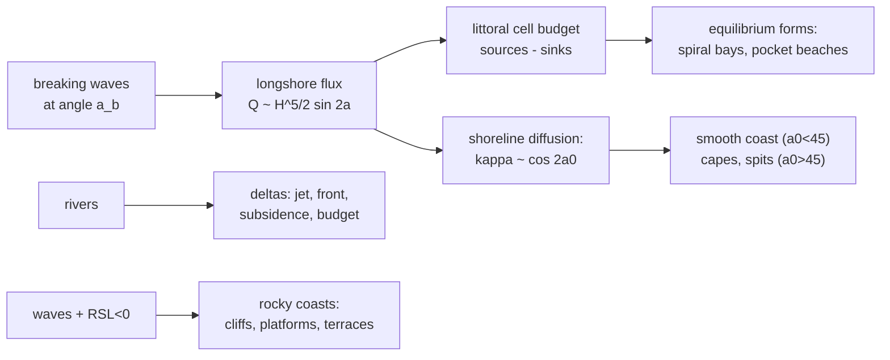

# LS27 · Coasts: Beaches, Deltas and Rocky Shores

◀ [[LS26 Sea Level and Ocean Waves]] · [[Landscapes and Geomorphology - Course Map|Course Map]] · next: (A&A continue with big floods, whole landscapes and periglacial landscapes; see the Course Map)

extra · book extra · beyond

> [!syllabus] Syllabus map: what is in the syllabus and what is extra in this chapter
> **No lecture source** (see [[LS21 River Hydraulics and Hydraulic Geometry]]). This is the second half of Anderson and Anderson Chapter 16; the first half is [[LS26 Sea Level and Ocean Waves]].
> 🟡 **Extra · book** (A&A Ch. 16, printed pp.512–531; **PDF page = printed + 18**): §1 sand movement and longshore drift ([[geomorphology-the-mechanics-and-chemistry-of-landscapes-9780521519786-0521519780_compress.pdf#page=530|pp.512–513]]); §2 the littoral cell budget (p.521); §3 capes, spits and beach cusps (pp.513–515); §4 pocket beaches and hooked bays (p.523); §5 deltas (pp.515–520); §6 rocky coasts (p.520); §7 icy coasts and the continental shelf (pp.524–528).
> 🔵 **Extra · beyond** (all numbers in `scripts/ls_hydro_coast_numbers.py`, section LS27, each checked by a second route): the **CERC longshore transport law** rederived from wave energy flux (with its closed coefficient), the **linear stability of a shoreline** ($\kappa=2Q_0\cos2\alpha_0/D$, a diffusion that changes sign at $45^\circ$; checked by a pseudo-spectral integration of the full nonlinear flux and shown to be ill-posed), the net-versus-gross drift example, the log-spiral derivation of hooked bays (checked numerically), the translating-exponential delta front (checked by a moving-frame finite-difference run), the plume-plunging concentration, the delta sediment budget, the cliff-fatigue count, and the problems.

> [!key] After this chapter you can
> - derive the **longshore sediment flux** from the longshore wave energy flux, $Q\propto H_b^{5/2}\sin2\alpha_b$, and compute **net and gross drift** from a wave climate,
> - write the **littoral-cell budget** and read its signature (linear rise of drift between river mouths, steps at them),
> - show that the shoreline obeys a **diffusion equation whose sign flips at $45^\circ$**, so that low-angle waves smooth the coast and high-angle waves grow capes and spits,
> - explain **beach cusps** and **log-spiral hooked bays** as self-organised or equilibrium forms,
> - describe a **delta**: the turbulent jet, Gilbert's topset/foreset/bottomset, the translating exponential front $e^{-u_0x/K}$, hypopycnal versus hyperpycnal plumes, and why deltas are vulnerable (low slope, subsidence, lost sediment),
> - explain **rocky-coast erosion** (abrasion, quarrying, wave power at the cliff base, tide, fatigue) and **icy-coast** retreat.

> [!intuition] The one-sentence story
> A beach is a river of sand flowing along the shore, driven by waves that arrive at an angle; because the flux depends on both wave height and angle, a straight shoreline can be stable or unstable, and the headlands, spits, cusps, spiral bays and deltas of a coast are what a nonlinear, self-organising system builds from sand, waves and a moving sea level, while a rocky coast is simply waves doing work on rock.

## 1. Sand moves along the beach
### 1.1 The longshore energy flux
Waves that break at an angle $\alpha_b$ to the shoreline rush up the beach face as swash along their direction of travel and run back down the fall line as backwash, so each grain follows a zig-zag and the sand is passed along the beach "one little hop at a time", with the breaking-wave-driven longshore current moving sediment suspended by the turbulence ([[LS26 Sea Level and Ocean Waves]] §3). Its rate, the **longshore (littoral) drift**, is the most studied sediment flux on coasts.

> [!derivation] 🔵 Extra · beyond (checked): rederiving the CERC formula
> The component of wave power directed *along* the shore at the breaker line, the **longshore energy flux**, is
>
> $$P_\ell=(E\,C_g)_b\sin\alpha_b\cos\alpha_b,\qquad E=\frac{\rho gH_b^2}8,\ \ C_g=\sqrt{gh_b},\ \ h_b=\frac{H_b}{\gamma}\ (\gamma=0.78),$$
>
> where $\sin\alpha\cos\alpha$ projects the flux onto the shore-parallel direction ($EC_g\cos\alpha$ is the flux toward the shore per unit length of shoreline, and $\sin\alpha$ resolves it along it). Substituting,
>
> $$P_\ell=\frac{\rho g^{3/2}}{8\sqrt\gamma}\,H_b^{5/2}\sin\alpha_b\cos\alpha_b=0.0707\,\rho g^{3/2}H_b^{5/2}\sin2\alpha_b\quad(\gamma=0.78).$$
>
> The empirical **CERC law** takes the volume flux of sand (as bulk volume) proportional to $P_\ell$: $Q=K\,P_\ell/[(\rho_s-\rho)g(1-p)]$, with $K\approx0.39$ (immersed-weight coefficient for the significant wave height; recalled, `[verify]`) and bed porosity $p=0.4$. A&A (p.512) quote Komar's equation $Q=\text{const}\times\rho g^{3/2}H_{br}^{5/2}\sin2\alpha_{br}$ with a numerical constant that is lost in the text layer (`[!verify]`); the structure, $H_b^{5/2}\sin2\alpha_b$, is the same as derived here.
>
> *Numbers* ($\rho=1025$, $\rho_s=2650$): $H_b=1$ m, $\alpha_b=10^\circ$ gives $P_\ell=762$ W/m and $Q=0.031$ m³/s $=\mathbf{0.98}$ million m³/yr; $H_b=2$ m, $10^\circ$: 4312 W/m and 5.5 million m³/yr; $H_b=2$ m at $45^\circ$: 16 million m³/yr. Typical coasts carry $10^5$–$10^6$ m³/yr, so this $K$ is at the upper end.

Three properties follow from $Q\propto H_b^{5/2}\sin2\alpha_b$ (figure A):
1. **Strong nonlinearity in height**: doubling $H_b$ multiplies the flux by $2^{5/2}=5.7$; the big waves carry the sand.
2. **A maximum at $45^\circ$**, where $\sin2\alpha=1$ (numerically at 45.0°); the flux *decreases* at higher angles, which is the seed of coastline instability (§3).
3. **Net drift is the small difference between large opposing fluxes** from different directions.

> [!example] 🧮 Net versus gross drift
> A wave climate: 60 % of the time $H_b=1.2$ m from $+10^\circ$ (drift one way), 30 % $H_b=0.8$ m from $-15^\circ$ (the other way) and 10 % $H_b=2.5$ m from $-8^\circ$. The yearly drift is $+0.93$, $-0.25$ and $-0.78$ Mm³/yr: **gross $1.96$ Mm³/yr, net $-0.10$ Mm³/yr** (5 % of gross, and in the *opposite* direction to the commonest waves). The rarest, biggest 10 % of waves carry 40 % of the gross drift. The net is what fills a harbour; to calculate it you need the whole joint distribution of heights and angles, with all waves first transformed to breaking ([[LS26 Sea Level and Ocean Waves]] §3).

### 1.2 Measuring drift
Direct measurement is very hard. Short-term tracer experiments inject dyed sand along a line across the surf zone and measure how far it moves downdrift in a fixed time: the volume flux is the mean speed times the surf-zone width $L$ times the thickness $d$ of the moving layer (Komar and Inman 1970). Long-term values come from the *accretion behind jetties and groins*, from the shoreline change, or from cosmogenic nuclides in the littoral sand (Perg et al. 2003, Santa Cruz).

## 2. The littoral cell budget
A **littoral cell** is a self-contained length of coast within which the sources and sinks of sand are included: its upcoast end is a line across which no sand is transported (a headland), its downcoast end commonly a **submarine canyon** that intercepts the drift and carries sand to the deep sea. Balance the volume of *sand* (grains larger than a cutoff of $\sim0.2$ mm, below which grains are lost to the shelf in suspension); conservation of sand in a coastal segment $dx$ with beach cross-section $A$ gives

$$\frac{\partial A}{\partial t}=-\frac{\partial Q_{litt}}{\partial x}+\underbrace{\dot e_{cliff}f_{cliff}H_{cliff}}_{\text{cliff retreat supplies sand}}+\underbrace{\frac{Q_{river}}{\rho_{litt}}\,\delta(x-x_r)}_{\text{river mouth}}-q_{shelf}-q_{dunes},$$

(A&A's balance, p.522; the units of the terms in $Q$ are mass or volume per time, those in $q$ per unit length of coast). At steady state $\partial A/\partial t=0$ and, between river mouths where the supply and loss are uniform,

$$Q_{litt}(x)=\big(\dot e_{cliff}f_{cliff}H_{cliff}-q_{shelf}\big)\,x,$$

a **linear rise** of the drift down-coast, with a **step** of size $Q_r$ at each river mouth: the sawtooth pattern of A&A Fig. 16.23. *Numbers:* cliff retreat $0.2$ m/yr, height 25 m, sand fraction 0.4: $2.0$ m³/yr per metre of coast; shelf leakage $0.5$ m³/yr/m; so $dQ/dx=1.5$ m³/yr/m, and over a 30 km cell with a river contributing $8\times10^{4}$ m³/yr at $x=10$ km the drift is $1.5\times10^{4}$ m³/yr before the river, $9.5\times10^{4}$ after it and $\mathbf{1.25\times10^{5}}$ m³/yr at the downcoast end (the numerics agree). Along the central California coast the pattern has been confirmed with cosmogenic nuclides. One could write the same balance for each grain size or mineral; none has been done, so grain-size evolution of beaches remains an open test.

## 3. Capes, spits and beach cusps: self-organisation
### 3.1 Shoreline evolution as a diffusion equation
On a scale of kilometres to tens of kilometres, sandy coasts are punctuated by capes and spits (the Carolina capes, of which Cape Hatteras is one, are spaced at about 150 km intervals; A&A p.513, "one of the largest-scale examples of self-organization in geomorphology"). Ashton, Murray and Arnoult (2001) showed that they arise from the angle dependence of the flux. Let the shoreline be $y(x,t)$ (offshore distance), its local angle to the mean trend $\theta=\partial_xy$, the deep-water wave angle (to the mean trend) $\alpha_0$, and the flux $Q=Q_0\sin2(\alpha_0-\theta)$.

> [!derivation] 🔵 Extra · beyond (checked): a diffusion that changes sign at $45^\circ$
> Conservation of sand over the active profile of height $D$ (from the dune crest to the closure depth, $\sim10$ m): $D\,\partial_ty=-\partial_xQ$. For small $\theta$, $Q\approx Q_0\sin2\alpha_0-2Q_0\cos2\alpha_0\,\theta$, so
>
> $$\boxed{\frac{\partial y}{\partial t}=\kappa\frac{\partial^2y}{\partial x^2},\qquad\kappa=\frac{2Q_0\cos2\alpha_0}{D}}.$$
>
> The first term is uniform and drops out. **If $\alpha_0<45^\circ$, $\kappa>0$ and the shoreline diffuses: bumps are smoothed. If $\alpha_0>45^\circ$, $\kappa<0$: the equation is anti-diffusive and bumps grow.** Physically, where the shoreline bulges the local wave angle is larger; for $\alpha<45^\circ$ a larger angle raises the flux so the bulge erodes, for $\alpha>45^\circ$ it *lowers* the flux downdrift so sand piles up and the bulge grows into a cape. *Numbers* ($Q_0=10^6$ m³/yr, $D=10$ m): $\alpha_0=15^\circ$: $\kappa=1.7\times10^{5}$ m²/yr and a perturbation of wavelength 1, 10, 100 km decays with time constant $1/\kappa k^2=0.15$ yr, 14.6 yr, 1460 yr; $\alpha_0=30^\circ$: $10^{5}$; $44^\circ$: $7\times10^3$ (almost neutral); $46^\circ$: $-7\times10^{3}$; $60^\circ$: $-10^{5}$ m²/yr, growth times of 0.25 yr (1 km), 25 yr (10 km) and 2500 yr (100 km) (figure B).
>
> *Check.* A pseudo-spectral integration of the *full nonlinear* flux $Q_0\sin2(\alpha_0-\arctan\theta)$ for a 5 m perturbation of 20 km wavelength gives an amplitude ratio **0.7104** after 20 yr at $15^\circ$ (linear theory $0.7104$) and **1.2182** at $60^\circ$ (linear theory 1.2182).
>
> **Ill-posedness.** The growth rate $|\kappa|k^2$ is unbounded as the wavelength shrinks: negative diffusion is *ill-posed*. An explicit finite-difference run of the unstable case blows up on the grid scale within a few years (and my first attempt did exactly that), so the linear model cannot predict the *size* of capes. In nature the minimum scale is set by what the linear theory leaves out: the finite width of the surf zone, and above all **wave shadowing**, where a growing cape or spit blocks waves from reaching the coast downdrift. In the simulations (Ashton et al. 2001; A&A Fig. 16.13) the shadowed bay can be reached only by rare waves from the opposite side, which drive sand *into* the bay, so spits curl: "one need not appeal to separate physical mechanisms for capes and cuspate spits".

The result unifies the opposite faces of coastal behaviour: **a coast with mostly low-angle waves is straight and stable; one with high-angle waves (the angle between deep-water crests and the mean shoreline above $45^\circ$) grows capes and spits**, a classic example of a self-organised pattern from feedback between form and process (cf. the instability of a flat bed that gives dunes and ripples, [[LS24 Sediment Transport Mechanics]] §7).

### 3.2 Beach cusps
At the scale of tens of metres, beaches often carry regular **beach cusps**: seaward ridges (horns) separated by small bays. They form within days and can persist. They are another feedback between topography and water flow: the swash runs up the bay and horns, and the backwash returns **down the fall line**, so flow converges in the bays (erosion) and decelerates on the horns (deposition). The numerical models of Werner and Fink (1993) and Coco et al. (2000) reproduce them without any imposed periodicity, and their spacing is proportional to the **swash excursion**. An independent estimate from standing subharmonic **edge waves** is $\lambda=gT^2\sin\beta/\pi$: 17 m for $T=8$ s on a $5^\circ$ beach, 27 m for 10 s, 63 m for 12 s on $8^\circ$ (an edge-wave result, recalled `[verify]`; A&A's Santa Cruz cusps are spaced $\sim$25 m).

## 4. Pocket beaches and hooked bays
Rocky coasts are crenulated, with headland-bounded **pocket beaches**; in the lee of a headland waves are diffracted and refracted, producing a *hooked* (spiral) bay such as Half Moon Bay, California. These shorelines follow a **logarithmic spiral**,

$$r=r_0\,e^{\theta\cot\alpha},$$

where the ray from the bay's centre (near the headland where the waves diffract) makes a **constant angle $\alpha$** with the shoreline (A&A p.523, Fig. 16.24; fitting $r_0$ and $\alpha$ with a rotation gives "remarkably good fits"). 

> [!derivation] 🔵 Extra · beyond (checked): why a spiral is the equilibrium shape
> At steady state the cross-sectional area of the beach is constant, $\partial A/\partial t=0$, and with no sources $dQ_{litt}/dx=0$: the **drift is the same at every point**. From $Q\propto H_b^{5/2}\sin2\alpha_b$, that requires the breaker height and the breaker-to-shore angle to be constant (or to compensate each other) along the bay. Waves diffracted around the headland have crests that are arcs about it, so the *rays* are radial; if the shoreline meets every radial ray at the same angle $\alpha$, the breaker angle is the same everywhere ($90^\circ-\alpha$). A curve that cuts all rays from a point at a constant angle satisfies $dr/(r\,d\theta)=\cot\alpha$, i.e. $r=r_0e^{\theta\cot\alpha}$, the logarithmic spiral. I verified the property numerically: the angle between ray and tangent is $70.000^\circ$ everywhere for $\alpha=70^\circ$, and the radius grows by a factor $e^{2\pi\cot70^\circ}=9.8$ per full turn. **Read in reverse, the shape of a bay records the dominant wave direction**: the asymmetry of a pocket beach points to the upcoast and downcoast sides (A&A: "can easily be read for the dominant wave direction").

![[fig_ls27_littoral.png]]
*Figure LS27.1. A: longshore transport against breaker angle for $H_b=1$ and 2 m (maximum at 45°). B: shoreline diffusivity $2Q_0\cos2\alpha_0/D$ against deep-water wave angle: positive (smoothing) below 45°, negative (capes and spits grow) above. C: the net drift is a small difference between large opposing fluxes (the example of §1.1).*

## 5. Deltas
Where a river enters a body of still water it drops its sediment: a **delta** (the Greek letter's shape was Herodotus' description of the Nile, now the home of five million people). Deltas are important for three reasons (A&A p.515): their slopes are **very low** ($10^{-4}$ or less), by definition they are **at sea level**, and they are **heavily populated**: roughly one in ten people lives on one, at a density about ten times the global mean.

### 5.1 The river as a turbulent jet
G. K. Gilbert (1890) described the basic architecture in the Bonneville basin: a flat **topset**, a steep **foreset** and a gentle **bottomset** (figure A of LS27.2). The flow of the river into the basin is a **free turbulent jet** (planar here): shear with the still ambient water entrains it, which both expands and slows the plume, and the width grows linearly with distance. In the established region the seaward speed falls as $x^{-1/2}$ (A&A p.516), so the **competence** (largest grain) and **capacity** (flux per width) decline away from the mouth: bedload stops, then finer grains drop out in order, giving a **reverse-graded** (coarsening-upward) deposit with the finest at the base (simulations of Fagherazzi and Overeem 2007). The jet is a *momentum jet* if the river's momentum dominates and a *plume* if buoyancy does. Fine particles flocculate in seawater into aggregates that settle faster than the single grains would (Syvitski 1991), so settling speeds cannot be calculated from grain size alone.

### 5.2 Shape of the delta front: a translating exponential
Once on the subaqueous front, sediment is redistributed by slumping and by granular creep under waves. Kenyon and Turcotte (1985) treat it as slope-driven transport, as for hillslopes:

> [!derivation] 🟡 Extra · book + 🔵 verified: the front is $z=z_0e^{-u_0x/K}$
> Let the delta front advance seaward at speed $u_0$ and transport be diffusive, $\partial_tz=K\partial_x^2z$. In the frame moving with the front, $x'=x-u_0t$, a steady shape satisfies $-u_0\,dz/dx'=K\,d^2z/dx'^2$, with decaying solution
>
> $$z=z_0\exp\Big(-\frac{u_0x'}{K}\Big),\qquad\text{length scale }\ \ell=\frac K{u_0}.$$
>
> **The faster the progradation and the less efficient the subaqueous transport, the shorter the front.** A&A fit this to bathymetric profiles: $K=2.4\times10^{4}$ m²/yr (Fraser) to $5.6\times10^{5}$ m²/yr (Mississippi); for $u_0=50$ m/yr the e-folding lengths are $\mathbf{0.5}$ km and $\mathbf{11}$ km (figure A of LS27.2). A moving-frame finite-difference run from a wrong initial shape converges to $e^{-u_0x/K}$ to within 0.004. This is a Péclet-number argument ([[Péclet Number]]): $K/u_0$ is the distance over which diffusion keeps up with advection ([[THX1 Diffusion Random Walks and the Heat Equation]]).

### 5.3 Hypopycnal and hyperpycnal plumes, and what dominates a delta
If the river water is **lighter** than the basin water the plume spreads over a salt wedge: **hypopycnal**. If the sediment concentration makes the bulk density exceed the basin's, the flow dives to the bed and runs down the delta face as a **turbidity current**: **hyperpycnal**. With the bulk density $\rho_w+C(1-\rho_w/\rho_s)$, plunging into the sea ($\rho=1025$ kg/m³) needs $C>25/0.623=\mathbf{40}$ kg/m³ (a very muddy flood: some rivers manage this, e.g. the Huang He, `[verify]`), into a brackish estuary of density 1010 kg/m³, $16$ kg/m³; and a cold river (4 °C, $\rho=1000.0$) entering a 20 °C lake ($998.2$) is *already* denser, so hyperpycnal flow is common in **lakes** (A&A: Lake Mead, where the foreslope is far gentler than the angle of repose). Waves and tides redistribute the sediment: deltas are classified as **river-**, **wave-** or **tide-dominated**.

![[fig_ls27_delta.png]]
*Figure LS27.2. A: the delta front $z=z_0e^{-u_0x/K}$ for the Fraser and the Mississippi at $u_0=50$ m/yr (dotted lines: $K/u_0=0.5$ and 11 km). B: the sediment concentration at which a river plunges, against the density difference to the basin water. C: sediment needed to keep three deltas level with rising relative sea level.*

### 5.4 Why deltas are vulnerable: slope, subsidence and the sediment budget
- **Slope.** Subaerial slopes can be as low as 1 m in 10 km ($10^{-4}$), so large areas lie within a metre or so of sea level: a **5 m storm surge penetrates $5/10^{-4}=50$ km** inland. More than ten million people are flooded from the sea on the world's deltas each year. Cyclone Nargis (2008) flooded thousands of km² of the Irrawaddy delta with a surge of several metres; New Orleans lies partly below sea level behind levees that are themselves sinking.
- **Subsidence** has several causes (A&A p.519): the mantle's response to unloading of the northern ice sheets and reloading of the ocean ($\sim$120 m of water; [[LS15 Glacial Deposits Rebound and Sea Level]]); the **load of the delta's own sediment**, which flexes the lithosphere; the **compaction** of the sediment column as pore water is squeezed out, fastest in organic-rich wetland sediment (Törnqvist et al. 2008: **5–10 mm/yr** in Mississippi marsh peats, against eustatic rise of $\sim3$ mm/yr); and human extraction of water and hydrocarbons.
- **Accommodation space and the sediment budget.** Naturally subsidence creates room that fresh sediment fills; **dams** in the catchment remove the supply (Ericson et al. 2006 show this dominates on many deltas, often after a period of increased supply from deforestation). The load needed to keep pace is

$$\boxed{M=A_d\,\dot{RSL}\,\rho_b}.$$

> [!example] 🧮 The delta budget
> A Mississippi-sized delta ($3\times10^{4}$ km²) with relative sea-level rise 10 mm/yr needs $3\times10^{10}\,\text{m}^2\times0.01\ \text{m/yr}=3\times10^{8}$ m³/yr, **390 Mt/yr** at $\rho_b=1300$ kg/m³. A Ganges–Brahmaputra delta of $10^{5}$ km² at 5 mm/yr needs 650 Mt/yr, a small delta of $10^{3}$ km² at 8 mm/yr only 10 Mt/yr. Compare the Amazon's total output of 1239 Mt/yr ([[LS22 Floods Planform and River Profiles]]): a single big river can barely keep a Mississippi-sized delta above water against a 10 mm/yr relative rise, and the Mississippi, whose load has been roughly halved by dams, cannot. The footprint of a delta is $1/100$ to $1/1000$ of its drainage basin (Ericson et al.): a very small area under a very large catchment, vulnerable to change in either.

## 6. Rocky coasts
Rocky coasts bound **rising** land (tectonic uplift as in California and Japan, or glacio-isostatic rebound as in Maine): a highly crenulated line of cliffs, with pocket beaches, and **marine terraces** from the interplay of uplift and glacial sea-level cycles ([[LS26 Sea Level and Ocean Waves]] §1.3). The **littoral "superhighway" of a sandy coast does not exist** here: the sand is discontinuous.

### 6.1 Processes and the wave-power view
As in rivers and under glaciers, rock is eroded by **abrasion**, **quarrying** (plucking) and **dissolution**; the last is weak in seawater (already high in ions) apart from **salt weathering** above the waves (growth of salt crystals when the rock wets and dries, [[LS11 Weathering and Regolith]]). Quarrying is most efficient, aided by hydraulic wedging (the impact of each wave vibrates the rock mass: easier to imagine here than in a river). As with stream power, the pragmatic view is to decompose the erosion rate into the **wave power delivered**: (1) power from storms at sea, retained across the ocean ($P=\rho g^2H^2T/32\pi$); (2) its modification by shoaling and refraction; (3) the breaking, which delivers the energy as work on the bed. A typical swell of 10–20 s means $\sim6000$ waves a day.

### 6.2 What the seismometers showed
Adams et al. (2002, 2005) put seismometers on Santa Cruz sea cliffs and found that (1) each wave jolts the cliff at high frequency, with an amplitude depending on the far-field wave height and the tide, which loosens blocks (and, with sand-laden water, abrades; cracks packed with sand become hydraulic wedges); and (2) the cliff **sways with an amplitude of $\sim10\ \mu$m per wave**, decaying inland over several cliff heights *whether or not there is a sandy beach*. The swaying acts as **fatigue**: for a cliff retreating at 10 cm/yr with the loading felt 30 m inland, the rock is cycled for $30/0.1=300$ yr at $3\times10^{6}$ waves per year, **$\sim10^{9}$ cycles** before it is exposed. Tide matters because at high water more wave energy reaches the cliff base (a base in 3 m of water meets unbroken waves of height $0.78\times3=2.3$ m, in 5 m of water $3.9$ m: energy ratio 2.8).

### 6.3 Icy coasts
Arctic coastal bluffs of ice-cemented sands and silts over permafrost hundreds of metres thick are retreating at **tens of metres per year** (north coast of Alaska, repeat photography). Loss of sea ice since the 1990s (the number of ice-free days at Drew Point rose from 20–30 to 50–70 per year, a decline of $\sim3\,\%$ per decade in ice extent) has two effects: a longer **fetch** for storm waves, and the replacement of a reflective lid by dark water that absorbs heat, so that warm water (above $10\,^\circ$C in summer near the coast) melts the ice cement. The thermal erosion is a problem of the surface boundary condition having been changed ([[THX1 Diffusion Random Walks and the Heat Equation]]), analogous to the melt of icebergs calved from tidewater glaciers; retreat is *quantised* by ice-wedge polygons: a notch undermines a block, the tundra mat hangs over, and the polygon topples (block failure). There is no negative feedback if the released sediment is fine silt (loess): it goes offshore in suspension, whereas coarse sediment would build a protective beach.

## 7. The continental shelf
Over the Quaternary every continental shelf has been repeatedly swept by coastal processes as the shoreline oscillated between glacial lowstands and interglacial highstands. The shelf edge follows the $120$–$140$ m contour, averaging 135 m, which is no coincidence; shelves average $\sim100$ km wide and cover 7 % of the ocean. On **rising** margins each sea-level cycle "grates off a slice of rock" and the record is kept as terraces on the inner margin; on **subsiding passive margins** the shelf records the shoreline "walking back and forth" across it, burying fluvial deposits from lowstands in littoral sediment. A&A's summary: sea level has swung by 120 m over the last couple of million years, the present rise of $\gtrsim3$ mm/yr is about half steric and half new water, and the coastal processes of this chapter have therefore acted over the whole shelf; wave heights on the US east coast have increased between two multi-decade buoy records (Allan and Komar 2006).

## 8. Worked examples
> [!example] 🧮 Example 1: a harbour on a drifting coast
> Waves with $H_b=1$ m at $+12^\circ$ for 70 % of the year and $H_b=1.5$ m at $-12^\circ$ for 30 %. The drift rates *per unit time* are $q_1=1.17$ and $q_2=3.21$ Mm³/yr (the ratio is $1.5^{5/2}=2.76$). Weighted by time: gross $0.7\times1.17+0.3\times3.21=1.78$ Mm³/yr, net $0.7\times1.17-0.3\times3.21=-0.15$ Mm³/yr. **The net drift runs opposite to the commonest waves**, and a breakwater on this coast would trap about 150 000 m³/yr on one side while the erosion on the other side, and the bypassing needed at the harbour, are set by the *gross*.

> [!example] 🧮 Example 2: will a bulge grow?
> $Q_0=5\times10^{5}$ m³/yr and $D=8$ m. For deep-water waves at $20^\circ$, $\kappa=2\times5\times10^{5}\cos40^\circ/8=9.6\times10^{4}$ m²/yr and a 5 km-wavelength perturbation decays in $1/\kappa k^2=6.6$ yr. At $55^\circ$, $\kappa=-4.3\times10^{4}$ m²/yr and a 20 km perturbation grows with e-folding time 237 yr.

> [!example] 🧮 Example 3: a delta front
> $K=10^{5}$ m²/yr and $u_0=100$ m/yr: the front's e-folding length is $K/u_0=1$ km, so at 3 km offshore the delta is only $e^{-3}=5\,\%$ of its initial height above the basin floor.

## 9. Check yourself
> [!question] Problems (answers folded)
> 1. $H_b=1.5$ m, $\alpha_b=8^\circ$: compute the longshore energy flux and the volume flux (use $K=0.39$, $p=0.4$).
> 2. By what factor does the drift change when $H_b$ doubles? When $\alpha_b$ goes from $20^\circ$ to $45^\circ$?
> 3. At what angle is the drift greatest, and why does the flux fall at larger angles?
> 4. Wave climate: 50 % at $H_b=1.0$ m from $+8^\circ$, 50 % at $H_b=1.4$ m from $-8^\circ$. Find gross and net drift (use $K=0.39$, $p=0.4$).
> 5. $Q_0=5\times10^{5}$ m³/yr, $D=8$ m, $\alpha_0=20^\circ$: the shoreline diffusivity and the decay time of a 5 km perturbation.
> 6. The same with $\alpha_0=55^\circ$: the e-folding time of a 20 km perturbation. What does the sign mean?
> 7. A delta front with $K=10^{5}$ m²/yr and $u_0=100$ m/yr: the e-folding length, and the height at 3 km as a fraction of the lip height.
> 8. Critical sediment concentration for a river to plunge into an estuary of density 1015 kg/m³ (take $\rho_{river}=1000$, $\rho_s=2650$).
> 9. A delta of $2\times10^{4}$ km² subsides plus sea level rises 12 mm/yr; $\rho_b=1200$ kg/m³: sediment flux needed.
> 10. A cliff base is in 3 m of water at low tide and 5 m at high tide: the ratio of the energy of the largest unbroken waves.
> 11. Cusp spacing from $\lambda=gT^2\sin\beta/\pi$ for $T=10$ s and a $6^\circ$ beach.

> [!example]- Answers
> 1. $P_\ell=0.0707\,\rho g^{3/2}H_b^{5/2}\sin16^\circ=0.0707\times1025\times30.72\times2.756\times0.2756=1693$ W/m; $Q=0.39\times1693/[(1625)(9.81)(0.6)]=0.069$ m³/s $=2.2$ Mm³/yr.
> 2. $2^{5/2}=5.66$; $\sin90^\circ/\sin40^\circ=1/0.643=1.56$.
> 3. $45^\circ$ ($\sin2\alpha=1$). At larger angles the component of wave power along the shore falls because the waves arrive more nearly parallel to the shore: $\sin\alpha\cos\alpha$ decreases.
> 4. Unit-time fluxes at $8^\circ$: $q_1=0.79$ ($H_b=1.0$) and $q_2=0.79\times1.4^{5/2}=1.83$ ($H_b=1.4$) Mm³/yr; gross $=0.5(0.79+1.83)=1.31$; net $=0.5(0.79-1.83)=-0.52$ Mm³/yr (opposite the 1.0 m waves, because the bigger waves are much more effective).
> 5. $\kappa=2\times5\times10^{5}\cos40^\circ/8=9.6\times10^{4}$ m²/yr; $k=2\pi/5000=1.26\times10^{-3}$; time $1/\kappa k^2=6.6$ yr.
> 6. $\kappa=2\times5\times10^{5}\cos110^\circ/8=-4.3\times10^{4}$; $k=3.14\times10^{-4}$; growth time $1/(|\kappa|k^2)=237$ yr. Negative $\kappa$ means anti-diffusion: bumps grow into capes and spits.
> 7. $\ell=K/u_0=1000$ m; $e^{-3}=0.050$.
> 8. $C=(1015-1000)/(1-1000/2650)=15/0.6226=24.1$ kg/m³.
> 9. $2\times10^{10}\ \text{m}^2\times0.012\ \text{m/yr}\times1200\ \text{kg/m}^3=2.9\times10^{11}$ kg/yr $=288$ Mt/yr.
> 10. $(0.78\times5)^2/(0.78\times3)^2=(5/3)^2=2.8$.
> 11. $9.81\times100\times\sin6^\circ/\pi=32.6$ m.

## 10. Summary
- Longshore energy flux $P_\ell=(EC_g)_b\sin\alpha_b\cos\alpha_b\propto H_b^{5/2}\sin2\alpha_b$; volume flux $Q=KP_\ell/[(\rho_s-\rho)g(1-p)]$, maximal at $45^\circ$; net drift is a small difference of big opposing fluxes.
- Littoral cell: drift rises linearly between river mouths and steps at them; sinks are shelf leakage and submarine canyons.
- Shoreline: $\partial_ty=\kappa\partial_x^2y$, $\kappa=2Q_0\cos2\alpha_0/D$: stable below $45^\circ$, unstable (capes, spits) above; the negative-diffusion model is ill-posed at short wavelength, cut off by shadowing.
- Beach cusps scale with the swash excursion; equilibrium hooked bays are log spirals $r=r_0e^{\theta\cot\alpha}$.
- Deltas: jet, reverse-graded foresets, front $z=z_0e^{-u_0x/K}$ with length $K/u_0$; hyperpycnal if $C>(\rho_{amb}-\rho_{riv})/(1-\rho_w/\rho_s)$ (40 kg/m³ for the sea); vulnerable through slope, compaction (5–10 mm/yr) and lost sediment: $M=A_d\dot{RSL}\rho_b$.
- Rocky coasts: wave power at the cliff base, tide, $\sim10^{9}$ fatigue cycles; icy coasts retreat tens of m/yr; shelves record Quaternary sea-level cycles.

<!-- interactive:start (generated by scripts/embed_interactive.py; edit the tool in scripts/interactive/tools/, not this block) -->
> [!interactive]+ Interactive: Waves coming ashore: dispersion, shoaling, refraction and breaking
> Linear water waves obey ω² = g k tanh(kh): in deep water the phase speed is gT/2π, in shallow water √(gh).
>
> ![[ls_ocean_waves.png|720]]
>
> **Try:** T = 12 s, H₀ = 2 m, α₀ = 30°: at 100 m depth C = 18.6 m/s, K_s = 0.984; at 10 m C = 9.4, K_s = 1.044, K_r = 0.946, α = 14.6°. T = 8 s, H₀ = 1 m, normal incidence breaks at 1.64 m depth with H_b = 1.28 m. Steeper beach: the same waves, nearer the shore.
>
> [▶ Open the tool in your browser](../Assets/interactive/ls_ocean_waves.html) · [absolute link](file:///home/swastik/Documents/notes/Assets/interactive/ls_ocean_waves.html) · all tools and coverage: [[Interactive Tools]]

<!-- interactive:end -->

## Map of this chapter
> [!connection] How LS27 connects
> **Earlier:** [[LS26 Sea Level and Ocean Waves]] (waves, breaking, surge), [[LS24 Sediment Transport Mechanics]] (suspension, bedforms), [[LS22 Floods Planform and River Profiles]] (river sediment supply, the Amazon), [[LS23 Bedrock Channels and River Incision]] (bedrock erosion processes), [[LS15 Glacial Deposits Rebound and Sea Level]] (subsidence by ice loads), [[LS11 Weathering and Regolith]] (salt weathering), [[LS12 Hillslope Transport and the Diffusion Equation]] (diffusive transport; the same $K$). 
> **Across subjects:** [[THX1 Diffusion Random Walks and the Heat Equation]] and [[Diffusion Equation]] (the shoreline and the delta front are diffusion problems; negative diffusion), [[Péclet Number]], [[Waves - Course Map]] and [[Wave Shoaling and Refraction]] (wave transformation is the input to $Q$), [[Climate - Course Map]] (sea-ice loss, hurricanes), [[Ecology and Evolution - Course Map]] (productive shelves, deltas as ecosystems; [[EE06 Eutrophication and Alternative Stable States]]), [[Gumbel Distribution]] (extreme surges).
> **Concept notes:** [[Longshore Drift]] · [[Coastline Instability]] · [[Littoral Cell Budget]] · [[Delta Front]] · [[Hyperpycnal Flow]] · [[Rocky Coast Erosion]] · [[Relative Sea Level]] · [[Storm Surge]].

## Provenance
> [!provenance]- Source map for this chapter
> | Topic | Source | Scope |
> |---|---|---|
> | sand movement, capes and spits, beach cusps, deltas, rocky coasts, littoral cell budget, pocket beaches, icy coasts, the shelf | A&A Ch. 16, printed pp.512–531 (PDF = printed + 18; text layer; equations rederived) | extra · book |
> | CERC law rederivation, shoreline diffusion and its checks and ill-posedness, net/gross example, log-spiral derivation and check, delta-front check, plume-density threshold, delta budget, fatigue count, problems | my derivations, `scripts/ls_hydro_coast_numbers.py` (LS27) | extra · beyond |
>
> **Flagged:** the CERC coefficient $K=0.39$ and the breaker index $0.78$ are recalled; A&A's own constant for Komar's formula is lost in the text layer; the edge-wave cusp formula and the Huang He concentration are recalled; $Q_0$, $D$, $K$, $u_0$ and the delta areas and rates are illustrative; the Ashton–Murray result is reported from A&A's description, with the linear stability analysis done here.
