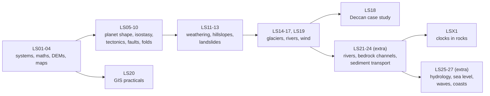

# Landscapes and Geomorphology - Course Map

*EC2123 Landscapes and Their Evolution, IISER Pune (Argha Banerjee; Deccan deck by Shilpa Patil; practicals by Shubhra and Aju).*

> [!summary] Where this subject stands
> **Chapters LS01–LS20 and LS99 are drafted** (LS01–LS17 now carry a **depth layer**: context, extra derivations and numbers computed in `scripts/ls_depth_numbers.py`, check-yourself problems, cross-subject links; four research papers are explained in **Further Research/**) with every slide of the pre-midsem deck (153 slides), the glacial–aeolian deck (48), the Deccan deck (37), TopoToolbox (15) and QGIS (14) shown and explained. Text of LS01–LS17 derives from the AI-written reference notes (secondary) cross-checked against sampled slides. **Still to do:** a depth layer for LS18–LS20, the Gutiérrez, Migoń, Bierman and Thornbury layers, and per-chapter concept notes beyond the 15 Deccan ones.

> [!key] Added 2026-10-29: the river, water and coast sequence from the primary book
> **LS21–LS24 continue Anderson and Anderson Chapters 12–14 in order** (the fluvial lectures have not been taught, so there are no slides; all four are labelled 🟡/🔵 and should be re-labelled 🟢 when the slides arrive): [[LS21 River Hydraulics and Hydraulic Geometry]] → [[LS22 Floods Planform and River Profiles]] → [[LS23 Bedrock Channels and River Incision]] → [[LS24 Sediment Transport Mechanics]]. Each is derivation-level (law of the wall, effective discharge, sine-generated meander, alluvial diffusion, the $\chi$-space solution of the knickpoint wave, the response-time integral, the torque balance, the Rouse profile), with every number in `scripts/ls_rivers_numbers.py` checked by a second route. The interdisciplinary chapter [[LSX1 Clocks in Rocks]] (A&A Ch. 6: decay, tunnelling, cosmogenic nuclides, closure temperature) lives in `Interdisciplinary/`, and its sibling [[THX1 Diffusion Random Walks and the Heat Equation]] in Thermodynamics. 22 new concept notes (below). **Then, the same day:** [[LS25 Water in the Landscape]] (A&A Ch. 11: Horton's laws, soil water, Green–Ampt, Dupuit, runoff mechanisms, channel heads, Coos Bay), [[LS26 Sea Level and Ocean Waves]] and [[LS27 Coasts Beaches Deltas and Rocky Shores]] (A&A Ch. 16: relative sea level, wave dispersion, energy, shoaling, longshore drift, shoreline instability, deltas, rocky coasts), with 20 more concept notes and numbers in `scripts/ls_hydro_coast_numbers.py`. The wave physics of LS26 is also the first real content of the **Waves** subject ([[Waves - Course Map]]). **Next in A&A:** Ch. 17 big floods, Ch. 18 whole landscapes, Ch. 9 periglacial, Ch. 4 tectonic geomorphology (not yet written).

![[LS18 Deccan Map.svg]]

## Chapters
| # | Chapter | Scope | Main source |
|---|---|---|---|
| 01 | [[LS01 Landscapes as Physical Systems]] | taught | pre-midsem deck |
| 02 | [[LS02 Mechanics and Mathematics Toolkit]] | taught | pre-midsem deck |
| 03 | [[LS03 Digital Elevation Models and Terrain Analysis]] | taught | pre-midsem deck |
| 04 | [[LS04 Map Projections and Reference Surfaces]] | taught | pre-midsem deck |
| 05 | [[LS05 Shape of Planets]] | taught | pre-midsem deck |
| 06 | [[LS06 Maximum Topography]] | taught | pre-midsem deck |
| 07 | [[LS07 Isostasy]] | taught | pre-midsem deck |
| 08 | [[LS08 Plate Tectonics Strain Stress and Convection]] | taught | pre-midsem deck |
| 09 | [[LS09 Faults and Earthquakes]] | taught | pre-midsem deck |
| 10 | [[LS10 Folds Flexure and Mountain Building]] | taught | pre-midsem deck |
| 11 | [[LS11 Weathering and Regolith]] | taught | pre-midsem deck |
| 12 | [[LS12 Hillslope Transport and the Diffusion Equation]] | taught | pre-midsem deck |
| 13 | [[LS13 Landslides]] | taught | pre-midsem deck |
| 14 | [[LS14 Glaciers Mass Balance and Ice Flow]] | taught | pre-midsem deck |
| 15 | [[LS15 Glacial Deposits Rebound and Sea Level]] | taught | pre-midsem deck |
| 16 | [[LS16 Fluvial Landscapes]] | taught | pre-midsem deck |
| 17 | [[LS17 Aeolian Landscapes]] | taught | pre-midsem deck |
| 18 | [[LS18 Deccan Traps Terrain]] | taught + extra | Deccan deck (Patil) |
| 19 | [[LS19 Glacial and Aeolian Landforms]] | taught + extra | `l_glacial_aolian.pdf` |
| 20 | [[LS20 GIS and TopoToolbox Practicals]] | taught | QGIS and TopoToolbox decks |
| 21 | [[LS21 River Hydraulics and Hydraulic Geometry]] | extra · book | A&A Ch. 12 (first half) |
| 22 | [[LS22 Floods Planform and River Profiles]] | extra · book | A&A Ch. 12 (second half) |
| 23 | [[LS23 Bedrock Channels and River Incision]] | extra · book | A&A Ch. 13 |
| 24 | [[LS24 Sediment Transport Mechanics]] | extra · book | A&A Ch. 14 |
| 25 | [[LS25 Water in the Landscape]] | extra · book | A&A Ch. 11 |
| 26 | [[LS26 Sea Level and Ocean Waves]] | extra · book | A&A Ch. 16 (first half) |
| 27 | [[LS27 Coasts Beaches Deltas and Rocky Shores]] | extra · book | A&A Ch. 16 (second half) |
| X1 | [[LSX1 Clocks in Rocks]] (interdisciplinary, in `Interdisciplinary/`) | extra · book + beyond | A&A Ch. 6 |
| 99 | [[LS99 Landscapes Practice Problems]] | practice | pre-midsem deck |

Reference: [[Landscapes Notation and Glossary]].

## Further Research (papers, beginner-style)
[[Further Research - Landscapes Papers]]: [[FR01 Braided Rivers in 3D (Olsen 2021)]] · [[FR02 Secondary Currents and River Channel Patterns (Njenga 2013)]] · [[FR03 Flow at a River Bend with CCHE2D (Das and Biswal 2023)]] · [[FR04 Building the Himalaya (Dal Zilio et al 2021)]]

## Concept notes
Rivers and sediment (16, from LS21–LS24): [[Law of the Wall]] · [[Shear Velocity]] · [[Manning Equation]] · [[Froude Number and Hydraulic Jump]] · [[Hydraulic Geometry]] · [[Effective Discharge]] · [[Meandering and Point Bars]] · [[Braided Rivers]] · [[Stream Power Law]] · [[Knickpoint]] · [[Chi Transform]] · [[Strath Terrace]] · [[Base Level]] · [[Shields Criterion]] · [[Rouse Profile]] · [[Saltation]]

Water and coasts (14, from LS25-LS27): [[Drainage Density and Horton's Laws]] · [[Water Balance]] · [[Soil Water Retention]] · [[Darcy's Law and Hydraulic Conductivity]] · [[Green-Ampt Infiltration]] · [[Dupuit Water Table]] · [[Overland Flow and Runoff Mechanisms]] · [[Channel Head]] · [[Relative Sea Level]] · [[Marine Terrace]] · [[Storm Surge]] · [[Longshore Drift]] · [[Coastline Instability]] · [[Littoral Cell Budget]] · [[Delta Front]] · [[Hyperpycnal Flow]] · [[Rocky Coast Erosion]] (with [[Water Wave Dispersion]], [[Wave Energy and Power]] and [[Wave Shoaling and Refraction]] in Waves)

Clocks (6, from LSX1): [[Radioactive Decay Law]] · [[Cosmogenic Nuclides]] · [[Cosmogenic Erosion Rate]] · [[Burial Dating]] · [[Closure Temperature]] · [[Thermochronology]] (with [[Alpha Decay]] in Quantum Mechanics)

Deccan Traps (15, each with its slide images): [[deccan-volcanic-province]] · [[trap-topography]] · [[massive-sheet-flow]] · [[compound-hummocky-pahoehoe]] · [[columnar-jointing]] · [[lava-flow-internal-structure]] · [[interflow-horizons]] · [[intertrappean-beds]] · [[regional-eastward-tilt]] · [[segmented-quaternary-block-faulting]] · [[bedrock-gorges-and-entrenched-meanders]] · [[fracture-bound-rock-trench]] · [[pothole-networks]] · [[planation-surfaces]] · [[laterite-cappings]]

## Reading order

## Sources
| Source | File | Used in |
|---|---|---|
| Pre-midsem lecture deck (153 slides, 218 MB, gitignored) | `lecture-notes-slides/pre_ms_landscape_26.pdf` | LS01–LS17 |
| AI-written reference notes (LaTeX) | `ai-gen-notes/` | LS01–LS17 (text), LS99 |
| Glacial and aeolian deck (48 slides, gitignored) | `l_glacial_aolian.pdf` | LS19 |
| Deccan Traps deck (37 slides) | `Geomorphic Features of the Deccan Traps Terrain.pdf` | LS18 + 15 concepts |
| TopoToolbox tutorial (15 slides) | `Topotoolbox_tut_shubhra.pdf` | LS20 |
| QGIS introduction (14 slides) | `Introduction_to_QGIS_aju.pptx` | LS20 |
| Primary books | `books/`: Anderson & Anderson (A&A), Turcotte & Schubert (two copies), Gutiérrez (LFS), Huggett | depth layer LS01–LS17 (A&A and T&S pages cited; Huggett p.36; Gutiérrez not yet used); **A&A Ch. 6 (LSX1), Ch. 11 (LS25), Ch. 12 (LS21–LS22), Ch. 13 (LS23), Ch. 14 (LS24), Ch. 16 (LS26–LS27)**, PDF page = printed + 18, text layer (equations garbled; derivations redone) |
| Other books | Migoń, Bierman & Montgomery, Thornbury, Goudie & Viles | not yet used |
| Research papers | Olsen 2021, Njenga 2013, Das & Biswal 2023, Dal Zilio 2021, plus `ai-gen-notes/river_braiding` | Further Research FR01–FR04 |

## Gaps and to-do
- [ ] A&A chapters still to write in sequence: **17 Geomorphology of big floods** (Missoula, Bonneville, jökulhlaups), **18 Whole landscapes** (Santa Cruz: terraces, seacliffs, uses LS26–LS27), **9 Periglacial**, **4 Tectonic geomorphology**, **5 Atmospheric processes**, and the remaining A&A Ch. 3, 7, 8, 10 rigour layers for LS06–LS15 (Ch. 8's ice-sheet profile and abrasion are done in LS14).
- [ ] Re-label LS21–LS24 from 🟡/🔵 to 🟢 when the fluvial slides are taught; check the slide notation against the chapter's.
- [x] Papers in `books/` explained as chapters FR01–FR04 (guides: only the abstract, introduction, methods and conclusions were read for FR01–FR03; FR04 from abstract, introduction and key points). [ ] Upgrade them to full summaries.
- [ ] Concept notes for LS01–LS17 and LS19 (only the Deccan set exists).
- [ ] Verify the AI-note derivations of LS01–LS17 against the remaining slides (only slides 1–12 and 109–120 were sampled).
- [ ] Constants and fitted values flagged `[verify]` in LS18/LS19 (slide 5 volumes, slide 34 constants α β, slide 36 fit).
- [ ] Link, do not duplicate, the Landlab–SSIIM vault (`~/Documents/Landlab-SSIIM-Vault`) for surface-process modelling.

## Connections
[[Climate - Course Map]] · [[Evolution of Earth and Life - Course Map]] · [[Waves - Course Map]]

See [[Subject Map]] for how this subject relates to the others and [[Roadmap]] for its place in the plan.

<!-- graph-spine:start (generated by scripts/graph_spine.py; do not edit between the markers) -->
## Atlas: every note in this subject
The graph view draws only real links, so this block links **every** note of the subject (the map is the hub of its cluster; [[Home]] is the hub of all maps).

> [!abstract]- Atlas (generated): 33 chapters · 54 concept notes · 9 zettel notes (the other tool's, filed in the vault) · 2 other notes in the vault · 8 notes from the other tool (source layer)
> **Chapters (33):** [[FR01 Braided Rivers in 3D (Olsen 2021)]] · [[FR02 Secondary Currents and River Channel Patterns (Njenga 2013)]] · [[FR03 Flow at a River Bend with CCHE2D (Das and Biswal 2023)]] · [[FR04 Building the Himalaya (Dal Zilio et al 2021)]] · [[LS01 Landscapes as Physical Systems]] · [[LS02 Mechanics and Mathematics Toolkit]] · [[LS03 Digital Elevation Models and Terrain Analysis]] · [[LS04 Map Projections and Reference Surfaces]] · [[LS05 Shape of Planets]] · [[LS06 Maximum Topography]] · [[LS07 Isostasy]] · [[LS08 Plate Tectonics Strain Stress and Convection]] · [[LS09 Faults and Earthquakes]] · [[LS10 Folds Flexure and Mountain Building]] · [[LS11 Weathering and Regolith]] · [[LS12 Hillslope Transport and the Diffusion Equation]] · [[LS13 Landslides]] · [[LS14 Glaciers Mass Balance and Ice Flow]] · [[LS15 Glacial Deposits Rebound and Sea Level]] · [[LS16 Fluvial Landscapes]] · [[LS17 Aeolian Landscapes]] · [[LS18 Deccan Traps Terrain]] · [[LS19 Glacial and Aeolian Landforms]] · [[LS20 GIS and TopoToolbox Practicals]] · [[LS21 River Hydraulics and Hydraulic Geometry]] · [[LS22 Floods Planform and River Profiles]] · [[LS23 Bedrock Channels and River Incision]] · [[LS24 Sediment Transport Mechanics]] · [[LS25 Water in the Landscape]] · [[LS26 Sea Level and Ocean Waves]] · [[LS27 Coasts Beaches Deltas and Rocky Shores]] · [[LS99 Landscapes Practice Problems]] · [[LSX1 Clocks in Rocks]]
>
> **Concept notes (54):** [[Base Level]] · [[bedrock-gorges-and-entrenched-meanders]] · [[Braided Rivers]] · [[Burial Dating]] · [[Channel Head]] · [[Chi Transform]] · [[Closure Temperature]] · [[Coastline Instability]] · [[columnar-jointing]] · [[compound-hummocky-pahoehoe]] · [[Cosmogenic Erosion Rate]] · [[Cosmogenic Nuclides]] · [[Darcy's Law and Hydraulic Conductivity]] · [[deccan-volcanic-province]] · [[Delta Front]] · [[Drainage Density and Horton's Laws]] · [[Dupuit Water Table]] · [[Effective Discharge]] · [[fracture-bound-rock-trench]] · [[Froude Number and Hydraulic Jump]] · [[Green-Ampt Infiltration]] · [[Hydraulic Geometry]] · [[Hyperpycnal Flow]] · [[interflow-horizons]] · [[intertrappean-beds]] · [[Knickpoint]] · [[laterite-cappings]] · [[lava-flow-internal-structure]] · [[Law of the Wall]] · [[Littoral Cell Budget]] · [[Longshore Drift]] · [[Manning Equation]] · [[Marine Terrace]] · [[massive-sheet-flow]] · [[Meandering and Point Bars]] · [[Overland Flow and Runoff Mechanisms]] · [[planation-surfaces]] · [[pothole-networks]] · [[Radioactive Decay Law]] · [[regional-eastward-tilt]] · [[Relative Sea Level]] · [[Rocky Coast Erosion]] · [[Rouse Profile]] · [[Saltation]] · [[segmented-quaternary-block-faulting]] · [[Shear Velocity]] · [[Shields Criterion]] · [[Soil Water Retention]] · [[Storm Surge]] · [[Strath Terrace]] · [[Stream Power Law]] · [[Thermochronology]] · [[trap-topography]] · [[Water Balance]]
>
> **Zettel notes (the other tool's, filed in the vault) (9):** [[digital-elevation-model]] · [[field-trip-coordinator-pre-departure-verification]] · [[field-trip-emergency-response-chain]] · [[field-trip-head-count-protocol]] · [[flowobj]] · [[gridobj]] · [[inpaintnans]] · [[participant-indemnity-and-health-self-certification]] · [[streamobj]]
>
> **Other notes in the vault (2):** [[Further Research - Landscapes Papers]] · [[Landscapes Notation and Glossary]]
>
> **Notes from the other tool (source layer) (8):** [[2026-08-11-qgis-and-topotoolbox-tutorials]] · [[2026-08-14-project-groups-and-brief]] · [[2026-09-03-himalaya-reading-and-slides]] · [[2026-10-24-geomorphic-features-of-the-deccan-traps-terrain]] · [[2026-10-27-glacial-and-aeolian-slides]] · [[2026-10-30-field-trip-7-nov-safety-and-declaration]] · [[landscape-evolution/exam-prep|exam-prep]] · [[landscape-evolution]]
<!-- graph-spine:end -->
