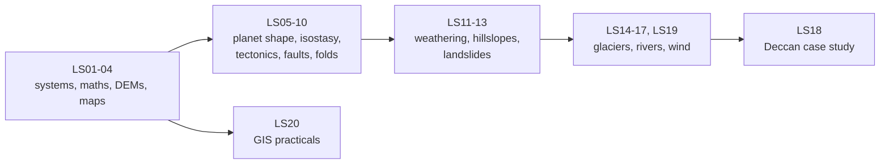

# Landscapes and Geomorphology - Course Map

*EC2123 Landscapes and Their Evolution, IISER Pune (Argha Banerjee; Deccan deck by Shilpa Patil; practicals by Shubhra and Aju).*

> [!summary] Where this subject stands
> **Chapters LS01–LS20 and LS99 are drafted** with every slide of the pre-midsem deck (153 slides), the glacial–aeolian deck (48), the Deccan deck (37), TopoToolbox (15) and QGIS (14) shown and explained. Text of LS01–LS17 derives from the AI-written reference notes (secondary) cross-checked against sampled slides. **Still to do:** the fluvial extra chapter from the braiding papers (see gaps) and per-chapter concept notes beyond the 15 Deccan ones.

![[LS18 Deccan Map.svg]]

## Chapters
| # | Chapter | Scope | Main source |
|---|---|---|---|
| 01 | [[LS01 Landscapes as Physical Systems]] | taught | pre-midsem deck |
| 02 | [[LS02 Mechanics and Mathematics Toolkit]] | taught | pre-midsem deck |
| 03 | [[LS03 Digital Elevation Models and Terrain Analysis]] | taught | pre-midsem deck |
| 04 | [[LS04 Map Projections and Reference Surfaces]] | taught | pre-midsem deck |
| 05 | [[LS05 Shape of Planets]] | taught | pre-midsem deck |
| 06 | [[LS06 Maximum Topography]] | taught | pre-midsem deck |
| 07 | [[LS07 Isostasy]] | taught | pre-midsem deck |
| 08 | [[LS08 Plate Tectonics Strain Stress and Convection]] | taught | pre-midsem deck |
| 09 | [[LS09 Faults and Earthquakes]] | taught | pre-midsem deck |
| 10 | [[LS10 Folds Flexure and Mountain Building]] | taught | pre-midsem deck |
| 11 | [[LS11 Weathering and Regolith]] | taught | pre-midsem deck |
| 12 | [[LS12 Hillslope Transport and the Diffusion Equation]] | taught | pre-midsem deck |
| 13 | [[LS13 Landslides]] | taught | pre-midsem deck |
| 14 | [[LS14 Glaciers Mass Balance and Ice Flow]] | taught | pre-midsem deck |
| 15 | [[LS15 Glacial Deposits Rebound and Sea Level]] | taught | pre-midsem deck |
| 16 | [[LS16 Fluvial Landscapes]] | taught | pre-midsem deck |
| 17 | [[LS17 Aeolian Landscapes]] | taught | pre-midsem deck |
| 18 | [[LS18 Deccan Traps Terrain]] | taught + extra | Deccan deck (Patil) |
| 19 | [[LS19 Glacial and Aeolian Landforms]] | taught + extra | `l_glacial_aolian.pdf` |
| 20 | [[LS20 GIS and TopoToolbox Practicals]] | taught | QGIS and TopoToolbox decks |
| 99 | [[LS99 Landscapes Practice Problems]] | practice | pre-midsem deck |

Reference: [[Landscapes Notation and Glossary]].

## Concept notes
Deccan Traps (15, each with its slide images): [[deccan-volcanic-province]] · [[trap-topography]] · [[massive-sheet-flow]] · [[compound-hummocky-pahoehoe]] · [[columnar-jointing]] · [[lava-flow-internal-structure]] · [[interflow-horizons]] · [[intertrappean-beds]] · [[regional-eastward-tilt]] · [[segmented-quaternary-block-faulting]] · [[bedrock-gorges-and-entrenched-meanders]] · [[fracture-bound-rock-trench]] · [[pothole-networks]] · [[planation-surfaces]] · [[laterite-cappings]]

## Reading order

## Sources
| Source | File | Used in |
|---|---|---|
| Pre-midsem lecture deck (153 slides, 218 MB, gitignored) | `lecture-notes-slides/pre_ms_landscape_26.pdf` | LS01–LS17 |
| AI-written reference notes (LaTeX) | `ai-gen-notes/` | LS01–LS17 (text), LS99 |
| Glacial and aeolian deck (48 slides, gitignored) | `l_glacial_aolian.pdf` | LS19 |
| Deccan Traps deck (37 slides) | `Geomorphic Features of the Deccan Traps Terrain.pdf` | LS18 + 15 concepts |
| TopoToolbox tutorial (15 slides) | `Topotoolbox_tut_shubhra.pdf` | LS20 |
| QGIS introduction (14 slides) | `Introduction_to_QGIS_aju.pptx` | LS20 |
| Textbooks | `books/` (Anderson & Anderson, Bierman & Montgomery, Gutierrez, Huggett, Migoń, Thornbury, Goudie & Viles) | cited by figure number |

## Gaps and to-do
- [ ] **Fluvial extra chapter** from the papers in `books/` (3D braided-channel modelling; secondary currents and classification of river channels; Himalaya from tectonic to earthquake scales; SRC-3-1-5-Das) and `ai-gen-notes/river_braiding`: not yet written.
- [ ] Concept notes for LS01–LS17 and LS19 (only the Deccan set exists).
- [ ] Verify the AI-note derivations of LS01–LS17 against the remaining slides (only slides 1–12 and 109–120 were sampled).
- [ ] Constants and fitted values flagged `[verify]` in LS18/LS19 (slide 5 volumes, slide 34 constants α β, slide 36 fit).
- [ ] Link, do not duplicate, the Landlab–SSIIM vault (`~/Documents/Landlab-SSIIM-Vault`) for surface-process modelling.

## Connections
[[Climate - Course Map]] · [[Evolution of Earth and Life - Course Map]] · [[Waves - Course Map]]

See [[Subject Map]] for how this subject relates to the others and [[Roadmap]] for its place in the plan.
