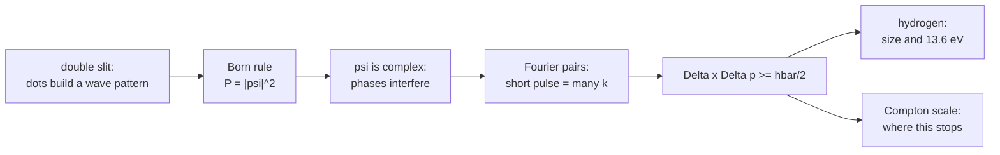

# QM01 · From Waves to Probabilities

◀ [[Quantum Mechanics - Course Map|Course Map]] · [[QM02 The Schrodinger Equation and Stationary States]] ▶

taught · in syllabus extra · book extra · beyond

> [!syllabus] Syllabus map: what is in the syllabus and what is extra in this chapter
> 🟢 **In syllabus (taught)**: the typed PH2113 lecture notes on wave-particle duality and uncertainty: [[PH2113_Wavefunction_to_Uncertainty (1).pdf|From the Wavefunction to the Uncertainty Principle]] (4 pp.), [[PH2113_Lecture6-7.pdf|Lecture 7]] (6 pp.) and [[PH2113_Lecture8_Uncertainty_Wavefunctions_Schrodinger (1).pdf|Lecture 8]] §1–2 (the part on uncertainty and the Compton scale). The folder has no instructor slides, so these notes **are** the syllabus (see Provenance).
> - §1 the double slit forces probabilities; the Born rule (WU §1–2)
> - §2 a first candidate $A\cos kx$; why $\psi$ is complex; the free particle $\Delta x=\infty,\ \Delta p=0$ (WU §3–5)
> - §3 how to localise: a single slit; superposing plane waves; the delta function (WU §6–8; L7 §1–2)
> - §4 Fourier pairs and the Gaussian packet; $\Delta x\,\Delta k=\tfrac12$ (WU §9; L7 §3)
> - §5 from $\Delta k$ to $\Delta p$: the Heisenberg relation and what it means (L7 §4–5; L8 §1)
> - §6 a first payoff: the size and energy of hydrogen (WU §10; L7 §6)
> - §7 where the theory stops: the Compton scale and dimensional analysis (L8 §2)
> - §8 Compton scattering and the de Broglie relation (earlier lectures; the Lecture 8 notes say the Compton wavelength was "introduced earlier")
>
> 🟡 **Extra · book** (from the AI-written PH2113 monographs, not from the lecture notes)
> - §8 the Compton derivation by four-momentum conservation; the Davisson-Germer check; phase and group velocity of matter waves; the spreading Gaussian packet
>
> 🔵 **Extra · beyond** (my additions, labelled)
> - §3 the band-limited packet $\sin Kx/\pi x$ with $\Delta x\,\Delta k\approx\pi$; §6 the general result for $A/r^2-B/r$ and the hydrogen-like ions; §7 the time scale $\hbar/mc^2$; numerical checks of every worked number

> [!key] After this chapter you can
> - state the **Born rule**, normalise a wavefunction, and explain why amplitudes (not probabilities) add in the double slit,
> - say why $A\cos kx$ and a plane wave are not normalisable states and what idealisation they stand for,
> - build a localised packet by **Fourier synthesis**, and show that a Gaussian has $\Delta x\,\Delta k=\tfrac12$,
> - convert to momentum with $p=\hbar k$ and state $\Delta x\,\Delta p\ge\hbar/2$, including what it does **not** mean,
> - use the uncertainty argument to estimate the **size and energy of hydrogen** and say how much to trust the prefactor,
> - say where non-relativistic quantum mechanics stops being valid ($\Delta x\sim\hbar/mc$) and find that length by dimensional analysis.

> [!intuition] The one-sentence story
> A beam of electrons makes discrete flashes but arrives with a wave's statistics, so we stop predicting single arrivals and predict **probabilities from a wave amplitude**. A wave that is narrow in space needs many wavelengths, and wavelength is momentum: so **knowing where means not knowing how fast**. Everything in the course follows from taking that seriously.

<!-- intuition-v1 -->

*Concept map: how the ideas of this chapter depend on each other (read left to right; every box is a section).*

## 1. The double slit forces a probabilistic description
taught *WU §1–2 ([[PH2113_Wavefunction_to_Uncertainty (1).pdf#page=1|p.1]])*

> [!intuition] Single outcomes are random, the pattern is not
> Each electron lands as one dot at a place you cannot predict; after thousands of dots the stripes of a wave are there. The wave does not tell you *where this electron goes*, it tells you *how likely each place is*. That is the whole meaning of $|\psi|^2$.

Send electrons one at a time through two narrow slits. Each electron produces **one localised flash** on the screen; nothing about a single arrival looks like a wave. But as flashes accumulate they build an interference pattern, and there are positions where electrons **never** arrive even though each slit alone would send electrons there (Fig. QM1.1). A particle that passed through "slit A or slit B" cannot cancel itself, so the explanation must be one of these:

- arrival is **discrete** (flashes), and
- the statistics are those of a **wave** (cancellation).

The resolution is to give up predicting individual arrivals and predict the **probability of arrival** from a wave amplitude.

> [!key] Born rule (postulate)
> The state of a particle is a **wavefunction** $\psi(x,t)$. The probability of finding it between $x$ and $x+\mathrm dx$ is
> $$P(x,t)\,\mathrm dx=|\psi(x,t)|^2\,\mathrm dx .$$
> Since the particle is found somewhere, $\displaystyle\int_{-\infty}^{\infty}|\psi(x,t)|^2\,\mathrm dx=1$ (**normalisation**).

When two paths are open, **amplitudes add**, not probabilities:
$$|\psi_A+\psi_B|^2=|\psi_A|^2+|\psi_B|^2+2\,\mathrm{Re}\,(\psi_A^*\psi_B).$$
The last term is the **interference term**. Where $\psi_A+\psi_B=0$ the probability is exactly zero (the dark fringes).

![[fig_qm01_double_slit.png]]
*Figure QM1.1. A: two-slit probability density when amplitudes add (blue) and the wrong answer if probabilities were added (orange); circles mark the exact zeros. B: the same density sampled one electron at a time (my simulation, drawn from $|\psi_A+\psi_B|^2$): single flashes look random, the pattern emerges with numbers.*

> [!example] A number
> At one screen point the slits give amplitudes of equal size, $|\psi_A|^2=|\psi_B|^2=0.20$, with a phase difference $\delta$. Then $P=0.40\,(1+\cos\delta)$: $0.80$ at $\delta=0$ (bright), $0.40$ at $\delta=\pi/2$ (the no-interference value), and $0$ at $\delta=\pi$ (dark). Adding probabilities would give $0.40$ everywhere.

> [!pitfall] Which-path detectors
> A detector at one slit destroys the fringes because the two paths become distinguishable (the detector states are orthogonal and the cross term vanishes), **not** because anyone looks. Treat this as background; the lecture notes use the double slit only to motivate $|\psi|^2$.

## 2. A first candidate wavefunction, and why $\psi$ is complex
taught *WU §3–5 ([[PH2113_Wavefunction_to_Uncertainty (1).pdf#page=1|pp.1–2]])*

> [!intuition] Why a complex number
> To make fringes the amplitudes from two slits must be able to **cancel**. Adding two real positive numbers can't; adding two complex numbers with opposite phase can. The phase is invisible in one slit and decisive when two paths meet.

Try the simplest wave, $\psi(x)=A\cos kx$ with $k=2\pi/\lambda$. Through de Broglie, $p=h/\lambda=\hbar k$, so one $k$ is one momentum.

- **Not localised.** $|\psi|^2=\tfrac{A^2}{2}[1+\cos 2kx]$ oscillates for ever and averages $A^2/2$ everywhere: the particle is as likely near $x=0$ as near $10^6$ m. So $\Delta x=\infty$.
- **Not normalisable.** $\int A^2\cos^2kx\,\mathrm dx$ diverges, so $A$ cannot be fixed.
- **Not one momentum.** $\cos kx=\tfrac12(e^{ikx}+e^{-ikx})$ is an equal mixture of $+\hbar k$ and $-\hbar k$ (a standing wave), not a particle moving one way.

To describe motion in one direction use the **complex** travelling wave $e^{i(kx-\omega t)}$. A complex $\psi$ is therefore not measurable; the measurable quantity is the real, non-negative $P=|\psi|^2=\psi^*\psi$. The **magnitude** gives the probability, the **phase** shows up only when two waves add (it is exactly what produces interference).

### The free particle
For $\psi=Ae^{i(kx-\omega t)}$ with definite momentum $\hbar k$ and energy $\hbar\omega$,
$$P=\psi^*\psi=|A|^2,$$
the exponentials cancel, so $P$ is the same at all $x$ and all $t$:
- $\Delta x=\infty$ (and $\int|A|^2\,\mathrm dx$ diverges: a plane wave is **not normalisable**),
- $\Delta p=0$ (one wavenumber).

> [!key] The first hint of a trade-off
> A perfectly definite momentum has cost all knowledge of position. The plane wave is an **idealisation** (a limiting state), not an ordinary normalisable wavefunction.

## 3. How to localise a particle
taught *WU §6–8 ([[PH2113_Wavefunction_to_Uncertainty (1).pdf#page=2|pp.2–3]]); L7 §1–2 ([[PH2113_Lecture6-7.pdf#page=1|p.1]])*

> [!intuition] The rubber-band trade
> To make a sharp pulse you must add waves of many different wavelengths so they all agree at one spot and cancel everywhere else. Sharper in $x$ costs spread in $k$, the way squeezing one end of a rubber band makes the other bulge.

### 3.1 A single slit
Send a plane wave of wavelength $\lambda$ at a slit of width $a$. Beyond the slit the particle is known to be within $\Delta x\approx a$, and the wave spreads into a diffraction pattern whose first minimum is at $\sin\theta=\lambda/a$. A particle in the central peak has acquired a sideways momentum of order $p\sin\theta$, so
$$\Delta p\approx p\sin\theta=\frac h\lambda\cdot\frac\lambda a=\frac ha,\qquad \Delta x\,\Delta p\approx a\cdot\frac ha=h.$$
Narrowing the slit sharpens position and widens the pattern. A plane wave went in, and something with a **peak** came out: a peak cannot be a single plane wave.

> [!example] Numbers ($\hbar$, $h$ from CODATA)
> Electrons accelerated through 100 V have $\lambda=h/\sqrt{2m_eeV}=0.1226$ nm. Through a slit $a=1\ \mu$m, $\sin\theta=\lambda/a=1.2\times10^{-4}$ rad, and $\Delta p\sim h/a=6.6\times10^{-28}$ kg m s$^{-1}$. Halve the slit and the spread doubles.

### 3.2 Superposing waves makes cancellation
Add two plane waves of equal amplitude and wavenumbers $k_1,k_2$. With $\bar k=(k_1+k_2)/2$ and $\Delta k=k_1-k_2$,
$$\psi=e^{ik_1x}+e^{ik_2x}=2\cos\!\Big(\frac{\Delta k\,x}{2}\Big)e^{i\bar kx},$$
a carrier $e^{i\bar kx}$ times an envelope that is exactly zero at $x_n=(2n+1)\pi/\Delta k$. Each wave alone is spread over all space, yet together they have regions of **no probability**. The larger $\Delta k$, the closer the zeros (spacing $2\pi/\Delta k$). Adding more waves kills the surviving humps: **to localise a particle, superpose many $k$ so that they cancel everywhere except in a small region.**

### 3.3 All $k$ with equal weight: the delta function
extra · beyond *the finite-band step is my arithmetic; the lecture states the limit*

Take a band $-K\le k\le K$ with equal amplitudes:
$$\psi(x)=\frac1{2\pi}\int_{-K}^{K}e^{ikx}\,\mathrm dk=\frac{\sin Kx}{\pi x}.$$
It has a central peak of height $K/\pi$ with first zeros at $x=\pm\pi/K$, so $\Delta k\approx K$ and $\Delta x\approx\pi/K$: $\Delta x\,\Delta k\approx\pi$ **whatever $K$ is** (Fig. QM1.2A). Letting $K\to\infty$ gives
$$\frac1{2\pi}\int_{-\infty}^{\infty}e^{ikx}\,\mathrm dk=\delta(x),$$
a state at a definite point ($\Delta x=0$) with every momentum present ($\Delta p=\infty$). The plane wave and the delta function are opposite extremes, **both unphysical**: a real particle lies between them.

## 4. Fourier pairs and the Gaussian packet
taught *WU §9 ([[PH2113_Wavefunction_to_Uncertainty (1).pdf#page=3|p.3]]); L7 §3 and §7 ([[PH2113_Lecture6-7.pdf#page=2|pp.2–4]])*

A state can be described in two equivalent ways:
$$\tilde\psi(k)=\frac1{\sqrt{2\pi}}\int\psi(x)e^{-ikx}\,\mathrm dx\quad(\text{analysis: which wavelengths are present?}),\qquad \psi(x)=\frac1{\sqrt{2\pi}}\int\tilde\psi(k)e^{ikx}\,\mathrm dk\quad(\text{synthesis}).$$
The transform does no physics by itself; it is a change of description. It becomes physics when we **interpret $|\tilde\psi(k)|^2\,\mathrm dk$ as the probability for the wavenumber to lie in $\mathrm dk$**, and so for the momentum $p=\hbar k$.

![[fig_qm01_fourier.png]]
*Figure QM1.2. A: a wider band of $k$ gives a narrower peak. B and C: two Gaussians and their transforms; the product $\Delta x\,\Delta k$ is $1/2$ for both.*

### The Gaussian
Take the normalised Gaussian packet
$$\psi(x)=(2\pi\sigma^2)^{-1/4}\exp\!\Big(-\frac{x^2}{4\sigma^2}\Big).$$

> [!derivation] Widths of a Gaussian pair
> **Position.** $|\psi|^2=(2\pi\sigma^2)^{-1/2}e^{-x^2/2\sigma^2}$ is a normalised Gaussian of variance $\sigma^2$, so $\Delta x=\sigma$.
>
> **Momentum space.** Using $\int e^{-ax^2+bx}\,\mathrm dx=\sqrt{\pi/a}\;e^{b^2/4a}$ with $a=1/4\sigma^2$ and $b=-ik$,
> $$\tilde\psi(k)=\frac{(2\pi\sigma^2)^{-1/4}}{\sqrt{2\pi}}\sqrt{4\pi\sigma^2}\;e^{-\sigma^2k^2}=\Big(\frac{2\sigma^2}{\pi}\Big)^{1/4}e^{-\sigma^2k^2}.$$
> So $|\tilde\psi|^2\propto e^{-2\sigma^2k^2}$, a Gaussian of variance $1/4\sigma^2$: $\Delta k=1/2\sigma$.
>
> **Product.** $\sigma$ cancels:
> $$\Delta x\,\Delta k=\sigma\cdot\frac1{2\sigma}=\frac12 .$$
> I checked this by numerical integration (norm $1.000000$, $\langle x^2\rangle=\sigma^2$, $\langle k^2\rangle=1/4\sigma^2$, product $0.50000$ for $\sigma=1.7$).

A narrow packet in $x$ is a wide packet in $k$ and vice versa, with the product fixed. More generally, for any square-integrable amplitude whose standard deviations exist,
$$\boxed{\ \Delta x\,\Delta k\ \ge\ \tfrac12\ }$$
and the **Gaussian is the minimum-bandwidth shape**. This is a theorem about Fourier pairs, true for sound pulses, water waves, radio signals and light; it is **not yet quantum mechanics** (a general proof appears in [[QM03 States Operators and Measurement]] from commutators).

> [!pitfall] Two different "extremes"
> The plane wave ($\Delta p=0$, $\Delta x$ not finite) and the delta function ($\Delta x\to0$, $\Delta p\to\infty$) are idealised limits. The inequality $\Delta x\,\Delta p\ge\hbar/2$ is a statement about **normalisable** states with both spreads finite; test it on the Gaussian, not on the extremes.

## 5. From $\Delta k$ to $\Delta p$: the Heisenberg relation
taught *L7 §4–5 ([[PH2113_Lecture6-7.pdf#page=2|pp.2–3]]); L8 §1 ([[PH2113_Lecture8_Uncertainty_Wavefunctions_Schrodinger (1).pdf#page=1|p.1]])*

> [!intuition] $\Delta x\,\Delta p\ge\hbar/2$ is a fact about waves, not about clumsy instruments
> Any wave packet, water or sound included, has $\Delta x\,\Delta k\ge\tfrac12$. Quantum mechanics only adds $p=\hbar k$. The 'uncertainty' is that the particle simply has no sharper pair of values.

Classical physics offers two ideal pictures of matter. A **particle** follows a trajectory, so $x(t)$ and $p(t)$ can be specified together ($\Delta x\,\Delta p$ can be $0$). A **wave** is extended and built from a range of wavenumbers, so it obeys $\Delta x\,\Delta k\gtrsim1$. Quantum matter fits neither column: individual detections are localised, yet the state shows diffraction and interference.

The missing ingredient is not only $p=\hbar k$; it is reading the Fourier coefficients **as quantum amplitudes**. With $p=\hbar k$ we get $\Delta p=\hbar\,\Delta k$ and
$$\boxed{\ \Delta x\,\Delta p=\hbar\,(\Delta x\,\Delta k)\ \ge\ \frac\hbar2\ }$$
where $\Delta x,\Delta p$ are the standard deviations of the outcomes of position and momentum measurements on **identically prepared** systems.

> [!key] What the relation means
> It is **not** about clumsy instruments. The state itself cannot have both an arbitrarily narrow position distribution and an arbitrarily narrow momentum distribution. Two measurements on two copies of one state give two broad distributions; the product of their widths is at least $\hbar/2$.

> [!example] Two scales (numbers recomputed)
> - **A tennis ball** (57 g) localised to 1 mm: $\Delta v\gtrsim\hbar/2m\Delta x=9\times10^{-31}$ m s$^{-1}$: far beyond any practical relevance.
> - **An electron** localised to an atomic size $a_0=0.529$ Å: $\Delta v\gtrsim\hbar/2m_ea_0=1.1\times10^{6}$ m s$^{-1}$: enormous.
>
> The same relation has radically different consequences at different scales, which is why classical mechanics works for tennis balls.

## 6. A first payoff: the size and energy of hydrogen
taught *WU §10 ([[PH2113_Wavefunction_to_Uncertainty (1).pdf#page=3|pp.3–4]]); L7 §6 ([[PH2113_Lecture6-7.pdf#page=3|p.3]])*

> [!intuition] Hydrogen without solving anything
> Confining the electron to radius $r$ costs kinetic energy $\sim\hbar^2/2mr^2$ (squeezing a wave); the Coulomb attraction gains $-e^2/4\pi\varepsilon_0r$. The sum is lowest at $r\sim0.5$ Å with $E\sim-13.6$ eV: the Bohr radius and the Rydberg, from the uncertainty principle alone.

Confine an electron to a region of size $r$ around a proton. Its momentum spread is at least of order $\hbar/r$, so its kinetic energy is of order $\Delta p^2/2m_e$:
$$E(r)\sim\frac{\hbar^2}{2m_er^2}-\frac{e^2}{4\pi\varepsilon_0r}.$$
The Coulomb term pulls the electron in; the uncertainty term pushes it out. Classically the electron would fall to $r=0$ and radiate away infinite energy. Quantum mechanically squeezing $r$ raises the kinetic energy as $1/r^2$, **faster** than the potential falls as $1/r$: the atom is **stable** and has a definite size.

> [!derivation] Minimising $E(r)$
> $$\frac{\mathrm dE}{\mathrm dr}=-\frac{\hbar^2}{m_er^3}+\frac{e^2}{4\pi\varepsilon_0r^2}=0\ \Longrightarrow\ r_{\min}=\frac{4\pi\varepsilon_0\hbar^2}{m_ee^2}\equiv a_0,\qquad E_{\min}=-\frac{\hbar^2}{2m_ea_0^2}=-\frac{m_ee^4}{2(4\pi\varepsilon_0)^2\hbar^2}.$$
> **Numbers** (CODATA): $a_0=5.2918\times10^{-11}$ m $=0.529$ Å and $E_{\min}=-2.180\times10^{-18}$ J $=-13.61$ eV. The measured ionisation energy is $13.606$ eV and the radius $0.529$ Å.

![[fig_qm01_hydrogen.png]]
*Figure QM1.3. A: confinement energy against the Coulomb energy for hydrogen. B: the same argument with $\Delta p=\hbar/2r$ instead of $\hbar/r$ gives $r=a_0/4$ and $-54.4$ eV: the scaling survives, the prefactor does not.*

> [!pitfall] Trust the scaling, not the prefactor
> The estimate used the **characteristic** momentum $p\sim\hbar/r$, not the strict bound $\Delta p\ge\hbar/2r$. With the strict value the minimum moves to $a_0/4$ and $-54.4$ eV (Fig. QM1.3B). The argument robustly gives how $r$ and $E$ scale with $m$, $e$ and $\hbar$ ($a_0\propto\hbar^2/me^2$, $E\propto me^4/\hbar^2$); the exact numerical agreement here is a **happy accident** of the Coulomb problem. The true ground-state energy and wavefunction come from the Schrödinger equation ([[QM02 The Schrodinger Equation and Stationary States]]).

> [!extra-beyond]- 🔵 Extra (beyond): the general result and the hydrogen-like ions
> Any energy of the form $E(r)=A/r^2-B/r$ has its minimum at $r=2A/B$ with $E=-B^2/4A$. For the nucleus of charge $Ze$, $B\to Ze^2/4\pi\varepsilon_0$, so $r_{\min}=a_0/Z$ and $E=-Z^2\times13.6$ eV: He$^+$ gives $r=0.265$ Å and $-54.4$ eV, which is the **exact** He$^+$ ground-state energy; Li$^{2+}$ gives $-122.4$ eV. The agreement is again special to Coulomb.

## 7. Where the theory stops: the Compton scale
taught *L8 §2 ([[PH2113_Lecture8_Uncertainty_Wavefunctions_Schrodinger (1).pdf#page=2|p.2]])*

Localising a particle to $\Delta x$ needs $\Delta p\sim\hbar/\Delta x$. When $\Delta x\sim\hbar/mc$, $\Delta p\sim mc$ and relativistic effects can no longer be neglected. The course stays in the **non-relativistic regime**, where momenta are $\ll mc$.

> [!derivation] Dimensional analysis picks the length
> A length $\ell=\hbar^ac^bm^d$ built from $[\hbar]=\mathrm{kg\,m^2\,s^{-1}}$, $[c]=\mathrm{m\,s^{-1}}$, $[m]=\mathrm{kg}$ needs matching powers of kg, m and s separately:
> $$\text{kg: }a+d=0,\qquad\text{m: }2a+b=1,\qquad\text{s: }-a-b=0\ \Longrightarrow\ a=1,\ b=-1,\ d=-1.$$
> Three equations, three unknowns, one solution: **the only length from $\hbar,c,m$ is $\propto\hbar/(mc)$**. Dimensional analysis fixes the scaling but not the number in front; the number $\sim1$ came from setting the localisation momentum equal to $mc$.
> **Number:** for the electron $\hbar/m_ec=3.86\times10^{-13}$ m (the reduced Compton wavelength; the usual $\lambda_C=h/m_ec=2.426$ pm is $2\pi$ times larger).

> [!pitfall] A validity threshold, not a size
> The lecture stresses that $\hbar/mc$ is **not** the electron's size: electron-scattering experiments reportedly probe down to about $10^{-18}$ m with no sign of structure (claim as stated in the lecture, not checked here). It is the scale at which the simple one-particle non-relativistic description stops being adequate; below it you need a relativistic quantum theory, which is beyond the course.

> [!extra-beyond]- 🔵 Extra (beyond): the matching time scale
> $\hbar/(m_ec^2)=1.29\times10^{-21}$ s, i.e. $(\hbar/mc)/c$, is the light-crossing time of the Compton length; $m_ec^2=511$ keV is the matching energy. Any process much slower and lower-energy than these can be treated non-relativistically.

## 8. Compton scattering and the de Broglie relation
taught (inferred) *the earlier lectures are not in the folder; Lecture 8 refers to the Compton wavelength "introduced earlier". Source for the derivations: the AI monograph `gemqphyprems2.pdf` §2–3, which I re-derived and checked.*

> [!verify] Missing lectures
> Lectures 1–5 (the empirical background) are not in the folder. The following is the standard content the later notes rely on. Check with the instructor which derivations were done in class.

**Photon momentum.** Light of wavelength $\lambda$ carries energy $E=h\nu=hc/\lambda$ and momentum $p=h/\lambda=E/c$. The photoelectric effect showed the quantised energy; **Compton scattering (1923)** showed the localised momentum.

> [!derivation] Compton shift from four-momentum conservation
> A photon of wavelength $\lambda$ scatters from an electron at rest through an angle $\theta$, leaving with $\lambda'$. Let $P_\gamma,P_\gamma'$ be the photon four-momenta and $P_e,P_e'$ the electron's, with $P_e=(m_ec,0)$. From $P_\gamma+P_e=P_\gamma'+P_e'$,
> $$(P_e')^2=(P_\gamma-P_\gamma'+P_e)^2\ \Longrightarrow\ P_e\!\cdot\!(P_\gamma-P_\gamma')=P_\gamma\!\cdot\!P_\gamma'$$
> (using $P_\gamma^2=P_\gamma'^2=0$ and $P_e^2=P_e'^2=m_e^2c^2$). Evaluating: left side $=m_e(E_\gamma-E_\gamma')=m_ehc\,\dfrac{\lambda'-\lambda}{\lambda\lambda'}$; right side $=\dfrac{h^2}{\lambda\lambda'}(1-\cos\theta)$. Hence
> $$\boxed{\ \lambda'-\lambda=\frac h{m_ec}\,(1-\cos\theta)=\lambda_C(1-\cos\theta)\ },\qquad\lambda_C=\frac h{m_ec}=2.426\ \mathrm{pm}.$$
> **Numbers:** the shift is $1.213$ pm at $60^\circ$, $2.426$ pm at $90^\circ$ and at most $4.853$ pm (backscatter, $180^\circ$). Mo K$\alpha$ X-rays ($\lambda=71.1$ pm, $17.44$ keV) scattered at $90^\circ$ come out at $73.53$ pm ($16.86$ keV), a $3.4\%$ shift, and the electron recoils with $575$ eV. A classical (Thomson) picture predicts **no** shift.

**Matter waves.** De Broglie (1924) turned the relation round: a particle of momentum $p$ has wavelength $\lambda=h/p$, i.e. $p=\hbar k$. Davisson and Germer (1927) saw electrons diffract from a nickel crystal; at 54 V the formula gives $\lambda=0.167$ nm, within about 1% of the quoted $0.165$ nm. A baseball (0.145 kg, 40 m s$^{-1}$) has $\lambda=1.1\times10^{-34}$ m: wave effects are unobservable.

> [!extra-book]- 🟡 Extra (book): phase and group velocity of a matter wave
> For a free particle $E=p^2/2m$ gives $\omega(k)=\hbar k^2/2m$. The **phase velocity** is $\omega/k=\hbar k/2m=\tfrac12v_{\text{classical}}$, but the **group velocity** (the speed of the envelope, i.e. of the probability) is $\mathrm d\omega/\mathrm dk=\hbar k_0/m=v_{\text{classical}}$. So a packet moves at the classical speed; the phase ripples inside it move at half that. (Source: AI monograph §3.3; derivation re-checked.)

> [!extra-book]- 🟡 Extra (book): a free Gaussian packet spreads
> Under the free-particle equation ([[QM02 The Schrodinger Equation and Stationary States]]) the width of $|\psi|^2$ evolves as
> $$\sigma(t)=\sigma_0\sqrt{1+\Big(\frac{\hbar t}{2m\sigma_0^2}\Big)^2}.$$
> I verified this by evolving a Gaussian numerically (widths $1,\ 1.118,\ 1.414,\ 2.693,\ 5.099$ at $t=0,1,2,5,10$ in units $\hbar=m=\sigma_0=1$, matching the formula to five digits). The spreading time is $2m\sigma_0^2/\hbar$: $1.7\times10^{-16}$ s for an electron with $\sigma_0=1$ Å (the packet is 6 million times wider after 1 ns), and $10^{27}$ s for a 57 g ball with $\sigma_0=1$ mm.

## 9. The reading tiers
extra · book *`books/`*

No assigned reading is stated in the folder. The two books present are **Griffiths**, *Introduction to Quantum Mechanics* (1st edition; Ch. 1: §1.2 the statistical interpretation [[Griffiths - Introduction to quantum mechanics.pdf#page=17|PDF p.17]], §1.4 normalisation [[Griffiths - Introduction to quantum mechanics.pdf#page=26|p.26]], §1.6 the uncertainty principle [[Griffiths - Introduction to quantum mechanics.pdf#page=32|p.32]]; the PDF is a scan without a text layer, so I OCR'd chapters 1–2 only to locate sections; book page = PDF page − 15) and **Sakurai and Napolitano**, *Modern Quantum Mechanics*, 3rd ed. (Ch. 1 for the Dirac formalism). Treat them as further reading.

> [!connection] Where this goes next
> - The Fourier idea is the same one used for spectra in [[CL02 Observing Global Temperature]] (FFT of a temperature record), and the "narrow in time, broad in frequency" trade-off governs spectral lines in [[CL07 Optical Properties of the Atmosphere]].
> - $\Delta x\,\Delta p\ge\hbar/2$ is the first example of a **commutator** bound ([[QM03 States Operators and Measurement]]); the localisation energy $\propto1/r^2$ is the **confinement energy** of the box ([[QM04 The Particle in a Box]]).

<!-- interactive:start (generated by scripts/embed_interactive.py; edit the tool in scripts/interactive/tools/, not this block) -->
> [!interactive]+ Interactive: A free Gaussian wave packet: spreading and the uncertainty principle
> A packet ψ(x,0) ∝ exp(−x²/4σ₀² + ik₀x) evolves freely (ħ = m = 1).
>
> ![[qm_wavepacket.png|720]]
>
> **Try:** Make σ₀ small: it spreads fast (large momentum spread). Make σ₀ large: nearly rigid. Change k₀ and see the packet move without changing shape.
>
> [▶ Open the tool in your browser](../Assets/interactive/qm_wavepacket.html) · [absolute link](file:///home/swastik/Documents/notes/Assets/interactive/qm_wavepacket.html) · all tools and coverage: [[Interactive Tools]]

> [!interactive]+ Interactive: Wave packets: phase velocity versus group velocity
> A packet is a superposition of plane waves ψ(x,t) = ∫ A(k) e^{i(kx − ω(k)t)} dk with a Gaussian A(k) centred on k₀.
>
> ![[wave_dispersion_packet.png|720]]
>
> **Try:** Deep water: v_g = v_p/2 (ripples run through the packet). Waveguide/plasma: v_p·v_g = c², ripples faster than c but the packet slower. Schrödinger: ω = k²/2, v_g = 2v_p. Non-dispersive: nothing spreads.
>
> [▶ Open the tool in your browser](../Assets/interactive/wave_dispersion_packet.html) · [absolute link](file:///home/swastik/Documents/notes/Assets/interactive/wave_dispersion_packet.html) · all tools and coverage: [[Interactive Tools]]

> [!interactive]+ Interactive: Fourier synthesis: build a waveform from harmonics
> A periodic function is a sum of sines.
>
> ![[wave_fourier.png|720]]
>
> **Try:** Square wave with N = 1, 3, 9, 49: watch the Gibbs ears sharpen but not shrink (overshoot 8.95 %). Triangle waves converge much faster (1/n² coefficients).
>
> [▶ Open the tool in your browser](../Assets/interactive/wave_fourier.html) · [absolute link](file:///home/swastik/Documents/notes/Assets/interactive/wave_fourier.html) · all tools and coverage: [[Interactive Tools]]

<!-- interactive:end -->

## Map of this chapter
> [!connection] How QM01 connects
> **Builds on:** school physics (waves, de Broglie) and Gaussian integrals.
> **Leads to:** [[QM02 The Schrodinger Equation and Stationary States]] → [[QM03 States Operators and Measurement]] → [[QM04 The Particle in a Box]] → [[QM05 The Harmonic Oscillator]].
> **Concepts:** [[Wave-Particle Duality]] · [[Born Rule]] · [[Wavefunction]] · [[Plane Wave]] · [[Fourier Transform and Wave Packets]] · [[Gaussian Wave Packet]] · [[Heisenberg Uncertainty Principle]] · [[Hydrogen Atom Stability]] · [[Compton Wavelength]] · [[Compton Scattering]] · [[de Broglie Relation]] · [[Dimensional Analysis]]
> **Other subjects:** [[Planck Law]] and [[Blackbody Radiation]] (the quantum of light), [[Waves - Course Map]] (Fourier and group velocity), [[Probability - Course Map]] (a wavefunction squared is a probability density).

## Summary
> [!summary] Cheat-sheet
> - **Born rule:** $P(x,t)\,\mathrm dx=|\psi|^2\,\mathrm dx$, $\int|\psi|^2\mathrm dx=1$; with two paths add **amplitudes**: $|\psi_A+\psi_B|^2=|\psi_A|^2+|\psi_B|^2+2\mathrm{Re}(\psi_A^*\psi_B)$.
> - $A\cos kx$ and $e^{i(kx-\omega t)}$ are **not normalisable**; the plane wave has $\Delta p=0$, $\Delta x=\infty$ and stands for an idealised state; the delta function is the opposite extreme. $\psi$ is complex; only $|\psi|^2$ is measurable.
> - **Single slit:** $\Delta x\approx a$, $\sin\theta=\lambda/a$, $\Delta p\approx h/a$. **Fourier synthesis:** narrow in $k$ $\Leftrightarrow$ broad in $x$; $\frac1{2\pi}\int_{-K}^{K}e^{ikx}\mathrm dk=\sin Kx/\pi x$.
> - **Gaussian:** $\psi=(2\pi\sigma^2)^{-1/4}e^{-x^2/4\sigma^2}$, $\Delta x=\sigma$, $\tilde\psi\propto e^{-\sigma^2k^2}$, $\Delta k=1/2\sigma$, **$\Delta x\,\Delta k=\tfrac12$ (the minimum)**.
> - **Heisenberg:** $\Delta x\,\Delta p\ge\hbar/2$: intrinsic spreads of measurement outcomes, not instrument errors. Tennis ball $9\times10^{-31}$ m/s; electron in an atom $10^6$ m/s.
> - **Hydrogen:** $E(r)=\hbar^2/2mr^2-e^2/4\pi\varepsilon_0r$; $r=a_0=0.529$ Å, $E=-13.6$ eV; trust the **scaling**, not the prefactor ($\hbar/2r$ would give $a_0/4$, $-54.4$ eV).
> - **Compton scale:** $\hbar/mc=3.86\times10^{-13}$ m is unique from $\hbar,c,m$; a validity threshold, not a size. $\lambda'-\lambda=\lambda_C(1-\cos\theta)$, $\lambda_C=2.426$ pm.

## Practice
1. **Add amplitudes.** At a screen point two slits give equal-size amplitudes with $|\psi_A|^2=|\psi_B|^2=0.15$ and phase difference $\delta$. Find $P$ for $\delta=0,\ \pi/3,\ \pi$. What does adding probabilities give?
2. **Not a state.** Show that $\psi=A\cos kx$ cannot be normalised on the whole line and write it as a superposition of momentum states. What are the possible momenta and probabilities?
3. **Single slit.** Electrons at 100 V ($\lambda=0.1226$ nm) pass a slit of width 1 µm. Find the angle of the first minimum and the transverse momentum spread $\sim h/a$. What slit width gives a spread ten times larger?
4. **Band-limited packet.** A packet is built from $-K\le k\le K$ with $K=2\times10^{10}$ m$^{-1}$. Where are the first zeros? What is the corresponding momentum band and the kinetic energy at the band edge for an electron?
5. **Gaussian numbers.** For $\psi\propto e^{-x^2/4\sigma^2}$ show $\Delta x\,\Delta p=\hbar/2$. For $\sigma=0.1$ nm find $\Delta p$, the kinetic-energy scale $\Delta p^2/2m$ and the velocity spread of an electron.
6. **A proton in a nucleus.** Take $\Delta x=5$ fm. Find the least momentum spread (use $\hbar c=197.3$ MeV fm) and the kinetic-energy scale $(pc)^2/2m_pc^2$. Is the proton relativistic ($m_pc^2=938$ MeV)?
7. **Hydrogen-like ions.** Redo the hydrogen estimate for a nucleus of charge $Ze$: find $r_{\min}$ and $E_{\min}$ for H, He$^+$ and Li$^{2+}$.
8. **Compton.** Mo K$\alpha$ X-rays ($\lambda=71.1$ pm) are scattered at $90^\circ$. Find the new wavelength, the photon energies and the electron's kinetic energy. For which wavelengths is the fractional shift large?
9. **de Broglie.** Find $\lambda$ for (a) an electron at 150 V, (b) a neutron at 2200 m s$^{-1}$, (c) a baseball of 0.145 kg at 40 m s$^{-1}$. Which can show diffraction from a crystal with spacing 0.2 nm?
10. **Dimensions.** Find the unique time that can be built from $\hbar$, $m$ and $c$, and evaluate it for the electron. Explain why the same method cannot fix a pure number such as $1/2\pi$.

> [!example]- Solutions
> 1. $P=2\times0.15\,(1+\cos\delta)$: $\delta=0$: $0.60$; $\pi/3$: $0.45$; $\pi$: $0$. Adding probabilities gives $0.30$ for every $\delta$.
> 2. $\int A^2\cos^2kx\,\mathrm dx$ diverges (the integrand averages $A^2/2$ over an infinite line). $\cos kx=\tfrac12(e^{ikx}+e^{-ikx})$: momentum $+\hbar k$ with probability $1/2$ and $-\hbar k$ with probability $1/2$. It is idealised: a real state is a normalisable packet built from such waves.
> 3. $\sin\theta=0.1226\text{ nm}/1\ \mu\text{m}=1.2\times10^{-4}$ rad; $\Delta p\sim h/a=6.6\times10^{-28}$ kg m s$^{-1}$. A ten-fold larger spread needs $a=0.1\ \mu$m.
> 4. First zeros at $x=\pm\pi/K=\pm0.157$ nm; momentum band $\pm\hbar K=\pm2.11\times10^{-24}$ kg m s$^{-1}$; $\hbar^2K^2/2m=15.2$ eV. A packet as narrow as an atom needs electrons of tens of eV in its tail.
> 5. $\Delta x=\sigma$, $\Delta k=1/2\sigma$, $\Delta p=\hbar/2\sigma$, product $\hbar/2$. For $\sigma=0.1$ nm: $\Delta p=5.27\times10^{-25}$ kg m s$^{-1}$, $\Delta p^2/2m=0.95$ eV, $\Delta v=5.8\times10^5$ m s$^{-1}$.
> 6. $pc\ge\hbar c/2\Delta x=19.7$ MeV (39.5 MeV with $\hbar c/\Delta x$); $KE\approx0.21$ MeV (0.83 MeV), $v/c\approx0.02$ (0.04). Non-relativistic is acceptable, and the **MeV** scale is the observed nuclear energy scale.
> 7. $E=\hbar^2/2mr^2-Ze^2/4\pi\varepsilon_0r\Rightarrow r=a_0/Z$, $E=-Z^2\times13.6$ eV: H: 0.529 Å, $-13.6$ eV; He$^+$: 0.265 Å, $-54.4$ eV; Li$^{2+}$: 0.176 Å, $-122.4$ eV.
> 8. $\Delta\lambda=2.426$ pm, so $\lambda'=73.53$ pm; $E=17.44\to16.86$ keV; electron kinetic energy $575$ eV. The fractional shift $\lambda_C(1-\cos\theta)/\lambda$ is large only when $\lambda\sim\lambda_C$, i.e. $\gamma$-rays (a 2 pm photon backscattered: $+243\%$).
> 9. (a) $h/\sqrt{2m_eeV}=0.100$ nm; (b) $h/mv=0.180$ nm; (c) $1.1\times10^{-34}$ m. (a) and (b) are comparable to the lattice spacing and diffract; (c) cannot.
> 10. $\tau=\hbar^ac^bm^d$ in seconds: kg: $a+d=0$; m: $2a+b=0$; s: $-a-b=1$, so $a=1$, $b=-2$, $d=-1$ and $\tau=\hbar/mc^2=1.29\times10^{-21}$ s. Dimensional analysis only fixes products of powers of dimensioned quantities; a pure number is dimensionless and drops out of the matching.

<!-- zettel:start (generated by scripts/sort_zettel.py; do not edit between the markers) -->
## Zettel notes

> [!abstract]- Zettel notes filed under this chapter (15): the other tool's concept notes from the lectures, unreviewed
> [[zettel/compton-scattering-momentum-and-energy-transfer|Compton Scattering Momentum and Energy Transfer]] · [[zettel/davisson-germer-electron-diffraction|Davisson-Germer Electron Diffraction]] · [[zettel/delocalized-plane-wave-idealization|Delocalized Plane Wave Idealization]] · [[zettel/dirac-delta-wavefunction-limit|Dirac Delta Wavefunction Limit]] · [[zettel/double-slit-interference-from-state-superposition|Double-Slit Interference from State Superposition]] · [[zettel/dynamical-amplification-of-quantum-uncertainty|Dynamical Amplification of Quantum Uncertainty]] · [[zettel/ensemble-interpretation-of-the-wavefunction|Ensemble Interpretation of the Wavefunction]] · [[zettel/fourier-band-limited-wave-packet-localization|Fourier Band-Limited Wave Packet Localization]] · [[zettel/hydrogen-ground-state-scale-from-uncertainty|Hydrogen Ground-State Scale from Uncertainty]] · [[zettel/macroscopic-classicality-criterion-via-de-broglie-wavelength|Macroscopic Classicality Criterion via de Broglie Wavelength]] · [[zettel/photoelectric-threshold-frequency|Photoelectric Threshold Frequency]] · [[zettel/position-momentum-uncertainty-relation-from-fourier-transform|Position-Momentum Uncertainty Relation from Fourier Transform]] · [[zettel/reduced-compton-wavelength-validity-threshold|Reduced Compton Wavelength Validity Threshold]] · [[zettel/single-slit-diffraction-localization|Single-Slit Diffraction Localization]] · [[zettel/two-wave-superposition-envelope-modulation|Two-Wave Superposition Envelope Modulation]]
<!-- zettel:end -->

## Provenance
> [!provenance]- Source map for this chapter
> | Topic | Source | Scope |
> |---|---|---|
> | double slit, Born rule, $\cos kx$, plane wave, single slit, Fourier synthesis, delta, Gaussian, hydrogen estimate | [[PH2113_Wavefunction_to_Uncertainty (1).pdf#page=1\|WU pp.1–4]] | taught |
> | the same ideas with the Fourier pair and $\Delta p=\hbar\Delta k$ made explicit; hydrogen scale | [[PH2113_Lecture6-7.pdf#page=1\|L7 pp.1–4]] | taught |
> | uncertainty relation meaning; the Compton scale; dimensional analysis | [[PH2113_Lecture8_Uncertainty_Wavefunctions_Schrodinger (1).pdf#page=1\|L8 pp.1–2]] | taught |
> | Compton shift, de Broglie, group velocity, packet spreading | AI monograph `gemqphyprems2.pdf` §2–4 (re-derived here) | extra/book |
> | band-limited packet, $A/r^2-B/r$, hydrogen-like ions, time scale, all worked numbers | computed here (`scripts/qm_numbers.py`, `fig_qm01_*.py`) | extra/beyond |
>
> **Read and not read.** All seven typed lecture notes in `lecture-notes-slides/` were read in full; the two textbooks were not (Griffiths is a scan; Sakurai has a text layer but was not needed). **There are no instructor slides in the folder**, so "taught" means "in the typed lecture notes"; their authorship is not stated in the files. Lectures 1–5 are absent.
>
> **Cross-check.** The AI notes `gemqphyprems.pdf`, `gemqphyprems2.pdf` and `Quantum_Mechanics_Notes.pdf` repeat these results; every number was recomputed independently and agreed. The lecture notes use $\Delta p\sim\hbar/r$ in the hydrogen estimate and say so; their dimensional-analysis exponents are unique, as stated.

**References.** Griffiths, D. J. *Introduction to Quantum Mechanics* (Ch. 1) · Sakurai, J. J. and Napolitano, J. *Modern Quantum Mechanics*, 3rd ed. (Ch. 1) · Compton, A. H. (1923) *Phys. Rev.* 21, 483 · de Broglie, L. (1924) · Davisson, C. and Germer, L. (1927) *Phys. Rev.* 30, 705 · Born, M. (1926) *Z. Phys.* 37, 863 · CODATA 2018 constants.
