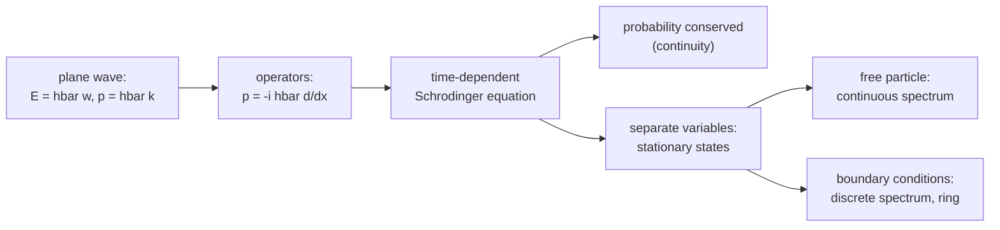

# QM02 · The Schrödinger Equation and Stationary States

◀ [[QM01 From Waves to Probabilities]] · [[Quantum Mechanics - Course Map|Course Map]] · [[QM03 States Operators and Measurement]] ▶

taught · in syllabus extra · book extra · beyond

> [!syllabus] Syllabus map: what is in the syllabus and what is extra in this chapter
> 🟢 **In syllabus (taught)**: [[PH2113_Lecture6-7.pdf|Lecture 7]] §7–13, [[PH2113_Lecture8_Uncertainty_Wavefunctions_Schrodinger (1).pdf|Lecture 8]] §3–12, [[PH2113_Lecture9_FreeParticle_Ring_GeneralProperties.pdf|Lecture 9]] (all), and the problem-oriented [[PH2113_wavefunctions_potentials_schrodinger_Tutorial.pdf|Tutorial Note]] (Problems 1–4 here; Problem 5 in QM03; Problem 6, the Gaussian transform, in QM01 and QM05).
> - §1 why a new dynamical law; §2 operators from a plane wave (L7 §8–9; L8 §6–9)
> - §3 the time-dependent equation and a free-particle check; §4 conservation of probability (L7 §10–13)
> - §5 separation of variables: the time-independent equation and stationary states (L8 §11; L9 §1)
> - §6 the free particle: a continuous spectrum (L9 §2)
> - §7 boundary conditions make levels discrete: periodic line and the ring (L9 §3–6)
> - §8 many solutions, linearity, superposition, global and relative phase (L9 §7–9)
> - §9 which functions are physical states? (L8 §3–5; L9 §10; Tutorial P1)
> - §10 which potentials are allowed? matching conditions and shifting $V$ (L9 §11; Tutorial §2–3, P2–P4)
>
> 🟡 **Extra · book**
> - §10 the delta-function well as a bound state (Griffiths §2.5, [[Griffiths - Introduction to quantum mechanics.pdf#page=65|PDF p.65]]); probability current for the plane wave
>
> 🔵 **Extra · beyond** (my additions, labelled)
> - §4 the full derivation of the continuity equation; §7 the numbers for a benzene-size ring and a 1 cm ring (these are taught in the States-and-Operators notes, recomputed here); §10 the inverse-square and complex-potential remarks; all worked numbers (`scripts/qm_numbers.py`)

> [!key] After this chapter you can
> - motivate $E\leftrightarrow i\hbar\partial_t$ and $p\leftrightarrow-i\hbar\partial_x$ from a plane wave and write the **time-dependent Schrödinger equation** (TDSE), stating that it is a **postulate**,
> - show that the TDSE conserves total probability using the **continuity equation** and the probability current,
> - **separate variables** to get the time-independent equation (TISE) and explain why $|\Psi|^2$ is time-independent for a stationary state,
> - explain why a free particle has a **continuous** spectrum and why a periodic condition ($x\equiv x+L$, the ring) makes it **discrete**,
> - decide whether a function is an **admissible state** (normalisable, single-valued, boundary conditions) and, separately, whether it solves the equation for a given $V$,
> - use **matching conditions** (continuity of $\psi$ and $\psi'$ for finite jumps in $V$; a jump in $\psi'$ for a delta function) and show that shifting $V$ by a constant only changes a global phase.

> [!intuition] The one-sentence story
> The Born rule says how to read probabilities out of $\psi$ and Fourier analysis says how position and momentum content are linked, but neither says **how $\psi$ changes in time**. The Schrödinger equation is that law. Its energy levels do not come from the equation alone: they come from the equation **plus the physical condition on the solutions**.

<!-- intuition-v1 -->

*Concept map: how the ideas of this chapter depend on each other (read left to right; every box is a section).*

## 1. Why we need a new law
taught *L7 §8 ([[PH2113_Lecture6-7.pdf#page=4|p.4]]); L8 §6 ([[PH2113_Lecture8_Uncertainty_Wavefunctions_Schrodinger (1).pdf#page=5|p.5]])*

Given $\psi(x,0)$, we want $\psi(x,t)$ for all later $t$, including the effect of a potential $V(x)$. Newtonian mechanics has its own law for $x(t)$, but the quantum state is the wavefunction, so the law must be an equation **for $\psi$**.

> [!key] A postulate, not a derivation
> The Schrödinger equation is a **fundamental postulate** of non-relativistic quantum mechanics. The relations $E=\hbar\omega$, $p=\hbar k$ and $E=p^2/2m+V$ strongly **motivate** its form but do not logically derive a unique law. Its justification is that its predictions agree with experiment.

## 2. Operators from a plane wave
taught *L7 §9 ([[PH2113_Lecture6-7.pdf#page=4|p.4]]); L8 §8–9 ([[PH2113_Lecture8_Uncertainty_Wavefunctions_Schrodinger (1).pdf#page=6|pp.6–7]])*

Take $\psi=Ae^{i(kx-\omega t)}$ and differentiate:
$$\frac{\partial\psi}{\partial x}=ik\psi\ \Rightarrow\ -i\hbar\frac{\partial\psi}{\partial x}=\hbar k\,\psi=p\,\psi,\qquad \frac{\partial\psi}{\partial t}=-i\omega\psi\ \Rightarrow\ i\hbar\frac{\partial\psi}{\partial t}=\hbar\omega\,\psi=E\,\psi .$$
A spatial derivative **extracts the wavenumber** and a time derivative **extracts the frequency**, and Planck and de Broglie turn these into momentum and energy:
$$\boxed{\ \hat p=-i\hbar\frac{\partial}{\partial x},\qquad \hat E=i\hbar\frac{\partial}{\partial t}\ }$$
Because differentiation is linear, these operators act consistently on **superpositions** of plane waves, which is why they are the right objects for a theory with superposition.

## 3. The time-dependent Schrödinger equation
taught *L7 §10, §12 ([[PH2113_Lecture6-7.pdf#page=5|p.5]]); L8 §7–8, §10 ([[PH2113_Lecture8_Uncertainty_Wavefunctions_Schrodinger (1).pdf#page=6|pp.6–8]])*

> [!intuition] Energy is the speed of the phase
> $i\hbar\,\partial_t\psi=\hat H\psi$ says: the faster the phase of a component rotates, the higher its energy. Evolution in time is nothing but each energy component spinning at its own rate $\omega=E/\hbar$.

The classical energy relation $E=p^2/2m+V(x)$ with $E\to i\hbar\partial_t$ and $p\to-i\hbar\partial_x$ gives
$$\boxed{\ i\hbar\frac{\partial\psi(x,t)}{\partial t}=-\frac{\hbar^2}{2m}\frac{\partial^2\psi(x,t)}{\partial x^2}+V(x,t)\,\psi(x,t)\ }$$
the **time-dependent Schrödinger equation (TDSE)**. In three dimensions $\partial_x^2\to\nabla^2=\partial_x^2+\partial_y^2+\partial_z^2$ and the plane wave is $e^{i(\mathbf k\cdot\mathbf r-\omega t)}$. The factor $i$ is essential: it makes $\psi$ **rotate in phase** rather than diffuse, and for a real $V$ it leads to unitary evolution and conservation of total probability (§4).

> [!example] Consistency check with a free particle
> For $V=0$ and $\psi=Ae^{i(kx-\omega t)}$: $i\hbar\partial_t\psi=\hbar\omega\psi$ and $-\tfrac{\hbar^2}{2m}\partial_x^2\psi=\tfrac{\hbar^2k^2}{2m}\psi$. So the equation holds if
> $$E=\hbar\omega=\frac{\hbar^2k^2}{2m}=\frac{p^2}{2m},\qquad \omega(k)=\frac{\hbar k^2}{2m}.$$
> With a constant $V$ it gives $E=p^2/2m+V$. This is a **check, not a derivation**: the equation reproduces the energy relation it was built from.

> [!pitfall] Which question are you asking?
> Two questions must not be confused: *is this function an admissible state?* and *does it solve the Schrödinger equation for this potential?* A function can be perfectly normalisable and still fail to be an energy eigenfunction of the chosen $V$.

## 4. Conservation of probability
taught *L7 §13 ([[PH2113_Lecture6-7.pdf#page=5|pp.5–6]]) (statement and result)* · extra · beyond *the step-by-step derivation is mine*

> [!intuition] Probability behaves like an incompressible fluid
> $\partial_t\rho+\partial_xj=0$: the probability in a region changes only by what flows through its edges; none appears or vanishes. That is what makes $\int|\psi|^2=1$ stay true at all times.

Born's rule needs a normalised state to **stay** normalised.

> [!derivation] The continuity equation
> Let $P=\psi^*\psi$. From the TDSE and its complex conjugate (real $V$),
> $$\partial_t\psi=\frac{i\hbar}{2m}\psi''-\frac i\hbar V\psi,\qquad \partial_t\psi^*=-\frac{i\hbar}{2m}\psi^{*\prime\prime}+\frac i\hbar V\psi^*,$$
> so the $V$ terms cancel in $\partial_tP=\psi^*\partial_t\psi+\psi\,\partial_t\psi^*$:
> $$\frac{\partial P}{\partial t}=\frac{i\hbar}{2m}\big(\psi^*\psi''-\psi\,\psi^{*\prime\prime}\big)=\frac{\partial}{\partial x}\Big[\frac{i\hbar}{2m}\big(\psi^*\psi'-\psi\,\psi^{*\prime}\big)\Big]=-\frac{\partial j}{\partial x},$$
> with the **probability current**
> $$j(x,t)=\frac\hbar{2mi}\Big(\psi^*\frac{\partial\psi}{\partial x}-\psi\frac{\partial\psi^*}{\partial x}\Big).$$
> So $\partial_tP+\partial_xj=0$: probability can flow from one region to another but is neither created nor destroyed. Integrating over the line, $\dfrac{\mathrm d}{\mathrm dt}\displaystyle\int|\psi|^2\mathrm dx=-\big[j\big]_{-\infty}^{\infty}=0$ for a normalisable state with vanishing boundary current.

> [!example] The current of a plane wave and of a ring state
> For $\psi=Ae^{ikx}$: $j=\dfrac{\hbar k}{m}|A|^2=v\,|A|^2$ (density times velocity). For the ring state $\psi_n=e^{ik_nx}/\sqrt L$: $j=\dfrac{\hbar k_n}{mL}=\dfrac{v_n}{L}$, constant, while $|\psi_n|^2=1/L$ is also constant, so nothing piles up. A real $\psi$ (a cosine) has $j=0$: a standing wave carries no current.

> [!pitfall] A complex potential breaks the conservation law
> If $V=V_R+i\Gamma$ with real $\Gamma$, the same steps give $\partial_tP+\partial_xj=\dfrac{2\Gamma}{\hbar}P$: total probability grows ($\Gamma>0$) or decays ($\Gamma<0$). Such a $V$ is used as an effective model of absorption; it is **not** a closed-system potential.

## 5. Separation of variables: stationary states
taught *L8 §11 ([[PH2113_Lecture8_Uncertainty_Wavefunctions_Schrodinger (1).pdf#page=8|p.8]]); L9 §1 ([[PH2113_Lecture9_FreeParticle_Ring_GeneralProperties.pdf#page=1|p.1]])*

> [!intuition] A stationary state is a standing wave
> The shape never changes; only the overall phase spins. Every probability, expectation value and spread is therefore constant, which is why the energy eigenstates are the natural 'resting' states.

If $V=V(x)$ does not depend on time, try $\Psi(x,t)=\psi(x)T(t)$. Substituting and dividing by $\psi T$:
$$i\hbar\frac1T\frac{\mathrm dT}{\mathrm dt}=-\frac{\hbar^2}{2m}\frac1\psi\frac{\mathrm d^2\psi}{\mathrm dx^2}+V(x).$$
The left side depends only on $t$, the right side only on $x$, so both equal a constant, $E$.

- **Time part:** $i\hbar\,\mathrm dT/\mathrm dt=ET\Rightarrow T(t)=e^{-iEt/\hbar}$.
- **Space part:**
$$\boxed{\ -\frac{\hbar^2}{2m}\frac{\mathrm d^2\psi}{\mathrm dx^2}+V(x)\psi=E\psi\ }\qquad\text{(TISE)}$$

> [!key] Stationary states
> A solution of definite energy has the form $\Psi(x,t)=\psi(x)\,e^{-iEt/\hbar}$. The full wavefunction still depends on $t$, but the time factor has magnitude one, so $|\Psi(x,t)|^2=|\psi(x)|^2$: the **probability density is independent of time**. Input: $V(x)$. Output: the allowed energies $E$ and shapes $\psi(x)$.
> "Stationary" does **not** mean zero momentum: on the ring $\psi_n=e^{ik_nx}/\sqrt L$ has definite non-zero momentum and a uniform, time-independent density.

## 6. The free particle: a continuous spectrum
taught *L9 §2 ([[PH2113_Lecture9_FreeParticle_Ring_GeneralProperties.pdf#page=2|p.2]])*

For $V=0$ the TISE is $-\frac{\hbar^2}{2m}\psi''=E\psi$. With $k^2=2mE/\hbar^2$,
$$\psi''+k^2\psi=0,\qquad \psi(x)=Ae^{ikx}+Be^{-ikx}.$$
Including the time factor, $\Psi_+=Ae^{i(kx-\omega t)}$ moves toward $+x$ (constant phase $kx-\omega t$ means $x=(\omega/k)t+\text{const}$) and $\Psi_-=Be^{-i(kx+\omega t)}$ toward $-x$; $e^{\pm ikx}$ has $p=\pm\hbar k$. To prepare a particle moving right choose $B=0$: the other solution is not forbidden, we are choosing a state.

Why is the energy continuous? On the infinite line **nothing restricts $k$**, so $E=\hbar^2k^2/2m$ takes any value $\ge0$.

> [!key] Quantum mechanics does not automatically mean discrete energy
> The Schrödinger equation alone does **not** make energies discrete. A plane wave is not normalisable; it is an idealised state of exactly defined momentum, and a localised particle is a **wave packet** of nearby $k$ ([[QM01 From Waves to Probabilities]]).

## 7. Boundary conditions make the spectrum discrete
taught *L9 §3, §5–6 ([[PH2113_Lecture9_FreeParticle_Ring_GeneralProperties.pdf#page=3|pp.3–6]]); numbers from the States-and-Operators notes §1.1 ([[PH2113_states_operators_notes.pdf#page=1|p.1]])*

> [!intuition] Why boundaries create a ladder
> A free wave has any wavelength. Force it to fit between two walls (or round a ring) and only whole numbers of half-waves (or full waves) survive, exactly like the notes of a guitar string. Discreteness is a *fitting* condition.

### 7.1 One small change: identify $x\equiv x+L$
Keep the same equation and the right-moving solution $\psi=Ae^{ikx}$, but now identify $x$ with $x+L$ (after a distance $L$ you are back at the same physical point). Then $\psi(x+L)=\psi(x)$, so $e^{ikL}=1$:
$$k_n=\frac{2\pi n}{L},\quad p_n=\hbar k_n=\frac{2\pi\hbar n}{L},\quad E_n=\frac{\hbar^2k_n^2}{2m}=\frac{2\pi^2\hbar^2}{mL^2}\,n^2,\qquad n=0,\pm1,\pm2,\dots$$
The differential equation did not change. **What changed is the physical condition on the wavefunction**, and it turned a continuum into a discrete set (Fig. QM2.1A).

### 7.2 The particle on a ring
In polar coordinates the free TISE is $-\frac{\hbar^2}{2m}\big[\partial_r^2+\tfrac1r\partial_r+\tfrac1{r^2}\partial_\theta^2\big]\psi=E\psi$. Constrain the particle to a ring of fixed radius $R$: radial motion is frozen, $\psi=\psi(\theta)$, and
$$-\frac{\hbar^2}{2mR^2}\frac{\mathrm d^2\psi}{\mathrm d\theta^2}=E\psi,\qquad \alpha^2=\frac{2mR^2E}{\hbar^2},\qquad \psi=Ae^{i\alpha\theta}+Be^{-i\alpha\theta}.$$
The two terms describe motion in opposite directions. After one revolution we are back at the same point, so $\psi(\theta+2\pi)=\psi(\theta)$, which forces $e^{2\pi i\alpha}=1$, i.e. $\alpha=n$ an integer:
$$\boxed{\ \psi_n(\theta)=Ae^{in\theta},\qquad E_n=\frac{\hbar^2n^2}{2mR^2},\qquad n=0,\pm1,\pm2,\dots\ }$$
(With $L=2\pi R$ this is the same $E_n$ as above.) Since $E_n=E_{-n}$, $e^{in\theta}$ and $e^{-in\theta}$ are **different states of the same energy** (opposite directions): a **degeneracy** (Fig. QM2.1B).

![[fig_qm02_ring.png]]
*Figure QM2.1. A: the free particle has any $k$ (curve); the periodic condition keeps only the dots. B: ring levels $E_n/E_1=n^2$; every level except $n=0$ is doubly degenerate. C: densities of three states with $n=\pm2$ energy: the travelling wave is uniform, the cosine and sine standing waves are not.*

> [!key] The lesson of the ring
> **Schrödinger equation + boundary condition $\Rightarrow$ allowed energies.** Energy quantisation is not an extra rule imposed by hand: only certain solutions of the equation satisfy the physical boundary conditions.

| | Free particle on a line | Particle on a ring |
|---|---|---|
| coordinate | $x\in(-\infty,\infty)$ | $\theta\in[0,2\pi)$ |
| solution | $e^{ikx}$ | $e^{in\theta}$ |
| restriction | none | $\psi(\theta+2\pi)=\psi(\theta)$ |
| label | $k$ continuous | $n$ integer |
| $E$ | $\hbar^2k^2/2m$ | $\hbar^2n^2/2mR^2$ |
| spectrum | continuous | discrete |

> [!example] How big is the quantum effect? (numbers recomputed)
> **Benzene-sized ring:** $L=0.83$ nm for an electron: $p_1=h/L=7.98\times10^{-25}$ kg m s$^{-1}$, $v_1=8.8\times10^5$ m s$^{-1}$, $E_1=2.18$ eV, $E_2=4E_1=8.73$ eV. The $n=1\to2$ gap is $3E_1=6.55$ eV: discrete, eV-scale, optically resolvable (benzene's UV absorption is near 4.9 eV, so the right order of magnitude for this crude model).
> **A 1 cm ring:** $E\propto1/L^2$ gives $E_1=1.5\times10^{-14}$ eV, about $10^{12}$ times **smaller** than $k_BT\approx0.026$ eV at room temperature: no measurement resolves the levels and the spectrum looks continuous. This is the **correspondence principle**: quantisation does not vanish, it becomes imperceptibly fine. A bead on a hoop never visibly jumps between levels.
> Quantisation matters only when $L$ is comparable to the de Broglie wavelength (Å to nm for an electron).

### 7.3 More dimensions
In 3-D the TDSE has $\nabla^2$ in place of $\partial_x^2$ and the free solution $e^{i(\mathbf k\cdot\mathbf r-\omega t)}$ with $E=\hbar^2k^2/2m$; the structure of the argument is unchanged.

## 8. Many solutions, linearity and phase
taught *L9 §7–9 ([[PH2113_Lecture9_FreeParticle_Ring_GeneralProperties.pdf#page=6|pp.6–7]])*

**The equation does not give one wavefunction.** Even at a fixed positive energy, $Ae^{ikx}+Be^{-ikx}$ contains two independent solutions, and the preparation fixes $A$ and $B$. For a fixed $V$ there can be many stationary states $\psi_1,\psi_2,\dots$ with energies $E_1,E_2,\dots$ (and sometimes a continuous family): $V$ + the equation $\not\Rightarrow$ one wavefunction. The **initial state** tells us which is present.

**Linearity and superposition.** The TDSE is linear: if $\Psi_1$ and $\Psi_2$ solve it, so does $c_1\Psi_1+c_2\Psi_2$ for complex $c_1,c_2$. This is the vector-space structure of states, the same algebra as $\mathbf v=c_1\mathbf v_1+c_2\mathbf v_2$.
- Same energy $E$: $c_1\psi_1+c_2\psi_2$ is again a stationary state of energy $E$.
- Different energies: $\Psi=c_1\psi_1e^{-iE_1t/\hbar}+c_2\psi_2e^{-iE_2t/\hbar}$ solves the TDSE but has **no single definite energy**.

**Overall and relative phase.** $\Psi'=e^{i\alpha}\Psi$ gives $|\Psi'|^2=|\Psi|^2$: the same physical state. But $\psi_1+\psi_2$ and $\psi_1-\psi_2$ give different interference patterns: **relative phase matters, overall phase does not**.

> [!example] Interference in time (Tutorial Problem 3)
> Let $H\phi_n=E_n\phi_n$. Then $\psi_n=\phi_ne^{-iE_nt/\hbar}$ solves the TDSE (differentiate: $i\hbar\partial_t\psi_n=E_n\psi_n=H\psi_n$) and $|\psi_n|^2=|\phi_n|^2$ is time-independent. For the superposition $\psi=c_1\phi_1e^{-iE_1t/\hbar}+c_2\phi_2e^{-iE_2t/\hbar}$,
> $$|\psi|^2=|c_1\phi_1|^2+|c_2\phi_2|^2+2\,\mathrm{Re}\big[c_1^*c_2\,\phi_1^*\phi_2\,e^{-i(E_2-E_1)t/\hbar}\big].$$
> The interference term oscillates at the angular frequency $\omega_{21}=(E_2-E_1)/\hbar$: the **Bohr frequency**. A single stationary state never moves; motion needs at least two energies.

## 9. Which functions can be states?
taught *L8 §3–5 ([[PH2113_Lecture8_Uncertainty_Wavefunctions_Schrodinger (1).pdf#page=3|pp.3–5]]); L9 §10 ([[PH2113_Lecture9_FreeParticle_Ring_GeneralProperties.pdf#page=7|p.7]]); Tutorial §1, Problem 1 ([[PH2113_wavefunctions_potentials_schrodinger_Tutorial.pdf#page=1|p.1]])*

> [!intuition] What 'allowed' means
> The function must have finite total probability (square-integrable), and be smooth enough that the energy is finite: kinks are fine if the potential has a step or a delta, but a wavefunction with a jump has infinite kinetic energy.

An ordinary localised state must be **single-valued**, **normalisable** ($\int|\psi|^2\mathrm dx<\infty$, then scale to 1), and obey the **boundary conditions** of the problem. For a **finite, nonsingular potential** the energy eigenfunctions are also **continuous with a continuous first derivative**. Square-integrability is the fundamental probability requirement; extra smoothness depends on the Hamiltonian: a function can be square-integrable yet have **infinite or ill-defined kinetic energy**.

![[fig_qm02_admissible.png]]
*Figure QM2.2. Six of the lecture's examples ($|\psi|^2$ shown). Allowed: Gaussian, the cusp $e^{-a|x|}$, $1/(1+|x|)$. Not allowed: $e^{ax^2}$, $1/\sqrt{1+|x|}$, $1/x$ through the origin.*

| candidate on $(-\infty,\infty)$ | verdict | reason |
|---|---|---|
| $Ae^{-ax^2}$ | allowed | integrand falls faster than any power |
| $Ae^{-a\lvert x\rvert}$ | allowed as a state | integral finite; the **cusp** at $0$ is not a solution for a regular $V$, but is for a delta potential |
| $Ae^{ax^2}$ | **not allowed** | grows, $\int|\psi|^2=\infty$ |
| $A/\sqrt{1+\lvert x\rvert}$ | **not allowed** | $\to0$, but $\lvert\psi\rvert^2\sim1/\lvert x\rvert$ so $\int\mathrm dx/x$ diverges (like $2\ln R$) |
| $A/(1+\lvert x\rvert)$ | allowed | $\lvert\psi\rvert^2\sim1/x^2$ converges |
| $A/x$ on a domain containing $0$ | **not allowed** | $\lvert\psi\rvert^2\sim1/x^2$ diverges at the origin |
| constant $A$ | **no on the line**; yes on $[0,L]$ with $A=1/\sqrt L$ | depends on the domain |

> [!pitfall] "Tends to zero" is not enough
> $\psi\to0$ at infinity does not guarantee normalisability: it must fall **sufficiently fast**. Whether a function is acceptable depends on the **domain** and the **boundary conditions**.

> [!example] Problem 1 of the tutorial, answered
> (a) $Ae^{-x^2/a^2}$: allowed, $A=(2/\pi a^2)^{1/4}$. (b) $A/(1+x^2)^{1/4}$: $|\psi|^2=1/\sqrt{1+x^2}\sim1/|x|$: **not normalisable** (log divergence). (c) $Ae^{-x^2/a^2}e^{ix^3/a^3}$: the phase does not change $|\psi|^2$, so it is normalisable and allowed; it has a position-dependent local wavenumber $3x^2/a^3$ but the Gaussian keeps $\langle p^2\rangle$ finite. (d) the top-hat $A$ for $|x|<a$, $0$ outside, $A=1/\sqrt{2a}$: **normalisable**, but $\psi$ is discontinuous, so $\psi'$ contains delta functions and the kinetic energy $\propto\int|\psi'|^2$ is **infinite**: an admissible probability amplitude but not a finite-energy state. (e) $Ae^{-|x|/a}$: normalisable; the cusp is **not automatically forbidden**: it appears for a delta-function potential (§10). (f) $Ae^{ikx}$: not normalisable on the line (idealised momentum state). (g) $Ae^{i\phi/2}$ on a ring: $\psi(\phi+2\pi)=-\psi(\phi)$, **not single-valued**, so forbidden.

## 10. Which potentials are allowed? Matching conditions
taught *L9 §11 ([[PH2113_Lecture9_FreeParticle_Ring_GeneralProperties.pdf#page=8|p.8]]); Tutorial §2–3 and Problems 2–4 ([[PH2113_wavefunctions_potentials_schrodinger_Tutorial.pdf#page=1|pp.1–3]])*

In ordinary closed-system quantum mechanics $V$ is **real**, so that $\hat H$ is Hermitian and probability is conserved. **Finite jumps** in $V$ are perfectly acceptable; **idealisations** such as $\delta(x)$ and infinite walls are useful but come with special matching or boundary conditions; a singular potential is not automatically forbidden: what matters is whether a consistent Hamiltonian can be defined.

> [!example] Potential detective (Tutorial Problem 2)
> (i) $V_0\Theta(x)$ a finite step: **ordinary**. (ii) $\tfrac12m\omega^2x^2$: ordinary and standard (the oscillator, [[QM05 The Harmonic Oscillator]]). (iii) $\lambda\delta(x)$: **idealised but standard**, $\psi'$ jumps. (iv) $i\Gamma$ with real $\Gamma$: **not a closed-system potential** (§4: probability is not conserved). (v) $-g/x^2$: **requires extra care**; for a strong enough attraction the energy is unbounded below ("fall to the centre"; standard result, critical coupling $g_c=\hbar^2/8m$) 🔵. (vi) $V=\infty$ outside $0<x<L$: **idealised but standard**, the box ([[QM04 The Particle in a Box]]).

> [!derivation] Matching conditions
> Integrate the TISE $\psi''=\frac{2m}{\hbar^2}(V-E)\psi$ from $x_0-\epsilon$ to $x_0+\epsilon$:
> $$\psi'(x_0^+)-\psi'(x_0^-)=\frac{2m}{\hbar^2}\int_{x_0-\epsilon}^{x_0+\epsilon}\big(V(x)-E\big)\psi\,\mathrm dx .$$
> (a) **Finite jump in $V$:** the integrand is bounded, so the right side $\to0$ as $\epsilon\to0$: **$\psi'$ is continuous** (and then $\psi$ is continuous).
> (b) **Delta potential $V=\lambda\delta(x-x_0)$:** the integral picks up $\lambda\psi(x_0)$ and the $E\psi$ part still vanishes, so
> $$\psi'(x_0^+)-\psi'(x_0^-)=\frac{2m\lambda}{\hbar^2}\,\psi(x_0).$$
> $\psi$ is continuous but its slope jumps: a **cusp**.
> (c) So the cusp of $e^{-|x|/a}$ (Problem 1e) is not automatically unphysical: it is exactly the shape produced by a delta potential.

> [!extra-book]- 🟡 Extra (book): the delta well has one bound state (Griffiths §2.5, PDF p.65)
> For $V=-\alpha\,\delta(x)$ ($\lambda=-\alpha<0$) try $\psi=\sqrt\kappa\,e^{-\kappa|x|}$, normalised. Then $\psi'(0^+)-\psi'(0^-)=-2\kappa^{3/2}$ and the matching condition gives $-2\kappa^{3/2}=-\frac{2m\alpha}{\hbar^2}\sqrt\kappa$, so $\kappa=m\alpha/\hbar^2$ and
> $$E=-\frac{\hbar^2\kappa^2}{2m}=-\frac{m\alpha^2}{2\hbar^2}.$$
> In units $\hbar=m=\alpha=1$: $\kappa=1$, $E=-\tfrac12$ (checked). A repulsive delta ($\alpha<0$) has no bound state: the condition would need $\kappa<0$, which is not normalisable.

> [!derivation] Does the zero of potential energy matter? (Tutorial Problem 4)
> Let $V'(x)=V(x)+V_0$ and suppose $\psi$ solves the TDSE for $V$. Define $\psi'(x,t)=e^{-iV_0t/\hbar}\psi(x,t)$. Then
> $$i\hbar\partial_t\psi'=V_0\psi'+e^{-iV_0t/\hbar}\big(-\tfrac{\hbar^2}{2m}\psi''+V\psi\big)=-\tfrac{\hbar^2}{2m}\psi'^{\prime\prime}+(V+V_0)\psi',$$
> so $\psi'$ solves the equation for $V'$. It differs from $\psi$ by a **global phase**: $|\psi'|^2=|\psi|^2$, position probabilities and the expectation values of observables that do not depend explicitly on this phase are unchanged. All energies shift by $V_0$; only **differences** of energy (frequencies, transition energies) are observable.

> [!connection] Same idea elsewhere
> A uniform shift of potential energy having no physical effect is the quantum version of "the zero of gravitational potential energy is arbitrary" ([[Geopotential]] in the climate chapters). The delta-function cusp and the finite-step continuity are the matching rules that reappear for **tunnelling** and **scattering**, the topic Lecture 9 announces next (not in the folder).

<!-- interactive:start (generated by scripts/embed_interactive.py; edit the tool in scripts/interactive/tools/, not this block) -->
> [!interactive]+ Interactive: A free Gaussian wave packet: spreading and the uncertainty principle
> A packet ψ(x,0) ∝ exp(−x²/4σ₀² + ik₀x) evolves freely (ħ = m = 1).
>
> ![[qm_wavepacket.png|720]]
>
> **Try:** Make σ₀ small: it spreads fast (large momentum spread). Make σ₀ large: nearly rigid. Change k₀ and see the packet move without changing shape.
>
> [▶ Open the tool in your browser](../Assets/interactive/qm_wavepacket.html) · [absolute link](file:///home/swastik/Documents/notes/Assets/interactive/qm_wavepacket.html) · all tools and coverage: [[Interactive Tools]]

<!-- interactive:end -->

## Map of this chapter
> [!connection] How QM02 connects
> **Builds on:** [[QM01 From Waves to Probabilities]] (Born rule, plane waves, $p=\hbar k$).
> **Leads to:** [[QM03 States Operators and Measurement]] (operators and eigenvalues made general) → [[QM04 The Particle in a Box]] (boundary conditions at walls) → [[QM05 The Harmonic Oscillator]].
> **Concepts:** [[Schrodinger Equation]] · [[Probability Current]] · [[Time-Independent Schrodinger Equation]] · [[Stationary State]] · [[Free Particle]] · [[Particle on a Ring]] · [[Boundary Conditions and Quantisation]] · [[Degeneracy]] · [[Superposition Principle]] · [[Global and Relative Phase]] · [[Admissible Wavefunction]] · [[Delta Function Potential]] · [[Correspondence Principle]]
> **Other subjects:** [[Relaxation Time]] (a contrast: the TDSE has the same first-order-in-time structure as a diffusion equation but with an $i$, so it rotates instead of damping), [[Waves - Course Map]], [[Group Theory - Course Map]] (rotations of the ring, $U(1)$ phase).

## Summary
> [!summary] Cheat-sheet
> - $\hat p=-i\hbar\partial_x$, $\hat E=i\hbar\partial_t$ from a plane wave. **TDSE (postulate):** $i\hbar\partial_t\psi=-\tfrac{\hbar^2}{2m}\partial_x^2\psi+V\psi$. Free particle: $\omega=\hbar k^2/2m$.
> - **Continuity:** $\partial_tP+\partial_xj=0$, $j=\frac\hbar{2mi}(\psi^*\psi'-\psi\psi^{*\prime})$; plane wave $j=v|\psi|^2$; real $\psi$ has $j=0$. Real $V$ only.
> - **TISE:** $-\tfrac{\hbar^2}{2m}\psi''+V\psi=E\psi$; stationary state $\Psi=\psi(x)e^{-iEt/\hbar}$, $|\Psi|^2$ time-independent.
> - **Free particle:** $e^{\pm ikx}$, $E=\hbar^2k^2/2m$ continuous. **Ring:** $\psi(\theta+2\pi)=\psi(\theta)\Rightarrow E_n=\hbar^2n^2/2mR^2$, $E_n=E_{-n}$ (degenerate). Benzene-size: $E_1=2.18$ eV; 1 cm ring: $10^{-14}$ eV (classical).
> - Superposition solves the TDSE; **overall phase irrelevant, relative phase matters**; two energies give a density oscillating at $(E_2-E_1)/\hbar$.
> - **Admissible state:** single-valued, normalisable, boundary conditions; "$\to0$" is not enough ($1/\sqrt{1+|x|}$ fails). Finite jump in $V$: $\psi,\psi'$ continuous; $\delta$: $\Delta\psi'=2m\lambda\psi/\hbar^2$. Shifting $V$ by $V_0$ multiplies $\psi$ by $e^{-iV_0t/\hbar}$.

## Practice
1. **Dispersion.** Show that $\psi=Ae^{i(kx-\omega t)}$ solves the free TDSE only if $\omega=\hbar k^2/2m$. Find the phase and group velocity for $k=5\times10^{9}$ m$^{-1}$ (electron).
2. **Current.** Compute $j$ for $\psi=Ae^{ikx}+Be^{-ikx}$ and interpret the result in terms of probabilities of $\pm\hbar k$.
3. **Complex potential.** For $V=V_R+i\Gamma$, show that $\mathrm d/\mathrm dt\int|\psi|^2\mathrm dx=(2\Gamma/\hbar)\int|\psi|^2\mathrm dx$. If $\Gamma=-0.1$ eV, find the lifetime of the probability.
4. **Ring.** An electron on a ring of radius $R=0.14$ nm (so $L=2\pi R=0.88$ nm). Find $E_n$ for $n=0,\pm1,\pm2$ and the wavelength of the $1\to2$ transition (ignore selection rules).
5. **Degeneracy.** On the ring, write the states with energy $E_2$ and find the probability density of $(\psi_2+e^{i\varphi}\psi_{-2})/\sqrt2$. How does $\varphi$ move the pattern?
6. **Wave-function detective.** Which of these can be an ordinary state? (a) $Ae^{-|x|^3}$; (b) $A/(1+x^2)$; (c) $A\sin x$ on $(0,\pi)$; (d) $A\ln|x|$ on $(-1,1)$; (e) $A\,e^{ix}$ on $\theta\in[0,2\pi)$ of a ring.
7. **Matching.** For a step $V=0$ ($x<0$), $V_0$ ($x>0$) and $E>V_0$, write $\psi$ in each region and apply continuity of $\psi$ and $\psi'$ to find $B/A$ and $C/A$ for an incoming wave from the left (call the reflected amplitude $B$ and transmitted $C$).
8. **Delta well.** For $V=-\alpha\delta(x)$ with $\alpha=1$ eV nm and an electron, find $\kappa$, $E$ and the decay length $1/\kappa$.
9. **Shift.** Show that shifting $V$ by $V_0$ multiplies the stationary state by $e^{-iV_0t/\hbar}$ and changes no probability. Does the Bohr frequency of a two-level superposition change?
10. **Interference.** A state is $\Psi=(\psi_1e^{-iE_1t/\hbar}+\psi_2e^{-iE_2t/\hbar})/\sqrt2$ with real, orthonormal $\psi_1,\psi_2$. Show $\int|\Psi|^2\mathrm dx=1$ at all times and find $\langle E\rangle$.

> [!example]- Solutions
> 1. $i\hbar(-i\omega)=\hbar\omega$ and $-\tfrac{\hbar^2}{2m}(-k^2)=\hbar^2k^2/2m$, so $\omega=\hbar k^2/2m$. $v_{ph}=\omega/k=\hbar k/2m=2.9\times10^{5}$ m s$^{-1}$ ($\hbar k/m=5.8\times10^{5}$ is the group velocity $=\mathrm d\omega/\mathrm dk$): phase velocity is **half** the group velocity.
> 2. $j=\frac{\hbar k}{m}(|A|^2-|B|^2)$ (cross terms cancel): the net current is the difference of the flows to the right and to the left; $|A|^2=|B|^2$ gives a standing wave with $j=0$.
> 3. $\partial_t|\psi|^2=\ldots+\tfrac{2\Gamma}{\hbar}|\psi|^2$; integrating, the current term vanishes and $N(t)=N_0e^{2\Gamma t/\hbar}$. For $\Gamma=-0.1$ eV: $\tau=\hbar/2|\Gamma|=6.58\times10^{-16}\,\text{eV s}/0.2\,\text{eV}=3.3$ fs.
> 4. $E_n=\hbar^2n^2/2mR^2$: $E_1=\hbar^2/2mR^2=1.94$ eV (the same as $2\pi^2\hbar^2/mL^2$ with $L=0.88$ nm), so $E_0=0$, $E_{\pm1}=1.94$, $E_{\pm2}=7.78$ eV. Gap $E_2-E_1=5.83$ eV, $\lambda=hc/\Delta E=213$ nm. (Benzene absorbs near 4.9 eV: right order of magnitude only.)
> 5. States $\psi_{\pm2}=e^{\pm2i\theta}/\sqrt{2\pi}$. $|\Psi|^2=\tfrac1{2\pi}[1+\cos(4\theta-\varphi)]$: $\varphi$ **rotates** the pattern by $\varphi/4$ around the ring; the density is time-independent because both components have energy $E_2$.
> 6. (a) $e^{-|x|^3}$: yes (smooth, falls faster than any power); (b) $1/(1+x^2)$: yes; (c) yes with boundary values $0$ at the ends (the standard box state); (d) $\ln|x|$ on $(-1,1)$: $\int\ln^2|x|\mathrm dx=4$: normalisable, allowed as a state but the divergence at 0 gives infinite kinetic energy; (e) $e^{i\theta}$: single-valued, allowed ($n=1$).
> 7. $\psi=Ae^{ik_1x}+Be^{-ik_1x}$ ($x<0$), $Ce^{ik_2x}$ ($x>0$), $k_1=\sqrt{2mE}/\hbar$, $k_2=\sqrt{2m(E-V_0)}/\hbar$. Continuity of $\psi$ and $\psi'$ at $0$: $A+B=C$ and $k_1(A-B)=k_2C$, so $B/A=(k_1-k_2)/(k_1+k_2)$ and $C/A=2k_1/(k_1+k_2)$. (Check: $1+B/A=C/A$.)
> 8. $\kappa=m\alpha/\hbar^2=\alpha/(\hbar^2/m)$. Using $\hbar^2/m=7.62\ \text{eV\,Å}^2=0.0762$ eV nm$^2$: $\kappa=1/0.0762=13.1$ nm$^{-1}$; $E=-\tfrac{\hbar^2\kappa^2}{2m}=-\alpha\kappa/2=-6.6$ eV; decay length $1/\kappa=0.076$ nm.
> 9. $V'=V+V_0$ gives $\psi'=e^{-iV_0t/\hbar}\psi$; $|\psi'|^2=|\psi|^2$. Energies $E_n\to E_n+V_0$, so $E_2-E_1$ and the **Bohr frequency are unchanged**.
> 10. $|\Psi|^2=\tfrac12(\psi_1^2+\psi_2^2)+\psi_1\psi_2\cos[(E_2-E_1)t/\hbar]$; orthonormality kills the cross term in the integral: $\int=\tfrac12+\tfrac12=1$. $\langle E\rangle=\tfrac12(E_1+E_2)$, constant in time.

<!-- zettel:start (generated by scripts/sort_zettel.py; do not edit between the markers) -->
## Zettel notes

> [!abstract]- Zettel notes filed under this chapter (19): the other tool's concept notes from the lectures, unreviewed
> [[zettel/admissible-potentials-for-stationary-analysis|Admissible Potentials for Stationary Analysis]] · [[zettel/boundary-induced-energy-quantization|Boundary-Induced Energy Quantization]] · [[zettel/differential-coordinate-representations-of-energy-and-momentum|Differential Coordinate Representations of Energy and Momentum]] · [[zettel/dynamical-probability-density-from-non-degenerate-superposition|Dynamical Probability Density from Non-Degenerate Superposition]] · [[zettel/emergence-of-energy-quantization-from-boundary-conditions|Emergence of Energy Quantization from Boundary Conditions]] · [[zettel/free-particle-dispersion-relation-in-schrodinger-theory|Free Particle Dispersion Relation in Schrödinger Theory]] · [[zettel/free-particle-on-an-infinite-line|Free Particle on an Infinite Line]] · [[zettel/free-particle-periodic-boundary-condition|Free Particle Periodic Boundary Condition]] · [[zettel/macroscopic-correspondence-on-a-ring|Macroscopic Correspondence on a Ring]] · [[zettel/overall-phase-vs-relative-phase|Overall Phase vs Relative Phase]] · [[zettel/particle-in-a-box-time-evolution|Particle in a Box Time Evolution]] · [[zettel/periodic-boundary-condition-on-a-ring|Periodic Boundary Condition on a Ring]] · [[zettel/potential-energy-zero-gauge-invariance|Potential Energy Zero Gauge Invariance]] · [[zettel/schrodinger-equation-linearity-and-superposition|Schrödinger Equation Linearity and Superposition]] · [[zettel/schrodinger-equation-probability-conservation|Schrödinger Equation Probability Conservation]] · [[zettel/square-integrability-of-wave-functions|Square-Integrability of Wave Functions]] · [[zettel/time-independent-schrodinger-equation|Time-Independent Schrödinger Equation]] · [[zettel/wave-function-boundary-matching-across-discontinuities|Wave Function Boundary Matching across Discontinuities]] · [[zettel/wave-function-physical-acceptability-conditions|Wave Function Physical Acceptability Conditions]]
<!-- zettel:end -->

## Provenance
> [!provenance]- Source map for this chapter
> | Topic | Source | Scope |
> |---|---|---|
> | operators from a plane wave; TDSE; free-particle check; continuity; TISE | [[PH2113_Lecture6-7.pdf#page=4\|L7 §8–13, pp.4–6]]; [[PH2113_Lecture8_Uncertainty_Wavefunctions_Schrodinger (1).pdf#page=5\|L8 §6–12, pp.5–9]] | taught |
> | admissible wavefunctions, seven examples | [[PH2113_Lecture8_Uncertainty_Wavefunctions_Schrodinger (1).pdf#page=3\|L8 §3–5, pp.3–5]]; [[PH2113_wavefunctions_potentials_schrodinger_Tutorial.pdf#page=1\|Tutorial P1]] | taught |
> | free particle, periodic line, ring, linearity, phase, general properties | [[PH2113_Lecture9_FreeParticle_Ring_GeneralProperties.pdf#page=1\|L9 pp.1–9]] | taught |
> | benzene and 1 cm ring numbers | [[PH2113_states_operators_notes.pdf#page=1\|States and Operators §1.1]] (recomputed) | taught |
> | potential detective, matching conditions, shift of $V$ | [[PH2113_wavefunctions_potentials_schrodinger_Tutorial.pdf#page=1\|Tutorial §2–3, P2–P4]] | taught |
> | delta-well bound state | Griffiths §2.5 ([[Griffiths - Introduction to quantum mechanics.pdf#page=65\|PDF p.65]]) | extra/book |
> | continuity derivation, complex-$V$ remark, $-g/x^2$ remark | derived/stated here | extra/beyond |
>
> **Read and not read.** All three numbered lectures and the tutorial note were read in full. Griffiths §2.5 was located by OCR (page found, text not read in detail). The statement of the critical coupling $g_c=\hbar^2/8m$ for $-g/x^2$ is a standard result recalled from the literature (Landau and Lifshitz, "fall to the centre") and not checked against a source in the folder.
>
> **Notes.** Lecture 9 ends by announcing tunnelling for $E<V$ (a step potential); that lecture is not in the folder. The exponents in Tutorial Problem 1(a) and (c) were checked on the page image (the text layer loses superscripts).

**References.** Schrödinger, E. (1926) *Ann. Phys.* 79, 361 · Griffiths, D. J. *Introduction to Quantum Mechanics* (1st ed. in the folder), Ch. 1–2 · Landau, L. D. and Lifshitz, E. M. *Quantum Mechanics* §35 · Born, M. (1926).
