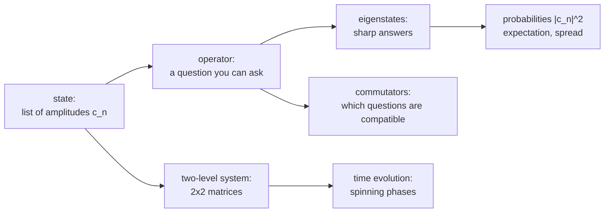

# QM03 · States, Operators and Measurement

◀ [[QM02 The Schrodinger Equation and Stationary States]] · [[Quantum Mechanics - Course Map|Course Map]] · [[QM04 The Particle in a Box]] ▶

taught · in syllabus extra · book extra · beyond

> [!syllabus] Syllabus map: what is in the syllabus and what is extra in this chapter
> 🟢 **In syllabus (taught)**: [[PH2113_states_operators_notes.pdf|States, Operators, Measurements, Uncertainty and Time Evolution]] (14 pp., all but the box example, which is in QM04) and [[PH2113_matrices_expectation_uncertainty.pdf|States, Operators, Bases, Expectation Values and Uncertainty]] (4 pp.), plus Problem 5 of the [[PH2113_wavefunctions_potentials_schrodinger_Tutorial.pdf|Tutorial Note]].
> - §1 states and superposition; §2 operators (SO §2–3)
> - §3 eigenstates and eigenvalues; degeneracy (SO §4)
> - §4 measurement probabilities, expectation values, uncertainty (SO §6–8; MX §4–7)
> - §5 commutators: compatible and incompatible observables; $[\hat x,\hat p]=i\hbar$ (SO §5; MX §8–9)
> - §6 the two-level system: $X,Y,Z$, bases, basis change (MX §1–5)
> - §7 time evolution of superpositions; why time is not an operator (SO §9)
> - §8 why we need operators at all (SO §11–13)
>
> 🟡 **Extra · book**
> - §5 the general uncertainty relation $\Delta A\,\Delta B\ge\tfrac12|\langle[A,B]\rangle|$ is **stated** in the notes; its proof (Cauchy-Schwarz) is in Griffiths §3.4 ([[Griffiths - Introduction to quantum mechanics.pdf#page=123|PDF p.123]]) and in the AI monograph as "supplementary"
>
> 🔵 **Extra · beyond** (my additions, labelled)
> - §5 the proof of the general uncertainty relation written out; $[\hat x,\hat p^2]$ and $[\hat x,\hat H]$; §6 the family of states that saturates the $X,Y$ bound; §7 the speed of the density pattern; the shift-operator proof that no time operator exists; all numbers (`scripts/qm_numbers.py`)

> [!key] After this chapter you can
> - write a state as a **superposition of eigenstates** and read off measurement **probabilities** $|c_a|^2$,
> - say whether a given function is an eigenstate of $\hat x,\hat p,\hat H$ or the parity operator, and **of which operator** it is an eigenstate,
> - compute an **expectation value** $\langle A\rangle=\int\Psi^*\hat A\Psi\,\mathrm dx$ and an **uncertainty** $\Delta A=\sqrt{\langle A^2\rangle-\langle A\rangle^2}$, and know that $\langle A\rangle$ need not be a possible result,
> - evaluate a **commutator**, derive $[\hat x,\hat p]=i\hbar$, and use $\Delta A\,\Delta B\ge\tfrac12|\langle[\hat A,\hat B]\rangle|$,
> - work in a **two-dimensional** state space with the matrices $X,Y,Z$ and change basis,
> - evolve a superposition in time and explain why probabilities of energy outcomes stay constant while the density can move,
> - explain why **time is not an operator** and why operators are needed at all.

> [!intuition] The one-sentence story
> A state is a **vector**; an observable is an **operator** that asks the state a question; the **eigenvectors** of the operator are the states that have a sharp answer; expanding the state in that eigenbasis gives the **probabilities** of the answers; and two questions can both be sharp only if their operators **commute**.

<!-- intuition-v1 -->

*Concept map: how the ideas of this chapter depend on each other (read left to right; every box is a section).*

![[QM03 From State to Measurement.svg]]
*Figure QM3.1. The whole chapter in one pass.*

## 1. States and superposition
taught *SO §2 ([[PH2113_states_operators_notes.pdf#page=2|pp.2–3]])*

> [!intuition] A state is an arrow, its amplitudes are coordinates
> The same arrow has different coordinates in different bases (energy, position, spin-up/down). Superposition just means the arrow is not along any one of your chosen axes.

A quantum system is described by a **state**. In the position representation it is a wavefunction $\psi(x)$; the same state can be denoted abstractly by $|\psi\rangle$ (the notation changes, not the physical state). For a normalised state $\int|\psi|^2\mathrm dx=1$ (for the ring, over any interval of length $L$).

> [!key] Superposition principle
> If $\psi_1$ and $\psi_2$ are allowed states then so is $\Psi=c_1\psi_1+c_2\psi_2$ (provided it satisfies the same boundary conditions and is normalised). For orthonormal ring states $\int_0^L\psi_m^*\psi_n\,\mathrm dx=\delta_{mn}$, so $\Psi=\sum_nc_n\psi_n$ is normalised iff $\sum|c_n|^2=1$.

> [!example] Examples on the ring ($\psi_n=e^{ik_nx}/\sqrt L$)
> - $\Psi=\psi_1$: one momentum state.
> - $\Psi=(\psi_0+\psi_1)/\sqrt2$: a valid state of **no single energy** ($E_0\ne E_1$).
> - $\frac1{\sqrt2}(\psi_n+\psi_{-n})=\sqrt{2/L}\cos k_nx$ and $\frac1{i\sqrt2}(\psi_n-\psi_{-n})=\sqrt{2/L}\sin k_nx$: **a cosine or sine is a superposition of $+p_n$ and $-p_n$**.
> - Relative phase: $\Psi_\varphi=(\psi_n+e^{i\varphi}\psi_{-n})/\sqrt2$ has $|\Psi_\varphi|^2=\frac1L[1+\cos(2k_nx-\varphi)]$; changing $\varphi$ shifts the pattern around the ring. An overall phase $e^{i\alpha}$ changes nothing.

**Expansion coefficients (Tutorial Problem 5).** If $\psi=\sum_nc_nu_n$ with orthonormal $u_n=e^{2\pi inx/L}/\sqrt L$ then $c_m=\int_0^Lu_m^*\psi\,\mathrm dx$. For $\psi=u_3$, $c_m=\delta_{m3}$: the state contains **only** the momentum $p_3=6\pi\hbar/L$, so it is a momentum eigenstate with $\Delta p=0$.

## 2. Operators
taught *SO §3 ([[PH2113_states_operators_notes.pdf#page=3|pp.3–4]])*

An **operator** is a rule that acts on a state and produces another state-like function. Observables are represented by operators; in one dimension
$$\hat x=x,\qquad \hat p=-i\hbar\frac{\mathrm d}{\mathrm dx},\qquad \hat H=-\frac{\hbar^2}{2m}\frac{\mathrm d^2}{\mathrm dx^2}+V(x),\qquad \hat H=\frac{\hat p^2}{2m}\ \ (V=0).$$
The action is literal: $\hat x\psi=x\psi$, $\hat p\psi=-i\hbar\psi'$. The operators are **linear**, $\hat A(c_1\psi_1+c_2\psi_2)=c_1\hat A\psi_1+c_2\hat A\psi_2$: this is what makes superposition useful.

> [!example] Operators acting (free particle or ring, $V=0$)
> - $\hat pe^{ikx}=\hbar k\,e^{ikx}$: returns the **same function times a number**.
> - $\hat p\cos kx=i\hbar k\sin kx$: **not** proportional to $\cos kx$.
> - $\hat H\cos kx=\dfrac{\hbar^2k^2}{2m}\cos kx$: proportional.
> - **Parity** $\hat P\psi(x)=\psi(-x)$: $\hat P\cos kx=+\cos kx$, $\hat P\sin kx=-\sin kx$. Not multiplication or differentiation, still an operator.

## 3. Eigenstates and eigenvalues
taught *SO §4 ([[PH2113_states_operators_notes.pdf#page=4|p.4]])*

> [!intuition] An eigenstate is a direction the operator does not turn
> Feed an eigenstate to the operator and it comes back stretched by the eigenvalue but pointing the same way. That is why measuring it gives a sharp result: there is only one number to report.

If $\hat A\psi=a\psi$, then $\psi$ is an **eigenstate** of $\hat A$ with **eigenvalue** $a$.

> [!key] Eigenstate means definite value
> In an eigenstate of $\hat A$ a measurement of $A$ gives the eigenvalue $a$ **with certainty**, $\langle A\rangle=a$ and $\Delta A=0$. Always ask "eigenstate of **which** operator?".

| state | $\hat p$ eigenstate? | $\hat H$ eigenstate? | comment |
|---|---|---|---|
| ring $\psi_n=e^{ik_nx}/\sqrt L$ | yes, $p_n=\hbar k_n$ | yes, $E_n$ | both definite |
| $\sqrt{2/L}\cos k_nx$ | no | **yes**, $E_n$ | definite energy, momentum $\pm p_n$ |
| $(\psi_0+\psi_1)/\sqrt2$ | no | no | $E_0\ne E_1$: a state but not an eigenstate |
| box $\sqrt{2/L}\sin(n\pi x/L)$ | no ($\hat p\phi_n\propto\cos$) | yes, $E_n=n^2\pi^2\hbar^2/2mL^2$ | definite energy, uncertain momentum |

**Degeneracy.** $E_n=E_{-n}$ on the ring: two distinct states ($\psi_n,\psi_{-n}$, momenta $\pm p_n$) share one energy.

## 4. Measurement probabilities, expectation values, uncertainty
taught *SO §6–8 ([[PH2113_states_operators_notes.pdf#page=7|pp.7–9]]); MX §4–7 ([[PH2113_matrices_expectation_uncertainty.pdf#page=2|pp.2–3]])*

> [!intuition] Average, spread and outcome are three different things
> A single measurement returns one eigenvalue; $\langle A\rangle$ is the weighted average over many repetitions (it need not be an allowed outcome); $\Delta A$ says how mixed the state is. A state with $\Delta A=0$ is an eigenstate.

Let $\{\phi_a\}$ be normalised eigenstates of $\hat A$, $\hat A\phi_a=a\phi_a$, and expand a normalised state $\Psi=\sum_ac_a\phi_a$, $\sum|c_a|^2=1$. When $A$ is measured:

> [!key] Measurement postulate (Born rule for any observable)
> The possible results are the **eigenvalues** $a$, and $P(A=a)=|c_a|^2$. After the measurement the state is the corresponding eigenstate ("collapse"). The coefficient is $c_a=\int\phi_a^*\Psi\,\mathrm dx=\langle\phi_a|\Psi\rangle$.

**Expectation value.** The average over many identically prepared copies:
$$\langle A\rangle=\sum_a|c_a|^2\,a=\int\Psi^*\hat A\Psi\,\mathrm dx,\qquad \langle x\rangle=\int x|\Psi|^2\mathrm dx,\ \ \langle p\rangle=\int\Psi^*\Big(-i\hbar\frac{\mathrm d}{\mathrm dx}\Big)\Psi\,\mathrm dx,\ \ \langle E\rangle=\int\Psi^*\hat H\Psi\,\mathrm dx .$$
It is an **ensemble average**; it need not be one of the possible single results. (A state that gives $0$ or $10$ eV with probability $\frac12$ each has $\langle E\rangle=5$ eV, but no single measurement gives 5 eV.)

**Uncertainty.** The spread of the possible results:
$$(\Delta A)^2=\langle(A-\langle A\rangle)^2\rangle=\langle A^2\rangle-\langle A\rangle^2,\qquad \Delta A=\sqrt{\langle A^2\rangle-\langle A\rangle^2}.$$
In an eigenstate $\langle A^2\rangle=a^2$ so $\Delta A=0$: **a definite value and zero uncertainty are the same statement.**

> [!example] Examples on the ring (all recomputed)
> - $\Psi=\psi_n$: $\langle p\rangle=p_n$, $\Delta p=0$, $\Delta E=0$.
> - $\Psi_c=\tfrac1{\sqrt2}(\psi_n+\psi_{-n})$: $\langle p\rangle=0$ but each measurement gives $\pm p_n$ with probability $\tfrac12$; $\langle p^2\rangle=p_n^2$, so $\Delta p=|p_n|$; yet both components have energy $E_n$, so $\Delta E=0$: **definite energy, uncertain momentum**.
> - $\Psi=a\psi_n+b\psi_{-n}$ ($|a|^2+|b|^2=1$): $\langle p\rangle=(|a|^2-|b|^2)p_n$, $\langle p^2\rangle=p_n^2$, so $(\Delta p)^2=4|a|^2|b|^2p_n^2$ and $\boxed{\Delta p=2|a||b|\,|p_n|}$. It vanishes with one component and is maximal for equal weights (Fig. QM3.2A). For $|a|^2=\tfrac34$: $P(+p_n)=\tfrac34$, $\langle p\rangle=p_n/2$, $\Delta p=\tfrac{\sqrt3}{2}|p_n|$.
> - Two equally likely eigenvalues $a_1,a_2$: $\langle A\rangle=\frac{a_1+a_2}2$ and $\Delta A=\frac{|a_2-a_1|}2$. For $(\psi_0+\psi_1)/\sqrt2$: $\langle E\rangle=E_1/2$, $\Delta E=E_1/2$.
> - Since $\hat H=\hat p^2/2m$ here, a definite $p$ implies a definite $E$, but not vice versa (the $\cos$ state).

> [!pitfall] The average is not the answer
> "$\langle p\rangle=0$" for $\Psi_c$ does **not** mean every measurement gives 0: the actual results are $\pm p_n$. Quote $\langle A\rangle$ together with $\Delta A$ (or the list of outcomes and probabilities).

## 5. Commutators: which observables can be sharp together?
taught *SO §5 ([[PH2113_states_operators_notes.pdf#page=5|pp.5–6]]); MX §8–9 ([[PH2113_matrices_expectation_uncertainty.pdf#page=3|p.3]])*

> [!intuition] Commuting questions can be answered together
> If $[A,B]=0$ there is a common set of axes in which both are sharp. If not, sharpening one smears the other: the commutator sets the exchange rate (QM03 §5 and [[Dirac Algebra]] §8).

The ring states $\psi_n$ are eigenstates of **both** $\hat p$ and $\hat H$; the box states are eigenstates of $\hat H$ only. What decides this is the **commutator**
$$[\hat A,\hat B]\equiv\hat A\hat B-\hat B\hat A .$$

> [!derivation] The canonical commutation relation
> Acting on an arbitrary $\psi(x)$:
> $$\hat x\hat p\,\psi=-i\hbar x\psi',\qquad \hat p\hat x\,\psi=-i\hbar(x\psi)'=-i\hbar\psi-i\hbar x\psi'.$$
> Subtracting, $[\hat x,\hat p]\psi=i\hbar\psi$. Since this holds for every $\psi$,
> $$\boxed{\ [\hat x,\hat p]=i\hbar\ }$$
> a fixed non-zero number. The order matters because the derivative in $\hat p$ acts on the factor $x$ as well as on $\psi$.

> [!key] Compatible and incompatible observables
> If $[\hat A,\hat B]=0$ the observables are **compatible**: they have a common set of eigenstates and both can be given definite values. If $[\hat A,\hat B]\ne0$ they are **incompatible**: no state (except special cases) has both sharp. Measurement order then matters: measuring $A$ then $B$ leaves the system in a different state from $B$ then $A$.

Examples: **free particle or ring:** $\hat H=\hat p^2/2m$ and any operator commutes with a function of itself, so $[\hat H,\hat p]=0$: $e^{ikx}$ has definite $E$ and $p$. **Box:** $\hat H$ contains $\hat p^2$ and $[\hat x,\hat p]\ne0$, so $[\hat H,\hat x]\ne0$: energy eigenstates have an uncertain position.

> [!example] Two commutators worth knowing (🔵)
> $[\hat x,\hat p^2]=\hat p[\hat x,\hat p]+[\hat x,\hat p]\hat p=2i\hbar\hat p$, hence $[\hat x,\hat H]=\dfrac{i\hbar}{m}\hat p$ and $[\hat x,\hat H]\neq0$ whenever the kinetic term is present. And $[\hat x,V(\hat x)]=0$: the potential never obstructs a sharp position.

### The general uncertainty relation
The commutator turns the uncertainty principle from a slogan into a calculation:
$$\boxed{\ \Delta A\,\Delta B\ \ge\ \frac12\,\big|\langle[\hat A,\hat B]\rangle\big|\ }\qquad\Longrightarrow\qquad\Delta x\,\Delta p\ge\frac\hbar2 .$$

> [!extra-beyond]- 🔵 Extra (beyond): proof (Robertson)
> Let $|f\rangle=(\hat A-\langle A\rangle)|\psi\rangle$ and $|g\rangle=(\hat B-\langle B\rangle)|\psi\rangle$, so $(\Delta A)^2=\langle f|f\rangle$ and $(\Delta B)^2=\langle g|g\rangle$. The **Cauchy-Schwarz inequality** gives $(\Delta A)^2(\Delta B)^2\ge|\langle f|g\rangle|^2$. Write
> $$\langle f|g\rangle=\tfrac12\langle[\hat A,\hat B]\rangle+\tfrac12\langle\{\hat A-\langle A\rangle,\hat B-\langle B\rangle\}\rangle ,$$
> where the commutator part is purely imaginary (the commutator of two Hermitian operators is anti-Hermitian) and the anticommutator part is real. Then $|\langle f|g\rangle|^2\ge(\mathrm{Im}\langle f|g\rangle)^2=\tfrac14|\langle[\hat A,\hat B]\rangle|^2$. $\square$
> For $\hat x,\hat p$: $\tfrac12|i\hbar|=\hbar/2$. The Gaussian of [[QM01 From Waves to Probabilities]] makes Cauchy-Schwarz an equality **and** has no real anticommutator part, so it saturates the bound.

> [!pitfall] Not a statement about disturbance only
> The relation is a property of the **state**: two measurements on two identical copies give two broad distributions. Measuring one variable also disturbs its partner, but that is a separate (and consistent) fact.

## 6. A two-level system: matrices instead of functions
taught *MX §1–5 ([[PH2113_matrices_expectation_uncertainty.pdf#page=1|pp.1–2]])*

> [!intuition] The whole theory in a 2×2 matrix
> A two-level system (spin-½, a qubit) has every feature: superposition, non-commuting observables ($X,Y,Z$), measurement collapse, interference. Its state is a point on a sphere and its dynamics a rotation.

The same structure appears in a **two-dimensional** state space, where everything is a $2\times2$ matrix and every integral is a sum. A state is a normalised vector $|\psi\rangle=\binom ab$, $|a|^2+|b|^2=1$; an observable is a Hermitian matrix. Three useful ones:
$$X=\begin{pmatrix}0&1\\1&0\end{pmatrix},\quad Y=\begin{pmatrix}0&-i\\i&0\end{pmatrix},\quad Z=\begin{pmatrix}1&0\\0&-1\end{pmatrix}.$$

| operator | eigenvalue $+1$ | eigenvalue $-1$ |
|---|---|---|
| $Z$ | $\lvert+z\rangle=\binom10$ | $\lvert-z\rangle=\binom01$ |
| $X$ | $\lvert+x\rangle=\frac1{\sqrt2}\binom11$ | $\lvert-x\rangle=\frac1{\sqrt2}\binom1{-1}$ |
| $Y$ | $\lvert+y\rangle=\frac1{\sqrt2}\binom1i$ | $\lvert-y\rangle=\frac1{\sqrt2}\binom1{-i}$ |

The commutators (checked symbolically): $[X,Y]=2iZ$, $[Y,Z]=2iX$, $[Z,X]=2iY$.

**The same state in different bases.** $|{+z}\rangle=\frac1{\sqrt2}(|{+x}\rangle+|{-x}\rangle)=\frac1{\sqrt2}(|{+y}\rangle+|{-y}\rangle)$: an eigenstate of $Z$ is an equal superposition of eigenstates of $X$ and $Y$. For $|\psi\rangle=\tfrac{\sqrt3}2|{+z}\rangle+\tfrac12|{-z}\rangle$, $Z$ gives $+1$ with probability $\tfrac34$ and $-1$ with $\tfrac14$.

![[fig_qm03_measurement.png]]
*Figure QM3.2. A: spread and mean of $p$ for $a\psi_n+b\psi_{-n}$ on the ring. B: the state $(\sqrt3/2,\,1/2)$ measured in the $Z$, $X$, $Y$ bases: the same state gives different statistics. C: for $\cos\frac\theta2|{+z}\rangle+\sin\frac\theta2|{-z}\rangle$ the product $\Delta X\,\Delta Y$ equals its lower bound $|\langle Z\rangle|$ at every $\theta$, while $\Delta Z\,\Delta X$ has bound $|\langle Y\rangle|=0$.*

> [!example] A basis change, in full (MX §3)
> $|{+x}\rangle=\frac1{\sqrt2}\binom11=\frac{1-i}2|{+y}\rangle+\frac{1+i}2|{-y}\rangle$ (coefficients $\langle\pm y|{+x}\rangle$; each has $|c|^2=\tfrac12$). The operator $X$ does not leave the $Y$ eigenvectors fixed: $X|{+y}\rangle=i|{-y}\rangle$ and $X|{-y}\rangle=-i|{+y}\rangle$. Acting on the superposition,
> $$X|{+x}\rangle=\frac{1-i}2\,i|{-y}\rangle+\frac{1+i}2(-i)|{+y}\rangle=\frac{1-i}2|{+y}\rangle+\frac{1+i}2|{-y}\rangle=|{+x}\rangle,$$
> so the intermediate vectors are mixed but the whole state returns to itself with eigenvalue $+1$. **Basis changes the coordinates, not the physics.**

**Expectation and uncertainty.** $\langle A\rangle=\langle\psi|A|\psi\rangle=|c_1|^2a_1+|c_2|^2a_2$. In $|{+x}\rangle$: $\langle X\rangle=1$, $\Delta X=0$. In $|{+z}\rangle$: $\langle X\rangle=0$, $\Delta X=1$ (each measurement gives $\pm1$). In $\tfrac{\sqrt3}2|{+z}\rangle+\tfrac12|{-z}\rangle$: $\langle Z\rangle=\tfrac12$ and $\Delta Z=\tfrac{\sqrt3}2$.

**The uncertainty bound in two dimensions.** In $|{+z}\rangle$: $\langle Z\rangle=1$, $\Delta X=\Delta Y=1$, so $\Delta X\,\Delta Y=1=\frac12|\langle[X,Y]\rangle|=\frac12|2i\langle Z\rangle|$: this state **saturates** the bound. For $\Psi=(\tfrac{\sqrt3}2,\tfrac12)$ one finds $\Delta Z\,\Delta X=\tfrac{\sqrt3}4=0.433$, above the bound $|\langle Y\rangle|=0$: allowed, not saturated.

> [!key] A dictionary between two dimensions and wave mechanics
> | idea | 2-D system | wave mechanics |
> |---|---|---|
> | state | $\binom ab$ | $\psi(x)$ |
> | observable | Hermitian matrix $A$ | operator $\hat x,\hat p,\hat H$ |
> | eigenstate | $A|a_n\rangle=a_n|a_n\rangle$ | $\hat A\phi_n=a_n\phi_n$ |
> | expansion | $\sum_{n=1}^2c_n|a_n\rangle$ | $\sum_nc_n\phi_n$ (or $\int\mathrm dp\,c(p)\phi_p$ for a continuous spectrum) |
> | probability | $|c_n|^2$ | $|c_n|^2$ (or $|c(p)|^2\mathrm dp$) |
> | expectation | $\langle\psi|A|\psi\rangle$ | $\int\psi^*\hat A\psi\,\mathrm dx$ |

## 7. Time evolution
taught *SO §9 ([[PH2113_states_operators_notes.pdf#page=10|pp.10–11]])*

> [!intuition] Time evolution is rotation of the phases
> In the energy basis each coefficient is multiplied by $e^{-iE_nt/\hbar}$. With two energies the relative phase drifts and the probabilities beat at $(E_2-E_1)/\hbar$.

The TDSE is $i\hbar\,\partial_t\Psi=\hat H\Psi$. In the energy basis:
- **An energy eigenstate** $\hat H\psi_n=E_n\psi_n$ evolves as $\Psi_n=\psi_n e^{-iE_nt/\hbar}$: only an overall phase, so $|\Psi_n|^2$ is time-independent (a **stationary state**).
- **A superposition** $\Psi(x,0)=\sum c_n\psi_n(x)$ evolves as $\Psi(x,t)=\sum c_ne^{-iE_nt/\hbar}\psi_n(x)$. Each component acquires **its own phase**; the $|c_n|$ do not change, so the **probabilities of the energy outcomes stay constant**, and so do $\langle E\rangle$ and $\Delta E$ (for a time-independent $\hat H$). What changes is the **relative phase** between components, and with it the density.

> [!example] A moving density (ring, $E_0=0$)
> $\Psi(x,0)=\frac1{\sqrt2}(\psi_0+\psi_1)$ with $\psi_0=1/\sqrt L$, $\psi_1=e^{ikx}/\sqrt L$, $k=2\pi/L$, $\omega=E_1/\hbar$:
> $$\Psi(x,t)=\frac1{\sqrt{2L}}\big(1+e^{i(kx-\omega t)}\big),\qquad|\Psi|^2=\frac1L\big[1+\cos(kx-\omega t)\big].$$
> The pattern **moves around the ring**: the state is not an energy eigenstate, its relative phase rotates. 🔵 The pattern speed is $\omega/k=\hbar k/2m$: **half** the velocity $\hbar k/m$ of the $\psi_1$ momentum state (it is the phase velocity of $\psi_1$ relative to $\psi_0$).
> **Same energy, different momenta:** $\frac1{\sqrt2}(\psi_n+\psi_{-n})=\sqrt{2/L}\cos k_nx$: both components acquire the **same** phase $e^{-iE_nt/\hbar}$, so $|\Psi|^2=\frac2L\cos^2k_nx$ is time-independent. It is **not** a momentum eigenstate but **is** an energy eigenstate, so it is stationary.

> [!example] Diagnostic table
> | state | definite $E$? | definite $p$? | $\Delta E$ | $\Delta p$ |
> |---|---|---|---|---|
> | ring $\psi_n$ | yes | yes | $0$ | $0$ |
> | $(\psi_n+\psi_{-n})/\sqrt2$ | yes | no | $0$ | $\lvert p_n\rvert$ |
> | $(\psi_0+\psi_1)/\sqrt2$ | no | no | $E_1/2$ | $\lvert p_1\rvert/2$ |
> | box $\sqrt{2/L}\sin(n\pi x/L)$ | yes | no | $0$ | $n\pi\hbar/L$ |

### Why is time not an operator?
$x,p,H$ are properties the system **has** at a given instant; $t$ is the parameter that labels the instants and sits **outside** the state. One might still look for an operator $\hat T$ conjugate to energy, $[\hat T,\hat H]=i\hbar$, by analogy with $[\hat x,\hat p]=i\hbar$. It cannot exist for a system whose energy is bounded below.

> [!derivation] No time operator for a bounded-below spectrum
> Suppose $[\hat T,\hat H]=i\hbar$ (so $[\hat H,\hat T]=-i\hbar$) and $\hat H|E\rangle=E|E\rangle$. For any real $a$, $[\hat H,e^{ia\hat T/\hbar}]=\tfrac{ia}\hbar[\hat H,\hat T]e^{ia\hat T/\hbar}=a\,e^{ia\hat T/\hbar}$, so
> $$\hat H\big(e^{ia\hat T/\hbar}|E\rangle\big)=(E+a)\big(e^{ia\hat T/\hbar}|E\rangle\big).$$
> Every eigenvalue $E$ would need a partner at $E+a$ for **all** real $a$: the spectrum would have to be continuous and unbounded **below**. But almost every system has a lowest energy (the ring's $E_0=0$, the box's $E_1=\pi^2\hbar^2/2mL^2$). So no such $\hat T$ exists for any bounded-below system. Momentum on the ring is discrete **and** unbounded in both directions because $x$ is periodic; time has no such periodicity.

## 8. Why we need operators at all
taught *SO §11–13 ([[PH2113_states_operators_notes.pdf#page=12|pp.12–14]])*

Classically a state is $(x,p)$ and an observable is a function $A(x,p)$ that returns a number. A quantum state $\psi$ need **not** contain one definite value of an observable: a superposition is not "one value we do not know" but genuinely indefinite until measured. So a state alone does not answer "what will I get if I measure $A$?". The operator answers three questions: **what results are possible** (its eigenvalues, which is exactly why energies come out quantised or continuous depending on the spectrum), **with what probability** (expand the state in its eigenbasis and take $|c_a|^2$), and **what state the system is left in** (the eigenstate).

| classical | quantum |
|---|---|
| state $(x,p)$ | state $\psi$ |
| observable $A(x,p)$, a number | operator $\hat A$ |
| known state $\Rightarrow$ definite value | $\hat A\psi=a\psi\Rightarrow$ definite value $a$; otherwise a **distribution** |
| statistical average $\sum_iP_iA_i$ | $\langle A\rangle=\langle\psi|\hat A|\psi\rangle$ |

Operators are the answer to "**which superposition basis is physically meaningful**": position eigenstates for $\hat x$, momentum eigenstates for $\hat p$, energy eigenstates for $\hat H$. And **non-commutativity is the mathematical form of the fact that two quantities cannot both be sharp**; numbers always commute ($ab=ba$), so if observables were numbers the statement $[\hat x,\hat p]\ne0$ could not even be written.

> [!connection] Same linear algebra elsewhere
> The eigenvalue problem here is the one used for matrix population models ([[Dominant Eigenvalue and Perron-Frobenius Theorem]]: $\mathbf n_{t+1}=\mathbf A\mathbf n_t$, the long-run state is the dominant eigenvector). The difference is that quantum evolution is **unitary** (probability conserved, eigenvalues on the unit circle) while the Leslie matrix is not (growth by $\lambda$). The two-level matrices $X,Y,Z$ are the starting point for [[Group Theory - Course Map]] (rotations of spin).

<!-- interactive:start (generated by scripts/embed_interactive.py; edit the tool in scripts/interactive/tools/, not this block) -->
> [!interactive]+ Interactive: Particle in a box: build a state from energy eigenstates
> Infinite well of width 1 (ħ = m = 1), E_n = n²π²/2.
>
> ![[qm_box.png|720]]
>
> **Try:** Put equal weight on n = 1 and 2: the packet bounces with period 2π/(E₂−E₁) = 0.85. Add n = 3 and the motion is no longer a simple oscillation. Notice ⟨E⟩ never moves.
>
> [▶ Open the tool in your browser](../Assets/interactive/qm_box.html) · [absolute link](file:///home/swastik/Documents/notes/Assets/interactive/qm_box.html) · all tools and coverage: [[Interactive Tools]]

<!-- interactive:end -->

## Map of this chapter
> [!connection] How QM03 connects
> **Builds on:** [[QM02 The Schrodinger Equation and Stationary States]] (stationary states, superposition).
> **Leads to:** [[QM04 The Particle in a Box]] (an energy eigenbasis, expectation values and uncertainties on a concrete system) → [[QM05 The Harmonic Oscillator]] (operators $\hat a_\pm$ built from $\hat x,\hat p$ and their commutator).
> **Concepts:** [[Operator]] · [[Eigenstate and Eigenvalue]] · [[Hermitian Operator]] · [[Expectation Value]] · [[Uncertainty of an Observable]] · [[Commutator]] · [[Canonical Commutation Relation]] · [[Generalised Uncertainty Principle]] · [[Measurement Postulate]] · [[Pauli Matrices]] · [[Two-Level System]] · [[Time Evolution of a Superposition]] · [[Time Is Not an Operator]] · [[Parity Operator]] · [[Degeneracy]]
> **Other subjects:** [[Bayes' Theorem]] and [[Probability - Course Map]] (a state gives a probability distribution; collapse is conditioning), [[Group Theory - Course Map]], [[Waves - Course Map]].

## Summary
> [!summary] Cheat-sheet
> - **State** = vector/wavefunction; superposition $\Psi=\sum c_n\psi_n$, $\sum|c_n|^2=1$; $c_n=\langle\psi_n|\Psi\rangle$. A cosine is a superposition of $\pm p$; overall phase irrelevant, relative phase not.
> - $\hat x=x$, $\hat p=-i\hbar\,\mathrm d/\mathrm dx$, $\hat H=\hat p^2/2m+V$; linear. **Eigenstate** $\hat A\psi=a\psi$ $\Leftrightarrow$ definite value $a$, $\Delta A=0$. Always ask: eigenstate of **which** operator? Ring $\psi_n$: both $p,E$; $\cos$: $E$ only; box: $E$ only.
> - **Measurement:** results = eigenvalues, $P(a)=|c_a|^2$; $\langle A\rangle=\sum|c_a|^2a=\int\Psi^*\hat A\Psi$; $\Delta A=\sqrt{\langle A^2\rangle-\langle A\rangle^2}$; $a\psi_n+b\psi_{-n}$ has $\Delta p=2|a||b||p_n|$.
> - $[\hat A,\hat B]=\hat A\hat B-\hat B\hat A$; $[\hat x,\hat p]=i\hbar$; $[\hat H,\hat p]=0$ free, $[\hat H,\hat x]\ne0$ in a box; $\Delta A\,\Delta B\ge\frac12|\langle[\hat A,\hat B]\rangle|$.
> - **Two levels:** $X,Y,Z$; $[X,Y]=2iZ$ etc.; $|{+z}\rangle=(|{+x}\rangle+|{-x}\rangle)/\sqrt2$; $|{+x}\rangle=\frac{1-i}2|{+y}\rangle+\frac{1+i}2|{-y}\rangle$; $|{+z}\rangle$ saturates $\Delta X\Delta Y\ge|\langle Z\rangle|$.
> - **Time:** $\Psi=\sum c_ne^{-iE_nt/\hbar}\psi_n$; $|c_n|^2$, $\langle E\rangle$, $\Delta E$ constant; density moves only if $\ge2$ energies present. No $\hat T$ conjugate to $\hat H$ when $E$ is bounded below.

## Practice
1. **Eigen or not?** For $\psi=e^{ikx}$, $\cos kx$ and $\sin(\pi x/L)$ say which of $\hat p,\hat H,\hat P$ (with $V=0$ inside the region of interest) they are eigenstates of, with eigenvalues.
2. **Probabilities.** $\Psi=\tfrac{\sqrt3}2\psi_n+\tfrac12\psi_{-n}$ on a ring. Find $P(\pm p_n)$, $\langle p\rangle$, $\Delta p$, $\langle E\rangle$, $\Delta E$.
3. **Two energies.** $\Psi=\tfrac1{\sqrt2}(\psi_0+\psi_1)$ on a ring. Find $\langle E\rangle$, $\Delta E$ in units of $E_1$ and the speed at which the density pattern moves.
4. **Commutators.** Show $[\hat x,\hat p^2]=2i\hbar\hat p$ and deduce $[\hat x,\hat H]$. Is $[\hat p,V(\hat x)]$ zero? Compute it.
5. **Generalised uncertainty.** For $\hat A=\hat x$ and $\hat B=\hat H$ (free particle) the relation gives $\Delta x\,\Delta E\ge\frac\hbar{2m}|\langle p\rangle|$. Evaluate it for a momentum eigenstate and for a Gaussian packet with mean momentum $p_0$.
6. **Two-level probabilities.** $|\psi\rangle=\tfrac{\sqrt3}2|{+z}\rangle+\tfrac12|{-z}\rangle$. Find the probabilities of $\pm1$ for $Z$, $X$ and $Y$ and the expectation values.
7. **Basis change.** Express $|{+z}\rangle$ in the $Y$ basis and verify that it is an equal superposition. Compute $\langle Y\rangle$ and $\Delta Y$ in $|{+z}\rangle$.
8. **Saturation.** In $|{+x}\rangle$ compute $\Delta Y\,\Delta Z$ and $\frac12|\langle[Y,Z]\rangle|$.
9. **Parity.** For a symmetric $V(x)=V(-x)$ show $[\hat P,\hat H]=0$. What follows for the eigenfunctions? Which of $\cos kx$, $\sin kx$, $e^{ikx}$ are parity eigenstates?
10. **Stationary?** State whether each is stationary and give $|\Psi|^2$: (a) $\psi_2$; (b) $\frac1{\sqrt2}(\psi_2+\psi_{-2})$; (c) $\frac1{\sqrt2}(\psi_1+\psi_2)$ on the ring.

> [!example]- Solutions
> 1. $e^{ikx}$: $\hat p$ ($\hbar k$), $\hat H$ ($\hbar^2k^2/2m$); not $\hat P$. $\cos kx$: $\hat H$ and $\hat P$ ($+1$); not $\hat p$ ($\hat p\cos kx=i\hbar k\sin kx$). $\sin(\pi x/L)$ (in a box, $V=0$ inside): $\hat H$ ($\pi^2\hbar^2/2mL^2$); not $\hat p$; about the box centre it is a $\hat P$ eigenstate with $+1$ (relative to the centre $x=L/2$), not about $x=0$.
> 2. $P(+p_n)=\tfrac34$, $P(-p_n)=\tfrac14$; $\langle p\rangle=p_n/2$; $\langle p^2\rangle=p_n^2$, $\Delta p=\sqrt{p_n^2-p_n^2/4}=\tfrac{\sqrt3}2|p_n|$; both components have energy $E_n$: $\langle E\rangle=E_n$, $\Delta E=0$.
> 3. $E_0=0$, $E_1$ equally likely: $\langle E\rangle=E_1/2$, $\Delta E=E_1/2$. The pattern moves at $\omega/k=\hbar k/2m$, half the velocity $\hbar k/m$ of the $\psi_1$ state.
> 4. $\hat x\hat p^2-\hat p^2\hat x=\hat p[\hat x,\hat p]+[\hat x,\hat p]\hat p=2i\hbar\hat p$; so $[\hat x,\hat H]=\tfrac{1}{2m}\cdot2i\hbar\hat p=i\hbar\hat p/m$ (and $[\hat x,V]=0$). $[\hat p,V(\hat x)]\psi=-i\hbar(V\psi)'+i\hbar V\psi'=-i\hbar V'\psi$, so $[\hat p,V]=-i\hbar V'(x)\ne0$ unless $V$ is constant.
> 5. $[\hat x,\hat H]=i\hbar\hat p/m$ so $\Delta x\,\Delta E\ge\frac\hbar{2m}|\langle p\rangle|$. A momentum eigenstate has $\Delta x=\infty$ and $\Delta E=0$ (product undefined; the bound holds in the sense of limits). A Gaussian with $\langle p\rangle=p_0$ and width $\sigma$: $\Delta x=\sigma$, $\Delta E=\Delta(p^2)/2m\approx p_0\Delta p/m=p_0\hbar/2m\sigma$ for $p_0\gg\Delta p$, so $\Delta x\,\Delta E\approx\frac{\hbar p_0}{2m}$: nearly saturated, as expected for a minimum-uncertainty packet.
> 6. $Z$: $P(+)=\tfrac34$, $P(-)=\tfrac14$, $\langle Z\rangle=\tfrac12$. $X$: $P(\pm)=\tfrac12(1\pm\tfrac{\sqrt3}2)=0.933,\ 0.067$, $\langle X\rangle=\tfrac{\sqrt3}2$. $Y$: $\langle Y\rangle=0$, so $0.5/0.5$ (real amplitudes carry no $Y$ polarisation).
> 7. $|{+z}\rangle=\frac1{\sqrt2}(|{+y}\rangle+|{-y}\rangle)$ (check: $\frac12[\binom1i+\binom1{-i}]=\binom10$). $\langle Y\rangle=\tfrac12(+1)+\tfrac12(-1)=0$, $\langle Y^2\rangle=1$, $\Delta Y=1$.
> 8. In $|{+x}\rangle$: $\Delta Y=\Delta Z=1$ (equal superpositions), product $1$; $\tfrac12|\langle[Y,Z]\rangle|=\tfrac12|2i\langle X\rangle|=1$. Saturated.
> 9. $\hat P\hat H\psi(x)=\hat H\psi(-x)$ evaluated using $V(-x)=V(x)$ and $\mathrm d^2/\mathrm dx^2$ invariant under $x\to-x$, so $[\hat P,\hat H]=0$: eigenfunctions can be chosen **even or odd** (strictly: if the level is non-degenerate they are one or the other). $\cos kx$ even, $\sin kx$ odd; $e^{ikx}$ is neither (it is a mixture of both), though it is an eigenstate of $\hat H$ with $V=0$: this is the degenerate case.
> 10. (a) stationary, $|\Psi|^2=1/L$; (b) stationary (same $E_2$): $|\Psi|^2=\frac2L\cos^2(2k_1x)$; (c) not stationary: $|\Psi|^2=\frac1L[1+\cos(k_1x-\omega t)]$ with $\omega=(E_2-E_1)/\hbar=3E_1/\hbar$.

<!-- zettel:start (generated by scripts/sort_zettel.py; do not edit between the markers) -->
## Zettel notes

> [!abstract]- Zettel notes filed under this chapter (17): the other tool's concept notes from the lectures, unreviewed
> [[zettel/basis-independence-of-quantum-states|Basis Independence of Quantum States]] · [[zettel/born-rule-and-expansion-postulate|Born Rule and Expansion Postulate]] · [[zettel/canonical-commutation-relation-position-momentum|Canonical Commutation Relation Position-Momentum]] · [[zettel/canonical-commutation-relations-in-two-dimensions|Canonical Commutation Relations in Two Dimensions]] · [[zettel/eigenstate-definite-value-principle|Eigenstate Definite Value Principle]] · [[zettel/energy-eigenstate-superposition-with-momentum-degeneracy|Energy Eigenstate Superposition with Momentum Degeneracy]] · [[zettel/linear-operator|Linear Operator]] · [[zettel/non-preservation-of-eigenstate-under-non-degenerate-superposition|Non-Preservation of Eigenstate Under Non-Degenerate Superposition]] · [[zettel/operator-commutator|Operator Commutator]] · [[zettel/orthogonality-of-energy-eigenstates|Orthogonality of Energy Eigenstates]] · [[zettel/parity-operator-eigenvalue-action|Parity Operator Eigenvalue Action]] · [[zettel/plane-wave-momentum-eigenstate|Plane Wave Momentum Eigenstate]] · [[zettel/position-dependent-phase-and-momentum-content|Position-Dependent Phase and Momentum Content]] · [[zettel/quantum-expectation-value|Quantum Expectation Value]] · [[zettel/quantum-mechanical-correspondence-between-discrete-and-continuous-syst|Quantum-Mechanical Correspondence Between Discrete and Continuous Systems]] · [[zettel/robertson-uncertainty-relation-for-pauli-matrices|Robertson Uncertainty Relation for Pauli Matrices]] · [[zettel/simultaneous-eigenstates-and-commuting-observables|Simultaneous Eigenstates and Commuting Observables]]
<!-- zettel:end -->

## Provenance
> [!provenance]- Source map for this chapter
> | Topic | Source | Scope |
> |---|---|---|
> | states, superposition, operators, eigenstates, degeneracy | [[PH2113_states_operators_notes.pdf#page=2\|SO §2–4, pp.2–4]] | taught |
> | commutators, canonical relation, compatible observables | [[PH2113_states_operators_notes.pdf#page=5\|SO §5, pp.5–6]]; [[PH2113_matrices_expectation_uncertainty.pdf#page=3\|MX §8–9, p.3]] | taught |
> | measurement probabilities, $\langle A\rangle$, $\Delta A$, ring examples | [[PH2113_states_operators_notes.pdf#page=7\|SO §6–8, pp.7–9]]; MX §4–7 | taught |
> | two-level system, bases, basis change, dictionary | [[PH2113_matrices_expectation_uncertainty.pdf#page=1\|MX §1–5, pp.1–2]] | taught |
> | time evolution, no time operator | [[PH2113_states_operators_notes.pdf#page=10\|SO §9, pp.10–11]] | taught |
> | why operators; classical vs quantum | [[PH2113_states_operators_notes.pdf#page=12\|SO §11–13, pp.12–14]] | taught |
> | expansion coefficients $c_m$ | [[PH2113_wavefunctions_potentials_schrodinger_Tutorial.pdf#page=3\|Tutorial P5, p.3]] | taught |
> | proof of the general uncertainty relation | Griffiths §3.4 ([[Griffiths - Introduction to quantum mechanics.pdf#page=123\|PDF p.123]]); AI monograph §6.1 ("supplementary") | extra/book |
> | $[\hat x,\hat p^2]$, saturation family, pattern speed, shift-operator proof, numbers | derived/computed here | extra/beyond |
>
> **Read and not read.** The States-and-Operators notes and the matrix note were read in full; the box example of SO §8.2 is used in [[QM04 The Particle in a Box]]. Griffiths §3.4 was located by OCR but not read in detail.
>
> **Notes.** The SO notes state the general uncertainty relation without proof and mention the numerical check for the box in §8.2. In SO §9.3 the argument about the time operator is as summarised in §7 above (the shift-operator form is my own writing of the same idea). Every matrix identity was checked symbolically (`scripts/qm_numbers.py`).

**References.** Griffiths, D. J. *Introduction to Quantum Mechanics*, Ch. 3 · Sakurai, J. J. and Napolitano, J. *Modern Quantum Mechanics* (3rd ed.), Ch. 1 · Robertson, H. P. (1929) *Phys. Rev.* 34, 163 · Pauli, W. (1933) *Handbuch der Physik* (on the time operator).
