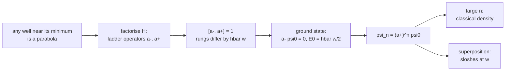

# QM05 · The Harmonic Oscillator

◀ [[QM04 The Particle in a Box]] · [[Quantum Mechanics - Course Map|Course Map]]

taught · in syllabus extra · book extra · beyond

> [!syllabus] Syllabus map: what is in the syllabus and what is extra in this chapter
> 🟢 **In syllabus (taught)**: the handwritten **oscillator lecture** ([[Harmonic_oscillator.pdf|13 pp.]]: the factorisation of $\hat H$, the ladder property, the ground state, $\hat a_\pm\psi_n=\sqrt{n+1}\,\psi_{n+1},\sqrt n\,\psi_{n-1}$, $\psi_n=(\hat a_+)^n\psi_0/\sqrt{n!}$, $\langle x\rangle,\langle p\rangle,\langle x^2\rangle,\langle p^2\rangle$; authorship is not stated, it is treated as the instructor's like the box lecture), [[Tutorial2.pdf|Tutorial II]] (five problems), [[Tutorial3.pdf|Tutorial III]] (three problems) and the Gaussian/Fourier primer of the [[PH2113_wavefunctions_potentials_schrodinger_Tutorial.pdf#page=3|Tutorial Note]] (Problems 5–6).
> - §1 the potential and the classical question (lecture p.2); §2 the ladder operators and their commutator; §3 $\hat H$ in ladder form (lecture pp.2–3, Tutorial II preamble)
> - §4 the ladder property (lecture pp.4–5, Q1); §5 the ground state, the spectrum, the constants $c_n,d_n$ and $\psi_n$ (lecture pp.6–11, Q2)
> - §6 $\langle x\rangle,\langle p\rangle,\langle x^2\rangle,\langle p^2\rangle$ for $\psi_n$ (lecture pp.12–13); sketches, parity and a superposition that oscillates (Q3)
> - §7 the ground state is unique (Q4); §8 Gaussian integrals and the Fourier transform of a Gaussian (Q5; Tutorial Note P5–P6)
> - §10 Tutorial III: $\langle p^2\rangle$ by ladders, the Gaussian integrals for $\langle x\rangle,\langle x^2\rangle$, orthogonality of eigenfunctions
>
> 🟡 **Extra · book**
> - the Hermite polynomials (Griffiths §2.3, [[Griffiths - Introduction to quantum mechanics.pdf#page=46|PDF p.46]]); the oscillation theorem behind "the ground state has no nodes"
>
> 🔵 **Extra · beyond** (my additions, labelled)
> - §1 the answer to the lecture's classical question (the density $1/\pi\sqrt{A^2-x^2}$); §6 $\langle x^2\rangle(t)$ for $(\psi_0+\psi_2)/\sqrt2$; §9 penetration into the forbidden region (16 % for the ground state), the quadratic-potential argument, the CO and CO$_2$ vibrations; all numbers (`scripts/qm_numbers.py`, `fig_qm05_ho.py`)

> [!key] After this chapter you can
> - define $\hat a_\pm$, derive $[\hat a_-,\hat a_+]=1$ and $\hat H=\hbar\omega(\hat a_+\hat a_-+\tfrac12)=\hbar\omega(\hat a_-\hat a_+-\tfrac12)$,
> - **prove** $\hat H(\hat a_-\psi)=(E-\hbar\omega)(\hat a_-\psi)$ and its partner, and deduce that the spectrum is $E_n=(n+\tfrac12)\hbar\omega$,
> - find $\psi_0$ from $\hat a_-\psi_0=0$, build $\psi_1,\psi_2$ with $\psi_n=(\hat a_+)^n\psi_0/\sqrt{n!}$ and describe the pattern (polynomial $\times$ Gaussian, $n$ nodes, parity $(-1)^n$),
> - say what $\langle x\rangle$ is for $\psi_n$ and for $(\psi_0+\psi_1)/\sqrt2$, and why one is constant and the other oscillates,
> - **prove** that the ground state of a 1-D Hamiltonian is non-degenerate if it has no nodes,
> - evaluate $\int e^{-ax^2+bx}\mathrm dx$ and the Fourier transform of a Gaussian, and say how the widths relate.

> [!intuition] The one-sentence story
> The oscillator is the system that is **solved by algebra, not by differential equations**: two operators $\hat a_\pm$ that step the energy up and down by exactly $\hbar\omega$ build the whole equally spaced ladder from one rung, and the bottom rung must be a Gaussian that cannot be stepped down further.

<!-- intuition-v1 -->

*Concept map: how the ideas of this chapter depend on each other (read left to right; every box is a section).*

## 1. The oscillator and why it matters
taught *oscillator lecture p.2 (the potential and the question)* · extra · beyond *context and the answer, derived here*

> [!intuition] Why this one problem is everywhere
> Every smooth potential looks like a parabola at its bottom, so every small vibration (molecular bonds, lattice phonons, light modes) is an oscillator. Solve this and you have solved the leading behaviour of all of them.

$$V(x)=\tfrac12m\omega^2x^2,\qquad\hat H=\frac{\hat p^2}{2m}+\tfrac12m\omega^2\hat x^2 .$$
Classically a mass on a spring of constant $k=m\omega^2$ oscillates with angular frequency $\omega$ and energy $E=\tfrac12m\omega^2A^2$ for **any** amplitude $A$. The potential is the first useful approximation to **any** smooth well: near a minimum $x_0$, $V(x)\approx V(x_0)+\tfrac12V''(x_0)(x-x_0)^2$, so small vibrations of molecules, crystals and fields all look like oscillators with $\omega=\sqrt{V''(x_0)/m}$. The quantum problem asks which energies are allowed and what the states look like.

The lecture opens with a classical question: ***what is the classical probability of finding the mass at $x$, and where is it peaked?***

> [!derivation] The classical probability density (🔵, answers the lecture's question)
> Take $x(t)=A\cos\omega t$, so the speed is $|v|=\omega A|\sin\omega t|=\omega\sqrt{A^2-x^2}$. The mass spends the time $\mathrm dt=\mathrm dx/|v|$ in $[x,x+\mathrm dx]$ and passes each $x$ twice per period $T=2\pi/\omega$, so
> $$P_{\rm cl}(x)\,\mathrm dx=\frac{2\,\mathrm dt}{T}=\frac{2\,\mathrm dx}{T\,\omega\sqrt{A^2-x^2}}\ \Longrightarrow\ \boxed{\ P_{\rm cl}(x)=\frac1{\pi\sqrt{A^2-x^2}},\quad|x|<A\ }$$
> It is normalised ($\int_{-A}^{A}P_{\rm cl}\,\mathrm dx=1$), **peaked at the turning points** $x=\pm A$ (the mass is slowest there; the density diverges but integrably) and **smallest at the centre**, where it is fastest. Sanity numbers: $P(|x|<A/2)=\tfrac2\pi\arcsin\tfrac12=\tfrac13$ and $P(|x|>0.9A)=0.287$ (a simulation of $2\times10^6$ random times gives $0.3332$ and $0.2875$). The amplitude for energy $E$ is $A=\sqrt{2E/m\omega^2}$, i.e. $x_t=\sqrt{(2n+1)\hbar/m\omega}$ for $E_n$. The quantum ground state is the opposite: one hump **at the centre**. For high $n$ the quantum density oscillates about $P_{\rm cl}$ (Fig. QM5.1B); for $n=20$ the quantum $P(|x|<x_t/2)=0.344$ against the classical $0.333$ ([[Classical Probability Density of the Oscillator]], [[Correspondence Principle]]).

## 2. The ladder operators
taught *[[Harmonic_oscillator.pdf#page=2|oscillator lecture p.2]]; [[Tutorial2.pdf|Tutorial II]] preamble (eqs. 1–5); [[Tutorial3.pdf#page=1|Tutorial III]] eqs. (1)–(6)*

> [!intuition] A staircase you can step up and down
> $\hat a_+$ adds one quantum $\hbar\omega$ of energy, $\hat a_-$ removes one. The algebra $[\hat a_-,\hat a_+]=1$ is the statement that the steps are all the same height.

> [!intuition] Why these operators? (the lecture's factorisation, p.2)
> $\hat H=\frac1{2m}\big[\hat p^2+(m\omega\hat x)^2\big]$ is a **sum of two squares**, and a sum of squares factorises over the complex numbers: $a^2+b^2=(ia+b)(-ia+b)$. Put $a=\hat p$, $b=m\omega\hat x$ and the two factors are exactly $\hat a_\mp$ up to the constant $\sqrt{2\hbar m\omega}$. Because $\hat x$ and $\hat p$ do not commute the factorisation is not exact: the cross terms leave the commutator, which is the $\pm\tfrac12$ in $\hat H=\hbar\omega(\hat a_\pm\hat a_\mp\pm\tfrac12)$ (§3).

$$\boxed{\ \hat a_+=\frac1{\sqrt{2\hbar m\omega}}\big(m\omega\hat x-i\hat p\big),\qquad\hat a_-=\frac1{\sqrt{2\hbar m\omega}}\big(m\omega\hat x+i\hat p\big)\ }$$
They are Hermitian conjugates of one another, $\int f^*\,\hat a_\mp g\,\mathrm dx=\int(\hat a_\pm f)^*g\,\mathrm dx$ (Tutorial eq. 5; the lecture proves it on p.9 by integrating by parts, see §5), and they are **not** Hermitian themselves, so they are not observables.

> [!derivation] The commutator $[\hat a_-,\hat a_+]=1$ (Tutorial eq. 3)
> $$[\hat a_-,\hat a_+]=\frac1{2\hbar m\omega}\big[m\omega\hat x+i\hat p,\ m\omega\hat x-i\hat p\big]=\frac1{2\hbar m\omega}\Big(-im\omega[\hat x,\hat p]+im\omega[\hat p,\hat x]\Big)=\frac{-2im\omega\,(i\hbar)}{2\hbar m\omega}=1 .$$
> (Only the cross terms survive and each gives $m\omega\hbar$.) I checked it on $\psi_0$ symbolically.

Inverting (add and subtract the two definitions), which is needed for expectation values (§6, §9, §10; lecture p.12, Tutorial III eqs. 5–6):
$$\hat x=\sqrt{\frac\hbar{2m\omega}}\,(\hat a_++\hat a_-),\qquad\hat p=i\sqrt{\frac{m\hbar\omega}2}\,(\hat a_+-\hat a_-).$$

## 3. The Hamiltonian in ladder form
taught *[[Harmonic_oscillator.pdf#page=3|oscillator lecture p.3]]; Tutorial II eq. 4; Tutorial III eq. 4*

$$\boxed{\ \hat H=\hbar\omega\Big(\hat a_+\hat a_-+\tfrac12\Big)=\hbar\omega\Big(\hat a_-\hat a_+-\tfrac12\Big)\ }$$

> [!derivation] Why: the lecture's route through $\hat a_-\hat a_+$ (p.3)
> Multiply the factors in the order $\hat a_-\hat a_+$:
> $$\hat a_-\hat a_+=\frac1{2\hbar m\omega}\Big[\hat p^2+(m\omega\hat x)^2\Big]-\frac{im\omega}{2\hbar m\omega}\big[\hat x\hat p-\hat p\hat x\big]=\frac{\hat H}{\hbar\omega}-\frac i{2\hbar}[\hat x,\hat p]=\frac{\hat H}{\hbar\omega}-\frac i{2\hbar}(i\hbar)=\frac{\hat H}{\hbar\omega}+\frac12 ,$$
> so $\hat H=\hbar\omega(\hat a_-\hat a_+-\tfrac12)$. The same steps in the other order give $\hat H=\hbar\omega(\hat a_+\hat a_-+\tfrac12)$, and subtracting the two,
> $$[\hat a_-,\hat a_+]=\hat a_-\hat a_+-\hat a_+\hat a_-=\Big(\frac{\hat H}{\hbar\omega}+\frac12\Big)-\Big(\frac{\hat H}{\hbar\omega}-\frac12\Big)=1$$
> (the lecture gets the commutator this way, as a corollary, rather than directly as in §2).

> [!derivation] The other order, written out (🔵)
> $$\hat a_+\hat a_-=\frac1{2\hbar m\omega}\big(m\omega\hat x-i\hat p\big)\big(m\omega\hat x+i\hat p\big)=\frac1{2\hbar m\omega}\Big(m^2\omega^2\hat x^2+\hat p^2+im\omega[\hat x,\hat p]\Big)=\frac1{2\hbar m\omega}\Big(m^2\omega^2\hat x^2+\hat p^2\Big)-\frac12 ,$$
> using $[\hat x,\hat p]=i\hbar$. Multiply by $\hbar\omega$: $\hbar\omega\,\hat a_+\hat a_-=\frac{\hat p^2}{2m}+\tfrac12m\omega^2\hat x^2-\tfrac12\hbar\omega=\hat H-\tfrac12\hbar\omega$. The second form follows from $\hat a_-\hat a_+=\hat a_+\hat a_-+1$.

The operator $\hat N=\hat a_+\hat a_-$ is the **number operator**: $\hat H=\hbar\omega(\hat N+\tfrac12)$, so $\hat H$ and $\hat N$ share eigenstates, with $\hat N\psi_n=n\psi_n$ (checked for $n=0,1,2,3$).

## 4. The ladder property
taught *[[Harmonic_oscillator.pdf#page=4|oscillator lecture pp.4–5]]; Tutorial II, Problem 1*

> [!intuition] Why the staircase has a bottom rung with energy left over
> You cannot step below the lowest rung, so $\hat a_-\psi_0=0$. That condition alone fixes $E_0=\tfrac12\hbar\omega$: the zero-point energy is the price of squeezing $x$ and $p$ at the same time.

> [!key] Lowering and raising
> If $\hat H\psi=E\psi$ then
> $$\hat H(\hat a_-\psi)=(E-\hbar\omega)(\hat a_-\psi),\qquad\hat H(\hat a_+\psi)=(E+\hbar\omega)(\hat a_+\psi).$$
> So $\hat a_-$ **lowers** the energy by $\hbar\omega$ and $\hat a_+$ **raises** it by $\hbar\omega$ (unless the result is zero).

> [!derivation] Proof of Problem 1
> From $[\hat a_-,\hat a_+]=1$ we have $[\hat a_+,\hat a_-]=-1$, and with $\hat H=\hbar\omega(\hat a_+\hat a_-+\tfrac12)$,
> $$[\hat H,\hat a_-]=\hbar\omega[\hat a_+\hat a_-,\hat a_-]=\hbar\omega[\hat a_+,\hat a_-]\hat a_-=-\hbar\omega\,\hat a_- .$$
> Therefore $\hat H\hat a_-\psi=\hat a_-\hat H\psi-\hbar\omega\hat a_-\psi=(E-\hbar\omega)\hat a_-\psi$. In the same way $[\hat H,\hat a_+]=+\hbar\omega\hat a_+$ gives the raising property. (Both verified symbolically on $\psi_2$.) $\square$

> [!derivation] The lecture's direct proof, with no commutators of $\hat H$ (pp.4–5)
> Let $\psi_n$ be *any* eigenstate, $\hat H\psi_n=E_n\psi_n$ (the lecture stresses: "we haven't actually found them" yet). Use $\hat H=\hbar\omega(\hat a_+\hat a_-+\tfrac12)$ on $\hat a_+\psi_n$, move $\hat a_+$ to the left with $\hat a_-\hat a_+=\hat a_+\hat a_-+1$, and recognise $\hat H$ again:
> $$\begin{aligned}\hat H(\hat a_+\psi_n)&=\hbar\omega\big(\hat a_+\hat a_-+\tfrac12\big)\hat a_+\psi_n=\hbar\omega\,\hat a_+\big(\hat a_-\hat a_++\tfrac12\big)\psi_n=\hbar\omega\,\hat a_+\big(\hat a_+\hat a_-+1+\tfrac12\big)\psi_n\\&=\hat a_+\big(\hat H+\hbar\omega\big)\psi_n=(E_n+\hbar\omega)\,(\hat a_+\psi_n).\end{aligned}$$
> For $\hat a_-$ use $\hat H=\hbar\omega(\hat a_-\hat a_+-\tfrac12)$ and $\hat a_+\hat a_-=\hat a_-\hat a_+-1$ to get $\hat H(\hat a_-\psi_n)=(E_n-\hbar\omega)(\hat a_-\psi_n)$.
>
> **Consequences stated in the lecture.** (1) If $\psi_n$ is an eigenstate, so are $\hat a_+\psi_n$, $\hat a_-\psi_n$ and every $(\hat a_\pm)^k\psi_n$. (2) The eigenvalues are separated by $\hbar\omega$, "the energy unit of the system". The argument assumes an eigenstate exists and never says it is normalised or non-zero: both are settled in §5.

## 5. The spectrum and the wavefunctions
taught *[[Harmonic_oscillator.pdf#page=6|oscillator lecture pp.6–11]]; Tutorial II, Problem 2*

> [!intuition] Equal spacing
> $E_n=(n+\tfrac12)\hbar\omega$ is a ruler with evenly spaced marks, the quantum image of 'the period does not depend on the amplitude'.

**The ladder must stop at the bottom.** Applying $\hat a_-$ repeatedly lowers $E$ by $\hbar\omega$ each time, but energy cannot go below the bottom of the potential ($E>V_{\min}=0$, [[QM04 The Particle in a Box]]). More directly, $\langle\psi|\hat H|\psi\rangle=\hbar\omega\big(\|\hat a_-\psi\|^2+\tfrac12\big)\ge\tfrac12\hbar\omega$. So there is a lowest state $\psi_0$ for which $\hat a_-\psi_0=0$.

> [!derivation] The ground state
> $\hat a_-\psi_0=0$ means $\big(m\omega x+\hbar\,\tfrac{\mathrm d}{\mathrm dx}\big)\psi_0=0$, i.e. $\dfrac{\mathrm d\psi_0}{\psi_0}=-\dfrac{m\omega}\hbar\,x\,\mathrm dx$ (lecture pp.6–7: "we solved a first-order differential equation", not the second-order Schrödinger equation). Integrating, $\ln\psi_0=-\dfrac{m\omega x^2}{2\hbar}+c$, so $\psi_0=A\,e^{-m\omega x^2/2\hbar}$, and normalisation $|A|^2\int e^{-m\omega x^2/\hbar}\mathrm dx=|A|^2\sqrt{\pi\hbar/m\omega}=1$ fixes $A$:
> $$\boxed{\ \psi_0(x)=\Big(\frac{m\omega}{\pi\hbar}\Big)^{1/4}e^{-m\omega x^2/2\hbar},\qquad E_0=\hbar\omega\big(0+\tfrac12\big)=\tfrac12\hbar\omega\ }$$
> (the form given in Tutorial II eq. 7; $\int\psi_0^2\mathrm dx=1$). Climbing the ladder:
> $$\boxed{\ E_n=\Big(n+\tfrac12\Big)\hbar\omega,\qquad\psi_n=\frac1{\sqrt{n!}}(\hat a_+)^n\psi_0,\qquad n=0,1,2,\dots\ }$$
> The factor $1/\sqrt{n!}$ keeps $\psi_n$ normalised, because $\hat a_+\psi_n=\sqrt{n+1}\,\psi_{n+1}$ and $\hat a_-\psi_n=\sqrt n\,\psi_{n-1}$: indeed $\|\hat a_+\psi_n\|^2=\langle\hat a_-\hat a_+\rangle=\langle\hat N+1\rangle=n+1$ (checked: $\hat a_+\psi_1/\psi_2=\sqrt2$).

> [!derivation] The constants $c_n,d_n$ the lecture's way (pp.9–11)
> The lecture first proves the **adjoint identity** by integrating by parts (the boundary term vanishes because the functions decay), for $\hat a_\pm=\frac1{\sqrt{2\hbar m\omega}}\big(\mp\hbar\,\partial_x+m\omega x\big)$:
> $$\int f^*\big(\hat a_+g\big)\mathrm dx=\int\big(\hat a_-f\big)^*g\,\mathrm dx,\qquad\int f^*\big(\hat a_-g\big)\mathrm dx=\int\big(\hat a_+f\big)^*g\,\mathrm dx .$$
> Write $\hat a_+\psi_n=c_n\psi_{n+1}$ and $\hat a_-\psi_n=d_n\psi_{n-1}$ (allowed by §4: the result is again an eigenfunction, one rung up or down, and unit norm is imposed on all $\psi_k$). Now $\langle\hat H\rangle=E_n=\hbar\omega(n+\tfrac12)$ and $\hat H=\hbar\omega(\hat a_+\hat a_-+\tfrac12)$ give $\int\psi_n^*\hat a_+\hat a_-\psi_n\,\mathrm dx=n$, and the identity turns the left side into a norm:
> $$\int(\hat a_-\psi_n)^*(\hat a_-\psi_n)\,\mathrm dx=|d_n|^2\int\psi_{n-1}^*\psi_{n-1}\,\mathrm dx=|d_n|^2=n\ \Rightarrow\ \boxed{d_n=\sqrt n},\qquad|c_n|^2=n+1\ \Rightarrow\ \boxed{c_n=\sqrt{n+1}}$$
> (phases chosen real). Hence $\psi_{n+1}=\hat a_+\psi_n/\sqrt{n+1}$, so $\psi_1=\hat a_+\psi_0$, $\psi_2=\frac1{\sqrt2}\hat a_+\psi_1=\frac1{\sqrt2}(\hat a_+)^2\psi_0$, $\psi_3=\frac1{\sqrt{3\cdot2}}(\hat a_+)^3\psi_0$ and, by induction, $\psi_n=\dfrac1{\sqrt{n!}}(\hat a_+)^n\psi_0$. Checked with `sympy` for $n\le6$: $\hat a_+\psi_n/\psi_{n+1}=\sqrt{n+1}$ and $\hat a_-\psi_n/\psi_{n-1}=\sqrt n$; the identity holds for all $n,m\le4$.

> [!verify] A sign slip on page 9 of the lecture
> The first line of the identity on [[Harmonic_oscillator.pdf#page=9|p.9]] writes the raising operator as $\hbar\,\partial_x+m\omega x$ (and drops the $1/\sqrt{2\hbar m\omega}$). With $\hat p=-i\hbar\partial_x$ the definition on p.2, $\hat a_+\propto-i\hat p+m\omega\hat x$, gives $-\hbar\,\partial_x+m\omega x$; the page's plus sign is the sign of $\hat a_-$ (p.6 uses it correctly for $\hat a_-\psi_0=0$). The **conclusions** on p.9 are right. With the page's sign the identity fails: $\int\psi_0\,(\hat a'\psi_1)\,\mathrm dx-\int(\hat a_-\psi_0)\psi_1\,\mathrm dx=1\ne0$ (`scripts/qm_numbers.py`). The sign used here is the one that makes the identity true.

**Explicit states** (Problem 2). With $\xi=\sqrt{m\omega/\hbar}\,x$ and $\hat a_+=\frac1{\sqrt2}\big(\xi-\mathrm d/\mathrm d\xi\big)$:
$$\psi_1=\Big(\frac{m\omega}{\pi\hbar}\Big)^{1/4}\sqrt2\,\xi\,e^{-\xi^2/2},\qquad\psi_2=\Big(\frac{m\omega}{\pi\hbar}\Big)^{1/4}\frac{2\xi^2-1}{\sqrt2}\,e^{-\xi^2/2}.$$
(From $\hat a_+\psi_0=\sqrt{2m\omega/\hbar}\,x\,\psi_0$; sympy confirms $\hat H\psi_n=(n+\tfrac12)\hbar\omega\psi_n$ and unit norm for $n\le3$.)

> [!key] The pattern
> $\psi_n=\Big(\dfrac{m\omega}{\pi\hbar}\Big)^{1/4}\dfrac1{\sqrt{2^nn!}}\,H_n(\xi)\,e^{-\xi^2/2}$: a **polynomial of degree $n$ times the Gaussian**; $n$ nodes; parity $(-1)^n$ (even/odd alternate). $H_0=1$, $H_1=2\xi$, $H_2=4\xi^2-2$, $H_3=8\xi^3-12\xi$ (Hermite polynomials; [[Griffiths - Introduction to quantum mechanics.pdf#page=46|Griffiths §2.3]]).

![[fig_qm05_ho.png]]
*Figure QM5.1. A: the parabola, levels $E_n=(n+\frac12)\hbar\omega$ and $\psi_0$ to $\psi_3$ drawn on their levels. B: $|\psi_{10}|^2$ against the classical probability density $1/\pi\sqrt{x_t^2-x^2}$: the quantum density oscillates about the classical one and leaks past the turning points. C: the density of $(\psi_0+\psi_1)/\sqrt2$ at four phases of the oscillation.*

> [!pitfall] The energy is never zero
> The lowest energy is $E_0=\tfrac12\hbar\omega$: **zero-point energy**, forced by $\Delta x\,\Delta p\ge\hbar/2$ (a particle at rest at the bottom would have $\Delta x=0$ and $\Delta p=0$). The levels are **equally spaced** by $\hbar\omega$, unlike the box ($n^2$) and unlike Coulomb ($1/n^2$): that is why a harmonic mode absorbs light at one frequency.

## 6. Sketches, $\langle x\rangle$ and a superposition
taught *Tutorial II, Problem 3; [[Harmonic_oscillator.pdf#page=12|oscillator lecture pp.12–13]] for the expectation values* · extra · beyond *the superposition dynamics (not in the lecture)*

**Eigenstates.** $\psi_0,\psi_1,\psi_2$ are real; $|\psi_n|^2$ is **symmetric** about the origin (even $\times$ even, or odd $\times$ odd), so $\int x|\psi_n|^2\mathrm dx=0$: $\langle x\rangle=0$ for every $n$ (the same follows from parity: $\hat x$ is odd, $\psi_n^2$ even). The lecture (p.12) gets $\langle x\rangle=\langle p\rangle=0$ **algebraically**: $\hat x\propto\hat a_++\hat a_-$ and $\hat p\propto\hat a_+-\hat a_-$ map $\psi_n$ to multiples of $\psi_{n\pm1}$, which are orthogonal to $\psi_n$, so $\int\psi_n^*(\hat a_+\pm\hat a_-)\psi_n\,\mathrm dx=0$ (this also covers $\langle p\rangle$, which parity alone does not give as quickly). $\psi_0$ has no node and one hump; $\psi_1$ is odd with a node at $0$ and two humps; $\psi_2$ is even with nodes at $x=\pm\sqrt{\hbar/2m\omega}$ and three humps (the outer two larger).

**A superposition.** $\psi=\frac1{\sqrt2}(\psi_0+\psi_1)$ is not an energy eigenstate. At $t=0$ it is **not symmetric**: $\psi_0$ and $\psi_1$ add on the side $x>0$ (both positive) and nearly cancel on $x<0$, so the density is shifted to the right and $\langle x\rangle>0$. With the time factors,
$$|\Psi|^2=\tfrac12\psi_0^2+\tfrac12\psi_1^2+\psi_0\psi_1\cos\omega t,\qquad\langle x\rangle(t)=\sqrt{\frac\hbar{2m\omega}}\ \cos\omega t ,$$
using $\langle\psi_0|\hat x|\psi_1\rangle=\sqrt{\hbar/2m\omega}$ (from $\hat x=\sqrt{\hbar/2m\omega}(\hat a_++\hat a_-)$; checked). So the answer to "will you get the same $\langle x\rangle$ as for $\psi_0$ or $\psi_1$?" is **no**: the expectation oscillates at the classical frequency $\omega$, as a classical oscillator would (Fig. QM5.1C). A stationary state never moves; **two energies are needed for motion**.

> [!example] A superposition of two even states (🔵)
> For $\psi=(\psi_0+\psi_2)/\sqrt2$ the parity of both is even, so $\langle x\rangle=0$ at all times, but the **width** breathes: with $\langle\psi_0|\hat x^2|\psi_2\rangle=\frac{\sqrt2\hbar}{2m\omega}$ and $\langle x^2\rangle_{0,2}=\frac\hbar{2m\omega}\{1,5\}$,
> $$\langle x^2\rangle(t)=\frac\hbar{2m\omega}\big(3+\sqrt2\cos2\omega t\big),$$
> oscillating at $2\omega=(E_2-E_0)/\hbar$.

> [!derivation] $\langle x^2\rangle$ and $\langle p^2\rangle$ by ladders (lecture pp.12–13)
> $\hat x^2=\dfrac\hbar{2m\omega}\big(\hat a_+^2+\hat a_-^2+\hat a_+\hat a_-+\hat a_-\hat a_+\big)$. In $\int\psi_n^*(\cdots)\psi_n\,\mathrm dx$ the terms $\hat a_\pm^2$ shift $n$ by $\pm2$ and give $0$ by orthogonality; $\hat a_+\hat a_-\psi_n=n\psi_n$ and $\hat a_-\hat a_+\psi_n=(n+1)\psi_n$ give $n$ and $n+1$. Hence $\langle x^2\rangle=\dfrac\hbar{2m\omega}(2n+1)$. Likewise $\hat p^2=-\dfrac{m\hbar\omega}2(\hat a_+-\hat a_-)^2$ $=-\dfrac{m\hbar\omega}2\big(\hat a_+^2+\hat a_-^2-\hat a_+\hat a_--\hat a_-\hat a_+\big)$ has its cross terms with a minus sign inside the bracket **and** an overall minus in front, so the diagonal part is $+\big(n+(n+1)\big)$ and $\langle p^2\rangle=\dfrac{m\hbar\omega}2(2n+1)$ (the lecture's last line).

> [!example] Uncertainties of $\psi_n$ (checked)
> $\langle x^2\rangle=(n+\tfrac12)\dfrac\hbar{m\omega}$, $\langle p^2\rangle=(n+\tfrac12)m\hbar\omega$ (`sympy`, $n\le5$: both equal $(2n+1)$ times $\hbar/2m\omega$ and $m\hbar\omega/2$), so
> $$\Delta x\,\Delta p=\Big(n+\frac12\Big)\hbar\ \ge\ \frac\hbar2 ,$$
> with equality only for the **ground state** (the Gaussian). Also $\langle V\rangle=\langle T\rangle=\tfrac12E_n$ (the virial theorem).

## 7. The ground state is non-degenerate
taught *Tutorial II, Problem 4*

**Claim.** If the ground state of $\hat H=-\frac{\hbar^2}{2m}\frac{\mathrm d^2}{\mathrm dx^2}+V(x)$ has **no nodes** (no zeros in the interior), then it is unique.

> [!derivation] Proof by contradiction
> Suppose two linearly independent ground states $\psi_1,\psi_2$ with the same energy $E_0$ exist. Without loss of generality both are positive everywhere. (a) Pick any point $x_0$ and define $\phi=\psi_1-c\,\psi_2$ with $c=\psi_1(x_0)/\psi_2(x_0)>0$. Then $\phi(x_0)=0$: **$\phi$ has a node**, and $\phi\not\equiv0$ because $\psi_1,\psi_2$ are independent. (b) But $\hat H$ is linear, so $\phi$ is again an eigenfunction with energy $E_0$, i.e. **a ground state**, and by assumption every ground state is nodeless. Contradiction. Hence the ground state is unique. $\square$

That the ground state has no nodes is a standard property of the lowest state of a 1-D potential (the Sturm-Liouville oscillation theorem; not proved or checked in the folder) and is visible for the oscillator and the box by direct solution. It is the reason the **Gaussian** is the single ground state of the oscillator.

## 8. Gaussian integrals and the Fourier transform
taught *Tutorial II, Problem 5; Tutorial Note P5–P6 ([[PH2113_wavefunctions_potentials_schrodinger_Tutorial.pdf#page=3|pp.3–4]])*

> [!derivation] (a) $I=\int_{-\infty}^\infty e^{-ax^2}\mathrm dx$ for $a>0$
> Square it and go to polar coordinates:
> $$I^2=\iint e^{-a(x^2+y^2)}\mathrm dx\,\mathrm dy=\int_0^{2\pi}\!\mathrm d\theta\int_0^\infty re^{-ar^2}\mathrm dr=2\pi\cdot\frac1{2a}=\frac\pi a\quad\Rightarrow\quad I=\sqrt{\frac\pi a}.$$
> **(b) $J=\int e^{-ax^2+bx}\mathrm dx$.** Complete the square: $-ax^2+bx=-a\big(x-\tfrac b{2a}\big)^2+\tfrac{b^2}{4a}$, so
> $$J=\sqrt{\frac\pi a}\;e^{b^2/4a}\qquad(\mathrm{Re}\,a>0,\ b\text{ real or complex}).$$
> **(c) Fourier transform of $f(x)=e^{-x^2/2\sigma^2}$.** With $\tilde f(k)=\frac1{\sqrt{2\pi}}\int f e^{-ikx}\mathrm dx$, use (b) with $a=1/2\sigma^2$, $b=-ik$:
> $$\tilde f(k)=\frac1{\sqrt{2\pi}}\sqrt{2\pi\sigma^2}\;e^{(-ik)^2\sigma^2/2}=\sigma\,e^{-\sigma^2k^2/2}.$$
> It is **again a Gaussian**, with width parameter $1/\sigma$: a narrow $f$ (small $\sigma$) has a broad $\tilde f$, and the product of the two width parameters is $1$.

For the normalised packet $\psi=(2\pi\sigma_x^2)^{-1/4}e^{-x^2/4\sigma_x^2}$ (Tutorial P6), $\tilde\psi=(2\sigma_x^2/\pi)^{1/4}e^{-\sigma_x^2k^2}$, $\Delta x=\sigma_x$, $\Delta p=\hbar/2\sigma_x$ and $\Delta x\,\Delta p=\hbar/2$, which is why the Gaussian is the canonical packet. The oscillator ground state is exactly this Gaussian with $\sigma_x=\sqrt{\hbar/2m\omega}$; its momentum-space wavefunction is also a Gaussian with $\Delta p=\sqrt{m\hbar\omega/2}$. **The ground state treats $x$ and $p$ symmetrically** (in units where $m\omega=\hbar$ it is its own Fourier transform).

## 9. Quantum versus classical, and real vibrations
extra · beyond *all numbers recomputed here*

> [!intuition] Where the classical picture reappears
> For large $n$ the quantum density, averaged over its fast wiggles, matches the classical probability to be found at $x$, $\propto1/\sqrt{x_t^2-x^2}$: a swinging mass spends most time at the turning points where it moves slowest.

**Forbidden regions.** A classical oscillator with energy $E_n$ cannot go beyond the turning points $x_t=\sqrt{(2n+1)\hbar/m\omega}$. The quantum state does: for $\psi_0$, $P(|x|>x_t)=\operatorname{erfc}(1)=15.7\%$; for $n=1,2,5$ it is $11.2\%,\ 9.5\%,\ 7.4\%$. The penetration is the same effect that makes finite wells lower than infinite wells ([[QM04 The Particle in a Box]]) and, for barriers, produces tunnelling. As $n$ grows the density approaches the classical $1/\pi\sqrt{x_t^2-x^2}$ on average (Fig. QM5.1B): the **correspondence principle**.

> [!example] A real vibration (CO), with numbers
> The carbon monoxide bond has force constant $k\approx1857$ N m$^{-1}$ and reduced mass $\mu=1.14\times10^{-26}$ kg, so $\omega=\sqrt{k/\mu}=4.04\times10^{14}$ rad s$^{-1}$, $\hbar\omega=0.266$ eV ($2144$ cm$^{-1}$, $4.66$ µm; the measured fundamental is about $2143$ cm$^{-1}$). The zero-point amplitude is $\sqrt{\hbar/2\mu\omega}=0.034$ Å, a few per cent of the bond length. At 300 K the population ratio of $n=1$ to $n=0$ is $e^{-\hbar\omega/k_BT}=3\times10^{-5}$: almost every CO molecule is in its vibrational ground state.
> **Why this matters for climate.** The CO$_2$ bending mode ($667$ cm$^{-1}$, $15.0$ µm; [[CL07 Optical Properties of the Atmosphere]]) has $\hbar\omega=h c\tilde\nu=0.0827$ eV, comparable to $k_BT=0.0248$ eV at 288 K: the Boltzmann factor for $n=1$ is $0.036$, so a few per cent of molecules are excited and the mode is **active** in absorbing and emitting around the peak of Earth's thermal spectrum. Equal level spacing means a single absorption frequency per mode; the selection rule $\Delta n=\pm1$ is stated here without proof (it is not in the course notes).

> [!connection] Same equation, many places
> The quantised mode of frequency $\omega$ with energies $(n+\tfrac12)\hbar\omega$ is the building block of **photons** (a field mode) and of **phonons** in a crystal; the equally spaced ladder is why heat capacities of solids and the Planck law follow from the same algebra ([[Thermodynamics - Course Map]], [[Planck Law]]). The damped classical cousin of the oscillator appears in [[Relaxation Time]].

## 10. Tutorial III: three computations
taught *[[Tutorial3.pdf#page=1|Tutorial III]] (a 2-page TeX sheet; it quotes the relations of §2–§3 as eqs. 1–6)*

> [!example] Problem 1: $\langle\hat p^2\rangle$ in an arbitrary $\psi_n$, by ladders
> Use $\hat p=i\sqrt{m\hbar\omega/2}\,(\hat a_+-\hat a_-)$ (eq. 6), so
> $$\hat p^2=-\frac{m\hbar\omega}2\big(\hat a_+^2-\hat a_+\hat a_--\hat a_-\hat a_++\hat a_-^2\big).$$
> The hint gives the action: $\hat a_+\psi_n=\sqrt{n+1}\,\psi_{n+1}$, $\hat a_-\psi_n=\sqrt n\,\psi_{n-1}$. Then $\hat a_\pm^2\psi_n\propto\psi_{n\pm2}$ has zero overlap with $\psi_n$, while
> $$\hat a_+\hat a_-\psi_n=\sqrt n\,\hat a_+\psi_{n-1}=n\,\psi_n,\qquad\hat a_-\hat a_+\psi_n=\sqrt{n+1}\,\hat a_-\psi_{n+1}=(n+1)\,\psi_n .$$
> $$\boxed{\ \langle\hat p^2\rangle_n=-\frac{m\hbar\omega}2\big(0-n-(n+1)+0\big)=\frac{m\hbar\omega}2(2n+1)=\Big(n+\frac12\Big)m\hbar\omega\ }$$
> Checks: $n=0$ gives $\Delta p=\sqrt{m\hbar\omega/2}$, the width of $\tilde\psi_0$ found in §8; $\langle T\rangle=\langle p^2\rangle/2m=\tfrac12E_n$, the virial result of §6; `sympy` with the explicit $\psi_n$ gives $(2n+1)\cdot m\hbar\omega/2$ for $n\le5$.

> [!example] Problem 2: $\langle x\rangle$ and $\langle x^2\rangle$ in the ground state by explicit Gaussian integrals
> Put $a=m\omega/\hbar$, so $\psi_0^2=\sqrt{a/\pi}\,e^{-ax^2}$.
> - **$\langle x\rangle$.** $\int x\,e^{-ax^2}\mathrm dx=\big[-e^{-ax^2}/2a\big]_{-\infty}^{\infty}=0$: the antiderivative is elementary and vanishes at both ends (equivalently, the integrand is odd). So $\langle x\rangle=0$.
> - **$\langle x^2\rangle$: the same method fails.** The integrand $x^2e^{-ax^2}$ is **even**, so symmetry gives nothing, and it has **no elementary antiderivative** (it involves the error function). Use one of the two tricks the sheet suggests:
>   *by parts*, $u=x$, $\mathrm dv=x\,e^{-ax^2}\mathrm dx$, $v=-e^{-ax^2}/2a$: $\displaystyle\int x^2e^{-ax^2}\mathrm dx=\Big[-\tfrac{x\,e^{-ax^2}}{2a}\Big]_{-\infty}^{\infty}+\frac1{2a}\int e^{-ax^2}\mathrm dx=\frac1{2a}\sqrt{\frac\pi a}$;
>   or *differentiate under the integral sign*, $\displaystyle\int x^2e^{-ax^2}\mathrm dx=-\frac{\mathrm d}{\mathrm da}\int e^{-ax^2}\mathrm dx=-\frac{\mathrm d}{\mathrm da}\sqrt{\frac\pi a}=\frac{\sqrt\pi}{2a^{3/2}}$.
> $$\langle x^2\rangle=\sqrt{\frac a\pi}\cdot\frac{\sqrt\pi}{2a^{3/2}}=\frac1{2a}=\boxed{\frac\hbar{2m\omega}}$$
> in agreement with the ladder result at $n=0$ (§6), and $\Delta x\,\Delta p=\sqrt{\tfrac\hbar{2m\omega}}\sqrt{\tfrac{m\hbar\omega}2}=\tfrac\hbar2$: the ground state saturates the uncertainty principle. (The Gaussian integral itself is [[Gaussian Integral]]; §8.)

> [!example] Problem 3: eigenfunctions of different energies are orthogonal
> **Step 0: $\hat H$ is Hermitian**, i.e. $\int f^*(\hat Hg)\,\mathrm dx=\int(\hat Hf)^*g\,\mathrm dx$ for normalisable $f,g$: the potential is real, and the kinetic term $-\frac{\hbar^2}{2m}\partial_x^2$ moves from $g$ to $f^*$ after two integrations by parts, the boundary terms $[f^*g'-f'^*g]_{-\infty}^{\infty}$ vanishing because the functions decay.
> Let $\hat H\psi_n=E_n\psi_n$ and $\hat H\psi_m=E_m\psi_m$ with $E_n\ne E_m$.
> 1. Multiply the first equation by $\psi_m^*$ and integrate: $\int\psi_m^*\hat H\psi_n\,\mathrm dx=E_n\int\psi_m^*\psi_n\,\mathrm dx$.
> 2. Conjugate the second equation, $(\hat H\psi_m)^*=E_m^*\psi_m^*$, multiply by $\psi_n$ and integrate: $\int(\hat H\psi_m)^*\psi_n\,\mathrm dx=E_m^*\int\psi_m^*\psi_n\,\mathrm dx$.
> 3. By Hermiticity the left sides are equal; subtract: $\big(E_n-E_m^*\big)\int\psi_m^*\psi_n\,\mathrm dx=0$.
> 4. Taking $m=n$ gives $(E_n-E_n^*)\int|\psi_n|^2\mathrm dx=0$, so $E_n$ is **real**; hence $E_m^*=E_m$, and step 3 reads $(E_n-E_m)\int\psi_m^*\psi_n\,\mathrm dx=0$.
>
> Since $E_n\ne E_m$: $\displaystyle\int\psi_m^*\psi_n\,\mathrm dx=0$. $\square$
>
> **For the oscillator the ladders give a second proof.** With $\psi_m\propto(\hat a_+)^m\psi_0$ and $m<n$, move the $m$ lowering operators across with the adjoint identity: $\langle\psi_m|\psi_n\rangle\propto\langle\psi_0|(\hat a_-)^m(\hat a_+)^n\psi_0\rangle$. Each $\hat a_-$ passes through the raising operators by $[\hat a_-,\hat a_+]=1$, i.e. $\hat a_-(\hat a_+)^k\psi_0=k(\hat a_+)^{k-1}\psi_0+(\hat a_+)^k\hat a_-\psi_0=k(\hat a_+)^{k-1}\psi_0$, so the expression is $\propto\langle\psi_0|(\hat a_+)^{n-m}\psi_0\rangle=\langle\hat a_-\psi_0|(\hat a_+)^{n-m-1}\psi_0\rangle=0$ because $\hat a_-\psi_0=0$. (`sympy`: $\langle\psi_m|\psi_n\rangle=0$ for all $0\le m<n\le6$, $\langle\psi_n|\psi_n\rangle=1$.)

> [!pitfall] The proof needs $E_n\ne E_m$
> If two independent eigenfunctions share an energy (a **degenerate** level, like $\pm n$ on the ring, [[QM04 The Particle in a Box]]), the argument says nothing; orthogonal combinations can be chosen (Gram–Schmidt) but are not forced. The 1-D oscillator has no degeneracy ([[Ground State Uniqueness]], §7), so every pair is orthogonal.

## Map of this chapter
> [!connection] How QM05 connects
> **Builds on:** [[QM03 States Operators and Measurement]] (commutators, expectation values) and [[QM04 The Particle in a Box]] (boundary conditions, $E>V_{\min}$, parity, superposition dynamics).
> **Leads to:** the topics announced but not in the folder: tunnelling and step potentials, hydrogen, angular momentum (see the [[Quantum Mechanics - Course Map]]).
> **Concepts:** [[Harmonic Oscillator]] · [[Ladder Operators]] · [[Number Operator]] · [[Hermite Polynomials]] · [[Zero-Point Energy]] · [[Ground State Uniqueness]] · [[Orthonormality of Eigenfunctions]] · [[Classical Probability Density of the Oscillator]] · [[Gaussian Integral]] · [[Fourier Transform and Wave Packets]] · [[Gaussian Wave Packet]] · [[Commutator]] · [[Correspondence Principle]]
> **Continues in:** [[QM06 The Oscillator Toolbox]] (matrix elements in the number basis, Hermite functions in full, normalisation, Ehrenfest and virial, the oscillator in momentum space, coherent states, the thermal oscillator).
> **Other subjects:** [[CL07 Optical Properties of the Atmosphere]] (CO$_2$ modes), [[Thermodynamics - Course Map]] (equipartition and the quantum oscillator), [[Group Theory - Course Map]] (the algebra of $\hat a_\pm$ is the Heisenberg algebra).

## Summary
> [!summary] Cheat-sheet
> - $\hat a_\pm=\frac1{\sqrt{2\hbar m\omega}}(m\omega\hat x\mp i\hat p)$; $[\hat a_-,\hat a_+]=1$; $\hat H=\hbar\omega(\hat a_+\hat a_-+\frac12)=\hbar\omega(\hat a_-\hat a_+-\frac12)$; $\hat x=\sqrt{\hbar/2m\omega}(\hat a_++\hat a_-)$, $\hat p=i\sqrt{m\hbar\omega/2}(\hat a_+-\hat a_-)$.
> - $[\hat H,\hat a_\mp]=\mp\hbar\omega\hat a_\mp$: $\hat H(\hat a_-\psi)=(E-\hbar\omega)(\hat a_-\psi)$. Bottom rung $\hat a_-\psi_0=0\Rightarrow\psi_0=(m\omega/\pi\hbar)^{1/4}e^{-m\omega x^2/2\hbar}$, $E_n=(n+\frac12)\hbar\omega$, $\psi_n=(\hat a_+)^n\psi_0/\sqrt{n!}$; $\hat a_+\psi_n=\sqrt{n+1}\psi_{n+1}$, $\hat a_-\psi_n=\sqrt n\psi_{n-1}$.
> - $\psi_1\propto\sqrt2\xi e^{-\xi^2/2}$, $\psi_2\propto(2\xi^2-1)/\sqrt2\,e^{-\xi^2/2}$, general $H_n(\xi)e^{-\xi^2/2}$: $n$ nodes, parity $(-1)^n$, $\langle x\rangle=0$.
> - $(\psi_0+\psi_1)/\sqrt2$: $\langle x\rangle=\sqrt{\hbar/2m\omega}\cos\omega t$. $\Delta x\Delta p=(n+\frac12)\hbar$; $\langle V\rangle=\langle T\rangle=E/2$.
> - Nodeless ground state $\Rightarrow$ unique ($\phi=\psi_1-c\psi_2$ would have a node). $\int e^{-ax^2}=\sqrt{\pi/a}$, $\int e^{-ax^2+bx}=\sqrt{\pi/a}\,e^{b^2/4a}$; FT of $e^{-x^2/2\sigma^2}$ is $\sigma e^{-\sigma^2k^2/2}$.
> - Forbidden-region probability $15.7\%$ for $n=0$; CO: $\hbar\omega=0.266$ eV; CO$_2$ bend: $0.083$ eV at $15.0$ µm.
> - Lecture and Tutorial III: $\hat a_-\hat a_+=\hat H/\hbar\omega+\frac12$ (so $[\hat a_-,\hat a_+]=1$); $\int f^*\hat a_+g=\int(\hat a_-f)^*g$; $|d_n|^2=n$, $|c_n|^2=n+1$ from $\langle\hat H\rangle=E_n$; $\langle x\rangle=\langle p\rangle=0$, $\langle x^2\rangle=(2n+1)\frac\hbar{2m\omega}$, $\langle p^2\rangle=(2n+1)\frac{m\hbar\omega}2$; $\int x^2e^{-ax^2}\mathrm dx=\frac{\sqrt\pi}{2a^{3/2}}$ (by parts or $-\partial_a$); eigenfunctions of a Hermitian $\hat H$ with $E_n\ne E_m$ are orthogonal; classical density $P_{\rm cl}=1/\pi\sqrt{A^2-x^2}$.

## Practice
1. **Algebra.** Prove $[\hat a_-,\hat a_+]=1$ using only $[\hat x,\hat p]=i\hbar$. Show $\hat a_+\hat a_-=\hat a_-\hat a_+-1$ and use it to write $\hat H$ both ways.
2. **Ladder.** Show $[\hat H,\hat a_+]=\hbar\omega\hat a_+$ and use it to prove that $\hat a_+\psi_n$ has energy $E_n+\hbar\omega$. Show $\hat a_-\psi_0=0$ does not contradict the ladder property.
3. **Normalisation.** Prove $\|\hat a_+\psi_n\|^2=n+1$ and $\|\hat a_-\psi_n\|^2=n$, hence $\hat a_+\psi_n=\sqrt{n+1}\psi_{n+1}$.
4. **Explicit states.** Derive $\psi_1$ and $\psi_2$ from $\psi_0$ and verify that $\psi_2$ has nodes at $\xi=\pm1/\sqrt2$.
5. **Moments.** Use $\hat x=\sqrt{\hbar/2m\omega}(\hat a_++\hat a_-)$ to show $\langle x^2\rangle=(n+\frac12)\hbar/m\omega$ and $\langle p^2\rangle=(n+\frac12)m\hbar\omega$. What is $\Delta x\Delta p$ for $n=3$?
6. **Superposition.** For $(\psi_0+\psi_1)/\sqrt2$ find $\langle x\rangle(t)$ and the maximum displacement for an electron with $\omega=10^{15}$ rad s$^{-1}$. For $(\psi_0+\psi_2)/\sqrt2$ find $\langle x\rangle$ and the oscillation of $\langle x^2\rangle$.
7. **Energies.** A diatomic with $k=500$ N m$^{-1}$ and $\mu=1.0\times10^{-26}$ kg. Find $\omega$, $\hbar\omega$ in eV and the wavelength of the $0\to1$ absorption. What is the zero-point energy?
8. **Forbidden region.** Show that for the ground state $P(|x|>\sqrt{\hbar/m\omega})=\operatorname{erfc}(1)$ and evaluate it.
9. **Uniqueness.** Show that the ground state of the infinite box is non-degenerate using the nodeless argument. Why can the excited levels of the ring ($V=0$, periodic) be degenerate even though its ground state is not?
10. **Fourier.** Using the Gaussian transform, find the momentum-space wavefunction of $\psi_0$ and verify $\Delta x\,\Delta p=\hbar/2$.

> [!example]- Solutions
> 1. $[\hat a_-,\hat a_+]=\frac{1}{2\hbar m\omega}(-im\omega[\hat x,\hat p]+im\omega[\hat p,\hat x])=\frac{1}{2\hbar m\omega}(m\omega\hbar+m\omega\hbar)=1$. Hence $\hat a_-\hat a_+=\hat a_+\hat a_-+1$, so $\hbar\omega(\hat a_+\hat a_-+\frac12)=\hbar\omega(\hat a_-\hat a_+-\frac12)$.
> 2. $[\hat H,\hat a_+]=\hbar\omega[\hat a_+\hat a_-,\hat a_+]=\hbar\omega\hat a_+[\hat a_-,\hat a_+]=\hbar\omega\hat a_+$, so $\hat H\hat a_+\psi=(E+\hbar\omega)\hat a_+\psi$. $\hat a_-\psi_0=0$ is the zero vector, which has no energy; the ladder property applies only to non-zero results, and this is exactly how the ladder terminates.
> 3. $\|\hat a_+\psi_n\|^2=\langle\psi_n|\hat a_-\hat a_+|\psi_n\rangle=\langle\hat N+1\rangle=n+1$; $\|\hat a_-\psi_n\|^2=\langle\hat a_+\hat a_-\rangle=n$. $\hat a_+\psi_n$ is proportional to $\psi_{n+1}$ (it has energy $E_{n+1}$, non-degenerate), so $\hat a_+\psi_n=\sqrt{n+1}\psi_{n+1}$ up to a phase.
> 4. $\psi_1=\hat a_+\psi_0=\frac1{\sqrt{2\hbar m\omega}}(m\omega x\,\psi_0-\hbar\psi_0')=\sqrt{2m\omega/\hbar}\,x\,\psi_0=\sqrt2\xi\psi_0$ (using $\psi_0'=-(m\omega/\hbar)x\psi_0$). $\psi_2=\frac1{\sqrt2}\hat a_+\psi_1=\frac1{\sqrt2}\cdot\frac1{\sqrt2}(\xi-\mathrm d_\xi)(\sqrt2\xi\psi_0)=\frac1{\sqrt2}(2\xi^2-1)\psi_0$, zero at $\xi^2=\frac12$.
> 5. $\hat x^2=\frac\hbar{2m\omega}(\hat a_+^2+\hat a_-^2+\hat a_+\hat a_-+\hat a_-\hat a_+)$; only the last two have non-zero diagonal elements: $n+(n+1)=2n+1$, so $\langle x^2\rangle=(n+\frac12)\hbar/m\omega$. Likewise $\hat p^2=-\frac{m\hbar\omega}2(\hat a_+-\hat a_-)^2$ gives $(n+\frac12)m\hbar\omega$. $\Delta x\Delta p=(n+\frac12)\hbar$: $3.5\hbar$ for $n=3$.
> 6. $\langle x\rangle(t)=\sqrt{\hbar/2m\omega}\cos\omega t$; for $\omega=10^{15}$ rad s$^{-1}$: $\sqrt{1.0546\times10^{-34}/(2\times9.109\times10^{-31}\times10^{15})}=2.4\times10^{-10}$ m $=2.4$ Å. $(\psi_0+\psi_2)/\sqrt2$: $\langle x\rangle=0$ (same parity) and $\langle x^2\rangle(t)=\frac\hbar{2m\omega}(3+\sqrt2\cos2\omega t)$.
> 7. $\omega=\sqrt{k/\mu}=\sqrt{500/10^{-26}}=2.24\times10^{14}$ rad s$^{-1}$; $\hbar\omega=0.147$ eV; $\lambda=2\pi c/\omega=8.4$ µm; $E_0=\frac12\hbar\omega=0.074$ eV.
> 8. $\psi_0^2=\frac1{\sqrt\pi}e^{-\xi^2}$ (in $\xi$), so $P(|\xi|>1)=\frac2{\sqrt\pi}\int_1^\infty e^{-\xi^2}\mathrm d\xi=\operatorname{erfc}(1)=0.157$.
> 9. Suppose two independent nodeless ground states $\psi_1,\psi_2>0$ existed for the box. Then $\phi=\psi_1-c\psi_2$ with $c=\psi_1(x_0)/\psi_2(x_0)$ vanishes at an interior point $x_0$ yet would still be a ground state, which is nodeless: contradiction. (Directly: $\sin(\pi x/a)$ is the only solution.) On the ring the ground state $n=0$ (a constant) is unique by the same argument, but the excited levels $\pm n$ are **doubly degenerate**: the proof says nothing about excited states, which have nodes, so $\psi_1-c\psi_2$ having a zero is no contradiction there.
> 10. $\psi_0\propto e^{-x^2/4\sigma_x^2}$ with $\sigma_x^2=\hbar/2m\omega$; the transform $\propto e^{-\sigma_x^2k^2}$, so $|\tilde\psi|^2\propto e^{-2\sigma_x^2k^2}$, $\Delta k=1/2\sigma_x$, $\Delta p=\hbar/2\sigma_x=\sqrt{m\hbar\omega/2}$, and $\Delta x\,\Delta p=\sigma_x\cdot\hbar/2\sigma_x=\hbar/2$.

## Provenance
> [!provenance]- Source map for this chapter
> | Topic | Source | Scope |
> |---|---|---|
> | classical question, factorisation, $\hat a_\pm$, $\hat H$ in ladder form, $[\hat a_-,\hat a_+]=1$ | [[Harmonic_oscillator.pdf#page=2\|oscillator lecture pp.2–3]] | taught |
> | ladder property (direct proof), spacing $\hbar\omega$ | [[Harmonic_oscillator.pdf#page=4\|lecture pp.4–5]] | taught |
> | ground state ($\hat a_-\psi_0=0$), normalisation, $E_0$, $E_n$ | [[Harmonic_oscillator.pdf#page=6\|lecture pp.6–8]] | taught |
> | adjoint identity, $c_n,d_n$, $\psi_n=(\hat a_+)^n\psi_0/\sqrt{n!}$ | [[Harmonic_oscillator.pdf#page=9\|lecture pp.9–11]] | taught |
> | $\hat x,\hat p$ in ladders; $\langle x\rangle,\langle p\rangle,\langle x^2\rangle,\langle p^2\rangle$ | [[Harmonic_oscillator.pdf#page=12\|lecture pp.12–13]] | taught |
> | ladder operators, commutator, $\hat H$ in ladder form; ground state | [[Tutorial2.pdf#page=1\|Tutorial II preamble (eqs. 1–7)]] | taught |
> | Problems 1–5: ladder property, explicit states, sketches, uniqueness, Gaussian integrals | [[Tutorial2.pdf#page=1\|Tutorial II, Q1–Q5]] | taught |
> | Problems 1–3: $\langle p^2\rangle$, $\langle x\rangle$ and $\langle x^2\rangle$ by Gaussian integrals, orthogonality | [[Tutorial3.pdf#page=1\|Tutorial III, Q1–Q3]] | taught |
> | Gaussian primer; Fourier transform of a Gaussian | [[PH2113_wavefunctions_potentials_schrodinger_Tutorial.pdf#page=3\|Tutorial Note §4–5, P5–P6]] | taught |
> | Hermite polynomials; $\hat x,\hat p$ in terms of $\hat a_\pm$ | Griffiths §2.3 ([[Griffiths - Introduction to quantum mechanics.pdf#page=46\|PDF p.46]]) | extra/book |
> | classical probability density; derivations written out; forbidden-region numbers; CO and CO$_2$ numbers | computed here (`scripts/qm_numbers.py`) | extra/beyond |
>
> **Read and not read.** The 13-page handwritten oscillator lecture (read as page images; p.1 is blank) and both tutorials were read in full; the AI notes `quantum_notes.pdf` solve Q1–Q5 and agree with the answers here. **Authorship of the lecture is not stated**; it is treated as the instructor's, like the box lecture. The lecture stops at $\langle p^2\rangle$: the superposition dynamics of §6, the forbidden-region numbers of §9 and everything in [[QM06 The Oscillator Toolbox]] are not in it. (An earlier version of this chapter said no oscillator lecture existed; the file was added to the folder afterwards.)
>
> **Notes.** (0) The identity on lecture p.9 is written with the sign of $\hat a_-$ for $\hat a_+$ (a slip, see the `[!verify]` in §5); the conclusions are correct. (1) Tutorial II uses $\hat a_\pm=(m\omega\hat x\mp i\hat p)/\sqrt{2\hbar m\omega}$, i.e. $\hat a_-$ is the lowering operator, the same as Griffiths. (2) Tutorial Q4 assumes the ground state has no nodes; that is a standard theorem, which I did not prove. (3) The CO force constant $k\approx1857$ N m$^{-1}$ is a standard literature value that I recalled (not checked against a source in the folder); the computed $2144$ cm$^{-1}$ agrees with the measured $2143$ cm$^{-1}$.

**References.** Griffiths, D. J. *Introduction to Quantum Mechanics*, §2.3 · Sakurai, J. J. and Napolitano, J. *Modern Quantum Mechanics* (3rd ed.), Ch. 2 · Dirac, P. A. M. *The Principles of Quantum Mechanics* (1930) · CODATA 2018.
