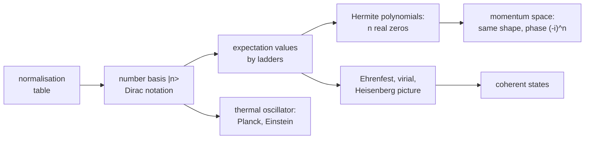

# QM06 · The Oscillator Toolbox

◀ [[QM05 The Harmonic Oscillator]] · [[Quantum Mechanics - Course Map|Course Map]]

taught · in syllabus (restated) extra · book extra · beyond

> [!warning] Scope of this chapter
> The instructor's oscillator material ([[Harmonic_oscillator.pdf|lecture]], [[Tutorial2.pdf|Tutorial II]], [[Tutorial3.pdf|Tutorial III]]) is complete in [[QM05 The Harmonic Oscillator]]. **This chapter goes beyond it on purpose**: it collects everything that sits next to the ladder operators, expectation values, normalisation and the Hermite polynomials, so that nothing related is missing from the vault. Each section says whether it is 🟢 a restatement of taught material, 🟡 from a book, or 🔵 mine. Nothing here is known to be examinable.

> [!syllabus] Syllabus map: what is in the syllabus and what is extra in this chapter
> 🟢 **Taught (restated for reference, all in QM05)**: the ladder algebra $[\hat a_-,\hat a_+]=1$, $\hat a_\pm\psi_n=\sqrt{n+1}\psi_{n+1},\sqrt n\,\psi_{n-1}$, $\psi_n=(\hat a_+)^n\psi_0/\sqrt{n!}$, the adjoint identity ([[Harmonic_oscillator.pdf#page=9|lecture p.9]]), $\langle x\rangle,\langle p\rangle,\langle x^2\rangle,\langle p^2\rangle$, orthogonality of eigenfunctions ([[Tutorial3.pdf#page=2|Tutorial III Q3]]), the normalisation of $\psi_0$.
> - §1 normalisation constants gathered from every chapter; §3 the expectation-value recipe (the lecture's method, extended)
>
> 🟡 **Extra · book** (Griffiths *Introduction to Quantum Mechanics*, §2.3.1 [[Griffiths - Introduction to quantum mechanics.pdf#page=47|PDF p.47]], §2.3.2 analytic method [[Griffiths - Introduction to quantum mechanics.pdf#page=52|PDF p.52]], recursion formula pp.54–55, Hermite polynomials pp.56–59; Sakurai and Napolitano Ch. 2)
> - §4 the series solution and the Hermite polynomials; §2 matrix elements of $\hat x,\hat p$ in the number basis; §6 the Ehrenfest theorem and the virial theorem
>
> 🔵 **Extra · beyond** (my additions, all numbers in `scripts/qm_numbers.py`)
> - §2 Dirac notation and completeness; §3 $\langle x^4\rangle$, selection rules, the Thomas–Reiche–Kuhn sum rule; §4 Rodrigues, the generating function, the proof that the ladder relations *are* the Hermite recurrences, probabilists' Hermite polynomials and their link to probability; §5 the oscillator in momentum space; §6 the uncertainty-principle estimate of $E_0$, the Heisenberg picture; §7 coherent states; §8 the thermal oscillator; §9 isotropic and anharmonic oscillators

> [!key] After this chapter you can
> - quote the **normalisation constant** of every state met so far, derive that of $\psi_n$ in three independent ways, and normalise a superposition even when its parts overlap,
> - write $\hat x,\hat p,\hat H,\hat a,\hat a^\dagger$ as matrices in the number basis and compute **any** expectation value $\langle x^k\rangle,\langle p^k\rangle$ by counting steps on the ladder,
> - derive the Hermite equation from the Schrödinger equation, show why only $E=(n+\tfrac12)\hbar\omega$ survives, and use the Rodrigues formula, generating function, recurrence and norm,
> - prove that $\psi_n$ is its own Fourier transform up to $(-i)^n$,
> - use Ehrenfest, Heisenberg and virial arguments, and build and use **coherent states**,
> - compute the thermal occupation, Planck mean energy and Einstein heat capacity of an oscillator, and count the degeneracy of 2D and 3D oscillators.

> [!intuition] The one-sentence story
> Everything about the oscillator is encoded in one rule, $[\hat a,\hat a^\dagger]=1$ with $\hat a\psi_0=0$; position space gives Hermite polynomials, momentum space gives the same polynomials again, the number basis gives tridiagonal matrices, and a displaced ground state gives the state that looks most like a classical oscillator.

<!-- intuition-v1 -->

*Concept map: how the ideas of this chapter depend on each other (read left to right; every box is a section).*

![[QM06 The Oscillator Toolbox.svg]]
*Diagram QM6.1. The toolbox. Editable source: [[QM06 The Oscillator Toolbox.excalidraw]].*

## 1. Normalisation: the complete picture
taught *[[PH2113_Wavefunction_to_Uncertainty (1).pdf#page=1|WU §2]], box lecture, [[Harmonic_oscillator.pdf#page=7|oscillator lecture p.7]]* · extra · beyond *the table, three derivations, continuum normalisation*

**Why normalise.** The Born rule says $|\psi|^2$ is a probability density, so $\langle\psi|\psi\rangle=\int|\psi|^2\mathrm dx=1$. Because the Schrödinger equation is linear, $\psi$ and $c\,\psi$ solve it together; normalising fixes $|c|$ and leaves the global phase free ([[Global and Relative Phase]]). The evolution keeps the norm fixed: $\frac{\mathrm d}{\mathrm dt}\int|\Psi|^2\mathrm dx=-[j]_{-\infty}^{\infty}=0$ ([[Probability Current]]).

> [!key] Normalisation constants met so far
> | State | Wavefunction $N\times\dots$ | $N$ | Integral used |
> |---|---|---|---|
> | box | $\sin(n\pi x/a)$ | $\sqrt{2/a}$ | $\int_0^a\sin^2=a/2$ |
> | ring | $e^{ik_nx}$, $k_n=2\pi n/L$ | $1/\sqrt L$ | $\int_0^L1=L$ |
> | $e^{-\lvert x\rvert/a}$ | $e^{-\lvert x\rvert/a}$ | $1/\sqrt a$ | $2\int_0^\infty e^{-2x/a}=a$ |
> | Gaussian packet | $e^{-x^2/4\sigma^2}$ | $(2\pi\sigma^2)^{-1/4}$ | $\int e^{-ax^2}=\sqrt{\pi/a}$ |
> | oscillator $\psi_0$ | $e^{-m\omega x^2/2\hbar}$ | $(m\omega/\pi\hbar)^{1/4}$ | same |
> | oscillator $\psi_n$ | $H_n(\xi)e^{-\xi^2/2}$ | $(m\omega/\pi\hbar)^{1/4}(2^nn!)^{-1/2}$ | $\int H_n^2e^{-\xi^2}=\sqrt\pi\,2^nn!$ |
>
> A **superposition** $\Psi=\sum c_n\psi_n$ of orthonormal states is normalised iff $\sum|c_n|^2=1$; for a non-orthogonal set the norm is $\sum_{m,n}c_m^*c_nS_{mn}$ with $S_{mn}=\langle\psi_m|\psi_n\rangle$ (§7).

**Three independent derivations of the constant of $\psi_n$** (all give $N_n=(m\omega/\pi\hbar)^{1/4}/\sqrt{2^nn!}$):

> [!derivation] (a) by the ladder, (b) by the Hermite integral, (c) by the recursion
> **(a) Ladder** ([[Harmonic_oscillator.pdf#page=10|lecture pp.10–11]]). Only $\psi_0$ is normalised by an integral. Then $\|\hat a_+\psi_n\|^2=\langle\hat a_-\hat a_+\rangle=n+1$ forces $\psi_{n+1}=\hat a_+\psi_n/\sqrt{n+1}$ and so $\psi_n=(\hat a_+)^n\psi_0/\sqrt{n!}$.
> **(b) Integral.** With $\mathrm dx=\sqrt{\hbar/m\omega}\,\mathrm d\xi$ and $\int H_n^2e^{-\xi^2}\mathrm d\xi=\sqrt\pi\,2^nn!$ (proved in §4),
> $$\int\psi_n^2\mathrm dx=N_n^2\sqrt{\frac\hbar{m\omega}}\ \sqrt\pi\,2^nn!=1\ \Rightarrow\ N_n^2=\sqrt{\frac{m\omega}{\pi\hbar}}\frac1{2^nn!}.$$
> **(c) Recursion.** In $\xi$-space $\hat a_+=\frac1{\sqrt2}(\xi-\partial_\xi)$ and $(2\xi-\partial_\xi)H_n=H_{n+1}$ (§4.3) give $\hat a_+\psi_n=\frac{N_n}{\sqrt2}H_{n+1}e^{-\xi^2/2}$, which must equal $\sqrt{n+1}\,N_{n+1}H_{n+1}e^{-\xi^2/2}$, hence $N_{n+1}=N_n/\sqrt{2(n+1)}$, which iterates to the same $N_n$.
> Check: $\int\psi_n^2\mathrm dx=1$ numerically for $n=0,\dots,10$; $\int H_5^2e^{-\xi^2}=6806.2$ and $\int H_{10}^2e^{-\xi^2}=6.586\times10^9$, both equal to $\sqrt\pi\,2^nn!$.

**Momentum space.** With $\tilde\psi(p)=(2\pi\hbar)^{-1/2}\int\psi(x)e^{-ipx/\hbar}\mathrm dx$, **Parseval–Plancherel** gives $\int|\tilde\psi|^2\mathrm dp=\int|\psi|^2\mathrm dx$: a state normalised in $x$ is automatically normalised in $p$ ([[Fourier Transform and Wave Packets]]).

**Continuum states.** A plane wave $\phi_k=e^{ikx}/\sqrt{2\pi}$ on the whole line has $\int|\phi_k|^2\mathrm dx=\infty$, so it cannot be normalised to 1. It is instead **delta-normalised**, $\langle\phi_k|\phi_{k'}\rangle=\delta(k-k')$, and physical states are wave packets $\int c(k)\phi_k\,\mathrm dk$ with $\int|c|^2\mathrm dk=1$ ([[Delta-Function Normalisation]], [[Free Particle]]).

> [!pitfall] Normalisable is not the same as normalised
> $\psi_B=Ne^{+x^2/a^2}$ and $e^{ikx}$ on a line are not normalisable (no $N$ works); $\psi=e^{-x^2/a^2}$ is normalisable but is only a *state* after you multiply by $N=(2/\pi a^2)^{1/4}$. Normalisability is a property of the **function and its domain**, normalisation a choice of constant ([[Admissible Wavefunction]], [[Normalisation Constants Table]]).

## 2. Dirac notation and the number basis
extra · beyond *kets for a two-level system are used in [[PH2113_matrices_expectation_uncertainty.pdf#page=1|MX §1–3]]; the number basis is new*

> [!intuition] Label the state by how many quanta it holds
> $|n\rangle$ is 'the oscillator with $n$ units of energy'. The ladders are then *counting* operators: $\hat a_-$ removes a unit (and tells you $\sqrt n$ ways to do it), $\hat a_+$ adds one.

**Dirac notation** ([[Dirac Notation]]). A state is a ket $|\psi\rangle$; the inner product is $\langle\phi|\psi\rangle=\int\phi^*\psi\,\mathrm dx$, with $\langle\phi|\psi\rangle^*=\langle\psi|\phi\rangle$ and $\langle\psi|\psi\rangle=1$. The **adjoint** (Hermitian conjugate) of an operator is defined by $\langle\phi|\hat A\psi\rangle=\langle\hat A^\dagger\phi|\psi\rangle$; $\hat A$ is Hermitian if $\hat A^\dagger=\hat A$ ([[Hermitian Conjugate]], [[Hermitian Operator]]). The lecture's identity $\int f^*(\hat a_+g)=\int(\hat a_-f)^*g$ says exactly $\hat a_+=\hat a_-^{\,\dagger}$, so from now on
$$\hat a\equiv\hat a_-,\qquad\hat a^\dagger\equiv\hat a_+,\qquad\hat N=\hat a^\dagger\hat a,\qquad\hat H=\hbar\omega\big(\hat N+\tfrac12\big).$$

**The number basis** ([[Number Basis]]). Write $|n\rangle$ for $\psi_n$. The algebra of QM05 becomes
$$\hat N|n\rangle=n|n\rangle,\qquad\hat a|n\rangle=\sqrt n\,|n-1\rangle,\qquad\hat a^\dagger|n\rangle=\sqrt{n+1}\,|n+1\rangle,\qquad\hat a|0\rangle=0,\qquad|n\rangle=\frac{(\hat a^\dagger)^n}{\sqrt{n!}}|0\rangle .$$
The $|n\rangle$ are **orthonormal** ($\langle m|n\rangle=\delta_{mn}$) and **complete**: $\sum_{n=0}^\infty|n\rangle\langle n|=\hat 1$, so every state is $|\psi\rangle=\sum c_n|n\rangle$ with $c_n=\langle n|\psi\rangle$ and $\sum|c_n|^2=\langle\psi|\psi\rangle=1$ ([[Completeness Relation]], [[Orthonormality of Eigenfunctions]]).

> [!key] The operators as matrices ($A_{mn}=\langle m|\hat A|n\rangle$, rows $m$, columns $n$)
> $$\hat a=\begin{pmatrix}0&1&0&0&\cdots\\0&0&\sqrt2&0&\cdots\\0&0&0&\sqrt3&\cdots\\0&0&0&0&\cdots\\\vdots&&&&\ddots\end{pmatrix},\quad\hat a^\dagger=\hat a^{\mathsf T},\quad\hat x=\sqrt{\tfrac\hbar{2m\omega}}\begin{pmatrix}0&1&0&\cdots\\1&0&\sqrt2&\cdots\\0&\sqrt2&0&\cdots\\\vdots&&&\ddots\end{pmatrix},\quad\hat p=i\sqrt{\tfrac{m\hbar\omega}2}\begin{pmatrix}0&-1&0&\cdots\\1&0&-\sqrt2&\cdots\\0&\sqrt2&0&\cdots\\\vdots&&&\ddots\end{pmatrix}$$
> and $\hat H=\hbar\omega\,\mathrm{diag}(\tfrac12,\tfrac32,\tfrac52,\dots)$. $\hat x$ is real symmetric and $\hat p$ is imaginary antisymmetric, so both are Hermitian. Compare the $2\times2$ matrices $X,Y,Z$ of [[QM03 States Operators and Measurement]]: this is the same machinery with infinitely many levels (Figure QM6.1 A).

> [!pitfall] A finite truncation cannot satisfy $[\hat a,\hat a^\dagger]=1$
> The trace of a commutator of finite matrices is $0$ but the trace of $\hat 1$ is the matrix size, so $[\hat a,\hat a^\dagger]=\hat 1$ is impossible in finite dimension. Numerically, in a $200\times200$ truncation the diagonal of $[\hat a,\hat a^\dagger]$ is $1,1,1,\dots$ but the **last entry is $-199$**; the same corruption spoils the top rows of $\hat x^2$ and $\hat p^2$. Use $n\ll N$. (This is also a hint that $\hat x,\hat p$ with $[\hat x,\hat p]=i\hbar$ must act on an infinite-dimensional space.)

![[fig_qm06_fock.png]]
*Figure QM6.1. A: $|\langle m|\hat x|n\rangle|$ in units $\sqrt{\hbar/m\omega}$, $\sqrt{(n+1)/2}$ on the two off-diagonals (§3). B: a coherent state is a fixed-size blob riding the classical circle, a Fock state is a ring (§7). C: photon statistics (§7–§8). D: Einstein heat capacity (§8).*

## 3. Expectation values: the recipe and the results
taught *the method, [[Harmonic_oscillator.pdf#page=12|lecture pp.12–13]]; [[Tutorial3.pdf#page=1|Tutorial III Q1]]* · extra · beyond *higher powers, selection rules, sum rules*

> [!intuition] Only terms that come back survive
> $\langle n|\hat x^2|n\rangle$ contains products of two ladders; since $\langle n|m\rangle=\delta_{nm}$ only those with one raise and one lower return to $|n\rangle$. That is why $\langle x^2\rangle=(n+\tfrac12)\hbar/m\omega$ costs one line.

**The recipe** ([[Expectation Value]], [[Oscillator Expectation Values]]). Write the observable as a polynomial in $\hat a,\hat a^\dagger$ using $\hat x=\sqrt{\hbar/2m\omega}(\hat a+\hat a^\dagger)$ and $\hat p=i\sqrt{m\hbar\omega/2}(\hat a^\dagger-\hat a)$. A word of $\hat a$'s and $\hat a^\dagger$'s moves $|n\rangle$ to $|n+(\#\hat a^\dagger-\#\hat a)\rangle$, so it has a non-zero **diagonal** element only if it contains equally many of each. Each step contributes the factor $\sqrt{\text{(the larger of the two indices)}}$.

> [!example] $\langle\hat x^4\rangle$, worked
> $(\hat a+\hat a^\dagger)^4$ has six words with two $\hat a$ and two $\hat a^\dagger$. Reading each from the right:
> $\hat a\hat a\hat a^\dagger\hat a^\dagger\to(n+1)(n+2)$ · $\hat a\hat a^\dagger\hat a\hat a^\dagger\to(n+1)^2$ · $\hat a\hat a^\dagger\hat a^\dagger\hat a\to n(n+1)$ · $\hat a^\dagger\hat a\hat a\hat a^\dagger\to n(n+1)$ · $\hat a^\dagger\hat a\hat a^\dagger\hat a\to n^2$ · $\hat a^\dagger\hat a^\dagger\hat a\hat a\to n(n-1)$.
> Their sum is $6n^2+6n+3$, so
> $$\boxed{\ \langle\hat x^4\rangle_n=\Big(\frac\hbar{2m\omega}\Big)^2\big(6n^2+6n+3\big)\ }$$
> (verified for $n=0,\dots,9$ with the matrices: $3,15,39,75,123,\dots$; the same numbers for $\langle\hat p^4\rangle$ with $m\hbar\omega/2$). For $n=0$ it is $3\sigma^4$ with $\sigma^2=\hbar/2m\omega$, the **fourth moment of a Gaussian** ($E[Z^4]=3$, [[Normal Distribution]]), as it must be since $|\psi_0|^2$ is a Gaussian density; in general $\langle x^{2k}\rangle_0=(2k-1)!!\,\sigma^{2k}$.

> [!key] A table to keep ($\sigma^2\equiv\hbar/2m\omega$)
> | Quantity | Value in $|n\rangle$ |
> |---|---|
> | $\langle x\rangle,\langle p\rangle,\langle x^3\rangle$ | $0$ (odd number of operators) |
> | $\langle x^2\rangle$ | $(2n+1)\sigma^2$ |
> | $\langle p^2\rangle$ | $(2n+1)\,m\hbar\omega/2$ |
> | $\langle x^4\rangle$ | $(6n^2+6n+3)\sigma^4$ |
> | $\langle V\rangle=\langle T\rangle$ | $\tfrac12E_n=\tfrac12(n+\tfrac12)\hbar\omega$ |
> | $\Delta x\,\Delta p$ | $(n+\tfrac12)\hbar$ |
> | off-diagonal $\langle n+2\vert\hat x^2\vert n\rangle$, $\langle n-2\vert\hat x^2\vert n\rangle$ | $\sigma^2\sqrt{(n+1)(n+2)}$, $\ \sigma^2\sqrt{n(n-1)}$ |

**Superpositions.** For $\Psi=\sum c_n|n\rangle$ only **neighbouring** components interfere in $\langle x\rangle$:
$$\langle x\rangle=\sqrt{\tfrac{2\hbar}{m\omega}}\ \sum_n\sqrt{n+1}\ \mathrm{Re}\big(c_n^*c_{n+1}\big).$$
With time dependence $c_n\to c_ne^{-i(n+\frac12)\omega t}$ every product $c_n^*c_{n+1}$ picks up the **same** factor $e^{-i\omega t}$, so $\langle x\rangle(t)$ oscillates at exactly $\omega$ for **every** state: the equal spacing of the levels is the quantum reason ([[Time Evolution of a Superposition]], §6). In $\langle x^2\rangle$ the components $n,n\pm2$ interfere, giving frequencies $0$ and $2\omega$ (the "breathing" of QM05 §6). With an anharmonic $V$ the spacings differ and many frequencies appear.

**Selection rule.** The elements $\langle m|\hat x|n\rangle=\sqrt{\tfrac\hbar{2m\omega}}\big(\sqrt n\,\delta_{m,n-1}+\sqrt{n+1}\,\delta_{m,n+1}\big)$ vanish unless $|m-n|=1$ (checked for $m,n<12$). The rate for absorbing light through the dipole $\propto\hat x$ is $\propto|\langle m|\hat x|n\rangle|^2$, so only $\Delta n=\pm1$ occurs and the oscillator absorbs **one line** at $\omega$: this *derives* the rule that QM05 §9 stated without proof ([[Selection Rules]], [[Matrix Elements of Position and Momentum]]). A real molecule also needs a dipole moment that changes with the vibration (the symmetric stretch of CO$_2$ does not change it, so it is infrared-inactive; the bend does), which is why the bend matters in [[CL07 Optical Properties of the Atmosphere]].

> [!derivation] A sum rule from completeness (Thomas–Reiche–Kuhn)
> Insert $\sum_n|n\rangle\langle n|$ into $\langle m|\hat x^2|m\rangle=\sum_n|x_{nm}|^2$ (checked for $m=3$: $3.5=3.5$). A sharper identity uses $[\hat H,\hat x]=-i\hbar\hat p/m$:
> $$\sum_n(E_n-E_m)\,|x_{nm}|^2=\tfrac12\langle m|[\hat x,[\hat H,\hat x]]|m\rangle=\frac{\hbar^2}{2m},$$
> because $[\hat x,[\hat H,\hat x]]=-\tfrac{i\hbar}m[\hat x,\hat p]=\hbar^2/m$. For the oscillator only $n=m\pm1$ contribute and $\hbar\omega\sigma^2\big[(m+1)-m\big]=\hbar^2/2m$ ✓ (numerically $0.500000$). It holds for **any** potential, which is why it is used to count "oscillator strength" ([[Sum Rules]]).

## 4. Hermite polynomials in full
extra · book *Griffiths §2.3.2, [[Griffiths - Introduction to quantum mechanics.pdf#page=52|PDF pp.52–59]]* · extra · beyond *generating-function proofs, the ladder identity, He$_n$, zeros*

### 4.1 The analytic route: why only $E=(n+\frac12)\hbar\omega$ survives
With $\xi=\sqrt{m\omega/\hbar}\,x$ and $K=2E/\hbar\omega$ the Schrödinger equation $-\frac{\hbar^2}{2m}\psi''+\frac12m\omega^2x^2\psi=E\psi$ becomes
$$\frac{\mathrm d^2\psi}{\mathrm d\xi^2}=(\xi^2-K)\psi .$$
For $\xi\to\infty$ the constant $K$ is negligible: $\psi''\approx\xi^2\psi$ is solved by $e^{\pm\xi^2/2}$, and normalisability keeps $e^{-\xi^2/2}$. Put $\psi=h(\xi)e^{-\xi^2/2}$; then $\psi''=(h''-2\xi h'-h+\xi^2h)e^{-\xi^2/2}$ and

> [!derivation] The Hermite equation and its series
> $$h''-2\xi h'+(K-1)h=0 .$$
> Insert $h=\sum_ja_j\xi^j$: the coefficient of $\xi^j$ gives $(j+2)(j+1)a_{j+2}-2ja_j+(K-1)a_j=0$, i.e.
> $$\boxed{\ a_{j+2}=\frac{2j+1-K}{(j+1)(j+2)}\,a_j\ }$$
> The even and odd parts decouple ($a_0$ and $a_1$ are free). For large $j$, $a_{j+2}/a_j\to2/j$, which is the coefficient ratio of $e^{\xi^2}=\sum\xi^{2k}/k!$ ($\tfrac{1}{(k+1)!}\big/\tfrac1{k!}=\tfrac1{k+1}=\tfrac2{j+2}$ with $j=2k$): numerically, for $K=2$, $a_{j+2}/a_j=0.0844,\ 0.0459,\ 0.0239$ at $j=20,40,80$ against $2/(j+2)=0.0909,\ 0.0476,\ 0.0244$. So **unless the series stops**, $h\sim e^{\xi^2}$ and $\psi=he^{-\xi^2/2}\sim e^{+\xi^2/2}$ blows up. It stops (at degree $n$) only if $2n+1-K=0$:
> $$K=2n+1\ \Longleftrightarrow\ E_n=\big(n+\tfrac12\big)\hbar\omega,$$
> and the other parity series must be switched off ($a_1=0$ for even $n$, $a_0=0$ for odd $n$). Then $h''-2\xi h'+2nh=0$ has the polynomial solution $\propto H_n(\xi)$. Examples from the recursion: $K=5$ gives $1-2\xi^2=-\tfrac12H_2$; $K=9$ gives $1-4\xi^2+\tfrac43\xi^4=\tfrac1{12}H_4$.

> [!intuition] Quantisation is the same story as in the box
> The equation has a solution for **every** $E$; most of them grow at infinity. Demanding a normalisable wavefunction picks out a discrete set, exactly as demanding $\psi(0)=\psi(a)=0$ did for the box ([[Boundary Conditions and Quantisation]]). Panel B of Figure QM6.2 shows it by *shooting*: integrate $\psi''=(\xi^2-K)\psi$ outwards from $\xi=0$ and look at $\psi(6)$. It changes sign (the solution flips from $+\infty$ to $-\infty$ at $\xi\to\infty$) at $K=1,5,9$ (even starts) and $K=3,7$ (odd starts), i.e. $E=\tfrac12,\tfrac32,\tfrac52,\tfrac72,\tfrac92$ in units of $\hbar\omega$, with the sign flips marking the allowed values ([[Hermite Equation and Series Solution]]).

### 4.2 Definition and properties
The (physicists') Hermite polynomial $H_n$ is defined by the **generating function**
$$\boxed{\ e^{2\xi t-t^2}=\sum_{n=0}^\infty H_n(\xi)\frac{t^n}{n!}\ }$$
Everything else follows from it ([[Hermite Generating Function and Recurrences]], [[Hermite Polynomials]]). Write $e^{2\xi t-t^2}=e^{\xi^2}e^{-(\xi-t)^2}$.

> [!derivation] Rodrigues, recurrences, ODE, parity, special values, orthogonality
> - **Rodrigues.** $\partial_t^n\,e^{-(\xi-t)^2}\big|_{t=0}=(-1)^n\partial_\xi^n e^{-\xi^2}$ (each $\partial_t$ acts as $-\partial_\xi$), so $\ H_n(\xi)=(-1)^ne^{\xi^2}\dfrac{\mathrm d^n}{\mathrm d\xi^n}e^{-\xi^2}$.
> - **Derivative.** $\partial_\xi g=2t\,g$ gives $H_n'=2nH_{n-1}$.
> - **Recurrence.** $\partial_tg=(2\xi-2t)g$ gives $H_{n+1}=2\xi H_n-2nH_{n-1}$.
> - **Ladder identity.** Combining the last two, $H_{n+1}=2\xi H_n-H_n'$.
> - **ODE.** Differentiate the ladder identity and use $H_{n+1}'=2(n+1)H_n$: $\ H_n''-2\xi H_n'+2nH_n=0$, the equation of §4.1.
> - **Parity.** $g(-\xi,-t)=g(\xi,t)\Rightarrow H_n(-\xi)=(-1)^nH_n(\xi)$. **Leading term** $2^n\xi^n$.
> - **Special values.** $g(0,t)=e^{-t^2}=\sum(-1)^kt^{2k}/k!$ gives $H_{2k}(0)=(-1)^k\dfrac{(2k)!}{k!}$ ($1,-2,12,-120,1680$) and $H_{2k+1}(0)=0$.
> - **Orthogonality and norm.** $\int g(\xi,s)g(\xi,t)e^{-\xi^2}\mathrm d\xi=\int e^{-(\xi-s-t)^2}e^{2st}\mathrm d\xi=\sqrt\pi\,e^{2st}=\sqrt\pi\sum\frac{(2st)^n}{n!}$. Comparing coefficients of $s^mt^n/(m!\,n!)$:
> $$\boxed{\ \int_{-\infty}^\infty H_m(\xi)H_n(\xi)e^{-\xi^2}\mathrm d\xi=\sqrt\pi\,2^nn!\ \delta_{mn}\ }$$
> All of these were checked symbolically for $n\le8$ (Rodrigues $n\le7$; orthogonality for $m,n\le4$: $\sqrt\pi,2\sqrt\pi,8\sqrt\pi,48\sqrt\pi,384\sqrt\pi$).

The first seven: $H_0=1$, $H_1=2\xi$, $H_2=4\xi^2-2$, $H_3=8\xi^3-12\xi$, $H_4=16\xi^4-48\xi^2+12$, $H_5=32\xi^5-160\xi^3+120\xi$, $H_6=64\xi^6-480\xi^4+720\xi^2-120$.

**Zeros = nodes.** $H_n$ has $n$ real, simple zeros, symmetric about $0$ ([[Node of a Wavefunction]]). The positive ones (so the nodes of $\psi_n$ in units $\sqrt{\hbar/m\omega}$):
$$H_2:\ 0.7071\quad H_3:\ 1.2247\quad H_4:\ 0.5246,\ 1.6507\quad H_5:\ 0.9586,\ 2.0202\quad H_6:\ 0.4361,\ 1.3359,\ 2.3506 .$$
(For $n=2$ the zero is $1/\sqrt2$, the node found by hand in QM05 §5; for $n=3$ it is $\sqrt{3/2}$.) The outermost zero lies inside the classical turning point $\sqrt{2n+1}$: e.g. $2.02<\sqrt{11}=3.32$ for $n=5$.

### 4.3 The ladder relations *are* the Hermite recurrences
In $\xi$-space $\hat a_\pm=\frac1{\sqrt2}\big(\xi\mp\partial_\xi\big)$. Acting on $he^{-\xi^2/2}$:
$$\big(\xi-\partial_\xi\big)\big(he^{-\xi^2/2}\big)=(2\xi h-h')e^{-\xi^2/2},\qquad\big(\xi+\partial_\xi\big)\big(he^{-\xi^2/2}\big)=h'e^{-\xi^2/2}.$$
With $h=H_n$ the first is $H_{n+1}$ (ladder identity) and the second is $2nH_{n-1}$ ($H_n'=2nH_{n-1}$). So **raising the oscillator state is $H_n\to H_{n+1}$, lowering it is differentiation**, and the constants $\sqrt{n+1},\sqrt n$ are exactly the ratios of the normalisations $N_n$ of §1. The three-term recurrence rewrites as the tridiagonal matrix of §2:
$$\xi\,\psi_n=\sqrt{\tfrac{n+1}2}\,\psi_{n+1}+\sqrt{\tfrac n2}\,\psi_{n-1}\quad\Longleftrightarrow\quad\hat x=\sqrt{\tfrac\hbar{2m\omega}}(\hat a+\hat a^\dagger).$$

![[fig_qm06_hermite.png]]
*Figure QM6.2. A: $H_n(\xi)/\sqrt{2^nn!}$ for $n=0,\dots,5$, $n$ zeros each and growth $\sim\xi^n$. B: the shooting method: the value at $\xi=6$ of the solution of $\psi''=(\xi^2-K)\psi$ with even or odd start flips sign only at $K=1,3,5,7,9$. C: $\psi_3(x)$ and the imaginary part of its Fourier transform $\tilde\psi_3(p)$ coincide (§5); $\mathrm{Re}\,\tilde\psi_3=0$ to $10^{-16}$.*

### 4.4 Probabilists' Hermite polynomials and the link to probability
extra · beyond *cross-subject*

The **probabilists'** polynomials are $\mathrm{He}_n(x)=2^{-n/2}H_n(x/\sqrt2)$: $\mathrm{He}_0=1$, $\mathrm{He}_1=x$, $\mathrm{He}_2=x^2-1$, $\mathrm{He}_3=x^3-3x$, $\mathrm{He}_4=x^4-6x^2+3$, with generating function $e^{xt-t^2/2}$ and orthogonality **with respect to the standard normal density**:
$$E\big[\mathrm{He}_m(Z)\mathrm{He}_n(Z)\big]=\int\mathrm{He}_m\mathrm{He}_n\,\frac{e^{-x^2/2}}{\sqrt{2\pi}}\mathrm dx=n!\,\delta_{mn}\qquad(\text{checked, }m,n\le4).$$
Three connections ([[Probabilists' Hermite Polynomials]]): **(i)** $e^{xt-t^2/2}=e^{xt}/M_Z(t)$ with $M_Z(t)=e^{t^2/2}$ the MGF of $N(0,1)$ ([[PR06 Moments Generating Functions and Limit Theorems]]); **(ii)** $x^4=\mathrm{He}_4+6\mathrm{He}_2+3$ so $E[Z^4]=3$, and in general $E[Z^{2k}]=(2k-1)!!$ = $\langle x^{2k}\rangle_0/\sigma^{2k}$ of §3; **(iii)** the Edgeworth/Gram–Charlier corrections to the CLT are series in $\mathrm{He}_n$: the leading one is $\frac{\gamma_1}{6\sqrt n}\mathrm{He}_3(x)\varphi(x)$ in the density, which integrates to the cdf term $-\frac{\gamma_1}{6\sqrt n}\mathrm{He}_2(x)\varphi(x)$ whose maximum modulus at $x=0$ is $\gamma_1/(6\sqrt{2\pi n})$, the number PR06 compared with the exact Gamma cdf. The oscillator wavefunction in $\mathrm{He}$ form is $\psi_n\propto\mathrm{He}_n(\sqrt2\,\xi)e^{-\xi^2/2}$.

## 5. The oscillator in momentum space
extra · beyond *the proof by ladders is mine; the Fourier transform of a Gaussian is taught ([[PH2113_wavefunctions_potentials_schrodinger_Tutorial.pdf#page=3|Tutorial Note P5–P6]])*

> [!intuition] $x$ and $p$ play identical roles
> $H=\tfrac12(p^2+x^2)$ in oscillator units is symmetric under $x\leftrightarrow p$, so the momentum-space wave function has the same Hermite shape: the Fourier transform of $\psi_n$ is $(-i)^n\psi_n$.

> [!key] Hermite functions are the eigenfunctions of the Fourier transform
> With $u_n(\xi)=\pi^{-1/4}(2^nn!)^{-1/2}H_n(\xi)e^{-\xi^2/2}$ (so $\psi_n(x)=(m\omega/\hbar)^{1/4}u_n(\xi)$), the momentum-space wavefunction is
> $$\boxed{\ \tilde\psi_n(p)=(-i)^n\,(m\hbar\omega)^{-1/4}\,u_n\!\Big(\frac p{\sqrt{m\hbar\omega}}\Big)\ }$$
> the same function of the dimensionless momentum $\eta=p/\sqrt{m\hbar\omega}$ that $\psi_n$ is of $\xi$, times the phase $(-i)^n\in\{1,-i,-1,i\}$. Checked numerically for $n=0,\dots,4$ at two momenta: $\tilde\psi_n/\psi_n=(-i)^n$ to five digits.

> [!derivation] Proof by ladders (no integrals)
> In the momentum representation $\hat x=i\hbar\,\mathrm d/\mathrm dp$ and $\hat p=p$. With $\eta=p/\sqrt{m\hbar\omega}$,
> $$\hat a=\frac{m\omega\hat x+i\hat p}{\sqrt{2\hbar m\omega}}=\frac i{\sqrt2}\Big(\eta+\frac{\mathrm d}{\mathrm d\eta}\Big),\qquad\hat a^\dagger=\frac{m\omega\hat x-i\hat p}{\sqrt{2\hbar m\omega}}=\frac{-i}{\sqrt2}\Big(\eta-\frac{\mathrm d}{\mathrm d\eta}\Big).$$
> These are the position-space operators of §4.3 **multiplied by $i$ and $-i$**. The ground state still solves $\hat a\tilde\psi_0=0$, i.e. $\tilde\psi_0\propto e^{-\eta^2/2}$ (positive, as the transform of a positive Gaussian). Then $\tilde\psi_n=(\hat a^\dagger)^n\tilde\psi_0/\sqrt{n!}$ picks up $(-i)^n$ from the $n$ factors of $-i$ and is otherwise the same function. $\square$

**Consequences.** (1) $\langle p^2\rangle_n=m\hbar\omega\langle\xi^2\rangle_n=(n+\tfrac12)m\hbar\omega$ by scaling from $\langle x^2\rangle_n$: a third derivation of Tutorial III Q1. (2) $x$ and $p$ enter $\hat H=\frac{\hbar\omega}2(\xi^2+\eta^2)$ on an equal footing: the Fourier transform $\mathcal F$ (a unitary operator) commutes with $\hat H$, $\mathcal F^2$ is the parity operator, $\mathcal F^4=\hat 1$, and its eigenvalues are $(-i)^n$ ([[Fourier Invariance of Hermite Functions]], [[Parity Operator]]).

> [!intuition] Phase space
> Classically $E=\frac{p^2}{2m}+\frac12m\omega^2x^2$ is an ellipse in the $(x,p)$ plane, a **circle** in $(\xi,\eta)$ of radius $\sqrt{2E/\hbar\omega}$, traversed at angular speed $\omega$. For $\psi_n$ the radius is $\sqrt{2n+1}$ (the red ring in Fig. QM6.1 B). A stationary state is a rotation-invariant ring, so $\langle x\rangle=\langle p\rangle=0$ at all times; time evolution is a rigid rotation in phase space by $\omega t$ ([[Phase Space Picture of the Oscillator]]).

## 6. Dynamics: Ehrenfest, Heisenberg, virial, and the uncertainty estimate
extra · book *Ehrenfest: Griffiths §1.5 (the equations for $\mathrm d\langle x\rangle/\mathrm dt$ and $\mathrm d\langle p\rangle/\mathrm dt$; page not checked); Sakurai Ch. 2* · extra · beyond *the general commutator form, the oscillator specialisations, the virial and uncertainty arguments*

### 6.1 The Ehrenfest theorem
> [!derivation] $\dfrac{\mathrm d}{\mathrm dt}\langle\hat A\rangle=\dfrac i\hbar\langle[\hat H,\hat A]\rangle+\Big\langle\dfrac{\partial\hat A}{\partial t}\Big\rangle$
> From $\partial_t\Psi=-\frac i\hbar\hat H\Psi$ and the Hermiticity of $\hat H$:
> $$\frac{\mathrm d}{\mathrm dt}\langle\Psi|\hat A\Psi\rangle=\langle\partial_t\Psi|\hat A\Psi\rangle+\langle\Psi|\hat A\partial_t\Psi\rangle+\langle\partial_t\hat A\rangle=\frac i\hbar\big(\langle\hat H\Psi|\hat A\Psi\rangle-\langle\Psi|\hat A\hat H\Psi\rangle\big)+\dots=\frac i\hbar\langle[\hat H,\hat A]\rangle+\dots$$
> With $[\hat H,\hat x]=-i\hbar\hat p/m$ and $[\hat H,\hat p]=i\hbar V'(\hat x)$:
> $$\frac{\mathrm d\langle x\rangle}{\mathrm dt}=\frac{\langle p\rangle}m,\qquad\frac{\mathrm d\langle p\rangle}{\mathrm dt}=-\big\langle V'(x)\big\rangle .$$
> Two consequences. **Stationary states:** $\langle n|[\hat H,\hat A]|n\rangle=(E_n-E_n)\langle n|\hat A|n\rangle=0$, so **no** expectation value changes ([[Stationary State]]). **Energy:** $\hat A=\hat H$ gives conservation of $\langle\hat H\rangle$.

For the oscillator $V'=m\omega^2x$ is **linear**, so $\langle V'(x)\rangle=m\omega^2\langle x\rangle$ and the equations close:
$$\frac{\mathrm d^2\langle x\rangle}{\mathrm dt^2}=-\omega^2\langle x\rangle\ \Longrightarrow\ \langle x\rangle(t)=\langle x\rangle_0\cos\omega t+\frac{\langle p\rangle_0}{m\omega}\sin\omega t$$
**exactly, for every state**, not only for wave packets. Check with $(\psi_0+\psi_1)/\sqrt2$ (symbolic): $\langle x\rangle=\sqrt{\hbar/2m\omega}\cos\omega t$, $\langle p\rangle=-\sqrt{m\hbar\omega/2}\sin\omega t$, and both Ehrenfest equations hold identically. For a non-linear $V$ one only has $\langle V'(x)\rangle\ne V'(\langle x\rangle)$, so the averages do **not** follow the classical orbit and a packet spreads ([[Ehrenfest Theorem]]).

### 6.2 The Heisenberg picture
Move the time dependence from states to operators: $\hat A_H(t)=e^{i\hat Ht/\hbar}\hat Ae^{-i\hat Ht/\hbar}$, $\ \dfrac{\mathrm d\hat A_H}{\mathrm dt}=\dfrac i\hbar[\hat H,\hat A_H]$ ([[Heisenberg Picture]], [[Time Evolution Operator]]). Since $[\hat H,\hat a]=-\hbar\omega\hat a$,
$$\frac{\mathrm d\hat a}{\mathrm dt}=-i\omega\hat a\ \Rightarrow\ \hat a(t)=\hat ae^{-i\omega t},\qquad\hat x(t)=\hat x\cos\omega t+\frac{\hat p}{m\omega}\sin\omega t,$$
the **operator** form of the classical solution, true for any state (checked with matrix exponentials: errors $\sim10^{-14}$). The result $\hat a(t)=\hat ae^{-i\omega t}$ is the whole of §3's "$\langle x\rangle$ oscillates at exactly $\omega$".

### 6.3 The virial theorem
Take $\hat A=\hat x\hat p$: $[\hat H,\hat x\hat p]=-i\hbar\hat p^2/m+i\hbar\hat xV'$, so $\frac{\mathrm d}{\mathrm dt}\langle\hat x\hat p\rangle=\frac{\langle p^2\rangle}m-\langle xV'\rangle=2\langle T\rangle-\langle xV'\rangle$. In a stationary state the left side is $0$:
$$\boxed{\ 2\langle T\rangle=\Big\langle x\frac{\mathrm dV}{\mathrm dx}\Big\rangle\ }\qquad V=c\,x^s\ \Rightarrow\ 2\langle T\rangle=s\langle V\rangle .$$
For $s=2$: $\langle T\rangle=\langle V\rangle=\frac12E$ ✓ (the oscillator values of §3). It holds for **any** potential of power-law form; finite-difference ground states ($\hbar=m=1$): $V=x^2/2$: $E_0=0.50000$, $2\langle T\rangle/\langle V\rangle=2.0000$; $V=x^4$: $E_0=0.66799$, ratio $4.0000$; $V=|x|$: $E_0=0.80862$, ratio $1.0000$. (The 3-D Coulomb case $s=-1$ gives $E=\frac12\langle V\rangle$, i.e. $\langle T\rangle=13.6$ eV and $\langle V\rangle=-27.2$ eV for hydrogen's ground state, the Bohr values.) ([[Virial Theorem]])

### 6.4 The uncertainty principle gives $E_0$ exactly
> [!example] A one-line derivation of the zero-point energy
> For any state with $\langle x\rangle=\langle p\rangle=0$, $\langle T\rangle=\frac{\langle p^2\rangle}{2m}\ge\frac{\hbar^2}{8m\,\Delta x^2}$ (from $\Delta x\Delta p\ge\hbar/2$) and $\langle V\rangle=\tfrac12m\omega^2\Delta x^2$. With $s=\Delta x^2$,
> $$E\ \ge\ \frac{\hbar^2}{8ms}+\frac12m\omega^2s\ \ge\ \frac{\hbar\omega}2,\qquad\text{minimum at }s=\frac\hbar{2m\omega}$$
> (minimising numerically gives $0.500000$ at $s=0.500000$ in units $\hbar=m=\omega=1$). The bound is **attained** because the Gaussian $\psi_0$ saturates $\Delta x\Delta p=\hbar/2$ ([[Zero-Point Energy]], [[Minimum Uncertainty State]]). The same estimate for a box of width $a$ gives $E\gtrsim\hbar^2/2ma^2$: right scaling, not exact.

## 7. Coherent states
extra · beyond *Glauber 1963; Sakurai and Napolitano Ch. 2 Problems*

> [!intuition] The most classical quantum state
> A coherent state is a fixed-size Gaussian blob ($\Delta x\Delta p=\hbar/2$) that rides the classical orbit without spreading. It is what a laser emits: a quantum state with a definite amplitude and phase.

> [!key] Definition
> A **coherent state** is an eigenstate of the (non-Hermitian) lowering operator, $\hat a|\alpha\rangle=\alpha|\alpha\rangle$ with $\alpha\in\mathbb C$ ([[Coherent State]]). In the number basis, $c_{n+1}\sqrt{n+1}=\alpha c_n\Rightarrow c_n=\alpha^nc_0/\sqrt{n!}$, and $\sum|c_n|^2=|c_0|^2e^{|\alpha|^2}=1$:
> $$\boxed{\ |\alpha\rangle=e^{-|\alpha|^2/2}\sum_{n=0}^\infty\frac{\alpha^n}{\sqrt{n!}}\,|n\rangle\ },\qquad P(n)=e^{-|\alpha|^2}\frac{|\alpha|^{2n}}{n!}\ \ (\text{Poisson, mean}=\text{variance}=|\alpha|^2).$$

> [!derivation] Properties (each checked with $90\times90$ matrices, $\alpha=2$ and $\alpha=1.2+0.9i$)
> - **Mean position and momentum.** $\langle x\rangle=\sqrt{\hbar/2m\omega}\,(\alpha+\alpha^*)=\sqrt{2\hbar/m\omega}\,\mathrm{Re}\,\alpha$ and $\langle p\rangle=\sqrt{2m\hbar\omega}\,\mathrm{Im}\,\alpha$ (with $\hbar=m=\omega=1$: $2.82843$ and $0$ for $\alpha=2$; $1.69706$ and $1.27279$ for the complex one).
> - **Minimum uncertainty.** $\langle x^2\rangle=\frac\hbar{2m\omega}\langle(\hat a+\hat a^\dagger)^2\rangle=\frac\hbar{2m\omega}\big((\alpha+\alpha^*)^2+1\big)$ (use $\hat a\hat a^\dagger=\hat a^\dagger\hat a+1$), so $\Delta x^2=\hbar/2m\omega$, and likewise $\Delta p^2=m\hbar\omega/2$: $\ \Delta x\,\Delta p=\hbar/2$, **for every $\alpha$** (numerically $0.70711,\ 0.70711,\ 0.50000$).
> - **Time evolution.** $c_n\to c_ne^{-i(n+\frac12)\omega t}$ is $\alpha\to\alpha e^{-i\omega t}$ times an overall phase: a coherent state **stays** coherent and its centre follows the classical orbit, $\langle x\rangle=\sqrt{2\hbar/m\omega}\,\mathrm{Re}(\alpha e^{-i\omega t})$ (at $t=0.7$: $2.11794$ both ways) and **does not spread** (Fig. QM6.1 B).
> - **Position space.** $\psi_\alpha(x)=\big(\tfrac{m\omega}{\pi\hbar}\big)^{1/4}\exp\!\Big[-\tfrac{m\omega}{2\hbar}(x-x_0)^2+\tfrac{i}\hbar p_0x-\tfrac{i}{2\hbar}x_0p_0\Big]$ with $x_0=\langle x\rangle$, $p_0=\langle p\rangle$: **the ground-state Gaussian, displaced in position and momentum** (the ratio to the Fock sum is $1$ to six digits at four points).
> - **Displacement operator.** $\hat D(\alpha)=e^{\alpha\hat a^\dagger-\alpha^*\hat a}$ and $|\alpha\rangle=\hat D(\alpha)|0\rangle$ (difference $3\times10^{-16}$).
> - **Overlap.** $|\langle\alpha|\beta\rangle|=e^{-|\alpha-\beta|^2/2}$ (numerically $0.250324$ for $\alpha=1.2+0.9i$, $\beta=0.3-0.5i$): coherent states are **not orthogonal**, and are **overcomplete**, $\frac1\pi\int|\alpha\rangle\langle\alpha|\,\mathrm d^2\alpha=\hat 1$ (stated).

> [!example] A sudden force makes a coherent state (🔵)
> The ground state of $\hat H_0=\hat p^2/2m+\frac12m\omega^2x^2$ is at rest at $x=0$. Switch on a constant force $F$ suddenly: $\hat H_0+(-F x)=\frac12m\omega^2\big(x-\tfrac F{m\omega^2}\big)^2-\frac{F^2}{2m\omega^2}$, an oscillator centred at $x_{\rm eq}=F/m\omega^2$ with the same $\omega$ and the same eigenfunctions, shifted. The old ground state is a Gaussian displaced by $x_{\rm eq}$ from the new centre, i.e. a **coherent state** with $|\alpha|^2=\dfrac{m\omega x_{\rm eq}^2}{2\hbar}=\dfrac{F^2}{2\hbar m\omega^3}$. It then oscillates about $x_{\rm eq}$ with amplitude $x_{\rm eq}$ and unchanged width, and the quantum numbers of the new Hamiltonian are Poisson-distributed with mean $|\alpha|^2$ (the "shake-up" of a molecule when its equilibrium bond length changes in an electronic transition is the same mathematics: the Franck–Condon factors).

**Why they matter.** A laser is (to good approximation) in a coherent state of the light field; the relative spread of the quantum number is $\Delta n/\langle n\rangle=1/|\alpha|\to0$, so a large $\alpha$ is a classical oscillation with a fixed, unavoidable quantum fuzz $\sqrt{\hbar/2m\omega}$: the best possible compromise between $x$ and $p$ ([[Correspondence Principle]], [[Photon Statistics]]).

## 8. The thermal oscillator
extra · beyond *links to [[TH06 From Kinetic Theory to Statistical Mechanics]], [[Planck Law]] and [[CL07 Optical Properties of the Atmosphere]]; numbers from `scripts/qm_numbers.py`*

> [!intuition] Temperature fills the ladder
> At temperature $T$ rung $n$ is occupied with Boltzmann weight $e^{-n\hbar\omega/kT}$ (geometric). If $kT\ll\hbar\omega$ the oscillator is frozen in its ground state and does not store heat: that is Einstein's explanation of why heat capacities drop at low $T$.

At temperature $T$ the level $n$ is occupied with the Boltzmann probability $P(n)=e^{-E_n/k_BT}/Z$. With $x=\hbar\omega/k_BT$,
$$Z=\sum_ne^{-x(n+\frac12)}=\frac{e^{-x/2}}{1-e^{-x}}=\frac1{2\sinh(x/2)},\qquad\boxed{\ P(n)=\big(1-e^{-x}\big)e^{-nx}\ }$$
which is a **geometric distribution** in $n$ ([[Geometric Distribution]]). In the failures-counting convention used in the Week 3 probability lecture, $P(N=k)=q^kp$ with $q=e^{-x}$, $p=1-e^{-x}$, so
$$\langle n\rangle=\frac qp=\frac1{e^x-1},\qquad\mathrm{Var}(n)=\frac q{p^2}=\langle n\rangle\big(1+\langle n\rangle\big)$$
(checked at $x=1.7$: sum $=1$, mean $0.223516$, variance $0.27348$). The first is the **Bose–Einstein** occupation ([[Thermal Harmonic Oscillator]]).

> [!derivation] Mean energy and heat capacity
> $\langle E\rangle=\hbar\omega\big(\tfrac12+\langle n\rangle\big)$. Dropping the zero-point $\tfrac12\hbar\omega$ gives **Planck's mean energy** $\dfrac{\hbar\omega}{e^{\hbar\omega/k_BT}-1}$ per mode, the factor that multiplies the density of modes in the Planck law ([[Planck Law]]). With $\mathrm dx/\mathrm dT=-x/T$:
> $$C=\frac{\mathrm d\langle E\rangle}{\mathrm dT}=k_B\,\frac{x^2e^x}{(e^x-1)^2}\ \ (\text{Einstein}),\qquad C\to k_B\Big(1-\frac{x^2}{12}\Big)\ (x\ll1),\qquad C\approx k_Bx^2e^{-x}\ (x\gg1).$$
> At high $T$ this is the equipartition value $k_B$ (two quadratic terms, $\frac12k_BT$ each); at low $T$ the oscillator is **frozen**, because the first excited level costs $\hbar\omega\gg k_BT$ ([[Einstein Heat Capacity]], [[Equipartition of Energy]]). Values: $x=0.1$: $C/k_B=0.99917$; $x=1$: $0.92067$; $x=3$: $0.49627$; $x=10$: $0.00454$.

> [!example] Two molecular vibrations at atmospheric temperature (🔵, numbers computed)
> Using $\theta_v=\hbar\omega/k_B=1.4388\ \mathrm{K\,cm}\times\tilde\nu$ ($\tilde\nu$ in cm$^{-1}$):
> - **CO stretch**, $\tilde\nu=2143$ cm$^{-1}$, $\theta_v=3083$ K. At 288 K, $x=10.71$, $P(n\ge1)=2.2\times10^{-5}$, $C/k_B=0.0026$: **frozen**. (Diatomics such as N$_2$ and O$_2$ in air have $\theta_v$ of the same order, so their vibration contributes nothing at 288 K and $C_V=\frac52R$: three translations plus two rotations.)
> - **CO$_2$ bend**, $\tilde\nu=667$ cm$^{-1}$, $\theta_v=960$ K. At 288 K, $x=3.33$, $\langle n\rangle=0.0370$, $P(n\ge1)=3.6\%$, $C/k_B=0.426$: **partly active**, which is why the 15 µm bend absorbs and emits at terrestrial temperatures ([[Greenhouse Gases and Absorption Bands]]). At 300 K: $P(n\ge1)=4.1\%$, $C/k_B=0.454$.

> [!pitfall] Photon statistics differ at the same mean
> For a light mode with $\langle n\rangle=4$: coherent light is **Poisson** ($\mathrm{Var}=\langle n\rangle$, Mandel $Q=\mathrm{Var}/\langle n\rangle-1=0$), thermal light is **geometric** ($\mathrm{Var}=\langle n\rangle(1+\langle n\rangle)=20$, $Q=\langle n\rangle=4$, "bunched"), a Fock state is **sharp** ($\mathrm{Var}=0$, $Q=-1$). Figure QM6.1 C shows the three; the mean alone does not identify the state ([[Photon Statistics]], [[Poisson Distribution]]).

## 9. More oscillators: isotropic and anharmonic
extra · beyond

**Higher dimensions** ([[Isotropic Oscillator and Degeneracy]]). For $V=\frac12m\omega^2(x^2+y^2+z^2)$, $\hat H=\hat H_x+\hat H_y+\hat H_z$ separates, with
$$\psi_{n_xn_yn_z}=\psi_{n_x}(x)\psi_{n_y}(y)\psi_{n_z}(z),\qquad E=\big(N+\tfrac32\big)\hbar\omega,\quad N=n_x+n_y+n_z,\quad\text{parity }(-1)^N .$$
The number of triples with sum $N$ is a **stars-and-bars count** ([[Counting Principles]]): $g_N=\binom{N+2}{2}=\frac{(N+1)(N+2)}2=1,3,6,10,15,21,28$ in 3D and $N+1$ in 2D (brute-force enumeration for $N\le6$ agrees). Levels are degenerate because of the rotational symmetry (and an extra hidden symmetry); the 1-D oscillator has no degeneracy ([[Ground State Uniqueness]]).

**Anharmonic corrections** ([[Anharmonic Oscillator]]). For $\hat H=\hat H_{\rm osc}+\lambda\hat x^4$ the first-order shift of level $n$ is the expectation value of §3,
$$\Delta E_n^{(1)}=\lambda\langle n|\hat x^4|n\rangle=\lambda\Big(\frac\hbar{2m\omega}\Big)^2(6n^2+6n+3).$$
Diagonalising the $140\times140$ matrix with $\hbar=m=\omega=1$, $\lambda=0.001$: $E_0-\tfrac12=0.0007474$ against $3\lambda/4=0.00075$; adding the second-order term $-\frac{21}8\lambda^2$ (the standard value, confirmed here to $3\times10^{-8}$) gives $0.0007474$ ✓; $E_1-\tfrac32=0.0037296$ against $15\lambda/4=0.00375$. A $+\lambda x^4$ stiffens the well and the spacing grows with $n$; real bonds soften (a $-x^3$ or Morse term) and the spacing shrinks, which is why overtones sit slightly below integer multiples of the fundamental. Perturbation theory is **not in this course**; it appears here only to show what $\langle x^4\rangle$ is used for.

## Map of this chapter
> [!connection] How QM06 connects
> **Builds on:** [[QM05 The Harmonic Oscillator]] (all of it), [[QM03 States Operators and Measurement]] (operators, commutators, expectation values), [[QM01 From Waves to Probabilities]] (Fourier transform of a Gaussian).
> **Leads to:** hydrogen, angular momentum and spin use the same ladder trick (not in the folder); quantum field theory is an oscillator for every mode.
> **Concepts:** [[Ladder Operators]] · [[Number Operator]] · [[Number Basis]] · [[Dirac Notation]] · [[Completeness Relation]] · [[Hermitian Conjugate]] · [[Matrix Elements of Position and Momentum]] · [[Selection Rules]] · [[Sum Rules]] · [[Expectation Value]] · [[Oscillator Expectation Values]] · [[Normalisation of a Wavefunction]] · [[Normalisation Constants Table]] · [[Delta-Function Normalisation]] · [[Hermite Polynomials]] · [[Hermite Equation and Series Solution]] · [[Hermite Generating Function and Recurrences]] · [[Probabilists' Hermite Polynomials]] · [[Fourier Invariance of Hermite Functions]] · [[Phase Space Picture of the Oscillator]] · [[Ehrenfest Theorem]] · [[Virial Theorem]] · [[Heisenberg Picture]] · [[Time Evolution Operator]] · [[Minimum Uncertainty State]] · [[Coherent State]] · [[Photon Statistics]] · [[Thermal Harmonic Oscillator]] · [[Einstein Heat Capacity]] · [[Isotropic Oscillator and Degeneracy]] · [[Anharmonic Oscillator]] · [[Classical Probability Density of the Oscillator]]
> **Other subjects:** [[PR06 Moments Generating Functions and Limit Theorems]] (He$_n$, MGF, Edgeworth), [[PR03 Discrete Random Variables and Distributions]] (Poisson, geometric), [[TH06 From Kinetic Theory to Statistical Mechanics]] (Planck mean energy), [[CL07 Optical Properties of the Atmosphere]] (CO$_2$ bands), [[PR01 Counting and the Axioms of Probability]] (stars and bars), [[Group Theory - Course Map]] (the Heisenberg algebra $[\hat a,\hat a^\dagger]=1$, the hidden symmetry of the isotropic oscillator).

## Summary
> [!summary] Cheat-sheet
> - $\hat a=\hat a_-,\ \hat a^\dagger=\hat a_+$, $[\hat a,\hat a^\dagger]=1$, $\hat N=\hat a^\dagger\hat a$, $\hat H=\hbar\omega(\hat N+\frac12)$; $\hat a|n\rangle=\sqrt n|n-1\rangle$, $\hat a^\dagger|n\rangle=\sqrt{n+1}|n+1\rangle$; $|n\rangle=(\hat a^\dagger)^n|0\rangle/\sqrt{n!}$; $\sum|n\rangle\langle n|=1$.
> - $\hat x=\sigma(\hat a+\hat a^\dagger)$, $\hat p=\frac{i\hbar}{2\sigma}(\hat a^\dagger-\hat a)$, $\sigma^2=\hbar/2m\omega$; $\langle x^2\rangle=(2n+1)\sigma^2$, $\langle x^4\rangle=(6n^2+6n+3)\sigma^4$; selection rule $\Delta n=\pm1$; TRK: $\sum(E_n-E_m)|x_{nm}|^2=\hbar^2/2m$.
> - **Normalisation:** $N_n=(m\omega/\pi\hbar)^{1/4}(2^nn!)^{-1/2}$; $\int H_mH_ne^{-\xi^2}=\sqrt\pi2^nn!\delta_{mn}$; $\sum|c_n|^2=1$; plane waves: $\delta(k-k')$.
> - **Hermite:** $e^{2\xi t-t^2}=\sum H_nt^n/n!$; $H_n=(-1)^ne^{\xi^2}\partial^ne^{-\xi^2}$; $H_{n+1}=2\xi H_n-2nH_{n-1}=2\xi H_n-H_n'$; $H_n'=2nH_{n-1}$; $h''-2\xi h'+2nh=0$; $a_{j+2}=\frac{2j+1-K}{(j+1)(j+2)}a_j$ stops iff $K=2n+1$; $\mathrm{He}_n(x)=2^{-n/2}H_n(x/\sqrt2)$, $E[\mathrm{He}_m\mathrm{He}_n]=n!\delta_{mn}$.
> - $\tilde\psi_n(p)=(-i)^n\psi_n(p)$ (scaled); $\hat a=\frac i{\sqrt2}(\eta+\partial_\eta)$ in $p$-space.
> - Ehrenfest: $\dot{\langle A\rangle}=\frac i\hbar\langle[H,A]\rangle$; $\langle x\rangle(t)=\langle x\rangle_0\cos\omega t+\frac{\langle p\rangle_0}{m\omega}\sin\omega t$ for every state; Heisenberg $\hat a(t)=\hat ae^{-i\omega t}$; virial $2\langle T\rangle=\langle xV'\rangle$; $E_0=\hbar\omega/2$ from $\Delta x\Delta p\ge\hbar/2$.
> - Coherent: $|\alpha\rangle=e^{-|\alpha|^2/2}\sum\frac{\alpha^n}{\sqrt{n!}}|n\rangle$, Poisson$(|\alpha|^2)$, $\Delta x\Delta p=\hbar/2$, $\alpha(t)=\alpha e^{-i\omega t}$, $|\langle\alpha|\beta\rangle|=e^{-|\alpha-\beta|^2/2}$.
> - Thermal: $P(n)=(1-e^{-x})e^{-nx}$, $\langle n\rangle=1/(e^x-1)$, $C/k=x^2e^x/(e^x-1)^2$; CO: $\theta_v=3083$ K (frozen); CO$_2$ bend: $\theta_v=960$ K, $P(n\ge1)=3.6\%$ at 288 K. 3D oscillator degeneracy $(N+1)(N+2)/2$.

## Practice
1. **Normalisation by integral.** Using $\int H_n^2e^{-\xi^2}\mathrm d\xi=\sqrt\pi2^nn!$, normalise $\psi_2\propto(2\xi^2-1)e^{-\xi^2/2}$ in terms of $x$. Check by integrating $(4\xi^2-2)^2e^{-\xi^2}$ directly.
2. **Matrices.** Using only $\langle0|\hat x|1\rangle$ and $\langle0|\hat p|1\rangle$, evaluate $\langle0|[\hat x,\hat p]|0\rangle$. Why would the same calculation for the *last* state of a truncated matrix fail?
3. **Fourth moment.** Compute $\langle x^4\rangle$ for $n=1$ and $n=2$ in units of $\sigma^4$, and the ratio $\langle x^4\rangle/\langle x^2\rangle^2$ for $n=0,1,2$. What does the ratio $3$ at $n=0$ mean?
4. **Nodes.** Find the nodes of $\psi_3$ and $\psi_4$ in units of $\sqrt{\hbar/m\omega}$ from the zeros of $H_3,H_4$ (the roots of $8\xi^3-12\xi$ and of $16\xi^4-48\xi^2+12$).
5. **Generating function.** Show that $H_{2k}(0)=(-1)^k(2k)!/k!$ and $H_n'(0)=2nH_{n-1}(0)$. Find $H_6(0)$ and $H_5'(0)$.
6. **Selection rule.** Which of $\langle2|\hat x|3\rangle,\langle2|\hat x|4\rangle,\langle2|\hat x^2|4\rangle$ are non-zero? Give the non-zero values in units of $\sigma$ resp. $\sigma^2$.
7. **Sum rule.** Verify $\sum_n(E_n-E_0)|x_{n0}|^2=\hbar^2/2m$ for the ground state.
8. **Coherent state.** For $\alpha=2$: the mean and standard deviation of $n$, $P(0)$ and $P(4)$, and $\langle H\rangle$. After a quarter period, what is $\langle p\rangle$ for $\alpha$ real?
9. **Overlapping superposition.** The even "cat state" $|\alpha\rangle+|-\alpha\rangle$ with $\alpha=1$: find the normalisation constant, and which $n$ appear.
10. **Thermal.** For the CO$_2$ bend at 288 K ($\hbar\omega=0.0827$ eV): $\langle n\rangle$, $P(0)$, and the mean vibrational energy above the zero point per molecule in eV.
11. **Virial.** A particle in $V=cx^6$ is in a stationary state with energy $E$. Find $\langle T\rangle$ and $\langle V\rangle$ in terms of $E$.
12. **Ehrenfest.** For $V=\frac12m\omega^2x^2+Fx$, show $\langle x\rangle(t)$ oscillates about $-F/m\omega^2$ for any state, and find its form for an initial state at rest at $x=0$.
13. **Degeneracy.** Count the 3D states at $N=3$ by stars and bars and list the triples $(n_x,n_y,n_z)$ of one distinct type for each class.

> [!example]- Solutions
> 1. Write $\psi_2=N(2\xi^2-1)e^{-\xi^2/2}=\tfrac N2H_2e^{-\xi^2/2}$. Then $\int\psi_2^2\mathrm dx=N^2\sqrt{\hbar/m\omega}\cdot\tfrac14\int H_2^2e^{-\xi^2}\mathrm d\xi=N^2\sqrt{\hbar/m\omega}\cdot\tfrac14\cdot8\sqrt\pi=2\sqrt\pi\,N^2\sqrt{\hbar/m\omega}=1$, so $N^2=\tfrac12\sqrt{m\omega/\pi\hbar}$ and $\psi_2=(m\omega/\pi\hbar)^{1/4}\tfrac1{\sqrt2}(2\xi^2-1)e^{-\xi^2/2}$, the form built by the ladder in QM05 §5 ✓. Direct integral: $\int(4\xi^2-2)^2e^{-\xi^2}\mathrm d\xi=8\sqrt\pi$ (symbolic), equal to $\sqrt\pi\,2^2\,2!$ ✓.
> 2. $\langle0|\hat x\hat p|0\rangle=x_{01}p_{10}=\sigma\cdot i\frac\hbar{2\sigma}=\frac{i\hbar}2$ and $\langle0|\hat p\hat x|0\rangle=p_{01}x_{10}=-\frac{i\hbar}2$, difference $i\hbar$ ✓. For the last state $n=N-1$ of a truncated matrix the intermediate state $|N\rangle$ is missing, so one product is lost and the diagonal entry is wrong (we found $-199$ for $[\hat a,\hat a^\dagger]$ in $N=200$): a finite matrix cannot have $\mathrm{tr}[\hat x,\hat p]\ne0$.
> 3. $\langle x^4\rangle/\sigma^4=15$ ($n=1$), $39$ ($n=2$). With $\langle x^2\rangle/\sigma^2=1,3,5$: ratios $3,\ 15/9=1.667,\ 39/25=1.56$. The value $3$ at $n=0$ is the **kurtosis of a Gaussian** ($E[Z^4]/E[Z^2]^2=3$, [[Skewness and Kurtosis]]); excited states are flatter (less than 3) because their density is more spread over the interior. As $n\to\infty$ the ratio $\to6n^2/4n^2=\tfrac32$, which is exactly the kurtosis of the classical arcsine density $1/\pi\sqrt{A^2-x^2}$ (variance $A^2/2$, fourth moment $3A^4/8$): the correspondence principle, seen in a single number.
> 4. $H_3=4\xi(2\xi^2-3)$: nodes at $0,\ \pm\sqrt{3/2}=\pm1.2247$. $H_4=16\xi^4-48\xi^2+12=0\Rightarrow\xi^2=\frac{3\pm\sqrt6}{2}$: $\xi=\pm0.5246,\ \pm1.6507$ ✓.
> 5. From $g(0,t)=e^{-t^2}$ the coefficient of $t^{2k}/(2k)!$ is $(-1)^k(2k)!/k!$; $H_n'(0)=2nH_{n-1}(0)$ from $H_n'=2nH_{n-1}$. $H_6(0)=(-1)^3\,6!/3!=-120$ ✓ (the constant term of $H_6$). $H_5'(0)=10H_4(0)=10\times12=120$ ✓ (the linear coefficient of $H_5$).
> 6. $\hat x$ connects $n\to n\pm1$ only: $\langle2|\hat x|3\rangle=\sigma\sqrt3$ (non-zero), $\langle2|\hat x|4\rangle=0$. $\hat x^2$ connects $n\to n,\ n\pm2$: $\langle2|\hat x^2|4\rangle=\sigma^2\sqrt{3\cdot4}=\sigma^2\sqrt{12}=3.464\sigma^2$ ✓ (from $\sqrt{(n+1)(n+2)}$ with $n=2$).
> 7. Only $n=1$: $E_1-E_0=\hbar\omega$, $|x_{10}|^2=\sigma^2=\frac\hbar{2m\omega}$: $\hbar\omega\cdot\frac\hbar{2m\omega}=\frac{\hbar^2}{2m}$ ✓.
> 8. $\langle n\rangle=|\alpha|^2=4$, $\Delta n=2$, $P(0)=e^{-4}=0.0183$, $P(4)=4^4e^{-4}/4!=0.1954$, $\langle H\rangle=\hbar\omega(4+\tfrac12)=4.5\hbar\omega$. After $\omega t=\pi/2$, $\alpha\to\alpha e^{-i\pi/2}=-2i$: $\langle p\rangle=\sqrt{2m\hbar\omega}\,\mathrm{Im}(-2i)=-2\sqrt{2m\hbar\omega}$ (and $\langle x\rangle=0$): the packet has swung through the origin.
> 9. $\langle\alpha|-\alpha\rangle=e^{-2|\alpha|^2}$ (from the overlap formula with $|\alpha-\beta|^2=4|\alpha|^2$), so $\|\,|\alpha\rangle+|-\alpha\rangle\|^2=2+2e^{-2|\alpha|^2}$; for $\alpha=1$, $=2(1+e^{-2})=2.2707$, $N=1/\sqrt{2.2707}=0.6636$. Odd $n$ cancel ($(-\alpha)^n=-\alpha^n$), so only **even** $n$ occur.
> 10. $x=\hbar\omega/k_BT=3.332$; $\langle n\rangle=1/(e^{3.332}-1)=0.0370$; $P(0)=1-e^{-x}=0.9643$; mean energy above zero point $=0.0370\times0.0827\ \mathrm{eV}=3.06\times10^{-3}$ eV.
> 11. $s=6$: $2\langle T\rangle=6\langle V\rangle$, $E=\langle T\rangle+\langle V\rangle=4\langle V\rangle$, so $\langle V\rangle=E/4$ and $\langle T\rangle=3E/4$.
> 12. $\mathrm d\langle p\rangle/\mathrm dt=-m\omega^2\langle x\rangle-F$ and $\mathrm d\langle x\rangle/\mathrm dt=\langle p\rangle/m$ give $\ddot{\langle x\rangle}=-\omega^2\big(\langle x\rangle+F/m\omega^2\big)$: oscillation about $x_{\rm eq}=-F/m\omega^2$ at $\omega$. From rest at $x=0$: $\langle x\rangle=-\frac F{m\omega^2}(1-\cos\omega t)$, amplitude $F/m\omega^2$.
> 13. $g_3=\binom52=10$. Classes: $(3,0,0)$ ×3 permutations, $(2,1,0)$ ×6, $(1,1,1)$ ×1: $3+6+1=10$ ✓.

<!-- zettel:start (generated by scripts/sort_zettel.py; do not edit between the markers) -->
## Zettel notes

> [!abstract]- Zettel notes filed under this chapter (1): the other tool's concept notes from the lectures, unreviewed
> [[zettel/gaussian-wave-packet-minimum-uncertainty|Gaussian Wave Packet Minimum Uncertainty]]
<!-- zettel:end -->

## Provenance
> [!provenance]- Source map for this chapter
> | Topic | Source | Scope |
> |---|---|---|
> | ladder algebra, $\psi_n$, $c_n,d_n$, adjoint identity, $\langle x^2\rangle,\langle p^2\rangle$ | [[Harmonic_oscillator.pdf#page=2\|oscillator lecture]]; [[Tutorial2.pdf]]; [[Tutorial3.pdf]] | taught (restated) |
> | series solution, Hermite polynomials (recursion, Rodrigues form) | Griffiths §2.3.2 ([[Griffiths - Introduction to quantum mechanics.pdf#page=52\|PDF pp.52–59]]; page anchors found by OCR) | extra/book |
> | Ehrenfest theorem, virial theorem, matrix elements | Griffiths §1.5; Sakurai and Napolitano Ch. 2 (not opened); derived here | extra/book |
> | number basis, Dirac notation, TRK sum rule, $\langle x^4\rangle$, Fourier invariance by ladders, $\mathrm{He}_n$ link, uncertainty estimate, coherent states, thermal oscillator, degeneracy, anharmonic shift | derived here; every number from `scripts/qm_numbers.py` (sections "QM06 …") | extra/beyond |
> | figures | `scripts/fig_qm06_hermite.py`, `scripts/fig_qm06_fock.py`; diagram `scripts/diagrams_qm.py` | extra/beyond |
>
> **Notes.** (1) Conventions: $\hat a=\hat a_-$ and $\hat a^\dagger=\hat a_+$ (Griffiths and the course); $H_n$ is the physicists' polynomial. (2) The CO and CO$_2$ wavenumbers (2143 and 667 cm$^{-1}$) are literature values recalled, not checked against a source in the folder; the CO force constant used in QM05 gives 2144 cm$^{-1}$. (3) Statements marked "stated" (completeness of the $\psi_n$, overcompleteness of coherent states, uniqueness of the Fourier eigenvalues) are standard results I did not prove. (4) The "Franck–Condon" remark is a pointer, not a derivation. (5) The geometric convention in §8 (counting failures) follows the Week 3 probability lecture, whereas PR03 counts trials; see the `[!verify]` in [[PR03 Discrete Random Variables and Distributions]].

**References.** Griffiths, D. J. *Introduction to Quantum Mechanics*, §2.3, §1.5 · Sakurai, J. J. and Napolitano, J. *Modern Quantum Mechanics* (3rd ed.), Ch. 2 · Glauber, R. J. (1963) *Coherent and incoherent states of the radiation field*, Phys. Rev. 131, 2766 · Einstein, A. (1907) *Die Plancksche Theorie der Strahlung und die Theorie der spezifischen Wärme*, Ann. Phys. 22, 180 · Wiener, N. (1933) *The Fourier Integral and Certain of Its Applications* · Mandel, L. (1979) *Sub-Poissonian photon statistics in resonance fluorescence*, Opt. Lett. 4, 205.
