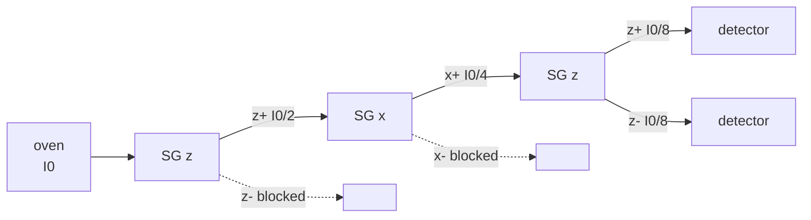

# QM09 · The Stern–Gerlach Experiment, Spin and Their Neighbours

◀ [[QM08 Quantum Tunnelling]] · [[Quantum Mechanics - Course Map|Course Map]] · next: (end of the quantum-mechanics block)

extra · book extra · beyond

> [!syllabus] Syllabus map: what is in the syllabus and what is extra in this chapter
> **No lecture source for spin.** The PH2113 folder reaches the two-level matrices $X,Y,Z$ ([[QM03 States Operators and Measurement]] §6, [[PH2113_matrices_expectation_uncertainty.pdf#page=1|MX §1–5]]) and the ladder algebra of the oscillator ([[QM05 The Harmonic Oscillator]]); the Stern–Gerlach experiment, spin as angular momentum, and everything below are **not in the lecture notes** (the [[Quantum Mechanics - Course Map]] lists "hydrogen, angular momentum, spin" under *Gaps*). This chapter therefore labels everything 🟡/🔵.
> 🟢 **Taught, used but not re-taught:** $X,Y,Z$ and their eigenvectors, $[X,Y]=2iZ$, the measurement rule and the uncertainty bound ([[Pauli Matrices]], [[Two-Level System]], [[Measurement Postulate]]); the ladder method ([[Ladder Operators]]).
> 🟡 **Extra · book**
> - §1–§3 the experiment, the force on a dipole and the electron's magnetic moment: Sakurai and Napolitano §1.1 ([[modern-quantum-mechanics-3nbsped-9781108473224-1108473229_compress.pdf#page=21|printed pp.1–10, PDF p.21 ff.]]); Griffiths §4.4 "Example: the Stern–Gerlach experiment" ([[Griffiths - Introduction to quantum mechanics.pdf#page=177|printed pp.162–164]])
> - §4–§5 spin-½ kets, sequential SG, polarisation analogy: Sakurai §1.1.2–1.1.3, §1.4; Griffiths §4.4.1
> - §6 density operators: Sakurai §3.4 ([[modern-quantum-mechanics-3nbsped-9781108473224-1108473229_compress.pdf#page=189|PDF p.189 ff.]]); §7 precession, finite rotations, the neutron $4\pi$ experiment, spin resonance: Sakurai §3.2 ([[modern-quantum-mechanics-3nbsped-9781108473224-1108473229_compress.pdf#page=175|PDF p.175 ff.]]), §5.5.4 ([[modern-quantum-mechanics-3nbsped-9781108473224-1108473229_compress.pdf#page=345|PDF p.345]]); Griffiths §4.4.2
> - §9 angular-momentum spectrum, Schwinger oscillators: Sakurai §3.5 and §3.9; §10 addition of spins: Sakurai §3.8, Griffiths §4.4.3; §11 spin correlations and Bell: Sakurai §3.10 ([[modern-quantum-mechanics-3nbsped-9781108473224-1108473229_compress.pdf#page=244|PDF p.244 ff.]])
> 🔵 **Extra · beyond** (my additions; every number in `scripts/qm09_numbers.py`, checked by an independent route: matrix exponentials, enumeration, ODE integration)
> - §2 the deflection estimate for a silver beam and the Larmor-averaging check; §5.4–§5.6 the recombining interferometer with a phase, the variance identity, the filter chain; §6 thermal polarisation numbers; §7.4 the rotating-frame derivation of the Rabi formula; §8 the von Neumann model and the Bohr–Mott estimate; §9.3 binomial rule for spin-$j$; §11 CHSH, Tsirelson, BB84 numbers; §12–§13 the cross-subject parallels (polarisers, NH$_3$, flavour oscillation, spin-only moments, character of $SU(2)$, frequency scales)

> [!key] After this chapter you can
> - describe the **Stern–Gerlach experiment** (oven, collimator, inhomogeneous magnet, plate), state the force law $F_z=\mu_z\,\partial_zB_z$, explain why $\nabla\cdot\mathbf B=0$ forces a transverse field component that **Larmor precession averages away**, and estimate the deflection of a silver beam (**0.33 mm** between the two spots for the numbers of §2),
> - build the **spin-½** theory from the experiment: a two-dimensional **complex** state space, $\mathbf S=\frac\hbar2\boldsymbol\sigma$, the eigenkets $|{\pm\mathbf n}\rangle$, the Bloch sphere and the rule $P(+\mathbf n'|+\mathbf n)=\tfrac12(1+\mathbf n\cdot\mathbf n')$,
> - predict any **sequential SG** experiment, including the $z$–$x$–$z$ result ($\tfrac18$ of the oven beam in each final port), its angle generalisation $\tfrac14\sin^2\theta$, and why recombining the middle beams removes the final $-z$ beam entirely,
> - describe oven beams, partially polarised beams and thermal ensembles with the **density matrix**, and compute polarisations such as $\tanh(\mu_BB/k_BT)$,
> - derive **Larmor precession**, the rotation operator $e^{-i\theta\,\mathbf n\cdot\boldsymbol\sigma/2}$, the $4\pi$ periodicity (neutron interferometer) and the **Rabi formula**, with NMR/ESR numbers,
> - show that a Stern–Gerlach magnet is a **measurement** (spin entangled with position, overlap $e^{-\Delta p^2/2\sigma_p^2}$) and why it fails for free electrons,
> - derive the **angular-momentum spectrum** ($j=0,\tfrac12,1,\dots$) from the commutators, treat spin 1 and general $j$, build spin from two oscillators (Schwinger), and couple two spins into singlet and triplet (the **21 cm line**),
> - derive the **singlet correlation** $-\cos\theta$, the **CHSH** bounds $2$ and $2\sqrt2$, the no-cloning theorem and the 25 % error of BB84 eavesdropping,
> - recognise the same mathematics in **polarisers, ammonia, flavour oscillations, paramagnets and spin-only moments**.

> [!intuition] The one-sentence story
> Throw a swarm of tiny, randomly oriented compass needles through a magnetic field that is stronger on one side: classically they should land smeared along a line; the silver atoms of 1922 landed in **two** spots, as if each needle could only ever be "up" or "down", and, more strikingly, **asking the same atoms a question about a different axis erases the answer to the first** — the whole of quantum mechanics in a two-component vector.

![[QM09 Stern-Gerlach Map.svg]]
*Diagram QM9.0. The chapter in one page: the experiment, spin-½ and the Bloch sphere, sequential SG, the density matrix, dynamics, SG as a measurement, spin $j$ and two spins, then entanglement and the parallels. Editable source: [[QM09 Stern-Gerlach Map.excalidraw]].*

> [!intuition] Four pictures to carry around
> 1. **A polarising filter.** Light through a vertical filter, then a horizontal one: nothing. Slip a diagonal filter *between* them: light comes out. A Stern–Gerlach analyser is the same device for a two-state system: "up/down along $z$" ↔ "vertical/horizontal", "along $x$" ↔ "diagonal" (§12.1). A new question about a different axis does not *add* information, it **replaces** it.
> 2. **A coin you may only ask one question of.** The state is a point on a sphere (the Bloch sphere); any analyser along an axis $\mathbf n'$ returns $\pm1$, with chance $\tfrac12(1+\cos\gamma)$ of $+1$ where $\gamma$ is the angle between the state and the axis. Certain along its own axis, 50:50 at right angles, never along the opposite one.
> 3. **A gyroscope that can only be read out in two ways.** In a magnetic field the spin axis precesses at the Larmor frequency, exactly like a classical top ([[Ehrenfest Theorem]]); the quantum part is only *what you see when you look*: always $\pm\tfrac\hbar2$ along whichever axis you choose.
> 4. **Two quantum dice with a hidden pact.** Two spins in the singlet state are each completely random, yet always opposite along *any* common axis. No pre-written list of answers can do that for three axes at once (§11): that is Bell's theorem.

> [!pitfall] Five traps
> 1. **Spin is not a spinning ball.** A classical electron of radius $2.8\times10^{-15}$ m with angular momentum $\hbar/2$ would have surface speed $\hbar/(2m_er)=2.05\times10^{10}$ m/s $=\mathbf{68\,c}$. Spin is an intrinsic degree of freedom with no position-space picture (§9.4).
> 2. **"Spin up" always refers to an axis.** $|{+z}\rangle$ is certain to give $+\hbar/2$ along $z$ and a coin toss along $x$ or $y$; its Bloch vector $\langle\boldsymbol\sigma\rangle=\hat z$ is an *average*, not a pointer you can read in one shot.
> 3. **Orthogonal states are antipodal, not perpendicular.** $|{+z}\rangle\perp|{-z}\rangle$ sit at opposite poles of the Bloch sphere (180°); the amplitude between states $\gamma$ apart on the sphere is $\cos(\gamma/2)$ (§4).
> 4. **Blocking a beam is not the same as recombining it.** Blocking $S_x=-$ and then asking $S_z$ gives 50:50; letting both $S_x$ beams recombine untouched gives $S_z=+$ with certainty (§5.4). What makes the difference is whether *which beam* was recorded anywhere.
> 5. **Probabilities add only when the alternatives are distinguished.** Amplitudes add when they are not. Almost every "paradox" in this chapter is that sentence.

## 1. The experiment
extra · book *Sakurai and Napolitano §1.1.1 ([[modern-quantum-mechanics-3nbsped-9781108473224-1108473229_compress.pdf#page=22|printed p.2]]); Friedrich and Herschbach, Phys. Today 56 (2003) 53, cited there*

> [!intuition] A question put to nature
> [[Stern-Gerlach Experiment|Stern's]] question (1921): *do atoms in a magnetic field point in any direction, or only in a discrete set?* The cleanest way to ask is to give each atom a sideways push proportional to the component of its magnetic moment along the field. If the directions are continuous, the pushes are continuous and the beam smears out. If they are discrete, the beam splits.

**The apparatus** (Fig. QM9.1 A). Silver is evaporated in an oven (≈ 1300 K in the numbers of §2); atoms escape through a slit, are collimated, and fly through an **inhomogeneous** magnetic field produced by a pair of pole pieces, one with a sharp edge and the other grooved; they land on a cold plate where the silver is deposited. Everything is in vacuum. The only thing that matters is that the field *changes* across the beam: $\partial B_z/\partial z\neq0$.

| | Prediction | Pattern on the plate |
|---|---|---|
| classical, isotropic moments | $\mu_z$ uniform on $[-\mu,\mu]$ | continuous band, densest at the centre once oven speeds are included |
| old quantum theory ("space quantisation") | discrete orientations | a few separate lines |
| spin-½ (this chapter) | $\mu_z=\pm\mu_B$ | **two** spots |
| **observed (Feb 1922)** | | **two** spots, separated by a few tenths of a mm |

Three observations carry all the weight:

1. **Discreteness.** $\mu_z$ takes only two values, not a continuum.
2. **The magnitude.** The two deflections correspond to $|\mu_z|=\mu_B$, the Bohr magneton ([[Bohr Magneton]]).
3. **Repeatability** (§5): atoms filtered into one beam stay in it if sent through an identical magnet.

> [!extra-book]+ 🟡 Extra (book): a short timeline (dates recalled unless cited; `[verify]` the unreferenced ones)
> | Year | Who | What |
> |---|---|---|
> | 1921 | Stern | proposes the experiment (Sakurai §1.1) |
> | Feb 1922 | Stern, Gerlach (Frankfurt) | two silver deposits; Gerlach's cheap sulphurous cigar is said to have turned the faint silver into visible black silver sulphide (Friedrich and Herschbach 2003) |
> | 1925 | Uhlenbeck, Goudsmit | electron spin ½ proposed |
> | 1927 | Pauli; Phipps and Taylor | the $\sigma$ matrices; SG with hydrogen atoms, a clean case since $l=0$ |
> | 1938–44 | Rabi | molecular-beam magnetic resonance, Nobel 1944 (cited in Sakurai §5.5) |
> | 1943 | Stern | Nobel Prize for the molecular-ray method and the proton's moment |
> | 1946 | Bloch; Purcell | NMR in bulk matter, Nobel 1952 (Sakurai §5.5) |
> | 1964 | Bell | an inequality that separates quantum mechanics from local hidden variables (Sakurai §3.10) |
> | 1975 | Rauch; Werner | neutron interferometry: the spinor needs $4\pi$ (Sakurai §3.2.3) |
> | 1999 | Lison et al. | a modern SG apparatus sorts the 9 hyperfine states of caesium $F=4$ (Sakurai Fig. 1.6) |

> [!verify] Right for the wrong reason?
> The experiment was designed to test the *old* quantum theory's "space quantisation" of the **orbital** angular momentum. The valence electron of silver is $5s$, i.e. $l=0$: it has **no** orbital moment, and the modern explanation of the two beams is the electron's **spin**. That the old theory also predicted two lines of the right size appears to have been a coincidence of its counting rules, which differ from the modern $2l+1$ (see Friedrich and Herschbach 2003 for the history). I have not re-derived the old-theory counting; treat the details as `[verify]`.

![[fig_qm09_apparatus.png]]
*Figure QM9.1. A: the magnet in cross-section (knife edge on top, groove below) with the field lines of the model field $\mathbf B=(-\alpha x,\,B_0+\alpha z)$ of §2; the field strengthens toward the knife edge, so a moment with $\mu_z>0$ is pushed up. B: trajectories of silver atoms (the numbers of §2): the quantum atoms follow just two parabolas, the grey fan is what continuous orientations would give. C: what lands on the plate, including the spread of oven speeds (deflection $\propto1/v^2$): a classical smear against two peaks pulled in to $\pm0.098$ mm with a dip at the centre (beam width $30\,\mu$m, an illustrative value).*

## 2. The physics of the apparatus
extra · book *Griffiths §4.4 ([[Griffiths - Introduction to quantum mechanics.pdf#page=177|printed pp.162–163, PDF p.177]]); Sakurai §1.1.1 eqs. (1.1)–(1.2)* · extra · beyond *the numbers*

**The force.** A magnetic moment $\boldsymbol\mu$ in a field has energy $U=-\boldsymbol\mu\cdot\mathbf B$, hence a force $\mathbf F=\nabla(\boldsymbol\mu\cdot\mathbf B)$. For a moment tied to a spin, $\boldsymbol\mu=\gamma\mathbf S$ ([[Gyromagnetic Ratio and g-Factor]]). Because the atom is heavy (de Broglie wavelength 6.7 pm at 548 m/s), its centre of mass follows a classical trajectory and only the *spin* needs quantum mechanics.

> [!derivation] Why the field must also have an $x$ component, and why it does not matter
> We want $B_z$ to vary with $z$. But Maxwell's $\nabla\cdot\mathbf B=0$ forbids a field with $\partial_zB_z\neq0$ and nothing else. The simplest field that satisfies both Maxwell equations ($\nabla\cdot\mathbf B=0$, $\nabla\times\mathbf B=0$) near the axis is [Griffiths, Eq. 4.169]
> $$\mathbf B=-\alpha x\,\hat x+(B_0+\alpha z)\,\hat z,\qquad \partial_xB_x+\partial_zB_z=-\alpha+\alpha=0,\quad\partial_zB_x-\partial_xB_z=0 .$$
> On the axis ($x=0$) the force $\mathbf F=\nabla(\boldsymbol\mu\cdot\mathbf B)$ has components
> $$F_x=-\alpha\,\mu_x,\qquad F_z=+\alpha\,\mu_z .$$
> The unwanted $F_x$ is not small *per se*. It averages to zero because the moment **precesses** about the strong uniform field $B_0\hat z$ at the Larmor frequency $\omega_L=|\gamma|B_0$ (§7.1): $\mu_x(t)=\mu_\perp\cos(\omega_Lt+\delta)$ changes sign $\omega_L t/\pi$ times during the flight, so its time average vanishes while $\mu_z$ is constant. The net force is
> $$\boxed{\bar F_z=\mu_z\,\frac{\partial B_z}{\partial z},\qquad \bar F_x=0.}$$
> The beam is deflected in proportion to the **component of the moment along the field**, i.e. the SG magnet *measures* $S_z$.

> [!example] A silver beam, with numbers (illustrative parameters, `[verify]` against the original apparatus)
> Oven $T=1300$ K; Ag atoms of mass $m=107.87$ u $=1.791\times10^{-25}$ kg; most probable speed of an effusive beam $v=\sqrt{3k_BT/m}=548$ m/s; field gradient $\partial_zB_z=10$ T/cm $=1000$ T/m; magnet length $L_1=3.5$ cm; magnet-to-plate distance $L_2=1$ cm. For $\mu_z=\pm\mu_B=\pm9.274\times10^{-24}$ J/T:
> - force $F=\mu_B\,\partial_zB=9.27\times10^{-21}$ N, i.e. **$5.3\times10^{3}$ times the atom's weight**; acceleration $a=F/m=5.18\times10^4$ m/s²;
> - time in the magnet $t_1=L_1/v=63.8\ \mu$s, so on leaving: displacement $\tfrac12at_1^2=0.105$ mm and transverse speed $at_1=3.3$ m/s;
> - drift over $L_2$ adds $at_1\,(L_2/v)=0.060$ mm; **total deflection $0.166$ mm each way, i.e. $0.33$ mm between the two spots** (a few tenths of a millimetre, the order reported historically `[verify]`);
> - the full formula is $z=\dfrac{\mu_B\,\partial_zB}{m v^2}\Big(\dfrac{L_1^2}{2}+L_1L_2\Big)$; since $z\propto1/v^2$ the **spread of oven speeds** pulls the peaks in to $\pm0.098$ mm and fills the dip (Fig. QM9.1 C): a 10 % change of speed moves a spot by 20 %;
> - the spin precesses at $\omega_L=2\mu_BB_0/\hbar=1.76\times10^{10}$ rad/s ($2.8$ GHz) in $B_0=0.1$ T, i.e. **$1.8\times10^{5}$ turns** in the 64 µs transit; the oscillating $F_x$ moves the atom by only $\alpha\mu_B/(m\omega_L^2)\approx2\times10^{-16}$ m. Averaging is excellent;
> - gravity bends the path by 0.03 µm: irrelevant.

> [!pitfall] Why silver, hydrogen, alkalis — and not electrons or ions
> A **neutral** atom feels no Lorentz force, which would otherwise swamp the tiny spin force (§8). It must be **heavy** so that wave packets can be localised well enough to follow trajectories, and its moment must come from **one unpaired electron** (closed inner shells contribute nothing, $l=0$ for the $5s$ electron). Silver ($^2S_{1/2}$), hydrogen and the alkalis fit.

## 3. Magnetic moments, quantisation and the electron's spin
extra · book *Sakurai §1.1.1 (eq. 1.1, Fig. 1.2); Griffiths §4.4.2* · extra · beyond *classical average, the beam-count table*

**The moment.** A classical charge $q$ of mass $m$ circulating with angular momentum $\mathbf L$ has $\boldsymbol\mu=\frac{q}{2m}\mathbf L$, so $\gamma=q/2m$: for an electron ($q=-e$) $\gamma_L=-e/2m_e=-8.794\times10^{10}$ s⁻¹T⁻¹. The natural unit is the [[Bohr Magneton|**Bohr magneton**]]
$$\boxed{\mu_B=\frac{e\hbar}{2m_e}=9.274\times10^{-24}\ \mathrm{J/T}=5.788\times10^{-5}\ \mathrm{eV/T}=13.996\ \mathrm{GHz/T}=0.6717\ \mathrm{K/T}\ (\mu_B/k_B).}$$
For the electron's [[Spin|spin]] the ratio is twice as large: $\boldsymbol\mu_s=-g_s\mu_B\,\mathbf S/\hbar$ with $g_s=2.0023$ (Dirac's equation gives exactly 2; the first radiative correction, Schwinger's $\alpha/2\pi=1.1614\times10^{-3}$, is within $0.15\,\%$ of the measured $g/2-1=1.15965\times10^{-3}$ `[verify]` CODATA value). So $\gamma_e=-g_s\mu_B/\hbar=-1.7609\times10^{11}$ s⁻¹T⁻¹, i.e. $\gamma_e/2\pi=-28.025$ GHz/T: **a spin precesses 28 GHz per tesla**.

**Classical expectation.** For isotropically oriented moments $\cos\theta$ is uniform on $[-1,1]$, so $\mu_z=\mu\cos\theta$ is **uniform** on $[-\mu,\mu]$ (not peaked), with $\langle\mu_z^2\rangle=\mu^2/3$. This is the grey band of Fig. QM9.1 C.

**Quantum answer.** $S_z$ has only the values $m\hbar$ with $m=-j,\dots,j$, giving $2j+1$ beams (§9 derives this):

| Atom (state) | Quantum number | Beams |
|---|---|---|
| Ag, H, Na (ground, ignoring nuclear spin) | $s=\tfrac12$ | **2** |
| Zn, Cd, Hg ($^1S_0$ ground) | $j=0$ | **1** (no splitting) |
| He metastable ($2\,^3S_1$) | $S=1$ | **3** |
| $^{133}$Cs ($F=4$) | $F=4$ | **9** (Fig. 1.6 of Sakurai) |

> [!example] Why the count is the dimension
> A $2j+1$-beam apparatus implies a $(2j+1)$-dimensional state space for the angular-momentum degree of freedom. That is Sakurai's opening move: *the number of outcomes of an SG-type measurement is the dimension of the vector space*. For silver the dimension is 2, and everything in the following sections is $2\times2$ linear algebra.

## 4. Spin-½: from two beams to a two-dimensional complex vector space
extra · book *Sakurai §1.1.2–1.1.3, §1.3.4, §1.4.2 ([[modern-quantum-mechanics-3nbsped-9781108473224-1108473229_compress.pdf#page=28|PDF p.28 ff.]]), §3.2.4; Griffiths §4.4.1 ([[Griffiths - Introduction to quantum mechanics.pdf#page=169|PDF p.169 ff.]])* · extra · beyond *the "why complex" argument, the numerical checks*

> [!intuition] Build the theory from three experimental facts
> We do not postulate the formalism; we read it off three observations about SG magnets $\mathrm{SG}\hat{\mathbf n}$ (field gradient along any axis $\hat{\mathbf n}$): **(E1)** each magnet gives exactly two beams, $S_{\mathbf n}=\pm\hbar/2$, and a second identical magnet sends a filtered beam entirely into one port; **(E2)** a beam filtered along $z$ and sent through $\mathrm{SG}\hat x$ splits 50:50, likewise $z\to y$ and $x\to y$; **(E3)** no axis is special (isotropy). Then (E1) says "$|{+z}\rangle$ and $|{-z}\rangle$ are an orthonormal basis of a 2-dimensional space", (E2) says "the $x$ kets are equal-weight superpositions of the $z$ kets".

**Step 1: the kets.** Write $|{\pm}\rangle\equiv|{\pm z}\rangle$ (so $|{+}\rangle=\binom10$, $|{-}\rangle=\binom01$). (E2) gives $|\langle\pm x|\pm z\rangle|^2=\tfrac12$; fix the phase of $|{-}\rangle$ so that
$$|{\pm x}\rangle=\tfrac1{\sqrt2}\big(|{+}\rangle\pm|{-}\rangle\big).$$
The $y$ kets must also have weights $1/\sqrt2$ on $|{\pm}\rangle$: $|{\pm y}\rangle=\tfrac1{\sqrt2}(|{+}\rangle\pm e^{i\beta}|{-}\rangle)$. Now (E2) for $x\to y$ requires $|\langle{+x}|{+y}\rangle|^2=\tfrac12$.

> [!derivation] Why the amplitudes must be complex
> $\langle{+x}|{+y}\rangle=\tfrac12(1+e^{i\beta})$, so $|\langle{+x}|{+y}\rangle|^2=\tfrac14|1+e^{i\beta}|^2=\tfrac12(1+\cos\beta)$. Setting this to $\tfrac12$ gives $\cos\beta=0$, i.e. $e^{i\beta}=\pm i$ — **never real**. With real amplitudes only two mutually "unbiased" bases ($z$ and $x$, at 45° to each other) exist in the plane; a third direction that is 45° from both does not. The analogy with light makes it vivid: linear polarisation along $x$ and at $\pm45^\circ$ are real, but **circular** polarisation (the $y$ kets) needs a $90^\circ$ phase, i.e. $i$ (Sakurai eqs. 1.9–1.14). So:
> $$|{\pm x}\rangle=\tfrac1{\sqrt2}\binom1{\pm1},\qquad |{\pm y}\rangle=\tfrac1{\sqrt2}\binom1{\pm i}.$$
> Complex numbers are not a convenience in quantum mechanics: **they are forced by the existence of three SG axes**.

**Step 2: the operators.** An observable with eigenkets $|{\pm\mathbf n}\rangle$ and eigenvalues $\pm\frac\hbar2$ is $S_{\mathbf n}=\frac\hbar2\big(|{+\mathbf n}\rangle\langle{+\mathbf n}|-|{-\mathbf n}\rangle\langle{-\mathbf n}|\big)$. Evaluating for the three axes:
$$S_z=\frac\hbar2\big(|{+}\rangle\langle{+}|-|{-}\rangle\langle{-}|\big),\quad S_x=\frac\hbar2\big(|{+}\rangle\langle{-}|+|{-}\rangle\langle{+}|\big),\quad S_y=\frac\hbar2\big(-i|{+}\rangle\langle{-}|+i|{-}\rangle\langle{+}|\big).$$
In the basis $\{|{+}\rangle,|{-}\rangle\}$, $\mathbf S=\frac\hbar2\boldsymbol\sigma$ with the **Pauli matrices**
$$\sigma_x=\begin{pmatrix}0&1\\1&0\end{pmatrix},\ \sigma_y=\begin{pmatrix}0&-i\\i&0\end{pmatrix},\ \sigma_z=\begin{pmatrix}1&0\\0&-1\end{pmatrix}\qquad(=X,Y,Z\ \text{of QM03}).$$
[[Pauli Matrices]] are Hermitian, traceless, square to $1$, and satisfy the master identity (checked numerically on random vectors in the script)
$$\boxed{\sigma_i\sigma_j=\delta_{ij}\mathbf 1+i\epsilon_{ijk}\sigma_k\ \Longrightarrow\ (\mathbf a\cdot\boldsymbol\sigma)(\mathbf b\cdot\boldsymbol\sigma)=\mathbf a\cdot\mathbf b\,\mathbf 1+i(\mathbf a\times\mathbf b)\cdot\boldsymbol\sigma,\quad [S_i,S_j]=i\hbar\epsilon_{ijk}S_k .}$$
The last relation is the **angular-momentum algebra** ([[Angular Momentum Algebra]], §9), here realised on a two-dimensional space. Every $2\times2$ Hermitian matrix is $a_0\mathbf 1+\mathbf a\cdot\boldsymbol\sigma$ with real $a_\mu$.

**Step 3: a general axis, the Bloch sphere.** Let $\mathbf n=(\sin\theta\cos\varphi,\sin\theta\sin\varphi,\cos\theta)$. Then
$$\mathbf n\cdot\boldsymbol\sigma=\begin{pmatrix}\cos\theta&\sin\theta\,e^{-i\varphi}\\\sin\theta\,e^{i\varphi}&-\cos\theta\end{pmatrix},\qquad (\mathbf n\cdot\boldsymbol\sigma)^2=\mathbf 1,$$
with eigenvectors (check the first row: $\cos\theta\cos\frac\theta2+\sin\theta\sin\frac\theta2=\cos\frac\theta2$)
$$\boxed{|{+\mathbf n}\rangle=\cos\tfrac\theta2\,|{+}\rangle+e^{i\varphi}\sin\tfrac\theta2\,|{-}\rangle,\qquad|{-\mathbf n}\rangle=-e^{-i\varphi}\sin\tfrac\theta2\,|{+}\rangle+\cos\tfrac\theta2\,|{-}\rangle.}$$
The expectation $\langle{+\mathbf n}|\boldsymbol\sigma|{+\mathbf n}\rangle=\mathbf n$ (script: checked for three directions). Each state (up to the irrelevant global phase, [[Global and Relative Phase]]) is a point $\mathbf n$ on the unit sphere, the **Bloch sphere** ([[Bloch Sphere]]); the two eigenkets of one axis are the **antipodal** points $\pm\mathbf n$. The full state space of a spin-½ is therefore a 2-sphere, not a 3-dimensional vector. The column $\binom{c_+}{c_-}$ of amplitudes is Pauli's two-component [[Spinor]].

**Step 4: the probability rule.** The SG magnet $\mathrm{SG}\hat{\mathbf n}'$ projects with $P_{\pm\mathbf n'}=\tfrac12(1\pm\mathbf n'\cdot\boldsymbol\sigma)$. For a $|{+\mathbf n}\rangle$ atom,
$$\boxed{P(+\mathbf n'\,|\,+\mathbf n)=|\langle{+\mathbf n'}|{+\mathbf n}\rangle|^2=\cos^2\frac\gamma2=\frac{1+\mathbf n\cdot\mathbf n'}2,\qquad P(-\mathbf n'\,|\,+\mathbf n)=\sin^2\frac\gamma2,}$$
$\gamma$ the angle between $\mathbf n$ and $\mathbf n'$ (since $\mathrm{Tr}[\tfrac12(1+\mathbf n\cdot\boldsymbol\sigma)\tfrac12(1+\mathbf n'\cdot\boldsymbol\sigma)]=\tfrac12(1+\mathbf n\cdot\mathbf n')$; script: six angles). This is **Malus's law for spin**.

| angle $\gamma$ | $P(+\mathbf n'\mid+\mathbf n)$ | $P(-\mathbf n'\mid+\mathbf n)$ |
|---|---|---|
| $0^\circ$ | 1 | 0 |
| $60^\circ$ | 0.75 | 0.25 |
| $90^\circ$ | 0.50 | 0.50 |
| $120^\circ$ | 0.25 | 0.75 |
| $180^\circ$ | 0 | 1 |

> [!example] Checking against the taught two-level example
> QM03 §6 took $|\psi\rangle=(\tfrac{\sqrt3}2,\tfrac12)$ and found $P(+z)=\tfrac34$, $P(+x)=0.933$, $P(+y)=\tfrac12$. Here $\cos\frac\theta2=\frac{\sqrt3}2\Rightarrow\theta=60^\circ,\ \varphi=0$, so the Bloch vector is $\mathbf n=(\sin60^\circ,0,\cos60^\circ)=(0.866,0,0.5)$ and the rule gives $P(+z)=\tfrac12(1+0.5)=0.75$, $P(+x)=\tfrac12(1+0.866)=0.933$, $P(+y)=\tfrac12$. ✓ The taught numbers are a point on the sphere.

> [!connection] Dictionary to QM03
> $X,Y,Z\leftrightarrow\sigma_x,\sigma_y,\sigma_z$; "measure $Z$" $\leftrightarrow$ pass through $\mathrm{SG}\hat z$; the $100\%$ "$\Delta X\,\Delta Y=\tfrac12|\langle[X,Y]\rangle|$ for $|{+z}\rangle$" of QM03 is $\Delta S_x\Delta S_y=\tfrac{\hbar^2}4=\tfrac12|\langle[S_x,S_y]\rangle|$ (§5.5). [[Two-Level System]] is the abstract statement; this chapter is the physical system and its dynamics.

## 5. Sequential Stern–Gerlach experiments: the heart of the matter
extra · book *Sakurai §1.1.2 ([[modern-quantum-mechanics-3nbsped-9781108473224-1108473229_compress.pdf#page=24|printed pp.4–6]]), §1.4* · extra · beyond *§5.3–§5.6*

> [!intuition] Filters are questions, and questions interfere
> A Stern–Gerlach magnet followed by a block that stops one beam is a **filter**: it prepares a state. The next magnet *measures* it. A quantum filter along $z$ gives an atom a definite $S_z$ and — this is the shock — a completely undefined $S_x$; a second filter along $x$ gives a definite $S_x$ and **forgets** $S_z$. A classical top has all three components of $\mathbf L$ at once and measuring one does not disturb another; a spin does not.

### 5.1 The three experiments
**The three experiments** ([[Sequential Stern-Gerlach Experiments]]; Sakurai Fig. 1.3; all intensities relative to the oven beam $I_0$):

| Arrangement | Result | Why |
|---|---|---|
| (a) $z\to z$ | only $z+$ emerges | $\lvert\langle{+z}\vert{+z}\rangle\rvert^2=1$: repeatable |
| (b) $z\to x$ | $x+$ and $x-$, **equal** | $\lvert\langle\pm x\vert{+z}\rangle\rvert^2=\tfrac12$ |
| (c) $z\to x\to z$ | **both** $z\pm$ emerge, equal | $\lvert\langle\pm z\vert{+x}\rangle\rvert^2=\tfrac12$ |

In (c) the $z-$ beam was **blocked** after the first magnet; the second filter (along $x$) brought it back. Counting in amplitudes: the fraction of the $z+$ beam reaching a given $x$ port is $\tfrac12$, and of that $\tfrac12$ goes to each $z$ port: **$\tfrac18I_0$ in each final port** (script: $I_0/2,\ I_0/4,\ I_0/8$).

### 5.2 The same experiment at a general angle
> [!derivation] The same experiment at a general angle
> Replace $\mathrm{SG}\hat x$ by $\mathrm{SG}\hat{\mathbf n}$ with $\mathbf n$ at angle $\theta$ from $z$ (any azimuth). The fraction of $z+$ atoms passing the $\mathbf n+$ port is $\cos^2\frac\theta2$; the fraction of those reaching the $z-$ port of the last magnet is $|\langle{-z}|{+\mathbf n}\rangle|^2=\sin^2\frac\theta2$. So
> $$\boxed{P(z-\ \text{at the end}\,|\,z+\to\mathbf n+)=\cos^2\tfrac\theta2\,\sin^2\tfrac\theta2=\tfrac14\sin^2\theta}$$
> (Fig. QM9.2 B). It vanishes at $\theta=0,\pi$ — the middle magnet then does not disturb $S_z$ — and is **largest, $\tfrac14$, at $\theta=90^\circ$**. Numbers (script): $\theta=30^\circ$: $0.0625$; $45^\circ$: $0.125$; $60^\circ$: $0.1875$; $90^\circ$: $0.25$; and $120^\circ$, $150^\circ$ mirror $60^\circ$, $30^\circ$. Starting from the oven, multiply by $\tfrac12$ for the first filter: at $60^\circ$ the fraction of the oven beam in the final $z-$ port is $\tfrac12\cdot\tfrac34\cdot\tfrac14=\tfrac3{32}=0.094$.

### 5.3 No hidden list of $S_z$ and $S_x$ values can explain it
Suppose each atom carried **both** an $S_z$ value and an $S_x$ value, as a classical top does: four types $(z\pm,x\pm)$. The oven beam has all four equally ($25\%$ each). The first filter keeps $(z+,x+)$ and $(z+,x-)$ (50:50: so (b) is reproduced). The second filter keeps $(z+,x+)$ **only**, and then the third magnet must give $z+$ with certainty. The observed 50:50 contradicts that. The only way out is to say the $x$-measurement *changes* $S_z$, and the change is not a controllable side effect but is as large as it can be: the filter "completely destroys any previous information about $S_z$" (Sakurai). §11 shows that this is not an accident of one experiment: *no* assignment of definite values to non-commuting spin components survives Bell's test.

### 5.4 Recombination: the SG interferometer
extra · beyond *amplitude calculation; Sakurai §1.1 asks the question, the phase calculation is mine*

> [!intuition] A beam splitter you can undo
> A Stern–Gerlach magnet only *separates* the beams; a second magnet with the opposite gradient can bring them back together. If *nothing recorded which beam an atom took*, the two paths interfere — exactly as in a Mach–Zehnder interferometer for light — and the outcome depends on the **relative phase** between the paths.

Let the middle device be a splitter along $x$ followed by a re-combiner, with a relative phase $\phi$ between the $x+$ and $x-$ components. (Physically: a uniform field along $x$ across the middle region rotates the spin about $x$ by $\phi=|\gamma|Bt$; there the spin is an eigenstate, so the field only multiplies the two components by $e^{\mp i\phi/2}$ and the overall phase drops out, §7.) The amplitude for $|{+z}\rangle$ to emerge as $|{-z}\rangle$ is
$$A=\langle{-z}|\big(|{+x}\rangle\langle{+x}|+e^{i\phi}|{-x}\rangle\langle{-x}|\big)|{+z}\rangle=\tfrac1{\sqrt2}\cdot\tfrac1{\sqrt2}+e^{i\phi}\Big(-\tfrac1{\sqrt2}\Big)\tfrac1{\sqrt2}=\tfrac12\big(1-e^{i\phi}\big),$$
$$\boxed{P(z-)=|A|^2=\sin^2\frac\phi2 .}$$
For $\phi=0$ the operator in brackets is the identity, $A=\langle{-z}|{+z}\rangle=0$: **the $z-$ beam that was blocked in experiment (c) is simply never produced**, the two paths cancel there and add in the $z+$ port. For $\phi=\pi$ the spin has been rotated to $|{-z}\rangle$ ($P=1$); a phase of $\pi/2$ gives $\tfrac12$ (script: all four values reproduced). This is the **spin version of two-path interference**; the "particle that was blocked" is not a classical trajectory but an amplitude.

If the two $x$ paths are made **distinguishable** — for instance an environment state $|t_\pm\rangle$ with $\langle t_+|t_-\rangle=0$ is attached to each — the amplitudes no longer add; the probabilities do: $P(z-)=\tfrac14+\tfrac14=\tfrac12$ for every $\phi$, which is what a middle *measurement* gives. The recombination *with* path information is exactly experiment (c). (§8 builds this from the SG magnet itself.)

### 5.5 Uncertainty relations on the sphere
The general rule $\Delta A\,\Delta B\ge\tfrac12|\langle[A,B]\rangle|$ ([[Generalised Uncertainty Principle]]) with $[S_x,S_y]=i\hbar S_z$ gives
$$\Delta S_x\,\Delta S_y\ge\tfrac\hbar2|\langle S_z\rangle| .$$
For $|{+z}\rangle$ one has $\Delta S_x=\Delta S_y=\frac\hbar2$, so $\Delta S_x\Delta S_y=\frac{\hbar^2}4=\frac\hbar2\cdot\frac\hbar2$: the bound is **saturated**. A sharper statement holds for *every* pure spin-½ state (script: two random states give exactly $2$ in units of $\hbar^2/4$):
$$\boxed{\Delta S_x^2+\Delta S_y^2+\Delta S_z^2=\tfrac34\hbar^2-\big|\langle\mathbf S\rangle\big|^2=\tfrac12\hbar^2,}$$
because each $\langle S_i^2\rangle=\frac{\hbar^2}4$ and, in a pure state, $|\langle\mathbf S\rangle|=\frac\hbar2$ (the Bloch vector has length 1). The *total* uncertainty is fixed; the state only decides how it is shared among the axes — sharp along one (zero) leaves $\frac\hbar2$ of standard deviation in each of the other two.

### 5.6 Many gentle filters: the polariser chain, the "Zeno" turning of a spin
extra · beyond *standard; numbers in the script*

Send a $+z$ beam through a chain of $N$ SG analysers whose axes turn by $\pi/N$ each time, keeping only the $+$ port. Each step passes $\cos^2(\pi/2N)$, so the fraction that ends up in $-z$ is
$$P_N=\cos^{2N}\frac\pi{2N}\ \xrightarrow{N\to\infty}\ 1-\frac{\pi^2}{4N}\to1 .$$
$N=1$: $0$ (the single step $+z\to-z$ passes nothing); $N=2$: $0.25$; $N=4$: $0.531$; $N=10$: $0.781$; $N=100$: $0.976$; $N=1000$: $0.9975$ (Fig. QM9.2 C). A *gentle* measurement that follows the state drags it along (the same arithmetic is the polariser chain of §12.1, and the Misra–Sudarshan [[Quantum Zeno Effect|quantum Zeno effect]] when the axis is held fixed while the state tries to precess away: $P_{\rm survive}=\cos^{2N}(\Delta\phi/2N)\to1$ for $N$ frequent measurements). The paradoxical $1/8$ and $1$ come from the same formula $\cos^2(\gamma/2)$ applied different numbers of times.

![[fig_qm09_sequential.png]]
*Figure QM9.2. A: the $z\to x\to z$ experiment on the Bloch sphere: $|{+z}\rangle$ is carried to $|{+x}\rangle$ (probability $\tfrac12$) and then to $|{\pm z}\rangle$ (each $\tfrac12$). B: the three-stage probability $\sin^2\theta/4$ against the angle of the middle magnet (blue), against the recombined case (orange, zero). The top axis is the same curve for **three polarisers** with the middle one at angle $\alpha=\theta/2$ (§12.1). C: the filter chain, $\cos^{2N}(\pi/2N)$ and its asymptote $1-\pi^2/4N$.*

> [!pitfall] Order matters
> $\mathrm{SG}\hat x$ then $\mathrm{SG}\hat z$ is not $\mathrm{SG}\hat z$ then $\mathrm{SG}\hat x$: projectors along different axes do not commute, $[\sigma_x,\sigma_z]=-2i\sigma_y\neq0$. Two filters on the same axis commute and are redundant.

## 6. Ensembles: the density matrix
extra · book *Sakurai §3.4 ([[modern-quantum-mechanics-3nbsped-9781108473224-1108473229_compress.pdf#page=189|printed p.169 ff.]])* · extra · beyond *the numbers and the thermal case*

> [!intuition] How to describe the beam *before* it has been filtered
> The ket describes an atom you have **prepared**. Atoms straight from the oven have no preferred direction; assigning any single ket $c_+|{+}\rangle+c_-|{-}\rangle$ would single out a direction (the Bloch vector). Sakurai's remark: the formalism so far is *incomplete* until it can describe ensembles with probabilities $w_i$ over several kets.

**Definition** ([[Density Matrix]], [[Pure and Mixed States]]). For an ensemble in which a fraction $w_i$ is in the pure state $|\psi_i\rangle$ ($\sum w_i=1$, the $|\psi_i\rangle$ need not be orthogonal),
$$\boxed{\rho=\sum_iw_i|\psi_i\rangle\langle\psi_i|,\qquad\langle A\rangle=\mathrm{Tr}(\rho A),\qquad P(a)=\mathrm{Tr}(\rho\,P_a)}$$
($\rho$ Hermitian, $\mathrm{Tr}\rho=1$, non-negative). A pure ensemble has $\rho=|\psi\rangle\langle\psi|$ and $\rho^2=\rho$.

**Spin-½.** Every $\rho$ is
$$\rho=\tfrac12\big(\mathbf 1+\mathbf r\cdot\boldsymbol\sigma\big),\qquad \mathbf r=\langle\boldsymbol\sigma\rangle,\ \ |\mathbf r|\le1,\qquad P(+\mathbf n)=\tfrac12(1+\mathbf r\cdot\mathbf n),$$
the **Bloch ball**: pure states on the surface ($|\mathbf r|=1$), the maximally mixed state at the centre. Eigenvalues are $\tfrac12(1\pm|\mathbf r|)$, so the purity is $\mathrm{Tr}\rho^2=\tfrac12(1+r^2)$ and the von Neumann entropy $S=-\mathrm{Tr}\rho\ln\rho=-\sum\lambda\ln\lambda$.

> [!example] Three beams
> - **Oven beam (isotropic):** $\rho=\int\frac{\mathrm d\Omega}{4\pi}|{+\mathbf n}\rangle\langle{+\mathbf n}|=\tfrac12\mathbf 1$: purity $\tfrac12$, $S=\ln2$ ($1$ bit, the most any two-level system can have), every analyser sees 50:50.
> - **Filtered beam:** $\mathbf r=\hat{\mathbf n}$, pure, $S=0$.
> - **Partially polarised:** $\mathbf r=(0.3,0,0.4)$: $|\mathbf r|=0.5$, purity $0.625$, eigenvalues $0.75,\,0.25$, $S=0.562$ nat ($0.811$ bit); $P(+z)=0.70$, $P(+x)=0.65$, $P(+y)=0.50$ (script).

> [!derivation] Different preparations, the same $\rho$; superposition is not mixture
> $\tfrac12|{+z}\rangle\langle{+z}|+\tfrac12|{-z}\rangle\langle{-z}|=\tfrac12|{+x}\rangle\langle{+x}|+\tfrac12|{-x}\rangle\langle{-x}|=\tfrac12\mathbf1$ (script: all equal). No experiment can tell **how** an ensemble was made, only $\rho$. By contrast the **coherent superposition** $\frac1{\sqrt2}(|{+z}\rangle+|{-z}\rangle)=|{+x}\rangle$ has the same $z$-statistics (50:50) but gives $S_x=+\frac\hbar2$ with certainty, while the mixture gives $\langle\sigma_x\rangle=0$: the off-diagonal elements of $\rho$ (the *coherences*) carry the phase information that interference needs.

**Thermal ensembles.** For an equilibrium ensemble of moments $\mu$ in a field $B$ (energies $\mp\mu B$) ([[Canonical Ensemble]], [[Partition Function]]) $\rho=e^{-H/k_BT}/Z$, which is diagonal with Bloch vector along the field
$$\boxed{P=p_\uparrow-p_\downarrow=\tanh\frac{\mu B}{k_BT},\qquad S/k_B=-\sum p\ln p,}$$
the two-level result of [[TH06 From Kinetic Theory to Statistical Mechanics]]. Numbers (script):

| System | $\mu B/k_BT$ | $P$ |
|---|---|---|
| electron, 1 T, 300 K | $2.24\times10^{-3}$ | $2.2\times10^{-3}$ |
| electron, 1 T, 4 K | $0.168$ | $0.166$ |
| electron, 10 T, 2 K | $3.36$ | $0.998$ |
| proton, 1.5 T, 300 K | $5.1\times10^{-6}$ | $5.1\times10^{-6}$ |

So **$90\,\%$ polarisation of electron spins in 1 T needs $T=0.456$ K**, while protons in a 1.5 T MRI magnet are polarised to five parts per million at body temperature (and would need 2.8 mK for 50 %): the weakness of the signal in NMR is a Boltzmann factor. At small $x$, $P\approx\mu B/k_BT$ (Curie's law); as $B/T\to\infty$ the entropy $S\to0$ (adiabatic demagnetisation). Population inversion, $P<0$, corresponds formally to a **negative temperature** ([[Entropy]]).

> [!pitfall] Pure versus mixed is not "known versus unknown"
> A pure state $|{+z}\rangle$ is *completely* specified and still gives random $x$ outcomes; a mixture is a classical lack of knowledge about *which* pure state was prepared. The Bloch vector's length $|\mathbf r|$ measures how much *spin order* survives, not how well you know something.

## 7. Spin dynamics: Larmor precession, rotations, Rabi flopping
extra · book *Griffiths §4.4.2 ([[Griffiths - Introduction to quantum mechanics.pdf#page=175|printed pp.160–162]]); Sakurai §2.1.5, §3.1–3.2 ([[modern-quantum-mechanics-3nbsped-9781108473224-1108473229_compress.pdf#page=175|PDF p.175 ff.]]), §5.5.4 ([[modern-quantum-mechanics-3nbsped-9781108473224-1108473229_compress.pdf#page=345|PDF p.345]])* · extra · beyond *the rotating-frame derivation, the numbers*

### 7.1 Larmor precession
(See [[Larmor Precession]].) For $\boldsymbol\mu=\gamma\mathbf S$ in a static field $B\hat z$: $H=-\boldsymbol\mu\cdot\mathbf B=-\gamma BS_z$. The Heisenberg equation $\dot{\mathbf S}=\frac i\hbar[H,\mathbf S]$ ([[Heisenberg Picture]]) with $[S_z,S_x]=i\hbar S_y$, $[S_z,S_y]=-i\hbar S_x$ gives
$$\dot S_x=\gamma BS_y,\qquad\dot S_y=-\gamma BS_x,\qquad\dot S_z=0\quad\Longleftrightarrow\quad\boxed{\frac{\mathrm d\mathbf S}{\mathrm dt}=\gamma\,\mathbf S\times\mathbf B=\boldsymbol\mu\times\mathbf B,}$$
the torque law of a classical gyroscope ([[Ehrenfest Theorem]]; Griffiths: "just as it would classically"). The solution is a rotation of $\langle\mathbf S\rangle$ about $\hat z$ with **angular velocity $\boldsymbol\omega_L=-\gamma\mathbf B$**, magnitude $\omega_L=|\gamma|B$ (script: verified against the matrix exponential):

| Particle | $\gamma/2\pi$ | at 1 T | at 1.5 T |
|---|---|---|---|
| electron | $-28.025$ GHz/T | 28.025 GHz | 42.04 GHz |
| proton | $+42.577$ MHz/T | 42.577 MHz | 63.87 MHz |
| neutron | $-29.165$ MHz/T | 29.165 MHz | 43.75 MHz |

The ratio of electron to proton frequencies is $\gamma_e/\gamma_p=658.2=(g_e/g_p)(\mu_B/\mu_N)$ with $g_e=2.0023$, $g_p=5.586$ (the proton's moment is $2.793\,\mu_N$) and $\mu_B/\mu_N=m_p/m_e=1836$: spins of electrons are probed at GHz, those of nuclei at MHz.

### 7.2 The rotation operator and the $4\pi$ periodicity
The state evolves with $U=e^{-iHt/\hbar}=\exp(-i\,\omega t\,S_z/\hbar)$, which is a **rotation by angle $\omega t$ about $z$**. In general ([[Spin Rotation Operator]]), rotating by $\theta$ about $\mathbf n$ is
$$\boxed{U(\mathbf n,\theta)=e^{-i\theta\,\mathbf n\cdot\mathbf S/\hbar}=e^{-i\frac\theta2\mathbf n\cdot\boldsymbol\sigma}=\cos\frac\theta2\,\mathbf 1-i\sin\frac\theta2\,(\mathbf n\cdot\boldsymbol\sigma)}$$
(the series sums because $(\mathbf n\cdot\boldsymbol\sigma)^2=\mathbf1$; script: matrix exponential agrees). It acts on the Bloch vector as an ordinary rotation: for $\mathbf n=\hat z$, $U\sigma_xU^\dagger=\cos\phi\,\sigma_x+\sin\phi\,\sigma_y$. But on the **kets** the half-angle shows:
$$U(\mathbf n,2\pi)=-\mathbf 1,\qquad U(\mathbf n,4\pi)=+\mathbf 1 .$$
After a full turn the expectation values are back, the ket is minus itself; only after $4\pi$ is the ket restored (Sakurai's $\tau_{\rm ket}=4\pi/\omega$ against $\tau_{\rm prec}=2\pi/\omega$). The map $U\mapsto R$ from $SU(2)$ to $SO(3)$ is **two-to-one** (§12.5).

### 7.3 The neutron interferometer: seeing the minus sign
A global minus sign is unobservable — *unless the rotated beam is compared with an unrotated one.* Split a neutron beam; let one arm pass through a field region while the other does not. The arm in the field picks up $e^{\mp i\varphi/2}$ with $\varphi=|\gamma_n|B\ell/v$ the rotation angle ($\ell$ the path length in the field). For a spin polarised **perpendicular** to $B$, $\langle\psi|U|\psi\rangle=\cos\frac\varphi2$, so the recombined intensity is
$$I\propto1+\cos\frac\varphi2 ,$$
with period $\Delta\varphi=4\pi$ (if the ket returned after $2\pi$ the period would be $2\pi$; Fig. QM9.3 C). Successive maxima as the field is varied are separated by
$$\Delta B=\frac{4\pi v}{|\gamma_n|\,\ell}.$$
For thermal neutrons $\lambda=1.8$ Å ($v=h/m_n\lambda=2198$ m/s) and $\ell=2$ cm: $\Delta B=7.5$ mT $=75$ G (a $2\pi$ rotation needs $3.8$ mT). The experiments of Rauch et al. and Werner et al. (1975) found the $4\pi$ period "to a fraction of a percent" (Sakurai).

> [!verify] Sakurai's $\Delta B$ formula uses a *reduced* wavelength
> Sakurai (3.43) gives $\Delta B=4\pi\hbar c/(e\,g_n\lambda\,l)$. With $\lambda$ the ordinary de Broglie wavelength the factor of $2\pi$ is lost: it reproduces $4\pi v/(|\gamma_n|\ell)$ only if $\lambda\equiv\hbar/p$ (so $v=\hbar/m\lambda$). The numbers above use the form with $v$, which does not depend on the convention `[verify]` (my reading of the printed formula).

### 7.4 A rotating field: Rabi flopping
([[Rabi Oscillation]], [[Magnetic Resonance]]) Add a small field $B_1$ rotating in the $xy$-plane at angular frequency $\omega$ (an oscillating field is half rotating one way and half the other; keep the resonant half, the rotating-wave approximation, whose neglected term shifts the resonance by $\sim\Omega^2/4\omega_0$):
$$H(t)=\omega_0S_z+\Omega\big(S_x\cos\omega t+S_y\sin\omega t\big),\qquad \omega_0\equiv-\gamma B_0,\ \ \Omega\equiv-\gamma B_1 .$$

> [!derivation] The rotating frame turns the problem into a static one
> Let $R(t)=e^{-i\omega tS_z/\hbar}$ (rotation by $\omega t$ about $z$), so $R\,S_x\,R^\dagger=S_x\cos\omega t+S_y\sin\omega t$. Write $|\psi\rangle=R|\psi'\rangle$. Then $i\hbar\partial_t|\psi'\rangle=\big(R^\dagger HR-\omega S_z\big)|\psi'\rangle=H'|\psi'\rangle$ with
> $$H'=(\omega_0-\omega)S_z+\Omega S_x=\frac\hbar2\big(\Delta\sigma_z+\Omega\sigma_x\big),\qquad\Delta=\omega_0-\omega,$$
> **time independent**. Equivalently the rotating frame removes the fictitious field $\omega/\gamma$ from $B_0$: $B_{\rm eff}=B_0+\omega/\gamma$ — the same bookkeeping as the Coriolis term in [[Rotating Reference Frames]]. Define $W=\sqrt{\Omega^2+\Delta^2}$ and $\hat{\mathbf n}=(\Omega,0,\Delta)/W$: $H'=\frac{\hbar W}2\hat{\mathbf n}\cdot\boldsymbol\sigma$, so by §7.2
> $$U'(t)=\cos\frac{Wt}2-i\sin\frac{Wt}2\,\hat{\mathbf n}\cdot\boldsymbol\sigma,\qquad P_{\uparrow\to\downarrow}(t)=|\langle{-}|U'|{+}\rangle|^2=\sin^2\frac{Wt}2\,(n_x^2+n_y^2).$$

$$\boxed{P_{\rm flip}(t)=\frac{\Omega^2}{\Omega^2+\Delta^2}\,\sin^2\!\Big(\tfrac12\sqrt{\Omega^2+\Delta^2}\,t\Big)}\qquad(\text{Rabi's formula; script vs. matrix exponential: error }10^{-15}).$$
On resonance ($\Delta=0$) the spin flips completely at $t=\pi/\Omega$ (**$\pi$-pulse**) and returns at $2\pi/\Omega$; $\pi/2$-pulses ($\Omega t=\pi/2$) tip the spin into the $xy$-plane. Off resonance the flip is incomplete: the peak $\Omega^2/(\Omega^2+\Delta^2)$ is a Lorentzian in $\Delta$ with full width $2\Omega$ — **the weaker the drive, the sharper the resonance** (Sakurai). The orbit of the Bloch vector is a rotation about the *effective* field $(\Omega,0,\Delta)$ (Fig. QM9.3 A): a great circle through the poles on resonance. A direct integration of the full rotating-field $H(t)$ (not rotating-wave) with $\omega_0=\omega=50$, $\Omega=1$ gives $P_{\rm flip}(\pi/\Omega)=1.000000$ and $P_{\rm flip}(2\pi/\Omega)=0.000000$ (script).

> [!example] Numbers for magnetic resonance
> | Spin | $B_0$ | resonance | $B_1$ | $\Omega/2\pi$ | $\pi$-pulse |
> |---|---|---|---|---|---|
> | electron (ESR) | 1 T | 28.03 GHz | 1 mT | 28.0 MHz | **17.8 ns** |
> | proton (NMR/MRI) | 1.5 T | 63.87 MHz | 10 µT | 425.8 Hz | **1.17 ms** |
> Detuned by $\Delta=\Omega/2$ the electron's peak flip probability is $0.80$ and the oscillation runs at $\sqrt{\Omega^2+\Delta^2}/2\pi=31.3$ MHz (script). A 3 T scanner: 127.7 MHz; 7 T: 298 MHz. In MRI (the clinical form of NMR; [[Neuroscience - Course Map]] for its use in brain imaging) the signal is the precessing magnetisation $M=n\mu P$ with $P\sim5\times10^{-6}$ (§6).

![[fig_qm09_dynamics.png]]
*Figure QM9.3. A: Larmor precession of $\langle\mathbf S\rangle$ about $\mathbf B$ (blue circle at constant polar angle) and the resonant Rabi flip in the rotating frame (orange meridian from $+z$ to $-z$). B: spin-flip probability against $\Omega t/2\pi$ for detunings $\Delta/\Omega=0,\ 0.5,\ 1,\ 2$; maxima $1,\ 0.80,\ 0.50,\ 0.20$. C: neutron-interferometer intensity $1+\cos(\varphi/2)$ against the rotation angle: maxima every $4\pi$ (blue), compared with the $2\pi$ period that would follow if the ket returned after one turn (dashed).*

> [!connection] Larmor's theorem and the Coriolis force
> A charge $q$ in a magnetic field feels $q\mathbf v\times\mathbf B$; a mass in a frame rotating at $\boldsymbol\Omega$ feels $-2m\boldsymbol\Omega\times\mathbf v$: the same form with $q\mathbf B\leftrightarrow2m\boldsymbol\Omega$ ([[Rotating Reference Frames]], [[CL12 Rotating Frames and the Coriolis Force]]). So a uniform weak $B$ looks, from a frame rotating at the Larmor frequency, like no field at all: the Foucault pendulum and the precessing spin are the same phenomenon in two vocabularies. To put a number on it: Earth's rotation, $7.29\times10^{-5}$ s⁻¹, is the Coriolis equivalent of a magnetic field of $2m_e\Omega/e=8.3\times10^{-16}$ T acting on an electron: utterly negligible, which is why a lab spin does not feel the planet's rotation.

## 8. The SG magnet as a quantum measurement
extra · book *Griffiths §4.4 p.163 (the beam-frame argument, after Ballentine); Sakurai §1.1.1 (why trajectories are legitimate)* · extra · beyond *the overlap, decoherence and Bohr–Mott numbers*

> [!intuition] The magnet entangles spin with position; the plate reads the position
> Before the magnet: spin and position are independent. Inside, the force depends on $S_z$, so atoms with $S_z=+$ are pushed up and those with $S_z=-$ down. A superposition of spins therefore becomes a superposition of an "up-moving atom with spin up" and a "down-moving atom with spin down": **spin entangled with position**. The plate (or any detector that notices where the atom is) completes the measurement.

**The model.** In the beam's rest frame the interaction acts for a time $\tau$: $H_{\rm int}=-\mu B'\,z\,\sigma_z$ (the uniform $B_0$ part only rotates the transverse spin and is dropped). Then $U=\exp\!\big(i\,k\,z\,\sigma_z\big)$ with $k=\mu B'\tau/\hbar$, the translation operator of [[Dirac Algebra]]: it shifts $p_z$ by $\pm\hbar k=\pm\Delta p=\pm F\tau$. Starting from $(a|{+}\rangle+b|{-}\rangle)\otimes\varphi(z)$:
$$|\Psi\rangle=a\,|{+}\rangle\,\varphi(z)e^{+ikz}+b\,|{-}\rangle\,\varphi(z)e^{-ikz}.$$
This is the **von Neumann measurement model** ([[Von Neumann Measurement Model]]): the "pointer" is the transverse momentum (later position), the "system" the spin. Tracing out the position leaves the spin density matrix
$$\rho_{\rm spin}=\begin{pmatrix}|a|^2&ab^*\,\mathcal O\\a^*b\,\mathcal O^*&|b|^2\end{pmatrix},\qquad\mathcal O=\int|\varphi|^2e^{2ikz}\,\mathrm dz=e^{-2k^2\sigma_z^2}=e^{-\Delta p^2/2\sigma_p^2}$$
for a Gaussian of rms width $\sigma_z$ and $\sigma_p=\hbar/2\sigma_z$. The diagonal ($S_z$ statistics) is untouched and the coherences are multiplied by the **packet overlap** $\mathcal O$: when the two packets separate, $\mathcal O\to0$ and the spin is left in the mixture $\mathrm{diag}(|a|^2,|b|^2)$: the superposition has been *measured*, without invoking collapse.

> [!example] Numbers for silver
> Kick $\Delta p=F\tau=9.27\times10^{-21}\ \mathrm N\times63.8\ \mu\mathrm s=5.9\times10^{-25}$ kg m/s ($\Delta v=3.3$ m/s, deflection angle $6$ mrad). For a beam of rms width $\sigma_z=20\ \mu$m, $\sigma_p=\hbar/2\sigma_z=2.6\times10^{-30}$ kg m/s, so $\Delta p/\sigma_p=2.2\times10^{5}$ and $\mathcal O=\exp(-2.5\times10^{10})$: the two packets are *perfectly* resolved; the gradient could be $1.6\times10^5$ times weaker before the overlap reached $1/e$. A "good" SG measurement is not delicate.

**Is the spin coherence really gone?** Not necessarily: it has moved into the correlation between spin and position. If the two beams are brought back together with a reversed gradient (net kick $0$), the packets overlap again, $\mathcal O\to1$, and the spin coherence returns — provided *nothing else* recorded the path. This reversible SG interferometer was analysed as "Humpty-Dumpty" by Englert, Schwinger and Scully (1988–89, `[verify]` references). §5.4's interference condition is exactly $\mathcal O\ne0$.

> [!pitfall] Why a Stern–Gerlach magnet does not split a free-electron beam
> **Bohr and Mott's** argument (Griffiths: "in practice the Stern–Gerlach experiment doesn't work… with a beam of free electrons"): a charged particle also feels the Lorentz force $e\,\mathbf v\times\mathbf B$, and the *field variation across the beam of width $w$* is $\delta B\sim B'w$, so the Lorentz force differs across the beam by $e v B'w$, to be compared with the spin force $\mu_BB'$:
> $$\frac{F_{\rm Lorentz}}{F_{\rm spin}}\sim\frac{e\,v\,w}{\mu_B}=\frac{2m_evw}{\hbar}=\frac{4\pi w}{\lambda_{\rm dB}} .$$
> For a 100 eV electron ($v=5.9\times10^6$ m/s, $\lambda_{\rm dB}=0.123$ nm) and $w=1\ \mu$m the ratio is $1.0\times10^{5}$ ($10^{8}$ for 1 mm). The spin force wins only for beams narrower than $\sim\lambda/4\pi\approx10$ pm, which the uncertainty principle would then spread over an angle $\gtrsim1$: no collimated beam exists. (A modern proposal separates electron spins with a standing light wave instead of a magnet, Batelaan et al. 1997, `[verify]`.) The heuristic is not a theorem; it is the reason an *atom* (neutral, $2\times10^{5}$ times heavier than an electron) was the right particle.

> [!connection] Link to the measurement postulate
> [[Measurement Postulate]] says "the state collapses onto an eigenstate". The SG model shows the *mechanism* that makes that effective description work: unitary evolution entangles spin with position; ignoring the position produces the diagonal $\rho$; a macroscopic plate fixes the outcome. Interpretations differ about the last step; the numbers do not.

## 9. Beyond spin-½: the general angular-momentum spectrum, spin 1, and spin from two oscillators
extra · book *Sakurai §3.5 ([[modern-quantum-mechanics-3nbsped-9781108473224-1108473229_compress.pdf#page=200|printed p.180 ff.]]), §3.9 ([[modern-quantum-mechanics-3nbsped-9781108473224-1108473229_compress.pdf#page=238|printed p.218 ff.]]); Griffiths §4.3* · extra · beyond *the binomial rule and the numerical checks*

> [!intuition] Same trick as the oscillator
> In [[QM05 The Harmonic Oscillator]] the commutator $[a_-,a_+]=1$ and the requirement $a_-\psi_0=0$ produced a whole ladder of states. Here $[J_x,J_y]=i\hbar J_z$ and the requirement that the ladder *stops at both ends* produce the possible beam counts $2j+1$, with $j$ an integer or half-integer, without ever writing a wavefunction.

### 9.1 The spectrum from the algebra alone
Take Hermitian $J_x,J_y,J_z$ with $[J_i,J_j]=i\hbar\epsilon_{ijk}J_k$ and set $J_\pm=J_x\pm iJ_y$, $\mathbf J^2=J_x^2+J_y^2+J_z^2$. Then (each step is one line of algebra)
$$[J_z,J_\pm]=\pm\hbar J_\pm,\quad[J_+,J_-]=2\hbar J_z,\quad[\mathbf J^2,J_i]=0,\quad\mathbf J^2=J_-J_++J_z^2+\hbar J_z=J_+J_-+J_z^2-\hbar J_z .$$
Let $\mathbf J^2|\lambda,m\rangle=\hbar^2\lambda|\lambda,m\rangle$, $J_z|\lambda,m\rangle=\hbar m|\lambda,m\rangle$. Then $J_\pm|\lambda,m\rangle$ is an eigenvector of $J_z$ with eigenvalue $\hbar(m\pm1)$ and the same $\lambda$ (because $J_zJ_\pm=J_\pm(J_z\pm\hbar)$). The norms must be non-negative:
$$\|J_+|\lambda,m\rangle\|^2=\hbar^2\big[\lambda-m(m+1)\big]\ge0,\qquad\|J_-|\lambda,m\rangle\|^2=\hbar^2\big[\lambda-m(m-1)\big]\ge0 .$$
So $m$ is bounded for fixed $\lambda$: the ladder must terminate. At the top, $m=j$ with $J_+|\lambda,j\rangle=0$, which forces $\lambda=j(j+1)$. At the bottom, $m=k$ with $J_-|\lambda,k\rangle=0$, so $\lambda=k(k-1)$, hence $k=-j$ (the root $k=j+1$ lies above the top). Climbing from $-j$ to $+j$ in unit steps needs $2j\in\{0,1,2,\dots\}$:
$$\boxed{j=0,\tfrac12,1,\tfrac32,\dots;\quad m=-j,-j+1,\dots,+j\ (2j+1\ \text{values});\quad J_\pm|j,m\rangle=\hbar\sqrt{j(j+1)-m(m\pm1)}\,|j,m\pm1\rangle.}$$
Check: $j=\tfrac12$, $J_+|{-\tfrac12}\rangle=\hbar\sqrt{\tfrac34+\tfrac14}|{+\tfrac12}\rangle=\hbar|{+\tfrac12}\rangle$, and $J_x=\tfrac12(J_++J_-)$ reproduces $\frac\hbar2\sigma_x$ (script verifies $[J_i,J_j]=i\hbar\epsilon J_k$ and $\mathbf J^2=j(j+1)\hbar^2$ for $j=\tfrac12,1,\tfrac32,\tfrac52$). The **SG experiment is therefore a direct readout of $j$**: $2j+1$ beams.

### 9.2 Spin 1: three beams
[[Spin-One Systems]]: in the basis $|{+1}\rangle,|0\rangle,|{-1}\rangle$ ($J_\pm$ has entries $\sqrt2\,\hbar$):
$$J_z=\hbar\begin{pmatrix}1&0&0\\0&0&0\\0&0&-1\end{pmatrix},\quad J_x=\frac\hbar{\sqrt2}\begin{pmatrix}0&1&0\\1&0&1\\0&1&0\end{pmatrix},\quad J_y=\frac\hbar{\sqrt2}\begin{pmatrix}0&-i&0\\i&0&-i\\0&i&0\end{pmatrix}.$$
Rotating the analyser by an angle $\beta$ in the $xz$-plane gives the Wigner matrix $d^{1}(\beta)$: $P(m'=0|m=0)=\cos^2\beta$, $P(\pm1|0)=\tfrac12\sin^2\beta$, $P(+1|+1)=\big(\tfrac{1+\cos\beta}2\big)^2$, $P(0|+1)=\tfrac12\sin^2\beta$, $P(-1|+1)=\big(\tfrac{1-\cos\beta}2\big)^2$ (script: all checked by diagonalising $J_n$). 

> [!example] A spin-1 surprise: the $m=0$ beam has no $x=0$ component
> Send the $m_z=0$ beam of a spin-1 atom (metastable helium $2\,^3S_1$) through $\mathrm{SG}\hat x$ ($\beta=90^\circ$): $J_x$'s eigenvector for eigenvalue $0$ is $(1,0,-1)/\sqrt2$ (solve $x_2=0,\ x_1+x_3=0$), orthogonal to $(0,1,0)$. So the three outcome probabilities are $\mathbf{(\tfrac12,\,0,\,\tfrac12)}$: the middle beam is *empty*. From $m_z=+1$ at $90^\circ$ one gets $(\tfrac14,\tfrac12,\tfrac14)$, and from $m_z=0$ at $45^\circ$ the same $(\tfrac14,\tfrac12,\tfrac14)$ (Fig. QM9.4 C). Classically a vector of length $\sqrt2\hbar$ pointing along the equator of $z$ would be found at $x=0$ with certainty; a quantum "$m=0$" is not that vector.

### 9.3 Spin $j$ as $2j$ spin-½'s: a binomial rule
extra · beyond *Majorana's picture; numerical check in the script*

The state $|j,j\rangle_z$ is the symmetric product of $2j$ spin-½'s all pointing $+z$ ($S_z=\sum s_z$ adds, and the product is the unique state with $m=j$). Measure along an axis at angle $\beta$: each constituent independently gives "up" with probability $p=\cos^2\frac\beta2$, so the number of ups is binomial and
$$P(m'|j,j)=\binom{2j}{j+m'}\cos^{2(j+m')}\!\tfrac\beta2\,\sin^{2(j-m')}\!\tfrac\beta2 .$$
At $\beta=90^\circ$ ($p=\tfrac12$): $j=1$: $\tfrac14,\tfrac12,\tfrac14$; $j=\tfrac32$: $\tfrac18,\tfrac38,\tfrac38,\tfrac18$ (script matches to $10^{-5}$). As $j\to\infty$ the binomial becomes a Gaussian: a classical vector with small spread — the **correspondence principle** ([[Correspondence Principle]]).

### 9.4 Orbital versus spin
Orbital angular momentum $\mathbf L=-i\hbar\,\mathbf r\times\nabla$ acts on functions of position; single-valuedness $e^{im\varphi}=e^{im(\varphi+2\pi)}$ forces integer $m$ and integer $l$. The algebra of §9.1 *also* allows half-integers, but no function of $\mathbf r$ can realise them: they live in a **spin** space with no position-space picture. That is why the $l=0$ silver atom splits in two, and why the electron's spin has no classical radius (Pitfall 1). In group language integer $j$ are the representations of $SO(3)$; half-integer $j$ need its double cover $SU(2)$ (§12.5).

### 9.5 Schwinger's oscillator model
extra · book *Sakurai §3.9* · extra · beyond *the connection to QM05–QM06 and to light*

> [!intuition] Angular momentum = how two oscillators trade quanta
> Take two uncoupled oscillators ([[Schwinger Oscillator Model]]) $a,b$ ($[a,a^\dagger]=[b,b^\dagger]=1$, all other commutators zero, [[Ladder Operators]]). Moving a quantum from $b$ to $a$ raises $J_z$; the reverse lowers it. The conserved total number $N=n_a+n_b$ is $2j$.

Define
$$J_+=\hbar\,a^\dagger b,\qquad J_-=\hbar\,b^\dagger a,\qquad J_z=\frac\hbar2\big(a^\dagger a-b^\dagger b\big).$$
Using $[b,b^\dagger]=1$, $[a^\dagger b,\,b^\dagger a]=a^\dagger a\,(1+b^\dagger b)-b^\dagger b\,(1+a^\dagger a)=n_a-n_b$, so $[J_+,J_-]=\hbar^2(n_a-n_b)=2\hbar J_z$ ✓, and $\mathbf J^2=\hbar^2\frac N2\big(\frac N2+1\big)$ (script, on states with $n_a,n_b\le3$). The two-oscillator Fock state $|n_a,n_b\rangle$ is $|j,m\rangle$ with
$$j=\frac{n_a+n_b}2,\qquad m=\frac{n_a-n_b}2,\qquad|j,m\rangle=\frac{(a^\dagger)^{j+m}(b^\dagger)^{j-m}}{\sqrt{(j+m)!\,(j-m)!}}|0\rangle .$$
One quantum shared between two modes is **spin-½**: $|1,0\rangle=|{\uparrow}\rangle$, $|0,1\rangle=|{\downarrow}\rangle$. This is exactly how a **photon's polarisation** is a spin-½: the two modes are horizontal and vertical polarisation and $J_x,J_y,J_z$ are the Stokes parameters (§12.1). Two quanta make spin 1 (three states: $|2,0\rangle,|1,1\rangle,|0,2\rangle$), etc. A tool for rotation matrices of any $j$, and one more place where the oscillator of QM05–QM06 is the building block of everything.

## 10. Two spins: singlet, triplet and the 21 cm line
extra · book *Sakurai §3.8 ([[modern-quantum-mechanics-3nbsped-9781108473224-1108473229_compress.pdf#page=225|printed p.205 ff.]]); Griffiths §4.4.3 ([[Griffiths - Introduction to quantum mechanics.pdf#page=180|printed p.165 ff.]], Clebsch–Gordan table p.168)* · extra · beyond *the rotation-invariance proof, numbers*

Two spin-½ particles ([[Singlet and Triplet States]]) live in $\mathbb C^2\otimes\mathbb C^2$ (dimension 4) with total spin $\mathbf S=\mathbf S_1+\mathbf S_2$. Lowering from $|{\uparrow\uparrow}\rangle$ with $S_-=S_{1-}+S_{2-}$ builds the **triplet** ($S=1$) and the orthogonal combination is the **singlet** ($S=0$):
$$|1,1\rangle=|{\uparrow\uparrow}\rangle,\ \ |1,0\rangle=\tfrac1{\sqrt2}(|{\uparrow\downarrow}\rangle+|{\downarrow\uparrow}\rangle),\ \ |1,{-1}\rangle=|{\downarrow\downarrow}\rangle;\qquad|0,0\rangle=\tfrac1{\sqrt2}(|{\uparrow\downarrow}\rangle-|{\downarrow\uparrow}\rangle).$$
Dimension count: $2\times2=3+1$ (in general $j_1\otimes j_2=|j_1-j_2|\oplus\cdots\oplus(j_1+j_2)$). The triplet is **symmetric** under exchanging the two spins, the singlet **antisymmetric**.

**$\mathbf S_1\cdot\mathbf S_2$.** From $\mathbf S^2=\mathbf S_1^2+\mathbf S_2^2+2\mathbf S_1\cdot\mathbf S_2$ with $\mathbf S_i^2=\frac34\hbar^2$:
$$\mathbf S_1\cdot\mathbf S_2=\tfrac12\big[S(S+1)-\tfrac32\big]\hbar^2=\begin{cases}+\tfrac14\hbar^2&\text{triplet}\\-\tfrac34\hbar^2&\text{singlet}\end{cases}\quad\text{(script: eigenvalues }-\tfrac34,+\tfrac14,+\tfrac14,+\tfrac14).$$

> [!derivation] The singlet is the same in every basis
> Write $|0,0\rangle=\frac1{\sqrt2}\sum_{ab}\varepsilon_{ab}|a\rangle|b\rangle$ with $\varepsilon_{\uparrow\downarrow}=1,\varepsilon_{\downarrow\uparrow}=-1$. Rotating both spins by the same $U\in SU(2)$ gives $\sum_{a'b'}U_{aa'}U_{bb'}\varepsilon_{a'b'}=(\det U)\,\varepsilon_{ab}=\varepsilon_{ab}$. So $(U\otimes U)|0,0\rangle=|0,0\rangle$: the singlet has **no preferred direction** (it is rotation-invariant), which is why Sakurai could rewrite it as $\frac1{\sqrt2}(|{-x}\rangle|{+x}\rangle-|{+x}\rangle|{-x}\rangle)$ by inspection. Each spin on its own is *completely unpolarised* ($\rho_1=\rho_2=\frac12\mathbf1$, script), yet the pair is pure: all the information is in the correlations.

> [!example] The hydrogen hyperfine line, 1420 MHz ([[Hydrogen 21 cm Line]])
> The proton ($I=\tfrac12$) and the electron ($s=\tfrac12$) in the $1s$ state couple by the contact interaction $H_{\rm hf}=(A/\hbar^2)\,\mathbf I\cdot\mathbf S$. By the formula above the triplet ($F=1$) lies above the singlet ($F=0$) by $A\big(\tfrac14+\tfrac34\big)=A$. Measured: $\nu=1420.405752$ MHz, i.e. $\Delta E=h\nu=5.874\ \mu$eV, $\lambda=c/\nu=21.106$ cm, $h\nu/k_B=68.2$ mK. The Fermi-contact estimate $\Delta E=\tfrac43g_p\frac{m_e}{m_p}\alpha^4m_ec^2$ (Griffiths' hydrogen hyperfine splitting, `[verify]` section) gives $5.877\ \mu$eV with $g_p=5.586$: $0.05\,\%$ from the measurement (script). Because $h\nu\ll k_BT$ in the interstellar medium the four sublevels are populated in the ratio of their statistical weights, $3:1$ (at 100 K: $2.998:1$), so the **emission is proportional to the number of hydrogen atoms**; the spontaneous-emission rate is only $\approx2.9\times10^{-15}$ s$^{-1}$ (a lifetime of $\approx10^7$ yr, recalled `[verify]`) but there is so much hydrogen that this line maps the neutral gas in the galaxy: a *spin flip* seen across the cosmos.

> [!connection] Singlet and triplet in helium and chemistry
> The Pauli principle needs the *total* wavefunction of two electrons to be antisymmetric: a **spin triplet** (symmetric) must have an **antisymmetric spatial** part (a node between the electrons: they stay apart, less repulsion), a **spin singlet** a symmetric spatial part. So the triplet lies below the singlet of the same configuration: $1s2s$ in helium, $2\,^3S_1$ at 19.82 eV against $2\,^1S_0$ at 20.62 eV above the ground state (recalled `[verify]`; the $2\,^3S_1$ state is the metastable atom of the spin-1 SG table). The same exchange energy is **Hund's rule**, and sets the triplet ground state of $\mathrm{O_2}$ in [[CH02 Molecular Orbital Theory Diatomics]].

## 11. Entanglement, the EPR–Bohm pair and Bell's theorem
extra · book *Sakurai §3.10 ([[modern-quantum-mechanics-3nbsped-9781108473224-1108473229_compress.pdf#page=244|printed pp.224–229]])* · extra · beyond *the correlation proof, CHSH, Tsirelson, no-cloning, BB84*

> [!intuition] A pact that cannot be written down in advance
> Two atoms leave a source in the singlet state ([[Entanglement]]). Each, alone, is a perfectly random coin. But if both are analysed along the *same* axis (any axis), the results are always opposite. If a pre-agreed list of "answers for every axis" (an instruction set) did the job, the list would have to be consistent for all axes at once. Bell showed that for three well-chosen axes it cannot be.

### 11.1 Correlations of the singlet
Let $E(\mathbf a,\mathbf b)=\langle\sigma_{\mathbf a}\otimes\sigma_{\mathbf b}\rangle$ be the mean product of the two $\pm1$ results when particle 1 is analysed along $\mathbf a$ and particle 2 along $\mathbf b$.

> [!derivation] $E(\mathbf a,\mathbf b)=-\mathbf a\cdot\mathbf b$
> The singlet satisfies $(\boldsymbol\sigma_1+\boldsymbol\sigma_2)|0,0\rangle=0$, i.e. $\sigma_{1i}|0,0\rangle=-\sigma_{2i}|0,0\rangle$. Then $(\mathbf a\cdot\boldsymbol\sigma_1)(\mathbf b\cdot\boldsymbol\sigma_2)|0,0\rangle=-(\mathbf a\cdot\boldsymbol\sigma_1)(\mathbf b\cdot\boldsymbol\sigma_1)|0,0\rangle=-\big[\mathbf a\cdot\mathbf b+i(\mathbf a\times\mathbf b)\cdot\boldsymbol\sigma_1\big]|0,0\rangle$ by the identity of §4. The expectation of $\boldsymbol\sigma_1$ in the singlet is $0$ (its reduced state is $\frac12\mathbf1$), so
> $$\boxed{E(\mathbf a,\mathbf b)=-\mathbf a\cdot\mathbf b=-\cos\theta_{ab}}$$
> (script: the explicit four-component state agrees at six angles). Likewise $P(a{+},b{+})=\frac14(1-\cos\theta)=\tfrac12\sin^2\frac\theta2$ and the marginals are $\tfrac12$ whatever the other side does: **no signalling** ($\rho_B=\frac12\mathbf1$ for every choice of Alice, script).

### 11.2 The three-axis (Wigner–Bell) inequality
Assume (local) hidden variables ([[Bell Inequality and CHSH]]): each pair carries a list of definite answers $(\mathbf a\pm,\mathbf b\pm,\mathbf c\pm)$ for three axes, particle 2's list being the opposite of particle 1's so that equal axes always give opposite results (Sakurai Table 3.2: eight populations $N_1\ldots N_8\ge0$). Then $N_3+N_4\le(N_2+N_4)+(N_3+N_7)$, i.e.
$$\boxed{P(\mathbf a{+};\mathbf b{+})\le P(\mathbf a{+};\mathbf c{+})+P(\mathbf c{+};\mathbf b{+})}$$
Quantum mechanics: $P(\mathbf a{+};\mathbf b{+})=\tfrac12\sin^2\frac{\theta_{ab}}2$. With $\mathbf c$ in the middle and $\theta_{ac}=\theta_{cb}=\theta$, $\theta_{ab}=2\theta$: the inequality would read $\tfrac12\sin^2\theta\le\sin^2\frac\theta2$, i.e. $\cos\theta\le0$. It is **violated for every $\theta<90^\circ$**; the violation is largest at $\theta=60^\circ$:
$$P(\mathbf a{+};\mathbf b{+})=\tfrac12\sin^260^\circ=0.375\ \ \nleq\ \ \sin^230^\circ=0.250\qquad(\text{script; difference }0.125).$$

### 11.3 CHSH and the quantum limit
Choose two settings on each side. With results $A,A',B,B'\in\{\pm1\}$ and a local model $A=A(\mathbf a,\lambda)$ etc.,
$$S=\langle AB\rangle-\langle AB'\rangle+\langle A'B\rangle+\langle A'B'\rangle,\qquad S_\lambda=A(B-B')+A'(B+B'),$$
and since $B,B'=\pm1$ one of $(B-B')$, $(B+B')$ is $0$ and the other $\pm2$: $|S_\lambda|=2$ for every $\lambda$, so
$$\boxed{|S|\le2\quad(\text{local hidden variables, CHSH})}$$
(script: all 16 deterministic strategies give $|S|\le2$). For the singlet take $\mathbf a=\hat z,\ \mathbf a'=\hat x$ and $\mathbf b,\mathbf b'$ at $45^\circ$ and $135^\circ$ from $\hat z$ in the $xz$-plane: the four terms are $-0.707,\ +0.707\ (\text{enters with a minus}),\ -0.707,\ -0.707$, so
$$|S|=4\times\tfrac{1}{\sqrt2}=2\sqrt2=2.828 .$$
With axes at $0,\varphi,2\varphi,3\varphi$ the sum is $|S|=|3\cos\varphi-\cos3\varphi|$, which exceeds 2 for $0<\varphi<68.5^\circ$ (the crossing solves $2c^3-3c+1=0$, $c=\cos\varphi=(\sqrt3-1)/2$) and peaks at $45^\circ$ (Fig. QM9.4 B).

> [!derivation] Why $2\sqrt2$ is the quantum maximum (Tsirelson)
> Let $A,A'$ act on one spin and $B,B'$ on the other (so $[A,B]=0$ etc.), each with square $\mathbf1$, and $C=AB-AB'+A'B+A'B'$. Expanding and cancelling the pure-$B$ and pure-$A$ terms gives $C^2=4\cdot\mathbf1+[A,A'][B,B']$ (script: checked as a matrix identity for the settings above). Since $\|[A,A']\|\le2$ and $\|[B,B']\|\le2$, $\|C^2\|\le8$ and $|\langle C\rangle|\le2\sqrt2$. The singlet reaches it exactly. **Quantum correlations beat the local bound by $41\,\%$ and no more; a fully "no-signalling" theory could reach 4.**

> [!example] What a local model can do: $E=-1+2\theta/\pi$
> The simplest local model, $A=\mathrm{sgn}(\mathbf a\cdot\boldsymbol\lambda)$, $B=-\mathrm{sgn}(\mathbf b\cdot\boldsymbol\lambda)$ with $\boldsymbol\lambda$ uniform on the sphere, gives $E(\theta)=-1+2\theta/\pi$ (a straight line, script by Monte-Carlo with $2\times10^6$ points: $-0.5005$ at $45^\circ$ against exact $-0.5$). It agrees with $-\cos\theta$ at $0$, $90^\circ$ and $180^\circ$ (so *perfect anticorrelation* is not the issue) but at the CHSH angles it gives four terms of $\pm\frac12$: $|S|=2$, the bound, never more (Fig. QM9.4 A).

![[fig_qm09_bell_spinj.png]]
*Figure QM9.4. A: the singlet correlation $-\cos\theta$ (blue) against the local model $-1+2\theta/\pi$ (orange dashed): the largest gap is at $45^\circ$ and $135^\circ$ (dots). B: the CHSH sum $|3\cos\varphi-\cos3\varphi|$ against the local bound 2 (dashed) and the Tsirelson bound $2\sqrt2$ (dotted); the shaded region is the violation. C: spin 1: the three outcomes of an $\mathrm{SG}_x$ stage for an incoming $m_z=+1$ beam $(\tfrac14,\tfrac12,\tfrac14)$ and for $m_z=0$ $(\tfrac12,0,\tfrac12)$ (§9.2).*

**Experiments** (recalled, `[verify]` dates): Freedman and Clauser (1972), Aspect and colleagues (1982) with settings changed while the photons were in flight, loophole-free tests (2015), and the Nobel Prize 2022 to Aspect, Clauser and Zeilinger. The photon version uses polarisation instead of spin (§12.1); the mathematics is the same.

### 11.4 No-cloning, and the use of the formalism: BB84
> [!derivation] No-cloning
> Suppose a unitary $U$ copies: $U|\psi\rangle|0\rangle=|\psi\rangle|\psi\rangle$ for all $|\psi\rangle$. For two states, unitarity preserves inner products: $\langle\psi|\phi\rangle=\langle\psi|\phi\rangle^2$, so $\langle\psi|\phi\rangle\in\{0,1\}$. But $|{+z}\rangle$ and $|{+x}\rangle$ have overlap $\frac1{\sqrt2}$. **An unknown spin cannot be copied** ([[No-Cloning Theorem]]). If it could, one could clone a $+z$ atom many times and measure all three components, defeating §5.

**BB84** (Bennett and Brassard 1984; [[BB84 Protocol]]). Alice sends spins prepared at random as $|{\pm z}\rangle$ or $|{\pm x}\rangle$; Bob measures each in a random basis. When the bases agree (probability $\tfrac12$) the bit is shared; otherwise it is thrown away. An eavesdropper who intercepts, measures and resends guesses the basis wrongly with probability $\tfrac12$, and in that case Bob's bit is wrong with probability $\tfrac12$: the sifted key has an error rate of **$\tfrac12\times\tfrac12=25\,\%$** (script), so comparing $n$ test bits exposes her except with probability $(\tfrac34)^n$ ($n=40$: $1.0\times10^{-5}$; $n=73$ is needed for $10^{-9}$). Information is protected by the non-commutation of $\sigma_z$ and $\sigma_x$ — the sequential SG experiment of §5 used as a lock.

> [!connection] Probability
> Bell's theorem is a statement about **joint distributions**: if all four variables $A,A',B,B'$ had a joint distribution, the four pairwise correlations would obey CHSH ([[Covariance and Correlation]]). The quantum correlations are consistent pairwise but have no joint distribution. The BB84 analysis is a short exercise in [[Conditional Probability]] and the [[Binomial Distribution]].

## 12. Parallels: every two-level system is a spin-½
extra · book *Sakurai §1.1.3 (light polarisation, [[modern-quantum-mechanics-3nbsped-9781108473224-1108473229_compress.pdf#page=26|printed p.6 ff.]]), §5.5.5 (maser)* · extra · beyond *the mapping tables, flavour oscillation, spin-only moments, the $SU(2)$ character*

> [!intuition] The same equation in different dress
> Any quantum system with two relevant states has a $2\times2$ Hamiltonian $H=\frac\hbar2(\Delta\sigma_z+\Omega\sigma_x)+\text{const}$, so §7.4's formulas — Rabi flopping, resonance width, Bloch-sphere motion — apply **verbatim**. Different physical systems just rename $\Delta$ and $\Omega$.

### 12.1 Light polarisation (Sakurai's own analogy)
[[Photon Polarisation]] is the classical shadow of the spin-½ structure:

| Spin-½ | Light | Note |
|---|---|---|
| $\mathrm{SG}\hat z$ ports $\pm z$ | polariser (or splitter): $H$/$V$ | a birefringent crystal or polarising beam-splitter is the "SG device" |
| $\mathrm{SG}\hat x$ ports $\pm x$ | $+45^\circ$/$-45^\circ$ linear | Sakurai eq. (1.7) |
| $\mathrm{SG}\hat y$ ports $\pm y$ | right/left **circular** | complex amplitudes, $\lvert{\pm y}\rangle\leftrightarrow\frac1{\sqrt2}(1,\pm i)$ |
| Bloch sphere, angle $\theta$ | Poincaré sphere, $\theta=2\alpha$ | polariser angle $\alpha$: **angles double** (helicity $\pm1$) |
| $P=\cos^2\frac\gamma2$ | Malus $I=I_0\cos^2\alpha$ | the same law |

The three-filter experiment ($x$-polariser, an intermediate polariser at angle $\alpha$, then a $y$-polariser) transmits $\tfrac12\cos^2\alpha\sin^2\alpha=\tfrac18\sin^22\alpha$ of unpolarised light: $\alpha=22.5^\circ$: $0.0625$; $45^\circ$: $\mathbf{0.125}=\tfrac18$ (the $z$–$x$–$z$ number); $67.5^\circ$: $0.0625$ (script: Malus chain agrees). A chain of $N$ polarisers each turned by $90^\circ/N$ transmits $\cos^{2N}(\pi/2N)$: $0.78$ for $N=10$, $0.976$ for $N=100$ — the filter chain of §5.6. The photon version of the SG-interferometer is the **Mach–Zehnder interferometer**; of the Schwinger model, the Stokes operators (§9.5).

![[fig_qm09_parallels.png]]
*Figure QM9.5. A: equilibrium polarisation $\tanh(\mu B/k_BT)$ with the four cases of §6 (1: proton 1.5 T 300 K; 2: electron 1 T 300 K; 3: electron 1 T 4 K; 4: electron 10 T 2 K). B: flavour oscillation $\sin^22\theta\,\sin^2(1.267\,\Delta m^2L/E)$ for $\Delta m^2=2.5\times10^{-3}$ eV$^2$: Rabi flopping in $L/E$; the first maximum is at $496$ km/GeV. C: spin-only magnetic moments $\sqrt{n(n+2)}\,\mu_B$ against the number of unpaired electrons (§12.5).*

### 12.2 A dictionary of two-level systems
| System | The two states | The "field" | What is seen |
|---|---|---|---|
| spin-½ in $\mathbf B$ | $\lvert{\uparrow}\rangle,\lvert{\downarrow}\rangle$ | Zeeman $\gamma B$ | 28 GHz/T (e), 42.6 MHz/T (p) |
| photon | $H,V$ | wave plate | polarisation rotation on the Poincaré sphere |
| NH$_3$ inversion | symmetric/antisymmetric of the N-above/below double well | static or microwave $E$ | 23.87 GHz maser, [[QM08 Quantum Tunnelling]] §6 |
| H$_2^+$, any A–B bond | electron on A or on B | resonance integral $\beta$ | $E_\pm=\alpha\pm\beta$, charge oscillates at $2\lvert\beta\rvert/\hbar$ ([[CH02 Molecular Orbital Theory Diatomics]]) |
| $K^0$–$\bar K^0$, neutrinos | flavour states | mass-splitting and mixing | oscillation in $L/E$ |
| superconducting qubit | $\lvert0\rangle,\lvert1\rangle$ | microwave drive | GHz, $\sim240$ mK equivalent |

**Ammonia and the electric Stern–Gerlach.** Sakurai §5.5.5: an inhomogeneous *electric* field separates the symmetric and antisymmetric NH$_3$ states "in much the same way as the inhomogeneous magnetic field in the Stern–Gerlach experiment separates $|+\rangle$ from $|-\rangle$"; the upper-state beam then enters a cavity tuned to $23.87$ GHz ($0.796\ \mathrm{cm^{-1}}$, $\Delta E=98.7\ \mu$eV, $h\nu/k_B=1.15$ K) for exactly a $\pi$-pulse: the **maser**.

> [!example] H$_2^+$ as Rabi flopping
> For an electron on atoms A and B with $H=\begin{pmatrix}\alpha&\beta\\\beta&\alpha\end{pmatrix}$ the eigen-energies are $\alpha\pm\beta$ and an electron put on A is found on B with $P=\sin^2(\beta t/\hbar)$: §7.4 with $\Delta=0$, $\Omega=2\beta/\hbar$. "Resonance" in valence-bond language is *literally* a Rabi oscillation of the electron between the two atoms.

**Flavour oscillation** ([[Flavour Oscillation]]). For two neutrino flavours with mixing angle $\theta$ and mass-squared difference $\Delta m^2$, in the flavour basis $H=\frac{\Delta m^2}{4E}\begin{pmatrix}-\cos2\theta&\sin2\theta\\\sin2\theta&\cos2\theta\end{pmatrix}$, i.e. $\Delta=-\frac{\Delta m^2}{2E}\cos2\theta$, $\Omega=\frac{\Delta m^2}{2E}\sin2\theta$, $W=\Delta m^2/2E$, so §7.4 gives
$$P=\sin^22\theta\,\sin^2\!\frac{\Delta m^2L}{4\hbar cE}=\sin^22\theta\,\sin^2\!\Big(1.267\,\frac{\Delta m^2}{\rm eV^2}\frac{L}{\rm km}\frac{\rm GeV}{E}\Big),$$
with $1.267=1/(4\hbar c)$ in these units (script: $1.2669$). For $\Delta m^2=2.5\times10^{-3}$ eV$^2$ the first maximum is at $L/E=\pi/(2\times1.267\,\Delta m^2)=496$ km/GeV: a beam of 295 km and $0.6$ GeV sits at $L/E=492$ km/GeV, phase $1.557$ rad, $\sin^2=0.9998$ (long-baseline experiments are designed on this arithmetic; the value of $\Delta m^2$ is recalled `[verify]`). Neutrinos *rotate on a Bloch sphere in flavour space* as they fly.

### 12.3 Thermodynamics: the paramagnet and the two-level entropy
[[TH06 From Kinetic Theory to Statistical Mechanics]] gives the two-level heat capacity (Schottky peak $0.439\,k_B$ at $0.417\,\varepsilon/k_B$) and entropy; here the splitting is $\varepsilon=2\mu B$ (the [[Zeeman Effect|Zeeman splitting]]) and §6's $P=\tanh(\mu B/k_BT)$ is the magnetisation of a paramagnet (Curie's law at small $\mu B/k_BT$). $S/k_B=\ln2$ at $B=0$ is the oven beam's entropy; at $x=\mu B/k_BT=0.5,1,3$, $S/k_B=0.582,\,0.365,\,0.017$ (script): **polarising spins is cooling**, which is how adiabatic demagnetisation works.

### 12.4 Chemistry: spin-only moments, $\mathrm{O_2}$ and NMR
A bulk sample ([[Spin-Only Magnetic Moment]]) with $n$ unpaired electrons has total spin $S=n/2$ and $g\approx2$, so its moment is
$$\mu_{\rm eff}=g\sqrt{S(S+1)}\,\mu_B=\sqrt{n(n+2)}\,\mu_B:\qquad n=1,2,3,4,5\ \Rightarrow\ 1.73,\ 2.83,\ 3.87,\ 4.90,\ 5.92\ \mu_B$$
(Fig. QM9.5 C). **$\mathrm{O_2}$** has two unpaired $\pi^*$ electrons ($S=1$, triplet): $2.83\,\mu_B$, which is why liquid oxygen is held between the poles of a magnet. The force law is the same $\mathbf F=\nabla(\boldsymbol\mu\cdot\mathbf B)$; in a bulk paramagnet thermal alignment ($\tanh$) gives a net moment, so the sample is *attracted* where an SG beam would be *split*. High-spin $d^5$ ions (Fe$^{3+}$, Mn$^{2+}$) have $n=5$: $5.92\,\mu_B$; high-spin Fe$^{2+}$ ($n=4$): $4.90$. Spin-pairing shows up as a **lower** moment (low-spin complexes), the experiment behind the ligand-field story. NMR and EPR are Rabi's method applied to nuclei and electrons (§7.4); the $658\times$ ratio of their frequencies at the same field (§7.1) is why ESR sits at GHz and NMR at MHz.

### 12.5 Group theory: why $4\pi$
The three operators $\frac12\sigma_i$ are a basis of the Lie algebra $\mathfrak{su}(2)$; the rotation operators $e^{-i\theta\mathbf n\cdot\boldsymbol\sigma/2}$ fill out the group $SU(2)$, which covers $SO(3)$ **twice** ($U$ and $-U$ give the same rotation): it is the unit quaternions, $\{\pm1,\pm i\sigma_x,\pm i\sigma_y,\pm i\sigma_z\}$ being the quaternion group $Q_8$ ([[Quaternion Group]]). The characters of the $(2j+1)$-dimensional representation, $\chi_j(\theta)=\sin\!\big((j+\tfrac12)\theta\big)/\sin\tfrac\theta2$ ([[GT10 Symmetry Representations and Characters]] has the integer-$\ell$ case), show the double cover at a glance: $\chi_{1/2}(\theta)=2\cos\frac\theta2$ equals $-2$ at $\theta=2\pi$ and $+2$ at $4\pi$, whereas $\chi_1(\theta)=1+2\cos\theta=3$ at both ([[Group Theory - Course Map]]). The sign flip of the spinor under a $2\pi$ rotation is a *topological* fact about $SO(3)$, seen in the lab by the neutron interferometer of §7.3.

### 12.6 Where else this sits in the vault
| Vault note | Link |
|---|---|
| [[Rotating Reference Frames]], [[CL12 Rotating Frames and the Coriolis Force]] | Larmor $\leftrightarrow$ Coriolis (§7.4 box) |
| [[TH06 From Kinetic Theory to Statistical Mechanics]], [[Partition Function]] | two-level thermodynamics (§6, §12.3) |
| [[CH02 Molecular Orbital Theory Diatomics]] | $\mathrm{O_2}$ triplet, bonding/antibonding as a two-level problem |
| [[Waves - Course Map]] | polarisation, Stokes vectors, Jones calculus |
| [[Probability - Course Map]] | Bell as a constraint on joint distributions (§11) |
| [[Group Theory - Course Map]] | $SU(2)\to SO(3)$, quaternions |

## 13. Where two-level physics lives: a table of scales
extra · beyond *the numbers are recomputed in the script; the frequency of the Cs clock is the exact defining value of the SI second*

Every system above has a *frequency* $\nu$; the energy is $h\nu$ and the temperature at which thermal motion competes is $h\nu/k_B$:

| System | $\nu$ | $h\nu$ ($\mu$eV) | $h\nu/k_B$ |
|---|---|---|---|
| proton Larmor, 1.5 T | 63.9 MHz | 0.264 | **3.1 mK** |
| hydrogen hyperfine | 1.4204 GHz | 5.87 | 68 mK |
| transmon qubit (typical) | 5 GHz | 20.7 | 0.24 K |
| Cs hyperfine (the second) | 9.1926 GHz | 38.0 | 0.44 K |
| NH$_3$ inversion | 23.87 GHz | 98.7 | 1.15 K |
| electron spin, 1 T | 28.03 GHz | 115.9 | 1.35 K |
| visible photon (500 nm) | $6.0\times10^{14}$ Hz | $2.5\times10^6$ | $2.9\times10^4$ K |

Rules of thumb: *a two-level system is only polarised if $T\lesssim h\nu/k_B$*. A 1.5 T proton transition is a 3 mK system sitting in a 300 K bath: $P=\tanh(h\nu/2k_BT)=5.1\times10^{-6}$; quantum bits need dilution refrigerators; a visible photon needs no cooling at all. The Stern–Gerlach idea survives in every modern **state-selective detection** — atomic clocks (Rabi or Ramsey pulses then a state-resolved count), cold-atom spinor gases, the 1999 caesium apparatus of Fig. 1.6 in Sakurai — and in the electric-field version that makes the maser.

## Map of this chapter
> [!connection] How QM09 connects
> **Builds on:** [[QM03 States Operators and Measurement]] (the $X,Y,Z$ matrices, measurement, commutators, uncertainty), [[QM05 The Harmonic Oscillator]] and [[QM06 The Oscillator Toolbox]] (ladder operators, the template for §9.1 and §9.5), [[QM01 From Waves to Probabilities]] (Born rule), [[QM08 Quantum Tunnelling]] (the ammonia double well), [[Dirac Algebra]] (kets, projectors, unitary operators, translation, Heisenberg picture).
> **Concepts:** [[Stern-Gerlach Experiment]] · [[Sequential Stern-Gerlach Experiments]] · [[Spin]] · [[Spinor]] · [[Bloch Sphere]] · [[Pauli Matrices]] · [[Spin Rotation Operator]] · [[Larmor Precession]] · [[Rabi Oscillation]] · [[Magnetic Resonance]] · [[Density Matrix]] · [[Pure and Mixed States]] · [[Bohr Magneton]] · [[Gyromagnetic Ratio and g-Factor]] · [[Zeeman Effect]] · [[Angular Momentum Algebra]] · [[Spin-One Systems]] · [[Schwinger Oscillator Model]] · [[Singlet and Triplet States]] · [[Hydrogen 21 cm Line]] · [[Entanglement]] · [[Bell Inequality and CHSH]] · [[No-Cloning Theorem]] · [[BB84 Protocol]] · [[Von Neumann Measurement Model]] · [[Photon Polarisation]] · [[Quantum Zeno Effect]] · [[Flavour Oscillation]] · [[Spin-Only Magnetic Moment]] · [[Two-Level System]] · [[Measurement Postulate]]
> **Other subjects:** [[Thermodynamics and Statistical Mechanics - Course Map]] and [[TH06 From Kinetic Theory to Statistical Mechanics]] (Boltzmann polarisation, two-level entropy, negative temperature); [[Inorganic Chemistry - Course Map]] and [[CH02 Molecular Orbital Theory Diatomics]] (paramagnetic $\mathrm{O_2}$, spin-only moments, NMR/EPR); [[Group Theory - Course Map]] and [[GT10 Symmetry Representations and Characters]] ($SU(2)\to SO(3)$, characters of half-integer spin, the quaternion group); [[Climate - Course Map]] ([[CL12 Rotating Frames and the Coriolis Force]]: Larmor ↔ Coriolis); [[Probability - Course Map]] (joint distributions, Bell, BB84); [[Waves - Course Map]] (polarisation, Jones and Stokes vectors); [[Neuroscience - Course Map]] (MRI).

## Summary
> [!summary] Cheat-sheet
> - **Experiment:** $\mathbf F=\nabla(\boldsymbol\mu\cdot\mathbf B)$, $\bar F_z=\mu_z\partial_zB_z$ (the transverse $F_x$ averages out by Larmor precession); Ag, $10$ T/cm, 3.5 cm + 1 cm: **0.33 mm between the two spots**, $1.8\times10^5$ precession turns in transit. Classical: $\mu_z$ uniform; observed: $\pm\mu_B$ ($\mu_B=9.274\times10^{-24}$ J/T, 28 GHz/T for $g=2$).
> - **Spin-½:** $\mathbf S=\frac\hbar2\boldsymbol\sigma$, $\sigma_i\sigma_j=\delta_{ij}+i\epsilon_{ijk}\sigma_k$, $[S_i,S_j]=i\hbar\epsilon_{ijk}S_k$; $|{+\mathbf n}\rangle=(\cos\frac\theta2,\,e^{i\varphi}\sin\frac\theta2)$; complex amplitudes are forced by three SG axes; Bloch sphere, orthogonal = antipodal.
> - **Probabilities:** $P(+\mathbf n'|+\mathbf n)=\cos^2\frac\gamma2=\frac12(1+\mathbf n\cdot\mathbf n')$ (Malus for spin). **$z$–$x$–$z$:** $\frac18$ in each final port; general angle $\frac14\sin^2\theta$; recombined with phase $\phi$: $\sin^2\frac\phi2$ (zero if the paths are untouched).
> - **Uncertainty:** $\Delta S_x\Delta S_y\ge\frac\hbar2|\langle S_z\rangle|$; $\sum\Delta S_i^2=\frac{\hbar^2}2$ for every pure state.
> - **Density matrix:** $\rho=\frac12(1+\mathbf r\cdot\boldsymbol\sigma)$, purity $\frac12(1+r^2)$; oven beam $\frac12\mathbf1$, $S=\ln2$; thermal $P=\tanh(\mu B/k_BT)$ ($5\times10^{-6}$ for protons at 1.5 T, 300 K).
> - **Dynamics:** $\dot{\mathbf S}=\gamma\mathbf S\times\mathbf B$, $\omega_L=|\gamma|B$ (electron 28.03 GHz/T, proton 42.58 MHz/T); $U=e^{-i\theta\mathbf n\cdot\boldsymbol\sigma/2}=\cos\frac\theta2-i\sin\frac\theta2\,\mathbf n\cdot\boldsymbol\sigma$, $U(2\pi)=-1$ (neutron interferometer: maxima every $4\pi$, $\Delta B=4\pi v/|\gamma_n|\ell$). **Rabi:** $P=\frac{\Omega^2}{\Omega^2+\Delta^2}\sin^2\frac{\sqrt{\Omega^2+\Delta^2}\,t}2$, width $2\Omega$, $\pi$-pulse $\Omega t=\pi$.
> - **SG as measurement:** $U=e^{ikz\sigma_z}$ entangles spin with position; coherences multiplied by $\mathcal O=e^{-\Delta p^2/2\sigma_p^2}$ ($=e^{-2.5\times10^{10}}$ for Ag); free electrons fail because $F_{\rm Lorentz}/F_{\rm spin}\sim4\pi w/\lambda$.
> - **Angular momentum:** ladder ends at both ends: $j=0,\frac12,1,\dots$, $2j+1$ beams, $J_\pm|j,m\rangle=\hbar\sqrt{j(j+1)-m(m\pm1)}|j,m\pm1\rangle$; spin 1 from $m=0$ through $\mathrm{SG}_x$: $(\frac12,0,\frac12)$; spin $j$ gives a binomial; Schwinger: $J_+=\hbar a^\dagger b$, $j=\frac{n_a+n_b}2$.
> - **Two spins:** $\frac12\otimes\frac12=0\oplus1$; $\mathbf S_1\cdot\mathbf S_2=-\frac34\hbar^2$ (singlet), $+\frac14\hbar^2$ (triplet); hydrogen $F=1\to0$: $1420.4058$ MHz, 21.106 cm, 5.874 µeV.
> - **Bell:** singlet $E=-\cos\theta$; local models $|S|\le2$, quantum $2\sqrt2$ (Tsirelson, $C^2=4+[A,A'][B,B']$), violated for $0<\varphi<68.5^\circ$; three-axis inequality violated by $0.375$ vs $0.25$ at $60^\circ$; no-cloning ($\langle\psi|\phi\rangle\in\{0,1\}$); BB84 intercept–resend error 25 %.
> - **Parallels:** polariser angle $\alpha\leftrightarrow\theta=2\alpha$, three polarisers $\frac18\sin^22\alpha$; NH$_3$ 23.87 GHz; flavour $\sin^22\theta\sin^2(1.267\Delta m^2L/E)$; spin-only $\sqrt{n(n+2)}\mu_B$; $\chi_{1/2}=2\cos\frac\theta2$.

## Practice
1. **Deflection.** Reproduce the 0.33 mm separation for the silver beam of §2 ($v=548$ m/s, $\partial_zB=10$ T/cm, $L_1=3.5$ cm, $L_2=1$ cm). What gradient gives a 1 mm separation?
2. **Counting beams.** How many beams does an SG magnet make from (a) ground-state Hg ($^1S_0$), (b) metastable He ($2\,^3S_1$), (c) $^{133}$Cs in $F=4$, (d) an atom with $j=\frac52$, (e) a spinless atom with $l=2$?
3. **Pauli identities.** Show $\sigma_x\sigma_y=i\sigma_z$, hence $(\mathbf a\cdot\boldsymbol\sigma)(\mathbf b\cdot\boldsymbol\sigma)=\mathbf a\cdot\mathbf b+i(\mathbf a\times\mathbf b)\cdot\boldsymbol\sigma$, and use $(\mathbf n\cdot\boldsymbol\sigma)^2=1$ to prove $e^{-i\theta\,\mathbf n\cdot\boldsymbol\sigma/2}=\cos\frac\theta2-i\sin\frac\theta2\,\mathbf n\cdot\boldsymbol\sigma$ and $U(2\pi)=-\mathbf1$.
4. **Probabilities on the sphere.** (a) A $+x$ atom meets $\mathrm{SG}\hat{\mathbf n}$ with $\mathbf n$ at $\theta=120^\circ$, $\varphi=0$: find $P(+\mathbf n)$. (b) A $+z$ atom meets $\mathrm{SG}\hat{\mathbf n}$ at $\theta=60^\circ$, $\varphi=0$: find $P(+\mathbf n)$ and compare with the state $(\frac{\sqrt3}2,\frac12)$ of QM03.
5. **Three stages.** From the oven: $\mathrm{SG}\hat z\,(+)\to\mathrm{SG}\hat{\mathbf n}\,(+)$ at $60^\circ$ from $z$ $\to\mathrm{SG}\hat z$. What fraction of the oven beam leaves in the $z-$ port? For which $\theta$ is it maximal, and what is the maximum?
6. **Recombination.** A uniform field along $x$ acts for 1 µs on an electron-spin beam inside the recombined SG interferometer of §5.4. Which $B$ makes the final beam purely $z-$? Which $B$ gives $P(z-)=\frac12$?
7. **Density matrix.** A beam has Bloch vector $\mathbf r=(0.3,0,0.4)$. Find $|\mathbf r|$, the purity, $P(+z),P(+x),P(+y)$, the eigenvalues of $\rho$ and the entropy in bits.
8. **Thermal spins.** (a) At what $T$ are electron spins in $B=1$ T $90\,\%$ polarised? (b) At $T=4$ K what $B$ is needed? (c) What is the proton polarisation in a 3 T scanner at 310 K?
9. **Rabi.** An electron spin in a resonant rotating field of $B_1=1$ mT: find $\Omega/2\pi$ and the $\pi$-pulse time. If the drive is detuned by $\Delta=\Omega/2$, what are the peak flip probability and the time at which it occurs?
10. **Neutron interferometer.** For $\lambda=1.8$ Å and a field path of 2 cm find the field step $\Delta B$ between successive maxima; how does it change for a 5 cm path, and what would it be if a $2\pi$ rotation returned the ket?
11. **Spin 1.** Find the SG$_n$ outcome probabilities for an $m_z=0$ beam when $\mathbf n$ is at $45^\circ$ and at $90^\circ$ from $z$, and for an $m_z=+1$ beam at $90^\circ$.
12. **Bell.** (a) For the singlet find $P(\mathbf a+;\mathbf b+)$ for $\theta_{ab}=120^\circ$ and check the three-axis inequality with $\mathbf c$ in the middle. (b) Compute $|S|$ for the CHSH angles $0,90^\circ$ and $45^\circ,135^\circ$. (c) Solve for the angle $\varphi$ at which $|3\cos\varphi-\cos3\varphi|=2$.
13. **BB84.** What error rate does intercept–resend produce in the sifted key, how many test bits are needed to make the chance of her escaping detection at most $10^{-9}$?
14. **21 cm.** From $\nu=1420.405752$ MHz compute $\Delta E$ (µeV), $\lambda$ and $h\nu/k_B$. Why is the 21 cm emission proportional to the number of H atoms?
15. **Parallels.** (a) For $\Delta m^2=2.5\times10^{-3}$ eV$^2$ find $L/E$ at the first oscillation maximum and the beam energy that suits a 295 km baseline. (b) Give the spin-only moments of high-spin Fe$^{3+}$ ($d^5$), Fe$^{2+}$ ($d^6$, four unpaired) and Co$^{2+}$ (three unpaired).

> [!example]- Solutions
> 1. $z=\dfrac{\mu_B\,\partial_zB}{mv^2}\big(\tfrac{L_1^2}2+L_1L_2\big)$: $\mu_B\partial_zB/m=5.178\times10^4$ m/s², $v^2=3.007\times10^5$ m²/s², ratio $0.1722$ m$^{-1}$; $\frac{L_1^2}2+L_1L_2=6.125\times10^{-4}+3.5\times10^{-4}=9.625\times10^{-4}$ m²; $z=1.658\times10^{-4}$ m, separation **0.332 mm**. $z\propto\partial_zB$, so 1 mm needs $10\times1/0.332=$ **30.2 T/cm**.
> 2. (a) **1** ($j=0$); (b) **3** ($S=1$); (c) **9** ($2F+1$); (d) **6**; (e) **5** ($2l+1$).
> 3. $\sigma_x\sigma_y=\begin{pmatrix}0&1\\1&0\end{pmatrix}\begin{pmatrix}0&-i\\i&0\end{pmatrix}=\begin{pmatrix}i&0\\0&-i\end{pmatrix}=i\sigma_z$; the other products follow by cyclic relabelling and $\sigma_i^2=\mathbf1$ gives $\sigma_i\sigma_j=\delta_{ij}+i\epsilon_{ijk}\sigma_k$. Then $\sum a_ib_j\sigma_i\sigma_j=\mathbf a\cdot\mathbf b+i\epsilon_{ijk}a_ib_j\sigma_k=\mathbf a\cdot\mathbf b+i(\mathbf a\times\mathbf b)\cdot\boldsymbol\sigma$; with $\mathbf a=\mathbf b=\mathbf n$: $(\mathbf n\cdot\boldsymbol\sigma)^2=\mathbf1$, so $(\mathbf n\cdot\boldsymbol\sigma)^{2k}=\mathbf1$, $(\mathbf n\cdot\boldsymbol\sigma)^{2k+1}=\mathbf n\cdot\boldsymbol\sigma$ and the exponential series splits into $\cos\frac\theta2\,\mathbf1-i\sin\frac\theta2\,\mathbf n\cdot\boldsymbol\sigma$. At $\theta=2\pi$: $\cos\pi=-1$, $\sin\pi=0$: $U=-\mathbf1$.
> 4. (a) $\mathbf n_{x}=(1,0,0)$, $\mathbf n=(\sin120^\circ,0,\cos120^\circ)=(0.866,0,-0.5)$: $P=\tfrac12(1+0.866)=\mathbf{0.933}$. (b) $\mathbf n\cdot\hat z=\cos60^\circ=0.5$: $P=0.75$ — the state $(\cos30^\circ,\sin30^\circ)=(\frac{\sqrt3}2,\frac12)$ is the $+\mathbf n$ eigenvector ($\theta=60^\circ$), and since $|\langle{+z}|{+\mathbf n}\rangle|^2=|\langle{+\mathbf n}|{+z}\rangle|^2$ this is the QM03 value $P(+z)=\frac34$; the other QM03 probabilities $(0.933,\ \frac12)$ for $X,Y$ come from the same Bloch vector $\mathbf n=(0.866,0,0.5)$.
> 5. $\tfrac12\cos^2 30^\circ\sin^230^\circ=\tfrac12\times\tfrac34\times\tfrac14=\tfrac3{32}=\mathbf{0.094}$. In general $\tfrac18\sin^2\theta$, maximal at $\theta=90^\circ$: $\tfrac18$ (the $z$–$x$–$z$ number).
> 6. $P(z-)=\sin^2(\phi/2)$ with $\phi=|\gamma|Bt$ (rotation about $x$). Purely $z-$: $\phi=\pi$, $B=\pi/(|\gamma_e|t)=\pi/(1.7609\times10^{11}\times10^{-6})=\mathbf{17.8\ \mu T}$. $P=\tfrac12$: $\phi=\pi/2$, $B=8.9\ \mu$T.
> 7. $|\mathbf r|=\sqrt{0.09+0.16}=0.5$; purity $\frac12(1+0.25)=0.625$; $P(+z)=\frac12(1+0.4)=0.70$, $P(+x)=0.65$, $P(+y)=0.50$; eigenvalues $\frac12(1\pm0.5)=0.75,\ 0.25$; $S=-0.75\ln0.75-0.25\ln0.25=0.562$ nat $=\mathbf{0.811}$ bit.
> 8. $P=0.9\Rightarrow\mu B/k_BT=\operatorname{artanh}0.9=1.472$. (a) $T=\mu_BB/(k_B\cdot1.472)=0.6717/1.472=\mathbf{0.456\ K}$. (b) $B=1.472\times4\ \mathrm K/0.6717\ \mathrm{K/T}=\mathbf{8.77\ T}$. (c) $x=\mu_pB/k_BT=1.4106\times10^{-26}\times3/(1.3806\times10^{-23}\times310)=9.9\times10^{-6}$: $P=\mathbf{9.9\times10^{-6}}$.
> 9. $\Omega/2\pi=|\gamma_e|B_1/2\pi=28.02\ $GHz/T $\times10^{-3}\ $T $=28.0$ MHz; $\pi$-pulse $t=\pi/\Omega=1/(2\times28.02\ \mathrm{MHz})=\mathbf{17.8\ ns}$. With $\Delta=\Omega/2$: $W=\Omega\sqrt{1.25}$ ($31.3$ MHz$\times2\pi$), peak $\Omega^2/W^2=1/1.25=\mathbf{0.80}$ at $t=\pi/W=1/(2\times31.33\ \mathrm{MHz})=\mathbf{16.0\ ns}$.
> 10. $\Delta B=4\pi v/(|\gamma_n|\ell)$ with $v=h/(m_n\lambda)=2198$ m/s, $|\gamma_n|=1.8325\times10^8$ s$^{-1}$T$^{-1}$: $\ell=2$ cm: $\Delta B=4\pi\times2198/(1.8325\times10^8\times0.02)=\mathbf{7.54\ mT}$; $\ell=5$ cm: $\times\frac25$: $\mathbf{3.01\ mT}$ ($\propto1/\ell$). If $2\pi$ returned the ket the step would be half: $3.77$ mT for 2 cm.
> 11. $m_z=0$: $P(0)=\cos^2\beta$, $P(\pm1)=\frac12\sin^2\beta$: $45^\circ$: $(\tfrac14,\tfrac12,\tfrac14)$; $90^\circ$: $(\tfrac12,0,\tfrac12)$. $m_z=+1$ at $90^\circ$: $\big(\frac{1-\cos\beta}2\big)^2=\tfrac14$, $\frac12\sin^2\beta=\tfrac12$, $\big(\frac{1+\cos\beta}2\big)^2=\tfrac14$: $(\tfrac14,\tfrac12,\tfrac14)$ for $(m'=-1,0,+1)$.
> 12. (a) $P(\mathbf a+;\mathbf b+)=\frac12\sin^2 60^\circ=0.375$; with $\mathbf c$ at $60^\circ$ from each: $P(\mathbf a+;\mathbf c+)=P(\mathbf c+;\mathbf b+)=\frac12\sin^230^\circ=0.125$, sum $0.25<0.375$: **violated** (inequality requires $0.375\le0.25$). (b) $E(\hat z,45^\circ)=-0.707$, $E(\hat z,135^\circ)=+0.707$, $E(\hat x,45^\circ)=-0.707$, $E(\hat x,135^\circ)=-0.707$: $S=-0.707-0.707-0.707-0.707=-2.828$, $|S|=2\sqrt2$. (c) $3c-(4c^3-3c)=2\Rightarrow2c^3-3c+1=0=(c-1)(2c^2+2c-1)$, root $c=(\sqrt3-1)/2=0.366$: $\varphi=\mathbf{68.5^\circ}$.
> 13. Error $=\tfrac12\times\tfrac12=\mathbf{25\,\%}$. Undetected probability $(3/4)^n\le10^{-9}$ needs $n\ge\ln10^{-9}/\ln0.75=72.0$, so **$n=73$** ($0.75^{72}=1.01\times10^{-9}$, $0.75^{73}=7.6\times10^{-10}$).
> 14. $\Delta E=h\nu=6.626\times10^{-34}\times1.4204\times10^9=9.411\times10^{-25}$ J $=\mathbf{5.874\ \mu eV}$; $\lambda=c/\nu=\mathbf{21.106\ cm}$; $h\nu/k_B=\mathbf{68.2\ mK}$. In the ISM $k_BT\gg h\nu$, the four hyperfine states are populated by statistical weights ($3$ triplet : $1$ singlet), so a fixed fraction $\frac34$ of atoms is in the emitting level and the emissivity is $\propto n_{\rm H}$.
> 15. (a) $L/E=\pi/(2\times1.267\times2.5\times10^{-3})=496$ km/GeV; for 295 km, $E=295/496=\mathbf{0.595\ GeV}$. (b) $n=5$: $\sqrt{35}=\mathbf{5.92}\ \mu_B$; Fe$^{2+}$ ($n=4$): $\sqrt{24}=\mathbf{4.90}$; Co$^{2+}$ ($n=3$): $\sqrt{15}=\mathbf{3.87}$.

## Provenance
> [!provenance]- Source map for this chapter
> | Topic | Source | Scope |
> |---|---|---|
> | experiment, classical vs observed pattern, sequential SG, polarisation analogy, complex amplitudes | Sakurai and Napolitano §1.1 ([[modern-quantum-mechanics-3nbsped-9781108473224-1108473229_compress.pdf#page=21\|PDF pp.21–29]], read as text) | extra/book |
> | the force on a dipole, model field $-\alpha x\hat x+(B_0+\alpha z)\hat z$, Larmor averaging, beam-frame argument, no free electrons | Griffiths §4.4 ([[Griffiths - Introduction to quantum mechanics.pdf#page=177\|PDF pp.177–179]], OCR'd) | extra/book |
> | the silver numbers, Larmor turns, $F/mg$, speed spread, plate pattern | computed here (`scripts/qm09_numbers.py` §1, §13), parameters illustrative | extra/beyond |
> | spin-½ kets/operators, Bloch sphere, $P=\frac12(1+\mathbf n\cdot\mathbf n')$ | Sakurai §1.1–1.4, §3.2.4; Griffiths §4.4.1 (OCR'd pp.154–161); checked numerically (script §3–§4); consistency with QM03 §6 | extra/book + checks |
> | density operator, pure vs mixed ensembles | Sakurai §3.4 ([[modern-quantum-mechanics-3nbsped-9781108473224-1108473229_compress.pdf#page=189\|PDF p.189 ff.]]) | extra/book |
> | thermal polarisation, NMR numbers | derived here from $\rho=e^{-\beta H}/Z$; $\mu_p,\gamma_p,\gamma_e,\gamma_n$ CODATA 2018 (recalled) | extra/beyond |
> | Larmor precession, rotation operator, $4\pi$, neutron interferometer | Sakurai §2.1.5, §3.1–3.2 ([[modern-quantum-mechanics-3nbsped-9781108473224-1108473229_compress.pdf#page=177\|PDF pp.177–179]]); $\Delta B$ in SI form derived here | extra/book |
> | rotating-frame derivation of Rabi, resonance width, numbers | Sakurai §5.5.4 ([[modern-quantum-mechanics-3nbsped-9781108473224-1108473229_compress.pdf#page=345\|PDF pp.345–347]]); derivation and checks mine (script §6) | extra/book + beyond |
> | von Neumann model, overlap, Bohr–Mott estimate | Griffiths p.163; derived here (script §10) | extra/beyond |
> | angular-momentum spectrum, spin 1, Schwinger oscillators | Sakurai §3.5, §3.9; binomial rule and checks mine (script §7) | extra/book + beyond |
> | singlet/triplet, hyperfine line | Sakurai §3.8; Griffiths §4.4.3 (Table 4.7, p.168); hyperfine formula recalled (`[verify]` Griffiths hyperfine section) | extra/book |
> | EPR–Bohm, Wigner–Bell inequality | Sakurai §3.10 ([[modern-quantum-mechanics-3nbsped-9781108473224-1108473229_compress.pdf#page=244\|PDF pp.244–249]]) | extra/book |
> | CHSH, Tsirelson, local model, no-cloning, BB84 | derived here and checked (script §9, §13); original papers recalled | extra/beyond |
> | polarisation/NH$_3$/H$_2^+$/flavour/chemistry/group theory/scales | Sakurai §1.1.3 and §5.5.5; the rest derived here (script §11, §12, §14) | extra/book + beyond |
>
> **Notes.** (1) Nothing in the PH2113 lecture folder covers spin, so no part of the chapter is 🟢; it uses taught material (QM03 §6) as its starting point. (2) **`[verify]` items**: silver-beam parameters (oven 1300 K, 10 T/cm, 3.5 cm + 1 cm, 30 µm beam) are illustrative; the old-quantum-theory counting and the timeline dates not cited by Sakurai; the Schwinger and CODATA values; Humpty-Dumpty and Batelaan references; the Bell-test dates; the neutrino $\Delta m^2$; the helium singlet/triplet energies; the 21 cm decay rate; Sakurai (3.43)'s use of $\lambda$ (flagged in §7.3). (3) The first Griffiths pages were read through OCR; page offsets: Griffiths PDF $=$ printed $+15$, Sakurai PDF $=$ printed $+20$. (4) The chapter's one genuine disagreement with a source is the $2\pi$ in (3.43), flagged in §7.3; the Sakurai and Griffiths treatments of the SG force differ only in presentation.

**References.** Sakurai, J. J. and Napolitano, J. *Modern Quantum Mechanics* (3rd ed.), §1.1–1.4, §2.1.5, §3.1–3.5, §3.8–3.10, §5.5 · Griffiths, D. J. *Introduction to Quantum Mechanics* (1st ed.), §4.3–4.4 · Gerlach, W. and Stern, O. (1922) *Z. Phys.* 9, 349 and 353 (`[verify]`) · Friedrich, B. and Herschbach, D. (2003) *Phys. Today* 56(12), 53 (cited in Sakurai) · Rabi, I. I. (1937) *Phys. Rev.* 51, 652 (`[verify]`) · Rauch, H. et al. (1975) *Phys. Lett. A* 54, 425; Werner, S. A. et al. (1975) *Phys. Rev. Lett.* 35, 1053 (both cited in Sakurai) · Lison, F. et al. (1999) *Phys. Rev. A* 61, 013405 (cited in Sakurai) · Bell, J. S. (1964) *Physics* 1, 195 · Clauser, J. F., Horne, M. A., Shimony, A. and Holt, R. A. (1969) *Phys. Rev. Lett.* 23, 880 · Tsirelson, B. S. (1980) *Lett. Math. Phys.* 4, 93 · Wootters, W. K. and Zurek, W. H. (1982) *Nature* 299, 802 · Bennett, C. H. and Brassard, G. (1984) *Proc. IEEE Int. Conf. on Computers, Systems and Signal Processing*, 175 · Misra, B. and Sudarshan, E. C. G. (1977) *J. Math. Phys.* 18, 756 · Englert, B.-G., Schwinger, J. and Scully, M. O. (1988) *Found. Phys.* 18, 1045 (`[verify]`) · Batelaan, H., Gay, T. J. and Schwendiman, J. J. (1997) *Phys. Rev. Lett.* 79, 4517 (`[verify]`).
