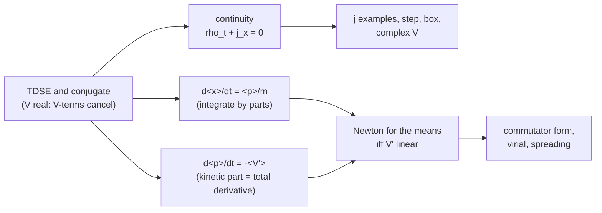

# QM13 · The Probability Current and Ehrenfest's Theorem

◀ [[QM12 The Hydrogen Atom]] · [[Quantum Mechanics - Course Map|Course Map]] · related: [[QM02 The Schrodinger Equation and Stationary States]] (first appearance of $j$), [[QM06 The Oscillator Toolbox]] (the commutator form, §6.1), [[QM10 The Finite Barrier and Tutorial V]] (Tutorial VI Q2)

taught · in syllabus extra · book extra · beyond

> [!syllabus] Syllabus map
> 🟢 **Taught** (lectured the week of 10 Nov 2026, between the barrier and the 2D/angular-momentum lectures; the chapter number only records the order in which the vault was written):
> - the instructor's handwritten notes [[Ehrenfest.pdf#page=1|Ehrenfest.pdf]] (8 pp.): **probability current and local conservation of probability** (pp. 1–2, §1–§2), **Ehrenfest's first theorem** $\mathrm d\langle x\rangle/\mathrm dt=\langle p\rangle/m$ (pp. 3–5, §5), **the second theorem** $\mathrm d\langle p\rangle/\mathrm dt=-\langle V'\rangle$ and the "special cases" (pp. 6–8, §6–§7);
> - [[Tutorial6.pdf|Tutorial VI]] **Problem 1** (the second Ehrenfest equation, then $m\,\ddot{\langle x\rangle}=-k\langle x\rangle$) → §6. (Problem 2, the barrier for $E>V_0$, is in [[QM10 The Finite Barrier and Tutorial V]].)
>
> 🟡 **Extra · book:** the 3D current $\mathbf j=\frac\hbar m\,\mathrm{Im}(\psi^*\nabla\psi)$ and the polar form $\mathbf j=\rho\nabla S/m$ (Sakurai §2.4); the Ehrenfest equations as the expectation values of the Heisenberg equations of motion, $\frac{\mathrm d}{\mathrm dt}\langle A\rangle=\frac i\hbar\langle[H,A]\rangle$ (Sakurai §2.2); Griffiths §1.4–§1.5 (conservation of probability; $\mathrm d\langle x\rangle/\mathrm dt$, $\mathrm d\langle p\rangle/\mathrm dt$). *Page numbers not checked (see Provenance).*
>
> 🔵 **Extra · beyond (mine):** the current of the **box superposition** $(\psi_1+\psi_2)/\sqrt2$ in closed form and its link to $\langle x\rangle(t)$; the second route to the first theorem through $\int j\,\mathrm dx$; current conservation at a step (why $T\ne|F/A|^2$); the $\sigma^2$ correction $\langle V'\rangle\approx V'(\bar x)+\tfrac12V'''\sigma^2$; the **hard-wall force** (the boundary term the lecture discards); the virial theorem and free spreading from the commutator form; every number checked against a split-step TDSE run. Numbers: `scripts/qm13_numbers.py`.

> [!key] After this chapter you can
> - derive $\partial_t\rho+\partial_xj=0$ from the TDSE and its conjugate, with $j=\frac{\hbar}{2mi}(\psi^*\psi'-\psi\psi^{*\prime})=\frac\hbar m\mathrm{Im}(\psi^*\psi')$, and say why the $V$-terms cancel only for a **real** potential,
> - evaluate $j$ for a plane wave, a superposition $Ae^{ikx}+Be^{-ikx}$, a real $\psi$, an evanescent wave and a packet, and use $j=\rho S'/m$,
> - derive **both Ehrenfest equations directly from the TDSE** by integration by parts (the lecture's route and Tutorial VI Q1),
> - state exactly when $\langle V'(x)\rangle=V'(\langle x\rangle)$ (linear force) and estimate the correction when it is not,
> - use $\frac{\mathrm d}{\mathrm dt}\langle A\rangle=\frac i\hbar\langle[H,A]\rangle$ to get both theorems, the virial theorem and the free spreading of a packet in two lines.

> [!intuition] One sentence
> Probability is a conserved fluid with density $|\psi|^2$ and flow $j$, and the **average** position and momentum of that fluid obey Newton's laws exactly, except that the force that enters is the force *averaged over the cloud*, which equals the force *at the centre of the cloud* only when the force is linear.

## 1. Local conservation of probability
taught *[[Ehrenfest.pdf#page=1|Ehrenfest.pdf p.1]]*

Let $\rho(x,t)=\Psi^*\Psi$. Take the TDSE $i\hbar\,\partial_t\Psi=-\frac{\hbar^2}{2m}\Psi''+V\Psi$ with **real** $V(x)$, and its complex conjugate:
$$\partial_t\Psi=\frac{i\hbar}{2m}\Psi''-\frac i\hbar V\Psi,\qquad \partial_t\Psi^*=-\frac{i\hbar}{2m}\Psi^{*\prime\prime}+\frac i\hbar V\Psi^* .$$
Then $\partial_t\rho=\Psi^*\partial_t\Psi+\Psi\,\partial_t\Psi^*$. The terms proportional to $V$ **cancel** ($-\frac i\hbar V\rho+\frac i\hbar V\rho=0$), leaving
$$\partial_t\rho=\frac{i\hbar}{2m}\big(\Psi^*\Psi''-\Psi\Psi^{*\prime\prime}\big)=\frac{i\hbar}{2m}\,\partial_x\big(\Psi^*\Psi'-\Psi\Psi^{*\prime}\big)\equiv-\partial_xj .$$
$$\boxed{\partial_t\rho+\partial_xj=0,\qquad j=\frac{\hbar}{2mi}\big(\Psi^*\Psi'-\Psi\Psi^{*\prime}\big)=\frac\hbar m\,\mathrm{Im}\big(\Psi^*\Psi'\big)}$$
This is **local** conservation: the probability in a small interval changes only because probability flows across its ends, exactly like charge ([[Probability Current]]). Integrating over the line, $\frac{\mathrm d}{\mathrm dt}\int\rho\,\mathrm dx=-[j]_{-\infty}^{\infty}=0$ for a normalisable state: the norm fixed at $t=0$ stays 1 ([[Born Rule]], [[Normalisation of a Wavefunction]]).

> [!pitfall] Real $V$ is essential
> For $V=V_R+i\Gamma$ the $V$-terms add instead of cancelling: $\partial_t\rho+\partial_xj=\dfrac{2\Gamma}{\hbar}\rho$. With $\Gamma<0$ probability leaks away at the rate $2|\Gamma|/\hbar$ (a model of absorption or decay); the norm is then $e^{-2|\Gamma|t/\hbar}$ and the state's lifetime is $\hbar/2|\Gamma|$. A closed system has a real $V$ ([[Hermitian Operator]]). (Practice 5.)

## 2. What the current says
taught (definition, p.2) · extra · book (3D, polar form)

> [!example] The standard currents ($\hbar/m$ times $\mathrm{Im}\,\psi^*\psi'$)
> | State | $j$ | Reading |
> |---|---|---|
> | $Ae^{ikx}$ | $\dfrac{\hbar k}m|A|^2=v\rho$ | density times velocity ($v=p/m$) |
> | $Ae^{ikx}+Be^{-ikx}$ | $\dfrac{\hbar k}m\big(|A|^2-|B|^2\big)$ | net flow = right-movers minus left-movers; the **cross terms drop out** of $j$ (they sit in $\rho$ as interference) |
> | any $\psi=f(x)\,e^{i\alpha}$, $f$ real | $0$ | a real wavefunction carries no current: **every bound stationary state** (box, oscillator, well) |
> | $Ce^{-\kappa x}+De^{\kappa x}$ | $\dfrac{2\hbar\kappa}m\mathrm{Im}(C^*D)$, independent of $x$ | an evanescent wave carries current **only if both exponentials are present with a complex ratio** (Practice 2) |
> | ring state $e^{in\phi}/\sqrt L$ | $v_n/L$ | circulating probability ([[QM02 The Schrodinger Equation and Stationary States]]) |
> | Gaussian packet $\propto e^{-x^2/4\sigma^2+ik_0x}$ | $\dfrac{\hbar k_0}m\rho(x)$; $\int j\,\mathrm dx=\dfrac{\hbar k_0}m$ | the whole cloud drifts at $\hbar k_0/m$ (checked: $|j-k_0\rho|<10^{-9}$, $\hbar=m=1$, $k_0=3$) |

> [!derivation] 🟡 Polar form: $j=\rho\,S'/m$
> Write $\psi=\sqrt\rho\,e^{iS/\hbar}$ with $\rho,S$ real. Then $\psi'=\big(\frac{\rho'}{2\rho}+\frac{iS'}\hbar\big)\psi$, so $\mathrm{Im}(\psi^*\psi')=\rho S'/\hbar$ and
> $$j=\rho\,\frac{S'}{m}.$$
> The probability fluid moves with **velocity field $v=S'/m$**, the phase gradient divided by the mass. The plane wave has $S=\hbar kx$; a real $\psi$ has $S'=0$. Sakurai §2.4 pushes this to the classical limit: substituting into the TDSE, the real part at $O(\hbar^0)$ is the Hamilton–Jacobi equation for $S$, so $S$ becomes the classical action and $\nabla S$ the classical momentum.

**Three dimensions** (🟡). $\partial_t\rho+\nabla\!\cdot\mathbf j=0$ with $\mathbf j=\frac\hbar m\mathrm{Im}(\psi^*\nabla\psi)$; the probability leaving a region is the flux of $\mathbf j$ through its surface (divergence theorem). For a charge $q$ in a vector potential $\mathbf A$ one replaces $\nabla$ by $\nabla-iq\mathbf A/\hbar$ (stated, not derived here).

### 2.1 Current conservation in a stationary scattering state
extra · beyond

For a stationary state $\partial_t\rho=0$, so **$\partial_xj=0$: the current is the same everywhere**. At a finite jump in $V$, $\psi$ and $\psi'$ are continuous ([[Admissible Wavefunction]]), hence so is $j$. For a wave incident from the left with $\psi_I=Ae^{ik_1x}+Be^{-ik_1x}$ and $\psi_{III}=Fe^{ik_2x}$:
$$\frac{\hbar k_1}m\big(|A|^2-|B|^2\big)=\frac{\hbar k_2}m|F|^2\ \Longrightarrow\ \underbrace{\frac{|B|^2}{|A|^2}}_{R}+\underbrace{\frac{k_2}{k_1}\frac{|F|^2}{|A|^2}}_{T}=1 .$$
$T$ is the ratio of **currents**, not of $|{\rm amplitude}|^2$: the $k_2/k_1$ factor matters whenever the wavenumbers on the two sides differ. For a step with $k_2=k_1/2$: $F/A=2k_1/(k_1+k_2)=4/3$ so $|F/A|^2=16/9>1$, yet $R=\big(\frac{k_1-k_2}{k_1+k_2}\big)^2=\frac19$ and $T=\frac12\cdot\frac{16}9=\frac89$, $R+T=1$ ✓. For a barrier or well with the same medium on both sides ($k_1=k_2=k_0$, as in [[QM07 The Finite Square Well]] and [[QM10 The Finite Barrier and Tutorial V]]) the factor is 1, which is why $T=|F/A|^2$ there. ([[Transmission Coefficient]], [[Reflection Coefficient]].)

### 2.2 A time-dependent example: the box superposition
extra · beyond

In the box $0<x<L$ take $\Psi=(\psi_1+\psi_2)/\sqrt2$ with $\psi_n=\sqrt{2/L}\sin(n\pi x/L)\,e^{-iE_nt/\hbar}$ ([[QM04 The Particle in a Box]]) and $\omega_{21}=(E_2-E_1)/\hbar=3\pi^2\hbar/2mL^2$. A real stationary state has $j=0$, but the superposition does not: its density sloshes,
$$\rho=\tfrac12\big(\psi_1^2+\psi_2^2\big)+\psi_1\psi_2\cos\omega_{21}t,\qquad\partial_t\rho=-\omega_{21}\,\psi_1\psi_2\sin\omega_{21}t .$$
Continuity $\partial_xj=-\partial_t\rho$ with $j(0)=0$ gives, using $\int_0^x\frac2L\sin\frac{\pi x'}L\sin\frac{2\pi x'}L\,\mathrm dx'=\frac1\pi\big[\sin\frac{\pi x}L-\frac13\sin\frac{3\pi x}L\big]$,
$$\boxed{j(x,t)=\frac{\omega_{21}}{\pi}\,\sin\omega_{21}t\,\Big[\sin\frac{\pi x}L-\frac13\sin\frac{3\pi x}L\Big]}$$
It vanishes at $x=L$ as well (**no flux through impenetrable walls**, the check that the sum rule closes) and
$$\int_0^Lj\,\mathrm dx=\frac{16L}{9\pi^2}\,\omega_{21}\sin\omega_{21}t=\frac{\mathrm d}{\mathrm dt}\Big[\frac L2-\frac{16L}{9\pi^2}\cos\omega_{21}t\Big]=\frac{\mathrm d\langle x\rangle}{\mathrm dt}.$$
Numerically ($\hbar=m=L=1$, $t=0.37$): $j$ from $\mathrm{Im}(\psi^*\psi')$ agrees with the formula to $2\times10^{-10}$; $|\partial_t\rho+\partial_xj|<4\times10^{-8}$; $\langle x\rangle=0.375224$ from $\int x\rho$ and from the formula; $\mathrm d\langle x\rangle/\mathrm dt=\int j\,\mathrm dx=\langle p\rangle/m=-1.923240$ (three routes, one number). The largest drift speed is $\dfrac{16}{9\pi^2}\omega_{21}L=\dfrac{8\hbar}{3mL}$: for an electron in $L=1$ nm, $3.09\times10^5$ m/s. This is the whole story of §3–§5 in one worked case.

## 3. Ehrenfest: the question
taught *[[Ehrenfest.pdf#page=3|Ehrenfest.pdf p.3]]*

Newton: $\dot x=p/m$, $\dot p=-V'(x)$. In quantum mechanics a particle has no trajectory, but it does have **averages**, $\langle x\rangle=\int x\rho\,\mathrm dx$ and $\langle p\rangle=-i\hbar\int\psi^*\psi'\mathrm dx$, which are functions of time. The theorem says how they move. Both derivations below use only the TDSE and its conjugate (§1) and drop boundary terms $[\ \ ]_{-\infty}^{\infty}$ for a normalisable state.

## 4. First theorem: $\mathrm d\langle x\rangle/\mathrm dt=\langle p\rangle/m$
taught *[[Ehrenfest.pdf#page=3|Ehrenfest.pdf pp.3–5]]*

> [!derivation] The lecture's route
> $\dfrac{\mathrm d\langle x\rangle}{\mathrm dt}=\displaystyle\int\mathrm dx\,\big[\partial_t\Psi^*\,x\Psi+\Psi^*x\,\partial_t\Psi\big]$. Insert the TDSE and its conjugate. **Terms proportional to $V$ cancel** (as in §1), leaving
> $$\frac{\mathrm d\langle x\rangle}{\mathrm dt}=\frac{i\hbar}{2m}\int\mathrm dx\,\big[-\Psi^{*\prime\prime}x\Psi+\Psi^*x\Psi''\big].$$
> Integrate by parts twice to take both derivatives off $\Psi^*$: $\int\Psi^{*\prime\prime}x\Psi=\int\Psi^*(x\Psi)''$ and $(x\Psi)''=2\Psi'+x\Psi''$. The $x\Psi''$ terms cancel:
> $$\frac{\mathrm d\langle x\rangle}{\mathrm dt}=\frac{i\hbar}{2m}\int\big[-2\Psi^*\Psi'\big]\mathrm dx=\frac1m\int\Psi^*\Big(-i\hbar\frac{\partial}{\partial x}\Big)\Psi\,\mathrm dx=\frac{\langle p\rangle}m .$$

> [!derivation] 🔵 A second route, through the current
> $\frac{\mathrm d\langle x\rangle}{\mathrm dt}=\int x\,\partial_t\rho\,\mathrm dx=-\int x\,\partial_xj\,\mathrm dx=\int j\,\mathrm dx-[xj]_{-\infty}^{\infty}=\int j\,\mathrm dx$. And $\int j\,\mathrm dx=\frac\hbar m\mathrm{Im}\!\int\Psi^*\Psi'\mathrm dx=\frac{\langle p\rangle}m$ because $\langle p\rangle$ is real (so $-i\hbar\int\Psi^*\Psi'$ is real, and equals $\hbar\,\mathrm{Im}\!\int\Psi^*\Psi'$). **The total current is the velocity of the centre of probability**: this is exactly the box check in §2.2. (Not the lecture's route; agrees with it to $10^{-12}$ in the TDSE run of §8.)

## 5. The classical reading
taught *[[Ehrenfest.pdf#page=5|Ehrenfest.pdf pp.5–6]]*

The first theorem says "momentum$/m$ is the rate of change of position" for the averages, with no condition on $V$ at all. The second theorem is the one that can fail to look classical.

## 6. Second theorem: $\mathrm d\langle p\rangle/\mathrm dt=-\langle V'\rangle$ (Tutorial VI Q1)
taught *[[Ehrenfest.pdf#page=6|Ehrenfest.pdf pp.6–8]], [[Tutorial6.pdf|Tutorial VI Problem 1]]*

> [!derivation] Direct from the TDSE
> $\dfrac{\mathrm d\langle p\rangle}{\mathrm dt}=-i\hbar\displaystyle\int\mathrm dx\,\big[\partial_t\Psi^*\,\Psi'+\Psi^*\partial_x\partial_t\Psi\big]$. In the second term integrate by parts (the boundary term "goes to 0"): it becomes $-\Psi^{*\prime}\partial_t\Psi$. Insert the TDSE and its conjugate:
> $$\partial_t\Psi^*\,\Psi'-\Psi^{*\prime}\partial_t\Psi=-\frac{i\hbar}{2m}\big(\Psi^{*\prime\prime}\Psi'+\Psi^{*\prime}\Psi''\big)+\frac i\hbar V\big(\Psi^*\Psi'+\Psi^{*\prime}\Psi\big)=-\frac{i\hbar}{2m}\big(\Psi^{*\prime}\Psi'\big)'+\frac i\hbar V\rho' .$$
> - the **kinetic part** is a total derivative: $\int(\Psi^{*\prime}\Psi')'\mathrm dx=[|\Psi'|^2]_{-\infty}^{\infty}=0$;
> - the **potential part**: $-i\hbar\cdot\frac i\hbar\int V\rho'\,\mathrm dx=\int V\rho'\,\mathrm dx=-\int V'\rho\,\mathrm dx$ (by parts).
>
> $$\boxed{\frac{\mathrm d\langle p\rangle}{\mathrm dt}=-\Big\langle\frac{\mathrm dV}{\mathrm dx}\Big\rangle}$$
> (the two lines are the same algebra as the lecture's, with the $V\Psi^*\Psi'$ terms collected into $V\rho'$).

> [!example] Tutorial VI Q1: the oscillator
> $V=\frac12kx^2$: $V'=kx$, so $\mathrm d\langle p\rangle/\mathrm dt=-k\langle x\rangle$. With §4, $\;m\,\dfrac{\mathrm d^2\langle x\rangle}{\mathrm dt^2}=-k\langle x\rangle$: Newton's equation for the mean, **for every state** ([[QM06 The Oscillator Toolbox]] §6.1 gets the same from commutators). Uniform force $V=-Fx$: $\langle x\rangle=\langle x\rangle_0+\frac{\langle p\rangle_0}mt+\frac F{2m}t^2$ for any packet, though the packet spreads (checked, $F=0.8$, $t\le2$: deviation $6\times10^{-13}$).

## 7. When is the mean classical? ("special cases", pp.7–8)
taught (the statement) · extra · beyond (the correction and numbers)

Ehrenfest's equations are **exact**; what is not exact is the classical-looking form
$$m\frac{\mathrm d^2\langle x\rangle}{\mathrm dt^2}=-V'(\langle x\rangle),$$
which needs $\langle V'(x)\rangle=V'(\langle x\rangle)$. This holds **iff $V'$ is linear in $x$**, i.e. for $V$ at most quadratic (free, uniform field, oscillator, the shifted oscillator of QM06 Practice 12). Otherwise expand about $\bar x=\langle x\rangle$ with $\sigma^2=\langle(x-\bar x)^2\rangle$:
$$\big\langle V'(x)\big\rangle=V'(\bar x)+\tfrac12V'''(\bar x)\,\sigma^2+\dots\qquad(\text{the linear term averages to zero}).$$
So the cloud's *width* feeds back into the motion of its centre; the classical force at the centre is right only when $\sigma$ is much smaller than the length over which $V'$ varies, $|V'''|\sigma^2\ll|V'|$.

> [!example] 🔵 Numbers ($\hbar=m=1$, Gaussian packet $x_0=1.5$, $\sigma=0.5$, $p_0=0$)
> - $V=\frac14x^4$: $V'=x^3$, $\langle x^3\rangle=x_0^3+3x_0\sigma^2=3.375+1.125=\mathbf{4.5000}$ (exact for a cubic: the correction $\frac12\cdot6x_0\sigma^2=1.125$), whereas the classical force is $V'(x_0)=3.375$. The TDSE run gives $\mathrm d\langle p\rangle/\mathrm dt=-4.4999$ at $t=0$, **not** $-3.375$; largest deviations over $0<t<2$: $1.7\times10^{-12}$ for $\mathrm d\langle x\rangle/\mathrm dt-\langle p\rangle$ and $2.7\times10^{-6}$ for $\mathrm d\langle p\rangle/\mathrm dt+\langle V'\rangle$.
> - $V=\frac12x^2$: $\langle V'\rangle=\langle x\rangle=1.5$ at $t=0$ and $\langle x\rangle(t)=1.5\cos t$ to $3\times10^{-8}$.
> - $V=\cos x$ (force $-\sin x$): $\langle V'\rangle=-\sin x_0\,e^{-\sigma^2/2}=-0.8803$ against $V'(x_0)=-0.9975$: the packet samples the force over its width and feels **12 % less** of it.

> [!pitfall] It is not "quantum mechanics is classical"
> The means of a linear-force problem are classical; widths, interference, the spectrum and the spreading are not. For a nonlinear force the mean is **not** the classical orbit started at $\bar x_0,\bar p_0$ (the equations for $\bar x$ and $\bar p$ are not closed: $\mathrm d\langle p\rangle/\mathrm dt$ involves $\sigma^2$, whose own equation involves higher moments). The classical limit is recovered when the packet is narrow *and stays narrow* on the scale of $V'$ ([[Correspondence Principle]]).

> [!pitfall] Where the boundary terms are used (and a hard-wall surprise)
> Every "integrate by parts" above discards $[\ \ ]_{-\infty}^{\infty}$. For a plane wave (not normalisable) the equations hold for the *densities*, not the integrated averages. For a **hard wall** the kinetic boundary term $-\frac{\hbar^2}{2m}[|\psi'|^2]_0^L$ in §6 is **not zero** ($\psi'\ne0$ at an infinite wall), and it *is* the force of the walls: $\dfrac{\mathrm d\langle p\rangle}{\mathrm dt}=\dfrac{\hbar^2}{2m}\big(|\psi'(0)|^2-|\psi'(L)|^2\big)$. For $\psi_n$ both walls push equally, each with $\dfrac{n^2\pi^2\hbar^2}{mL^3}=\dfrac{2E_n}L=-\dfrac{\mathrm dE_n}{\mathrm dL}$, so $\langle p\rangle$ is constant. For the superposition of §2.2 at $t=0$: $\psi'(0)\propto3$, $\psi'(L)\propto1$ (in units $\pi/L^{3/2}$), net force $\frac{\hbar^2}{2m}\frac{8\pi^2}{L^3}=\frac{4\pi^2\hbar^2}{mL^3}$, and the second derivative of $\langle x\rangle$ gives $m\cdot\frac{16L}{9\pi^2}\omega_{21}^2=\frac{4\pi^2\hbar^2}{mL^3}$ ✓. (Practice 10.)

## 8. The commutator form and what it buys
extra · book (Sakurai §2.2; Griffiths §1.5) · extra · beyond (the applications)

For any operator $\hat A$ and a Hermitian $\hat H$, use $\partial_t\psi=-\frac i\hbar\hat H\psi$ and its conjugate in $\frac{\mathrm d}{\mathrm dt}\langle\psi|\hat A|\psi\rangle$:
$$\boxed{\frac{\mathrm d}{\mathrm dt}\langle\hat A\rangle=\frac i\hbar\big\langle[\hat H,\hat A]\big\rangle+\Big\langle\frac{\partial\hat A}{\partial t}\Big\rangle}$$
- $\hat A=\hat x$: $[\hat H,\hat x]=-i\hbar\hat p/m$ gives $\langle p\rangle/m$. $\hat A=\hat p$: $[\hat H,\hat p]=[V,\hat p]=i\hbar V'$ gives $-\langle V'\rangle$. Same two theorems, three lines ([[Commutator]], [[Canonical Commutation Relation]]).
- **Stationary states:** $\langle n|[\hat H,\hat A]|n\rangle=(E_n-E_n)\langle A\rangle=0$, so **no expectation value changes**; in particular $\langle V'\rangle_n=0$ for every bound state with a smooth $V$ ([[Stationary State]]). (With hard walls, the wall forces of §7 supply the balance.)
- **Virial theorem.** Take $\hat A=\frac12(\hat x\hat p+\hat p\hat x)$: $[\hat H,\hat A]=-i\hbar\,\hat p^2/m+i\hbar\,xV'$, so $\frac{\mathrm d}{\mathrm dt}\langle A\rangle=2\langle T\rangle-\langle xV'\rangle$, and in a stationary state $2\langle T\rangle=\langle xV'\rangle$ ([[Virial Theorem]]; check: the oscillator ground state has $2\langle T\rangle=\langle x^2\rangle=0.5$ in units $\hbar=m=\omega=1$).
- **Free spreading.** For $V=0$: $\frac{\mathrm d}{\mathrm dt}\langle x^2\rangle=\frac2m\langle D\rangle$ ($D=\frac12(xp+px)$) and $\frac{\mathrm d}{\mathrm dt}\langle D\rangle=\langle p^2\rangle/m$, hence $\sigma_x^2(t)=\sigma_0^2+\frac2m\big(\langle D\rangle_0-\bar x_0\bar p\big)t+\frac{\sigma_p^2}{m^2}t^2$. For a Gaussian with no initial correlation, $\sigma_x^2(t)=\sigma_0^2\big[1+\big(\frac{\hbar t}{2m\sigma_0^2}\big)^2\big]$ ([[Gaussian Wave Packet]]).
- **Heisenberg picture.** The operator equations $\dot{\hat x}=\hat p/m$, $\dot{\hat p}=-V'(\hat x)$ are *exactly* Newton's; Ehrenfest is their expectation value, and the only quantum ingredient is that $\langle V'(\hat x)\rangle\neq V'(\langle\hat x\rangle)$ ([[Heisenberg Picture]]). Replacing $\{A,H\}_{\rm Poisson}\to\frac1{i\hbar}[A,H]$ turns Hamilton's $\dot A=\{A,H\}$ into the formula above.

## 9. Numerical check
extra · beyond

A split-step Fourier solution of the TDSE ($\hbar=m=1$, $\Delta t=5\times10^{-4}$, 4096 points on $[-20,20)$, Gaussian $\sigma=0.5$ at $x_0=1.5$, $0<t<2$) tests both theorems for three potentials (`scripts/qm13_numbers.py`):

| $V$ | $\max|\mathrm d\langle x\rangle/\mathrm dt-\langle p\rangle|$ | $\max|\mathrm d\langle p\rangle/\mathrm dt+\langle V'\rangle|$ | $\langle V'\rangle$ vs $V'(\langle x\rangle)$ at $t=0$ |
|---|---|---|---|
| $\frac14x^4$ | $1.7\times10^{-12}$ | $2.7\times10^{-6}$ | $4.500$ vs $3.375$ (differ) |
| $\frac12x^2$ | $1.5\times10^{-12}$ | $9.4\times10^{-8}$ | $1.500$ vs $1.500$ (equal) |
| $-0.8\,x$ | $1.8\times10^{-12}$ | $1.0\times10^{-12}$ | $-0.800$ vs $-0.800$ (equal) |

The theorems hold to discretisation error in all three; only the *classical* form needs a linear force.

## Map of this chapter
> [!connection] How QM13 connects
> **Builds on:** [[QM02 The Schrodinger Equation and Stationary States]] (TDSE, the first statement of $j$, probability conservation), [[QM03 States Operators and Measurement]] (expectation values, commutators, time evolution), [[QM04 The Particle in a Box]] (the superposition of §2.2), [[QM05 The Harmonic Oscillator]] (the linear force).
> **Leads to:** [[QM08 Quantum Tunnelling]] and [[QM10 The Finite Barrier and Tutorial V]] ($R+T=1$ is current conservation); [[QM11 Two-Dimensional Problems Angular Momentum and the Circular Well]] (circulating current $\propto m\hbar/\!r^2$ in $e^{il\phi}$ states, $\hat L$ conserved because $[\hat H,\hat L]=0$ is Ehrenfest with $A=L$); the Heisenberg picture and perturbation theory (not in the folder).
> **Concepts:** [[Probability Current]] · [[Ehrenfest Theorem]] · [[Heisenberg Picture]] · [[Commutator]] · [[Expectation Value]] · [[Stationary State]] · [[Virial Theorem]] · [[Correspondence Principle]] · [[Plane Wave]] · [[Born Rule]] · [[Schrodinger Equation]] · [[Transmission Coefficient]] · [[Reflection Coefficient]] · [[Evanescent Wave]] · [[Gaussian Wave Packet]] · [[Time Evolution Operator]]
> **Other subjects:** [[Waves - Course Map]] (a conserved-density continuity equation, group velocity as the speed of $\int j$), [[Probability - Course Map]] ($\rho$ and $\langle x\rangle$, the variance formula $\sigma^2=\langle x^2\rangle-\bar x^2$ used in §7 and §8), classical mechanics (Hamilton's equations as the limit of §8) and electrodynamics (charge continuity $\partial_t\rho_e+\nabla\!\cdot\mathbf J=0$, the template for §1).

## Summary
> [!summary] Cheat-sheet
> - TDSE and conjugate: $V$-terms cancel for **real** $V$. $\;\partial_t\rho+\partial_xj=0$, $\;j=\frac\hbar m\mathrm{Im}(\psi^*\psi')=\rho S'/m$; 3D $\mathbf j=\frac\hbar m\mathrm{Im}(\psi^*\nabla\psi)$.
> - $j$: plane wave $v\rho$; $Ae^{ikx}+Be^{-ikx}$: $\frac{\hbar k}m(|A|^2-|B|^2)$; real $\psi$: $0$; evanescent: $\frac{2\hbar\kappa}m\mathrm{Im}(C^*D)$. Stationary: $j$ constant, so $R+T=1$ with $T=\frac{k_2}{k_1}|F/A|^2$.
> - Complex $V_R+i\Gamma$: $\partial_t\rho+\partial_xj=2\Gamma\rho/\hbar$.
> - $\mathrm d\langle x\rangle/\mathrm dt=\langle p\rangle/m=\int j\,\mathrm dx$ (any $V$); $\mathrm d\langle p\rangle/\mathrm dt=-\langle V'\rangle$.
> - Mean is classical iff $V'$ linear; else $\langle V'\rangle=V'(\bar x)+\frac12V'''\sigma^2+\dots$ (quartic example $4.5$ vs $3.375$).
> - $\frac{\mathrm d}{\mathrm dt}\langle A\rangle=\frac i\hbar\langle[H,A]\rangle+\langle\partial_tA\rangle$; stationary $\Rightarrow$ constant; $A=\frac12(xp+px)\Rightarrow 2\langle T\rangle=\langle xV'\rangle$; free $\sigma_x^2(t)=\sigma_0^2+\frac2m(\langle D\rangle_0-\bar x_0\bar p)t+\sigma_p^2t^2/m^2$.
> - Hard walls: boundary term $=$ wall force $\frac{\hbar^2}{2m}(|\psi'(0)|^2-|\psi'(L)|^2)$, each wall $2E_n/L$ in $\psi_n$.

## Practice
1. Compute $j$ for $\psi=3e^{ikx}+e^{-ikx}$ and for $\psi=3e^{ikx}+ie^{-ikx}$. Does the relative phase of the two terms change $j$?
2. For $\psi=Ce^{-\kappa x}+De^{\kappa x}$ with $C,D$ complex, find $j$. For which $D/C$ does it vanish? What does that say about the evanescent wave inside a barrier?
3. For a Gaussian packet $\psi\propto e^{-x^2/4\sigma^2+ik_0x}$ find $j$ and $\int j\,\mathrm dx$.
4. A wave incident on a step has $k_2=k_1/2$. Find $|F/A|^2$, $R$, $T$ and check $R+T=1$.
5. A particle has $V=V_R-i\gamma$ ($\gamma>0$ constant). Find $\mathrm d/\mathrm dt\int|\psi|^2\mathrm dx$ and the lifetime for $\gamma=1$ meV.
6. Using the box current of §2.2, find the maximum speed of $\langle x\rangle$ and evaluate it for an electron in $L=1$ nm.
7. Show that in $V=-Fx$ the mean obeys $\langle x\rangle=\langle x\rangle_0+\langle p\rangle_0t/m+Ft^2/2m$ for every state, and evaluate it for $F=0.8$, $x_0=1.5$, $p_0=0$, $t=2$ ($\hbar=m=1$).
8. For $V=\frac12kx^2+\lambda x^3$ show $\mathrm d\langle p\rangle/\mathrm dt=-k\bar x-3\lambda\bar x^2-3\lambda\sigma^2$. Why is $\bar x(t)$ not classical?
9. Use $\frac{\mathrm d}{\mathrm dt}\langle A\rangle=\frac i\hbar\langle[H,A]\rangle$ with $A=x^2$ and $A=D$ to show that a free packet's variance grows as $\sigma_x^2(t)=\sigma_0^2+(\sigma_pt/m)^2$ when $\langle D\rangle_0=\bar x_0\bar p$.
10. In the box state $\psi_1$ the two walls act on the particle. Show that the force of each wall is $2E_1/L$ and evaluate it in newtons for an electron in $L=1$ nm ($E_1=0.376$ eV). Why does $\mathrm d\langle p\rangle/\mathrm dt=0$?

> [!example]- Solutions
> 1. $j=\frac{\hbar k}m(9-1)=\frac{8\hbar k}m$ for both: the cross terms are $\mathrm{Im}$ of a real quantity in $\psi^*\psi'$ (shown in §2). The relative phase moves the interference fringes in $\rho$ but not the net current.
> 2. $\psi^*\psi'=\kappa\big(-|C|^2e^{-2\kappa x}+|D|^2e^{2\kappa x}+C^*D-CD^*\big)$, whose imaginary part is $2\kappa\,\mathrm{Im}(C^*D)$: $j=\dfrac{2\hbar\kappa}m\mathrm{Im}(C^*D)$, independent of $x$. It vanishes when $D/C$ is real. Inside a barrier the relative phase of the growing and decaying exponentials is fixed by the matching conditions, and a net tunnelling current requires it to be complex; a single decaying exponential, or any real combination, carries none.
> 3. $\psi'=(-x/2\sigma^2+ik_0)\psi$, so $\mathrm{Im}(\psi^*\psi')=k_0|\psi|^2$: $j=\frac{\hbar k_0}m\rho$ and $\int j=\hbar k_0/m$ (equal to $\langle p\rangle/m$).
> 4. $F/A=2k_1/(k_1+k_2)=4/3$, $|F/A|^2=16/9$; $R=(1/3)^2=1/9$; $T=\frac{k_2}{k_1}\cdot\frac{16}9=\frac89$; $R+T=1$ ✓. ($|F/A|^2>1$ does not violate anything: the transmitted wave is slower, so a larger amplitude carries the same current.)
> 5. $\partial_t\rho+\partial_xj=\frac{2\gamma}\hbar\rho$ (here $\Gamma=-\gamma$ in §1's notation gives $-\frac{2\gamma}\hbar\rho$): $\frac{\mathrm d}{\mathrm dt}\int\rho=-\frac{2\gamma}\hbar\int\rho$, norm $\propto e^{-2\gamma t/\hbar}$, lifetime $\tau=\hbar/2\gamma=6.582\times10^{-16}\,\mathrm{eV\,s}/(2\times10^{-3}\,\mathrm{eV})=3.29\times10^{-13}$ s. (Sign: §1's $\Gamma$ is the imaginary part of $V$, so $V_R-i\gamma$ is $\Gamma=-\gamma$, a decay.)
> 6. $\dot{\langle x\rangle}_{\max}=\frac{16L}{9\pi^2}\omega_{21}=\frac{16L}{9\pi^2}\cdot\frac{3\pi^2\hbar}{2mL^2}=\frac{8\hbar}{3mL}$. For $L=1$ nm: $\hbar/mL=1.0546\times10^{-34}/(9.109\times10^{-31}\cdot10^{-9})=1.158\times10^5$ m/s, times $8/3$: $3.09\times10^5$ m/s.
> 7. $\mathrm d\langle p\rangle/\mathrm dt=-\langle V'\rangle=F$ (a constant, so no averaging issue), $\langle p\rangle=\langle p\rangle_0+Ft$, then integrate $\mathrm d\langle x\rangle/\mathrm dt=\langle p\rangle/m$. Value: $1.5+0.8\cdot4/2=3.1$ (TDSE agrees to $6\times10^{-13}$).
> 8. $V'=kx+3\lambda x^2$ so $\langle V'\rangle=k\bar x+3\lambda\langle x^2\rangle=k\bar x+3\lambda(\bar x^2+\sigma^2)$. The variance $\sigma^2$ enters the equation of motion of the mean, and $\sigma^2(t)$ has its own equation involving higher moments: the hierarchy does not close at the level of $(\bar x,\bar p)$, so $\bar x(t)$ is not the classical orbit. (The $\lambda\bar x^2$ term alone would be the classical force; $-3\lambda\sigma^2$ is the quantum/statistical correction.)
> 9. $[H,x^2]=-\frac{i\hbar}m(xp+px)=-\frac{2i\hbar}mD$ so $\frac{\mathrm d}{\mathrm dt}\langle x^2\rangle=\frac2m\langle D\rangle$. $[H,D]=-\frac{i\hbar}m p^2$ (free), so $\frac{\mathrm d}{\mathrm dt}\langle D\rangle=\langle p^2\rangle/m$. Integrate: $\langle D\rangle=\langle D\rangle_0+\langle p^2\rangle t/m$, $\langle x^2\rangle=\langle x^2\rangle_0+\frac{2\langle D\rangle_0}mt+\frac{\langle p^2\rangle}{m^2}t^2$. With $\bar x(t)=\bar x_0+\bar pt/m$, subtract $\bar x^2$: $\sigma^2(t)=\sigma_0^2+\frac2m(\langle D\rangle_0-\bar x_0\bar p)t+\frac{\sigma_p^2}{m^2}t^2$. With zero correlation and $\sigma_p=\hbar/2\sigma_0$ (minimum uncertainty) this is $\sigma_0^2[1+(\hbar t/2m\sigma_0^2)^2]$.
> 10. $\mathrm d\langle p\rangle/\mathrm dt=\frac{\hbar^2}{2m}\big(|\psi'(0)|^2-|\psi'(L)|^2\big)$ with $|\psi_n'(0)|=|\psi_n'(L)|=\sqrt{2/L}\,n\pi/L$: each term is $\frac{\hbar^2}{2m}\frac2L\frac{n^2\pi^2}{L^2}=\frac{n^2\pi^2\hbar^2}{mL^3}=\frac{2E_n}L$. Left wall pushes $+x$, right wall $-x$, equal and opposite, so the net rate is zero. For $n=1$, $L=1$ nm: $2\times0.376\ \mathrm{eV}/1\ \mathrm{nm}=0.752$ eV/nm $=1.20\times10^{-10}$ N each. (It equals $-\mathrm dE_1/\mathrm dL$: the pressure of the confined particle.)

## Provenance
> [!provenance]- Source map
> | Topic | Source | Scope |
> |---|---|---|
> | probability current, local conservation, "terms proportional to $V$ cancel" | [[Ehrenfest.pdf#page=1\|Ehrenfest.pdf pp.1–2]] | taught |
> | first theorem, integration by parts | [[Ehrenfest.pdf#page=3\|pp.3–5]] | taught |
> | second theorem, "for quadratic potentials", "special cases" | [[Ehrenfest.pdf#page=6\|pp.6–8]]; [[Tutorial6.pdf\|Tutorial VI Q1]] | taught |
> | 3D $\mathbf j$, polar form $j=\rho S'/m$, Hamilton–Jacobi limit | Sakurai and Napolitano §2.4 | extra/book |
> | $\frac{\mathrm d}{\mathrm dt}\langle A\rangle=\frac i\hbar\langle[H,A]\rangle$, Ehrenfest as Heisenberg equations | Sakurai and Napolitano §2.2; Griffiths §1.5 | extra/book |
> | conservation of probability in 1D | Griffiths §1.4 | extra/book |
> | table of currents, step ($R+T=1$), box superposition $j(x,t)$, $\sigma^2$ correction, hard-wall force, virial and spreading from the commutator form, Practice | derived here; numbers from `scripts/qm13_numbers.py` | extra/beyond |
>
> **Notes.** (1) **The scan was not re-read for this chapter.** Ehrenfest.pdf is an 8.3 MB handwritten scan that the file tool used here cannot return; §1 and §4–§7 follow the page-by-page reading recorded in [[QM06 The Oscillator Toolbox]] ("Continued in the vault", read from the page images on 12 Nov) and the structure of [[ph2113/2026-11-10-probability-current-ehrenfest-notes]], and the page anchors above come from there. §6's algebra is the same as the lecture's with the $V$-terms collected into $V\rho'$. (2) The Griffiths and Sakurai section numbers are given from the books' standard layouts and **page numbers were not checked** (the vault's Griffiths scan has page = PDF $-15$; Sakurai's PDF is under `physics/quantum-mechanics/books/`). (3) The charged-particle current with $\mathbf A$ is stated, not derived. (4) The existing [[QM06 The Oscillator Toolbox]] section and the concept notes [[Probability Current]] and [[Ehrenfest Theorem]] remain as the short versions; this chapter is the full treatment. (5) Lectured the week of 10 Nov; it sits between [[QM10 The Finite Barrier and Tutorial V]] and [[QM11 Two-Dimensional Problems Angular Momentum and the Circular Well]] in the course but carries number 13 so that no earlier links change.
>
> **Coverage check (lecture material after the box).** Against the Course Map's source table every taught PDF after the box lecture has a chapter: the oscillator lecture and Tutorials II–III in QM05, the finite-well lecture and Tutorial IV in QM07, the barrier lecture and Tutorial V in QM10, **Ehrenfest.pdf and Tutorial VI Q1 in this chapter (previously a pendant section of QM06)**, the angular-momentum lecture, the circular-well note and Tutorial VII in QM11, the hydrogen note in QM12. Gap found and filled here: the lecture's "special cases" remark had been recorded only as "$\langle V'\rangle\ne V'(\langle x\rangle)$"; the size of the difference, the hard-wall boundary term and the link to the total current were missing. I did not re-read the other PDFs line by line.

**References.** Griffiths, D. J. *Introduction to Quantum Mechanics* §1.4–§1.5 · Sakurai, J. J. and Napolitano, J. *Modern Quantum Mechanics* (3rd ed.) §2.2, §2.4 · Ehrenfest, P. (1927) *Bemerkung über die angenäherte Gültigkeit der klassischen Mechanik innerhalb der Quantenmechanik*, Z. Phys. 45, 455.
