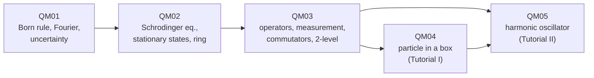

# Quantum Mechanics: Course Map (PH2113)

<span class="scope-taught">taught · in syllabus</span> <span class="scope-extra-book">extra · book</span>

*PH2113 Introductory Quantum Physics.* Five chapters cover everything in the folder: the probabilistic wavefunction and uncertainty, the Schrödinger equation with its first solutions (free particle, ring), the operator/measurement formalism (with a two-level system), the particle in a box, and the harmonic oscillator by ladder operators. Each chapter has a syllabus map, worked numbers (recomputed in `scripts/qm_numbers.py`), practice problems with solutions, and a provenance table.

> [!warning] What is and is not in the sources
> The folder holds **typed lecture notes** (Lectures 6–9 and three topic notes), a **handwritten box lecture**, **two instructor tutorials**, two textbooks (Griffiths, Sakurai) and six AI-written monographs. **There are no instructor slides, and Lectures 1–5 and everything after the oscillator tutorial are absent.** "Taught" therefore means "in the typed lecture notes, the handwritten notes or the tutorials"; the AI notes and textbooks are secondary. Lecture 9 announces tunnelling through a step (E < V) as the next topic; it is not in the folder. See *Gaps* below.

## The storyline

Central thread: **a wave amplitude gives probabilities (QM01) → a law for how the amplitude changes (QM02) → the general rules for asking questions of a state (QM03) → two systems solved completely, one by boundary conditions (QM04) and one by algebra (QM05).**

## Chapters
| # | Chapter | Sources | Status |
|---|---|---|---|
| 01 | [[QM01 From Waves to Probabilities]] | WU, L7, L8 §1–2 | draft |
| 02 | [[QM02 The Schrodinger Equation and Stationary States]] | L7 §7–13, L8, L9, Tutorial note | draft |
| 03 | [[QM03 States Operators and Measurement]] | SO, MX | draft |
| 04 | [[QM04 The Particle in a Box]] | handwritten box lecture, SO §8.2, Tutorial I | draft |
| 05 | [[QM05 The Harmonic Oscillator]] | Tutorial II, Tutorial note P5–P6 | draft |

```dataview
TABLE chapter AS "#", scope AS "Scope", status AS "Status"
FROM #subject/qm AND #type/chapter
SORT chapter ASC
```

## Sources and what they are
| ID | File | What it is | Role |
|---|---|---|---|
| WU | [[PH2113_Wavefunction_to_Uncertainty (1).pdf]] | typed lecture note, 4 pp. (double slit → Born → Gaussian → hydrogen) | taught: QM01 |
| L7 | [[PH2113_Lecture6-7.pdf]] | typed Lecture 7 (Fourier, uncertainty, TDSE, continuity), 6 pp. | taught: QM01–02 |
| L8 | [[PH2113_Lecture8_Uncertainty_Wavefunctions_Schrodinger (1).pdf]] | typed Lecture 8 (Compton scale, admissible states, TDSE), 10 pp. | taught: QM01–02 |
| L9 | [[PH2113_Lecture9_FreeParticle_Ring_GeneralProperties.pdf]] | typed Lecture 9 (TISE, free particle, ring, properties), 9 pp. | taught: QM02 |
| SO | [[PH2113_states_operators_notes.pdf]] | typed notes: states, operators, measurement, time evolution, 14 pp. | taught: QM03–04 |
| MX | [[PH2113_matrices_expectation_uncertainty.pdf]] | typed note: 2×2 matrices, expectation, commutators, 4 pp. | taught: QM03 |
| WT | [[PH2113_wavefunctions_potentials_schrodinger_Tutorial.pdf]] | tutorial note with six problems, 4 pp. | taught: QM02, QM05 |
| BOX | [[Particle_in_a_box.pdf]] | handwritten lecture, 10 pp. (page images; no usable text layer) | taught: QM04 |
| T1, T2 | [[tutorial1.pdf]], [[Tutorial2.pdf]] | instructor's Tutorial I (6 Oct 2026, box) and II (oscillator) | taught: QM04, QM05 |
| — | [[qphyprems-merged.pdf]] | merge of WU, L7–L9, SO, MX, WT: the pre-midsem pack | = the pre-midsem syllabus |
| G | [[Griffiths - Introduction to quantum mechanics.pdf]] | 1st edition, scan (OCR'd Ch. 1–2 to locate sections; book page = PDF − 15) | extra/book |
| S | [[modern-quantum-mechanics-3nbsped-9781108473224-1108473229_compress.pdf]] | Sakurai and Napolitano, 3rd ed. (text layer) | extra/book |
| AI | `gemqphyprems.pdf`, `gemqphyprems2.pdf`, `Quantum_Mechanics_Notes.pdf`, `quantum_notes.pdf`, `Quantum Mechanics II - Chapters 1-2.pdf`, `- Complete.pdf` | AI-written monographs; the first three repeat Lectures 1–9, `quantum_notes.pdf` solves Tutorials I–II, the last two are a QM II course (spin, hydrogen, perturbation theory, scattering) | secondary; cross-check only |

## Gaps (to ask the instructor / supply later)
- **Lectures 1–5** (photoelectric, Compton, de Broglie, early wave mechanics) are not in the folder; QM01 §8 rebuilds them from the AI monograph and flags it `[!verify]`.
- **Tunnelling and step potentials** (announced at the end of Lecture 9), finite wells, delta-function scattering: no source. QM02 §10 has only the matching conditions.
- **Hydrogen, angular momentum, spin, perturbation theory**: only in the AI "QM II" monographs (secondary, beyond this course), not used.
- **Authorship of the typed notes** is not stated in the files; they are treated as the instructor's.

## Why this subject is tightly linked to the others
- **Climate and thermodynamics:** Planck's law and blackbody radiation ([[Planck Law]], [[Blackbody Radiation]]) are quantum results; molecular vibration and rotation (the oscillator and the ring) give the absorption bands of [[CL07 Optical Properties of the Atmosphere]] (CO$_2$ 15 µm, CO bond 4.66 µm).
- **Waves:** Fourier analysis, group and phase velocity, standing waves ([[Waves - Course Map]]).
- **Probability:** the Born rule, expectation, variance, conditioning ([[Probability - Course Map]], [[Bayes' Theorem]]).
- **Group theory:** the two-level matrices $X,Y,Z$, the ring's rotations and $U(1)$ phase, the ladder algebra ([[Group Theory - Course Map]]).
- **Foundations:** [[Dimensional Analysis]], [[Gaussian Integral]], [[Fixed Points and Linear Stability]].
- **Chemistry:** the box and ring models of conjugated molecules ([[Inorganic Chemistry - Course Map]]).

## Revision
- A printable formula sheet: [[qm-formula-sheet.pdf]] (2 pages).
- Practice with solutions lives at the end of each chapter (5 × 10 problems).

## Concept index
```dataview
LIST FROM #type/concept AND #subject/qm SORT file.name ASC
```

See [[Subject Map]] for how this subject relates to the others and [[Roadmap]] for its place in the plan.
