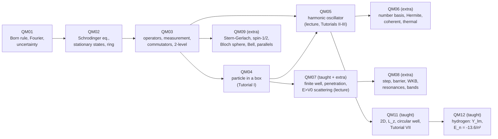

# Quantum Mechanics: Course Map (PH2113)

<span class="scope-taught">taught · in syllabus</span> <span class="scope-extra-book">extra · book</span>

*PH2113 Introductory Quantum Physics.* Six chapters and a quiz-prep page cover everything in the folder: the probabilistic wavefunction and uncertainty, the Schrödinger equation with its first solutions (free particle, ring), the operator/measurement formalism (with a two-level system), the particle in a box, the harmonic oscillator by ladder operators, and an extra chapter (QM06) collecting everything related to the oscillator: the number basis, expectation values, normalisation, the Hermite polynomials in full, coherent states and the thermal oscillator. QM09 (extra) adds the Stern–Gerlach experiment, spin-½ with its dynamics, entanglement and the two-level parallels in other subjects. Each chapter has a syllabus map, worked numbers (recomputed in `scripts/qm_numbers.py`), practice problems with solutions, and a provenance table. **Revision:** [[Quantum Mechanics Quiz Prep]] (the mock quiz and the 3 Sep quiz, formula sheet, traps, self-test) and [[qm-formula-sheet.pdf]].

> [!warning] What is and is not in the sources
> The folder holds **typed lecture notes** (Lectures 6–9 and three topic notes), **handwritten lectures** (the box and, added 2026-10-25, the 13-page **oscillator lecture**), **three instructor tutorials** (I, II and, added, **III**), two textbooks (Griffiths, Sakurai), six AI-written monographs and, from another tool, **summaries of the Classroom posts** (mock quiz, quiz solutions, exam-prep) under `ph2113/`. **There are no instructor slides, and Lectures 1–5 and everything after the oscillator are absent.** "Taught" therefore means "in the typed lecture notes, the handwritten notes or the tutorials"; the AI notes and textbooks are secondary. Lecture 9 announces tunnelling through a step (E < V) as the next topic; it is not in the folder. See *Gaps* below.


> [!info] Shared drive: related books, past papers and old decks on the shared drive are listed in [[physics/quantum-mechanics/shared-drive-sources|shared-drive sources (15 files)]].


> [!example] Past paper (found on Drive 2026-11-21): [[PH2113 Past Papers 2020 - Question Map]] (2020 quizzes and final with the instructors' solutions, mapped to chapters).
>
> **Question Paper Archive (Sem-3, Drive; solved 2026-11-22)**, one note per year: [[PH2113 Past Papers 2021 - Solved|2021]] (online mid-sem) · [[PH2113 Past Papers 2022 - Solved|2022]] · [[PH2113 Past Papers 2023 - Solved|2023]] · [[PH2113 Past Papers 2024 - Solved|2024]] (quizzes, mid-sem with official solutions checked; end-sem solved) · [[PH2113 Past Papers 2025 - Solved|2025]]. Files in `physics/quantum-mechanics/lecture-notes-slides/past-papers/qp-archive/`.

## The storyline

Central thread: **a wave amplitude gives probabilities (QM01) → a law for how the amplitude changes (QM02) → the general rules for asking questions of a state (QM03) → two systems solved completely, one by boundary conditions (QM04) and one by algebra (QM05) → the algebra's full toolbox (QM06) → the finite well relaxes the infinite walls (QM07).**

## Chapters
| # | Chapter | Sources | Status |
|---|---|---|---|
| 01 | [[QM01 From Waves to Probabilities]] | WU, L7, L8 §1–2 | draft |
| 02 | [[QM02 The Schrodinger Equation and Stationary States]] | L7 §7–13, L8, L9, Tutorial note | draft |
| 03 | [[QM03 States Operators and Measurement]] | SO, MX | draft |
| 04 | [[QM04 The Particle in a Box]] | handwritten box lecture, SO §8.2, Tutorial I | draft |
| 05 | [[QM05 The Harmonic Oscillator]] | **oscillator lecture (HO)**, Tutorial II, **Tutorial III**, Tutorial note P5–P6 | draft |
| 06 | [[QM06 The Oscillator Toolbox]] (extra) | Griffiths §2.3; derived here, all numbers in `qm_numbers.py` | draft (🟡/🔵) |
| 07 | [[QM07 The Finite Square Well]] (**taught** in §9–§11; extra in §1–§8, §12) | **[[Finite_well.pdf\|Finite_well.pdf]] (instructor, 13 pp.)**, **[[tutorial4.pdf\|Tutorial IV]]**; Griffiths §2.5–§2.6; Sakurai §2.5 | draft (🟢/🟡/🔵) |
| 08 | [[QM08 Quantum Tunnelling]] (extra; the topic announced at the end of Lecture 9) | QM07 §11 continued; Griffiths §2.5; Sakurai §2.5.4; `qm08_numbers.py` | draft (🟡/🔵) |
| 09 | [[QM09 The Stern-Gerlach Experiment and Spin]] (extra; spin and the two-level system physically; no lecture source) | Sakurai §1.1, §3.2–3.10, §5.5; Griffiths §4.4; `qm09_numbers.py` | draft (🟡/🔵) |
| 10 | [[QM10 The Finite Barrier and Tutorial V]] (🟢 taught: the barrier lecture [[Barrier.pdf]] and [[Tutorial5.pdf\|Tutorial V]]) | Barrier.pdf, Tutorial5.pdf; `qm10_numbers.py` | draft |
| 13 | [[QM13 The Probability Current and Ehrenfest Theorem]] (🟢 taught: lectured 10 Nov between QM10 and QM11; the probability current, both Ehrenfest theorems, Tutorial VI Q1) | Ehrenfest.pdf, Tutorial6.pdf Q1; Sakurai §2.2, §2.4; Griffiths §1.4–§1.5; `qm13_numbers.py` | draft |
| — | [[Dirac Algebra]] (Foundations, extra) | Sakurai Ch. 1 and §2.1; Griffiths Ch. 3; Shankar Ch. 1 | draft (🟡/🔵) |
| — | [[Quantum Mechanics Quiz Prep]] | mock quiz and 3 Sep quiz (Classroom summaries QZ1, QZ2) | draft |

```dataview
TABLE chapter AS "#", scope AS "Scope", status AS "Status"
FROM #subject/qm AND #type/chapter
SORT chapter ASC
```

## Sources and what they are
| ID | File | What it is | Role |
|---|---|---|---|
| WU | [[PH2113_Wavefunction_to_Uncertainty (1).pdf]] | typed lecture note, 4 pp. (double slit → Born → Gaussian → hydrogen) | taught: QM01 |
| L7 | [[PH2113_Lecture6-7.pdf]] | typed Lecture 7 (Fourier, uncertainty, TDSE, continuity), 6 pp. | taught: QM01–02 |
| L8 | [[PH2113_Lecture8_Uncertainty_Wavefunctions_Schrodinger (1).pdf]] | typed Lecture 8 (Compton scale, admissible states, TDSE), 10 pp. | taught: QM01–02 |
| L9 | [[PH2113_Lecture9_FreeParticle_Ring_GeneralProperties.pdf]] | typed Lecture 9 (TISE, free particle, ring, properties), 9 pp. | taught: QM02 |
| SO | [[PH2113_states_operators_notes.pdf]] | typed notes: states, operators, measurement, time evolution, 14 pp. | taught: QM03–04 |
| MX | [[PH2113_matrices_expectation_uncertainty.pdf]] | typed note: 2×2 matrices, expectation, commutators, 4 pp. | taught: QM03 |
| WT | [[PH2113_wavefunctions_potentials_schrodinger_Tutorial.pdf]] | tutorial note with six problems, 4 pp. | taught: QM02, QM05 |
| BOX | [[Particle_in_a_box.pdf]] | handwritten lecture, 10 pp. (page images; no usable text layer) | taught: QM04 |
| T1, T2 | [[tutorial1.pdf]], [[Tutorial2.pdf]] | instructor's Tutorial I (6 Oct 2026, box) and II (oscillator) | taught: QM04, QM05 |
| HO | [[Harmonic_oscillator.pdf]] | **handwritten oscillator lecture, 13 pp.** (page images, p.1 blank; authorship not stated, treated as the instructor's): factorisation, ladder property, ground state, $c_n,d_n$, $\psi_n$, $\langle x\rangle,\langle p\rangle,\langle x^2\rangle,\langle p^2\rangle$; p.9 has a sign slip | taught: QM05 |
| FW | [[Finite_well.pdf]] | **handwritten finite-well lecture, 13 pp.** (page images, p.1 blank; garbled text layer; added 2026-10-27): bound states with the floor at zero, $\kappa/k_0=\tan k_0a$ and $-\cot k_0a$, the graph, deep/shallow limits, then $E>V_0$ scattering with $T=1/(1+V_0^2\sin^2(2k_0a)/4E(E-V_0))$ and resonances | taught: QM07 §9–§11 |
| T4 | [[tutorial4.pdf]] | instructor's **Tutorial IV**, 1 p.: plot the exact shape of $\kappa/k_0$ | taught: QM07 §10 |
| T6 / EH | [[Tutorial6.pdf]] / [[Ehrenfest.pdf]] | Tutorial VI (1 p., text: the second Ehrenfest equation; the barrier for $E>V_0$) / the instructor's handwritten notes on the probability current and Ehrenfest's theorem (8 pp., read from page images 2026-11-12) | taught: [[QM13 The Probability Current and Ehrenfest Theorem]] (full chapter; the short version is the end of [[QM06 The Oscillator Toolbox]]) and [[QM10 The Finite Barrier and Tutorial V]] (Tutorial VI Q2) |
| AM / CW | [[Angular_momentum.pdf]] / [[Angular_momentum (2).pdf]] | **handwritten 2D / angular-momentum lecture**, 6 pp. (p.1 blank; page images) / typed note *Schrödinger equation in two dimensions: an example* (circular infinite well, Bessel), 3 pp.; both posted 16 Nov 2026 (Classroom sync) | taught: QM11 |
| NB | `circular_well_density.ipynb` | instructor's notebook: normalisation, rings vs lobes, energy diagram (read as text, not executed) | taught: QM11 §5 |
| T7 | [[tutorial7.pdf]] | **Tutorial VII**, 2 pp.: polar Laplacian, 2D oscillator radial equation, radial probability density | taught: QM11 §2, §6, §7 |
| HA | [[Hydrogen_atom.pdf]] | typed note *Schrödinger equation in three dimensions: hydrogen atom*, 8 pp. (posted 16 Nov 2026); [!verify] Eq. 29 ($R_{2,0}$) has an extra factor 2 | taught: QM12 |
| T3 | [[Tutorial3.pdf]] | instructor's **Tutorial III**, 2 pp. TeX: $\langle p^2\rangle$ by ladders, $\langle x\rangle$ and $\langle x^2\rangle$ by Gaussian integrals, orthogonality | taught: QM05 §10 |
| QZ1, QZ2, EP | [[2026-09-02-mock-quiz-and-solutions]], [[2026-09-03-quiz-ideal-solutions]], [[ph2113/exam-prep]] | summaries of Classroom posts by another tool (`agent_written`); the PDFs and the 3 Sep question texts are **not** in the folder | taught: [[Quantum Mechanics Quiz Prep]] |
| — | [[qphyprems-merged.pdf]] | merge of WU, L7–L9, SO, MX, WT: the pre-midsem pack | = the pre-midsem syllabus |
| G | [[Griffiths - Introduction to quantum mechanics.pdf]] | 1st edition, scan (OCR'd Ch. 1–2 to locate sections; book page = PDF − 15) | extra/book |
| SH | [[Shankar - Principles of quantum mechanics.pdf]] and [[Shankar - contents.pdf]] | Shankar, 2nd ed. and its contents (added 2026-10-27; cited for the Dirac-notation chapter) | extra/book |
| S | [[modern-quantum-mechanics-3nbsped-9781108473224-1108473229_compress.pdf]] | Sakurai and Napolitano, 3rd ed. (text layer) | extra/book |
| AI | `gemqphyprems.pdf`, `gemqphyprems2.pdf`, `Quantum_Mechanics_Notes.pdf`, `quantum_notes.pdf`, `Quantum Mechanics II - Chapters 1-2.pdf`, `- Complete.pdf` | AI-written monographs; the first three repeat Lectures 1–9, `quantum_notes.pdf` solves Tutorials I–II, the last two are a QM II course (spin, hydrogen, perturbation theory, scattering) | secondary; cross-check only |

## Gaps (to ask the instructor / supply later)
- **Lectures 1–5** (photoelectric, Compton, de Broglie, early wave mechanics) are not in the folder; QM01 §8 rebuilds them from the AI monograph and flags it `[!verify]`. The two quizzes (Sep 3) **did** examine them, as explanations ([[Quantum Mechanics Quiz Prep]]), so they are examinable even though no lecture note is present.
- **Oscillator lecture:** now present ([[Harmonic_oscillator.pdf]]); it stops at $\langle p^2\rangle$, so the superposition dynamics (QM05 §6), the forbidden-region numbers (§9) and all of QM06 are not in it. The lecture's page 9 has a sign slip (flagged). Authorship of the handwritten lectures is not stated.
- **Quiz texts:** the actual 3 Sep question texts are missing; the Classroom PDFs are not in the folder; the summary of Q5(b) has inconsistent vectors (see the `[!verify]` in the quiz-prep page). No assessment after 3 Sep is announced.
- **Tunnelling and step potentials** (announced at the end of Lecture 9): the **finite well, its graph and the $E>V_0$ scattering are now lectured material** ([[Finite_well.pdf]], [[QM07 The Finite Square Well]] §9–§11); steps, barriers and tunnelling proper still have no lecture source, so [[QM08 Quantum Tunnelling]] writes them up as extra (🟡/🔵).
- **Convention clash resolved:** the lecture puts the floor of the well at $E=0$; QM07 §1–§8 (first written from Griffiths) use $V=-V_0$ inside. A dictionary is in QM07 (box after the story); formulas agree via $E_{\rm Griffiths}=E_{\rm lecture}-V_0$.
- **Slips in the finite-well lecture** (flagged `[verify]` in QM07 §9/§11): the figure labels the walls $\mp a/2$ while the algebra matches at $\mp a$; the first form of $|F/A|^2$ on p.13 lacks the square on $(k^2-k_0^2)$.
- **Hydrogen, angular momentum, spin, perturbation theory**: only in the AI "QM II" monographs (secondary, beyond this course), not used.
  - **Update 2026-10-29:** the Stern–Gerlach experiment, spin-½, angular momentum, two spins, Bell and magnetic resonance are now written up from Sakurai and Griffiths in [[QM09 The Stern-Gerlach Experiment and Spin]] (labelled 🟡/🔵; still no lecture source). Hydrogen and perturbation theory remain open.
- **Authorship of the typed notes** is not stated in the files; they are treated as the instructor's.

## Why this subject is tightly linked to the others
- **Climate and thermodynamics:** Planck's law and blackbody radiation ([[Planck Law]], [[Blackbody Radiation]]) are quantum results; molecular vibration and rotation (the oscillator and the ring) give the absorption bands of [[CL07 Optical Properties of the Atmosphere]] (CO$_2$ 15 µm, CO bond 4.66 µm).
- **Waves:** Fourier analysis, group and phase velocity, standing waves ([[Waves - Course Map]]).
- **Probability:** the Born rule, expectation, variance, conditioning ([[Probability - Course Map]], [[Bayes' Theorem]]).
- **Group theory:** the two-level matrices $X,Y,Z$, the ring's rotations and $U(1)$ phase, the ladder algebra ([[Group Theory - Course Map]]).
- **Foundations:** [[Dimensional Analysis]], [[Gaussian Integral]], [[Fixed Points and Linear Stability]], [[Dirac Algebra]].
- **Chemistry:** the box and ring models of conjugated molecules ([[Inorganic Chemistry - Course Map]]).

## Continued (2026-11-04)
- [[QM10 The Finite Barrier and Tutorial V]]: the barrier lecture ([[Barrier.pdf]]) and [[Tutorial5.pdf|Tutorial V]] solved. **Added 2026-11-12:** Tutorial VI Q2 (the barrier for $E>V_0$, resonances at $2ka=n\pi$) appended to QM10; the Ehrenfest/probability-current notes and Tutorial VI Q1 (direct derivation of $\mathrm d\langle x\rangle/\mathrm dt=\langle p\rangle/m$ and $\mathrm d\langle p\rangle/\mathrm dt=-\langle V'\rangle$ from the TDSE, numerically checked) appended to [[QM06 The Oscillator Toolbox]]. Concepts: [[Double Well Potential]], [[Tunnel Splitting]].

## Continued (2026-11-21, Classroom sync)
- [[QM11 Two-Dimensional Problems Angular Momentum and the Circular Well]]: 2D TISE, polar Laplacian, $\hat L=-i\hbar\partial_\phi$, $e^{il\phi}$, $\pm l$ degeneracy, the circular infinite well (Bessel), the 2D oscillator ($E=\hbar\omega(2n_r+|l|+1)$), radial probability density; **Tutorial VII solved**. Tool `qm_circular_well`.
- [[QM12 The Hydrogen Atom]]: scales, $\hat L^2$, $\hat L_z$, $Y_{lm}$, radial equation, $E_n=-13.6/n^2$ with $n^2$ degeneracy, $R_{10},R_{20},R_{21}$, the 1s radial peak at $r=a$. Tool `qm_hydrogen_radial`.
- Classroom admin: Quiz 2 answer scripts shown on 17 Nov (LHC 101). Related lectures on the shared drive (CH1213 *H-atom*, *Particle on a sphere*): [[physics/quantum-mechanics/shared-drive-sources|shared-drive sources]].

## Continued (2026-11-25)
- [[QM13 The Probability Current and Ehrenfest Theorem]]: the instructor's Ehrenfest/probability-current lecture and Tutorial VI Q1 as a chapter of its own (it was a pendant section of QM06): continuity equation and $j$ with a table of currents, current conservation at a step ($T=\frac{k_2}{k_1}|F/A|^2$), the box-superposition current $j(x,t)$, both Ehrenfest theorems from the TDSE (the lecture's route and a route through $\int j\,\mathrm dx$), the $\sigma^2$ correction to the classical force, the hard-wall force, and the commutator form (virial, free spreading). Numbers: `scripts/qm13_numbers.py` (split-step TDSE check). The Atlas block below is generated; rerun `scripts/graph_spine.py` to add the chapter.

## Revision
- A printable formula sheet: [[qm-formula-sheet.pdf]] (2 pages).
- Practice with solutions lives at the end of each chapter (10 problems each, plus the lecture-style extras of QM07).

## Concept index
```dataview
LIST FROM #type/concept AND #subject/qm SORT file.name ASC
```

See [[Subject Map]] for how this subject relates to the others and [[Roadmap]] for its place in the plan.

<!-- graph-spine:start (generated by scripts/graph_spine.py; do not edit between the markers) -->
## Atlas: every note in this subject
The graph view draws only real links, so this block links **every** note of the subject (the map is the hub of its cluster; [[Home]] is the hub of all maps).

> [!abstract]- Atlas (generated): 12 chapters · 145 concept notes · 78 zettel notes (the other tool's, filed in the vault) · 7 other notes in the vault · 36 notes from the other tool (source layer)
> **Chapters (12):** [[QM01 From Waves to Probabilities]] · [[QM02 The Schrodinger Equation and Stationary States]] · [[QM03 States Operators and Measurement]] · [[QM04 The Particle in a Box]] · [[QM05 The Harmonic Oscillator]] · [[QM06 The Oscillator Toolbox]] · [[QM07 The Finite Square Well]] · [[QM08 Quantum Tunnelling]] · [[QM09 The Stern-Gerlach Experiment and Spin]] · [[QM10 The Finite Barrier and Tutorial V]] · [[QM11 Two-Dimensional Problems Angular Momentum and the Circular Well]] · [[QM12 The Hydrogen Atom]]
>
> **Concept notes (145):** [[Admissible Wavefunction]] · [[Alpha Decay]] · [[Angular Momentum Algebra]] · [[Anharmonic Oscillator]] · [[Associated Legendre Polynomials]] · [[BB84 Protocol]] · [[Bell Inequality and CHSH]] · [[Bessel Functions]] · [[Bloch Sphere]] · [[Bloch Theorem]] · [[Bohr Magneton]] · [[Bohr Radius and Atomic Units]] · [[Born Rule]] · [[Bound State]] · [[Boundary Conditions and Quantisation]] · [[Canonical Commutation Relation]] · [[Centrifugal Barrier]] · [[Circular Infinite Well]] · [[Classical Probability Density of the Oscillator]] · [[Classically Forbidden Region]] · [[Coherent State]] · [[Commutator]] · [[Completeness Relation]] · [[Compton Scattering]] · [[Compton Wavelength]] · [[Correspondence Principle]] · [[de Broglie Relation]] · [[Degeneracy]] · [[Delta Function Potential]] · [[Delta-Function Normalisation]] · [[Density Matrix]] · [[Dirac Notation]] · [[Displacement Operator]] · [[Double Well Potential]] · [[Effective Well Width]] · [[Ehrenfest Theorem]] · [[Eigenstate and Eigenvalue]] · [[Einstein Heat Capacity]] · [[Energy Quantisation]] · [[Entanglement]] · [[Evanescent Wave]] · [[Expectation Value]] · [[Flavour Oscillation]] · [[Fourier Invariance of Hermite Functions]] · [[Fourier Transform and Wave Packets]] · [[Free Particle]] · [[Gamow Factor]] · [[Gaussian Wave Packet]] · [[Generalised Uncertainty Principle]] · [[Global and Relative Phase]] · [[Gram-Schmidt Orthogonalisation]] · [[Ground State Uniqueness]] · [[Gyromagnetic Ratio and g-Factor]] · [[Harmonic Oscillator]] · [[Heisenberg Picture]] · [[Heisenberg Uncertainty Principle]] · [[Hermite Equation and Series Solution]] · [[Hermite Generating Function and Recurrences]] · [[Hermite Polynomials]] · [[Hermitian Conjugate]] · [[Hermitian Operator]] · [[Hilbert Space]] · [[Hydrogen 21 cm Line]] · [[Hydrogen Atom Spectrum]] · [[Hydrogen Atom Stability]] · [[Isotropic Oscillator and Degeneracy]] · [[Kronig-Penney Model]] · [[Ladder Operators]] · [[Laplacian in Polar and Spherical Coordinates]] · [[Larmor Precession]] · [[Logarithmic Derivative Matching]] · [[Magnetic Resonance]] · [[Matrix Elements of Position and Momentum]] · [[Measurement Postulate]] · [[Minimum Uncertainty State]] · [[No-Cloning Theorem]] · [[Node of a Wavefunction]] · [[Normal Ordering]] · [[Normalisation Constants Table]] · [[Normalisation of a Wavefunction]] · [[Number Basis]] · [[Number Operator]] · [[Operator]] · [[Orthogonal Polynomials]] · [[Orthonormality of Eigenfunctions]] · [[Oscillator Expectation Values]] · [[Parity Operator]] · [[Parity Theorem]] · [[Parseval-Plancherel Theorem]] · [[Particle in a Box]] · [[Particle on a Ring]] · [[Pauli Matrices]] · [[Penetration Depth]] · [[Phase Space Picture of the Oscillator]] · [[Photon Polarisation]] · [[Photon Statistics]] · [[Plane Wave]] · [[Probabilists' Hermite Polynomials]] · [[Probability Current]] · [[Pure and Mixed States]] · [[Quantum Tunnelling]] · [[Quantum Zeno Effect]] · [[Rabi Oscillation]] · [[Radial Probability Density]] · [[Rectangular Barrier]] · [[Reflection Coefficient]] · [[Resonant Tunnelling]] · [[Scattering State]] · [[Schrodinger Equation]] · [[Schwinger Oscillator Model]] · [[Selection Rules]] · [[Sequential Stern-Gerlach Experiments]] · [[Singlet and Triplet States]] · [[Spherical Harmonics]] · [[Spin Rotation Operator]] · [[Spin-One Systems]] · [[Spin-Only Magnetic Moment]] · [[Spin]] · [[Spinor]] · [[Stationary State]] · [[Step Potential]] · [[Stern-Gerlach Experiment]] · [[Sum Rules]] · [[Superposition Principle]] · [[Thermal Harmonic Oscillator]] · [[Time Evolution of a Superposition]] · [[Time Evolution Operator]] · [[Time Is Not an Operator]] · [[Time-Independent Schrodinger Equation]] · [[Transcendental Equation]] · [[Transfer Matrix]] · [[Transmission Coefficient]] · [[Transmission Resonance]] · [[Tunnel Splitting]] · [[Tunnelling Probability]] · [[Two-Level System]] · [[Uncertainty of an Observable]] · [[Unitary Operator]] · [[06-Quantum-Mechanics/Concepts/Virial Theorem|Virial Theorem]] · [[Von Neumann Measurement Model]] · [[Wave-Particle Duality]] · [[Wavefunction]] · [[WKB Approximation]] · [[Zeeman Effect]] · [[Zero-Point Energy]]
>
> **Zettel notes (the other tool's, filed in the vault) (78):** [[admissible-potentials-for-stationary-analysis]] · [[angular-wavefunction-representations-in-circular-wells]] · [[associated-legendre-polynomials]] · [[basis-independence-of-quantum-states]] · [[born-rule-and-expansion-postulate]] · [[boundary-induced-energy-quantization]] · [[breakdown-of-classical-thomson-scattering]] · [[canonical-commutation-relation-position-momentum]] · [[canonical-commutation-relations-in-two-dimensions]] · [[circular-infinite-well-energy-eigenvalues-and-eigenstates]] · [[circular-infinite-well-potential-in-two-dimensions]] · [[circular-well-normalization-constant]] · [[classical-particle-in-a-box]] · [[compton-scattering-momentum-and-energy-transfer]] · [[compton-scattering]] · [[davisson-germer-electron-diffraction]] · [[deep-wide-well-approximation]] · [[delocalized-plane-wave-idealization]] · [[differential-coordinate-representations-of-energy-and-momentum]] · [[dirac-delta-wavefunction-limit]] · [[double-slit-interference-from-state-superposition]] · [[dynamical-amplification-of-quantum-uncertainty]] · [[dynamical-probability-density-from-non-degenerate-superposition]] · [[eigenstate-definite-value-principle]] · [[emergence-of-energy-quantization-from-boundary-conditions]] · [[energy-eigenstate-superposition-with-momentum-degeneracy]] · [[ensemble-interpretation-of-the-wavefunction]] · [[finite-well-scattering-states]] · [[fourier-band-limited-wave-packet-localization]] · [[free-particle-dispersion-relation-in-schrodinger-theory]] · [[free-particle-on-an-infinite-line]] · [[free-particle-periodic-boundary-condition]] · [[gaussian-wave-packet-minimum-uncertainty]] · [[harmonic-oscillator-excited-states-generation]] · [[hydrogen-atom-radial-equation]] · [[hydrogen-atom-radial-wavefunctions]] · [[hydrogen-ground-state-scale-from-uncertainty]] · [[hydrogen-spectrum-and-degeneracy]] · [[infinite-square-well-potential]] · [[linear-operator]] · [[macroscopic-classicality-criterion-via-de-broglie-wavelength]] · [[macroscopic-correspondence-on-a-ring]] · [[non-preservation-of-eigenstate-under-non-degenerate-superposition]] · [[operator-commutator]] · [[orthogonality-of-energy-eigenstates]] · [[overall-phase-vs-relative-phase]] · [[parity-operator-eigenvalue-action]] · [[particle-in-a-box-momentum-expectation-value]] · [[particle-in-a-box-position-expectation-value]] · [[particle-in-a-box-time-evolution]] · [[periodic-boundary-condition-on-a-ring]] · [[photoelectric-threshold-frequency]] · [[plane-wave-momentum-eigenstate]] · [[position-dependent-phase-and-momentum-content]] · [[position-momentum-uncertainty-relation-from-fourier-transform]] · [[potential-energy-zero-gauge-invariance]] · [[quantum-expectation-value]] · [[quantum-mechanical-correspondence-between-discrete-and-continuous-syst]] · [[quantum-probability-amplitude-superposition]] · [[radial-probability-density]] · [[reduced-compton-wavelength-validity-threshold]] · [[robertson-uncertainty-relation-for-pauli-matrices]] · [[schrodinger-equation-linearity-and-superposition]] · [[schrodinger-equation-probability-conservation]] · [[separation-of-variables-in-polar-coordinates]] · [[shallow-well-bound-state-existence]] · [[simultaneous-eigenstates-and-commuting-observables]] · [[single-slit-diffraction-localization]] · [[spherical-harmonics]] · [[square-integrability-of-wave-functions]] · [[thomson-scattering-classical-limit]] · [[time-independent-schrodinger-equation]] · [[two-dimensional-harmonic-oscillator-in-polar-coordinates]] · [[two-dimensional-quantum-state]] · [[two-dimensional-schrodinger-equation-in-polar-coordinates]] · [[two-wave-superposition-envelope-modulation]] · [[wave-function-boundary-matching-across-discontinuities]] · [[wave-function-physical-acceptability-conditions]]
>
> **Other notes in the vault (7):** [[PH2113 Past Papers 2020 - Question Map]] · [[PH2113 Past Papers 2021 - Solved]] · [[PH2113 Past Papers 2022 - Solved]] · [[PH2113 Past Papers 2023 - Solved]] · [[PH2113 Past Papers 2024 - Solved]] · [[PH2113 Past Papers 2025 - Solved]] · [[Quantum Mechanics Quiz Prep]]
>
> **Notes from the other tool (source layer) (36):** [[2026-08-04-lectures-1-2-double-slit-and-compton]] · [[2026-08-06-lecture-3-compton-scattering]] · [[2026-08-11-lectures-4-5-de-broglie-and-wave-function]] · [[2026-08-11-problem-set-1]] · [[2026-08-13-problem-set-1-solutions]] · [[2026-08-18-wavefunction-to-uncertainty]] · [[2026-08-20-lecture-6-7-fourier-synthesis-to-schrodinger]] · [[2026-08-24-lecture-8-uncertainty-wavefunctions-schrodinger]] · [[2026-08-25-lecture-9-free-particle-ring-general-properties]] · [[2026-08-25-tutorial-wavefunctions-uncertainty-schrodinger]] · [[2026-08-27-tutorial-solutions-wavefunctions-uncertainty-schrodinger]] · [[2026-08-31-states-operators-measurements-notes]] · [[2026-09-02-mock-quiz-and-solutions]] · [[2026-09-03-quiz-ideal-solutions]] · [[2026-09-07-matrices-expectation-uncertainty]] · [[2026-09-08-tutorial-states-interference-uncertainty]] · [[2026-09-10-tutorial-solutions-states-interference-uncertainty]] · [[2026-09-13-tutorial-wavefunctions-potentials-schrodinger]] · [[2026-09-24-midsem-solutions]] · [[2026-10-06-particle-in-a-box-notes]] · [[2026-10-06-tutorial-i-particle-in-a-box]] · [[2026-10-12-tutorial-ii-harmonic-oscillator-ladder-operators]] · [[2026-10-19-harmonic-oscillator-ladder-operator-notes]] · [[2026-10-19-tutorial-iii-harmonic-oscillator-expectation-values]] · [[2026-10-26-tutorial-iv-finite-well-practice]] · [[2026-10-27-finite-well-notes]] · [[2026-11-02-tutorial-v-finite-well-double-well-transmission]] · [[2026-11-04-barrier-notes]] · [[2026-11-09-tutorial-vi-ehrenfest-barrier-above]] · [[2026-11-10-probability-current-ehrenfest-notes]] · [[2026-11-16-angular-momentum-2d-handwritten-notes]] · [[2026-11-16-circular-well-2d-and-density-notebook]] · [[2026-11-16-hydrogen-atom-3d-notes]] · [[2026-11-16-tutorial-vii-polar-schrodinger-2d-oscillator]] · [[ph2113/exam-prep|exam-prep]] · [[ph2113]]
<!-- graph-spine:end -->

## Continued in the vault (added 2026-10-29)
- Application of tunnelling to nuclear clocks: [[Alpha Decay]], [[LSX1 Clocks in Rocks]] (the Gamow calculation of half-lives).
