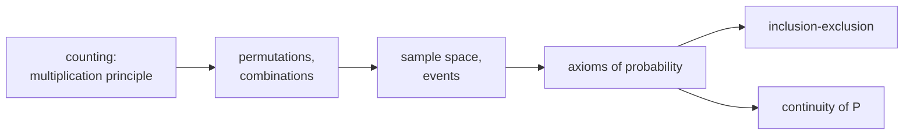

# PR01 · Counting and the Axioms of Probability

◀ [[Probability - Course Map|Course Map]] · [[PR02 Conditional Probability Bayes Rule and Independence]] ▶

taught · in syllabus extra · book extra · beyond

> [!syllabus] Syllabus map: what is in the syllabus and what is extra in this chapter
> 🟢 **In syllabus (taught)**: the instructor's typed class notes for MT2113, in the merged file [[ilovepdf_merged-1.pdf|class notes]]: **5 Aug** (counting; PDF pp.1–2), **6 Aug** (sample spaces, events, definitions of probability; pp.3–6), **12 Aug** (properties, examples, inclusion-exclusion; pp.7–9) and the problem sheets of [[Practice problems 7th August 2026.pdf|7 Aug]] and [[Practice problems 14th August 2026.pdf|14 Aug]].
> - §1 counting: multiplication principle, permutations, combinations, Pascal's identity, binomial and multinomial theorems, stars and bars (5–6 Aug)
> - §2 random experiments, sample spaces, events, the algebra of events (6 Aug)
> - §3 naive, frequentist and axiomatic probability; consequences of the axioms (6, 12 Aug)
> - §4 inclusion-exclusion and the matching problem (12 Aug)
>
> 🟡 **Extra · book** (the class notes say "further reading, not necessary for this course")
> - §5 probability as a continuous set function: limits of increasing or decreasing sequences of events, disjointification (12 Aug, §2 of those notes; p.9–11 of the PDF); the frequentist and Bayesian views (Blitzstein and Hwang pp.22–23)
>
> 🔵 **Extra · beyond** (my additions, labelled)
> - §4 the coincidence ("birthday") probability for $N$ slots and $k$ objects; numerical checks (exact and simulated) of every worked number (`scripts/pr_numbers.py`)

> [!key] After this chapter you can
> - count **arrangements**, **subsets**, **partitions** and **placements of identical balls**, choosing between $n!$, $\binom nk$, the multinomial coefficient and stars and bars,
> - describe an experiment by its **sample space** and **events**, and write events with $\cup$, $\cap$, complements and De Morgan's laws,
> - state the **three axioms** and derive $P(\varnothing)=0$, $P(E^c)=1-P(E)$, monotonicity and $P(E\cup F)$,
> - use the **naive definition** correctly (equally likely outcomes) and say why the **frequentist limit** is not a definition,
> - apply **inclusion-exclusion** and the complement trick, including the **matching problem** with its limit $1/e$.

> [!intuition] The one-sentence story
> Probability starts as counting: when outcomes are equally likely, a probability is a ratio of counts; the axioms keep that arithmetic consistent for events of every shape, and inclusion-exclusion is the bookkeeping that stops overlapping events being counted twice.

<!-- intuition-v1 -->

*Concept map: how the ideas of this chapter depend on each other (read left to right; every box is a section).*

## 1. Counting
taught *5–6 Aug ([[ilovepdf_merged-1.pdf#page=1|pp.1–4]]); sheet of 7 Aug*

> [!intuition] Choices multiply, orderings divide
> If a task has $m$ choices then $n$ choices, there are $mn$ ways. Orderings that you do not care about are over-counted by the number of ways to shuffle them, so divide by it: that is the whole of $\binom nk=n!/k!(n-k)!$.

> [!key] The tools
> - **Multiplication principle.** If experiment 1 has $m$ outcomes and experiment 2 has $n$, there are $mn$ outcome-pairs; for $r$ experiments, $m_1m_2\cdots m_r$.
> - **Permutations.** $n$ distinguishable objects can be arranged in $n!$ ways. If $k_1$ are of one kind, $k_2$ of a second, ..., $k_r$ of an $r$-th ($\sum k_i=n$, objects of one kind indistinguishable): $\dfrac{n!}{k_1!k_2!\cdots k_r!}$.
> - **Combinations.** The number of $r$-subsets of an $n$-set is $\dbinom nr=\dfrac{n!}{r!(n-r)!}=\dfrac{n(n-1)\cdots(n-r+1)}{r!}$ (divide the $n(n-1)\cdots(n-r+1)$ ordered selections by the $r!$ orderings of each subset: equivalence classes).
> - **Pascal's identity** $\dbinom nr=\dbinom{n-1}r+\dbinom{n-1}{r-1}$; **binomial theorem** $(x+y)^n=\sum_{k=0}^n\binom nkx^ky^{n-k}$.
> - **Multinomial coefficient.** Splitting $n$ distinct items into $r$ labelled groups of sizes $m_1,\dots,m_r$: $\dbinom n{m_1,\dots,m_r}=\dfrac{n!}{m_1!\cdots m_r!}$; **multinomial theorem** $(x_1+\dots+x_r)^n=\sum\binom n{m_1,\dots,m_r}x_1^{m_1}\cdots x_r^{m_r}$.
> - **Stars and bars** (6 Aug). $n$ identical balls into $k$ labelled boxes: $\dbinom{n+k-1}{k-1}$; with every box non-empty: $\dbinom{n-1}{k-1}$ (equivalently, writing $n$ as an ordered sum of $k$ non-negative, respectively positive, integers).

> [!derivation] A story proof of Pascal's identity (practice sheet 7 Aug, problem 9)
> Count the $r$-subsets of $\{1,\dots,n\}$ in two ways. All of them: $\binom nr$. Split by whether element $n$ is in the subset: if **not**, choose $r$ from the other $n-1$ ($\binom{n-1}r$); if **yes**, choose the other $r-1$ from the other $n-1$ ($\binom{n-1}{r-1}$). Adding gives the identity. (Blitzstein and Hwang call these **story proofs**.)

> [!example] Antennas (class, 5 Aug)
> $n$ antennas, $m$ defective, defective ones indistinguishable, working ones indistinguishable. In how many arrangements are no two defective antennas adjacent? Place the $n-m$ working antennas first; this leaves $n-m+1$ gaps (including both ends), and a defective antenna may sit in each gap at most once. Choose which $m$ gaps are used: $\binom{n-m+1}m$. For $n=10$, $m=3$: $\binom83=56$ arrangements out of $\binom{10}3=120$, so $56/120=0.467$ if all placements are equally likely.

> [!example] Splitting a dozen people (sheet 7 Aug, problem 8)
> Into teams of $2,5,5$: $\dfrac{12!}{2!\,5!\,5!}=16\,632$ ordered splits, but the two 5-teams are not distinguishable, so divide by $2$: **8316**. Into three teams of 4: $\dfrac{12!}{(4!)^3}=34\,650$, divide by $3!$ for the unlabelled teams: **5775**.

> [!pitfall] Is the order, or the label, part of the outcome?
> Most counting errors are a factor of $k!$: decide whether the objects (or groups) are distinguishable and whether order matters, and divide by the symmetry you do not want to count. Stars and bars is for **identical** balls and **labelled** boxes.

## 2. Random experiments, sample spaces and events
taught *6 Aug ([[ilovepdf_merged-1.pdf#page=3|pp.3–5]])*

A **random experiment** is one whose set of possible outcomes is known in advance but whose actual outcome is not (a drug given to a patient; a blood-pressure reading; the lifetime of a light bulb). The **sample space** $S$ (or $\Omega$) is the set of all possible outcomes, each element a **sample point**. An **event** is any subset $E\subset S$.

> [!example] Sample spaces from the notes
> Three coin tosses: $S=\{HHH,HHT,\dots,TTT\}$ ($8$ points). Two dice: $S=\{(i,j):1\le i,j\le6\}$ ($36$ points); "the sum is even" is the $18$-point subset with $i+j$ even; "the sum is divisible by 3" has $12$ points. Light bulbs known to last at least 1000 h: $S=[1000,\infty)$; "at least 2000 h" is $[2000,\infty)$, "between 2000 and 3000 h" is $[2000,3000]$.

Events combine like sets: $E\cup F$ (either or both), $E\cap F$ (both), $E^c=S\setminus E$. The commutative, associative and distributive laws hold, and **De Morgan's laws**
$$\Big(\bigcup_{i=1}^nE_i\Big)^c=\bigcap_{i=1}^nE_i^c,\qquad\Big(\bigcap_{i=1}^nE_i\Big)^c=\bigcup_{i=1}^nE_i^c .$$
Two events with $E\cap F=\varnothing$ are **mutually exclusive** (disjoint).

## 3. What "probability" means
taught *6 and 12 Aug ([[ilovepdf_merged-1.pdf#page=5|pp.5–7]])*

> [!intuition] Three meanings, one calculus
> Long-run frequency, degree of belief, and a measure on outcomes all satisfy the same three axioms; the theorems do not care which one you have in mind.

**Naive definition.** For a finite sample space with equally likely outcomes,
$$P[A]=\frac{|A|}{|S|}=\frac{\text{number of favourable outcomes}}{\text{total number of outcomes}} .$$
It is useful but not abstract (it needs equal likelihood and finiteness).

**Frequentist idea.** Repeat the experiment $n$ times under identical conditions and let $n(E)$ be the number of repetitions in which $E$ occurs; then $P(E)=\lim_{n\to\infty}n(E)/n$. The class notes point out two drawbacks: how do we know the sequence converges, and why to the **same** limit for every sequence of trials? So we adopt the axiomatic approach (and read the frequentist and Bayesian interpretations in Blitzstein and Hwang pp.22–23).

> [!key] The axioms (Kolmogorov)
> To each event $E$ is attached a number $P(E)$ such that
> 1. $0\le P(E)\le1$;
> 2. $P(S)=1$;
> 3. for pairwise disjoint $E_1,E_2,\dots$ ($E_i\cap E_j=\varnothing$, $i\ne j$): $P\big(\bigcup_{i=1}^\infty E_i\big)=\sum_{i=1}^\infty P(E_i)$.

**Consequences** (all derived in class):
- $P(\varnothing)=0$: $1=P(S)=P(S\cup\varnothing)=P(S)+P(\varnothing)$. Hence **finite additivity** by padding with empty sets.
- $P(E^c)=1-P(E)$, since $E$ and $E^c$ are disjoint with union $S$.
- If $E\subset F$: $P(F)=P(E)+P(F\setminus E)\ge P(E)$ (**monotonicity**), and $P(F\setminus E)=P(F)-P(E)$ (sheet 7 Aug, problem 12).
- For equally likely finite $S=\{1,\dots,N\}$, $P(\{i\})=1/N$ and $P(E)=|E|/N$ (the naive definition is a special case).

> [!example] Using the complement (12 Aug)
> A college has 10 time slots and assigns courses at random; there are three statistics courses. $P(\text{two or more share a slot})=1-P(\text{all different})=1-\dfrac{10\cdot9\cdot8}{10^3}=0.28$.

> [!example] Seating (12 Aug)
> Gimli, Legolas and ten others sit in a row of 12, all arrangements equally likely. Treat the pair as a block: $2$ orders of the pair, $11$ positions for the block, $10!$ arrangements of the rest: $\dfrac{2\cdot11\cdot10!}{12!}=\dfrac16$. Around a circular table with unlabelled chairs where left and right matter: fix Gimli; Legolas is equally likely to be in any of the $11$ other relative positions and $2$ are adjacent: $\dfrac2{11}=0.182$.

> [!pitfall] The naive definition needs "equally likely"
> The sum of two dice has 11 possible values but they are **not** equally likely (7 has probability $6/36$, 2 has $1/36$); counting the 11 values would give a wrong answer. Work in the 36-point space of ordered pairs, where the outcomes are equally likely.

> [!example] Poker hands (sheet 7 Aug, problem 5), recomputed
> Full house (three of one denomination, two of another): $\dfrac{13\binom43\cdot12\binom42}{\binom{52}5}=\dfrac{3744}{2\,598\,960}=0.00144$. Straight flush (five consecutive denominations, one suit; royal flush included): $\dfrac{10\cdot4}{\binom{52}5}=1.54\times10^{-5}$.
> Elevator (problem 10): three people each leave at one of floors 2–10 equally likely and independently; the three buttons are consecutive floors in $7\cdot3!=42$ of the $9^3=729$ equally likely outcomes: $0.0576$.

## 4. Inclusion-exclusion
taught *12 Aug ([[ilovepdf_merged-1.pdf#page=8|pp.8–9]]); sheet of 14 Aug, problems 1–2*

> [!intuition] Add, subtract the double-counted, add back the triple-counted
> Summing $P(A_i)$ counts overlaps twice; subtract pairwise overlaps; that removes triples too often; add them back; and so on with alternating signs.

For any two events $E,F$: $\ P(E\cup F)=P(E)+P(F)-P(E\cap F)$ (split into the disjoint pieces $E\setminus F$, $F\setminus E$, $E\cap F$). For three,
$$P(E\cup F\cup G)=P(E)+P(F)+P(G)-P(E\cap F)-P(E\cap G)-P(F\cap G)+P(E\cap F\cap G),$$
and in general
$$\boxed{\ P\Big(\bigcup_{i=1}^nE_i\Big)=\sum_iP(E_i)-\sum_{i<j}P(E_i\cap E_j)+\sum_{i<j<k}P(E_i\cap E_j\cap E_k)-\dots+(-1)^{n-1}P\Big(\bigcap_{i=1}^nE_i\Big)\ }$$

> [!derivation] The counting proof (sheet 14 Aug, problem 2)
> Take an equally likely finite space and a sample point $\omega$ that belongs to **exactly $r\ge1$** of the events. On the right-hand side it is counted $\binom r1-\binom r2+\binom r3-\dots+(-1)^{r-1}\binom rr=1-(1-1)^r=1$ times (the binomial theorem). A point in none of the events is counted $0$ times, as on the left. So both sides agree point by point. (The inductive proof from $n=2,3$ is problem 1.)

### The matching problem
$n$ people leave a party and coats are returned at random. What is the probability that **nobody** gets their own coat? Let $A_i$ be "person $i$ gets their own coat". For distinct indices, $P[A_{i_1}\cap\dots\cap A_{i_k}]=\dfrac{(n-k)!}{n!}$ (those $k$ coats are fixed, the remaining $n-k$ are arranged arbitrarily), and there are $\binom nk$ such intersections, so
$$P\Big[\bigcup_iA_i\Big]=\sum_{k=1}^n(-1)^{k+1}\binom nk\frac{(n-k)!}{n!}=\sum_{k=1}^n\frac{(-1)^{k+1}}{k!},\qquad P[\text{no match}]=\sum_{k=0}^n\frac{(-1)^k}{k!}\ \xrightarrow{\,n\to\infty\,}\ e^{-1}.$$
(The same problem with $n$ cards turned over is "guess the card"; the count of no-match arrangements is the number of **derangements**.)

![[fig_pr01_matching.png]]
*Figure PR1.1. A: $P(\text{no match})$ for $n=1,\dots,12$, exact (dots) and simulated with 20,000 shuffles (crosses); the limit is $1/e=0.3679$. B: the probability that at least two of $k$ objects share one of $N$ slots; the 10-slot case is the class example.*

> [!example] Numbers (recomputed)
> No match: $n=3$: $1/3$; $n=4$: $0.375$; $n=5$: $0.3667$; $n=10$: $0.367879$. So the chance of **at least one** match is $0.632$ for large $n$ (about two chances in three, almost independent of $n$): you win the "guess the card" game almost two times in three.
> 🔵 **Coincidence probability.** The 10-slot course example generalises: $k$ objects in $N$ slots have no collision with probability $N!/((N-k)!N^k)$. For $N=365$ and $k=23$ the collision probability already exceeds $0.5$ ($0.507$); for 10 slots, 5 objects give $0.70$. Collisions arise from the $\binom k2$ **pairs**, not from the $k$ objects.

## 5. Further reading: probability is continuous
extra · book *12 Aug notes §2 ([[ilovepdf_merged-1.pdf#page=9|pp.9–11]]), "not necessary for this course"*

A sequence of events is **increasing** if $E_1\subset E_2\subset\cdots$ (limit $\bigcup_nE_n$) and **decreasing** if $E_1\supset E_2\supset\cdots$ (limit $\bigcap_nE_n$). For either, $P(\lim E_n)=\lim P(E_n)$.

> [!extra-book]- 🟡 Extra (book): proof by disjointification
> For an increasing sequence put $F_1=E_1$, $F_n=E_n\setminus\bigcup_{i<n}E_i$. The $F_n$ are pairwise disjoint, $E_n=\bigcup_{i\le n}F_i$ and $\bigcup_nE_n=\bigcup_nF_n$. Hence $P(E_n)=\sum_{i\le n}P(F_i)$ and, by the third axiom, $P(\bigcup E_n)=\sum_{n=1}^\infty P(F_n)=\lim_nP(E_n)$. For a decreasing sequence apply this to the increasing complements $E_n^c$ and De Morgan's law.
> *Example.* Under Uniform$(0,1)$, $E_n=(0,1/n)$ decreases to $\varnothing$ and $P(E_n)=1/n\to0=P(\varnothing)$.

## Map of this chapter
> [!connection] How PR01 connects
> **Builds on:** school counting and set theory.
> **Leads to:** [[PR02 Conditional Probability Bayes Rule and Independence]] (conditioning restricts the sample space) → [[PR03 Discrete Random Variables and Distributions]] (counting arguments give the binomial and hypergeometric pmfs).
> **Concepts:** [[Sample Space and Events]] · [[Axioms of Probability]] · [[Naive Definition of Probability]] · [[Inclusion-Exclusion Principle]] · [[Counting Principles]] · [[Multinomial Coefficient]] · [[Matching Problem]] · [[Continuity of Probability]]
> **Other subjects:** [[Probability - Course Map]], [[EE07 Conservation Biology]] (extinction probabilities use the same axioms), [[Quantum Mechanics - Course Map]] ($|\psi|^2$ is a probability density), [[Thermodynamics - Course Map]] (counting microstates: entropy as $\ln\Omega$, [[TH06 From Kinetic Theory to Statistical Mechanics]]).

## Summary
> [!summary] Cheat-sheet
> - $n!$; $\frac{n!}{k_1!\cdots k_r!}$ (indistinguishable kinds); $\binom nr$; Pascal $\binom nr=\binom{n-1}r+\binom{n-1}{r-1}$; $(x+y)^n=\sum\binom nkx^ky^{n-k}$; multinomial $\frac{n!}{m_1!\cdots m_r!}$; **stars and bars**: $\binom{n+k-1}{k-1}$ (any), $\binom{n-1}{k-1}$ (non-empty).
> - Sample space $S$, event $E\subset S$; De Morgan $(\cup E_i)^c=\cap E_i^c$.
> - **Axioms:** $0\le P\le1$, $P(S)=1$, countable additivity for disjoint events. $P(\varnothing)=0$; $P(E^c)=1-P(E)$; $E\subset F\Rightarrow P(F\setminus E)=P(F)-P(E)$; naive $P=|A|/|S|$ needs equally likely outcomes.
> - **Inclusion-exclusion:** $P(\cup E_i)=\sum P(E_i)-\sum_{i<j}P(E_i\cap E_j)+\dots$; proof: a point in $r$ events is counted $1-(1-1)^r=1$ time.
> - **Matching:** $P(\text{no match})=\sum_{k=0}^n(-1)^k/k!\to1/e$. **Numbers:** full house $0.00144$, straight flush $1.54\times10^{-5}$, 3 courses/10 slots $0.28$, antennas $56/120$, Gimli and Legolas $1/6$ (row), $2/11$ (circle).

## Practice
1. **Orderings.** $n$ runners finish a race with no ties. How many outcomes rank all of them? How many outcomes list only the winner, runner-up and third? Evaluate for $n=8$.
2. **Cards.** One card is drawn from 52. Let $A$ = ace, $B$ = heart. Find $P(A)$, $P(B)$, $P(A\cup B)$ and $P(A\cap B)$ and interpret each event.
3. **Two dice.** Find the probability that the sum is 11, and that it is 12. Find the probabilities that the sum is even, and that it is divisible by 3.
4. **Placements.** In how many ways can 10 identical balls be placed in 4 labelled boxes? With each box non-empty? With at most 2 in the first box?
5. **Antennas.** 12 antennas, 4 defective. In how many arrangements are no two defective ones adjacent? If all $\binom{12}4$ placements of the defective ones are equally likely, what is the probability?
6. **Teams.** A class of 12 splits into three teams of 4. How many ways if the teams are unlabelled? If the teams are labelled A, B, C? What is the probability that two named friends are on the same team?
7. **Complement.** A college has 12 time slots and assigns 4 courses to random slots independently. Find the probability that some two courses share a slot.
8. **Inclusion-exclusion.** Events $A,B,C$ with $P(A)=0.5$, $P(B)=0.4$, $P(C)=0.3$, $P(A\cap B)=0.2$, $P(A\cap C)=0.1$, $P(B\cap C)=0.1$, $P(A\cap B\cap C)=0.05$. Find $P(A\cup B\cup C)$ and $P(A^c\cap B^c\cap C^c)$.
9. **Matching.** For $n=6$ people returning coats at random, find the probability that nobody gets the own coat, and the probability that exactly one person does.
10. **Axioms.** Using only the axioms, show (a) $P(E\cup F)\le P(E)+P(F)$ and (b) if $E_1,E_2,\dots$ is increasing, $P(E_n)$ is non-decreasing and bounded by 1.

> [!example]- Solutions
> 1. $n!$ outcomes; $n(n-1)(n-2)$ for the podium. $n=8$: $40\,320$ and $336$.
> 2. $P(A)=4/52=1/13$; $P(B)=13/52=1/4$; $A\cup B$ = "an ace or a heart" has $4+13-1=16$ cards: $16/52=4/13$; $A\cap B$ = "the ace of hearts": $1/52$.
> 3. $P(\text{sum}=11)=2/36=1/18$, $P(\text{sum}=12)=1/36$; even: $18/36=1/2$; divisible by 3 (sum 3, 6, 9, 12: $2+5+4+1=12$ outcomes): $12/36=1/3$.
> 4. $\binom{13}3=286$; non-empty $\binom93=84$. At most 2 in box 1: $\sum_{j=0}^2\binom{10-j+2}{2}=\binom{12}2+\binom{11}2+\binom{10}2=66+55+45=166$.
> 5. $\binom{12-4+1}4=\binom94=126$ arrangements; probability $126/\binom{12}4=126/495=0.255$.
> 6. Unlabelled: $\dfrac{12!}{(4!)^3\,3!}=5775$; labelled: $34\,650$. Two named friends: the second is among the 11 other positions, of which 3 are in the first one's team: $3/11=0.273$.
> 7. $1-\dfrac{12\cdot11\cdot10\cdot9}{12^4}=1-0.573=0.427$.
> 8. $P(A\cup B\cup C)=1.2-0.4+0.05=0.85$; complement $0.15$.
> 9. $n=6$: $\sum_{k=0}^6(-1)^k/k!=1-1+\tfrac12-\tfrac16+\tfrac1{24}-\tfrac1{120}+\tfrac1{720}=0.36806$. Exactly one match: choose the matcher ($6$ ways) and derange the other 5 ($44$ ways): $6\times44/720=0.3667$.
> 10. (a) $E\cup F=E\cup(F\setminus E)$ disjoint, so $P(E\cup F)=P(E)+P(F\setminus E)\le P(E)+P(F)$ by monotonicity. (b) $E_n\subset E_{n+1}$ gives $P(E_n)\le P(E_{n+1})\le1$ by monotonicity and the first axiom.

> [!connection] Group theory used here
> Counting objects up to symmetry (Burnside), derangements and random permutations: [[GT05 Actions Conjugation and Sylow Theorems]], [[GT06 Permutation Groups]]; see [[Where Groups Appear in the Vault]].

## Provenance
> [!provenance]- Source map for this chapter
> | Topic | Source | Scope |
> |---|---|---|
> | counting principles, permutations, combinations, multinomials, stars and bars, antennas | [[ilovepdf_merged-1.pdf#page=1\|class notes 5–6 Aug, pp.1–4]] | taught |
> | sample spaces, events, De Morgan; naive, frequentist, axiomatic definitions | [[ilovepdf_merged-1.pdf#page=3\|class notes 6 Aug, pp.3–6]] | taught |
> | consequences of the axioms; complement and seating examples; inclusion-exclusion; matching | [[ilovepdf_merged-1.pdf#page=7\|class notes 12 Aug, pp.7–9]] | taught |
> | problem sheets (poker, elevator, teams, Pascal story proof, inclusion-exclusion proofs) | [[Practice problems 7th August 2026.pdf\|sheet 7 Aug]]; [[Practice problems 14th August 2026.pdf\|sheet 14 Aug]] | taught |
> | continuity of probability | class notes 12 Aug §2 (pp.9–11) | extra/book |
> | coincidence probability, numerical checks | recomputed (`scripts/pr_numbers.py`, `fig_pr01_matching.py`) | extra/beyond |
>
> **Read and not read.** The class notes (32 pp.) were read in full. Blitzstein and Hwang is a scan (not opened; pp.22–23 are cited by the class notes), Ross has a text layer but was not needed. The AI notes `probability_notes.pdf` follow the class notes and were used only as a cross-check.
>
> **Notes.** The 19 Aug independence example speaks of a die yielding "a head"; I read it as a given face (see PR02). The solutions above are my own.

**References.** Blitzstein, J. K. and Hwang, J. *Introduction to Probability*, Ch. 1 · Ross, S. *A First Course in Probability* (8th ed.), Ch. 1–2 · Kolmogorov, A. N. (1933) *Grundbegriffe der Wahrscheinlichkeitsrechnung*.
