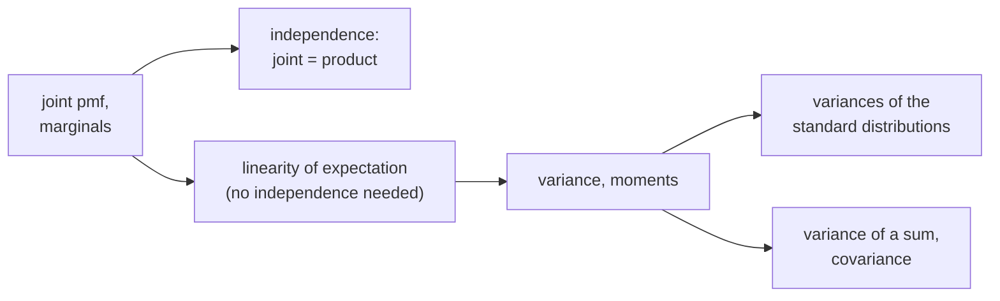

# PR04 · Joint Distributions, Expectation and Variance

◀ [[PR03 Discrete Random Variables and Distributions]] · [[PR05 Continuous Random Variables]] ▶

taught · in syllabus extra · book extra · beyond

> [!syllabus] Syllabus map: what is in the syllabus and what is extra in this chapter
> 🟢 **In syllabus (taught)**: [[ilovepdf_merged-1.pdf#page=23|class notes 2 Sep]] (pp.23–26), [[ilovepdf_merged-1.pdf#page=27|9 Sep]] (p.27) and the sheets of [[Practice problems 4th September 2026.pdf|4 Sep]], [[Practice problems weekend of 12th September 2026.pdf|11–12 Sep]] and [[Practice problems 17th September and following tutorial and weekend.pdf|17 Sep]].
> - §1 joint pmf, marginals, independence of two or more random variables
> - §2 **linearity of expectation** (proved for discrete variables) and its applications (binomial, negative binomial, hypergeometric, distinct coupons)
> - §3 raw and central **moments**, **variance** $\mathrm{Var}[X]=E[X^2]-E[X]^2$, $\mathrm{Var}[aX+b]=a^2\mathrm{Var}[X]$, standard deviation
> - §4 the **variances** of the binomial, Poisson, geometric and negative binomial computed directly (sheet 11–12 Sep)
> - §5 functions of a discrete random variable (pmf and cdf of $g(X)$)
>
> 🟡 **Extra · book**
> - §6 variance of a sum of independent variables and covariance (the instructor says (1.1) is not proved in this course; a proof is given here for completeness)
>
> 🔵 **Extra · beyond** (my additions, labelled)
> - §2 expected number of fixed points of a random permutation and of distinct coupon types by indicators; §6 the correlation of (sum, max) of two dice; Monte Carlo checks of every variance (`scripts/pr_numbers.py`)

> [!key] After this chapter you can
> - build a **joint pmf**, read the marginals from its row and column sums, and test **independence** cell by cell,
> - use **linearity of expectation** (no independence needed) to get means by writing a count as a sum of indicators,
> - compute $\mathrm{Var}[X]$ from $E[X^2]-(E[X])^2$ and use $E[X(X-1)]$ to get the variances of the standard distributions,
> - find the pmf and cdf of $Y=g(X)$ and standardise $Y=(X-\mu)/\sigma$.

> [!intuition] The one-sentence story
> A joint pmf is a table whose row and column sums are the individual pmfs; the expected value ignores the table's dependence structure (linearity), while the **variance** measures spread, and for a sum of dependent variables it picks up covariance terms.

<!-- intuition-v1 -->

*Concept map: how the ideas of this chapter depend on each other (read left to right; every box is a section).*

## 1. Joint pmfs and independence
taught *2 Sep ([[ilovepdf_merged-1.pdf#page=23|pp.23–24]])*

For discrete rvs $X_1,X_2$ **on the same sample space**, taking values $a_i$ and $b_j$, the **joint pmf** is
$$p(a_i,b_j)=P[X_1=a_i,\,X_2=b_j]=P\big[\{X_1=a_i\}\cap\{X_2=b_j\}\big].$$
The **marginals** come from the third axiom (the events $\{X_2=b_j\}$ partition the space):
$$P[X_1=a_i]=\sum_jp(a_i,b_j),\qquad P[X_2=b_j]=\sum_ip(a_i,b_j).$$

> [!example] Sum and maximum of two dice (2 Sep)
> Roll two distinguishable fair dice; $X_1$ = sum ($2,\dots,12$), $X_2$ = maximum ($1,\dots,6$). Necessarily $X_1>X_2$ when the dice are different or $X_1=2X_2$ when they agree. For instance
> $$P[X_1=7,X_2=5]=P[\{(2,5),(5,2)\}]=\tfrac2{36}=\tfrac1{18}.$$
> The whole table (in 36ths) is Figure PR4.1 A: each cell is $1$ (a double, e.g. $(4,4)$) or $2$ (a pair of orders). Row sums give the pmf of the maximum, column sums that of the sum.

![[fig_pr04_joint.png]]
*Figure PR4.1. A: the joint pmf of (sum, max) of two dice in 36ths. B: the marginal pmf of the sum (mean 7, variance $35/6$). C: the expected number of draws to complete $N$ coupon types, $E[T]=NH_N$, against $N(\ln N+\gamma)$.*

> [!key] Independence of random variables (2 Sep)
> $X_1,X_2$ are **independent** if
> $$P[X_1\le x_1,\,X_2\le x_2]=P[X_1\le x_1]\,P[X_2\le x_2]\quad\text{for all }x_1,x_2\in\mathbb R.$$
> For discrete variables this is equivalent to $p(a_i,b_j)=P[X_1=a_i]P[X_2=b_j]$ for **all** $i,j$. For a finite family, independence means the product rule for every sub-family (as for events, PR02 §4).

- Two tosses that do not influence each other give independent indicators $X_i=\mathbf 1\{\text{head on toss }i\}$.
- The sum and the maximum of two dice are **not** independent: $P[X_1=7,X_2=5]=\tfrac1{18}$ but $P[X_1=7]\,P[X_2=5]=\tfrac6{36}\cdot\tfrac9{36}=\tfrac3{72}=\tfrac1{24}$. (A single failing cell is enough.)
- If $X_1,\dots,X_n$ are independent Bernoulli$(p)$ then $\sum_iX_i\sim$ Binomial$(n,p)$ (the pmf follows from counting, PR03 §3).

## 2. Linearity of expectation
taught *2 Sep ([[ilovepdf_merged-1.pdf#page=25|pp.25–26]])*

> [!intuition] The indicator trick
> Write a count as a sum of 0/1 indicators; $E[\text{count}]=\sum P(\text{each})$, whatever the dependence. A hat-check problem with $n$ people has $E[\text{matches}]=1$ for every $n$.

> [!key] Linearity
> For any random variables $X_1,X_2$ on the same sample space (discrete or not, **dependent or not**),
> $$E[X_1+X_2]=E[X_1]+E[X_2],\qquad\text{hence}\quad E\Big[\sum_{i=1}^na_iX_i+b\Big]=\sum_ia_iE[X_i]+b .$$

> [!derivation] Proof for discrete variables (class notes)
> With joint pmf $p$,
> $$E[X_1+X_2]=\sum_i\sum_j(a_i+b_j)p(a_i,b_j)=\sum_ia_i\underbrace{\sum_jp(a_i,b_j)}_{=P[X_1=a_i]}+\sum_jb_j\underbrace{\sum_ip(a_i,b_j)}_{=P[X_2=b_j]}=E[X_1]+E[X_2],$$
> where the order of the (absolutely convergent) sums was interchanged and the marginals were recognised. No independence was used.

> [!key] Counting by indicators
> To find the mean of a count $X$, write $X=\sum_i\mathbf 1_{A_i}$ and add the probabilities: $E[X]=\sum_iP[A_i]$. The events $A_i$ may be dependent.

> [!example] Means the easy way
> - **Binomial:** $X=\sum_{i=1}^n\mathbf 1\{\text{success on trial }i\}$, $E[X]=np$.
> - **Negative binomial:** $Y=X_1+\dots+X_k$ with $X_i\sim$ Geometric$(p)$ (PR03 §4): $E[Y]=k/p$.
> - **Hypergeometric:** $X=\sum_{i=1}^n\mathbf 1\{\text{draw }i\text{ white}\}$; each draw is white with probability $\tfrac w{w+b}$ (exchangeability), so $E[X]=\tfrac{nw}{w+b}$ (28 Aug sheet, problem 4).
> - **Distinct coupon types** (4 Sep class): after $n$ draws from $N$ types, $X_i=\mathbf 1\{\text{type }i\text{ seen}\}$ has $E[X_i]=1-(1-\tfrac1N)^n$, so $E[X]=N\big[1-(1-\tfrac1N)^n\big]$. For $N=10$, $n=20$: $8.784$ types.
> - **Coupon collector** (🔵): $T=T_1+\dots+T_N$, where $T_i$ is the wait for the next *new* type once $i-1$ types are held, Geometric$\big(\tfrac{N-i+1}N\big)$ (mean $\tfrac N{N-i+1}$). Hence $E[T]=N\big(1+\tfrac12+\dots+\tfrac1N\big)=NH_N$: $14.70$ for $N=6$, $29.29$ for $N=10$, $224.96$ for $N=50$ (Figure PR4.1 C; simulation of $N=6$ gives mean $14.68$).
> - **Fixed points** (🔵): for a uniformly random permutation of $n$ items, $X=\sum_i\mathbf 1\{\sigma(i)=i\}$ and $E[X]=n\cdot\tfrac1n=1$ for every $n$, although the indicators are dependent (simulation, $n=10$: $1.004$).
> - **Typos** (4 Sep sheet, problem 5): Fred and George catch each of $n$ typos independently with probabilities $p_1,p_2$; a typo is caught by at least one with probability $1-(1-p_1)(1-p_2)$, so $X\sim$ Bin$\big(n,1-(1-p_1)(1-p_2)\big)$. For $n=100$, $p_1=0.7$, $p_2=0.6$: $X\sim$ Bin$(100,0.88)$, mean $88$, variance $10.56$.

> [!example] Size-biased birth ranks (4 Sep sheet, problem 8)
> A town has 100 families: 30 with one child, 50 with two, 20 with three. **(a)** Pick a family uniformly, then a child of that family uniformly: $P[\text{rank}=1]=0.3\cdot1+0.5\cdot\tfrac12+0.2\cdot\tfrac13=0.6167$, $P[\text{rank}=2]=0.5\cdot\tfrac12+0.2\cdot\tfrac13=0.3167$, $P[\text{rank}=3]=0.2\cdot\tfrac13=0.0667$, $E[\text{rank}]=1.45$. **(b)** Pick a child uniformly out of the $30+100+60=190$ children: $P[1]=\tfrac{100}{190}=0.5263$, $P[2]=\tfrac{70}{190}=0.3684$, $P[3]=\tfrac{20}{190}=0.1053$, $E=1.579$. Larger families are over-represented when children, not families, are sampled (compare the buses of PR03).

## 3. Moments and variance
taught *9 Sep ([[ilovepdf_merged-1.pdf#page=27|p.27]])*

> [!intuition] Variance is the typical squared distance from the mean
> It measures spread in *squared* units; the standard deviation takes the root to get back to the units of $X$. $\mathrm{Var}(X)=E[X^2]-(E[X])^2$ is the shortcut.

> [!key] Definitions
> The **$n$-th (raw) moment** is $E[X^n]=\sum_ix_i^np(x_i)$ ($E[X]$ is the first moment); the **$n$-th central moment** is $E[(X-E[X])^n]$. The **variance** is the second central moment,
> $$\mathrm{Var}[X]=E\big[(X-\mu)^2\big]=E[X^2]-(E[X])^2,\qquad\sigma=\sqrt{\mathrm{Var}[X]}\ (\text{standard deviation}).$$

> [!derivation] The shortcut and the scaling rule
> With $\mu=E[X]$: $E[(X-\mu)^2]=E[X^2-2\mu X+\mu^2]=E[X^2]-2\mu E[X]+\mu^2=E[X^2]-\mu^2$ (linearity, $\mu$ constant).
> For constants $a,b$: $E[aX+b]=a\mu+b$, so $(aX+b)-E[aX+b]=a(X-\mu)$ and $\mathrm{Var}[aX+b]=a^2\mathrm{Var}[X]$. A shift does not change the spread; a scale $a$ multiplies it by $a^2$.

> [!example] A fair die
> $E[X]=\tfrac72$, $E[X^2]=\tfrac{91}6$, $\mathrm{Var}[X]=\tfrac{91}6-\tfrac{49}4=\tfrac{35}{12}=2.917$. For the sum of two independent dice, $\mathrm{Var}=2\cdot\tfrac{35}{12}=\tfrac{35}6=5.833$ (recomputed from the 36-point space), and $\mathrm{Var}[2X+3]=4\cdot\tfrac{35}{12}=11.67$.

> [!pitfall] $\mathrm{Var}[X+Y]\ne\mathrm{Var}[X]+\mathrm{Var}[Y]$ in general
> It holds when $X,Y$ are independent (§6). For a dependent pair such as (sum, max) a **covariance** term must be added: $\mathrm{Var}[S+M]=\mathrm{Var}[S]+\mathrm{Var}[M]+2\,\mathrm{Cov}(S,M)$, with $\mathrm{Cov}=\tfrac{35}{12}$ here (§6).

> [!key] Standardisation (11–12 Sep sheet, problem 9)
> If $E[X]=\mu$ and $\mathrm{Var}[X]=\sigma^2$, then $Y=\dfrac{X-\mu}\sigma$ has $E[Y]=0$, $\mathrm{Var}[Y]=1$. For discrete $X$: $P[Y=y]=p(\mu+\sigma y)$ and $F_Y(y)=F_X(\mu+\sigma y)$.

## 4. Variances of the standard distributions
taught *tutorial and sheet 11–12 Sep, problems 2–6 (computed from the pmf, since the sum rule is not proved in class)*

The trick: compute $E[X(X-1)]$ (the second **factorial moment**) because $x(x-1)$ cancels against $x!$; then $E[X^2]=E[X(X-1)]+E[X]$.

> [!derivation] Binomial$(n,p)$, $q=1-p$
> $E[X(X-1)]=\sum_{k\ge2}k(k-1)\binom nkp^kq^{n-k}=n(n-1)p^2\sum_{k\ge2}\binom{n-2}{k-2}p^{k-2}q^{n-k}=n(n-1)p^2$, using $k(k-1)\binom nk=n(n-1)\binom{n-2}{k-2}$. Hence $E[X^2]=n(n-1)p^2+np$ and
> $$\mathrm{Var}[X]=n(n-1)p^2+np-n^2p^2=np(1-p).$$

> [!derivation] Poisson$(\lambda)$
> $E[X(X-1)]=\sum_{k\ge2}k(k-1)e^{-\lambda}\dfrac{\lambda^k}{k!}=\lambda^2e^{-\lambda}\sum_{k\ge2}\dfrac{\lambda^{k-2}}{(k-2)!}=\lambda^2$. So $E[X^2]=\lambda^2+\lambda$ and $\mathrm{Var}[X]=\lambda$: **mean = variance**.
> **Recursion** (sheet problem 6): $E[X^n]=\sum_{k\ge1}k^ne^{-\lambda}\tfrac{\lambda^k}{k!}=\lambda\sum_{k\ge1}k^{n-1}e^{-\lambda}\tfrac{\lambda^{k-1}}{(k-1)!}=\lambda E[(X+1)^{n-1}]$. Hence $E[X^2]=\lambda(E[X]+1)=\lambda^2+\lambda$ and
> $$E[X^3]=\lambda E[(X+1)^2]=\lambda\big(E[X^2]+2E[X]+1\big)=\lambda^3+3\lambda^2+\lambda .$$
> For $\lambda=2$: $E[X^3]=22$ (series check: $22.000$).

> [!derivation] Geometric$(p)$
> $E[X(X-1)]=\sum_{n\ge2}n(n-1)q^{n-1}p=pq\dfrac{d^2}{dq^2}\sum_{n\ge0}q^n=pq\cdot\dfrac2{(1-q)^3}=\dfrac{2q}{p^2}$, so $E[X^2]=\dfrac{2q}{p^2}+\dfrac1p$ and
> $$\mathrm{Var}[X]=\frac{2q}{p^2}+\frac1p-\frac1{p^2}=\frac{q}{p^2}=\frac{1-p}{p^2}.$$
> For $p=0.25$: $12$.

> [!derivation] Negative binomial$(r,p)$ (trials to the $r$-th success)
> Use $n\binom{n-1}{r-1}=r\binom nr$. Then $E[Y^m]=\sum_{n\ge r}n^m\binom{n-1}{r-1}p^rq^{n-r}=\dfrac rp\sum_{n\ge r}n^{m-1}\binom nrp^{r+1}q^{n-r}=\dfrac rpE[(Z-1)^{m-1}]$ with $Z\sim$ NegBin$(r+1,p)$ (shift $n=z-1$). So $E[Y]=r/p$ and $E[Y^2]=\dfrac rp\big(E[Z]-1\big)=\dfrac rp\Big(\dfrac{r+1}p-1\Big)$, giving
> $$\mathrm{Var}[Y]=\frac{r(r+1)}{p^2}-\frac rp-\frac{r^2}{p^2}=\frac{r(1-p)}{p^2}.$$
> For $r=3$, $p=0.4$: $11.25$ (series check: $11.250$).

> [!example] Summary of variances (checked numerically)
> Bin$(10,0.3)$: $np q=2.1$; Poisson$(3.2)$: $3.2$ (series: $E[X^2]=13.44$, $E[X(X-1)]=10.24=\lambda^2$); Geom$(0.25)$: $12$ ($E[X(X-1)]=24$); NegBin$(3,0.4)$: $11.25$; Bernoulli$(p)$: $p(1-p)$.

## 5. Functions of a discrete random variable
taught *27 Aug notes, deferred to follow the joint distributions; 9 Sep ([[ilovepdf_merged-1.pdf#page=20|pp.20–22]], [[ilovepdf_merged-1.pdf#page=27|p.27]])*

If $Y=g(X)$ with $X$ discrete, then $Y$ is discrete with values $\{g(x_i)\}$ and
$$P[Y=y]=\sum_{i:\,g(x_i)=y}p(x_i),\qquad F_Y(y)=P[g(X)\le y]=\sum_{i:\,g(x_i)\le y}p(x_i).$$
Unless $g$ is one-to-one, several $x_i$ map to the same $y$ and their masses add.

> [!example] A symmetric walk (27 Aug)
> A particle takes $n$ independent steps $\pm1$ on the integers, $+1$ with probability $p$. With $X$ = number of $+1$ steps, $X\sim$ Bin$(n,p)$ and the position is $Y=2X-n$ (a linear, hence one-to-one, function), so $P[Y=2k-n]=\binom nkp^k(1-p)^{n-k}$, $E[Y]=n(2p-1)$, $\mathrm{Var}[Y]=4np(1-p)$. For $n=6$, $p=0.6$: $P[Y=2]=\binom64(0.6)^4(0.4)^2=0.3110$, $E[Y]=1.2$, $\mathrm{Var}=5.76$. (Compare the gambler's ruin of PR02.)

> [!example] A non-injective $g$ (🔵)
> $X$ uniform on $\{-2,-1,0,1,2\}$ and $Y=X^2$: $P[Y=0]=\tfrac15$, $P[Y=1]=\tfrac25$, $P[Y=4]=\tfrac25$; $E[Y]=\tfrac{10}5=2$ (equal to $\sum x^2p(x)$ without forming the pmf of $Y$). Note that $X$ and $Y$ are **not** independent although $E[XY]=0=E[X]E[Y]$.

> [!example] The maximum of five prizes (4 Sep sheet, problem 4)
> 100 boxes with prizes $1,\dots,100$; pick 5 without replacement; $X$ = largest prize. $P[X\le k]=\binom k5/\binom{100}5$ so $P[X=k]=\binom{k-1}4/\binom{100}5$ for $5\le k\le100$ (the maximum is $k$ and the other four are among the $k-1$ smaller). For example $P[X=100]=\tfrac5{100}=0.05$, $P[X=96]=0.0423$ and $E[X]=\tfrac{5\cdot101}6=84.17$.

## 6. Variance of a sum, covariance
extra · book *the sheet remarks that (1.1) "will not be proved in class (and possibly, in this course at all)"; Blitzstein and Hwang Ch. 7*

> [!intuition] Covariance is co-movement
> If $X$ and $Y$ rise together, $\mathrm{Var}(X+Y)$ exceeds the sum of the variances; if one rises when the other falls, it is smaller (diversification). Independent variables have zero covariance (the converse is false).

> [!key] Covariance and the variance of a sum
> $\mathrm{Cov}(X,Y)=E[(X-\mu_X)(Y-\mu_Y)]=E[XY]-E[X]E[Y]$, and
> $$\mathrm{Var}\Big[\sum_iX_i\Big]=\sum_i\mathrm{Var}[X_i]+2\sum_{i<j}\mathrm{Cov}(X_i,X_j).$$
> If $X,Y$ are **independent**, then $E[XY]=E[X]E[Y]$, so $\mathrm{Cov}=0$ and the variance of a sum is the sum of the variances. Zero covariance does **not** imply independence (the $X$, $X^2$ example above).

> [!derivation] Proof of the formula for two variables
> $\mathrm{Var}[X+Y]=E[(X+Y)^2]-(E[X]+E[Y])^2=E[X^2]-E[X]^2+E[Y^2]-E[Y]^2+2\big(E[XY]-E[X]E[Y]\big)$. For independent discrete $X,Y$: $E[XY]=\sum_{i,j}a_ib_jp(a_i)p(b_j)=E[X]E[Y]$.

> [!example] What it buys
> Binomial: $\mathrm{Var}[\sum X_i]=n\,p(1-p)$ with $X_i$ independent Bernoulli. Negative binomial: $r\cdot\tfrac{1-p}{p^2}$ (agrees with §4). Ten dice: $10\cdot\tfrac{35}{12}=29.17$ (simulation $29.16$). Dependent pair 🔵: for (sum, max) of two dice $\mathrm{Cov}=\tfrac{35}{12}=2.917$, $\mathrm{Var}[\text{max}]=1.971$, correlation $\rho=\mathrm{Cov}/\sqrt{\mathrm{Var}[S]\mathrm{Var}[M]}=0.860$.

<!-- interactive:start (generated by scripts/embed_interactive.py; edit the tool in scripts/interactive/tools/, not this block) -->
> [!interactive]+ Interactive: Joint, marginal and conditional distributions
> A scatter of 4000 pairs (X, Y) from a chosen joint law, with the marginal histograms on the axes and the conditional distribution of Y given X in a narrow slice around x₀ (click or slide x₀).
>
> ![[pr_joint.png|720]]
>
> **Try:** Correlated normal ρ = 0.8: slice at x₀ = 1.5: E[Y|X] = ρx₀ = 1.2, conditional s.d. √(1−ρ²) = 0.6. Switch to the disk: E[Y|X] = 0 for every x₀ but the conditional range shrinks to ±√(1−x₀²): dependence without correlation.
>
> [▶ Open the tool in your browser](../Assets/interactive/pr_joint.html) · [absolute link](file:///home/swastik/Documents/notes/Assets/interactive/pr_joint.html) · all tools and coverage: [[Interactive Tools]]

<!-- interactive:end -->

## Map of this chapter
> [!connection] How PR04 connects
> **Builds on:** [[PR03 Discrete Random Variables and Distributions]] (the named pmfs and their means).
> **Leads to:** [[PR05 Continuous Random Variables]] (the same expectation and variance with integrals) → [[PR06 Moments Generating Functions and Limit Theorems]] (the moment generating function packages all moments).
> **Concepts:** [[Joint Distribution]] · [[Marginal Distribution]] · [[Independence of Random Variables]] · [[Linearity of Expectation]] · [[08-Probability/Concepts/Variance|Variance]] · [[Moments of a Random Variable]] · [[Factorial Moments]] · [[Covariance and Correlation]] · [[Standardisation of a Random Variable]] · [[Coupon Collector Problem]] · [[Size-Biased Sampling]]
> **Other subjects:** [[Probability - Course Map]], [[TH06 From Kinetic Theory to Statistical Mechanics]] (variance of the energy, $\Delta E/E\sim1/\sqrt N$), [[QM03 States Operators and Measurement]] (the variance of a measurement outcome is the uncertainty $\Delta A$), [[QM01 From Waves to Probabilities]], [[EE02 Structured Population Models]] (demographic stochasticity: $\mathrm{Var}\propto n$).

## Summary
> [!summary] Cheat-sheet
> - Joint pmf $p(a,b)$; marginals = row/column sums; **independent** iff $p(a,b)=p_X(a)p_Y(b)$ for **all** cells.
> - **Linearity:** $E[\sum a_iX_i+b]=\sum a_iE[X_i]+b$ always. Indicators: $E[\#]=\sum P[A_i]$. $E[g(X)]=\sum g(x)p(x)$.
> - $\mathrm{Var}[X]=E[X^2]-E[X]^2=E[X(X-1)]+E[X]-E[X]^2$; $\mathrm{Var}[aX+b]=a^2\mathrm{Var}[X]$; $\sigma=\sqrt{\mathrm{Var}}$.
> - **Variances:** Bin $npq$; Poisson $\lambda$; Geom $q/p^2$; NegBin $rq/p^2$; Bernoulli $pq$; die $35/12$.
> - Poisson: $E[X^n]=\lambda E[(X+1)^{n-1}]$, $E[X^3]=\lambda^3+3\lambda^2+\lambda$. Coupons: $E[\text{distinct}]=N[1-(1-1/N)^n]$, $E[T]=NH_N$.
> - Independent $\Rightarrow\mathrm{Var}[\sum X_i]=\sum\mathrm{Var}[X_i]$ (🟡); $\mathrm{Cov}=0\not\Rightarrow$ independent. Standardise $Y=(X-\mu)/\sigma$.

## Practice
1. **Joint table.** Two fair dice; $X$ = smaller, $Y$ = larger. Find $P[X=2,Y=5]$, $P[X=Y]$ and the marginal pmf of $X$ at $x=1$ and $x=6$.
2. **Independence.** The joint pmf of $(X,Y)$ is $p(0,0)=0.3$, $p(0,1)=0.2$, $p(1,0)=0.3$, $p(1,1)=0.2$. Are $X,Y$ independent? Change the table so that they are not.
3. **Indicators.** A bag has 4 red and 6 blue balls; 5 are drawn without replacement. Find the mean number of red balls in the sample. Separately, if all 10 balls are drawn in a random order, find the mean number of red balls that appear **before the first blue** ball.
4. **Matching.** At a party $n$ guests leave and coats are returned at random. Find the expected number of guests who get their own coat. Find the expected number of **pairs** of guests who swap coats (an exact 2-cycle); hint: $\binom n2$ pairs.
5. **Variance by definition.** $X$ has pmf $p(1)=0.5$, $p(2)=0.3$, $p(5)=0.2$. Find $E[X]$, $\mathrm{Var}[X]$, and $\mathrm{Var}[4-3X]$.
6. **Binomial variance.** Compute $\mathrm{Var}[X]$ for Bin$(12,0.25)$ by $E[X(X-1)]$ and check with $npq$. Find the standard deviation.
7. **Geometric.** For Geom$(0.2)$ find the mean, variance and $P[X>5]$.
8. **Poisson moments.** $X\sim$ Poisson$(4)$. Find $E[X^2]$, $E[X^3]$, and $E[X(X-1)(X-2)]$.
9. **A transformation.** $X$ is uniform on $\{-1,0,1,2\}$. Find the pmf, mean and variance of $Y=X^2$ and of $Z=|X-1|$.
10. **Coupons.** There are 8 equally likely coupon types. Find the expected number of draws to complete the set, the expected number of distinct types after 12 draws, and the expected number of draws needed to obtain 5 distinct types.

> [!example]- Solutions
> 1. Ordered pair $(2,5)$ or $(5,2)$: $P[X=2,Y=5]=\tfrac2{36}=\tfrac1{18}$. $P[X=Y]=\tfrac6{36}=\tfrac16$. $P[X=1]=\tfrac{11}{36}$, $P[X=6]=\tfrac1{36}$.
> 2. Marginals: $P[X=0]=0.5$, $P[X=1]=0.5$; $P[Y=0]=0.6$, $P[Y=1]=0.4$; every cell equals the product ($0.5\cdot0.6=0.3$, $0.5\cdot0.4=0.2$): independent. For dependence take $p(0,0)=0.4$, $p(0,1)=0.1$, $p(1,0)=0.2$, $p(1,1)=0.3$: then $P[X=0]P[Y=0]=0.5\cdot0.6=0.3\ne0.4$.
> 3. Each draw is red w.p. $0.4$: $E=5\cdot0.4=2$. Reds before the first blue: let $I_i$ = "red ball $i$ comes before all 6 blue balls", probability $\tfrac17$ (it is first among that ball and the 6 blues); $E=4\cdot\tfrac17=0.571$.
> 4. $E=n\cdot\tfrac1n=1$. A pair $\{i,j\}$ swaps coats with probability $\tfrac1{n(n-1)}$ ($\sigma(i)=j$ and $\sigma(j)=i$), so $E=\binom n2\tfrac1{n(n-1)}=\tfrac12$.
> 5. $E[X]=0.5+0.6+1.0=2.1$; $E[X^2]=0.5+1.2+5.0=6.7$; $\mathrm{Var}=6.7-4.41=2.29$; $\mathrm{Var}[4-3X]=9\cdot2.29=20.61$.
> 6. $E[X(X-1)]=12\cdot11\cdot0.25^2=8.25$; $E[X]=3$; $\mathrm{Var}=8.25+3-9=2.25=12\cdot0.25\cdot0.75$; $\sigma=1.5$.
> 7. $E=5$; $\mathrm{Var}=0.8/0.04=20$; $P[X>5]=0.8^5=0.3277$.
> 8. $E[X^2]=\lambda^2+\lambda=20$; $E[X^3]=64+48+4=116$; $E[X(X-1)(X-2)]=\lambda^3=64$.
> 9. $Y\in\{0,1,4\}$: $P[Y=0]=\tfrac14$, $P[Y=1]=\tfrac12$ ($X=\pm1$), $P[Y=4]=\tfrac14$; $E[Y]=\tfrac12+1=1.5$; $E[Y^2]=\tfrac12+4=4.5$; $\mathrm{Var}=4.5-2.25=2.25$. $Z=|X-1|\in\{2,1,0,1\}$: $P[Z=0]=\tfrac14$, $P[Z=1]=\tfrac12$, $P[Z=2]=\tfrac14$; $E[Z]=1$, $\mathrm{Var}[Z]=\tfrac12$.
> 10. $E[T]=8H_8=8\cdot2.7179=21.74$. Distinct after 12 draws: $8\big[1-(7/8)^{12}\big]=8(1-0.2014)=6.39$. To get 5 distinct: $\sum_{i=1}^{5}\tfrac8{8-i+1}=1+\tfrac87+\tfrac86+\tfrac85+\tfrac84=1+1.143+1.333+1.6+2=7.076$.

<!-- zettel:start (generated by scripts/sort_zettel.py; do not edit between the markers) -->
## Zettel notes

> [!abstract]- Zettel notes filed under this chapter (7): the other tool's concept notes from the lectures, unreviewed
> [[zettel/coupon-collector-draw-independence-and-conditioning|Coupon Collector Draw Independence and Conditioning]] · [[zettel/independence-of-random-variables|Independence of Random Variables]] · [[zettel/joint-probability-mass-function|Joint Probability Mass Function]] · [[zettel/linearity-of-expectation|Linearity of Expectation]] · [[zettel/poisson-distribution-moment-recurrence|Poisson Distribution Moment Recurrence]] · [[zettel/standard-deviation|Standard Deviation]] · [[zettel/variance|Variance]]
<!-- zettel:end -->

## Provenance
> [!provenance]- Source map for this chapter
> | Topic | Source | Scope |
> |---|---|---|
> | joint pmf, marginals, independence of rvs, indicators, geometric and negative binomial construction, linearity (proof) | [[ilovepdf_merged-1.pdf#page=23\|class notes 2 Sep, pp.23–26]] | taught |
> | moments, variance, $\mathrm{Var}[aX+b]$, standard deviation | [[ilovepdf_merged-1.pdf#page=27\|class notes 9 Sep, p.27]] | taught |
> | transformations of discrete variables; random walk | class notes 27 Aug ([[ilovepdf_merged-1.pdf#page=21\|pp.21–22]]) | taught |
> | distinct coupons, prizes, typos, birth rank | [[Practice problems 4th September 2026.pdf\|sheet 4 Sep]] | taught |
> | variances of the standard distributions, Poisson recursion, standardisation | [[Practice problems weekend of 12th September 2026.pdf\|sheet 11–12 Sep]] | taught |
> | variance of a sum, covariance | remark on the 11–12 Sep sheet; Blitzstein and Hwang Ch. 7 | extra/book |
> | fixed points, coupon-collector $NH_N$, correlation, Monte Carlo checks | `scripts/pr_numbers.py`, `fig_pr04_joint.py` | extra/beyond |
>
> **Notes.** The class notes say transformations of variables are taught after joint distributions; §5 follows that order. Proofs of $\mathrm{Var}[\sum X_i]=\sum\mathrm{Var}[X_i]$ are not examined (instructor's remark), so the §4 variances are computed from the pmf.

> [!verify] The 11 Sep sheet and the class notes
> The sheet asks for the variance of NegBin$(r,p)$ **without** the sum rule. The derivation in §4 uses only $n\binom{n-1}{r-1}=r\binom nr$.

**References.** Blitzstein, J. K. and Hwang, J. *Introduction to Probability*, Ch. 7 · Ross, S. *A First Course in Probability* (8th ed.), Ch. 4 and 6–7.

## Continued in the vault (added 2026-11-07)
- Multinomial counts built from trial indicators, with their negative covariances: [[PR08 Order Statistics and the Multinomial Distribution]] §4, [[Multinomial Distribution]].
