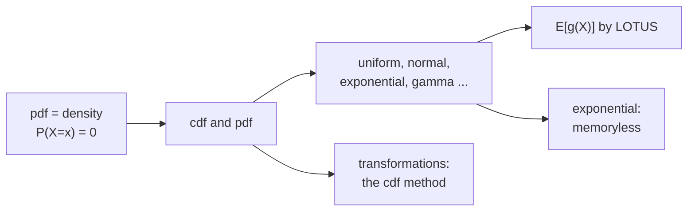

# PR05 · Continuous Random Variables

◀ [[PR04 Joint Distributions Expectation and Variance]] · [[PR06 Moments Generating Functions and Limit Theorems]] ▶

taught · in syllabus extra · book extra · beyond

> [!syllabus] Syllabus map: what is in the syllabus and what is extra in this chapter
> 🟢 **In syllabus (taught)**: [[ilovepdf_merged-1.pdf#page=28|class notes of 10 Sep]] (pp.28–30), the handwritten **post-midterm Week 1** notes ([[week1_mt2113.pdf#page=3|pp.3–9]], with the homework on pp.1–2), the handwritten **post-midterm Week 2** notes ([[Week2_notes.pdf#page=1|pp.1–4]] lecture summary, p.5 with Homework 2: the folded normal, the exponential distribution, its geometric limit and the memoryless characterisation), and sheet problem 11 of [[Practice problems 17th September and following tutorial and weekend.pdf|17 Sep]].
> - §1 continuous random variables, the pdf and its link to the cdf; $P[X=x]=0$
> - §2 uniform, logistic, Rayleigh, standard normal and $N(\mu,\sigma^2)$
> - §3 expectation, **LOTUS** $E[g(X)]=\int g\,f$ with the proof for $g\ge0$, variance, linearity
> - §4 the worked computations (uniform, logistic, Rayleigh, normal) and the **week-1 homework** (Rayleigh quartiles, random circle, broken stick, $E[\max(Z-c,0)]$, inflection points of the normal pdf, LOTUS for any $g$)
> - §4 **week 2 homework** (repair time, the Gumbel limit of a maximum, $E[F(X)]=\tfrac12$)
> - §5 the cdf method for $Y=g(X)$, including the **folded normal** $|Z|$ (Week 2)
> - §6 the **exponential distribution**: pdf, cdf, moments by the recursion $I_n=\tfrac n\lambda I_{n-1}$, the limit of the geometric distribution, the memoryless property and its characterisation theorem with proof (Week 2)
> - Practice 13–15 are the three questions of **Quiz 1** (16 Sep 2026, 20 minutes; [[quiz(somenumber).jpeg]]), added 2026-10-29: the mean of $xe^{-x}$, a normal interval probability, and the normalising constant of the **Maxwell speed density**
>
> 🟡 **Extra · book**
> - the Gaussian tail (Blitzstein and Hwang Ch. 5; Ross Ch. 5)
>
> 🔵 **Extra · beyond** (my additions, labelled)
> - §2 the 68–95–99.7 values; §5 the $\chi^2_1$ density of $Z^2$; §6 the Rayleigh–exponential link, the degenerate cases of the theorem, the Gumbel mean and variance, the uniform as a non-memoryless counter-example; every integral rechecked numerically (`scripts/pr_numbers.py`)

> [!key] After this chapter you can
> - pass between **cdf and pdf** ($f=F'$, $F=\int f$), normalise a density, and compute $P[a<X<b]$,
> - compute $E[X]$, $E[g(X)]$ and $\mathrm{Var}[X]$ by integration and by the shortcut $E[X^2]-E[X]^2$,
> - show $\int e^{-x^2/2}\,\mathrm dx=\sqrt{2\pi}$ and derive the mean and variance of $N(0,1)$ and $N(\mu,\sigma^2)$,
> - find the distribution of $Y=g(X)$ by the **cdf method**, and use LOTUS to avoid it when only moments are needed.

> [!intuition] The one-sentence story
> A pmf puts mass on points; a pdf spreads mass over a line, so single points get zero probability and intervals get areas; every sum from the discrete chapters becomes an integral and every formula carries over.

<!-- intuition-v1 -->

*Concept map: how the ideas of this chapter depend on each other (read left to right; every box is a section).*

![[fig_pr05_continuous.png]]
*Figure PR5.1. A: the Rayleigh cdf and pdf, with the quartiles $0.759$, $1.177$, $1.665$ and the shaded area $P[1<X<3]=0.595$. B: the standard normal, with the probabilities within $\pm1$, $\pm2$, $\pm3$ and the inflection points $\pm1$. C: the layer-cake identity $E[Y]=\int_0^\infty P[Y>y]\,\mathrm dy$ for $Y=X^2$, $X\sim U(0,1)$ (area $\tfrac13$).*

## 1. Continuous random variables, the pdf
taught *10 Sep ([[ilovepdf_merged-1.pdf#page=28|pp.28–30]]); week 1, p.3 ([[week1_mt2113.pdf#page=3|handwritten]])*

> [!intuition] Density, not probability
> $f(x)\,dx$ is the probability of being in a tiny interval; a single point has probability 0. The pdf can exceed 1 (a narrow spike) as long as its area is 1.

A random variable $X$ is **continuous** if its cdf $F(x)=P[X\le x]$ is (absolutely) continuous; equivalently there is a function $f\ge0$ with
$$P[X\in B]=\int_Bf(x)\,\mathrm dx\quad\text{for every reasonable }B\subset\mathbb R,\qquad\int_{-\infty}^\infty f(x)\,\mathrm dx=1 .$$
$f$ is the **probability density function** (pdf). It must be non-negative, integrate to 1, and (week-1 notes) be continuous except at finitely many points.

> [!key] Consequences
> - **No mass at a point:** $P[X=x]=\int_x^xf=0$ (equivalently $F(x)-F(x^-)=0$ since $F$ is continuous). Hence $P[a<X<b]=P[a\le X<b]=P[a<X\le b]=P[a\le X\le b]=\int_a^bf$.
> - **Density meaning:** for small $\varepsilon$, $P[x-\varepsilon<X<x+\varepsilon]\approx f(x)\cdot2\varepsilon$: mass = density × length. So $f(x)$ itself is not a probability and may exceed 1.
> - **cdf and pdf:** $F(x)=\int_{-\infty}^xf(y)\,\mathrm dy$ and $F'(x)=f(x)$ wherever $f$ is continuous.
> - The **cdf is more fundamental**: it exists for every random variable. To find a distribution, find $F$ first and differentiate.

> [!pitfall] A density can be larger than 1
> $X\sim U(0,\tfrac12)$ has $f=2$ on $(0,\tfrac12)$. Only the integral is bounded by 1.

> [!example] A polynomial density (17 Sep sheet, problem 11)
> $f(x)=c(1-x^2)$ on $(-1,1)$, 0 elsewhere. Normalise: $c\int_{-1}^1(1-x^2)\mathrm dx=c\cdot\tfrac43=1$, so $c=\tfrac34$. The cdf is $F(x)=0$ for $x\le-1$; $F(x)=\tfrac34\big(x-\tfrac{x^3}3+\tfrac23\big)=\tfrac12+\tfrac34x-\tfrac14x^3$ for $-1<x<1$; $F(x)=1$ for $x\ge1$. Check: $F(0)=\tfrac12$ (symmetry), $F(1)=\tfrac12+\tfrac34-\tfrac14=1$.

## 2. The distributions of the course
taught *week 1 (post midterm), [[week1_mt2113.pdf#page=3|pp.3–4]] and [[week1_mt2113.pdf#page=8|p.8]]*

> [!key] Uniform $U(a,b)$
> $f(x)=\dfrac1{b-a}$ on $[a,b]$, 0 outside; $F(x)=\dfrac{x-a}{b-a}$ on $[a,b]$. For $B\subset[a,b]$, $P[X\in B]=\dfrac{|B|}{b-a}$: probability is proportional to length.

> [!key] Logistic
> $f(x)=\dfrac{e^x}{(1+e^x)^2}$, $x\in\mathbb R$. It is non-negative and continuous. Substituting $u=1+e^x$ (so $\mathrm du=e^x\mathrm dx$): $\int\!f=\int_1^\infty\dfrac{\mathrm du}{u^2}=1$. The cdf is $F(x)=\int_{-\infty}^x\dfrac{e^t\,\mathrm dt}{(1+e^t)^2}=1-\dfrac1{1+e^x}=\dfrac{e^x}{1+e^x}$.

> [!key] Rayleigh
> $f(x)=xe^{-x^2/2}$ for $x\ge0$, $0$ for $x<0$; $F(x)=1-e^{-x^2/2}$ for $x\ge0$, $0$ for $x<0$ (and $\lim_{x\to\infty}F=1$, so $f$ is a density).

> [!key] Standard normal $N(0,1)$ and the Gaussian
> $\varphi(z)=\dfrac{e^{-z^2/2}}{\sqrt{2\pi}}$, $z\in\mathbb R$ (the bell curve, Figure PR5.1 B). To show $\int\varphi=1$ one needs $I=\int_{-\infty}^\infty e^{-x^2/2}\mathrm dx=\sqrt{2\pi}$.
> $$I^2=\int\!\!\int_{\mathbb R^2}e^{-(x^2+y^2)/2}\mathrm dx\,\mathrm dy=\int_0^{2\pi}\!\!\int_0^\infty e^{-r^2/2}\,r\,\mathrm dr\,\mathrm d\theta=2\pi\Big[-e^{-r^2/2}\Big]_0^\infty=2\pi .$$
> **General Gaussian** $N(\mu,\sigma^2)$ (with $\sigma>0$, $\mu\in\mathbb R$): $X\sim N(\mu,\sigma^2)$ if $Z=\dfrac{X-\mu}\sigma\sim N(0,1)$, i.e. $X=\sigma Z+\mu$, so its pdf is $\dfrac1{\sigma}\varphi\big(\tfrac{x-\mu}\sigma\big)$.

> [!example] Normal probabilities (recomputed)
> $P[|Z|<1]=0.6827$, $P[|Z|<2]=0.9545$, $P[|Z|<3]=0.9973$: the **68–95–99.7 rule**. **Inflection points (week-1 homework Q5).** $\varphi'(z)=-z\varphi(z)$ and $\varphi''(z)=(z^2-1)\varphi(z)$, which changes sign at $z=\pm1$ (the orange dots in Figure PR5.1 B). For $N(\mu,\sigma^2)$ the pdf is $f(x)=\tfrac1\sigma\varphi\big(\tfrac{x-\mu}\sigma\big)$ and $f''(x)=\tfrac1{\sigma^3}\varphi''\big(\tfrac{x-\mu}\sigma\big)$, so the inflection points are $x=\mu\pm\sigma$; $\varphi(1)/\varphi(0)=e^{-1/2}=0.607$.

> [!pitfall] "$\sqrt{2\pi}$" is not "$\sqrt\pi$"
> $\int e^{-x^2}\mathrm dx=\sqrt\pi$ but $\int e^{-x^2/2}\mathrm dx=\sqrt{2\pi}$; the $\tfrac12$ in the exponent is what makes the variance 1. The polar trick above is the same trick as the Gaussian integral of [[Gaussian Integral]] in the foundations.

## 3. Expectation, LOTUS and variance
taught *10 Sep (pp.29–30); week 1, [[week1_mt2113.pdf#page=5|pp.5–9]]*

> [!intuition] LOTUS saves a step
> To get $E[g(X)]$ you do not need the distribution of $g(X)$; just integrate $g(x)f(x)$. It works because averaging after transforming equals transforming, then averaging over the original weights.

> [!key] Definitions
> $$E[X]=\int_{-\infty}^\infty x\,f(x)\,\mathrm dx,\qquad\boxed{E[g(X)]=\int_{-\infty}^\infty g(x)f(x)\,\mathrm dx}\ \text{(LOTUS)},$$
> $$\mathrm{Var}[X]=E[(X-\mu)^2]=\int(x-\mu)^2f=E[X^2]-(E[X])^2,\qquad\mu=E[X].$$
> $E[aX+b]=aE[X]+b$, $\mathrm{Var}[aX+b]=a^2\mathrm{Var}[X]$, and linearity $E[\sum X_i]=\sum E[X_i]$ holds for any random variables, continuous or not.
> LOTUS = **Law of the Unconscious Statistician**: you can compute $E[g(X)]$ from the pdf of $X$ **without finding** the pdf of $g(X)$.

> [!derivation] The lemma $E[Y]=\int_0^\infty P[Y>y]\,\mathrm dy$ for $Y\ge0$ (week 1, p.6)
> $\displaystyle\int_0^\infty P[Y>y]\,\mathrm dy=\int_0^\infty\!\!\int_y^\infty f_Y(t)\,\mathrm dt\,\mathrm dy=\int_0^\infty\!\!\int_0^tf_Y(t)\,\mathrm dy\,\mathrm dt=\int_0^\infty t\,f_Y(t)\,\mathrm dt=E[Y]$, interchanging the order of integration over the region $0<y<t$ (the triangle in the handwritten sketch). (Figure PR5.1 C: for $Y=X^2$, $X\sim U(0,1)$, the area under $1-\sqrt y$ is $\tfrac13=E[X^2]$.)

> [!derivation] Proof of LOTUS for $g\ge0$ (week 1, p.7)
> Let $Y=g(X)\ge0$. By the lemma and since $\{Y>y\}=\{X\in\{x:g(x)>y\}\}$,
> $$E[g(X)]=\int_0^\infty P[X\in\{g>y\}]\,\mathrm dy=\int_0^\infty\!\!\int_{\{x:\,g(x)>y\}}\!f(x)\,\mathrm dx\,\mathrm dy=\int_{\{x:\,g(x)>0\}}f(x)\Big(\int_0^{g(x)}\mathrm dy\Big)\mathrm dx=\int_{\mathbb R}g(x)f(x)\,\mathrm dx .$$
> The last equality holds because $g(x)f(x)=0$ where $g=0$. The general case ($g$ of either sign) is an optional homework (split $g=g^+-g^-$).

> [!derivation] The variance shortcut by LOTUS (week 1, p.7)
> With $\mu=E[X]$: $\int(x-\mu)^2f=\int x^2f+\mu^2\!\int\!f-2\mu\!\int xf=E[X^2]+\mu^2-2\mu^2=E[X^2]-\mu^2$.

## 4. Worked computations
taught *week 1 (post midterm), [[week1_mt2113.pdf#page=5|pp.5–9]] and the homework*

> [!example] Uniform
> $E[X]=\displaystyle\int_a^b\frac{x\,\mathrm dx}{b-a}=\frac{b^2-a^2}{2(b-a)}=\frac{a+b}2$. $E[X^2]=\dfrac{b^3-a^3}{3(b-a)}=\dfrac{a^2+ab+b^2}3$, so $\mathrm{Var}[X]=\dfrac{a^2+ab+b^2}3-\dfrac{(a+b)^2}4=\dfrac{(b-a)^2}{12}$. For $U(0,1)$: mean $\tfrac12$, variance $\tfrac1{12}=0.0833$.

> [!example] Logistic
> $E[X]=\int_{-\infty}^\infty\dfrac{xe^x\,\mathrm dx}{(1+e^x)^2}=\int\dfrac{x\,\mathrm dx}{(e^{x/2}+e^{-x/2})^2}=0$, because the integrand is **odd** (the density is symmetric about 0). 🔵 The variance is $\pi^2/3=3.290$ (numerical integral and a simulation of $10^6$ draws: $3.292$).

> [!example] Rayleigh mean and variance
> $E[X]=\displaystyle\int_0^\infty x^2e^{-x^2/2}\mathrm dx$. Integrate by parts with $u=x$, $\mathrm dv=xe^{-x^2/2}\mathrm dx$ ($v=-e^{-x^2/2}$): $=\big[-xe^{-x^2/2}\big]_0^\infty+\int_0^\infty e^{-x^2/2}\mathrm dx=\tfrac12I=\sqrt{\pi/2}=1.2533$ (the even integrand gives half of $I=\sqrt{2\pi}$). $E[X^2]=\int_0^\infty x^3e^{-x^2/2}\mathrm dx=2$ (substitute $t=x^2/2$), so $\mathrm{Var}[X]=2-\tfrac\pi2=0.4292$.

> [!example] The normal mean and variance
> $E[Z]=\int z\varphi(z)\mathrm dz=0$ (odd integrand). By LOTUS, $E[Z^2]=\int z^2\varphi=\dfrac2{\sqrt{2\pi}}\int_0^\infty z^2e^{-z^2/2}\mathrm dz=\dfrac2{\sqrt{2\pi}}\cdot\dfrac{\sqrt{2\pi}}2=1$, using the Rayleigh computation above ($\int_0^\infty x^2e^{-x^2/2}=\tfrac12I$). So $\mathrm{Var}[Z]=1$. For $X=\sigma Z+\mu$: $E[X]=\sigma E[Z]+\mu=\mu$ and $\mathrm{Var}[X]=\sigma^2\mathrm{Var}[Z]=\sigma^2$; the standard deviation is $\sigma$.

### Homework, week 1

> [!example] Q1 Rayleigh quartiles
> **(a)** $P[1<X<3]=F(3)-F(1)=e^{-1/2}-e^{-9/2}=0.6065-0.0111=0.5954$. **(b)** $q_i$ solves $F(q_i)=\tfrac i4$: $1-e^{-q^2/2}=\tfrac i4\Rightarrow q_i=\sqrt{-2\ln(1-\tfrac i4)}$, i.e. $q_1=0.7585$, $q_2$ (median) $=\sqrt{2\ln2}=1.1774$, $q_3=1.6651$ (Figure PR5.1 A).

> [!example] Q2 A random circle
> $R\sim U(0,1)$ is the radius, $A=\pi R^2$ the area. **(a) Without the cdf (LOTUS):** $E[A]=\int_0^1\pi r^2\mathrm dr=\dfrac\pi3=1.0472$, $E[A^2]=\int_0^1\pi^2r^4\mathrm dr=\dfrac{\pi^2}5$, $\mathrm{Var}[A]=\dfrac{\pi^2}5-\dfrac{\pi^2}9=\dfrac{4\pi^2}{45}=0.8773$. **(b) cdf and pdf:** for $0\le a\le\pi$, $F_A(a)=P[\pi R^2\le a]=P\big[R\le\sqrt{a/\pi}\big]=\sqrt{a/\pi}$, so $f_A(a)=\dfrac1{2\sqrt{\pi a}}$ on $(0,\pi)$ (a Monte Carlo of $10^6$ circles gives mean $1.0475$ and variance $0.8776$). Check: $\int_0^\pi a\cdot\frac{\mathrm da}{2\sqrt{\pi a}}=\pi/3$ ✓.

> [!example] Q3 The broken stick
> A stick of length 1 is split at a uniform point $U$; $p\in[0,1]$ is a fixed point; $X$ = length of the part containing $p$. If $U>p$ the left piece $[0,U]$ contains $p$ and $X=U$; if $U<p$ the right piece $[U,1]$ contains it and $X=1-U$. Hence
> $$E[X]=\int_p^1u\,\mathrm du+\int_0^p(1-u)\,\mathrm du=\frac{1-p^2}2+p-\frac{p^2}2=\frac12+p-p^2 .$$
> Maximising: $\tfrac{\mathrm d}{\mathrm dp}=1-2p=0\Rightarrow p=\tfrac12$ and $E[X]=\tfrac34$ (simulation $0.7501$). The stick is longest on average when $p$ is the midpoint; for $p=0$ or $1$, $E[X]=\tfrac12$.

> [!example] Q4 Expected excess of a normal over a threshold
> $Z\sim N(0,1)$, $c\in\mathbb R$: $E[\max\{Z-c,0\}]=\displaystyle\int_c^\infty(z-c)\varphi(z)\,\mathrm dz=\int_c^\infty z\varphi(z)\mathrm dz-c\,[1-\Phi(c)]=\varphi(c)-c\,[1-\Phi(c)]$, because $z\varphi(z)=-\varphi'(z)$. Values: $c=0$: $0.3989$; $c=1$: $0.0833$; $c=2$: $0.0085$; $c=-1$: $1.0833$ (each agrees with a direct numerical integral). This "expected payoff" integral is the building block of option pricing and of expected shortfall.

> [!example] Q6 The tail formula for any sign, and LOTUS for any $g$ (the starred problem)
> **(a)** Write $Y=Y^+-Y^-$ with $Y^\pm\ge0$. For $y>0$, $\{Y^+>y\}=\{Y>y\}$ and $\{Y^->y\}=\{Y<-y\}$, so by the lemma applied to $Y^+$ and $Y^-$,
> $$E[Y]=E[Y^+]-E[Y^-]=\int_0^\infty P[Y>y]\,\mathrm dy-\int_0^\infty P[Y<-y]\,\mathrm dy .$$
> **(b)** For arbitrary $g$ put $g=g^+-g^-$ with $g^\pm\ge0$. LOTUS for non-negative functions gives $E[g^\pm(X)]=\int g^\pm f$, and $g(X)=g^+(X)-g^-(X)$, so $E[g(X)]=\int g^+f-\int g^-f=\int gf$ (when both integrals are finite).

### Homework, week 2
taught *[[Week2_notes.pdf#page=5|handwritten p.5, "HW 2 problems"]]; solutions are mine*

> [!example] Q1 A repair time
> $T\sim\mathrm{Expo}(\lambda)$ hours with $\lambda=\tfrac12$ (mean 2 h). **(a)** $P[T>2]=e^{-\lambda\cdot2}=e^{-1}=0.3679$. **(b)** $P[T\ge10\mid T>9]=\dfrac{e^{-5}}{e^{-4.5}}=e^{-1/2}=0.6065=P[T\ge1]$: by **memorylessness** the nine hours already spent are irrelevant ([[Memoryless Property]]).

> [!example] Q2 The Gumbel distribution and the maximum of exponentials
> **(a)** $Y=-\ln X$ with $X\sim\mathrm{Expo}(1)$: $P[Y\le y]=P[X\ge e^{-y}]=e^{-e^{-y}}$ for all real $y$. This is the **Gumbel** cdf; the density is $e^{-y}e^{-e^{-y}}$ ([[Gumbel Distribution]]).
> **(b)** For i.i.d. $X_i\sim\mathrm{Expo}(1)$, $M_n=\max X_i$: independence gives $P[M_n\le m]=(1-e^{-m})^n$ for $m\ge0$. Put $m=y+\ln n$ (so the event is non-trivial once $n>e^{-y}$):
> $$P[M_n-\ln n\le y]=\Big(1-\frac{e^{-y}}n\Big)^n\ \longrightarrow\ e^{-e^{-y}}\qquad(n\to\infty),$$
> by $(1+a_n/n)^n\to e^a$ when $a_n\to a$ (here $a=-e^{-y}$). So $M_n-\ln n$ converges **in distribution** to the Gumbel law. At $y=0.5$ the values are $0.393,\ 0.485,\ 0.524,\ 0.540,\ 0.5447,\ 0.5452$ for $n=1,2,5,20,200,10^4$ against the limit $0.5452$ (Figure PR5.2 B). 🔵 The Gumbel mean is Euler's $\gamma=0.5772$ and its variance $\pi^2/6=1.6449$ (simulation: $0.5783$ and $1.655$; for the maximum of $200$: $0.5791$ and $1.622$).

> [!example] Q3 The expectation of $F(X)$, with and without LOTUS
> $X$ continuous with cdf $F$. **Without LOTUS:** $U=F(X)$ is uniform on $(0,1)$, because $P[F(X)\le u]=P[X\le F^{-1}(u)]=F(F^{-1}(u))=u$ (the **probability integral transform**); so $E[F(X)]=E[U]=\tfrac12$. **With LOTUS:** $E[F(X)]=\int F(x)f(x)\,\mathrm dx=\int F\,F'\,\mathrm dx=\big[\tfrac12F^2\big]_{-\infty}^{\infty}=\tfrac12$. Checked by simulation for the normal, exponential, Rayleigh and uniform laws ($0.4995$–$0.5000$ with $10^6$ draws); likewise $E[F(X)^2]=\tfrac13$. 🔵 The same transform in reverse, $X=F^{-1}(U)$, generates any distribution from uniform random numbers.

## 5. Transformations: the cdf method
taught *9 Sep ("how to derive the cdf, pmf and expectation of a transformed random variable"); week 1 homework Q2*

> [!intuition] When in doubt, transform the cdf
> $P(g(X)\le y)$ is an event about $X$; compute it, then differentiate. The pdf formula with Jacobians is a shortcut for the monotone case only.

For $Y=g(X)$ with $X$ continuous: **find $F_Y(y)=P[g(X)\le y]$ by rewriting the event in terms of $X$**, then differentiate. If $g$ is strictly increasing and differentiable, $F_Y(y)=F_X(g^{-1}(y))$ and $f_Y(y)=f_X(g^{-1}(y))\big|\tfrac{\mathrm d}{\mathrm dy}g^{-1}(y)\big|$.

> [!example] Three transformations
> - **Linear:** $Y=aX+b$, $a>0$: $F_Y(y)=F_X\big(\tfrac{y-b}a\big)$, $f_Y(y)=\tfrac1af_X\big(\tfrac{y-b}a\big)$; this is how $N(\mu,\sigma^2)$ comes from $N(0,1)$.
> - **Square of a uniform:** $Y=X^2$, $X\sim U(0,1)$: $F_Y(y)=P[X\le\sqrt y]=\sqrt y$, $f_Y=\tfrac1{2\sqrt y}$ on $(0,1)$; $E[Y]=\int_0^1y\cdot\tfrac{\mathrm dy}{2\sqrt y}=\tfrac13$ (the same as by LOTUS).
> - **Square of a normal** (non-monotone): $W=Z^2$: $F_W(w)=P[-\sqrt w\le Z\le\sqrt w]=2\Phi(\sqrt w)-1$, $f_W(w)=\dfrac{e^{-w/2}}{\sqrt{2\pi w}}$ for $w>0$ (the $\chi^2_1$ density); $E[W]=1$, the variance of $Z$.

> [!example] The folded normal $X=|Z|$ (Week 2, [[Week2_notes.pdf#page=1|handwritten p.1]])
> cdf: $P[X\le c]=0$ for $c<0$ and $P[-c\le Z\le c]=F(c)-F(-c)$ for $c\ge0$ ($F=\Phi$). Differentiating and using the symmetry $f(-c)=f(c)$: $f_X(c)=F'(c)+F'(-c)=2f(c)$, i.e.
> $$f_X(c)=\begin{cases}0&c\le0\\\dfrac2{\sqrt{2\pi}}e^{-c^2/2}&c\ge0\end{cases}$$
> $E[X]=\dfrac2{\sqrt{2\pi}}\displaystyle\int_0^\infty xe^{-x^2/2}\mathrm dx=\dfrac2{\sqrt{2\pi}}\int_0^\infty e^{-t}\mathrm dt=\sqrt{\dfrac2\pi}=0.7979$ (substitute $t=x^2/2$). $E[X^2]=E[Z^2]=1$ (LOTUS, $|Z|^2=Z^2$), so $\mathrm{Var}[X]=1-\dfrac2\pi=0.3634$ (simulation of $2\times10^6$: $0.7976$ and $0.3629$). The folded normal **doubles the right half** of the bell (Figure PR5.2 C). Its MGF is in [[PR06 Moments Generating Functions and Limit Theorems]] (homework 3, Q6).

> [!pitfall] Folded versus half-normal
> "Folded normal" usually means $|X|$ for $X\sim N(\mu,\sigma^2)$; the lecture's $|Z|$ is the special case $\mu=0,\sigma=1$, also called the **half-normal** ([[Folded Normal Distribution]]).

> [!pitfall] Check the event, not the formula
> For non-monotone $g$ (like $z^2$) the event $\{g(X)\le y\}$ is a union of intervals; forgetting the second branch halves the density.

## 6. The exponential distribution and memorylessness
taught *Week 2, [[Week2_notes.pdf#page=1|handwritten pp.1–5]]* · extra · beyond *the Rayleigh link, the degenerate cases, the counter-example*

> [!intuition] The exponential has no memory
> $P(X>s+t\mid X>s)=P(X>t)$: if a bulb has lasted $s$ hours its remaining life has the same distribution as a new bulb's. It is the only continuous distribution with this property.

> [!key] Exponential$(\lambda)$, $\lambda>0$
> $$f(x)=\begin{cases}\lambda e^{-\lambda x}&x>0\\0&x\le0\end{cases},\qquad F(x)=1-e^{-\lambda x},\qquad P[X\ge x]=e^{-\lambda x}\quad(x\ge0).$$
> It is a pdf because $\int_0^\infty\lambda e^{-\lambda x}\mathrm dx=\big[-e^{-\lambda x}\big]_0^\infty=1$. **Interpretation:** the **waiting time before the first success** when successes arrive at rate $\lambda$ per unit time (mean waiting time $1/\lambda$).

> [!derivation] Moments by the recursion $I_n=\frac n\lambda I_{n-1}$ (lecture p.2)
> Let $I_n=\int_0^\infty\lambda x^ne^{-\lambda x}\mathrm dx=E[X^n]$. Integrate by parts with $u=x^n$, $\mathrm dv=\lambda e^{-\lambda x}\mathrm dx$ ($v=-e^{-\lambda x}$):
> $$I_n=\big[-x^ne^{-\lambda x}\big]_0^\infty+n\int_0^\infty x^{n-1}e^{-\lambda x}\mathrm dx=0+\frac n\lambda I_{n-1}\ \Longrightarrow\ I_n=\frac n\lambda\cdot\frac{n-1}\lambda\cdots\frac1\lambda\,I_0=\boxed{\frac{n!}{\lambda^n}}\quad(I_0=1).$$
> So $E[X]=\tfrac1\lambda$, $E[X^2]=\tfrac2{\lambda^2}$ and $\mathrm{Var}[X]=\tfrac2{\lambda^2}-\tfrac1{\lambda^2}=\tfrac1{\lambda^2}$. (Checked for $n\le5$ at $\lambda=0.7$ by numerical integration; skewness $2$ and excess kurtosis $6$ for every $\lambda$, [[PR06 Moments Generating Functions and Limit Theorems]].)

> [!derivation] The exponential is the limit of the geometric (lecture pp.2–3)
> Let trials occur at times $h,2h,3h,\dots$ with success probability $p$ each, and $G$ the number of failures before the first success: $P[G=k]=q^kp$ ($q=1-p$). Then
> $$P[G\ge k]=\sum_{i\ge k}q^ip=\frac{pq^k}{1-q}=q^k .$$
> Let $h\to0$ with $k h\to x$ and the **rate** $p/h\to\lambda$ held fixed, i.e. $p=\lambda h$: $P[G\ge k]=(1-\lambda h)^{x/h}\to e^{-\lambda x}$ (with $t=-\lambda h$: $(1+t)^{-\lambda x/t}\to e^{-\lambda x}$). But $P[X\ge x]=1-(1-e^{-\lambda x})=e^{-\lambda x}$ for $X\sim\mathrm{Expo}(\lambda)$: the **same survival function**, so the exponential is the continuous analogue of the geometric distribution. Numbers ($\lambda=\tfrac12$, $x=2$): $0.3164,\ 0.3585,\ 0.3670,\ 0.3678$ for $h=0.5,\ 0.1,\ 0.01,\ 0.001$, limit $e^{-1}=0.3679$ (Figure PR5.2 A).

![[fig_pr05_exp_gumbel.png]]
*Figure PR5.2. A: the geometric survival function $q^k$ at time $x=kh$ for $\lambda=1$ and shrinking $h$ approaches $e^{-\lambda x}$. B: $P[M_n-\ln n\le y]$ for the maximum of $n$ exponentials against the Gumbel cdf. C: $|Z|$ doubles the right half of the normal density, $E|Z|=\sqrt{2/\pi}$.*

### The memoryless property
> [!key] Definition and theorem (lecture pp.3–5)
> A random variable $X$ has the **memoryless property** if $P[X\ge t+s\mid X\ge s]=P[X\ge t]$ for all $s,t\ge0$ (for a discrete $X$, take $s,t$ non-negative integers). **Theorem.** If $X\ge0$ has the memoryless property then $X\sim\mathrm{Geom}(p)$ for some $p$ if $X$ is discrete, and $X\sim\mathrm{Expo}(\lambda)$ for some $\lambda$ if $X$ is continuous.

> [!derivation] Proof, discrete case
> $\{X\ge m+n\}\subset\{X\ge m\}$, so the definition says $P[X\ge m+n]=P[X\ge m]\,P[X\ge n]$. With $a_n=P[X\ge n]$: $a_{m+n}=a_ma_n$, hence $a_n=a_{n-1}a_1=\dots=a_1^{\,n}$. For $\mathrm{Geom}(p)$ (failures counted) $P[X\ge k]=q^k$, so $q=a_1$: $X\sim\mathrm{Geom}(1-a_1)$.

> [!derivation] Proof, continuous case
> Let $G(x)=P[X\ge x]=1-F(x)$; then $G(t+s)=G(t)G(s)$ for $s,t\ge0$. Splitting $\tfrac mn$ into $m$ pieces of size $\tfrac1n$: $G(\tfrac mn)=G(\tfrac1n)^m$. Taking $m=n$: $G(1)=G(\tfrac1n)^n$, so $G(\tfrac1n)=G(1)^{1/n}$ and
> $$G\big(\tfrac mn\big)=G(1)^{m/n}\quad\text{i.e. }G(x)=G(1)^x\text{ for every non-negative rational }x.$$
> For real $x>0$ take rationals $x_n\to x$; since $G$ is continuous (a continuous variable has a continuous cdf) and $a\mapsto a^x$ is continuous, $G(x)=\lim G(x_n)=\lim G(1)^{x_n}=G(1)^x$. Writing $G(1)=e^{-\lambda}$ with $\lambda=-\ln G(1)$ gives $G(x)=e^{-\lambda x}$: $X\sim\mathrm{Expo}(\lambda)$. $\square$

> [!example] Using it, and a counter-example
> Repair time (Q1b): $P[T\ge10\mid T>9]=e^{-1/2}=0.6065$. A **geometric** failures count with $q=0.6$: $P[G\ge5]/P[G\ge2]=0.216=P[G\ge3]$ ✓. **Uniform is not memoryless:** for $U(0,1)$, $P[X\ge0.75\mid X\ge0.25]=\tfrac{0.25}{0.75}=\tfrac13\ne P[X\ge0.5]=\tfrac12$ (an aged component of a uniform lifetime is more likely to fail soon).

> [!pitfall] The degenerate cases the lecture does not mention
> $G(1)$ must lie strictly in $(0,1)$. If $G(1)=0$ then $G(x)=0$ for all $x>0$, so $X=0$ with probability 1 (not continuous); if $G(1)=1$ then $G\equiv1$ and $X=\infty$. Neither is a proper continuous random variable, so the theorem is not affected, but the proof silently assumes it.

> [!pitfall] "No memory" is a modelling statement
> The exponential says an item that has survived $s$ hours is **as good as new**. That is a fair model for the waiting time to a random event (a Poisson process) and a poor one for wear-out failures.

> [!note] Rayleigh link (🔵)
> If $R$ is Rayleigh then $R^2/2\sim\mathrm{Exp}(1)$ (since $P[R^2/2>t]=P[R>\sqrt{2t}]=e^{-t}$): the length of a 2-D Gaussian vector, as in the polar-coordinate derivation of $\int e^{-x^2/2}\mathrm dx=\sqrt{2\pi}$.

## Map of this chapter
> [!connection] How PR05 connects
> **Builds on:** [[PR03 Discrete Random Variables and Distributions]] and [[PR04 Joint Distributions Expectation and Variance]] (the same definitions with integrals; the cdf).
> **Leads to:** [[PR06 Moments Generating Functions and Limit Theorems]] (MGFs, the normal approximation, the central limit theorem). Two continuous variables at once (joint densities, convolution, $|\rho|\le1$): [[PR07 Sums of Independent Variables Covariance and Correlation]].
> **Concepts:** [[Continuous Random Variable]] · [[Probability Density Function]] · [[Uniform Distribution]] · [[Rayleigh Distribution]] · [[Logistic Distribution]] · [[Normal Distribution]] · [[Standard Normal Distribution]] · [[Folded Normal Distribution]] · [[Exponential Distribution]] · [[Memoryless Property]] · [[Gumbel Distribution]] · [[Cdf Method for Transformations]] · [[Law of the Unconscious Statistician]] · [[Cdf Method for Transformations]] · [[Gaussian Integral]] · [[Memoryless Property]]
> **Other subjects:** [[Probability - Course Map]], [[QM01 From Waves to Probabilities]] (the Gaussian wave packet, $|\psi|^2$ as a pdf, $\int|\psi|^2=1$), [[QM04 The Particle in a Box]] (uniform-like densities, $\langle x\rangle$ and $\Delta x$ are integrals of this chapter), [[TH06 From Kinetic Theory to Statistical Mechanics]] (a molecular speed is the length of a 3D Gaussian velocity vector; the 2D analogue of that length is exactly the Rayleigh law), [[Dimensional Analysis]].

## Summary
> [!summary] Cheat-sheet
> - $f\ge0$, $\int f=1$; $P[a<X<b]=\int_a^bf$; $P[X=x]=0$; $F(x)=\int_{-\infty}^xf$, $F'=f$.
> - $E[X]=\int xf$; **LOTUS** $E[g(X)]=\int gf$; $\mathrm{Var}=E[X^2]-E[X]^2$; $\mathrm{Var}[aX+b]=a^2\mathrm{Var}$. Lemma $E[Y]=\int_0^\infty P[Y>y]\mathrm dy$ ($Y\ge0$).
> - $U(a,b)$: $\frac{a+b}2$, $\frac{(b-a)^2}{12}$. Logistic $f=\frac{e^x}{(1+e^x)^2}$, $F=\frac{e^x}{1+e^x}$, mean 0. Rayleigh $F=1-e^{-x^2/2}$, mean $\sqrt{\pi/2}$, var $2-\frac\pi2$. $N(0,1)$: $\int e^{-x^2/2}=\sqrt{2\pi}$ (polar), mean 0, var 1; $N(\mu,\sigma^2)=\sigma Z+\mu$. Exp$(\lambda)$: mean $1/\lambda$, memoryless.
> - **cdf method:** $F_Y(y)=P[g(X)\le y]$, then differentiate. Folded normal $|Z|$: $f=2\varphi$ on $y\ge0$, mean $\sqrt{2/\pi}$, var $1-\frac2\pi$.
> - **Exponential (Week 2):** $f=\lambda e^{-\lambda x}$, $F=1-e^{-\lambda x}$, $E[X^n]=n!/\lambda^n$; limit of Geom ($p=\lambda h$, $(1-\lambda h)^{x/h}\to e^{-\lambda x}$); **memoryless** $P[X\ge t+s\mid X\ge s]=P[X\ge t]$ characterises Geom (discrete) and Expo (continuous); $E[F(X)]=\tfrac12$; $\max$ of $n$ Expo(1) minus $\ln n\to$ Gumbel $e^{-e^{-y}}$.
> - **Numbers:** Rayleigh $P[1<X<3]=0.595$, quartiles $0.759,1.177,1.665$; circle $E[A]=\pi/3$, $\mathrm{Var}=4\pi^2/45$; broken stick $\tfrac12+p-p^2\le\tfrac34$; $c=\tfrac34$ for $c(1-x^2)$.

## Practice
1. **Normalise.** $f(x)=cx^2$ on $[0,2]$. Find $c$, the cdf, $P[X>1]$ and $E[X]$.
2. **From a cdf.** $F(x)=1-e^{-x^2/4}$ for $x\ge0$. Find the pdf, the median and $P[1<X<2]$.
3. **Uniform.** $X\sim U(2,8)$. Find $E[X]$, $\mathrm{Var}[X]$, $P[X>6]$, and the probability that $X$ is within 1 of its mean.
4. **Logistic.** For the logistic distribution find $P[X>1]$ and the median, and show that $f$ is symmetric about 0.
5. **LOTUS.** $X\sim U(0,2)$. Find $E[X^3]$, $E[e^X]$ and $\mathrm{Var}[X^2]$.
6. **Normal.** $X\sim N(10,4)$ (variance 4). Find $P[8<X<12]$, $P[X>14]$, and the value $a$ with $P[|X-10|<a]=0.95$.
7. **cdf method.** $X\sim U(0,1)$ and $Y=-\ln X$. Find the cdf and pdf of $Y$, and its mean.
8. **Square.** $X\sim U(-1,1)$ and $W=X^2$. Find the pdf of $W$ and $E[W]$.
9. **Tail formula.** For the exponential with rate 2 compute $E[X]$ via $\int_0^\infty P[X>y]\mathrm dy$ and $E[X^2]$ by LOTUS. Verify the variance.
10. **Gaussian integral.** Use the polar-coordinate trick to evaluate $\int_{-\infty}^\infty e^{-x^2}\mathrm dx$ and deduce $\int_0^\infty x^2e^{-x^2}\mathrm dx$.
11. **Memoryless.** A component has an exponential lifetime with mean 1000 h. Given that it has survived 1000 h, what is the probability it survives another 200 h? Why would the answer be different for a uniform lifetime on $(0,2000)$?
12. **Folded normal.** For $X=|Z|$ find $P[X\le1]$ and the median of $X$.
13. **Quiz 1, Q1 (5 pts).** The lifetime in hours of an electronic tube has density $f(x)=xe^{-x}$, $x\ge0$. Compute the expected lifetime.
14. **Quiz 1, Q2 (5 pts).** $X$ is normal with mean $\mu=10$ and variance $\sigma^2=36$. Express $P(4<X<16)$ in terms of the standard normal cdf $\Phi$.
15. **Quiz 1, Q3 (3 pts bonus).** The speed of a molecule in a uniform gas at equilibrium has density $f(x)=ax^2e^{-bx^2}$ for $x\ge0$ and $0$ for $x<0$, where $b=m/(2kT)$ ($k$ Boltzmann's constant, $T$ the absolute temperature, $m$ the mass of a molecule). Evaluate $a$ in terms of $b$.

> [!example]- Solutions
> 1. $c\cdot\tfrac83=1\Rightarrow c=\tfrac38$. $F(x)=\tfrac{x^3}8$ on $[0,2]$. $P[X>1]=1-\tfrac18=\tfrac78$. $E[X]=\tfrac38\int_0^2x^3\mathrm dx=\tfrac38\cdot4=\tfrac32$.
> 2. $f(x)=\tfrac x2e^{-x^2/4}$ ($x\ge0$). Median: $e^{-m^2/4}=\tfrac12\Rightarrow m=2\sqrt{\ln2}=1.665$. $P[1<X<2]=e^{-1/4}-e^{-1}=0.7788-0.3679=0.4109$.
> 3. $E=5$; $\mathrm{Var}=\tfrac{36}{12}=3$; $P[X>6]=\tfrac26=\tfrac13$; $P[4<X<6]=\tfrac26=\tfrac13$.
> 4. $F(x)=\tfrac{e^x}{1+e^x}$ so $P[X>1]=1-F(1)=\tfrac1{1+e}=0.2689$; median: $F(m)=\tfrac12\Rightarrow m=0$. $f(-x)=\tfrac{e^{-x}}{(1+e^{-x})^2}=\tfrac{e^{-x}e^{2x}}{(e^x+1)^2}=f(x)$.
> 5. $f=\tfrac12$: $E[X^3]=\tfrac12\int_0^2x^3=2$; $E[e^X]=\tfrac12(e^2-1)=3.195$; $E[X^2]=\tfrac43$, $E[X^4]=\tfrac12\cdot\tfrac{32}5=\tfrac{16}5$; $\mathrm{Var}[X^2]=\tfrac{16}5-\tfrac{16}9=\tfrac{64}{45}=1.422$.
> 6. $\sigma=2$: $P[8<X<12]=P[|Z|<1]=0.6827$; $P[X>14]=P[Z>2]=0.0228$; $a=1.96\sigma=3.92$.
> 7. $F_Y(y)=P[-\ln X\le y]=P[X\ge e^{-y}]=1-e^{-y}$, $y\ge0$: Exp$(1)$, $f_Y=e^{-y}$, $E[Y]=1$.
> 8. $F_W(w)=P[|X|\le\sqrt w]=\sqrt w$ on $(0,1)$, $f_W=\tfrac1{2\sqrt w}$; $E[W]=\tfrac13$ (also $\int x^2\cdot\tfrac12\mathrm dx$ by LOTUS).
> 9. $P[X>y]=e^{-2y}$, so $E[X]=\tfrac12$. $E[X^2]=\int_0^\infty x^2\,2e^{-2x}\mathrm dx=\tfrac{2}{\lambda^2}=\tfrac12$ (integrate by parts twice). $\mathrm{Var}=\tfrac12-\tfrac14=\tfrac14=\tfrac1{\lambda^2}$ ✓.
> 10. $J=\int e^{-x^2}\mathrm dx$; $J^2=\int_0^{2\pi}\!\int_0^\infty e^{-r^2}r\,\mathrm dr\,\mathrm d\theta=2\pi\cdot\tfrac12=\pi$, so $J=\sqrt\pi$. By parts with $u=x$, $\mathrm dv=xe^{-x^2}\mathrm dx$: $\int_0^\infty x^2e^{-x^2}\mathrm dx=\tfrac12\int_0^\infty e^{-x^2}\mathrm dx=\tfrac{\sqrt\pi}4$.
> 11. $\lambda=10^{-3}$: $P[X>1200\mid X>1000]=P[X>200]=e^{-0.2}=0.8187$. For $U(0,2000)$: $P[X>1200\mid X>1000]=\tfrac{800}{1000}=0.8$ but $P[X>200]=0.9$, and the conditional probability changes with the elapsed time (not memoryless).
> 12. $P[X\le1]=2\Phi(1)-1=0.6827$; median $m$: $2\Phi(m)-1=\tfrac12\Rightarrow\Phi(m)=0.75\Rightarrow m=0.6745$ (the upper quartile of $Z$).
> 13. $E[X]=\int_0^\infty x\cdot xe^{-x}\mathrm dx=\int_0^\infty x^2e^{-x}\mathrm dx=\Gamma(3)=2$ hours. (The density is the Gamma$(2,1)$ law: $\int_0^\infty xe^{-x}\mathrm dx=1$, so it is normalised, and $E[X]=\text{shape}/\text{rate}=2$.)
> 14. $\sigma=6$, so $P(4<X<16)=P\big(\tfrac{4-10}6<Z<\tfrac{16-10}6\big)=\Phi(1)-\Phi(-1)=\boxed{2\Phi(1)-1}=0.6827$ (the "one standard deviation" of the 68–95–99.7 rule).
> 15. Normalise: $1=a\int_0^\infty x^2e^{-bx^2}\mathrm dx$. With $u=\sqrt b\,x$, $\int_0^\infty x^2e^{-bx^2}\mathrm dx=b^{-3/2}\int_0^\infty u^2e^{-u^2}\mathrm du=b^{-3/2}\dfrac{\sqrt\pi}4$ (Practice 10), so $\boxed{a=\dfrac{4b^{3/2}}{\sqrt\pi}}=\dfrac4{\sqrt\pi}\Big(\dfrac m{2kT}\Big)^{3/2}$. This is the **Maxwell speed density** ([[Maxwell-Boltzmann Distribution]], [[TH06 From Kinetic Theory to Statistical Mechanics]]). 🔵 Its mean is $\int_0^\infty ax^3e^{-bx^2}\mathrm dx=\dfrac a{2b^2}=\dfrac2{\sqrt{\pi b}}=\sqrt{\dfrac{8kT}{\pi m}}$; numerically $a=2.2568$ and mean $1.1284$ at $b=1$, and the normalisation integral equals $1$ for $b=0.5,1,2$ (`scripts/pr_numbers2.py`).

<!-- zettel:start (generated by scripts/sort_zettel.py; do not edit between the markers) -->
## Zettel notes

> [!abstract]- Zettel notes filed under this chapter (2): the other tool's concept notes from the lectures, unreviewed
> [[zettel/continuous-random-variable|Continuous Random Variable]] · [[zettel/probability-density-function|Probability Density Function]]
<!-- zettel:end -->

## Provenance
> [!provenance]- Source map for this chapter
> | Topic | Source | Scope |
> |---|---|---|
> | continuous rv, pdf, $P[X=x]=0$, cdf–pdf link, expectation, variance, linearity | [[ilovepdf_merged-1.pdf#page=28\|class notes 10 Sep, pp.28–30]] | taught |
> | uniform, logistic, Rayleigh, SND, polar-coordinates proof of $\sqrt{2\pi}$, $N(\mu,\sigma^2)$ | [[week1_mt2113.pdf#page=3\|week 1 post-midterm, handwritten pp.3–9]] | taught |
> | lemma $E[Y]=\int P[Y>y]$, LOTUS proof, variance shortcut | [[week1_mt2113.pdf#page=6\|handwritten pp.6–7]] | taught |
> | homework Q1 (Rayleigh), Q2 (circle), Q3 (stick) | [[week1_mt2113.pdf#page=1\|handwritten p.1]] | taught |
> | homework Q4 ($E\max\{Z-c,0\}$), Q5 (inflection points), Q6 (tail formula and LOTUS for any $g$) | [[week1_mt2113.pdf#page=2\|handwritten p.2]] | taught |
> | $c(1-x^2)$ | [[Practice problems 17th September and following tutorial and weekend.pdf\|sheet 17 Sep, problem 11]] | taught |
> | folded normal, exponential (moments, geometric limit, memoryless theorem and proof) | [[Week2_notes.pdf#page=1\|week 2 post-midterm, handwritten pp.1–4]] | taught |
> | homework 2: repair time, Gumbel, $E[F(X)]$ | [[Week2_notes.pdf#page=5\|handwritten p.5]] (typed problem statements; solutions mine) | taught |
> | the original post of homework 2 (the same three problems; sources of the statements) | [[hw2.png]] (Oct 15, edited Oct 23) | taught |
> | **Quiz 1** (MT2213 as printed on the paper, 16/09/2026): mean of $xe^{-x}$, $P(4<X<16)$, Maxwell constant $a$ | [[quiz(somenumber).jpeg]] (photograph; Practice 13–15, solutions mine) | taught |
> | $\chi^2_1$, payoff integral, Rayleigh–exponential link, Gumbel moments | `scripts/pr_numbers.py`; Blitzstein and Hwang Ch. 5 (not opened) | extra/book, beyond |
>
> **Notes.** The handwritten pages are images (no text layer); I read them page by page. The page numbers above are the PDF page indices: p.1–2 homework, pp.3–4 definitions and examples, p.5 expectations, p.6 LOTUS lemma, p.7 LOTUS proof and variance, p.8 uniform variance and SND, p.9 normal moments. LOTUS for $g$ of either sign is left as homework Q6 (p.2); my solution is in §4.

> [!verify] Week 2 settles the exponential; the $\chi^2$ is still unconfirmed
> The Week 2 notes (added 2026-10-25) teach the exponential distribution, so §6 is now 🟢. The $\chi^2_1$ density of $Z^2$ (§5, a 🔵 extra) still appears in no lecture note. **Week 2 page 5** shows the problem statements typed in a monospaced font and the lecture summary handwritten (Xournal++); authorship of the lecture is not stated and is treated as the instructor's.

**References.** Blitzstein, J. K. and Hwang, J. *Introduction to Probability*, Ch. 5 · Ross, S. *A First Course in Probability* (8th ed.), Ch. 5 · Gauss, C. F. (1809) *Theoria motus corporum coelestium*.
