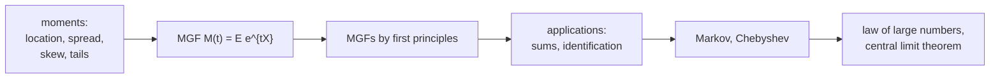

# PR06 · Moments, Generating Functions and Limit Theorems

◀ [[PR05 Continuous Random Variables]] · [[Probability - Course Map]] · [[PR07 Sums of Independent Variables Covariance and Correlation]] ▶

taught · in syllabus extra · book extra · beyond

> [!warning] Scope of this chapter
> **Updated 2026-10-25.** The handwritten **post-midterm Week 3** notes ([[Week3_notes.pdf#page=1|pp.1–5 lecture summary, p.6 Homework 3]]) now cover the **median and mode**, **moments, skewness and kurtosis**, the **MGF** (definition, the exponential-generating-function remark, Taylor coefficients, the affine rule $M_{aX+b}=e^{tb}M_X(at)$) and the MGFs of the **uniform, exponential, standard normal, Bernoulli, binomial and geometric** laws, each derived from the integral or sum. Those parts are 🟢. **Still without a lecture source (🟡):** existence of moments (Cauchy), the Poisson and negative-binomial MGFs, sums of independent variables, uniqueness and continuity, **Markov, Chebyshev, the law of large numbers, the CLT**. The AI-written `probability_moments_and_mgf_notes.pdf` states a **course policy** (MGFs may be used in homework and exams, but the form for a named distribution must first be derived from first principles), which the Week 3 lecture follows. **Ask the instructor** whether the CLT, Chebyshev and the LLN are examinable.

> [!syllabus] Syllabus map: what is in the syllabus and what is extra in this chapter
> 🟢 **Taught (Week 3, [[Week3_notes.pdf#page=1|handwritten notes]])**
> - §1 median (continuous, discrete, the unified definition), mode, raw moments, $E[X^2]=\sigma^2+\mu^2$, skewness, (excess) kurtosis
> - §2 the MGF $M_X(t)=E[e^{tX}]$, the exponential-generating-function remark, $E[X^n]$ as a Taylor coefficient, $M_{aX+b}$
> - §3 first-principles MGFs: uniform, exponential, $N(0,1)$ (and $N(\mu,\sigma^2)$), Bernoulli, binomial, geometric; **Homework 3** (median and mode, Pareto, skewness, the two-dice MGF, the geometric mean and variance by MGF, the folded-normal MGF)
>
> 🟡 **Extra · book** (AI notes `probability_moments_and_mgf_notes.pdf`, checked line by line; Ross Ch. 7–8, Blitzstein and Hwang Ch. 6 and 10)
> - §1 existence of moments, Cauchy; §2 independent sums, uniqueness, continuity (stated); §3 Poisson and negative-binomial MGFs
> - §4 sums of independent Poissons and normals; the Poisson limit; §5 Markov, Chebyshev, the law of large numbers, the CLT and the normal approximation
>
> 🔵 **Extra · beyond** (my additions, all numbers in `scripts/pr_numbers.py`)
> - §1 mean $>$ median $>$ mode for right-skewed laws; §3 the closed form $M_{|Z|}(t)=2e^{t^2/2}\Phi(t)$, the geometric convention link, the checks of two slips in the handwriting; §5 the $1/\sqrt n$ rate of the CLT against the exact Gamma law (leading Edgeworth term $\gamma_1/(6\sqrt{2\pi n})$)

> [!taught] 🟢 §5 is now taught (lecture summaries Weeks 6–7, Classroom 18 Nov 2026; added 2026-11-21)
> [[week6_lectures.pdf|Week 6 lectures summary]] (4 pp.): Cauchy–Schwarz (two proofs) and its use for joint MGFs, Jensen, **Markov, Chebyshev**, the **weak law** (proved by Chebyshev), the **strong law** (stated). [[week7_lectures.pdf|Week 7 lecture summary]] (4 pp.): the **CLT** and its approximation corollary, the MGF-convergence lemma (no proof), a proof of the CLT via $L(t)=\ln M(t)$, and two worked examples ("two examples also, which were not discussed in class, due to lack of time"). Read §5 as 🟢 *taught*; what the lectures add is in **§7** at the end. *No review lecture on 19 Nov; a video review was promised (not yet posted).*

> [!key] After this chapter you can
> - find the **median and mode** of a discrete or continuous law, compute **skewness** and **kurtosis** and say which moments exist,
> - **derive** an MGF from the definition, read off $E[X^k]=M^{(k)}(0)$, and use $M_{aX+b}$ and $M_{\sum X_i}=\prod M_{X_i}$,
> - prove that independent normals (and Poissons) add, and that Binomial$(n,c/n)\to$ Poisson$(c)$, using MGFs,
> - state and apply **Markov, Chebyshev, the law of large numbers and the CLT**, with the continuity correction for the binomial.

> [!intuition] The one-sentence story
> The MGF $E[e^{tX}]$ packs all moments into one function; because $e^{t(X+Y)}=e^{tX}e^{tY}$ it turns sums of independent variables into products, which is why sums of many small independent pieces converge to the normal curve.

<!-- intuition-v1 -->

*Concept map: how the ideas of this chapter depend on each other (read left to right; every box is a section).*

## 1. Median, mode, higher moments, skewness and kurtosis
taught *Week 3, [[Week3_notes.pdf#page=1|pp.1–2]]* · extra · book *AI notes §1.1–1.4 (existence of moments, Cauchy)*

> [!intuition] Four numbers tell the story of a distribution
> Mean = where it sits, variance = how wide, skewness = which way it leans, kurtosis = how heavy the tails are. Two distributions with the same mean and variance can look very different.

> [!key] Median and mode (lecture p.1) ([[Median and Mode]])
> - **Continuous** $X$ with pdf $f$ and cdf $F$: $c$ is a **median** iff $F(c)=\tfrac12$; $c$ is a **mode** iff $f(c)\ge f(x)$ for all $x$ (the pdf has a global maximum at $c$).
> - **Discrete** $X$ with values $x_1<x_2<\cdots$ and $p_i=P[X=x_i]$: there is a first $i$ with $p_1+\dots+p_{i-1}<\tfrac12$ and $p_1+\dots+p_i\ge\tfrac12$. If $p_1+\dots+p_i>\tfrac12$ then $x_i$ is the **unique** median; if $=\tfrac12$ then **every** $c\in[x_i,x_{i+1}]$ is a median (in practice $x_i$ or $\tfrac12(x_i+x_{i+1})$). The **mode** is a value $x_i$ with $p_i\ge p_j$ for all $j$.
> - **Unified definition:** $c$ is a median iff $P[X\le c]\ge\tfrac12$ **and** $P[X\ge c]\ge\tfrac12$ (equivalently $P[X<c]\le\tfrac12$).

> [!verify] The instructor's correction to the discrete median (posted with Homework 3, [[hw3.png]], 22 Oct, edited 24 Oct)
> The board had $P[X\ge c]\le\tfrac12$ **by mistake**; the correct condition is $P[X\le c]\ge\tfrac12$ and $P[X\ge c]\ge\tfrac12$, as in the unified definition above. For values $x_1<\dots<x_n$ with $p_i=P[X=x_i]$ take the first $i$ with $p_1+\dots+p_{i-1}<\tfrac12\le p_1+\dots+p_i$. Then also $p_i+\dots+p_n=1-(p_1+\dots+p_{i-1})>\tfrac12$, so $x_i$ is a median, the **smallest** one (the instructor's "taking the smallest $c$ which works").

> [!example] Examples (checked)
> A **fair die**: $P[X\le3]=\tfrac12=P[X\ge4]$, so every $c\in[3,4]$ is a median; every face is a mode. $U(a,b)$: median $\tfrac{a+b}2$, **every** point of $[a,b]$ is a mode. Expo$(\lambda)$: median $\ln2/\lambda$ ($0.9902$ at $\lambda=0.7$), mode $0$. Pareto$(a)$ (homework 3): median $2^{1/a}$ ($\sqrt2=1.4142$ for $a=2$), mode $1$, mean $a/(a-1)=2$. For these **right-skewed** laws **mean $>$ median $>$ mode** (Expo$(1)$: $1>0.693>0$); for the normal all three coincide ($\mu$).

> [!pitfall] Median and mode need not be unique, and the mode can sit on the boundary
> The uniform has infinitely many modes, the fair die has six and a discrete median can be an interval. The exponential's density is largest as $x\to0^+$; with the lecture's definition ($f(x)=0$ for $x\le0$) the supremum $\lambda$ is not attained, so the usual convention $f(0)=\lambda$ is needed to say "mode $=0$".

Raw moments $E[X^k]$ and central moments $\mu_k=E[(X-\mu)^k]=\sum_{j=0}^k\binom kj(-\mu)^{k-j}E[X^j]$ (binomial expansion, linearity). The standardised third and fourth moments are

> [!key] Shape numbers (lecture p.2: $n$-th moment $E[X^n]$, $E[X^0]=1$, $E[X^1]=\mu$, $E[X^2]=\sigma^2+\mu^2$)
> $$\text{skewness }\gamma_1=\frac{E[(X-\mu)^3]}{\sigma^3},\qquad\text{kurtosis }\alpha_4=\frac{E[(X-\mu)^4]}{\sigma^4},\qquad\text{excess kurtosis }\gamma_2=\alpha_4-3 .$$
> **Convention warning:** the lecture writes $\mathrm{Kurtosis}(X)=E\big[(\tfrac{X-\mu}\sigma)^4\big]-3$, so its "kurtosis" is already the **excess** kurtosis $\gamma_2$ (zero for the normal); some books keep the $3$ ($\alpha_4$).
> $\gamma_1=0$ for any distribution symmetric about its mean (the cube is an odd function); $\gamma_1>0$: long right tail. $\gamma_2=0$ for the normal; $\gamma_2>0$ means heavier tails and a sharper peak than the normal, $\gamma_2<0$ lighter tails.

> [!example] Values (recomputed)
> Exponential$(\lambda)$: $E[X^k]=k!/\lambda^k$, so $\mu_3=\tfrac6{\lambda^3}-3\tfrac1\lambda\tfrac2{\lambda^2}+2\tfrac1{\lambda^3}=\tfrac2{\lambda^3}$, $\gamma_1=2$ for every $\lambda$, $\gamma_2=6$. Normal: $E[Z^4]=3$ (by parts: $\int_0^\infty x^4e^{-x^2/2}=3\int_0^\infty x^2e^{-x^2/2}$), so $\gamma_2=0$; more generally $E[Z^{2k}]=\tfrac{(2k)!}{2^kk!}=1,3,15,105,945,\dots$ Uniform: $\gamma_2=-1.2$. Bernoulli$(\tfrac12)$: $\gamma_2=-2$. Poisson$(3.2)$: $\gamma_1=1/\sqrt\lambda=0.559$, $\gamma_2=1/\lambda=0.3125$.

> [!key] Do the moments exist? (Theorem 1.9 of the AI notes)
> If $E|X|^s<\infty$ then $E|X|^r<\infty$ for $0<r<s$, because $|X|^r\le1+|X|^s$. So existence of a high moment implies existence of all lower ones.

> [!example] The Cauchy distribution has no mean
> $f(x)=\dfrac1{\pi(1+x^2)}$: $E|X|=\dfrac2\pi\displaystyle\int_0^\infty\frac{x\,\mathrm dx}{1+x^2}=\dfrac1\pi\big[\ln(1+x^2)\big]_0^\infty=\infty$. So $E[X]$ is undefined, and so are the variance and the MGF. The running mean of Cauchy samples never settles (Figure PR6.1 B). A Pareto$(x_m,\alpha)$ density has $E[X^k]<\infty$ iff $k<\alpha$; for $\alpha=1.5$ the mean is finite ($3x_m$) and the variance infinite.

![[fig_pr06_limits.png]]
*Figure PR6.1. A: the Binomial$(30,0.3)$ pmf and its normal approximation; $P(X\le10)$ exact $0.7304$, with continuity correction $0.7250$, without $0.6548$. B: running means of 5000 draws (two runs each): the normal mean converges, the Cauchy mean does not.*

## 2. The moment generating function
taught *Week 3, [[Week3_notes.pdf#page=2|pp.2–3]] (definition, EGF remark, Taylor coefficients, affine rule)* · extra · book *AI notes §2.2 (independent sums, uniqueness, continuity)*

> [!intuition] The MGF is all the moments in one function
> Expand $e^{tX}=\sum t^kX^k/k!$: the coefficient of $t^k/k!$ is $E[X^k]$. Derivatives at $t=0$ read the moments off, and the MGF of a sum of independent variables is the *product* of their MGFs.

> [!key] Why "generating function" (lecture p.2)
> $M_X(t)=E[e^{tX}]$ is required to exist on $-\delta<t<\delta$ for some $\delta>0$. It is the **exponential generating function** of the numbers $a_n=E[X^n]$: in combinatorics the EGF of $\{a_n\}_{n\ge0}$ is the formal power series $\sum_{n\ge0}a_n\dfrac{x^n}{n!}$. Hence **$E[X^n]$ is $n!$ times the coefficient of $t^n$** in the Taylor expansion of $M_X(t)$ (the "this is $E(X^n)$" arrows in the lecture), the same statement as $E[X^n]=M_X^{(n)}(0)$ below.

> [!key] Definition and basic theorems
> $$M_X(t)=E\big[e^{tX}\big]=\sum_xe^{tx}p(x)\ \text{ or }\ \int e^{tx}f(x)\,\mathrm dx,$$
> defined for those $t$ where it is finite; "the MGF exists" means it is finite on some interval $(-h,h)$.
> 1. **Moments:** $E[X^k]=M_X^{(k)}(0)$.
> 2. **Linear map:** $M_{aX+b}(t)=e^{bt}M_X(at)$.
> 3. **Independent sum:** $M_{X_1+\dots+X_n}(t)=\prod_iM_{X_i}(t)$.
> 4. **Uniqueness (stated):** if $M_X=M_Y$ on an interval around 0 then $X$ and $Y$ have the same cdf.
> 5. **Continuity (stated):** if $M_{X_n}(t)\to M_X(t)$ for $|t|<h$ then $X_n\to X$ in distribution.

> [!derivation] Proofs of 1–3
> 1. Expand $e^{tX}=\sum_k\tfrac{t^k}{k!}X^k$ and take expectations term by term: $M_X(t)=\sum_k\tfrac{t^k}{k!}E[X^k]$; the coefficient of $t^k/k!$ is $E[X^k]$, so the $k$-th derivative at 0 is $E[X^k]$.
> 2. $E[e^{t(aX+b)}]=e^{bt}E[e^{(at)X}]=e^{bt}M_X(at)$.
> 3. $E[e^{t\sum X_i}]=E[\prod e^{tX_i}]=\prod E[e^{tX_i}]$, since for independent variables the expectation of a product is the product of expectations (PR04 §6).

## 3. First-principles MGFs #quiz/pr-hw4
taught *Week 3, [[Week3_notes.pdf#page=3|pp.3–5]]: uniform, exponential, $N(0,1)$, Bernoulli, binomial, geometric; $N(\mu,\sigma^2)$ via the affine rule* · extra · book *AI notes §2.3 (Poisson, negative binomial). Course policy: derive before use. Every result below was also checked symbolically.*

Write $q=1-p$.

> [!derivation] Bernoulli, binomial
> **Bernoulli$(p)$:** $M(t)=e^{t\cdot0}q+e^{t\cdot1}p=q+pe^t$.
> **Binomial$(n,p)$:** $M(t)=\sum_{k=0}^ne^{tk}\binom nkp^kq^{n-k}=\sum_k\binom nk(pe^t)^kq^{n-k}=(q+pe^t)^n$ (binomial theorem).
> *Moments:* $M'(t)=npe^t(q+pe^t)^{n-1}\Rightarrow E[X]=np$; $M''(0)=n(n-1)p^2+np\Rightarrow\mathrm{Var}=np(1-p)$ (agrees with PR04).

> [!derivation] Poisson$(\lambda)$
> $M(t)=\sum_{k\ge0}e^{tk}e^{-\lambda}\dfrac{\lambda^k}{k!}=e^{-\lambda}\sum_k\dfrac{(\lambda e^t)^k}{k!}=e^{-\lambda}e^{\lambda e^t}=\exp\big(\lambda(e^t-1)\big)$ for all $t$.
> $M'=\lambda e^tM\Rightarrow E[X]=\lambda$; $M''(0)=\lambda^2+\lambda$; $M'''(0)=\lambda^3+3\lambda^2+\lambda$ (matches the recursion of PR04 §4: $E[X^3]=22$ for $\lambda=2$).

> [!derivation] Geometric$(p)$ and negative binomial$(r,p)$ (trials)
> $M(t)=\sum_{n\ge1}e^{tn}q^{n-1}p=pe^t\sum_{n\ge0}(qe^t)^n=\dfrac{pe^t}{1-qe^t}$ for $qe^t<1$, i.e. $t<-\ln q$. Then $M'(0)=\tfrac1p$ and $M''(0)-M'(0)^2=\tfrac{1-p}{p^2}$. Since NegBin$(r,p)$ is a sum of $r$ independent geometrics, $M(t)=\Big(\dfrac{pe^t}{1-qe^t}\Big)^r$, mean $r/p$, variance $r(1-p)/p^2$ (PR04).

> [!derivation] Uniform, exponential
> **Uniform$(a,b)$:** $M(t)=\int_a^b\dfrac{e^{tx}}{b-a}\mathrm dx=\dfrac{e^{tb}-e^{ta}}{t(b-a)}$ ($t\ne0$, $M(0)=1$); for $U(0,1)$, $M(t)=\tfrac{e^t-1}t=\sum_k\tfrac{t^k}{(k+1)!}$ so $E[X^k]=\tfrac1{k+1}$.
> **Exponential$(\lambda)$:** $M(t)=\lambda\int_0^\infty e^{-(\lambda-t)x}\mathrm dx=\dfrac\lambda{\lambda-t}$ for $t<\lambda$; expanding, $\sum_k(t/\lambda)^k$, so $E[X^k]=k!/\lambda^k$.

> [!derivation] Standard normal and $N(\mu,\sigma^2)$
> $M_Z(t)=\dfrac1{\sqrt{2\pi}}\displaystyle\int e^{tx}e^{-x^2/2}\mathrm dx$. Complete the square, $x^2-2tx=(x-t)^2-t^2$:
> $$M_Z(t)=e^{t^2/2}\cdot\frac1{\sqrt{2\pi}}\int e^{-(x-t)^2/2}\mathrm dx=e^{t^2/2},$$
> since the last integral is the total mass of an $N(t,1)$ density. With $X=\mu+\sigma Z$ and the linear-map rule, $M_X(t)=e^{\mu t}M_Z(\sigma t)=\exp\big(\mu t+\tfrac12\sigma^2t^2\big)$. Differentiating gives $E[X]=\mu$, $\mathrm{Var}[X]=\sigma^2$ and $E[(X-\mu)^4]=3\sigma^4$; the series $e^{t^2/2}=\sum_k\tfrac{t^{2k}}{2^kk!}$ gives $E[Z^{2k}]=\tfrac{(2k)!}{2^kk!}$.

> [!pitfall] Existence region
> The exponential MGF exists only for $t<\lambda$, the geometric for $t<-\ln q$, the Cauchy for no $t\neq0$. A formula without its domain is incomplete, and uniqueness needs an interval around 0.

### 3.1 Reading the moments off the Taylor series (Week 3, pp.3–5)
> [!example] The lecture's four expansions, checked
> - **Bernoulli$(p)$:** $M=q+pe^t=1+\sum_{n\ge1}\frac{t^n}{n!}p$, so $E[X^n]=p$ for every $n\ge1$ (since $X^n=X$).
> - **Exponential$(\lambda)$:** $M=\frac\lambda{\lambda-t}=\sum_{n\ge0}\frac{t^n}{\lambda^n}=\sum\frac{t^n}{n!}\cdot\frac{n!}{\lambda^n}$ for $|t|<\lambda$ (the radius $\delta=\lambda$): $E[X^n]=n!/\lambda^n$, matching PR05 §6.
> - **$N(0,1)$:** $M=e^{t^2/2}=\sum_{n}\frac{t^{2n}}{2^nn!}=\sum\frac{t^{2n}}{(2n)!}\cdot\frac{(2n)!}{2^nn!}$: odd moments $0$, $E[Z^{2k}]=\frac{(2k)!}{k!\,2^k}=1,1,3,15,105,945$.
> - **$U(a,b)$:** $M=\dfrac{e^{tb}-e^{ta}}{t(b-a)}=\sum_{m\ge0}\dfrac{t^m}{m!}\cdot\dfrac{b^{m+1}-a^{m+1}}{(m+1)(b-a)}$, so $E[X^m]=\dfrac{b^m+b^{m-1}a+\dots+a^m}{m+1}$.

> [!verify] Two slips in the handwritten Week 3 page (both corrected here)
> **(1) The uniform series (p.3).** The page divides $b^m+b^{m-1}a+\dots+ba^{m-1}+a^m$ by $m$ and marks it "this is $E(X^n)$". The sum has $m+1$ terms and the correct denominator is $m+1$: the page's version is undefined for $m=0$ and gives $a+b$ instead of $\tfrac{a+b}2$ for $m=1$ (symbolic check: the Taylor coefficients of $M$ give $\tfrac{a+b}2,\ \tfrac{a^2+ab+b^2}3,\ \tfrac{(a+b)(a^2+b^2)}4$ for $m=1,2,3$). **(2) The normal MGF (p.5).** The affine-rule example ends with $M_Y(t)=e^{t\mu}e^{-(\sigma t)^2/2}=e^{t\mu-\sigma^2t^2/2}$ for $Y=\sigma X+\mu$; the exponent must be **$+\sigma^2t^2/2$** (as the page itself found for $N(0,1)$, $e^{+t^2/2}$). For $\mu=1,\sigma=2,t=0.3$: numerical integral $1.61607=e^{\mu t+\sigma^2t^2/2}$, whereas the page's sign would give $1.1275<e^{\mu t}=1.3499$, impossible by Jensen's inequality ($E[e^{tY}]\ge e^{tE[Y]}$).

### 3.2 The geometric convention (lecture versus PR03)
> [!verify] Failures here, trials in PR03
> The Week 2 and Week 3 notes define $\mathrm{Geom}(p)$ by $P[X=k]=(1-p)^kp$ for $k=0,1,2,\dots$ (the number of **failures** before the first success; mean $q/p$, variance $q/p^2$, MGF $\dfrac p{1-qe^t}$, Homework 3 Q5). The typed class notes of 2 Sep that PR03 follows count **trials**, $P[X=n]=q^{n-1}p$ ($n\ge1$), with mean $1/p$ and MGF $\dfrac{pe^t}{1-qe^t}$ (derived above). They are related by $X_{\rm trials}=1+X_{\rm fail}$, so $M_{\rm trials}(t)=e^tM_{\rm fail}(t)$ (checked: both means give $1/p$ and $q/p$). **Read the support before using a formula.** The thermal-oscillator occupation of [[Thermal Harmonic Oscillator]] is Geometric in the failures convention.

### 3.3 Homework, week 3
taught *[[Week3_notes.pdf#page=6|handwritten p.6, "HW3 Problems"]]; solutions are mine, all checked in `scripts/pr_numbers.py`*

> [!example] Q1 Median and mode of $U(a,b)$ and Expo$(\lambda)$
> $U(a,b)$: $F(c)=\frac{c-a}{b-a}=\tfrac12\Rightarrow$ **median $\frac{a+b}2$**; $f=\frac1{b-a}$ is constant on $[a,b]$, so it is maximal everywhere there: **every point of $[a,b]$ is a mode**. Expo$(\lambda)$: $1-e^{-\lambda c}=\tfrac12\Rightarrow$ **median $\frac{\ln2}\lambda$**; $f=\lambda e^{-\lambda x}$ is strictly decreasing, largest as $x\to0^+$: **mode $0$** (with the convention $f(0)=\lambda$). Mean $\tfrac1\lambda>$ median $\tfrac{0.693}\lambda>$ mode $0$.

> [!example] Q2 Pareto$(a)$, $f(x)=a/x^{a+1}$ for $x\ge1$
> $F(x)=\int_1^xat^{-a-1}\mathrm dt=1-x^{-a}$, so $F(c)=\tfrac12\Rightarrow$ **median $2^{1/a}$** ($1.4142$ for $a=2$, $2$ for $a=1$). $f$ is strictly decreasing on $[1,\infty)$, so the maximum is at the boundary: **mode $1$**, $f(1)=a$. For $a>1$ the mean is $\frac a{a-1}$ ($2$ for $a=2$): mean $>$ median $>$ mode.

> [!example] Q3 Skewness of Expo$(\lambda)$
> With $\mu=\sigma=\frac1\lambda$ and $E[X^k]=k!/\lambda^k$: $E[(X-\mu)^3]=E[X^3]-3\mu E[X^2]+3\mu^2E[X]-\mu^3=\frac{6-6+3-1}{\lambda^3}=\frac2{\lambda^3}$, so $\gamma_1=\dfrac{2/\lambda^3}{1/\lambda^3}=\boxed{2}$. **Positive** because the density has a long right tail: rare large values dominate the cubed deviations. **Independent of $\lambda$** because $\lambda$ only rescales the axis ($X=W/\lambda$ with $W\sim\mathrm{Expo}(1)$) and the standardised variable $(X-\mu)/\sigma=W-1$ does not contain $\lambda$: skewness is invariant under positive scaling. (Checked: $2.000000$ for $\lambda=0.5,1,3$; excess kurtosis $6$.)

> [!example] Q4 (postponed to the next homework) Two dice
> *(set again as Homework 4 Q4; see also its convolution reading in [[PR07 Sums of Independent Variables Covariance and Correlation]] §6)*
> $X,Y$ independent fair dice: $M_{X+Y}(t)=M_X(t)M_Y(t)=\Big(\frac16\sum_{k=1}^6e^{kt}\Big)^2=\frac1{36}\sum_{s=2}^{12}c_se^{st}$ with $c_s=1,2,3,4,5,6,5,4,3,2,1$ the numbers of ways to roll $s$. Check: $M'(0)=7$, $\mathrm{Var}=M''(0)-49=\tfrac{35}6=5.833$.

> [!example] Q5 The geometric mean and variance via the MGF
> $M(t)=\sum_{k\ge0}e^{tk}q^kp=\dfrac p{1-qe^t}$ for $qe^t<1$. $M'(t)=\dfrac{pqe^t}{(1-qe^t)^2}$, so $M'(0)=\dfrac{pq}{p^2}=\dfrac qp$. $M''(t)=\dfrac{pqe^t(1+qe^t)}{(1-qe^t)^3}$, so $M''(0)=\dfrac{pq(1+q)}{p^3}=\dfrac{q(1+q)}{p^2}$ and $\mathrm{Var}=\dfrac{q(1+q)}{p^2}-\dfrac{q^2}{p^2}=\dfrac q{p^2}$ ✓ (symbolic check).

> [!example] Q6 The MGF of the folded normal $Y=|Z|$ in two integrals
> **From the pdf of $Y$** ($f_Y(y)=\frac2{\sqrt{2\pi}}e^{-y^2/2}$, $y\ge0$): $M_Y(t)=\displaystyle\int_0^\infty e^{ty}\,\frac2{\sqrt{2\pi}}e^{-y^2/2}\mathrm dy$. **From the pdf of $Z$ by LOTUS:** $M_Y(t)=E[e^{t|Z|}]=\displaystyle\int_{-\infty}^\infty e^{t|z|}\frac1{\sqrt{2\pi}}e^{-z^2/2}\mathrm dz$. They agree because the integrand is even. 🔵 **Closed form:** $2\int_0^\infty e^{ty}\varphi(y)\mathrm dy=2e^{t^2/2}\int_0^\infty\varphi(y-t)\mathrm dy=\boxed{2e^{t^2/2}\Phi(t)}$; at $t=0.7$ both integrals and the formula give $1.936967$; at $t=0$ it gives $1$ ✓. The MGF exists for **every** $t$ (it is not $e^{t^2/2}$, which would be the MGF of $Z$).

## 4. Applications of MGFs
extra · book *AI notes §2.4*

> [!example] Independent normals add
> $X\sim N(\mu_1,\sigma_1^2)$ and $Y\sim N(\mu_2,\sigma_2^2)$ independent: $M_{X+Y}(t)=\exp\big(\mu_1t+\tfrac12\sigma_1^2t^2\big)\exp\big(\mu_2t+\tfrac12\sigma_2^2t^2\big)=\exp\big((\mu_1+\mu_2)t+\tfrac12(\sigma_1^2+\sigma_2^2)t^2\big)$, which is the MGF of $N(\mu_1+\mu_2,\sigma_1^2+\sigma_2^2)$; by uniqueness $X+Y$ has that law. Numeric check: for $\mu=1$, $\sigma=2$, $t=0.3$ the MGF is $1.6161$ both from the formula and by direct integration.

> [!example] Independent Poissons add (🔵)
> $M_{X+Y}(t)=e^{\lambda_1(e^t-1)}e^{\lambda_2(e^t-1)}=e^{(\lambda_1+\lambda_2)(e^t-1)}$: $X+Y\sim$ Poisson$(\lambda_1+\lambda_2)$. Similarly $\sum$ of $n$ iid Bernoulli$(p)$ has MGF $(q+pe^t)^n$, which proves that the sum is binomial.

> [!derivation] The Poisson limit by MGFs (🔵; compare PR03 §5)
> $X_n\sim$ Bin$(n,c/n)$ has $M_n(t)=\big(1+\tfrac cn(e^t-1)\big)^n\to e^{c(e^t-1)}$ as $n\to\infty$, using $(1+a_n/n)^n\to e^{a}$ when $a_n\to a$. This is the MGF of Poisson$(c)$, so by the continuity theorem Bin$(n,c/n)\to$ Poisson$(c)$ in distribution. Numerically at $t=0.7$, $c=3.2$: $M_{100}=24.349$, $M_{10^4}=25.623$, $M_{10^6}=25.636$, limit $25.636$.

## 5. Inequalities and limit theorems
extra · book *AI notes Example 2.8 and §1.5; Ross Ch. 8; Blitzstein and Hwang Ch. 10*

> [!intuition] Averages settle down, and their wobble is Gaussian
> The LLN says $\bar X_n\to\mu$; the CLT says the leftover wobble $(\bar X_n-\mu)\sqrt n/\sigma$ looks like a standard normal whatever the original distribution (finite variance). That is why the bell curve is everywhere.

> [!key] Markov and Chebyshev
> - **Markov:** $X\ge0$, $a>0$: $P[X\ge a]\le\dfrac{E[X]}a$ (since $a\mathbf 1\{X\ge a\}\le X$).
> - **Chebyshev:** $P\big[|X-\mu|\ge k\sigma\big]\le\dfrac1{k^2}$ (Markov applied to $(X-\mu)^2$ and $a=k^2\sigma^2$).
> They hold for every distribution with the needed moments, and are therefore loose. For $k=2$ the bound is $0.25$ against the true tail probabilities $0.0455$ (normal) and $0.0498$ (Exp$(1)$); for $k=3$: $0.111$ against $0.0027$ and $0.0183$. Markov for Exp$(1)$ at $a=3$: $\tfrac13$ against $e^{-3}=0.0498$.

> [!key] Weak law of large numbers
> If $X_1,X_2,\dots$ are independent with the same mean $\mu$ and variance $\sigma^2$, and $\bar X_n=\tfrac1n\sum X_i$, then $E[\bar X_n]=\mu$, $\mathrm{Var}[\bar X_n]=\sigma^2/n$ (PR04 §6), and by Chebyshev
> $$P\big[|\bar X_n-\mu|>\varepsilon\big]\le\frac{\sigma^2}{n\varepsilon^2}\to0 .$$
> For the mean of $n=100$ dice and $\varepsilon=0.25$: bound $0.467$, true probability $0.135$ (simulation of 200,000 runs).

> [!key] Central limit theorem
> If $X_i$ are iid with mean $\mu$ and variance $\sigma^2>0$ (MGF finite near 0), then
> $$S_n^*=\frac{\sum_{i=1}^nX_i-n\mu}{\sigma\sqrt n}\ \xrightarrow{\ d\ }\ N(0,1),\qquad\text{i.e. }P[S_n^*\le x]\to\Phi(x).$$

> [!derivation] Proof by MGFs (AI notes Example 2.8)
> Put $Z_i=(X_i-\mu)/\sigma$, so $E[Z_i]=0$, $E[Z_i^2]=1$ and $S_n^*=\tfrac1{\sqrt n}\sum Z_i$. By independence $M_{S_n^*}(t)=\big[M_Z(t/\sqrt n)\big]^n$. Taylor-expanding $M_Z(s)=1+0\cdot s+\tfrac12s^2+o(s^2)$ at $s=t/\sqrt n$:
> $$M_{S_n^*}(t)=\Big(1+\frac{t^2}{2n}+o\big(\tfrac1n\big)\Big)^n\longrightarrow e^{t^2/2},$$
> the $N(0,1)$ MGF. The continuity theorem gives convergence in distribution. (The Lyapunov version allows non-identical independent terms provided $\sum E|X_i-\mu_i|^{2+\delta}/s_n^{2+\delta}\to0$, so that no single term dominates the variance.)

![[fig_pr06_clt.png]]
*Figure PR6.2. A: standardised sums of $n$ iid Exp$(1)$ variables (Gamma$(n,1)$ densities) against the standard normal. B: the largest gap between the exact cdf and $\Phi$ falls like $1/\sqrt n$ and follows the leading Edgeworth term $\gamma_1/(6\sqrt{2\pi n})$ with $\gamma_1=2$ (🔵).*

> [!example] Using the CLT: the normal approximation to a binomial
> $X\sim$ Bin$(n,p)$ is a sum of $n$ Bernoulli variables, so $X\approx N(np,\,npq)$. Since $X$ is integer-valued, use the **continuity correction** $P[X\le k]\approx\Phi\Big(\dfrac{k+\frac12-np}{\sqrt{npq}}\Big)$. Bin$(30,0.3)$, $P[X\le10]$: exact $0.7304$; corrected $\Phi\big(\tfrac{10.5-9}{2.51}\big)=0.7250$; uncorrected $0.6548$. Bin$(100,0.5)$, $P[X\le45]$: exact $0.18410$, corrected $0.18406$, uncorrected $0.1587$. Poisson$(100)$, $P[X\le90]$: exact $0.1714$, corrected normal $0.1711$.

> [!pitfall] The CLT needs a finite variance
> For Cauchy variables the sample mean has the **same** Cauchy distribution for every $n$ (its MGF does not exist), so neither the law of large numbers nor the CLT applies (Figure PR6.1 B). Likewise Pareto with $\alpha\le2$.

<!-- interactive:start (generated by scripts/embed_interactive.py; edit the tool in scripts/interactive/tools/, not this block) -->
> [!interactive]+ Interactive: Binomial → Poisson and binomial → normal
> Bars: the exact Binomial(n, p) probabilities.
>
> ![[pr_binom_limits.png|720]]
>
> **Try:** n = 100, p = 0.02: Poisson(2) is superb, the normal is poor (skewed, negative values). n = 100, p = 0.5: normal superb, Poisson terrible. Fix np = 5 and increase n: binomial → Poisson(5).
>
> [▶ Open the tool in your browser](../Assets/interactive/pr_binom_limits.html) · [absolute link](file:///home/swastik/Documents/notes/Assets/interactive/pr_binom_limits.html) · all tools and coverage: [[Interactive Tools]]

> [!interactive]+ Interactive: The central limit theorem in action
> Draw n independent values from a distribution (uniform, exponential, a very skewed Bernoulli, a two-point distribution or a heavy-tailed log-normal), average them, standardise, and repeat 4000 times.
>
> ![[pr_clt.png|720]]
>
> **Try:** Exponential (skewness 2): n = 1 is a one-sided exponential curve; n = 4 is already lump-shaped; n = 30 is close to normal, skewness 2/√n = 0.37. The log-normal needs a much larger n. Bernoulli(0.05) needs n around 100 before the normal shape appears (the usual rule np ≥ 10).
>
> [▶ Open the tool in your browser](../Assets/interactive/pr_clt.html) · [absolute link](file:///home/swastik/Documents/notes/Assets/interactive/pr_clt.html) · all tools and coverage: [[Interactive Tools]]

> [!interactive]+ Interactive: Fourier synthesis: build a waveform from harmonics
> A periodic function is a sum of sines.
>
> ![[wave_fourier.png|720]]
>
> **Try:** Square wave with N = 1, 3, 9, 49: watch the Gibbs ears sharpen but not shrink (overshoot 8.95 %). Triangle waves converge much faster (1/n² coefficients).
>
> [▶ Open the tool in your browser](../Assets/interactive/wave_fourier.html) · [absolute link](file:///home/swastik/Documents/notes/Assets/interactive/wave_fourier.html) · all tools and coverage: [[Interactive Tools]]

<!-- interactive:end -->

## Map of this chapter
> [!connection] How PR06 connects
> **Builds on:** [[PR04 Joint Distributions Expectation and Variance]] (variance of a sum, independence) and [[PR05 Continuous Random Variables]] (the normal and exponential densities).
> **Leads to:** [[PR07 Sums of Independent Variables Covariance and Correlation]] (convolution, the covariance matrix and $|\rho|\le1$: Homework 4), then statistics and stochastic processes (confidence intervals, Poisson processes, random walks).
> **Concepts:** [[Median and Mode]] · [[Moment Generating Function]] · [[Skewness and Kurtosis]] · [[Moments of a Random Variable]] · [[Pareto Distribution]] · [[Folded Normal Distribution]] · [[Exponential Distribution]] · [[Markov and Chebyshev Inequalities]] · [[Law of Large Numbers]] · [[Central Limit Theorem]] · [[Normal Approximation to the Binomial]] · [[Cauchy Distribution]] · [[Poisson Limit Theorem]]
> **Other subjects:** [[Probability - Course Map]], [[TH06 From Kinetic Theory to Statistical Mechanics]] (the partition function is a Laplace transform of the density of states, the same device as an MGF with $t=-\beta$; fluctuations $\sim1/\sqrt N$ are the CLT), [[QM01 From Waves to Probabilities]] (Fourier transform of a Gaussian is a Gaussian, the characteristic function version of the CLT), [[Akaike Information Criterion]] (large-sample normal approximations of the likelihood).

## Summary
> [!summary] Cheat-sheet
> - **Median:** $F(c)=\tfrac12$; unified: $P[X\le c]\ge\tfrac12$ and $P[X\ge c]\ge\tfrac12$. **Mode:** global max of $f$ (or $p_i$). Expo: median $\ln2/\lambda$, mode $0$; Pareto$(a)$: median $2^{1/a}$, mode $1$; $U(a,b)$: median $\frac{a+b}2$, every point a mode.
> - **Lecture's "kurtosis" is the excess** $E[(\frac{X-\mu}\sigma)^4]-3$. $E[X^n]=n!\times[t^n]M_X(t)$ (EGF of the moments).
> - **Geometric (failures):** $P=q^kp$, MGF $\frac p{1-qe^t}$, mean $\frac qp$, var $\frac q{p^2}$; trials version $\frac{pe^t}{1-qe^t}$. $M_{|Z|}=2e^{t^2/2}\Phi(t)$. $E[X^m]_{U(a,b)}=\frac{b^{m+1}-a^{m+1}}{(m+1)(b-a)}$.
> - $\gamma_1=\mu_3/\sigma^3$, $\gamma_2=\mu_4/\sigma^4-3$. Exp: $\gamma_1=2$, $\gamma_2=6$; normal $\gamma_2=0$; uniform $-1.2$; Poisson $1/\sqrt\lambda$, $1/\lambda$.
> - $M_X(t)=E[e^{tX}]$; $E[X^k]=M^{(k)}(0)$; $M_{aX+b}=e^{bt}M_X(at)$; $M_{\sum}=\prod M_i$ (independent); equal MGFs near 0 ⇒ equal laws.
> - **MGFs (derive first):** Bern $q+pe^t$; Bin $(q+pe^t)^n$; Poisson $e^{\lambda(e^t-1)}$; Geom $\frac{pe^t}{1-qe^t}$; NegBin its $r$-th power; Unif $\frac{e^{tb}-e^{ta}}{t(b-a)}$; Exp $\frac\lambda{\lambda-t}$ ($t<\lambda$); $N(\mu,\sigma^2)$ $e^{\mu t+\sigma^2t^2/2}$.
> - Markov $P[X\ge a]\le E[X]/a$; Chebyshev $P[|X-\mu|\ge k\sigma]\le1/k^2$; WLLN $P[|\bar X-\mu|>\varepsilon]\le\sigma^2/(n\varepsilon^2)$; **CLT** $(S_n-n\mu)/(\sigma\sqrt n)\to N(0,1)$, error $\sim\gamma_1/(6\sqrt{2\pi n})$.
> - Binomial $\approx N(np,npq)$ with continuity correction; Cauchy: no mean, no CLT.

## Practice
1. **MGF from scratch.** Derive the MGF of $X$ with $P[X=-1]=\tfrac14$, $P[X=0]=\tfrac12$, $P[X=2]=\tfrac14$, and use it to find $E[X]$ and $E[X^2]$.
2. **Binomial.** Show from the definition that Bin$(n,p)$ has MGF $(q+pe^t)^n$ and use it to find the third raw moment of Bin$(4,0.5)$.
3. **Exponential.** Derive the MGF of Exp$(\lambda)$ and find $E[X^3]$. For which $t$ is it finite?
4. **Uniqueness.** A variable has MGF $\big(\tfrac13+\tfrac23e^t\big)^5$. Identify its distribution and find $P[X=3]$.
5. **Sums.** $X\sim$ Poisson$(2)$ and $Y\sim$ Poisson$(3)$ are independent. Find $P[X+Y=4]$ using the MGF argument.
6. **Normal sum.** $X\sim N(1,4)$ and $Y\sim N(-2,9)$ independent. Find $P[X+Y>2]$ and $P[2X-Y<5]$.
7. **Chebyshev.** A variable has mean 50 and standard deviation 5. Give a lower bound for $P[40<X<60]$ and compare with the normal value.
8. **WLLN.** How many tosses of a fair coin guarantee, by Chebyshev, that the proportion of heads is within $0.05$ of $\tfrac12$ with probability at least $0.95$?
9. **CLT.** 100 independent fair dice are rolled. Approximate $P[\text{sum}\le340]$.
10. **Continuity correction.** Approximate $P[X\ge60]$ for $X\sim$ Bin$(100,0.5)$, with and without the correction, and compare with the exact value $0.0284$.

> [!example]- Solutions
> 1. $M(t)=\tfrac14e^{-t}+\tfrac12+\tfrac14e^{2t}$. $M'(0)=-\tfrac14+\tfrac12=\tfrac14$, so $E[X]=\tfrac14$; $M''(0)=\tfrac14+1=\tfrac54$, so $E[X^2]=\tfrac54$ (check from the pmf: $\tfrac14+\tfrac{4}{4}=\tfrac54$ ✓).
> 2. $M(t)=\sum_k\binom nk(pe^t)^kq^{n-k}=(q+pe^t)^n$. For $n=4$, $p=q=\tfrac12$: $M=\tfrac1{16}(1+e^t)^4$; $E[X^3]=\tfrac1{16}\sum_kk^3\binom4k=\tfrac{4+48+108+64}{16}=\tfrac{224}{16}=14$, in agreement with the factorial-moment formula $np+3n(n-1)p^2+n(n-1)(n-2)p^3=2+3\cdot3+3=14$.
> 3. $M(t)=\dfrac\lambda{\lambda-t}$ for $t<\lambda$; $E[X^3]=3!/\lambda^3=6/\lambda^3$.
> 4. $(q+pe^t)^n$ with $p=\tfrac23$, $n=5$: Bin$(5,\tfrac23)$ by uniqueness; $P[X=3]=\binom53(\tfrac23)^3(\tfrac13)^2=10\cdot\tfrac8{27}\cdot\tfrac19=\tfrac{80}{243}=0.3292$.
> 5. $M_{X+Y}=e^{5(e^t-1)}$, so Poisson$(5)$: $P[X+Y=4]=e^{-5}\tfrac{5^4}{24}=0.1755$.
> 6. $X+Y\sim N(-1,13)$: $P[X+Y>2]=P[Z>3/\sqrt{13}=0.832]=0.2027$. $2X-Y\sim N(2+2,\,16+9)=N(4,25)$: $P[2X-Y<5]=\Phi(0.2)=0.5793$.
> 7. $P[|X-50|<10]=P[|X-\mu|<2\sigma]\ge1-\tfrac14=0.75$. For a normal: $0.9545$.
> 8. $\mathrm{Var}[\bar X]=\tfrac1{4n}$; $\tfrac{1}{4n(0.05)^2}\le0.05\Rightarrow n\ge\tfrac{1}{4\cdot0.0025\cdot0.05}=2000$.
> 9. Mean $350$, variance $100\cdot\tfrac{35}{12}=291.67$, $\sigma=17.08$. $P[S\le340]\approx\Phi\big(\tfrac{340.5-350}{17.08}\big)=\Phi(-0.556)=0.289$.
> 10. $\mu=50$, $\sigma=5$. Corrected: $P[X\ge60]=1-\Phi\big(\tfrac{59.5-50}5\big)=1-\Phi(1.9)=0.0287$; uncorrected $1-\Phi(2)=0.0228$; exact $0.0284$.

<!-- zettel:start (generated by scripts/sort_zettel.py; do not edit between the markers) -->
## Zettel notes

> [!abstract]- Zettel notes filed under this chapter (3): the other tool's concept notes from the lectures, unreviewed
> [[zettel/central-moment|Central Moment]] · [[zettel/raw-moment|Raw Moment]] · [[zettel/stochastic-parametrization|Stochastic Parametrization]]
<!-- zettel:end -->

## Provenance
> [!provenance]- Source map for this chapter
> | Topic | Source | Scope |
> |---|---|---|
> | median, mode, moments, skewness, (excess) kurtosis | [[Week3_notes.pdf#page=1\|week 3 post-midterm, handwritten pp.1–2]] | taught |
> | MGF definition, EGF remark, Taylor coefficients, affine rule; MGFs of uniform, exponential, $N(0,1)$, Bernoulli, binomial, geometric | [[Week3_notes.pdf#page=2\|handwritten pp.2–6]] | taught |
> | homework 3 (Q1–Q6) | [[Week3_notes.pdf#page=6\|handwritten p.6]] (typed statements; solutions mine) | taught |
> | the original post of homework 3 and the median correction | [[hw3.png]] (Oct 22, edited Oct 24) | taught |
> | the two-dice MGF reappears as Homework 4 Q4; sums, convolution, covariance matrix | [[PR07 Sums of Independent Variables Covariance and Correlation]] | taught |
> | existence of moments, Cauchy, Pareto, Lyapunov | `probability_moments_and_mgf_notes.pdf` §1 (AI-written) | extra/book |
> | independent sums, uniqueness, continuity, Poisson and NegBin MGFs, normal sum, CLT proof | same file §2 (AI-written, including the course-policy remark) | extra/book |
> | Markov, Chebyshev, WLLN, continuity correction | Ross Ch. 8 (text layer, not opened); Blitzstein and Hwang Ch. 10 | extra/book |
> | symbolic and numeric checks, Edgeworth comparison, figures | `scripts/pr_numbers.py`, `fig_pr06_limits.py`, `fig_pr06_clt.py` | extra/beyond |
>
> **Notes.** (1) The Week 3 pages are Xournal++ handwriting with typed homework statements; two slips were found and corrected (see the `[!verify]` in §3.1). (2) The lecture's geometric convention (failures) differs from PR03's (trials). (3) The AI notes cite "Theorem 1.7" for the statement that $E|X|=\infty$ implies $E|X|^k=\infty$ for $k\ge1$; the theorem they state is numbered 1.9 and gives the converse form used above. The proofs of uniqueness and of the continuity theorem are not given (they need characteristic functions or measure theory).

**References.** Ross, S. *A First Course in Probability* (8th ed.), Ch. 7–8 · Blitzstein, J. K. and Hwang, J. *Introduction to Probability*, Ch. 6, 10 · Lyapunov, A. M. (1901) *Nouvelle forme du théorème sur la limite de probabilité*.

## 7. Weeks 6–7 lectures: what they add (added 2026-11-21)
taught *[[week6_lectures.pdf]] pp.1–4 and [[week7_lectures.pdf]] pp.1–4 (handwritten, read as page images); numbers `scripts/pr_week67_numbers.py`* #quiz/probability

> [!key] Cauchy–Schwarz for random variables (Week 6 p.1)
> $|E(XY)|\le\sqrt{E(X^2)E(Y^2)}$.
> **Proof 1** (discriminant): $E\big((X+tY)^2\big)\ge0$ for all $t$, i.e. $t^2E(Y^2)+2tE(XY)+E(X^2)\ge0$. If $E(Y^2)=0$, the linear function $E(X^2)+2tE(XY)\ge0$ for all $t$ forces $E(XY)=0$. Otherwise complete the square: $\big(t\sqrt{E(Y^2)}+\frac{E(XY)}{\sqrt{E(Y^2)}}\big)^2+E(X^2)-\frac{E(XY)^2}{E(Y^2)}\ge0$, so $E(X^2)-\frac{E(XY)^2}{E(Y^2)}\ge0$.
> **Proof 2** (via covariance): $|E(XY)|=|\mathrm{Cov}(X,Y)+E(X)E(Y)|\le|E(X)||E(Y)|+\sqrt{\mathrm{Var}X\,\mathrm{Var}Y}$ (using $|\mathrm{Cov}|\le\sqrt{\mathrm{Var}\,\mathrm{Var}}$), which is the dot product of $(|E X|,\sqrt{\mathrm{Var}X})$ and $(|EY|,\sqrt{\mathrm{Var}Y})$, hence $\le\sqrt{(E X)^2+\mathrm{Var}X}\sqrt{(EY)^2+\mathrm{Var}Y}=\sqrt{E(X^2)E(Y^2)}$ by the vector Cauchy–Schwarz inequality.
> **Application** (pp.1–2): if $X_1,X_2$ have MGFs finite for $|t|<2\varepsilon$, then the joint MGF $M_{\vec X}(t_1,t_2)=E\big(e^{t_1X_1}e^{t_2X_2}\big)\le\sqrt{M_{X_1}(2t_1)M_{X_2}(2t_2)}$ is finite for $|t_1|,|t_2|<\varepsilon$.

> [!key] Jensen (Week 6 p.2)
> If $g''\ge0$ (convex), $E(g(X))\ge g(E(X))$. **Proof:** the graph lies above its tangent at $\mu=E(X)$: $g(x)\ge g(\mu)+g'(\mu)(x-\mu)$; take expectations (if $Y\ge X$ then $E Y\ge E X$): $E g(X)\ge g(\mu)+g'(\mu)\cdot0$. Example $g(x)=x^2$: $E(X^2)-(EX)^2=\mathrm{Var}X\ge0$.
> **Markov's proof in the lecture:** reduce to $a=1$ via $X/a$; $Y=\mathbf 1\{X\ge1\}\le X$, so $P(X\ge1)=E(Y)\le E(X)$. **Chebyshev** (p.3) in the form $P\big(|\tfrac{X-\mu}\sigma|\ge a\big)\le\tfrac1{a^2}$: Markov on $Y=(X-\mu)^2/\sigma^2$, $E(Y)=1$. **WLLN** (pp.3–4): $\mathrm{Var}\bar X_n=\sigma^2/n$, so $P(|\bar X_n-\mu|\ge\varepsilon)\le\sigma^2/n\varepsilon^2\to0$ by the sandwich theorem: $\bar X_n\to\mu$ **in probability**. **Strong law** (p.4, without proof): $\bar X_n\to\mu$ **with probability 1**: $\lim_n\bar X_n(x)=\mu$ for all outcomes $x$ outside a set $B$ with $P(B)=0$.

> [!derivation] The lecture's proof of the CLT (Week 7 pp.1–3)
> **Lemma** (proof skipped): if $M_{Z_n}(t)\to M_Z(t)$ for all $t$, then $F_{Z_n}(x)\to F_Z(x)$ at every continuity point of $F_Z$.
> WLOG $\mu=0$, $\sigma=1$ (replace $X_i$ by $(X_i-\mu)/\sigma$). Then $\frac{\bar X_n-\mu}{\sigma/\sqrt n}=\frac1{\sqrt n}\sum X_i$ and its MGF is $M(t/\sqrt n)^n$. Let $L(t)=\ln M(t)$: $L(0)=0$, $L'(0)=M'(0)/M(0)=0$, $L''(0)=\frac{M''(0)}{M(0)}-\frac{M'(0)^2}{M(0)^2}=1$. It suffices that $nL(t/\sqrt n)\to t^2/2$. With $y=1/\sqrt n$, two applications of l'Hôpital ($0/0$ each time, since $L(0)=L'(0)=0$):
> $$\lim_{y\to0}\frac{L(ty)}{y^2}=\lim_{y\to0}\frac{tL'(ty)}{2y}=\lim_{y\to0}\frac{t^2L''(ty)}2=\frac{t^2}2 .$$
> Hence $M(t/\sqrt n)^n\to e^{t^2/2}$, the $N(0,1)$ MGF. (Same result as §5's Taylor proof; this route avoids the $o(\cdot)$ bookkeeping.)
> **Corollary:** for large $n$, $\bar X_n$ is approximately $N(\mu,\sigma^2/n)$ — "we don't make a precise assertion".

> [!example] The two lecture examples, with the exact answers
> **Ex 1.** A fair die is rolled 10 times: $P(30\le\text{sum}\le40)$. $E(X_i)=\tfrac72$, $E(X_i^2)=\tfrac{91}6$, $\mathrm{Var}(X_i)=\tfrac{35}{12}$. With the continuity correction, $P(29.5\le X\le40.5)=P\big(2.95\le\tfrac{\sum X_i}{10}\le4.05\big)=2\Phi\Big(\dfrac{0.55}{\sqrt{35/120}}\Big)-1=2\Phi(1.018)-1=\mathbf{0.6915}$. **Exact** (convolution of 10 dice): **0.6870**; without the continuity correction the CLT gives 0.6455.
> **Ex 2.** $X_1,\dots,X_{10}$ iid U(0,1): $P(\sum X_i>6)=P\Big(\dfrac{\bar X-0.5}{\sqrt{1/120}}>\dfrac{0.1}{\sqrt{1/120}}\Big)=1-\Phi(\sqrt{1.2})=\mathbf{0.1367}$. **Exact** (Irwin–Hall): **0.1389**.

