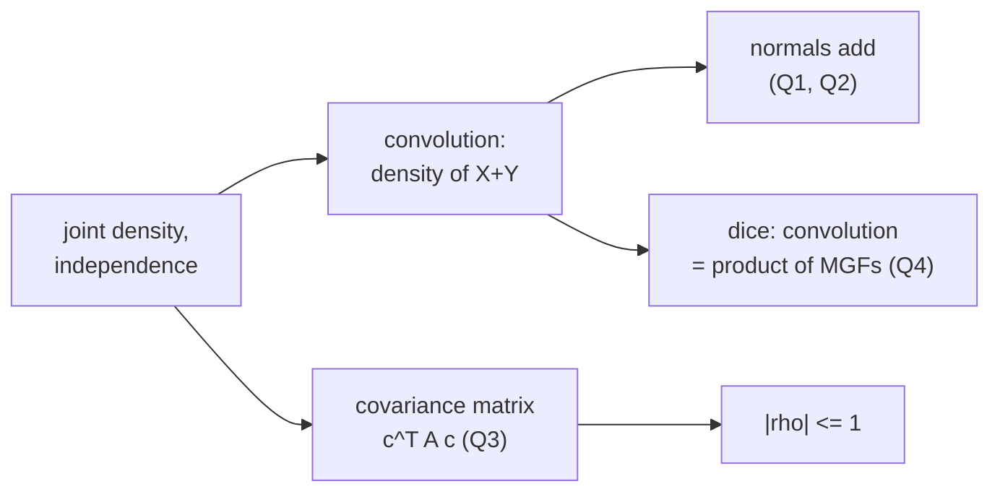

# PR07 · Sums of Independent Variables, Covariance and Correlation

◀ [[PR06 Moments Generating Functions and Limit Theorems]] · [[Probability - Course Map]]

taught · in syllabus extra · book extra · beyond

> [!warning] Scope of this chapter
> **Added 2026-10-29.** The instructor posted **Homework 4** ([[hw4.pdf]], one page: three handwritten questions and, as Q4, the two-dice MGF question carried over from Homework 3). It is the first source in the folder that treats **two continuous random variables at once**: the convolution formula $f_{X+Y}(z)=\int f_X(x)f_Y(z-x)\,\mathrm dx$ is quoted on the sheet, and the questions use independent normals, the covariance matrix and the bound $|\rho|\le1$. No earlier chapter covers joint densities, convolution or covariance for continuous variables ([[PR04 Joint Distributions Expectation and Variance]] is discrete, [[PR05 Continuous Random Variables]] and [[PR06 Moments Generating Functions and Limit Theorems]] treat one variable at a time), so this chapter supplies that background and then solves the four questions. **There is still no lecture note** for the joint-density part (🟡): *ask the instructor* whether joint densities beyond the formula on the sheet are examinable.

> [!syllabus] Syllabus map: what is in the syllabus and what is extra in this chapter
> 🟢 **Taught (Homework 4, [[hw4.pdf#page=1|the sheet]])**
> - §2 the **convolution formula** $f_{X+Y}(z)=\int f_X(x)f_Y(z-x)\mathrm dx$ (quoted on the sheet)
> - §3 Q1 independent normals add, **by convolution** (the MGF proof is PR06 §4)
> - §4 Q2 $-Y\sim N(-\mu,\sigma^2)$ and $E|X-Y|=2/\sqrt\pi$ for independent standard normals
> - §5 Q3 $\mathrm{Var}(\sum c_iX_i)=c^{\mathsf T}Ac$ with $A_{ij}=\mathrm{Cov}(X_i,X_j)$, and $\rho\in[-1,1]$ from $\mathrm{Var}(X+tY)\ge0$
> - §6 Q4 the two-dice MGF (the Homework 3 question, solved in [[PR06 Moments Generating Functions and Limit Theorems]] §3.3, here seen as a convolution)
>
> 🟡 **Extra · book** (Ross, *A First Course in Probability*, 8th ed.: §6.1–6.2 joint densities and independence, §6.3 sums of independent variables with Proposition 3.2, §7.4 covariance and correlation, Problem 7.24 Cauchy–Schwarz; Blitzstein and Hwang Ch. 7, a scan, not opened)
> - §1 joint density, marginals, independence, two-dimensional LOTUS; §2 the derivation of the convolution formula from the cdf and the discrete version
>
> 🔵 **Extra · beyond** (my additions, all numbers in `scripts/pr_numbers2.py`)
> - §1 uncorrelated but dependent (uniform on a disc); §2 $\mathrm{Expo}+\mathrm{Expo}$, uniform plus uniform, the Cauchy sum; §4 $\mathrm{Var}|X-Y|=2-4/\pi$; §5 the equality case $|\rho|=1$ and the check that $A$ is positive semi-definite

> [!key] After this chapter you can
> - work with a **joint density**: marginals, independence as a product, $E[g(X,Y)]$ as a double integral,
> - compute the density of $X+Y$ for independent variables by **convolution** (discrete and continuous) and say how it relates to the MGF,
> - prove by completing the square that independent normals add, and use it for $X-Y$, $\bar X$ and $E|X-Y|$,
> - write $\mathrm{Var}(\sum c_iX_i)=c^{\mathsf T}Ac$, and prove $-1\le\rho\le1$ with equality exactly for a linear relation.

> [!intuition] The one-sentence story
> Adding independent random quantities **blends** their densities (a convolution), variances add because the random parts do not interfere, and when the parts *do* interfere the interference is measured by the covariance, which can never be larger than the product of the spreads: that is the whole content of $|\rho|\le1$.

<!-- intuition-v1 -->

*Concept map: how the ideas of this chapter depend on each other (read left to right; every box is a section).*

## 1. Two continuous variables: joint density and independence
extra · book *Ross §6.1–6.2, the continuous twin of the joint pmf of PR04 §1*

> [!intuition] Probability as volume
> A single pdf makes probability the **area** under a curve; a joint pdf makes it the **volume** above a region of the plane. Everything in [[PR04 Joint Distributions Expectation and Variance]] carries over with sums replaced by double integrals.

> [!key] Joint density ([[Joint Density Function]])
> $(X,Y)$ has the **joint pdf** $f(x,y)\ge0$, with $\iint f=1$, if $P[(X,Y)\in B]=\iint_Bf(x,y)\,\mathrm dx\,\mathrm dy$ for every region $B$.
> - **Marginals:** $f_X(x)=\int f(x,y)\,\mathrm dy$, $f_Y(y)=\int f(x,y)\,\mathrm dx$.
> - **Independence:** $X,Y$ are independent iff $f(x,y)=f_X(x)f_Y(y)$ for all $x,y$ (equivalently the joint cdf factorises).
> - **Two-dimensional LOTUS:** $E[g(X,Y)]=\iint g(x,y)f(x,y)\,\mathrm dx\,\mathrm dy$. If $X,Y$ are independent, $E[g(X)h(Y)]=E[g(X)]E[h(Y)]$, so $\mathrm{Cov}(X,Y)=E[XY]-E[X]E[Y]=0$.

> [!example] 🔵 Uncorrelated but not independent: the uniform disc
> Let $(X,Y)$ be uniform on the unit disc, $f=\frac1\pi$ on $x^2+y^2\le1$. By symmetry $x\mapsto-x$, $E[X]=0$ and $E[XY]=0$, so $\mathrm{Cov}(X,Y)=0$. But $f_X(x)=\frac2\pi\sqrt{1-x^2}$ and the joint density is **not** the product: at $(0.9,0.9)$ it is $0$ while $f_Xf_Y=0.0770$; and $P[|X|>0.8,|Y|>0.8]=0$ (since $0.64+0.64>1$) whereas $P[|X|>0.8]^2=0.1041^2=0.0108$. A support that is not a rectangle already rules out independence, and $\rho(X^2,Y^2)=-\tfrac13$ shows the dependence is real (simulation $-0.333$).

## 2. The convolution formula
taught *the formula is quoted on [[hw4.pdf#page=1|Homework 4]]* · extra · book *derivation: Ross §6.3*

> [!intuition] Blending
> To get $X+Y=z$ the first variable must be some $x$ and the second exactly $z-x$. Weigh every way of splitting $z$ by how likely it is, and add the weights: $\int f_X(x)f_Y(z-x)\,\mathrm dx$ (independence turns the joint likelihood into a product).

> [!key] The density of a sum ([[Sum of Independent Random Variables]], [[Convolution]])
> If $X,Y$ are **independent** then
> $$f_{X+Y}(z)=\int_{-\infty}^\infty f_X(x)f_Y(z-x)\,\mathrm dx\qquad\text{and, for integer values,}\qquad p_{X+Y}(s)=\sum_kp_X(k)\,p_Y(s-k).$$
> Only the **region where both densities are positive** contributes: write the limits accordingly.

> [!derivation] Where it comes from
> $F_{X+Y}(z)=P[X+Y\le z]=\iint_{x+y\le z}f_X(x)f_Y(y)\,\mathrm dx\,\mathrm dy=\int f_Y(y)\,F_X(z-y)\,\mathrm dy$, since for fixed $y$ the inner integral over $x\le z-y$ is $F_X(z-y)$. Differentiating in $z$ (and using $F_X'=f_X$) gives $f_{X+Y}(z)=\int f_Y(y)f_X(z-y)\,\mathrm dy$, which is the formula with the roles of $x$ and $y$ exchanged (the convolution is commutative).

> [!example] Three standard cases (all checked)
> - **Dice (discrete).** $p_{X+Y}(s)=\sum_kp_X(k)p_Y(s-k)=\frac{c_s}{36}$ with $c_s=1,2,3,4,5,6,5,4,3,2,1$ for $s=2,\dots,12$ (the number of ways to split $s$).
> - **Exponentials.** $X,Y\sim\mathrm{Expo}(1)$ independent: both densities vanish for negative arguments, so $f_{X+Y}(z)=\int_0^ze^{-x}e^{-(z-x)}\mathrm dx=ze^{-z}$, $z\ge0$: the Gamma$(2,1)$ density, $0.3347$ at $z=1.5$; mean $2$, variance $2$.
> - **Uniforms.** $X,Y\sim U(0,1)$: $f_{X+Y}(z)=z$ on $[0,1]$ and $2-z$ on $[1,2]$ (the triangle), so $P[X+Y>1.5]=\tfrac18$.

> [!pitfall] Where students slip
> - The **density of a sum is not the sum of the densities** ($f_X+f_Y$ integrates to $2$). It is the convolution.
> - The formula needs **independence**; for dependent variables the joint density replaces the product.
> - Forgetting that $f_Y(z-x)$ is zero unless $z-x$ is in the support: the limits of integration are usually not $\pm\infty$ (above, $0\le x\le z$).

> [!connection] Convolution and the MGF
> $M_{X+Y}(t)=E[e^{tX}e^{tY}]=M_X(t)M_Y(t)$ for independent variables ([[PR06 Moments Generating Functions and Limit Theorems]] §2): **convolution of densities becomes multiplication of MGFs**, exactly as convolution of functions becomes multiplication of Fourier transforms ([[Convolution Theorem]]). The MGF route is shorter; the convolution route needs no uniqueness theorem and shows *why* a family is closed under addition.

## 3. Homework 4, Q1: independent normals add (by convolution)
taught *[[hw4.pdf#page=1|Homework 4]]; solution is mine, identity checked symbolically in `scripts/pr_numbers2.py`*

> [!example] Q1 Show that $X+Y\sim N(\mu_1+\mu_2,\sigma_1^2+\sigma_2^2)$ using $f_{X+Y}(z)=\int f_X(x)f_Y(z-x)\mathrm dx$
> Write $u=x-\mu_1$ and $w=z-\mu_1-\mu_2$, so that $z-x-\mu_2=w-u$. Then
> $$f_{X+Y}(z)=\frac1{2\pi\sigma_1\sigma_2}\int_{-\infty}^\infty\exp\Big[-\frac{u^2}{2\sigma_1^2}-\frac{(w-u)^2}{2\sigma_2^2}\Big]\mathrm du.$$
> Put $s^2=\sigma_1^2+\sigma_2^2$ and $\tau^2=\dfrac{\sigma_1^2\sigma_2^2}{s^2}$ (so $\tfrac1{\tau^2}=\tfrac1{\sigma_1^2}+\tfrac1{\sigma_2^2}$). **Completing the square in $u$:**
> $$-\frac{u^2}{2\sigma_1^2}-\frac{(w-u)^2}{2\sigma_2^2}=-\frac{(u-m)^2}{2\tau^2}-\frac{w^2}{2s^2},\qquad m=\frac{\sigma_1^2}{s^2}\,w.$$
> The last term does not contain $u$ and comes out of the integral. The remaining integral is a Gaussian integral, $\int e^{-(u-m)^2/2\tau^2}\mathrm du=\sqrt{2\pi}\,\tau$, so
> $$f_{X+Y}(z)=\frac{\sqrt{2\pi}\,\tau}{2\pi\sigma_1\sigma_2}\,e^{-w^2/2s^2}=\frac1{\sqrt{2\pi}\,s}\exp\Big[-\frac{(z-\mu_1-\mu_2)^2}{2(\sigma_1^2+\sigma_2^2)}\Big],\qquad\text{because }\frac\tau{\sigma_1\sigma_2}=\frac1s.$$
> That is the $N(\mu_1+\mu_2,\ \sigma_1^2+\sigma_2^2)$ density. **Check:** for $\mu=(1,-0.5)$, $\sigma=(2,1.5)$ the numerical convolution and the formula agree to eight digits at $z=-2,0.3,1.7,4$ (e.g. $0.14221301$ at $z=1.7$); the exponent identity was also verified symbolically.

> [!connection] Same theorem, two proofs
> PR06 §4 proved this with MGFs: $\exp(\mu_1t+\tfrac12\sigma_1^2t^2)\exp(\mu_2t+\tfrac12\sigma_2^2t^2)$ is the MGF of the claimed normal, and the MGF determines the law. The convolution proof above is self-contained. By induction $\sum_{i=1}^nX_i\sim N(\sum\mu_i,\sum\sigma_i^2)$ for independent normals, and with the scaling rule $aX\sim N(a\mu,a^2\sigma^2)$ the **sample mean** of $n$ iid $N(\mu,\sigma^2)$ variables is exactly $N(\mu,\sigma^2/n)$ (Practice 12).

> [!example] 🔵 The Cauchy law does not behave this way
> Two independent standard Cauchy variables have $f_{X+Y}(0)=\int\frac1{\pi^2(1+x^2)^2}\mathrm dx=\frac1{2\pi}=0.1592$, which is the density at $0$ of a **Cauchy with scale $2$**: the sum is $2\times$ a standard Cauchy (the Cauchy family is closed under convolution with scales adding; checked here at $z=0$), so $\tfrac12(X+Y)$ is again standard Cauchy. Averaging does not narrow the law, which is why the law of large numbers fails (PR06 §5).

## 4. Homework 4, Q2: reflection and $E|X-Y|$
taught *[[hw4.pdf#page=1|Homework 4]]; solutions are mine*

> [!example] Q2(a) If $Y\sim N(\mu,\sigma^2)$ then $-Y\sim N(-\mu,\sigma^2)$
> **cdf method (PR05 §5).** $P[-Y\le y]=P[Y\ge-y]=1-\Phi\big(\tfrac{-y-\mu}\sigma\big)=\Phi\big(\tfrac{y+\mu}\sigma\big)$, using $1-\Phi(a)=\Phi(-a)$. That is the cdf of $N(-\mu,\sigma^2)$, because $\Phi\big(\tfrac{y-(-\mu)}\sigma\big)$ is its cdf. (By density: $f_{-Y}(y)=f_Y(-y)\propto e^{-(-y-\mu)^2/2\sigma^2}=e^{-(y+\mu)^2/2\sigma^2}$.)

> [!example] Q2(b) $X,Y\sim N(0,1)$ independent $\Rightarrow E|X-Y|=\dfrac2{\sqrt\pi}$
> $X$ and $-Y$ are independent (functions of independent variables) and $-Y\sim N(0,1)$ by (a). By Q1, $X-Y=X+(-Y)\sim N(0,1+1)=N(0,2)$, so $X-Y=\sqrt2\,Z$ with $Z\sim N(0,1)$ and
> $$E|X-Y|=\sqrt2\,E|Z|=\sqrt2\cdot\sqrt{\frac2\pi}=\frac2{\sqrt\pi}=1.1284,$$
> using the sheet's hint $E[\text{folded Gaussian}]=\sqrt{2/\pi}$ (PR05 §5: $2\int_0^\infty z\varphi(z)\mathrm dz=2\varphi(0)$). Simulation with $10^7$ pairs gives $1.12833$. 🔵 Also $E[(X-Y)^2]=2$, so $\mathrm{Var}|X-Y|=2-\dfrac4\pi=0.7268$ (simulation $0.7265$). In general for independent $N(\mu_1,\sigma_1^2)$, $N(\mu_2,\sigma_2^2)$ with equal means $E|X-Y|=\sqrt{\tfrac2\pi}\sqrt{\sigma_1^2+\sigma_2^2}$.

![[fig_pr07_sums.png]]
*Figure PR7.1. A: the integrand $f_X(x)f_Y(z-x)$ of the convolution for $X\sim N(1,4)$, $Y\sim N(-0.5,2.25)$ at $z=2$; its area is the density $f_{X+Y}(2)=0.1333$ of $N(0.5,6.25)$. B: the parabola $\mathrm{Var}(X+tY)=1+2\rho t+t^2$ (unit variances) is nonnegative for every $t$ only if $|\rho|\le1$; it touches $0$ at $t=-1$ when $\rho=1$ (§5). C: $|X-Y|$ for iid standard normals follows the folded $N(0,2)$ with mean $2/\sqrt\pi$.*

> [!pitfall] Differences of independent variables
> $\mathrm{Var}(X-Y)=\mathrm{Var}X+\mathrm{Var}Y$ (**plus**, not minus): the spreads add whether you add or subtract. And $|X-Y|$ is **folded** normal, not $N(0,2)$; its mean is positive.

## 5. Homework 4, Q3: the covariance matrix and $|\rho|\le1$
taught *[[hw4.pdf#page=1|Homework 4]]; solutions are mine, numbers in `scripts/pr_numbers2.py`*

> [!key] Covariance matrix ([[Covariance Matrix]], [[Covariance and Correlation]])
> For $X_1,\dots,X_n$ let $A$ be the $n\times n$ matrix with $A_{ij}=\mathrm{Cov}(X_i,X_j)$ (so $A_{ii}=\mathrm{Var}X_i$ and $A$ is symmetric). Then for constants $c_1,\dots,c_n$
> $$\mathrm{Var}\Big(\sum_{i=1}^nc_iX_i\Big)=\sum_{i,j}c_ic_jA_{ij}=(c_1\cdots c_n)\,A\begin{pmatrix}c_1\\\vdots\\c_n\end{pmatrix}=c^{\mathsf T}Ac.$$

> [!derivation] Q3 first part
> Let $S=\sum c_iX_i$ and $\mu_i=E[X_i]$. By linearity $E[S]=\sum c_i\mu_i$, so $S-E[S]=\sum_ic_i(X_i-\mu_i)$. Squaring turns the sum into a double sum: $(S-E[S])^2=\sum_{i,j}c_ic_j(X_i-\mu_i)(X_j-\mu_j)$. Taking expectations term by term, $\mathrm{Var}(S)=\sum_{i,j}c_ic_j\mathrm{Cov}(X_i,X_j)=c^{\mathsf T}Ac$. Separating $i=j$ from $i\neq j$ (each pair appears twice) gives back the formula of PR04 §6, $\sum c_i^2\mathrm{Var}X_i+2\sum_{i<j}c_ic_j\mathrm{Cov}(X_i,X_j)$.
> **Consequence.** Since a variance is never negative, $c^{\mathsf T}Ac\ge0$ for **every** $c$: the covariance matrix is **positive semi-definite**. **Check:** for the $4\times4$ matrix in the script and $c=(2,-1,0.5,3)$, $c^{\mathsf T}Ac=23.45$ both by the formula and by the double sum; simulation with $10^6$ draws gives $23.456$; all four eigenvalues ($0.77,1.32,2.30,3.12$) are positive.

> [!example] Q3 second part: $-1\le\mathrm{Cor}(X,Y)\le1$
> Assume $\mathrm{Var}Y>0$ (if $Y$ is constant, $\mathrm{Cov}=0$ and $\rho$ is undefined). For **every real** $t$,
> $$0\le\mathrm{Var}(X+tY)=\mathrm{Var}X+2t\,\mathrm{Cov}(X,Y)+t^2\,\mathrm{Var}Y.$$
> The right side is a quadratic in $t$ with positive leading coefficient $\mathrm{Var}Y$ that never goes below zero, so it has **at most one real root**: its discriminant is $\le0$,
> $$4\,\mathrm{Cov}(X,Y)^2-4\,\mathrm{Var}X\,\mathrm{Var}Y\le0\iff\mathrm{Cov}(X,Y)^2\le\mathrm{Var}X\,\mathrm{Var}Y\iff|\rho|\le1,\qquad\rho=\frac{\mathrm{Cov}(X,Y)}{\sqrt{\mathrm{Var}X}\sqrt{\mathrm{Var}Y}}.$$
> Equivalently the minimum over $t$, at $t^*=-\mathrm{Cov}/\mathrm{Var}Y$, equals $\mathrm{Var}X\,(1-\rho^2)\ge0$. **Numbers:** $\mathrm{Var}X=2$, $\mathrm{Var}Y=3$, $\mathrm{Cov}=1.2$ give discriminant$/4=1.44-6=-4.56<0$, $t^*=-0.4$, minimum $1.52=2(1-0.24)$, $\rho=0.490$.

> [!key] 🔵 The equality case
> $|\rho|=1$ iff the minimum is $0$, i.e. $\mathrm{Var}(X+t^*Y)=0$, i.e. $X+t^*Y$ is **constant with probability 1**: $X$ and $Y$ are exactly **linearly related**, $Y=aX+b$, and $\rho=\mathrm{sign}(a)$ (simulation: $Y=2X+1$ gives $1.0000$, $Y=-3X$ gives $-1.0000$). Under an affine change $X\mapsto aX+b$, $Y\mapsto cY+d$ the correlation is unchanged up to the sign of $ac$: $\rho$ measures **linear** association only. This is the **Cauchy–Schwarz inequality** [[Cauchy-Schwarz Inequality]] for the mean-zero variables $X-\mu_X$ and $Y-\mu_Y$: $(E[UV])^2\le E[U^2]E[V^2]$.

> [!pitfall] Correlation zero is not independence
> $\rho=0$ only says there is **no linear** dependence. $X\sim N(0,1)$ and $X^2$ have $\mathrm{Cov}=E[X^3]-E[X]E[X^2]=0$ (simulation $\rho=0.006$) yet $X^2$ is a function of $X$; the uniform disc (§1) is another example. The converse holds in one important case: for **jointly normal** variables zero correlation does imply independence (not proved here).

## 6. Homework 4, Q4: the two dice, as a convolution
taught *[[hw4.pdf#page=1|Homework 4 Q4]] = Homework 3 Q4; solved in [[PR06 Moments Generating Functions and Limit Theorems]] §3.3*

> [!example] Q4 MGF of the sum of two fair dice
> $X,Y$ independent, so $M_{X+Y}(t)=M_X(t)M_Y(t)=\Big(\frac16\sum_{k=1}^6e^{kt}\Big)^2$. Multiplying out, the coefficient of $e^{st}$ is the number of pairs $(j,k)$ with $j+k=s$, which is exactly the convolution count $c_s$ of §2:
> $$M_{X+Y}(t)=\frac1{36}\sum_{s=2}^{12}c_se^{st},\qquad c_s=1,2,3,4,5,6,5,4,3,2,1.$$
> **Check:** at $t=0.3$ both forms give $10.5441$; the pmf of the sum obtained by convolving two uniform pmfs is $(1,2,3,4,5,6,5,4,3,2,1)/36$. $M'(0)=7=E[X+Y]$ and $\mathrm{Var}=\tfrac{35}6=\mathrm{Var}X+\mathrm{Var}Y$.

<!-- interactive:start (generated by scripts/embed_interactive.py; edit the tool in scripts/interactive/tools/, not this block) -->
> [!interactive]+ Interactive: Covariance, correlation and what they miss
> A cloud of 300 points with a chosen shape.
>
> ![[pr_correlation.png|720]]
>
> **Try:** Bivariate normal, ρ = 0.8: R² = 0.64. Switch to the parabola: correlation ≈ 0 despite y being a function of x. Add an outlier at (6, 6) to uncorrelated normal data and the correlation jumps.
>
> [▶ Open the tool in your browser](../Assets/interactive/pr_correlation.html) · [absolute link](file:///home/swastik/Documents/notes/Assets/interactive/pr_correlation.html) · all tools and coverage: [[Interactive Tools]]

> [!interactive]+ Interactive: Joint, marginal and conditional distributions
> A scatter of 4000 pairs (X, Y) from a chosen joint law, with the marginal histograms on the axes and the conditional distribution of Y given X in a narrow slice around x₀ (click or slide x₀).
>
> ![[pr_joint.png|720]]
>
> **Try:** Correlated normal ρ = 0.8: slice at x₀ = 1.5: E[Y|X] = ρx₀ = 1.2, conditional s.d. √(1−ρ²) = 0.6. Switch to the disk: E[Y|X] = 0 for every x₀ but the conditional range shrinks to ±√(1−x₀²): dependence without correlation.
>
> [▶ Open the tool in your browser](../Assets/interactive/pr_joint.html) · [absolute link](file:///home/swastik/Documents/notes/Assets/interactive/pr_joint.html) · all tools and coverage: [[Interactive Tools]]

<!-- interactive:end -->

## Map of this chapter
> [!connection] How PR07 connects
> **Builds on:** [[PR04 Joint Distributions Expectation and Variance]] (covariance of discrete pairs, the variance of a sum), [[PR05 Continuous Random Variables]] (cdf method, folded normal, LOTUS) and [[PR06 Moments Generating Functions and Limit Theorems]] (the MGF proof that normals add, the Cauchy example).
> **Leads to:** the **Gaussian vector** (a covariance matrix $A$ plus a mean determines a multivariate normal; not in the sources), regression and the correlation as a $R^2$, and the central limit theorem for sums (PR06 §5) where convolution powers of a density tend to the normal.
> **Concepts:** [[Joint Density Function]] · [[Sum of Independent Random Variables]] · [[Convolution]] · [[Covariance Matrix]] · [[Covariance and Correlation]] · [[Cauchy-Schwarz Inequality]] · [[Folded Normal Distribution]] · [[Normal Distribution]] · [[Independence of Random Variables]] · [[Moment Generating Function]] · [[Cdf Method for Transformations]]
> **Other subjects:** [[Probability - Course Map]], [[QM03 States Operators and Measurement]] and [[Generalised Uncertainty Principle]] (the uncertainty relation is the Cauchy–Schwarz inequality for the vectors $(A-\langle A\rangle)\psi$ and $(B-\langle B\rangle)\psi$), [[TH06 From Kinetic Theory to Statistical Mechanics]] (the energy of $N$ independent particles has variance $N\sigma^2$, so the relative fluctuation falls as $1/\sqrt N$), [[LS27 Coasts Beaches Deltas and Rocky Shores]] (diffusion of a shoreline perturbation is convolution with a Gaussian kernel whose variance is $2\kappa t$, so convolving the kernels at times $t_1$ and $t_2$ gives the kernel at $t_1+t_2$: the same "variances add" rule), [[Fourier and Laplace Transforms]] (convolution becomes a product).

## Summary
> [!summary] Cheat-sheet
> - **Joint pdf:** $P[(X,Y)\in B]=\iint_Bf$; marginals by integrating out; **independent iff $f=f_Xf_Y$**; $E[g(X,Y)]=\iint gf$.
> - **Convolution:** independent $X,Y$: $f_{X+Y}(z)=\int f_X(x)f_Y(z-x)\mathrm dx$; discrete $p_{X+Y}(s)=\sum_kp_X(k)p_Y(s-k)$; MGFs multiply. Expo+Expo = Gamma(2); $U+U$ = triangle; Poisson+Poisson = Poisson.
> - **Normals add:** $X+Y\sim N(\mu_1+\mu_2,\sigma_1^2+\sigma_2^2)$ (complete the square); $-Y\sim N(-\mu,\sigma^2)$; $X-Y\sim N(\mu_1-\mu_2,\sigma_1^2+\sigma_2^2)$; $\bar X\sim N(\mu,\sigma^2/n)$.
> - **$E|X-Y|=2/\sqrt\pi$** for iid $N(0,1)$ (folded $N(0,2)$); $\mathrm{Var}|X-Y|=2-4/\pi$.
> - **Quadratic form:** $\mathrm{Var}(\sum c_iX_i)=c^{\mathsf T}Ac$, $A_{ij}=\mathrm{Cov}(X_i,X_j)$ symmetric positive semi-definite.
> - **$|\rho|\le1$** from $\mathrm{Var}(X+tY)\ge0$ for all $t$ (discriminant $\le0$); $|\rho|=1$ iff $Y=aX+b$. $\rho=0$ does **not** give independence.

## Practice
1. **Joint density.** $f(x,y)=c(x+y)$ on $[0,1]^2$ (zero elsewhere). Find $c$, the marginal of $X$, $E[X]$, $E[XY]$, $\mathrm{Cov}(X,Y)$ and $\rho$. Are $X,Y$ independent?
2. **Uncorrelated, dependent.** $(X,Y)$ uniform on the unit disc. Show $\mathrm{Cov}(X,Y)=0$ and that $X,Y$ are not independent.
3. **Convolution.** $X\sim\mathrm{Expo}(1)$ and $Y\sim\mathrm{Expo}(2)$ independent. Find the density and mean of $X+Y$.
4. **Uniform sum.** $X,Y\sim U(0,1)$ independent: find $f_{X+Y}$ and $P[X+Y>1.5]$.
5. **Poisson sum.** $X\sim\mathrm{Poisson}(2)$, $Y\sim\mathrm{Poisson}(3)$ independent. Compute $P[X+Y=4]$ by convolution and compare with $\mathrm{Poisson}(5)$.
6. **Normal difference.** $X\sim N(1,4)$ and $Y\sim N(-2,9)$ independent (variances 4 and 9). Find $P[X-Y>6]$.
7. **Mean absolute difference.** $X,Y$ iid $N(5,4)$. Find $E|X-Y|$.
8. **Quadratic form.** $\mathrm{Var}X=4$, $\mathrm{Var}Y=9$, $\mathrm{Var}Z=1$, $\mathrm{Cov}(X,Y)=3$, $\mathrm{Cov}(X,Z)=-1$, $\mathrm{Cov}(Y,Z)=0$. Find $\mathrm{Var}(2X-3Y+Z)$ and check it with $c^{\mathsf T}Ac$.
9. **Affine maps.** Show $\mathrm{Cor}(aX+b,cY+d)=\mathrm{sign}(ac)\,\mathrm{Cor}(X,Y)$ for $a,c\ne0$.
10. **Cauchy–Schwarz.** For $E[U^2],E[V^2]<\infty$ prove $(E[UV])^2\le E[U^2]E[V^2]$ using $E[(U+tV)^2]\ge0$.
11. **Two dice, again.** Find the pmf of $X-Y$ for two fair dice, and $E|X-Y|$.
12. **Sample mean.** $X_1,\dots,X_n$ iid $N(\mu,\sigma^2)$. Show $\bar X\sim N(\mu,\sigma^2/n)$ and find the least $n$ with $P[|\bar X-\mu|<0.1\sigma]\ge0.95$.

> [!example]- Solutions
> 1. $\int_0^1\!\!\int_0^1(x+y)=\tfrac12+\tfrac12=1$, so $c=1$. $f_X(x)=\int_0^1(x+y)\mathrm dy=x+\tfrac12$. $E[X]=\int_0^1x(x+\tfrac12)\mathrm dx=\tfrac13+\tfrac14=\tfrac7{12}$ (same for $Y$). $E[XY]=\iint xy(x+y)=\tfrac16+\tfrac16=\tfrac13$. $\mathrm{Cov}=\tfrac13-\tfrac{49}{144}=-\tfrac1{144}$. $E[X^2]=\tfrac14+\tfrac16=\tfrac5{12}$, $\mathrm{Var}X=\tfrac5{12}-\tfrac{49}{144}=\tfrac{11}{144}$, so $\rho=-\tfrac1{11}=-0.0909$. Not independent: $f(x,y)=x+y\ne(x+\tfrac12)(y+\tfrac12)$ (they differ by $\tfrac14$).
> 2. $f=\tfrac1\pi$ is even in $x$, so $E[X]=0$ and $E[XY]=\iint xy f=0$ (odd in $x$): $\mathrm{Cov}=0$. The support is not a rectangle: $P[|X|>0.8,|Y|>0.8]=0$ but $P[|X|>0.8]^2=0.0108>0$.
> 3. $f_{X+Y}(z)=\int_0^ze^{-x}\,2e^{-2(z-x)}\mathrm dx=2e^{-2z}(e^z-1)=2(e^{-z}-e^{-2z})$, $z\ge0$. Mean $=1+\tfrac12=\tfrac32$ (also $\int z f=2(1-\tfrac14)=\tfrac32$). At $z=1.3$ the density is $0.3965$.
> 4. $f(z)=z$ on $[0,1]$, $2-z$ on $[1,2]$. $P[X+Y>1.5]=\int_{1.5}^2(2-z)\mathrm dz=\tfrac18$ (simulation $0.1246$).
> 5. $\sum_{k=0}^4e^{-2}\frac{2^k}{k!}\,e^{-3}\frac{3^{4-k}}{(4-k)!}=\frac{e^{-5}}{4!}\sum_k\binom4k2^k3^{4-k}=\frac{5^4e^{-5}}{24}=0.17547$ by the binomial theorem; this is the $\mathrm{Poisson}(5)$ pmf at $4$.
> 6. $X-Y\sim N(1-(-2),\,4+9)=N(3,13)$. $P[X-Y>6]=1-\Phi\big(\tfrac{6-3}{\sqrt{13}}\big)=1-\Phi(0.832)=0.2027$ (simulation $0.2026$).
> 7. $X-Y\sim N(0,8)$, so $E|X-Y|=\sqrt8\sqrt{2/\pi}=\dfrac4{\sqrt\pi}=2.2568$.
> 8. $c=(2,-3,1)$: $2^2\cdot4+3^2\cdot9+1+2\big[2(-3)\cdot3+2\cdot1\cdot(-1)+(-3)(1)\cdot0\big]=16+81+1+2(-18-2)=58$. Matrix form: $A=\begin{pmatrix}4&3&-1\\3&9&0\\-1&0&1\end{pmatrix}$, $c^{\mathsf T}Ac=58$ (eigenvalues $0.58,3,10.42>0$).
> 9. $\mathrm{Cov}(aX+b,cY+d)=ac\,\mathrm{Cov}(X,Y)$, $\mathrm{Var}(aX+b)=a^2\mathrm{Var}X$, so $\rho'=\dfrac{ac\,\mathrm{Cov}}{|a||c|\,\sigma_X\sigma_Y}=\mathrm{sign}(ac)\rho$ (simulation: $\rho=0.5\Rightarrow\mathrm{Cor}(2X+1,-3Y+4)=-0.500$).
> 10. If $E[V^2]=0$ then $V=0$ almost surely and both sides are $0$. Otherwise $0\le E[(U+tV)^2]=E[U^2]+2tE[UV]+t^2E[V^2]$ for all $t$; the discriminant is $\le0$: $4E[UV]^2-4E[U^2]E[V^2]\le0$. With $U=X-\mu_X$, $V=Y-\mu_Y$ this is $\mathrm{Cov}^2\le\mathrm{Var}X\,\mathrm{Var}Y$.
> 11. $P[X-Y=d]=\dfrac{6-|d|}{36}$ for $d=-5,\dots,5$ (the same triangle as the sum, shifted). $E|X-Y|=\dfrac2{36}\sum_{d=1}^5d(6-d)=\dfrac{2\cdot35}{36}=\dfrac{35}{18}=1.944$. Also $\mathrm{Var}(X-Y)=\tfrac{35}6$, as for the sum.
> 12. By Q1 and induction $\sum X_i\sim N(n\mu,n\sigma^2)$; scaling by $\tfrac1n$ gives $N(\mu,\sigma^2/n)$. Then $P[|\bar X-\mu|<0.1\sigma]=2\Phi(0.1\sqrt n)-1\ge0.95\iff0.1\sqrt n\ge1.96\iff n\ge384.15$, so $n=385$ (the probability is $0.95025$ at $n=385$ and $0.94996$, just short, at $n=384$).

## Provenance
> [!provenance]- Source map for this chapter
> | Topic | Source | Scope |
> |---|---|---|
> | Q1 Gaussian convolution, Q2 reflection and $E|X-Y|$, Q3 covariance quadratic form and $\rho\in[-1,1]$, Q4 two-dice MGF | [[hw4.pdf#page=1\|Homework 4, handwritten page + typed Q4]] (solutions mine) | taught |
> | joint density, marginals, independence, 2-D LOTUS; convolution derivation; normals add (direct convolution); covariance and correlation | Ross, *A First Course in Probability* 8th ed., §6.1–6.3 (Proposition 3.2) and §7.4, Problem 7.24 (text layer checked); Blitzstein and Hwang Ch. 7 (scan, not opened) | extra/book |
> | MGF proof that normals and Poissons add; folded normal; Cauchy sample mean | [[PR06 Moments Generating Functions and Limit Theorems]] §4–§5; [[PR05 Continuous Random Variables]] §5 | taught / extra |
> | uniform disc, Expo+Expo, $U+U$, Cauchy sum, $\mathrm{Var}|X-Y|$, equality case of $|\rho|\le1$, Practice 1–12 | `scripts/pr_numbers2.py` (numerical integration, symbolic identity for the completed square, Monte Carlo), `fig_pr07_sums.py` | extra/beyond |
>
> **Notes.** Homework 4 Q4 repeats Homework 3 Q4 (the sheet says "From HW3"). The Gaussian Q1 hint "we showed using MGF" refers to PR06 §4 (the MGF lecture). The sheet's Q3 writes $A_{ij}=\mathrm{Cov}(X_i,X_j)$ and "Using $\mathrm{Var}(X+tY)\ge0\ \forall t$"; the equality case and the positive semi-definiteness remark are mine.

**References.** Ross, S. *A First Course in Probability*, 8th ed., Ch. 6–7 · Blitzstein, J. and Hwang, J. *Introduction to Probability*, Ch. 7 · Feller, W. *An Introduction to Probability Theory and Its Applications*, Vol. 2, Ch. III (convolutions).

## Continued in the vault (added 2026-11-07)
- Order statistics, exponential order statistics and the multinomial covariance matrix (Homework 5): [[PR08 Order Statistics and the Multinomial Distribution]].
