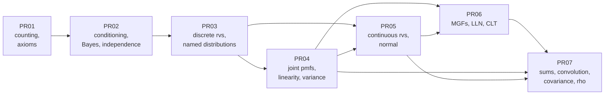

# Probability: Course Map (MT2113)

<span class="scope-taught">taught · in syllabus</span> <span class="scope-extra-book">extra · book</span>

Nine chapters (PR08 added 2026-11-07, PR09 added 2026-11-12; the sentences below describe the first seven). PR01–PR05 follow the instructor's **typed class notes** (5 Aug – 10 Sep 2026, one merged 32-page PDF), the **handwritten post-midterm Week 1, 2 and 3** notes (9, 5 and 6 pages, each with a homework page) and the seven **practice-problem sheets** (7 Aug – 17 Sep). **PR06** is now partly taught: the **Week 3** notes cover median and mode, moments, skewness, kurtosis, the MGF and six first-principles MGFs; the rest of PR06 (independent sums, Markov and Chebyshev, the law of large numbers, the CLT) still has **no lecture note** and stays 🟡 (AI notes and textbooks). **Week 2** supplies the exponential distribution, the folded normal and the memoryless theorem (PR05 §5–§6).

> [!warning] What is and is not in the sources
> - **Taught (🟢)**: counting and axioms, conditional probability and independence, discrete random variables and the named discrete distributions, joint pmfs, linearity of expectation, variance, continuous random variables with the uniform, logistic, Rayleigh and normal laws.
> - **Not formally in the syllabus (the instructor says so)**: continuity of probability (§2 of 12 Aug), the proofs of the cdf properties (right-continuity), gambler's ruin, the variance of a sum of independent variables ("not proved in class, possibly not in this course").
> - **Taught in Weeks 2–3 (🟢, added 2026-10-25)**: the folded normal, the exponential distribution (moments, geometric limit, memoryless characterisation), median and mode, moments, skewness, (excess) kurtosis, the MGF with its EGF remark, and the MGFs of the uniform, exponential, normal, Bernoulli, binomial and geometric laws (each derived from first principles, in line with the AI notes' **course policy**).
> - **Added 2026-10-29 (🟢):** **Homework 4** ([[hw4.pdf]]: convolution of normals, $E|X-Y|$, the covariance matrix and $|\rho|\le1$, the two-dice MGF) → new chapter [[PR07 Sums of Independent Variables Covariance and Correlation]]; **Quiz 1** of 16 Sep ([[quiz(somenumber).jpeg]]) → Practice 13–15 of PR05; screenshots of the Homework 2 and 3 posts ([[hw2.png]], [[hw3.png]]), whose problems were already in PR05 and PR06, with the instructor's **correction to the discrete median** (now a `[!verify]` in PR06 §1).
> - **Added 2026-11-07 (🟢):** **Homework 5** ([[hw5.pdf]] and the instructor's solution of Q1, [[HW-5, Q.1.jpg]]: order statistics, exponential order statistics, multinomial moments) → new chapter [[PR08 Order Statistics and the Multinomial Distribution]] (no chapter covered order statistics or the multinomial vector). The notes the sheet announces for the weekend are not in the folder yet.
> - **Added 2026-11-12 (🟢):** **Week 4 notes** ([[Week4_notes.pdf]]: Homework 4 and the lecture summary on marginal, conditional and Bayes densities), **Week 5 notes** ([[Week5_notes.pdf]]: Homework 5 and the summary: covariance matrix, min/max lemma, multinomial, change of variables) and **Homework 6** ([[hw6_edited.pdf]]: multivariate normal, $-\ln U$, tangent line and Jensen) → new chapter [[PR09 Change of Variables the Multivariate Normal and Products of Uniforms]]; the HW4 and Week 5 covariance/min–max/multinomial parts were already in PR07 and PR08 (compared, not repeated). Three ambiguities are flagged in PR09: the constant in the sheet's disc marginal, the label "Poisson" on an exponential race (Week 4 Example 2), and the two meanings of $\sigma_i^2$ in HW6 Q1.
> - **Still no lecture source (🟡)**: existence of moments (Cauchy), the Poisson and negative-binomial MGFs, sums of independent variables (beyond the convolution questions of Homework 4), Markov, Chebyshev, the law of large numbers, the CLT. **Ask the instructor** whether these are examinable.
> - **Two slips on the handwritten Week 3 pages** (the uniform Taylor denominator $m\to m+1$; the sign in the $N(\mu,\sigma^2)$ exponent) and a **convention clash** (the lectures' geometric counts failures, PR03's counts trials) are flagged with `[!verify]` in PR06 §3.
> - The 9 Sep notes refer to "updated class notes of 27 Aug" on transformations of random variables; the version in the folder is the earlier one. The cdf method for a transformation is covered from the 9 Sep remark, the homework (random circle) and the sheets.
> - Blitzstein and Hwang is a **scan** (not read; only cited by page where the class notes cite it); Ross has a text layer and was used as a cross-check.


> [!info] Shared drive: related books, past papers and old decks on the shared drive are listed in [[math/probability/shared-drive-sources|shared-drive sources (2 files)]].

## The storyline

Central thread: **probability is counting with a consistent set of rules (PR01) $\to$ new information shrinks the sample space (PR02) $\to$ a random variable summarises an outcome by a number and each named distribution answers a counting question (PR03) $\to$ expectation is linear, spread is the variance (PR04) $\to$ replace sums by integrals (PR05) $\to$ sums of many independent pieces become normal (PR06).**

## Chapters
| # | Chapter | Main sources | Status |
|---|---|---|---|
| 01 | [[PR01 Counting and the Axioms of Probability]] | class notes 5, 6, 12 Aug; sheets 7 and 14 Aug | draft |
| 02 | [[PR02 Conditional Probability Bayes Rule and Independence]] | class notes 13, 19 Aug; sheets 14 and 21 Aug | draft |
| 03 | [[PR03 Discrete Random Variables and Distributions]] | class notes 20, 27 Aug, 2 Sep; sheet 28 Aug | draft |
| 04 | [[PR04 Joint Distributions Expectation and Variance]] | class notes 2, 9 Sep; sheets 4, 11–12 and 17 Sep | draft |
| 05 | [[PR05 Continuous Random Variables]] | class notes 10 Sep; handwritten week 1 and **week 2** (post midterm); sheet 17 Sep | draft |
| 06 | [[PR06 Moments Generating Functions and Limit Theorems]] | handwritten **week 3** (median, mode, moments, MGF); AI notes (limit theorems); Ross, Blitzstein–Hwang | draft (🟢 §1–§3, 🟡 §4–§5) |
| 07 | [[PR07 Sums of Independent Variables Covariance and Correlation]] | **Homework 4** (instructor, added 2026-10-29); Ross §6.1–6.3, §7.4 | draft (🟢 §2–§6, 🟡 §1) |
| 08 | [[PR08 Order Statistics and the Multinomial Distribution]] | **Homework 5** (instructor, added 2026-11-07) and the instructor's Q1 solution | draft (🟢 §1, §3, §4, 🔵 §2) |
| 09 | [[PR09 Change of Variables the Multivariate Normal and Products of Uniforms]] | **Week 4 and Week 5 lecture summaries** and **Homework 6** (instructor, added 2026-11-12) | draft (🟢 §1–§5, 🔵 §1–§5) |

```dataview
TABLE chapter AS "#", scope AS "Scope", status AS "Status"
FROM #subject/probability AND #type/chapter
SORT chapter ASC
```

## Sources and what they are
| ID | File | What it is | Role |
|---|---|---|---|
| CN | [[ilovepdf_merged-1.pdf]] | the instructor's typed class notes, 5 Aug – 10 Sep 2026 (32 pp; p.1–2 counting, 3–6 sample space and axioms, 7–11 properties and inclusion-exclusion, 12–14 conditioning, 15–16 Bayes and independence, 17–19 random variables, 20–22 Poisson and expectation, 23–26 joint pmfs and waiting times, 27 variance, 28–30 continuous rvs, 31–32 appendices) | taught: PR01–PR05 |
| W1 | [[week1_mt2113.pdf]] | handwritten post-midterm Week 1 notes (9 pp images): homework (p.1–2), pdf/cdf, uniform, logistic, Rayleigh, LOTUS, variance, standard normal | taught: PR05 |
| W2 | [[Week2_notes.pdf]] | handwritten post-midterm Week 2 (5 pp, Xournal++, created 23 Oct 2026): folded normal, exponential, geometric limit, memoryless theorem (pp.1–4); Homework 2 typed on p.5 | taught: PR05 §4–§6 |
| W3 | [[Week3_notes.pdf]] | handwritten post-midterm Week 3 (6 pp, Xournal++, created 24 Oct 2026): median, mode, moments, skewness, kurtosis, MGF, six MGFs (pp.1–5); Homework 3 typed on p.6 | taught: PR06 §1–§3 |
| HW | [[hw2.png]], [[hw3.png]], [[hw4.pdf]] | the instructor's homework posts: screenshots of Homework 2 and 3 (with the median correction) and the handwritten Homework 4 page (1 p.) | taught: PR05 §4, PR06 §3.3, **PR07** |
| HW5 | [[hw5.pdf]], [[HW-5, Q.1.jpg]] | Homework 5 (handwritten, 2 pp: order statistics, exponential order statistics, multinomial moments) and the instructor's handwritten solution of Q1 (the joint cdf route) | taught: **PR08** |
| W4–W5, HW6 | [[Week4_notes.pdf]], [[Week5_notes.pdf]], [[hw6_edited.pdf]] | handwritten Week 4 (4 pp: Homework 4 + lecture summary), Week 5 (9 pp: Homework 5 on pp. 1–2, summary pp. 3–9) and Homework 6 (1 p.); read from page images 2026-11-12 | taught: **PR09** (and PR07/PR08, already covered) |
| Q1 | [[quiz(somenumber).jpeg]] | photograph of **Quiz 1**, 16 Sep 2026 (20 min; the paper header reads MT2213), three questions | taught: PR05 Practice 13–15 |
| S7–S17 | [[Practice problems 7th August 2026.pdf]], [[Practice problems 14th August 2026.pdf]], [[Practice problems 21st August 2026.pdf]], [[Practice problems 28th August and following weekend.pdf]], [[Practice problems 4th September 2026.pdf]], [[Practice problems weekend of 12th September 2026.pdf]], [[Practice problems 17th September and following tutorial and weekend.pdf]] | weekly practice sheets with hints | taught: all chapters |
| AI | `probability_notes.pdf`, `probability_moments_and_mgf_notes.pdf`, `mt2113_week1_notes.pdf`, `prob_prems_problems.pdf` (+ `.tex`) | AI-written notes: class-notes companion, moments and MGFs (with the MGF policy), a typed version of week 1, a rigorous problem set | secondary; PR06 and cross-checks |
| BK | `A-First-Course-in-Probability-8th-ed.pdf` (Ross, text), `Blitzstein Hwang Probability.pdf` (scan) | textbooks | extra/book |

## Gaps (to ask the instructor / supply later)
- Whether **joint densities, convolution and the covariance matrix** (the content of Homework 4) have a lecture note; PR07 §1 is built from Ross, not from a class note.
- **Homework 5 (added 2026-11-07):** the weekend lecture notes it announces are not in the folder; the instructor's solution is only for Q1. The sheet's "$\mathrm{Var}(Y_\cdot)=5/(4\lambda^2)$" in Q2(e) is $\mathrm{Var}(Y_2)$ (PR08 §3 `[!verify]`). Are **order statistics** beyond $n=2$ and the **multinomial** examinable?
- **Week 4–6 (added 2026-11-12):** no solution to Homework 6 was posted (PR09's solutions are mine); is the **multivariate normal** (not just the bivariate) examinable, and is **Jensen's inequality** to be proved in the exam as on HW6 Q3? Ask which of the three flagged ambiguities in PR09 the instructor intended.
- Are the **LLN, Chebyshev, CLT** (the remainder of PR06) examinable? Is there a Week 4 lecture on them? (The Week 2–3 notes settled the exponential distribution, median, mode, moments and the MGF.)
- The "updated 27 Aug class notes" on transformations of random variables; the typed notes after 10 Sep (continuous joint distributions, conditional densities?), if they exist.
- Whether **gambler's ruin**, the **continuity of probability** and the **variance of a sum** are to be examined or are background only.
- A statement of the mid-semester and end-semester syllabus.

## Why this subject is tightly linked to the others
- **Quantum mechanics:** $|\psi|^2$ is a pdf, expectation values and uncertainties are $E$ and $\sqrt{\mathrm{Var}}$, a measurement is conditioning ([[Quantum Mechanics - Course Map]], [[QM01 From Waves to Probabilities]], [[QM03 States Operators and Measurement]]).
- **Thermodynamics and statistical mechanics:** counting microstates, the Boltzmann factor, Gaussian fluctuations $\sim1/\sqrt N$, the Poisson number of molecules in a volume ([[Thermodynamics and Statistical Mechanics - Course Map]], [[TH06 From Kinetic Theory to Statistical Mechanics]]).
- **Ecology and evolution:** demographic stochasticity (binomial and Poisson births and deaths), extinction probabilities, Bayesian inference and model selection ([[Ecology and Evolution - Course Map]], [[Bayes' Theorem]], [[Akaike Information Criterion]], [[EE02 Structured Population Models]], [[EE07 Conservation Biology]]).
- **Climate:** extremes, return periods, sampling error of means, ensemble averages ([[Climate - Course Map]] where present).
- **Foundations:** [[Gaussian Integral]] (the polar-coordinate trick), [[Dimensional Analysis]].


> [!info] Classroom sync (2026-11-21)
> [[week6_lectures.pdf]] (Cauchy–Schwarz, Jensen, Markov, Chebyshev, WLLN, SLLN) and [[week7_lectures.pdf]] (CLT, its MGF proof via $\ln M$, two examples) → [[PR06 Moments Generating Functions and Limit Theorems]] §5 (now taught) and §7. Already in the vault and skipped by the sync (md5): Week4/5 notes, HW-5 Q1 solution, hw6_edited. Admin: Quiz 6 papers shown 19–21 Nov by batch; remedial classes 7, 15, 20 Nov; no review lecture on 19 Nov (a video review promised). Shared-drive texts (Ross 10e, Blitzstein–Hwang): [[math/probability/shared-drive-sources|shared-drive sources]].

## Revision
- A printable formula sheet: [[pr-formula-sheet.pdf]] (2 pages).
- **Quiz 2026-11-13 (Homework 4, 5, 6): [[Probability Quiz Prep]]**: every homework question mapped to its solution, formulas, traps, derivations and a 12-question self-test; everything related is tagged `#quiz/pr-hw4`, `#quiz/pr-hw5`, `#quiz/pr-hw6` (search `tag:#quiz/probability`). The formula sheet now has PR07–PR09 (3 pages).
- Practice with solutions lives at the end of each chapter (7 chapters, 10–15 problems each); the weekly sheets are the best source of further problems.

## Concept index
```dataview
LIST FROM #type/concept AND #subject/probability SORT file.name ASC
```

See [[Subject Map]] for how this subject relates to the others and [[Roadmap]] for its place in the plan.

<!-- graph-spine:start (generated by scripts/graph_spine.py; do not edit between the markers) -->
## Atlas: every note in this subject
The graph view draws only real links, so this block links **every** note of the subject (the map is the hub of its cluster; [[Home]] is the hub of all maps).

> [!abstract]- Atlas (generated): 9 chapters · 81 concept notes · 73 zettel notes (the other tool's, filed in the vault) · 1 other notes in the vault · 39 notes from the other tool (source layer)
> **Chapters (9):** [[PR01 Counting and the Axioms of Probability]] · [[PR02 Conditional Probability Bayes Rule and Independence]] · [[PR03 Discrete Random Variables and Distributions]] · [[PR04 Joint Distributions Expectation and Variance]] · [[PR05 Continuous Random Variables]] · [[PR06 Moments Generating Functions and Limit Theorems]] · [[PR07 Sums of Independent Variables Covariance and Correlation]] · [[PR08 Order Statistics and the Multinomial Distribution]] · [[PR09 Change of Variables the Multivariate Normal and Products of Uniforms]]
>
> **Concept notes (81):** [[Akaike Information Criterion]] · [[Axioms of Probability]] · [[Bayes' Theorem]] · [[Bernoulli Distribution]] · [[Binomial Distribution]] · [[Box-Muller Transform]] · [[Cauchy Distribution]] · [[Cdf Method for Transformations]] · [[Central Limit Theorem]] · [[Change of Variables for Densities]] · [[Conditional Density Function]] · [[Conditional Independence]] · [[Conditional Probability]] · [[Continuity of Probability]] · [[Continuous Random Variable]] · [[Counting Principles]] · [[Coupon Collector Problem]] · [[Covariance and Correlation]] · [[Covariance Matrix]] · [[Cumulative Distribution Function]] · [[Discrete Uniform Distribution]] · [[Exchangeability]] · [[Expectation]] · [[Exponential Distribution]] · [[Exponential Generating Function]] · [[Exponential Order Statistics]] · [[Factorial Moments]] · [[Folded Normal Distribution]] · [[Gambler's Ruin]] · [[Gamma Distribution]] · [[Geometric Distribution]] · [[Gumbel Distribution]] · [[Hypergeometric Distribution]] · [[Inclusion-Exclusion Principle]] · [[Independence of Events]] · [[Independence of Random Variables]] · [[Indicator Random Variable]] · [[Jensen's Inequality]] · [[Joint Density Function]] · [[Joint Density of Order Statistics]] · [[Joint Distribution]] · [[Law of Large Numbers]] · [[Law of the Unconscious Statistician]] · [[Law of Total Probability]] · [[Linearity of Expectation]] · [[Logistic Distribution]] · [[Marginal Distribution]] · [[Markov and Chebyshev Inequalities]] · [[Matching Problem]] · [[Median and Mode]] · [[Memoryless Property]] · [[Moment Generating Function]] · [[Moments of a Random Variable]] · [[Monty Hall Problem]] · [[Multinomial Coefficient]] · [[Multinomial Covariance Matrix]] · [[Multinomial Distribution]] · [[Multiplication Rule]] · [[Multivariate Normal Distribution]] · [[Naive Definition of Probability]] · [[Negative Binomial Distribution]] · [[Normal Approximation to the Binomial]] · [[Normal Distribution]] · [[Order Statistics]] · [[Pareto Distribution]] · [[Poisson Distribution]] · [[Poisson Limit Theorem]] · [[Probability Density Function]] · [[Probability Integral Transform]] · [[Probability Mass Function]] · [[Random Variable]] · [[Random Walk]] · [[Rayleigh Distribution]] · [[Sample Space and Events]] · [[Size-Biased Sampling]] · [[Skewness and Kurtosis]] · [[Standard Normal Distribution]] · [[Standardisation of a Random Variable]] · [[Sum of Independent Random Variables]] · [[Uniform Distribution]] · [[08-Probability/Concepts/Variance|Variance]]
>
> **Zettel notes (the other tool's, filed in the vault) (73):** [[accident-proneness-posterior-inference]] · [[addition-rule-for-two-events]] · [[axiomatic-definition-of-probability]] · [[banach-matchbox-problem]] · [[basic-principle-of-counting]] · [[bayes-rule-for-a-finite-partition]] · [[bayes-rule-for-multiple-choice-guessing]] · [[bayesian-smoking-and-lung-cancer-updating]] · [[bertrand-s-box-marble-paradox]] · [[binomial-distribution]] · [[binomial-overbooking-survival-sum]] · [[binomial-promotion-model]] · [[central-moment]] · [[chain-rule-for-finite-intersection-probabilities]] · [[coin-selection-posterior-inference-under-repeated-tosses]] · [[combinations]] · [[conditional-probability-measure]] · [[consecutive-comparison-win-count-in-random-permutations]] · [[continuous-random-variable]] · [[coupon-collector-draw-independence-and-conditioning]] · [[coupon-collector-waiting-time]] · [[difference-random-variable-of-symmetrical-binomial-counters]] · [[discrete-random-variable]] · [[discrete-uniform-distribution]] · [[event]] · [[exchangeability-in-sequential-sampling-without-replacement]] · [[first-colour-arrival-probability-under-sampling-with-replacement]] · [[first-colour-arrival-probability-under-sampling-without-replacement]] · [[full-house]] · [[gambler-s-ruin-difference-recurrence]] · [[hypergeometric-first-draw-posterior-probability]] · [[hypergeometric-promotion-model]] · [[independence-of-complements]] · [[independence-of-events]] · [[independence-of-random-variables]] · [[joint-probability-mass-function]] · [[language-model-conditional-probability-generation]] · [[law-of-total-probability-and-bayes-formula]] · [[linearity-of-expectation]] · [[maxwell-boltzmann-distribution-in-reaction-kinetics]] · [[medical-screening-false-positive-inversion]] · [[mode-of-the-binomial-distribution]] · [[monty-hall-problem]] · [[multiplication-rule-for-conditional-probability]] · [[mutual-independence-of-a-finite-collection-of-events]] · [[naive-definition-of-probability]] · [[negative-binomial-distribution-as-sum-of-geometrics]] · [[order-statistic-of-first-rank-in-uniform-random-permutations]] · [[partition-of-the-sample-space]] · [[pascal-s-identity]] · [[permutations-of-distinguishable-objects]] · [[poisson-distribution-as-binomial-limit]] · [[poisson-distribution-moment-recurrence]] · [[principle-of-inclusion-and-exclusion-for-cardinalities]] · [[principle-of-inclusion-and-exclusion-for-probability]] · [[probability-density-function]] · [[probability-difference-formula-for-subsets]] · [[quantum-tunneling]] · [[random-experiment]] · [[random-variable]] · [[raw-moment]] · [[reduced-sample-space-method]] · [[sample-space]] · [[self-independent-event]] · [[sequential-question-answering-optimization]] · [[standard-deviation]] · [[stochastic-parametrization]] · [[straight-flush]] · [[subjective-bayesian-criminal-investigation-updating]] · [[sum-of-independent-bernoulli-trials-representation-of-binomial]] · [[truncated-geometric-random-variable-for-coin-tosses]] · [[08-Probability/Concepts/zettel/variance|variance]] · [[weighted-urn-sampling-without-replacement]]
>
> **Other notes in the vault (1):** [[Probability Quiz Prep]]
>
> **Notes from the other tool (source layer) (39):** [[2026-08-05-class-notes-5th-august-2026]] · [[2026-08-05-class-notes-6th-august-2026]] · [[2026-08-05-why-study-probability]] · [[2026-08-06-practice-problems-7th-august-2026]] · [[2026-08-07-tutorial-1-clarifications-full-house-straight-flush-multinomial]] · [[2026-08-10-video-lecture-on-tutorial-1]] · [[2026-08-11-class-notes-12th-august-2026]] · [[2026-08-11-class-notes-13th-august-2026]] · [[2026-08-13-practice-problems-14th-august-2026]] · [[2026-08-19-class-notes-19th-august-2026]] · [[2026-08-19-class-notes-20th-august-2026]] · [[2026-08-19-practice-problems-21st-august-2026]] · [[2026-08-19-solutions-quiz-1]] · [[2026-08-26-class-notes-27th-august-2026]] · [[2026-08-26-practice-problems-28th-august-and-following-weekend]] · [[2026-09-02-class-notes-2nd-september-2026]] · [[2026-09-02-proof-of-expectation-of-binomial-rv]] · [[2026-09-03-practice-problems-4th-september-2026]] · [[2026-09-04-quiz-2-solutions]] · [[2026-09-08-why-the-negative-binomial-distribution-is-called-so]] · [[2026-09-09-class-notes-9th-september-2026]] · [[2026-09-10-class-notes-10th-september-2026]] · [[2026-09-10-practice-problems-weekend-of-12th-september-2026]] · [[2026-09-17-practice-problems-17th-september-and-following-tutorial-and-weekend]] · [[2026-09-18-quiz-3-solutions]] · [[2026-09-22-mid-semester-solutions]] · [[2026-10-08-week-1-post-mid-term-hw-and-lecture-notes]] · [[2026-10-15-hw-2-problems]] · [[2026-10-22-hw3-problems-and-median-clarification]] · [[2026-10-29-hw4]] · [[2026-10-29-week-4-notes]] · [[2026-11-05-hw5]] · [[2026-11-05-week-5-notes]] · [[2026-11-06-hw-5-q1-solution]] · [[2026-11-12-hw-6]] · [[2026-11-18-week-6-lectures-summary]] · [[2026-11-18-week-7-lectures-summary]] · [[introduction-to-probability/exam-prep|exam-prep]] · [[introduction-to-probability]]
<!-- graph-spine:end -->
