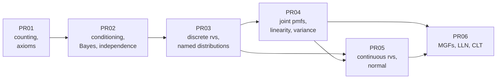

# Probability: Course Map (MT2113)

<span class="scope-taught">taught · in syllabus</span> <span class="scope-extra-book">extra · book</span>

Six chapters. PR01–PR05 follow the instructor's **typed class notes** (5 Aug – 10 Sep 2026, one merged 32-page PDF), the **handwritten post-midterm Week 1** notes (9 pages, with a homework page) and the seven **practice-problem sheets** (7 Aug – 17 Sep). PR06 (MGFs, moments, limit theorems) is the part for which there is **no lecture note**; it is built from AI-written notes and the textbooks and marked 🟡.

> [!warning] What is and is not in the sources
> - **Taught (🟢)**: counting and axioms, conditional probability and independence, discrete random variables and the named discrete distributions, joint pmfs, linearity of expectation, variance, continuous random variables with the uniform, logistic, Rayleigh and normal laws.
> - **Not formally in the syllabus (the instructor says so)**: continuity of probability (§2 of 12 Aug), the proofs of the cdf properties (right-continuity), gambler's ruin, the variance of a sum of independent variables ("not proved in class, possibly not in this course").
> - **No lecture source (🟡)**: MGFs, skewness/kurtosis, Chebyshev, the law of large numbers, the CLT, the exponential distribution. The AI notes record a **course policy**: MGFs may be used in homework and exams, but each named MGF must be derived from first principles first. **Ask the instructor** whether these are examinable.
> - The 9 Sep notes refer to "updated class notes of 27 Aug" on transformations of random variables; the version in the folder is the earlier one. The cdf method for a transformation is covered from the 9 Sep remark, the homework (random circle) and the sheets.
> - Blitzstein and Hwang is a **scan** (not read; only cited by page where the class notes cite it); Ross has a text layer and was used as a cross-check.

## The storyline

Central thread: **probability is counting with a consistent set of rules (PR01) $\to$ new information shrinks the sample space (PR02) $\to$ a random variable summarises an outcome by a number and each named distribution answers a counting question (PR03) $\to$ expectation is linear, spread is the variance (PR04) $\to$ replace sums by integrals (PR05) $\to$ sums of many independent pieces become normal (PR06).**

## Chapters
| # | Chapter | Main sources | Status |
|---|---|---|---|
| 01 | [[PR01 Counting and the Axioms of Probability]] | class notes 5, 6, 12 Aug; sheets 7 and 14 Aug | draft |
| 02 | [[PR02 Conditional Probability Bayes Rule and Independence]] | class notes 13, 19 Aug; sheets 14 and 21 Aug | draft |
| 03 | [[PR03 Discrete Random Variables and Distributions]] | class notes 20, 27 Aug, 2 Sep; sheet 28 Aug | draft |
| 04 | [[PR04 Joint Distributions Expectation and Variance]] | class notes 2, 9 Sep; sheets 4, 11–12 and 17 Sep | draft |
| 05 | [[PR05 Continuous Random Variables]] | class notes 10 Sep; handwritten week 1 (post midterm); sheet 17 Sep | draft |
| 06 | [[PR06 Moments Generating Functions and Limit Theorems]] | AI notes (moments and MGFs); Ross, Blitzstein–Hwang | draft (🟡) |

```dataview
TABLE chapter AS "#", scope AS "Scope", status AS "Status"
FROM #subject/probability AND #type/chapter
SORT chapter ASC
```

## Sources and what they are
| ID | File | What it is | Role |
|---|---|---|---|
| CN | [[ilovepdf_merged-1.pdf]] | the instructor's typed class notes, 5 Aug – 10 Sep 2026 (32 pp; p.1–2 counting, 3–6 sample space and axioms, 7–11 properties and inclusion-exclusion, 12–14 conditioning, 15–16 Bayes and independence, 17–19 random variables, 20–22 Poisson and expectation, 23–26 joint pmfs and waiting times, 27 variance, 28–30 continuous rvs, 31–32 appendices) | taught: PR01–PR05 |
| W1 | [[week1_mt2113.pdf]] | handwritten post-midterm Week 1 notes (9 pp images): homework (p.1–2), pdf/cdf, uniform, logistic, Rayleigh, LOTUS, variance, standard normal | taught: PR05 |
| S7–S17 | [[Practice problems 7th August 2026.pdf]], [[Practice problems 14th August 2026.pdf]], [[Practice problems 21st August 2026.pdf]], [[Practice problems 28th August and following weekend.pdf]], [[Practice problems 4th September 2026.pdf]], [[Practice problems weekend of 12th September 2026.pdf]], [[Practice problems 17th September and following tutorial and weekend.pdf]] | weekly practice sheets with hints | taught: all chapters |
| AI | `probability_notes.pdf`, `probability_moments_and_mgf_notes.pdf`, `mt2113_week1_notes.pdf`, `prob_prems_problems.pdf` (+ `.tex`) | AI-written notes: class-notes companion, moments and MGFs (with the MGF policy), a typed version of week 1, a rigorous problem set | secondary; PR06 and cross-checks |
| BK | `A-First-Course-in-Probability-8th-ed.pdf` (Ross, text), `Blitzstein Hwang Probability.pdf` (scan) | textbooks | extra/book |

## Gaps (to ask the instructor / supply later)
- Is PR06 (MGFs, LLN, CLT, Chebyshev, exponential) examinable? Is there a later lecture on it?
- The "updated 27 Aug class notes" on transformations of random variables; the typed notes after 10 Sep (continuous joint distributions, conditional densities?), if they exist.
- Whether **gambler's ruin**, the **continuity of probability** and the **variance of a sum** are to be examined or are background only.
- A statement of the mid-semester and end-semester syllabus.

## Why this subject is tightly linked to the others
- **Quantum mechanics:** $|\psi|^2$ is a pdf, expectation values and uncertainties are $E$ and $\sqrt{\mathrm{Var}}$, a measurement is conditioning ([[Quantum Mechanics - Course Map]], [[QM01 From Waves to Probabilities]], [[QM03 States Operators and Measurement]]).
- **Thermodynamics and statistical mechanics:** counting microstates, the Boltzmann factor, Gaussian fluctuations $\sim1/\sqrt N$, the Poisson number of molecules in a volume ([[Thermodynamics - Course Map]], [[TH06 From Kinetic Theory to Statistical Mechanics]]).
- **Ecology and evolution:** demographic stochasticity (binomial and Poisson births and deaths), extinction probabilities, Bayesian inference and model selection ([[Ecology and Evolution - Course Map]], [[Bayes' Theorem]], [[Akaike Information Criterion]], [[EE02 Structured Population Models]], [[EE07 Conservation Biology]]).
- **Climate:** extremes, return periods, sampling error of means, ensemble averages ([[Climate - Course Map]] where present).
- **Foundations:** [[Gaussian Integral]] (the polar-coordinate trick), [[Dimensional Analysis]].

## Revision
- A printable formula sheet: [[pr-formula-sheet.pdf]] (2 pages).
- Practice with solutions lives at the end of each chapter (6 × 10 problems); the weekly sheets are the best source of further problems.

## Concept index
```dataview
LIST FROM #type/concept AND #subject/probability SORT file.name ASC
```

See [[Subject Map]] for how this subject relates to the others and [[Roadmap]] for its place in the plan.
