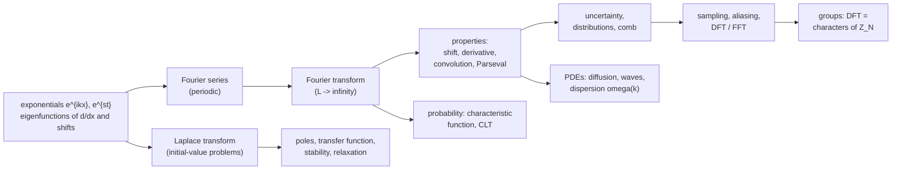

# Fourier and Laplace Transforms

[[09-Foundations|Foundations]] · used by [[Quantum Mechanics - Course Map|QM]], [[Waves - Course Map|Waves]], [[Probability - Course Map|Probability]], [[Climate - Course Map|Climate]], [[Landscapes and Geomorphology - Course Map|Landscapes]], [[Thermodynamics - Course Map|Thermodynamics]], [[Group Theory - Course Map|Group Theory]]

> [!summary] What this chapter is
> A self-contained, beginner-accessible but rigorous account of the two transforms that appear in almost every subject of this vault: **Fourier** (waves, spectra, diffusion, uncertainty, sampling) and **Laplace** (initial-value problems, relaxation, stability, transfer functions). Nothing here is a course of its own; it exists so that every other chapter can say "Fourier" or "Laplace" and point to one place. There is **no lecture source** for this material in the repository; it is standard mathematics written out in the vault's style, and *every number quoted was checked by computation* (`scripts/ft_numbers.py`, 20 checks; figures from `scripts/fig_ft.py`).

> [!key] After this chapter you can
> - expand a periodic function in a **Fourier series**, read its coefficients off, and say how fast they decay and why (smoothness), including the **Gibbs phenomenon** and its exact size (8.95 % of the jump),
> - define the **Fourier transform** in the vault's convention, write down the standard pairs, and prove the key **properties** (shift, scaling, derivative, convolution theorem, Parseval/Plancherel),
> - prove the **uncertainty principle** $\Delta x\,\Delta k\ge\tfrac12$ and explain why only the Gaussian saturates it,
> - use **distributions** ($\delta$, the Dirac comb, Poisson summation) and derive the **sampling theorem** and **aliasing**; use the **DFT/FFT** correctly (leakage, windows, resolution),
> - solve linear **PDEs** (diffusion, waves, Schrödinger, flexure, potential fields) mode by mode through the **dispersion relation** $\omega(k)$,
> - define the **Laplace transform**, invert it by partial fractions, solve **ODEs with initial conditions**, and read **stability and relaxation times from poles** (including critical slowing down at tipping points),
> - connect everything: **characteristic and moment-generating functions** and the CLT, and the **DFT as the character table of $\mathbb Z_N$**.

> [!intuition] The one-sentence story
> Many problems are hard because the unknown is tangled up with its own derivatives; both transforms re-express the unknown in a basis of **exponentials** $e^{ikx}$ or $e^{st}$, which are the "eigenvectors" of differentiation and shifting, so that calculus turns into multiplication and a differential equation turns into algebra.

![[Fourier Laplace Map.svg]]
*Diagram F0. The chapter in one page. Editable source: [[Fourier Laplace Map.excalidraw]].*

*Concept map.*

## 0. Conventions (read once)
> [!key] The vault's convention for the Fourier transform
> $$\tilde f(k)=\frac1{\sqrt{2\pi}}\int_{-\infty}^{\infty}f(x)\,e^{-ikx}\,\mathrm dx,\qquad f(x)=\frac1{\sqrt{2\pi}}\int_{-\infty}^{\infty}\tilde f(k)\,e^{ikx}\,\mathrm dk.$$
> This is the **unitary** (symmetric) convention of the quantum notes ([[Fourier Transform and Wave Packets]]): the two directions look alike, and $\int\lvert f\rvert^2\mathrm dx=\int\lvert\tilde f\rvert^2\mathrm dk$ with no factors. For time signals write $t$ and $\omega$ in place of $x$ and $k$. **Books differ; here is the dictionary** (the single most common source of "off by $2\pi$" errors):
> | Source of the convention | Forward transform | Inverse | Gaussian $e^{-\pi x^2}$ maps to |
> |---|---|---|---|
> | **vault / quantum (unitary, $k$)** | $\frac1{\sqrt{2\pi}}\int f e^{-ikx}\mathrm dx$ | $\frac1{\sqrt{2\pi}}\int\tilde fe^{ikx}\mathrm dk$ | $(2\pi)^{-1/2}e^{-k^2/4\pi}$ |
> | physics/engineering ($\omega$, non-unitary) | $\int f e^{-i\omega t}\mathrm dt$ | $\frac1{2\pi}\int F e^{i\omega t}\mathrm d\omega$ | $e^{-\omega^2/4\pi}$ |
> | mathematics / signal processing (frequency $\nu$) | $\int fe^{-2\pi i\nu t}\mathrm dt$ | $\int\hat fe^{2\pi i\nu t}\mathrm d\nu$ | $e^{-\pi\nu^2}$ (self-dual) |
> To convert, remember $k=2\pi\nu$ and that the factor $2\pi$ sits wherever the convention puts it; a **Plancherel check** ($\int\lvert f\rvert^2=\int\lvert\tilde f\rvert^2$, up to the same factor) catches mistakes. *Sign of the exponent:* physicists often use $e^{-i\omega t}$ for a wave travelling right ($e^{i(kx-\omega t)}$); the forward transform of a time signal then carries $e^{+i\omega t}$. Always check which sign a source uses.

> [!pitfall] Which Gaussian is "self-dual"?
> With the unitary convention the Gaussian $e^{-x^2/2\sigma^2}$ maps to $\sigma e^{-\sigma^2k^2/2}$ (checked numerically in §3.3), so the self-dual one is $e^{-x^2/2}$. The function $e^{-\pi x^2}$ is self-dual only in the **frequency ($\nu$) convention** (third row); in the unitary $k$-convention it maps to $(2\pi)^{-1/2}e^{-k^2/4\pi}$ (row 1). Do not mix the two.

## 1. The big idea: exponentials diagonalise calculus
> [!intuition] A chord and its notes
> A sound wave is a single curve $p(t)$, but your ear splits it into *notes*: sinusoids of different frequencies and amplitudes. Fourier analysis is exactly that splitting; Fourier synthesis is adding the notes back. A prism does it for light. The reason it is useful and not just pretty is the next calculation.

> [!derivation] Exponentials are eigenfunctions of every linear time-invariant (LTI) operation
> **Derivative.** $\dfrac{\mathrm d}{\mathrm dt}e^{st}=s\,e^{st}$: the function comes back multiplied by a number. **Shift.** $e^{s(t-a)}=e^{-sa}e^{st}$. **Any LTI system** (one whose output for a time-shifted input is the same output shifted, e.g. a spring–damper, a river reach, an electric filter): let $L$ commute with shifts $T_a[f](t)=f(t-a)$ and suppose $L[e^{st}]=g(t)$. Then
> $$L[e^{s(t-a)}]=e^{-sa}L[e^{st}]\ \text{and also}\ =T_aL[e^{st}]=g(t-a)\ \Longrightarrow\ g(t-a)=e^{-sa}g(t)\ \text{for all }a.$$
> Setting $t=0$: $g(-a)=e^{-sa}g(0)$, so $g(t)=g(0)\,e^{st}$. Hence $L[e^{st}]=H(s)\,e^{st}$ with $H(s)=g(0)$: **an exponential in gives the same exponential out, times a complex number $H(s)$** (the *transfer function*). If the input is a sum of exponentials, the output is the same sum with each term multiplied by its own $H$: the problem has been **diagonalised**, exactly as one diagonalises a symmetric matrix by its eigenvectors. The transforms are the machinery that (a) writes any reasonable input as such a sum or integral and (b) sums the output back.
> *Fourier:* $s=ik$ or $s=i\omega$ (pure oscillations); *Laplace:* general complex $s$ (oscillation **and** growth/decay).

> [!example] What "diagonalise" buys you
> The relaxation law $\tau\dot z+z=z_{eq}(t)$ of [[LS01 Landscapes as Physical Systems]]. Put $z_{eq}=e^{i\omega t}$ and look for $z=H\,e^{i\omega t}$: $(i\omega\tau+1)H=1$, so $H(i\omega)=\dfrac1{1+i\omega\tau}$ with $\lvert H\rvert=1/\sqrt{1+\omega^2\tau^2}$ and phase lag $\arctan\omega\tau$: *exactly* the low-pass filter derived there by hand. No integration was done: only algebra.

## 2. Fourier series: periodic functions
### 2.1 Orthogonality and the coefficients
> [!key] Setting
> Let $f$ have period $2\pi$ (for period $2L$ replace $x$ by $\pi x/L$ throughout). The functions $1,\cos nx,\sin nx$ ($n=1,2,\ldots$) are **orthogonal** on $[-\pi,\pi]$:
> $$\int_{-\pi}^{\pi}\cos mx\cos nx\,\mathrm dx=\pi\delta_{mn},\quad\int\sin mx\sin nx\,\mathrm dx=\pi\delta_{mn},\quad\int\sin mx\cos nx\,\mathrm dx=0\quad(m,n\ge1).$$
> *Proof of the first (the rest are the same):* $\cos mx\cos nx=\tfrac12[\cos(m-n)x+\cos(m+n)x]$ and $\int_{-\pi}^{\pi}\cos jx\,\mathrm dx=2\pi\delta_{j0}$ for integer $j$. ∎

> [!derivation] Coefficients: "project onto each note"
> Assume $f=\tfrac12a_0+\sum_{n\ge1}(a_n\cos nx+b_n\sin nx)$ and integrate against $\cos mx$ or $\sin mx$ term by term; orthogonality kills every term but one:
> $$a_n=\frac1\pi\int_{-\pi}^{\pi}f(x)\cos nx\,\mathrm dx,\qquad b_n=\frac1\pi\int_{-\pi}^{\pi}f(x)\sin nx\,\mathrm dx.$$
> **Complex form (cleaner, and the one that becomes the Fourier transform).** With $\cos nx=\tfrac12(e^{inx}+e^{-inx})$, $\sin nx=\tfrac1{2i}(e^{inx}-e^{-inx})$:
> $$f(x)=\sum_{n=-\infty}^{\infty}c_ne^{inx},\qquad c_n=\frac1{2\pi}\int_{-\pi}^{\pi}f(x)e^{-inx}\,\mathrm dx,\qquad c_n=\tfrac12(a_n-ib_n),\ c_{-n}=\overline{c_n}\ \text{if $f$ is real.}$$
> Orthogonality in the complex form: $\frac1{2\pi}\int_{-\pi}^{\pi}e^{i(m-n)x}\mathrm dx=\delta_{mn}$. **Symmetry shortcuts:** even $f$ has only cosines ($b_n=0$), odd $f$ only sines ($a_n=0$).

> [!intuition] Vectors in a very long list
> A periodic function is a vector with one component per point; the exponentials $e^{inx}$ are an **orthonormal basis** (with the inner product $\langle f,g\rangle=\frac1{2\pi}\int\bar fg$), and $c_n=\langle e^{inx},f\rangle$ is the component along the $n$-th basis vector, exactly as $v_i=\mathbf e_i\cdot\mathbf v$ in $\mathbb R^3$. All the formulae of Dirac notation ([[Dirac Algebra]]) apply: $c_n=\langle n|f\rangle$, completeness $\sum_n|n\rangle\langle n|=1$.

### 2.2 Three examples (all coefficients checked numerically)
> [!example] Square wave $f=\operatorname{sgn}(\sin x)$ on $(-\pi,\pi)$
> Odd, so only $b_n$: $b_n=\frac2\pi\int_0^\pi\sin nx\,\mathrm dx=\frac{2}{n\pi}\,(1-\cos n\pi)=\begin{cases}4/n\pi&n\text{ odd}\\0&n\text{ even.}\end{cases}$ Hence
> $$\operatorname{sgn}(\sin x)=\frac4\pi\Big(\sin x+\frac{\sin3x}3+\frac{\sin5x}5+\cdots\Big).$$
> *Meaning:* the lowest note carries most of the energy, and harmonics fade like $1/n$: the discontinuity makes the series converge slowly.

> [!example] Sawtooth $f=x$ on $(-\pi,\pi)$
> Odd: $b_n=\frac2\pi\int_0^\pi x\sin nx\,\mathrm dx=\frac{2(-1)^{n+1}}{n}$, so $x=2\sum_{n\ge1}\dfrac{(-1)^{n+1}}n\sin nx$. At $x=\pi/2$ this gives **Leibniz's series** $\tfrac\pi4=1-\tfrac13+\tfrac15-\cdots$. The jump at $x=\pm\pi$ (the periodic extension is discontinuous there) again gives $1/n$ decay.

> [!example] Triangle wave $f=\lvert x\rvert$ on $(-\pi,\pi)$
> Even: $a_0=\pi$, $a_n=\frac2\pi\int_0^\pi x\cos nx\,\mathrm dx=\frac{2}{\pi n^2}\big((-1)^n-1\big)=-\frac{4}{\pi n^2}$ (odd $n$), $0$ (even $n$). Here the function is continuous with only a *kink*, and the coefficients decay like $1/n^2$ (compare the square wave's $1/n$).

### 2.3 Parseval's identity and sums you can now do
> [!derivation] Parseval: energy is the same in either description
> Multiply the series by $\bar f$ and integrate (completeness lets one exchange sum and integral in $L^2$): 
> $$\frac1{2\pi}\int_{-\pi}^{\pi}\lvert f\rvert^2\mathrm dx=\sum_{n=-\infty}^{\infty}\lvert c_n\rvert^2=\frac{a_0^2}4+\frac12\sum_{n\ge1}(a_n^2+b_n^2).$$
> **Check (square wave):** left side $=1$; right side $\tfrac12\sum_{\text{odd }n}16/\pi^2n^2=\tfrac8{\pi^2}\cdot\tfrac{\pi^2}8=1$ ✓ (numerically $0.9999980$ with $10^5$ terms), which *proves* $\sum_{\text{odd}}1/n^2=\pi^2/8$. **Basel problem:** for the sawtooth, $\frac1{2\pi}\int x^2\,\mathrm dx=\pi^2/3=\tfrac12\sum b_n^2=2\sum1/n^2$, so $\displaystyle\sum_{n=1}^\infty\frac1{n^2}=\frac{\pi^2}6$ (computed: $1.644932$ with $4\times10^5$ terms; $\zeta(2)=1.644934$).

### 2.4 Convergence: what the series actually does
> [!key] Three levels of convergence (stated; Dirichlet, Fejér, Carleson)
> - **In the mean square ($L^2$)**: always, if $\int\lvert f\rvert^2<\infty$; this is Parseval.
> - **Pointwise (Dirichlet):** if $f$ is piecewise smooth, the series converges at every $x$ to $\tfrac12[f(x^+)+f(x^-)]$: at a jump it goes to the **midpoint**.
> - **Uniformly:** if $f$ is continuous and piecewise smooth (no jumps).
> **Decay of the coefficients measures smoothness.** Integrating by parts, $c_n=\frac1{2\pi}\int fe^{-inx}\mathrm dx=\frac1{in}\cdot\frac1{2\pi}\int f'e^{-inx}\mathrm dx+\text{boundary terms}$: each derivative that exists (and is integrable) buys one factor $1/n$:
> | $f$ is | coefficients decay like | example |
> |---|---|---|
> | discontinuous (jump) | $1/n$ | square wave, sawtooth |
> | continuous, kink | $1/n^2$ | triangle wave |
> | $C^{m-1}$, $f^{(m)}$ has jumps | $1/n^{m+1}$ | smoother splines |
> | infinitely smooth ($C^\infty$) | faster than any power | bump functions |
> | analytic in a strip | exponentially | $1/(2-\cos x)$ |
> This is why a **smooth landscape has a steep red spectrum** (little short-wavelength energy) and why a DEM with a cliff or a river bank has a slowly decaying spectrum ([[LS03 Digital Elevation Models and Terrain Analysis]]).

### 2.5 The Gibbs phenomenon, exactly
> [!derivation] Why the partial sums overshoot a jump by 8.95 %
> Let $S_N(x)=\frac4\pi\sum_{m=1}^{N}\frac{\sin(2m-1)x}{2m-1}$ (the first $N$ non-zero terms of the square wave). Differentiating, $S_N'(x)=\frac4\pi\sum_{m=1}^N\cos(2m-1)x=\frac2\pi\frac{\sin2Nx}{\sin x}$ (sum of a geometric series of exponentials). The first maximum to the right of the jump is where this first vanishes, $x_N=\pi/2N$, and
> $$S_N(x_N)=\int_0^{\pi/2N}\frac2\pi\frac{\sin2Nx}{\sin x}\,\mathrm dx\ \xrightarrow{N\to\infty}\ \frac2\pi\int_0^{\pi}\frac{\sin u}{u}\,\mathrm du=\frac2\pi\,\mathrm{Si}(\pi)=1.17898\ldots$$
> (substitute $u=2Nx$, $\sin x\approx x$). The target is $1$, so the **overshoot is $0.179$, i.e. $8.95\,\%$ of the full jump of 2**, *independent of $N$*: more terms squeeze the overshoot into a narrower region next to the jump, but never lower it. Computed values: $N=1$: $13.7\,\%$; $N=3$: $9.42\,\%$; $N=10$: $8.99\,\%$; $N=200$: $8.949\,\%$. Mean-square error tends to zero (middle and right panels) but the maximum error does not: **$L^2$ convergence is not uniform convergence.**

![[fig_ft01_gibbs.png]]
*Figure F1. Left: the first, third and tenth partial sums of the square wave. Middle: zoom at the jump; the overshoot stays at $1.179$. Right: the rms error shrinks, the peak overshoot does not (both computed).*

> [!pitfall] Gibbs is real, not an artefact of plotting
> It shows up wherever a sharp edge is cut off in frequency: ringing in an over-sharpened image, the "wiggles" before a DEM cliff after low-pass filtering, spectral ocean models near coastlines. **Cure:** damp the high harmonics smoothly (Fejér/Cesàro averages, or a window; §5.4) at the price of blurring the edge.

## 3. The Fourier transform
### 3.1 From the series to the transform
> [!derivation] Let the period go to infinity
> Take period $2L$: $f(x)=\sum_nc_ne^{in\pi x/L}$ with $c_n=\frac1{2L}\int_{-L}^{L}f(x)e^{-in\pi x/L}\mathrm dx$. Put $k_n=n\pi/L$, spacing $\Delta k=\pi/L$, and define $\tilde f(k)=\frac1{\sqrt{2\pi}}\int_{-L}^{L}f(x)e^{-ikx}\mathrm dx$ so that $c_n=\frac{\Delta k}{\sqrt{2\pi}}\tilde f(k_n)$ (since $\frac1{2L}=\frac{\Delta k}{2\pi}$). Then
> $$f(x)=\frac1{\sqrt{2\pi}}\sum_n\tilde f(k_n)e^{ik_nx}\Delta k\ \xrightarrow{L\to\infty}\ \frac1{\sqrt{2\pi}}\int_{-\infty}^{\infty}\tilde f(k)e^{ikx}\mathrm dk,$$
> a Riemann sum turning into an integral. *The discrete notes of a periodic function have merged into a continuous band*: a non-periodic function contains **all** wavenumbers, with a density $\tilde f(k)$.

### 3.2 What is proved, and in which sense
> [!key] Inversion, Plancherel, Riemann–Lebesgue (stated)
> - **Inversion.** If $f\in L^1$ and $\tilde f\in L^1$ then the inversion formula holds at every point where $f$ is continuous.
> - **Plancherel.** The transform extends from $L^1\cap L^2$ to a **unitary** map $L^2\to L^2$: $\displaystyle\int\lvert f\rvert^2\mathrm dx=\int\lvert\tilde f\rvert^2\mathrm dk$ and $\int\bar fg\,\mathrm dx=\int\bar{\tilde f}\tilde g\,\mathrm dk$ (the QM statement is [[Parseval-Plancherel Theorem]]: norm, and hence total probability, is the same in position and momentum space).
> - **Riemann–Lebesgue.** $f\in L^1\Rightarrow\tilde f$ is continuous and $\tilde f(k)\to0$ as $\lvert k\rvert\to\infty$ (a wave that oscillates faster and faster averages $f$ to zero).
> - **Tempered distributions** ($\delta$, $1$, $e^{ik_0x}$, the comb) have transforms too; §4.

### 3.3 Standard pairs (all numerically verified)
> [!derivation] The Gaussian: three ways to the same answer
> Let $f=e^{-x^2/2\sigma^2}$. **(i) Complete the square:** $-\frac{x^2}{2\sigma^2}-ikx=-\frac1{2\sigma^2}(x+i\sigma^2k)^2-\frac{\sigma^2k^2}2$, shift the contour (the integrand is entire and decays), and use $\int e^{-u^2/2\sigma^2}\mathrm du=\sigma\sqrt{2\pi}$ ([[Gaussian Integral]]): $\tilde f(k)=\sigma\,e^{-\sigma^2k^2/2}$. **(ii) Differential equation:** $f'=-\frac{x}{\sigma^2}f$; transform ($x\to i\,\mathrm d/\mathrm dk$, $\mathrm d/\mathrm dx\to ik$; §3.4): $ik\tilde f=-\frac{i}{\sigma^2}\tilde f'$, i.e. $\tilde f'=-\sigma^2k\tilde f$, so $\tilde f=\tilde f(0)e^{-\sigma^2k^2/2}$ with $\tilde f(0)=\frac1{\sqrt{2\pi}}\sigma\sqrt{2\pi}=\sigma$. **(iii) Uniqueness of the shape:** the Gaussian is the only family that equals its own transform up to scale. *A narrow Gaussian in $x$ is a broad Gaussian in $k$; the width product is fixed.*

| $f(x)$ | $\tilde f(k)$ | Notes |
|---|---|---|
| $e^{-x^2/2\sigma^2}$ | $\sigma\,e^{-\sigma^2k^2/2}$ | self-dual for $\sigma=1$; **minimum uncertainty** |
| $\mathbf 1_{\lvert x\rvert<a}$ (rectangle) | $\sqrt{\tfrac2\pi}\,\dfrac{\sin ka}{k}=a\sqrt{\tfrac2\pi}\,\mathrm{sinc}\,ka$ | $\mathrm{sinc}\,u=\sin u/u$; slow $1/k$ decay: the rectangle has jumps |
| $(1-\lvert x\rvert/a)_+$ (triangle) | $\dfrac a{\sqrt{2\pi}}\,\mathrm{sinc}^2\!\tfrac{ka}2$ | triangle $=$ rect $*$ rect; $\mathrm{sinc}^2$ decays like $1/k^2$ |
| $e^{-a\lvert x\rvert}$ | $\sqrt{\tfrac2\pi}\,\dfrac a{a^2+k^2}$ | Lorentzian; kink at 0 gives $1/k^2$ |
| $\dfrac1{x^2+a^2}$ | $\sqrt{\tfrac\pi2}\,\dfrac{e^{-a\lvert k\rvert}}a$ | duality of the previous row |
| $\mathrm{sech}\,x$ | $\sqrt{\tfrac\pi2}\,\mathrm{sech}\tfrac{\pi k}2$ | soliton shape; self-similar |
| $\delta(x)$ | $\dfrac1{\sqrt{2\pi}}$ | all wavenumbers equally ([[Dirac Delta Function]]) |
| $1$ | $\sqrt{2\pi}\,\delta(k)$ | one wavenumber, $k=0$ |
| $e^{ik_0x}$ | $\sqrt{2\pi}\,\delta(k-k_0)$ | a plane wave is one point in $k$ ([[Plane Wave]]) |
| $\theta(x)e^{-ax}$ | $\dfrac1{\sqrt{2\pi}\,(a+ik)}$ | one-sided: complex, causal |
| Hermite functions $\psi_n$ | $(-i)^n\psi_n(k)$ | eigenfunctions of the transform ([[Fourier Invariance of Hermite Functions]]) |
*Rows 1–5 were each checked by numerical quadrature at two wavenumbers (agreement to $10^{-6}$ or better: `scripts/ft_numbers.py`).*

![[fig_ft02_pairs.png]]
*Figure F2. Three pairs. The rectangle's transform is a sinc with side-lobes (jump $\Rightarrow$ slow decay); the exponential's is a Lorentzian (kink $\Rightarrow$ $1/k^2$); the Gaussian's is a Gaussian.*

### 3.4 The properties, with proofs
> [!key] Rules (all follow from the definition; each is a one-line proof)
> | Operation on $f$ | Effect on $\tilde f$ | Proof idea |
> |---|---|---|
> | linearity $af+bg$ | $a\tilde f+b\tilde g$ | integral is linear |
> | **shift** $f(x-a)$ | $e^{-ika}\tilde f(k)$ | substitute $u=x-a$ |
> | **modulation** $e^{ik_0x}f(x)$ | $\tilde f(k-k_0)$ | combine the exponentials |
> | **scaling** $f(cx)$ | $\frac1{\lvert c\rvert}\tilde f(k/c)$ | substitute $u=cx$: *squeezing in $x$ spreads in $k$* |
> | **derivative** $f'(x)$ | $ik\,\tilde f(k)$ | integrate by parts, boundary terms vanish |
> | multiplication $xf(x)$ | $i\,\tilde f'(k)$ | differentiate under the integral |
> | **convolution** $(f*g)(x)=\int f(y)g(x-y)\mathrm dy$ | $\sqrt{2\pi}\,\tilde f\,\tilde g$ | Fubini + shift rule |
> | product $fg$ | $\frac1{\sqrt{2\pi}}(\tilde f*\tilde g)$ | duality |
> | **duality** | transforming twice gives $f(-x)$: $\tilde{\tilde f}(x)=f(-x)$ | inversion formula |
> | conjugate $\bar f$ | $\overline{\tilde f(-k)}$ | conjugate the integral |
> | **real** $f$ | $\tilde f(-k)=\overline{\tilde f(k)}$: $\lvert\tilde f\rvert$ even | conjugate rule |
> | even/odd $f$ | even/odd, real/imaginary $\tilde f$ | symmetry of the integrand |
> Unitary convention: **the factor $\sqrt{2\pi}$ in the convolution theorem** is the price of the symmetric normalisation (in the non-unitary $\omega$ convention it is just $F\cdot G$).

> [!derivation] Convolution theorem
> $$\widetilde{(f*g)}(k)=\frac1{\sqrt{2\pi}}\iint f(y)g(x-y)e^{-ikx}\,\mathrm dy\,\mathrm dx=\frac1{\sqrt{2\pi}}\int f(y)e^{-iky}\Big[\int g(u)e^{-iku}\mathrm du\Big]\mathrm dy=\sqrt{2\pi}\,\tilde f(k)\tilde g(k)\ \ (u=x-y).$$
> **Why it matters:** a *response to a distributed input* $y=h*u$ (superposition of shifted impulse responses) becomes, in frequency space, a plain **product** $\tilde y=\sqrt{2\pi}\,\tilde h\tilde u$: the transfer function of §1. And *averaging, smoothing and blurring are convolutions*, so each acts on the spectrum as a multiplication.

> [!example] A triangle is a rectangle convolved with itself
> The density of $X_1+X_2$ for independent uniforms on $(0,1)$ is the convolution of two rectangles: a triangle with peak $1$ (checked numerically, `max = 1.000`). Up to a shift, this is the triangle of the table with $a=1$. Check with the convolution theorem: the rectangle of half-width $\tfrac12$ has transform $\sqrt{2/\pi}\,\sin(k/2)/k=\tfrac1{\sqrt{2\pi}}\mathrm{sinc}(k/2)$, and $\sqrt{2\pi}\times\big(\tfrac1{\sqrt{2\pi}}\mathrm{sinc}(k/2)\big)^2=\tfrac1{\sqrt{2\pi}}\mathrm{sinc}^2(k/2)$, which is the table entry. This is the first step of the **central limit theorem** (§9): adding variables convolves densities, i.e. multiplies characteristic functions.

### 3.5 The uncertainty principle, proved
> [!derivation] $\Delta x\,\Delta k\ge\tfrac12$ for any function
> Let $f$ be normalised, $\int\lvert f\rvert^2=1$, centred so that $\langle x\rangle=\langle k\rangle=0$. Define $\Delta x^2=\int x^2\lvert f\rvert^2\mathrm dx$ and $\Delta k^2=\int k^2\lvert\tilde f\rvert^2\mathrm dk=\int\lvert f'\rvert^2\mathrm dx$ (the last equality is Plancherel applied to the derivative rule $\widetilde{f'}=ik\tilde f$). Cauchy–Schwarz gives
> $$\Big|\int xf\,\bar f'\,\mathrm dx\Big|^2\le\int x^2\lvert f\rvert^2\int\lvert f'\rvert^2=\Delta x^2\,\Delta k^2.$$
> Now $\operatorname{Re}\int xf\bar f'\mathrm dx=\tfrac12\int x\,(\lvert f\rvert^2)'\,\mathrm dx=-\tfrac12\int\lvert f\rvert^2\mathrm dx=-\tfrac12$ (integrate by parts; boundary terms vanish). Therefore $\lvert\int xf\bar f'\rvert\ge\tfrac12$ and **$\Delta x\,\Delta k\ge\tfrac12$.** Equality in Cauchy–Schwarz requires $f'=-\lambda xf$ with real $\lambda>0$ (up to a constant phase), i.e. $f\propto e^{-\lambda x^2/2}$: **only the Gaussian saturates the bound.** ∎
> Multiply by $\hbar$ with $p=\hbar k$ to get $\Delta x\,\Delta p\ge\hbar/2$: Heisenberg's principle ([[Heisenberg Uncertainty Principle]]) is this **purely mathematical fact about waves**, and the general version for any two observables is the Robertson inequality of [[Dirac Algebra]] §8. The same inequality limits **time and frequency**: a pulse of duration $\Delta t$ cannot have bandwidth narrower than $1/(2\Delta t)$ (radar, seismology, spectroscopy).

![[fig_ft03_uncertainty.png]]
*Figure F3. Left, middle: Gaussians of three widths in $x$ and their $k$-space shapes. Right: the width product (standard deviations of $\lvert f\rvert^2$ and $\lvert\tilde f\rvert^2$) is exactly $0.500$ for a Gaussian and larger for every other shape tested: sech ($\pi/6=0.524$), triangle ($0.548$), $e^{-\lvert x\rvert}$ ($1/\sqrt2=0.707$). All by numerical integration.*

> [!pitfall] Three ways to misuse "uncertainty"
> 1. It concerns **spreads of $\lvert f\rvert^2$ and $\lvert\tilde f\rvert^2$**; for a function with heavy tails (a Lorentzian) $\Delta x$ is infinite and the bound is trivially satisfied.
> 2. It is **not** a statement about measurement disturbance; it holds for sound, light and landscape profiles.
> 3. A *rectangular* pulse has a finite spread in $x$ but an infinite one in $k$ (the $1/k$ tail makes $\int k^2\lvert\tilde f\rvert^2$ diverge); sharp edges cost unboundedly many wavenumbers.

## 4. Distributions: $\delta$, the comb, and Poisson summation
> [!key] Why we need them
> Plane waves and delta spikes are not square-integrable, yet they are the most useful objects of all. A **tempered distribution** is a linear functional on smooth rapidly-decaying test functions $\varphi$; $\delta$ is $\varphi\mapsto\varphi(0)$ (sifting property), and derivatives, transforms and products with smooth functions are defined by moving the operation onto $\varphi$. The Fourier transform extends to all of them, which is what gives
> $$\int_{-\infty}^{\infty}e^{ikx}\,\mathrm dk=2\pi\,\delta(x)\qquad(\text{completeness of plane waves}).$$
> See [[Delta-Function Normalisation]] for how this is used in quantum mechanics.

> [!derivation] The Dirac comb, its transform, and the Poisson summation formula
> The **comb** $\operatorname{Ш}_T(x)=\sum_{n\in\mathbb Z}\delta(x-nT)$ is periodic; its Fourier series coefficients are $c_m=\frac1T\int_{-T/2}^{T/2}\delta(x)e^{-2\pi imx/T}\mathrm dx=\frac1T$ for every $m$, so
> $$\sum_n\delta(x-nT)=\frac1T\sum_me^{2\pi imx/T}\ \Longrightarrow\ \widetilde{\operatorname{Ш}_T}(k)=\frac{\sqrt{2\pi}}T\sum_m\delta\big(k-\tfrac{2\pi m}T\big):$$
> **the transform of a comb of spacing $T$ is a comb of spacing $2\pi/T$**: dense sampling in $x$ $\Leftrightarrow$ sparse copies in $k$. Pairing both sides with a test function gives the **Poisson summation formula** $\sum_nf(nT)=\frac1T\sum_m\hat f(m/T)$ (with $\hat f$ in the $\nu$ convention). **Check** with $f=e^{-\pi t x^2}$ (self-dual): $\sum_ne^{-\pi tn^2}=t^{-1/2}\sum_ne^{-\pi n^2/t}$ (a Jacobi theta identity): at $t=0.7$ both sides equal $1.2221051$ (computed, 16 digits). This identity is the engine of the sampling theorem next.

> [!example] Transforms of other generalised functions
> $\widetilde{\cos k_0x}=\sqrt{\tfrac\pi2}[\delta(k-k_0)+\delta(k+k_0)]$; the **step** $\theta(x)$ has $\tilde\theta=\frac1{\sqrt{2\pi}}\big[\pi\delta(k)+\mathrm{P}\tfrac1{ik}\big]$ ($\mathrm P$ = principal value), because $\theta=\tfrac12(1+\operatorname{sgn})$ and $\operatorname{sgn}'=2\delta$ gives $ik\,\widetilde{\operatorname{sgn}}=2/\sqrt{2\pi}$. The $1/k$ tail of the step's transform is the same slow decay as the square wave's coefficients.

## 5. Sampling, aliasing, the DFT and the FFT
### 5.1 The sampling theorem
> [!derivation] Why $2$ samples per period is enough, and why fewer is a disaster (Nyquist–Shannon)
> Sampling a signal $f(t)$ every $T=1/f_s$ means multiplying it by a comb: $f_s(t)=f(t)\operatorname{Ш}_T(t)$. By the product rule and the comb's transform (§4), **the spectrum of the sampled signal is the original spectrum repeated every $f_s$** (in frequency $\nu$):
> $$\hat f_s(\nu)=\sum_m\hat f(\nu-mf_s).$$
> If $\hat f$ vanishes for $\lvert\nu\rvert>B$ (**band-limited**) the copies do not overlap iff $f_s>2B$: then a low-pass filter (multiplication by a box in $\nu$, i.e. convolution with a sinc in $t$) recovers $f$ exactly: $f(t)=\sum_nf(nT)\,\mathrm{sinc}\big(\pi(t-nT)/T\big)$ (**Shannon interpolation**). If $f_s<2B$ the copies overlap and high frequencies are **folded** onto low ones: **aliasing**. The folding rule: apparent frequency $=\big\lvert\nu-f_s\,\mathrm{round}(\nu/f_s)\big\rvert$ (the **Nyquist frequency** $f_s/2$ is the largest frequency that survives).

> [!example] A 9 Hz wave sampled at 10 Hz masquerades as 1 Hz
> $\sin(2\pi\cdot9\,t_n)$ at $t_n=n/10$ equals $-\sin(2\pi\cdot1\,t_n)$ for every $n$ (since $9=10-1$): the samples cannot tell the two apart. The numerical FFT of the samples has its peak at **1.0 Hz** (checked). *Wagon wheels look like they turn backwards in films for the same reason.*

> [!example] A DEM is a sampled landscape
> A grid of spacing $\Delta=30$ m has a Nyquist wavelength of $2\Delta=60$ m. A real ridge–valley pattern of wavelength $40$ m is aliased: $1/\lambda_a=1/30-1/40=1/120$, i.e. it appears as a spurious **$120$ m** undulation (computed). This is the Fourier explanation of why slope and curvature from a coarse DEM are wrong ([[LS03 Digital Elevation Models and Terrain Analysis]]: the $\operatorname{sinc}(k\Delta)$ attenuation of finite differences is the transfer function of the stencil) and why a DEM should be low-pass filtered *before* subsampling, never after.

![[fig_ft04_aliasing.png]]
*Figure F4. Left: the 9 Hz wave (grey), its samples at 10 Hz (blue) and the 1 Hz alias through them (orange). Right: the folding map from true to apparent frequency.*

### 5.2 The discrete Fourier transform (DFT)
> [!key] Definition
> For $N$ samples $x_0,\ldots,x_{N-1}$ taken at spacing $T$ over a record of duration $\mathcal T=NT$:
> $$X_m=\sum_{n=0}^{N-1}x_n\,e^{-2\pi imn/N},\qquad x_n=\frac1N\sum_{m=0}^{N-1}X_me^{+2\pi imn/N}.$$
> $X_m$ is the amplitude at frequency $\nu_m=m/\mathcal T$ (resolution $\Delta\nu=1/\mathcal T$; $m>N/2$ are the negative frequencies); **the DFT is the Fourier series of the periodic extension of the record**. In matrix form $X=Fx$ with $F_{mn}=\omega^{mn}$, $\omega=e^{-2\pi i/N}$, and $FF^\dagger=N\,\mathbf 1$ (columns orthogonal; checked for $N=8$: `True`). The **convolution theorem** is for *cyclic* convolution: $\mathrm{IDFT}(X\cdot Y)=x\circledast y$ (checked); to get ordinary convolution pad with zeros.

### 5.3 The FFT
> [!intuition] Why it is called "fast"
> Evaluating $N$ sums of $N$ terms costs $N^2$ operations. The Cooley–Tukey idea: for even $N$ split the sum into even and odd samples, $X_m=E_m+\omega^mO_m$, where $E,O$ are DFTs of length $N/2$ (and they repeat with period $N/2$, so each is computed once). Recursing gives $\log_2N$ levels each costing $N$: **$N\log_2N$ operations**. For $N=2^{10}$ the speed-up over the direct sum is $102$; for $N=2^{20}\approx10^6$ it is **52 429** ($1.1\times10^{12}$ versus $2.1\times10^{7}$ operations). The FFT is what makes spectral methods, convolution of large images and DEM filtering practical.

### 5.4 Practical spectral analysis
> [!example] Leakage and windows
> A record of finite length is the true signal multiplied by a **rectangular window**; by the convolution theorem its spectrum is the true spectrum convolved with the window's transform, a sinc with side-lobes. A strong tone therefore **leaks** into neighbouring bins and can bury a weak tone nearby. The highest side-lobe of the rectangular window is $-13.3$ dB; tapering the record smoothly to zero (**Hann** window) lowers it to $-31.5$ dB (computed) at the cost of a wider main lobe (poorer resolution): the same Gibbs/sharpness trade-off as in §2.5.

![[fig_ft05_window.png]]
*Figure F5. A strong tone at 20.3 cycles per record and a weak one ($-40$ dB) at 27. With the rectangular window the weak tone is lost in the side-lobes; with a Hann window it is visible.*

> [!pitfall] Seven habits that prevent wrong spectra
> 1. **Resolution is $1/\mathcal T$**, not finer: two lines closer than that cannot be separated. 2. **Zero-padding interpolates the spectrum smoothly; it adds no information.** 3. **Remove the mean and trend first**, or the zero-frequency bin dominates. 4. **Window** unless the signal is exactly periodic in the record. 5. **Anti-alias before sampling.** 6. Mind the **normalisation** (power per bin versus power spectral density per Hz; $2\times$ for one-sided spectra). 7. For non-stationary signals (a changing frequency) a single FFT hides *when*; use short-time transforms or wavelets, limited by the uncertainty principle.

### 5.5 The DFT as the character table of $\mathbb Z_N$: a bridge to group theory
> [!derivation] Why exponentials are *the* basis for translation-invariant problems
> The cyclic group $\mathbb Z_N$ (translations of $N$ points on a ring) has $N$ **one-dimensional irreducible representations** $\chi_m(n)=\omega^{mn}$ (as many irreps as conjugacy classes: all $N$ elements are their own classes, [[GT10 Symmetry Representations and Characters]]). Their characters form the **character table of $\mathbb Z_N$, which is exactly the DFT matrix $F$**; the orthogonality relations of that chapter are $FF^\dagger=N\mathbf 1$ (rows) and $F^\dagger F=N\mathbf 1$ (columns). The same pattern holds for the other translation groups: $\mathbb R\leftrightarrow$ Fourier transform (characters $e^{ikx}$), the circle $S^1=\mathbb R/2\pi\mathbb Z\leftrightarrow$ Fourier series (characters $e^{inx}$), $\mathbb Z\leftrightarrow$ discrete-time transform. **Convolution theorem = the group algebra:** convolving functions on the group is multiplying them in the character basis, which is why any *translation-invariant* (LTI) operation is diagonal in this basis (§1). For **non-Abelian** groups the characters no longer suffice and one uses matrix representations (non-commutative harmonic analysis; spherical harmonics $Y_\ell^m$ are the Fourier basis of the sphere and each degree $\ell$ is one irrep of $SO(3)$, [[LS05 Shape of Planets]]).

![[fig_ft08_dft_characters.png]]
*Figure F6. The DFT matrix for $N=8$: real and imaginary parts (rows are the 8 characters of $\mathbb Z_8$) and the orthogonality check $\lvert FF^\dagger\rvert/N=\mathbf 1$.*

## 6. Fourier methods for differential equations
> [!key] The master recipe
> For a **linear, constant-coefficient** equation, transform in the translation-invariant variable. Each term $\partial_x^n$ becomes $(ik)^n$, so the PDE becomes an **ODE in the other variable for each $k$**, solved independently ("mode by mode"). The $k$-dependence of the solution's time behaviour, $e^{-i\omega(k)t}$, is the **dispersion relation** $\omega(k)$, which contains all the physics.

### 6.1 Diffusion
> [!derivation] The heat/hillslope equation $\partial_tu=D\,\partial_x^2u$
> Transform in $x$: $\partial_t\tilde u=-Dk^2\tilde u$, so $\tilde u(k,t)=\tilde u(k,0)\,e^{-Dk^2t}$: **every mode decays at its own rate $Dk^2$, short wavelengths first.** Multiplying by $e^{-Dk^2t}$ is convolving with the transform of that Gaussian, which is again a Gaussian,
> $$u(x,t)=\int G(x-y,t)\,u(y,0)\,\mathrm dy,\qquad G=\frac1{\sqrt{4\pi Dt}}\,e^{-x^2/4Dt}\qquad(\sigma^2=2Dt).$$
> A delta-function initial condition spreads into this **Gaussian kernel**; any initial shape is a superposition of such spreading spikes. *Numbers:* a sinusoidal hillslope of wavelength $\lambda$ decays with time constant $\tau=1/Dk^2=\lambda^2/4\pi^2D$; for $D=0.01\ \mathrm{m^2yr^{-1}}$: $\lambda=10$ m: $253$ yr; $\lambda=100$ m: **$2.5\times10^4$ yr**; $\lambda=1$ km: $2.5\times10^6$ yr (computed). A Gaussian ridge of initial width $5$ m spreads to $15$ m after $10^4$ yr ($\sigma^2=\sigma_0^2+2Dt$); a spectral (FFT) solution reproduced the analytic Gaussian to $10^{-16}$. **This is the quantitative content of "diffusion smooths short wavelengths faster"** used for hillslopes in [[LS12 Hillslope Transport and the Diffusion Equation]], for heat in [[Thermodynamics - Course Map]] (the erf solution of half-space cooling is the integral of this kernel) and for the relaxation time of [[Relaxation Time]] ($\tau\propto\lambda^2$).

### 6.2 Waves and dispersion
> [!derivation] Phase and group velocity
> For $\partial_t^2u=c^2\partial_x^2u$: $\omega^2=c^2k^2$, so every mode $e^{i(kx\mp\omega t)}$ moves at $c$ with no change of shape (**non-dispersive**: sound, light in vacuum). When $\omega(k)$ is not linear the modes drift apart: a packet $\int A(k)e^{i(kx-\omega(k)t)}\mathrm dk$ concentrated near $k_0$ has, by expanding $\omega\approx\omega_0+v_g(k-k_0)$ (stationary-phase argument), an envelope moving at the **group velocity** $v_g=\mathrm d\omega/\mathrm dk$ while the crests move at the **phase velocity** $v_p=\omega/k$. The quadratic term $\tfrac12\omega''(k-k_0)^2$ makes the envelope **spread**.
> | System | $\omega(k)$ | $v_p$ | $v_g$ | Consequence |
> |---|---|---|---|---|
> | sound, light in vacuum | $ck$ | $c$ | $c$ | shape preserved |
> | deep-water waves | $\sqrt{gk}$ | $\sqrt{g/k}$ | $\tfrac12\sqrt{g/k}$ | long waves outrun short ones: a storm's swell arrives sorted by period |
> | free quantum particle | $\hbar k^2/2m$ | $\hbar k/2m$ | $\hbar k/m$ (the classical velocity) | wave packets spread ([[Gaussian Wave Packet]]) |
> | diffusion | $-iDk^2$ (pure damping) | none | none | smoothing, no propagation |
> *Numbers:* a deep-water wave with $\lambda=100$ m has $v_p=12.5$ m/s, $v_g=6.25$ m/s, period 8.0 s; $\lambda=10$ m: $3.95$ and $1.98$ m/s. A free electron with $\sigma_0=1$ nm doubles its width in $\sqrt3\,(2m\sigma_0^2/\hbar)=3.0\times10^{-14}$ s, from $\sigma(t)=\sigma_0\sqrt{1+(\hbar t/2m\sigma_0^2)^2}$ (computed); this is the diffusion-like spreading that atomic confinement ([[QM04 The Particle in a Box]]) prevents.

![[fig_ft06_diffusion_dispersion.png]]
*Figure F7. Left: the diffusion kernel broadens as $\sigma^2=\sigma_0^2+2Dt$. Middle: dispersion relations $\omega(k)$; curvature means dispersion. Right: decay time of a sinusoidal hillslope versus its wavelength ($\propto\lambda^2$).*

### 6.3 Two geophysical filters hiding in plain sight
> [!example] Lithospheric flexure is a low-pass filter ([[LS10 Folds Flexure and Mountain Building]], [[LS07 Isostasy]])
> A thin elastic plate of flexural rigidity $D_f$ over a fluid mantle obeys $D_f\,w''''+\Delta\rho\,g\,w=q(x)$. Transform: $(D_fk^4+\Delta\rho g)\tilde w=\tilde q$, so the deflection per unit load is the **filter**
> $$\frac{\tilde w}{\tilde q}=\frac1{\Delta\rho g}\cdot\frac1{1+D_fk^4/\Delta\rho g}.$$
> The factor $1/(1+(k/k_c)^4)$ is the **degree of compensation** (the fraction of the Airy-isostasy response): loads of wavelength $\gg2\pi/k_c$ are fully compensated (floating), loads much shorter are **carried by the plate's strength** (response $\propto k^{-4}$). With $D_f=10^{23}$ N m and $\Delta\rho g=3.24\times10^4\ \mathrm{N\,m^{-3}}$: $k_c=(\Delta\rho g/D_f)^{1/4}=2.39\times10^{-5}\ \mathrm{m^{-1}}$, half-compensation at $\lambda=2\pi/k_c=\mathbf{263}$ km; responses: $50$ km: $0.001$; $100$ km: $0.02$; $200$ km: $0.25$; $470$ km: $0.91$; $1000$ km: $0.995$ (computed). (T&S's Figure 3–27, "degree of compensation versus nondimensional wavelength", is this curve.)
> **Potential-field continuation.** Laplace's equation $\nabla^2\phi=0$ in the half-space $z>0$ gives modes $e^{ikx}e^{-\lvert k\rvert z}$: a gravity anomaly of wavelength $\lambda$ measured at height $z$ above its source is multiplied by $e^{-2\pi z/\lambda}$ (**upward continuation**). A $10$ km-wavelength anomaly from a source $2$ km below survives at $0.28$ of its amplitude, from $5$ km at $0.04$; a $1$ km anomaly from $2$ km depth is $\approx0$: *short-wavelength gravity comes from shallow sources*, the Fourier basis of the geoid and gravity interpretation in [[LS05 Shape of Planets]].

## 7. The Laplace transform
### 7.1 Definition and why it is needed
> [!key] Definition and region of convergence
> For $f(t)$ defined for $t\ge0$ (a signal that *starts* at $t=0$):
> $$F(s)=\mathcal L\{f\}(s)=\int_0^\infty f(t)\,e^{-st}\,\mathrm dt,\qquad s=\sigma+i\omega\in\mathbb C.$$
> The integral converges for $\operatorname{Re}s>\sigma_a$ (the **abscissa of convergence**; if $\lvert f\rvert\le Me^{\sigma_at}$, any $\operatorname{Re}s>\sigma_a$ works). The weight $e^{-\sigma t}$ **tames growth**: $e^{3t}$ has no Fourier transform but has $\mathcal L=1/(s-3)$ for $\operatorname{Re}s>3$. Setting $\sigma=0$ ($s=i\omega$) in $F(s)$ gives the Fourier transform of $f(t)\theta(t)$ *provided* the abscissa is negative (the signal decays). **Laplace is Fourier with a built-in convergence factor and a built-in starting time:** the right tool for *initial-value problems* ("a system is switched on at $t=0$ with given initial conditions").

> [!intuition] Fourier versus Laplace in one line
> Fourier asks "which pure oscillations make up this signal for all time?"; Laplace asks "which **oscillating-and-growing-or-decaying** modes, $e^{(\sigma+i\omega)t}$, does the system respond with after being switched on?", the right question when stability or decay matters.

### 7.2 Table of pairs (all verified by symbolic computation)
> [!derivation] Derivations of the basics
> $\mathcal L\{1\}=\int_0^\infty e^{-st}\mathrm dt=\frac1s$. $\ \mathcal L\{e^{-at}\}=\frac1{s+a}$ ($\operatorname{Re}s>-a$). $\ \mathcal L\{t^n\}=\frac{n!}{s^{n+1}}$ (substitute $u=st$, Gamma function). $\ \mathcal L\{\sin\omega t\}$, $\mathcal L\{\cos\omega t\}$ follow from Euler's formula and $e^{-at}$ with $a=\mp i\omega$.
> | $f(t)$ ($t\ge0$) | $F(s)$ | Region |
> |---|---|---|
> | $1$ (step $\theta(t)$) | $1/s$ | $\operatorname{Re}s>0$ |
> | $t^n$ | $n!/s^{n+1}$ | $\operatorname{Re}s>0$ |
> | $e^{-at}$ | $1/(s+a)$ | $\operatorname{Re}s>-a$ |
> | $te^{-at}$ | $1/(s+a)^2$ | $\operatorname{Re}s>-a$ |
> | $\sin\omega t$ | $\omega/(s^2+\omega^2)$ | $\operatorname{Re}s>0$ |
> | $\cos\omega t$ | $s/(s^2+\omega^2)$ | $\operatorname{Re}s>0$ |
> | $\sinh\omega t$ | $\omega/(s^2-\omega^2)$ | $\operatorname{Re}s>\omega$ |
> | $e^{-at}\sin\omega t$ | $\omega/((s+a)^2+\omega^2)$ | $\operatorname{Re}s>-a$ |
> | $1/\sqrt{\pi t}$ | $1/\sqrt s$ | $\operatorname{Re}s>0$ |
> | $\delta(t)$ | $1$ | all $s$ |
> | $\theta(t-a)$ | $e^{-as}/s$ | $\operatorname{Re}s>0$ |

### 7.3 The rules, with proofs
> [!key] Properties
> | Operation | Effect on $F(s)$ | Proof |
> |---|---|---|
> | linearity | $aF+bG$ | linear integral |
> | **derivative** $f'$ | $sF(s)-f(0)$ | integrate by parts |
> | second derivative $f''$ | $s^2F(s)-sf(0)-f'(0)$ | apply twice |
> | integral $\int_0^tf$ | $F(s)/s$ | converse of the derivative rule |
> | **$s$-shift** $e^{-at}f(t)$ | $F(s+a)$ | combine exponentials (*damping shifts the plane*) |
> | **$t$-shift** $\theta(t-a)f(t-a)$ | $e^{-as}F(s)$ | substitute $u=t-a$ (*delay = factor $e^{-as}$*) |
> | multiplication $tf(t)$ | $-F'(s)$ | differentiate under the integral |
> | **convolution** $(f*g)(t)=\int_0^tf(\tau)g(t-\tau)\mathrm d\tau$ | $F(s)G(s)$ | Fubini on the triangle $0<\tau<t$ |
> | **initial value** | $f(0^+)=\lim_{s\to\infty}sF(s)$ | from the derivative rule |
> | **final value** | $f(\infty)=\lim_{s\to0}sF(s)$ | valid only if all poles of $sF$ are in the left half-plane; e.g. $F=1/s(s+2)$: $1/2$ ✓ |
> *Derivative rule proof:* $\int_0^\infty f'e^{-st}\mathrm dt=[fe^{-st}]_0^\infty+s\int_0^\infty fe^{-st}\mathrm dt=-f(0)+sF(s)$ for $\operatorname{Re}s>\sigma_a$. **This is the whole point: initial conditions enter the algebra automatically.** Note that the Laplace convolution theorem carries no $\sqrt{2\pi}$.

### 7.4 Inversion
> [!derivation] Partial fractions, and the Bromwich integral
> **In practice**: $F(s)$ is a ratio of polynomials; factor the denominator and write $F=\sum\frac{A_j}{s-s_j}$ (poles $s_j$; for a double pole add $B/(s-s_j)^2$ and so on), then each term is a table entry: $A_je^{s_jt}$. *Heaviside cover-up:* $A_j=\lim_{s\to s_j}(s-s_j)F(s)$. **Complex-conjugate poles** $s=-a\pm i\omega$ combine into $e^{-at}\times(\text{sinusoid})$.
> **In general** (when partial fractions are unavailable): the **Bromwich integral** $f(t)=\frac1{2\pi i}\int_{c-i\infty}^{c+i\infty}F(s)e^{st}\mathrm ds$ along a vertical line to the right of all singularities, evaluated by closing the contour and summing **residues**: $f(t)=\sum_j\operatorname{Res}_{s_j}[F(s)e^{st}]$. **Check:** for $F=1/(s^2+s+1)$ (poles $-\tfrac12\pm i\tfrac{\sqrt3}2$) the residue sum is $\tfrac2{\sqrt3}e^{-t/2}\sin\tfrac{\sqrt3}2t$; numerical Talbot inversion at $t=2$ gives $0.419\,279\,63$ and the closed form $0.419\,279\,63$ ✓.
> *Uniqueness:* if two functions have the same transform they are equal (except on a set of measure zero).

### 7.5 Solving ODEs: three worked examples from this vault
> [!example] (a) Relaxation, again ([[LS01 Landscapes as Physical Systems]], [[Relaxation Time]])
> $\tau\dot z+z=A\,\theta(t)$, $z(0)=0$. Transform: $\tau sZ+Z=A/s$, so $Z=\dfrac A{s(\tau s+1)}=A\Big[\dfrac1s-\dfrac1{s+1/\tau}\Big]$ and $z(t)=A(1-e^{-t/\tau})$: the step response, 63 % complete at $t=\tau$. The transfer function is $H(s)=1/(1+\tau s)$ with a single **pole at $s=-1/\tau$**: *the relaxation time is minus the inverse of the pole.* On the imaginary axis $\lvert H(i\omega)\rvert=1/\sqrt{1+\omega^2\tau^2}$, the low-pass filter ($\tau=10^6$ yr, 41 kyr forcing: $0.0065$, phase $89.6^\circ$, as in LS01).

> [!example] (b) A Maxwell viscoelastic material, solved by Laplace ([[LS02 Mechanics and Mathematics Toolkit]])
> Model: $\dot\varepsilon=\dot\sigma/G+\sigma/\eta$. **Stress relaxation** (strain step $\varepsilon(t)=\varepsilon_0\theta(t)$, so $\tilde\varepsilon=\varepsilon_0/s$ and $\dot\varepsilon\to s\tilde\varepsilon=\varepsilon_0$): transforming the model gives $s\tilde\varepsilon=\tilde\sigma\,(s/G+1/\eta)$, hence $\tilde\sigma=\dfrac{G\varepsilon_0}{s+G/\eta}$ and $\sigma(t)=G\varepsilon_0e^{-t/\tau_M}$ with $\tau_M=\eta/G$. **Creep** (stress step $\sigma_0$): $\tilde\varepsilon=\sigma_0\big(\frac1{Gs}+\frac1{\eta s^2}\big)$, so $\varepsilon(t)=\sigma_0\big(\frac1G+\frac t\eta\big)$: an instantaneous elastic jump followed by steady viscous flow. The single pole at $-1/\tau_M$ is why the mantle ($\tau_M\approx450$ yr) behaves elastically for seismic waves and as a fluid for ice-age rebound.

> [!example] (c) The damped, driven oscillator and resonance ([[QM05 The Harmonic Oscillator]], [[Waves - Course Map]])
> $\ddot x+2\zeta\omega_0\dot x+\omega_0^2x=\omega_0^2u(t)$, rest initially. $X=\dfrac{\omega_0^2}{s^2+2\zeta\omega_0s+\omega_0^2}\,U$, with poles
> $$s_\pm=-\zeta\omega_0\pm i\omega_0\sqrt{1-\zeta^2}\quad(\zeta<1).$$
> *Underdamped* ($\zeta<1$): oscillation at $\omega_d=\omega_0\sqrt{1-\zeta^2}$ inside an envelope $e^{-\zeta\omega_0t}$; the **step response overshoots by $e^{-\pi\zeta/\sqrt{1-\zeta^2}}$**: $\zeta=0.1$: $73\%$; $0.2$: $52.7\%$; $0.5$: $16.3\%$; $0.707$: $4.3\%$; $\zeta\ge1$: none (all checked against numerical step responses to four digits). *Critically damped* ($\zeta=1$): double pole at $-\omega_0$, $x\propto1-(1+\omega_0t)e^{-\omega_0t}$. *Overdamped*: two real poles, the slow one dominates. **Resonance:** the frequency response $\lvert H(i\omega)\rvert=\omega_0^2/\lvert\omega_0^2-\omega^2+2i\zeta\omega_0\omega\rvert$ peaks near $\omega_0$ for small $\zeta$ (the orange curve in Fig. F8).

### 7.6 Transfer functions, poles and stability
> [!derivation] Everything about a linear system is in its poles
> For a linear time-invariant system with input $u$ and output $y$ (zero initial state), $Y(s)=H(s)U(s)$ where $H(s)=\mathcal L\{h\}$ and $h$ is the **impulse response** (the output for $u=\delta$). In the time domain $y=h*u$: *the output is the superposition of impulse responses* (Duhamel/Green; §7.7). If $H=\dfrac{N(s)}{D(s)}$, the **poles** are the roots of $D(s)$, and the impulse response is a sum of modes $e^{s_jt}$: 
> - $\operatorname{Re}s_j<0$ for all $j$: **stable** (all modes decay), with relaxation time $1/\lvert\operatorname{Re}s_j\rvert$ and oscillation frequency $\operatorname{Im}s_j$;
> - any $\operatorname{Re}s_j>0$: **unstable** (a mode grows);
> - $\operatorname{Re}s_j=0$: marginal (oscillation without decay; a pole at 0 is a conserved quantity or a free integrator).
> **Link to linear stability of nonlinear systems** ([[Fixed Points and Linear Stability]], [[Linearisation and Sensitivity]], [[Phase Plane and Isoclines]]): linearise $\dot{\mathbf x}=\mathbf f(\mathbf x)$ about a fixed point to get $\dot{\boldsymbol\xi}=J\boldsymbol\xi$; the Laplace transform gives $(s-J)\tilde{\boldsymbol\xi}=\boldsymbol\xi_0$, so **the poles are the eigenvalues of the Jacobian $J$**. A node, spiral or saddle in the phase plane is a pole pair in the $s$-plane (spiral = complex pair; saddle = poles of opposite sign).

![[fig_ft07_laplace.png]]
*Figure F8. Left: poles of $1/(s^2+2\zeta s+1)$ for three damping ratios (all in the left half-plane = stable). Middle: the corresponding step responses with the predicted overshoot. Right: frequency responses $\lvert H(i\omega)\rvert$: the first-order relaxation filter of LS01 and the second-order oscillator with a resonant peak for small $\zeta$.*

> [!example] Critical slowing down: a pole creeping to the imaginary axis ([[Bistability and Tipping Points]])
> Near a tipping point (fold bifurcation) the single dominant eigenvalue $s=-(1-r)/\tau_0$ approaches $0$ as the control parameter $r\to1$. The relaxation time $1/\lvert s\rvert=\tau_0/(1-r)$ **diverges**: it is $2\tau_0$ at $1-r=0.5$, $10\tau_0$ at $0.1$, $100\tau_0$ at $0.01$ (computed). Hence the early-warning signals of a system approaching a tipping point (slower recovery from perturbations, higher variance and autocorrelation) are simply *the pole approaching the origin*. Observing a climate or ecosystem time series recover ever more slowly is observing $\operatorname{Re}s\to0^-$.

### 7.7 Green's functions and the delta function
> [!key] The impulse response is the Green's function
> $\mathcal L\{\delta\}=1$, so $H(s)$ *is* the transform of the system's response to a unit impulse; the response to an arbitrary forcing is $y(t)=\int_0^th(t-t')u(t')\,\mathrm dt'$ (convolution = Laplace product). In space the same idea gives the **Green's function** of a PDE: the diffusion kernel $G$ of §6.1 is the response to a point source, and any source distribution is superposed. *Causality* ($h(t)=0$ for $t<0$) is what makes the Laplace transform analytic in a right half-plane; it is also the content of the Kramers–Kronig relations linking the real and imaginary parts of a response function.

## 8. Fourier, Laplace and their relatives
| Transform | Kernel | Domain | Best for |
|---|---|---|---|
| Fourier series | $e^{inx}$ | periodic, discrete spectrum | periodic forcing, standing waves, heat in a ring |
| **Fourier transform** | $e^{ikx}$ | whole line, continuous spectrum | wave packets, diffusion, filtering, spectra |
| **DFT / FFT** | $\omega^{mn}$ | $N$ samples | numerical spectra, fast convolution, DEM filtering |
| **Laplace** | $e^{-st}$ | $t\ge0$, complex $s$ | initial-value problems, stability, relaxation |
| two-sided Laplace | $e^{-st}$ | all $t$ | moment-generating functions ([[Moment Generating Function]]) |
| $z$-transform | $z^{-n}$ | sequences, $z=e^{sT}$ | difference equations and discrete-time population models ([[Fixed Points and Linear Stability]] for maps: stable iff $\lvert z_j\rvert<1$) |
| Mellin | $x^{s-1}$ | $x>0$ | scale-invariant problems, products of random variables |
| wavelets | localised waves | time–frequency | non-stationary signals (limited by uncertainty) |

## 9. Link to probability: characteristic functions and the CLT
> [!derivation] The characteristic function is a Fourier transform; the MGF is a Laplace transform
> For a random variable $X$ with density $f$: the **characteristic function** $\varphi_X(t)=E[e^{itX}]=\int f(x)e^{itx}\mathrm dx$ is (up to $\sqrt{2\pi}$ and the sign convention) the Fourier transform of the density, and it **always exists**; the **moment-generating function** $M_X(t)=E[e^{tX}]$ is the (two-sided) Laplace transform at $s=-t$ and may not exist ([[Moment Generating Function]]). *Check:* for the exponential density $\lambda e^{-\lambda x}$, $\mathcal L(s)=\lambda/(\lambda+s)$ and $M(t)=\lambda/(\lambda-t)$ ✓ (numerical integral $0.60606=2/3.3$). Properties inherited from §3.4: $\varphi_{X+Y}=\varphi_X\varphi_Y$ **for independent $X,Y$ (convolution theorem)**; $\varphi_{aX+b}(t)=e^{ibt}\varphi_X(at)$; moments are derivatives at $0$ ($E[X^n]=i^{-n}\varphi^{(n)}(0)$); a density is recovered by the inversion formula; the Gaussian is its own transform up to scale, so **a sum of independent normals is normal** ([[Normal Distribution]]).
> **The central limit theorem in three lines.** Let $X_i$ be i.i.d. with mean 0 and variance 1; then $\varphi_{S_n/\sqrt n}(t)=\big[\varphi(t/\sqrt n)\big]^n$ and, by Taylor, $\varphi(u)=1-\tfrac12u^2+o(u^2)$, so $\big[1-\tfrac{t^2}{2n}+o(1/n)\big]^n\to e^{-t^2/2}$, which is the characteristic function of the standard normal ([[Central Limit Theorem]]). **Numerical check:** $X$ uniform with variance 1 has $\varphi(u)=\mathrm{sinc}(\sqrt3u)$; for $n=10$, $t=1$: $\varphi(t/\sqrt{10})^{10}=0.60345$ against $e^{-1/2}=0.60653$ (0.5 % apart after only ten terms). *Why Cauchy variables do not obey it:* $\varphi(t)=e^{-\lvert t\rvert}$ is not smooth at 0, so there is no second-moment Taylor term; the sum of $n$ Cauchys scaled by $1/n$ is again Cauchy.

## 10. Where these transforms are used in the vault
| Subject | Where | What the transform does there |
|---|---|---|
| **QM** | [[QM01 From Waves to Probabilities]], [[Fourier Transform and Wave Packets]], [[Gaussian Wave Packet]] | position $\leftrightarrow$ momentum space, $\Delta x\,\Delta p\ge\hbar/2$ (§3.5), packet spreading (§6.2) |
| | [[QM06 The Oscillator Toolbox]], [[Fourier Invariance of Hermite Functions]] | Hermite functions are eigenfunctions of the transform with eigenvalue $(-i)^n$ |
| | [[Dirac Algebra]] §6, [[Delta-Function Normalisation]] | $\langle x\vert p\rangle=e^{ipx/\hbar}/\sqrt{2\pi\hbar}$: the Fourier kernel; completeness of plane waves $=\delta$ |
| | [[QM08 Quantum Tunnelling]] | Fourier transform of the barrier; the Kronig–Penney bands are the Fourier (Bloch) decomposition of a periodic potential |
| **Waves** | [[Waves - Course Map]] | dispersion relations, group/phase velocity, normal modes |
| **Probability** | [[PR06 Moments Generating Functions and Limit Theorems]], [[Central Limit Theorem]], [[Moment Generating Function]] | MGF $=$ Laplace, characteristic function $=$ Fourier, CLT (§9) |
| **Thermodynamics** | [[Thermodynamics - Course Map]] | heat equation: modes decay as $e^{-Dk^2t}$, Gaussian kernel (§6.1) |
| **Climate** | [[Climate - Course Map]] | spectra of temperature records and orbital (Milankovitch) periods; energy-balance relaxation $\tau=C/\lambda$ is a first-order low-pass filter (§1, §7.5a); critical slowing down for tipping points (§7.6) |
| **Landscapes** | [[LS01 Landscapes as Physical Systems]] | landscape as a low-pass filter: $H=1/(1+i\omega\tau)$ |
| | [[LS02 Mechanics and Mathematics Toolkit]] | Maxwell model solved by Laplace (§7.5b) |
| | [[LS03 Digital Elevation Models and Terrain Analysis]] | sampling, Nyquist, $\operatorname{sinc}$ attenuation of finite differences |
| | [[LS07 Isostasy]], [[LS10 Folds Flexure and Mountain Building]] | flexure transfer function; degree of compensation vs wavelength (§6.3) |
| | [[LS12 Hillslope Transport and the Diffusion Equation]] | hillslope relief decays as $e^{-Dk^2t}$ |
| | [[LS05 Shape of Planets]] | spherical harmonics, upward continuation of potentials |
| **Group theory** | [[GT10 Symmetry Representations and Characters]] | DFT $=$ character table of $\mathbb Z_N$ (§5.5) |
| **Inorganic chemistry** | [[Inorganic Chemistry - Course Map]] | FTIR and NMR spectrometers record an interferogram or free-induction decay and *Fourier-transform it* into the spectrum |
| **Neuroscience** | [[Neuroscience - Course Map]] | EEG/LFP rhythms are read off power spectra (bands); spike-train statistics via the Laplace/characteristic function |
| **Foundations** | [[Relaxation Time]], [[Fixed Points and Linear Stability]], [[Bistability and Tipping Points]], [[Dirac Delta Function]], [[Gaussian Integral]] | poles = eigenvalues = inverse relaxation times |

## 11. Pitfalls, summary and practice
> [!pitfall] Ten common errors
> 1. **Convention mismatch** ($2\pi$, signs, $\sqrt{2\pi}$): always check with a Plancherel or $f(0)=\int\tilde f$ test. 2. **Gibbs** treated as a plotting bug. 3. **Aliasing** removed after sampling instead of before. 4. **Leakage** mistaken for real spectral lines; **zero-padding** mistaken for resolution. 5. Applying the Fourier transform to a **growing** function (use Laplace). 6. Forgetting the **initial-condition terms** in the Laplace derivative rule. 7. The **final-value theorem** used when a pole is in the right half-plane (the limit exists but is meaningless). 8. **Region of convergence** ignored: $1/(s-a)$ is the transform of $e^{at}\theta(t)$ for $\operatorname{Re}s>a$ and, with the same formula, of $-e^{at}\theta(-t)$ for $\operatorname{Re}s<a$ (two-sided transform). 9. **Cyclic versus linear convolution** with the DFT. 10. Reading **uncertainty** as measurement disturbance.

> [!summary] Cheat-sheet
> | Idea | Formula |
> |---|---|
> | series | $f=\sum c_ne^{inx}$, $c_n=\frac1{2\pi}\int fe^{-inx}$; Parseval $\frac1{2\pi}\int\lvert f\rvert^2=\sum\lvert c_n\rvert^2$ |
> | Gibbs overshoot | $\frac2\pi\mathrm{Si}(\pi)-1=0.179$ (8.95 % of the jump) |
> | transform (vault) | $\tilde f=\frac1{\sqrt{2\pi}}\int fe^{-ikx}$; Plancherel $\int\lvert f\rvert^2=\int\lvert\tilde f\rvert^2$ |
> | rules | shift $\to e^{-ika}$; $f'\to ik\tilde f$; $f*g\to\sqrt{2\pi}\tilde f\tilde g$; scaling $\to\frac1{\lvert c\rvert}\tilde f(k/c)$ |
> | uncertainty | $\Delta x\Delta k\ge\frac12$, Gaussian only |
> | sampling | copies every $f_s$; need $f_s>2B$; alias $=\lvert\nu-f_s\,\mathrm{round}(\nu/f_s)\rvert$ |
> | DFT / FFT | $X_m=\sum x_ne^{-2\pi imn/N}$; cost $N\log_2N$ |
> | diffusion | $\tilde u\propto e^{-Dk^2t}$, $G=e^{-x^2/4Dt}/\sqrt{4\pi Dt}$ |
> | dispersion | $v_p=\omega/k$, $v_g=\mathrm d\omega/\mathrm dk$ |
> | Laplace | $F=\int_0^\infty fe^{-st}$; $f'\to sF-f(0)$; $f*g\to FG$ |
> | poles | stable iff $\operatorname{Re}s_j<0$; relaxation time $=1/\lvert\operatorname{Re}s\rvert$ |
> | probability | $\varphi=$ Fourier, MGF $=$ Laplace at $-t$; sums $\leftrightarrow$ products |

> [!question]- Practice (with answers)
> 1. **Fourier coefficients.** Find the Fourier series of $f(x)=x^2$ on $(-\pi,\pi)$ and use it at $x=\pi$ to prove $\sum1/n^2=\pi^2/6$. *Answer:* even, $a_0=2\pi^2/3$, $a_n=\frac2\pi\int_0^\pi x^2\cos nx\,\mathrm dx=\frac{4(-1)^n}{n^2}$, so $x^2=\frac{\pi^2}3+4\sum\frac{(-1)^n\cos nx}{n^2}$; at $x=\pi$: $\pi^2=\frac{\pi^2}3+4\sum\frac1{n^2}$, giving $\sum1/n^2=\pi^2/6$. (The function is continuous, so the series converges uniformly with $1/n^2$ decay.)
> 2. **Convolution.** Show that $\mathrm{rect}*\mathrm{rect}$ is a triangle and find its width and peak for $\mathrm{rect}=\mathbf 1_{|x|<a}$. *Answer:* support $|x|<2a$, peak $2a$ at $x=0$ (overlap length), linear sides; transform $\sqrt{2\pi}\big(\sqrt{2/\pi}\,\sin ka/k\big)^2=2\sqrt{2/\pi}\,\sin^2(ka)/k^2=2a^2\sqrt{2/\pi}\,\mathrm{sinc}^2(ka)$.
> 3. **Scaling.** If $\tilde f(k)$ is the transform of $f(x)$, what is the transform of $f(2x)$? Verify with the Gaussian. *Answer:* $\tfrac12\tilde f(k/2)$; for $e^{-x^2/2\sigma^2}$ the squeezed function has $\sigma'=\sigma/2$ and transform $\sigma'e^{-\sigma'^2k^2/2}=\tfrac\sigma2e^{-\sigma^2k^2/8}=\tfrac12\tilde f(k/2)$ ✓.
> 4. **Uncertainty.** A Gaussian pulse has $\Delta t=1$ ms. What is the narrowest possible bandwidth $\Delta\omega$, and $\Delta\nu$ in Hz? *Answer:* $\Delta\omega\ge1/(2\Delta t)=500\ \mathrm{s^{-1}}$, $\Delta\nu=\Delta\omega/2\pi=79.6$ Hz.
> 5. **Aliasing.** A DEM has $\Delta=90$ m. What wavelength does a real 100 m feature appear as? *Answer:* $1/\lambda_a=\lvert1/90-1/100\rvert=1/900$: **900 m** (Nyquist wavelength is 180 m, so 100 m is below it).
> 6. **Diffusion.** How long does a 50 m-wavelength sinusoidal hillslope take to lose $1-e^{-1}$ of its amplitude if $D=0.005\ \mathrm{m^2yr^{-1}}$? *Answer:* $\tau=\lambda^2/4\pi^2D=2500/(39.48\times0.005)=1.27\times10^4$ yr.
> 7. **Laplace.** Solve $y''+3y'+2y=0$, $y(0)=1$, $y'(0)=0$. *Answer:* $(s^2+3s+2)Y=s+3$, $Y=\frac{s+3}{(s+1)(s+2)}=\frac{2}{s+1}-\frac{1}{s+2}$, so $y=2e^{-t}-e^{-2t}$ (poles $-1,-2$: overdamped, stable).
> 8. **Final value.** The step response of $H(s)=\dfrac{5}{s^2+2s+5}$: find $y(\infty)$ and the overshoot. *Answer:* $y(\infty)=\lim_{s\to0}sH(s)/s=1$; $\omega_0^2=5$, $\zeta=1/\sqrt5=0.447$, overshoot $e^{-\pi\zeta/\sqrt{1-\zeta^2}}=e^{-\pi/2}=20.8\%$.
> 9. **Poles.** A system has poles at $-0.05\pm0.8i$ (in day$^{-1}$). Give the decay time and the oscillation period. *Answer:* $1/0.05=20$ days; $T=2\pi/0.8=7.85$ days.
> 10. **Characteristic function.** If $X\sim N(0,\sigma^2)$ and $Y\sim N(0,\tau^2)$ are independent, find the law of $X+Y$. *Answer:* $\varphi=e^{-\sigma^2t^2/2}e^{-\tau^2t^2/2}=e^{-(\sigma^2+\tau^2)t^2/2}$: $N(0,\sigma^2+\tau^2)$.

## Map of this chapter
> [!connection] How this chapter connects
> **Builds on:** [[Dirac Delta Function]], [[Gaussian Integral]], [[Dirac Algebra]] (orthonormal bases, completeness), [[Relaxation Time]]. **Used by:** every subject in the table of §10. **Next in the vault:** the group-theory chapters ([[GT10 Symmetry Representations and Characters]]) generalise the "characters diagonalise translations" idea to non-Abelian groups; [[Fixed Points and Linear Stability]] and [[Bistability and Tipping Points]] use the pole picture of §7.6.
> **Concept notes:** [[Fourier Series]] · [[Fourier Transform]] · [[Gibbs Phenomenon]] · [[Convolution]] · [[Convolution Theorem]] · [[Uncertainty Principle (Fourier)]] · [[Dirac Comb and Poisson Summation]] · [[Sampling Theorem]] · [[Aliasing]] · [[Discrete Fourier Transform]] · [[Fast Fourier Transform]] · [[Spectral Leakage and Windows]] · [[Dispersion Relation]] · [[Phase and Group Velocity]] · [[Laplace Transform]] · [[Transfer Function]] · [[Poles and Stability]] · [[Impulse Response and Green's Function]] · [[Final and Initial Value Theorems]] · [[Characteristic Function]] · [[Critical Slowing Down]]

## Provenance
> [!provenance]- Source map for this chapter
> | Topic | Source | Role |
> |---|---|---|
> | all derivations, tables, examples, practice | my own write-up of standard mathematics (series, transform, distributions, sampling, DFT/FFT, Laplace, transfer functions). **No Fourier or Laplace text exists in the repository**; the quantum notes use the transform ([[Fourier Transform and Wave Packets]], [[Parseval-Plancherel Theorem]], [[Fourier Invariance of Hermite Functions]]) and were used for the convention | own-notes |
> | every numerical value (Gibbs, Parseval and Basel sums, transform pairs, uncertainty products, aliasing, FFT cost, window side-lobes, diffusion, dispersion, Laplace table, overshoot, Bromwich check, CLT check, flexure and continuation numbers) | `scripts/ft_numbers.py` (20 checks, `sympy`, `scipy`, `mpmath`); figures `scripts/fig_ft.py` | computed |
> | flexure and compensation figure; gravity upward continuation | T&S (Bookos copy) Fig. 3–27 on the degree of compensation (PDF p.235, found by text search; only the caption was read) | primary book (landscapes), cited |
> | Maxwell model, relaxation, $\tau=-1/\mathrm{pole}$ | the LS01/LS02 chapters of this vault | cross-reference |
> | suggested reading (not consulted): Boas, *Mathematical Methods in the Physical Sciences*; Stein and Shakarchi, *Fourier Analysis*; Oppenheim and Willsky, *Signals and Systems*; Bracewell, *The Fourier Transform and Its Applications* | recommendation only | not read |
>
> **Flags.** (1) The flexure parameters $D_f=10^{23}$ N m and $\Delta\rho=3300$ kg/m³ are round illustrative numbers, not data. (2) Exact or computed: Gibbs, Parseval and Basel sums, the transform pairs, the Poisson/theta identity, the Laplace table, step overshoots, the Bromwich check and the CLT check (all in `scripts/ft_numbers.py`). (3) The conditions of the inversion and Plancherel theorems, the Dirichlet convergence statements and the Cooley–Tukey idea are quoted, not proved line by line. (4) The Kramers–Kronig remark in §7.7 and the wavelet row in §8 are mentions, not developed.
