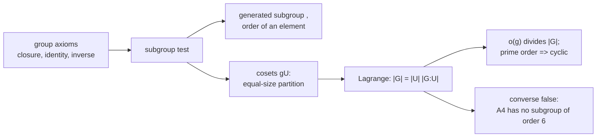

# GT01 · Groups, Subgroups and Cosets

◀ [[Group Theory - Course Map|Course Map]] · next: [[GT02 Homomorphisms Normal Subgroups and Quotients]]

> [!info] Source and approach
> Follows Kurzweil and Stellmacher, *The Theory of Finite Groups* (K–S), §1.1 ([[Kurzweil-Stellmacher_Theory of finite groups.pdf#page=14|PDF p.14 ff.]]; PDF page = printed page + 13). Cayley table, subgroup lattices and all counts are my own computations (`scripts/gt_numbers.py`).

> [!tip] Start here (first read)
> - **The picture.** A group is *the complete list of moves that leave an object looking the same*, together with the rule "do one move, then another": the rotations and flips of a triangle, the hours on a clock face (add hours), the shuffles of a deck of cards, the moves of a Rubik's cube. The three axioms say only that doing nothing is a move, every move can be undone, and chaining three moves does not depend on how you bracket them. **Cosets** cut the list into equal-sized teams, so *(size of a sub-list) × (number of teams) = (size of the whole list)*: that is Lagrange's theorem.
> - **What you need.** Sets, functions and the idea of a proof by direct argument ([[PA01 Logic and Methods of Proof]]); equivalence relations help ([[PA03 Relations Equivalence and Order]]) because "$x\sim y$ iff $x^{-1}y\in U$" is one.
> - **How to read.** In every chapter of this subject a proof is preceded or followed by a box in plain words ("what the proof is doing"); read that first, then the symbols. Do the practice problems: they carry hints and answers.
> - **Notation glossary.** $|G|$ number of elements; $o(g)$ order of $g$; $\langle X\rangle$ the subgroup generated by $X$; $U\le G$ subgroup; $gU$ left coset; $|G:U|$ index; $\cong$ "is isomorphic to" (same structure); $1$ the identity; $x^{-1}$ inverse; $\mathbb Z_n=C_n$ clock arithmetic mod $n$; $S_n$ shuffles of $n$ objects; $D_n$ symmetries of a regular $n$-gon.

> [!key] After this chapter you can
> - state the group axioms and derive from them that the identity and inverses are unique and that cancellation holds,
> - decide whether a subset is a subgroup (**the finite one-step test**) and describe $\langle X\rangle$,
> - prove the **product formula** $|AB|=|A||B|/|A\cap B|$ and **Lagrange's theorem** $|G|=|U|\cdot|G:U|$ and its consequences ($o(g)\mid|G|$, groups of prime order are cyclic),
> - read a **Cayley table** and a **subgroup lattice**, and know why the converse of Lagrange fails.

> [!intuition] The one-sentence story
> A group is the complete list of things you can do to an object without being able to tell you did anything (its symmetries), together with the rule "do one, then the other"; cosets cut that list into equal pieces, which is why subgroup sizes must divide the group size.

![[GT01 Groups Map.svg]]
*Diagram GT1.0. The chapter in one page. Editable source: [[GT01 Groups Map.excalidraw]].*

*Concept map.*

## 1. Groups
*K–S §1.1*

> [!key] Definition
> A **group** is a nonempty set $G$ with a rule assigning to each pair $(x,y)\in G\times G$ an element $xy\in G$ such that
> 1. **associativity:** $(xy)z=x(yz)$ for all $x,y,z$,
> 2. **identity:** there is $1\in G$ with $1x=x$ for all $x$,
> 3. **inverses:** for every $x$ there is $x^{-1}$ with $x^{-1}x=1$.
> $G$ is **Abelian** if $xy=yx$ always. The **order** $|G|$ is the number of elements; the **order of an element**, $o(g)$, is the least $n\ge1$ with $g^n=1$ (or $\infty$).

> [!derivation] What follows at once (K–S state the axioms in this one-sided form; here is why they are enough)
> **(a) A left inverse is a right inverse.** Let $x^{-1}x=1$ and let $y$ satisfy $y\,x^{-1}=1$ (a left inverse of $x^{-1}$). Then $xx^{-1}=1\cdot xx^{-1}=(yx^{-1})xx^{-1}=y(x^{-1}x)x^{-1}=y\,x^{-1}=1$.
> **(b) The left identity is a right identity.** $x1=x(x^{-1}x)=(xx^{-1})x=1x=x$.
> **(c) Uniqueness.** If $e$ also satisfies $ex=x$ for all $x$, then $e=e1=1$. If $ax=1$ and $a'x=1$, then $a=a(xx^{-1})=(ax)x^{-1}=x^{-1}$, so $a'=x^{-1}$ too.
> **(d) Cancellation.** $xa=xb\Rightarrow a=b$ (multiply on the left by $x^{-1}$), and $ax=bx\Rightarrow a=b$. In particular, for fixed $a$, the maps $x\mapsto ax$ and $x\mapsto xa$ are **bijections** of $G$ (K–S 1.1.1): every row and column of a Cayley table contains each element exactly once.
> **(e)** $(xy)^{-1}=y^{-1}x^{-1}$ because $(xy)(y^{-1}x^{-1})=x(yy^{-1})x^{-1}=1$.

**Examples worth carrying.**

| group | elements | order | Abelian? |
|---|---|---|---|
| $\mathbb Z_n=\mathbb Z/n\mathbb Z$ ($C_n$) | integers mod $n$ under $+$ | $n$ | yes |
| $(\mathbb Z/n)^\times$ | residues prime to $n$ under $\times$ | $\varphi(n)$ | yes |
| $S_n$ | all bijections of $\{1,\dots,n\}$ | $n!$ | only $n\le2$ |
| $D_n$ | symmetries of a regular $n$-gon | $2n$ | only $n\le2$ |
| $GL_n(F)$ | invertible $n\times n$ matrices | infinite (finite over $\mathbb F_q$) | $n=1$ only |
| $V_4=\mathbb Z_2\times\mathbb Z_2$ | $\{1,a,b,ab\}$, $a^2=b^2=1$ | 4 | yes |

> [!pitfall] Composition order for permutations
> I compose permutations **right to left**: $(pq)(i)=p(q(i))$ (do $q$ first), as in calculus and in the code in `scripts/gt_numbers.py`. `[verify]` K–S write maps on the **right** ($\alpha^{\sigma\tau}$ means "first $\sigma$, then $\tau$"; see their List of Symbols, $X^\varphi$), so a product such as $(123)(12)$ is a *different* permutation in the two conventions. Always check which convention a source uses before comparing a worked product.

## 2. Symmetry: where groups come from
> [!intuition] The group of a square and the group of a triangle
> Rotate an equilateral triangle by $120^\circ$ ($r$) or flip it about the axis through a vertex ($s$): it looks unchanged. All such moves form $D_3\cong S_3$ with $r^3=s^2=1$ and $srs=r^{-1}$. The six elements are $e,r,r^2,s,sr,sr^2$. The **Cayley table** below records every product; the group is non-Abelian because $rs\neq sr$ ($rs=sr^2$).

![[fig_gt01_cayley.png]]
*Figure GT1.1. Left: Cayley table of $S_3\cong D_3$ (each element has its own colour: each row and column is a permutation of the colours, which is cancellation). Right: the three **left cosets** of $H=\{e,s\}$; they are disjoint, equal in size and cover $G$.*

> [!derivation] Why $D_n$ has order $2n$ (and is the full symmetry group of the $n$-gon)
> A symmetry is determined by where it sends one vertex (any of $n$ places) and then whether it preserves or reverses the orientation of the rest (2 choices): $n\cdot2=2n$. Rotations form the cyclic subgroup $\langle r\rangle$ of order $n$; the other $n$ elements are reflections $sr^k$. The relation $srs^{-1}=r^{-1}$ says reflecting reverses the sense of rotation.

## 3. Subgroups
*K–S 1.1.3–1.1.6*

> [!key] Subgroup, generated subgroup
> $U\subseteq G$ is a **subgroup** ($U\le G$) if it is a group under the same product. **Test (1.1.3).** *A nonempty finite subset $U$ is a subgroup iff $xy\in U$ for all $x,y\in U$.* For an arbitrary subset $X$, $\langle X\rangle$ is the **smallest subgroup containing $X$** (the intersection of all subgroups containing $X$, 1.1.4). $\langle g\rangle=\{g^k\}$ is **cyclic** and has $|\langle g\rangle|=o(g)$.

> [!derivation] Proof of the finite test
> Take $x\in U$. The powers $x,x^2,x^3,\dots$ all lie in $U$ (closure), which is finite, so $x^i=x^j$ for some $i<j$; cancel to get $x^{j-i}=1$. Hence $1\in U$ ($=x^{j-i}$), and $x^{-1}=x^{j-i-1}\in U$ (take $j-i=1$ to get $x=1$, whose inverse is itself). Associativity is inherited. ∎ For infinite $G$ the test fails: $\mathbb N\subset\mathbb Z$ is closed under $+$ but is not a subgroup.

> [!derivation] When is $AB$ a subgroup, and how big is it? (K–S 1.1.5–1.1.6)
> For subgroups $A,B$ of $G$, $AB=\{ab\}$ is a subgroup **iff $AB=BA$**. (If $AB$ is a subgroup then $ba=(a^{-1}b^{-1})^{-1}\in(AB)^{-1}=AB$ shows $BA\subseteq AB$ and vice versa; conversely if $AB=BA$ then $(ab)(a'b')=a(ba')b'=a(a''b'')b'\in AB$ and $(ab)^{-1}=b^{-1}a^{-1}\in BA=AB$.)
> **Product formula:** $|AB|=\dfrac{|A||B|}{|A\cap B|}$. *Proof.* The map $A\times B\to AB$, $(a,b)\mapsto ab$ is onto. If $ab=a'b'$ then $c=a^{-1}a'=b\,b'^{-1}\in A\cap B$ and $(a',b')=(ac,\,c^{-1}b)$; conversely every $c\in A\cap B$ gives such a pair. So each element of $AB$ has exactly $|A\cap B|$ preimages. ∎ (This is a statement about sets; it holds even if $AB$ is not a subgroup.)

![[fig_gt01_lattice.png]]
*Figure GT1.2. Subgroup lattices (a line goes up from a subgroup to one that contains it). $S_3$ has **6** subgroups: $1$, three of order 2 (the reflections), $A_3=\langle r\rangle$ of order 3, and $S_3$. $D_4$ has **10**: $1$, five of order 2, three of order 4 ($C_4$, and two Klein four-groups $V_4,V_4'$) and $D_4$. Both counts are brute-forced in `scripts/gt_numbers.py`.*

> [!example] Reading the lattice
> In $D_4$ the centre $Z=\langle r^2\rangle$ (rotation by $180^\circ$) is the only order-2 subgroup lying inside all three order-4 subgroups; each reflection lies in exactly one Klein group. In $S_3$ every order-2 subgroup has no larger proper subgroup above it: the lattice is a "diamond" and $A_3$ is the only non-reflection subgroup. The sizes $1,2,3,4,6,8$ all divide the group orders $6$, $8$, as Lagrange (next section) demands.

## 4. Cosets and Lagrange's theorem
*K–S 1.1.7–1.1.9*

> [!key] Cosets, index, transversal
> For $U\le G$ and $g\in G$ the **left coset** is $gU=\{gu:u\in U\}$ (and $Ug$ the right coset). The number of left cosets is the **index** $|G:U|$. A **transversal** of $U$ in $G$ is a set $S$ containing exactly one element from each coset (1.1.9).

> [!derivation] Theorem (Lagrange, 1.1.7). If $U\le G$ with $G$ finite, then $|G|=|U|\cdot|G:U|$; in particular $|U|$ divides $|G|$.
> *Proof.* (i) **The cosets partition $G$.** Define $x\sim y$ iff $x^{-1}y\in U$. It is reflexive ($x^{-1}x=1$), symmetric ($(x^{-1}y)^{-1}=y^{-1}x\in U$) and transitive ($x^{-1}y,\ y^{-1}z\in U\Rightarrow x^{-1}z\in U$), and the class of $x$ is exactly $xU$. So the left cosets are disjoint and cover $G$. (ii) **Every coset has $|U|$ elements:** $u\mapsto gu$ is a bijection $U\to gU$ by cancellation. Hence $|G|=\sum_{\text{cosets}}|U|=|G:U|\,|U|$. ∎

> [!derivation] Corollaries
> 1. **$o(g)\mid|G|$** (1.1.8), because $o(g)=|\langle g\rangle|$; hence $g^{|G|}=1$ for every $g$. In $(\mathbb Z/p)^\times$ (order $p-1$) this is **Fermat's little theorem** $a^{p-1}\equiv1$; in $(\mathbb Z/n)^\times$ it is **Euler's theorem** $a^{\varphi(n)}\equiv1$.
> 2. **A group of prime order $p$ is cyclic** (and generated by any non-identity element): $o(g)>1$ divides $p$, so $o(g)=p=|G|$, and $\langle g\rangle=G$. So every group of order 2, 3, 5, 7 is $\mathbb Z_p$.
> 3. If $K\le U\le G$ then $|G:K|=|G:U||U:K|$ (multiply the Lagrange equalities).
> 4. **Tower for products:** with $A,B\le G$, $|G|\ge|AB|=|A||B|/|A\cap B|$, so $|A\cap B|\ge|A||B|/|G|$: two subgroups of more than half the group always meet non-trivially.

> [!pitfall] The converse of Lagrange is false
> A divisor of $|G|$ need not be the order of a subgroup. $A_4$ (the 12 even permutations of four points) has **no subgroup of order 6**; this is checked by brute force over all subgroups generated by at most three elements in `scripts/gt_numbers.py` (`False`). A one-line reason: a subgroup of order 6 would have index 2 and therefore contain the square of every element; $A_4$ has 8 elements of order 3 and every one of them is the square of another ($g=(g^{2})^{2}$), so all 8 would be in the subgroup, which has only 6 elements. The converse *does* hold for prime powers dividing $|G|$ (Sylow, [[GT05 Actions Conjugation and Sylow Theorems]]) and for cyclic groups.

> [!example] Counting with Lagrange
> In $S_4$ ($|G|=24$) the possible subgroup orders are among $1,2,3,4,6,8,12,24$; all occur ($S_3$ gives 6, $D_4$ gives 8, $A_4$ gives 12). In a group of order 10 an element of order 4 is impossible, and in a group of order 6 elements have order 1, 2, 3 or 6, so a group of order 6 with no element of order 6 has an element of order 2 and one of order 3 (Cauchy, [[GT05 Actions Conjugation and Sylow Theorems]]).

## 5. Summary and practice
> [!summary] Cheat-sheet
> | Statement | Formula or fact | Section |
> |---|---|---|
> | axioms $\Rightarrow$ two-sided identity and inverse, cancellation | $(xy)^{-1}=y^{-1}x^{-1}$ | §1 |
> | finite subgroup test | nonempty and closed under product | §3 |
> | $AB\le G$ | iff $AB=BA$ | §3 |
> | product formula | $\lvert AB\rvert=\lvert A\rvert\lvert B\rvert/\lvert A\cap B\rvert$ | §3 |
> | Lagrange | $\lvert G\rvert=\lvert U\rvert\lvert G:U\rvert$ | §4 |
> | element orders | $o(g)\mid\lvert G\rvert$, $g^{\lvert G\rvert}=1$ | §4 |
> | prime order | cyclic | §4 |
> | counts | $S_3$: 6 subgroups; $D_4$: 10; $A_4$: none of order 6 | §3–4 |

> [!example]- Practice (with answers)
> 1. **Prove** that a group in which every element satisfies $x^2=1$ is Abelian. *Answer:* $xy=(xy)^{-1}=y^{-1}x^{-1}=yx$.
> 2. **List the orders of elements of $D_4$.** *Answer:* $1$ (one element), $2$ (five: $r^2$ and the four reflections), $4$ ($r,r^3$); sum $1+5+2=8$; consistent with divisors of 8.
> 3. **How many subgroups of order 2 does $S_4$ have?** *Answer:* one for each element of order 2: 6 transpositions + 3 double transpositions = 9.
> 4. **Show** $\mathbb Z_6\not\cong S_3$ although both have order 6. *Answer:* $\mathbb Z_6$ is Abelian, $S_3$ is not (also $S_3$ has no element of order 6).
> 5. **Use the product formula:** in a group of order 60 suppose $A,B$ are subgroups of orders 12 and 15. Show $|A\cap B|=3$. *Answer:* $|AB|=180/|A\cap B|\le60$ gives $|A\cap B|\ge3$; and $|A\cap B|$ divides both 12 and 15, so it divides 3.
> 6. **Euler:** compute $7^{222}\bmod10$. *Answer:* $\varphi(10)=4$, $222=4\cdot55+2$, so $7^{222}\equiv7^2=49\equiv9$.
> 7. **(Assignment 10 Q1a) The group $\mu_4=\{1,i,-1,-i\}$.** Write its multiplication table and show it is an abelian group of order 4; what is the order of $i$? *Answer:* the table (rows and columns in the order $1,i,-1,-i$) is $1,i,-1,-i\,|\,i,-1,-i,1\,|\,-1,-i,1,i\,|\,-i,1,i,-1$; every product lies in the set (closed), the table is symmetric about the diagonal (abelian), $1$ is the identity, each row contains $1$ (inverses: $i^{-1}=-i$, $(-1)^{-1}=-1$), associativity is inherited from $\mathbb C$. $o(i)=4$ ($i,-1,-i,1$), so $\mu_4=\langle i\rangle\cong\mathbb Z_4$.
> 8. **(Q1b) $\mu_n=\{z\in\mathbb C:z^n=1\}$ is an abelian group of order $n$.** *Answer:* $1\in\mu_n$; if $z^n=w^n=1$ then $(zw)^n=z^nw^n=1$ and $(z^{-1})^n=1$; associativity and commutativity come from $\mathbb C$; $|\mu_n|=n$ because $z^n=1$ has exactly the $n$ roots $e^{2\pi ik/n}$, $k=0,\dots,n-1$. It is cyclic, generated by $e^{2\pi i/n}$ (checked for $n=4,6,12$).
> 9. **(Q2) $S^1=\{z:|z|=1\}$ is an abelian group under multiplication.** *Answer:* $|zw|=|z||w|=1$; $1\in S^1$; $z\bar z=|z|^2=1$ gives $z^{-1}=\bar z$ with $|\bar z|=1$; associative and commutative as in $\mathbb C$. (It is infinite, so not isomorphic to any $\mu_n$; $t\mapsto e^{2\pi it}$ identifies it with $\mathbb R/\mathbb Z$.)
> 10. **(Q3) $T=\left\{\begin{pmatrix}1&a\\0&1\end{pmatrix}:a\in\mathbb R\right\}$ is an abelian group under matrix multiplication.** *Answer:* write $T(a)$; then $T(a)T(b)=\begin{pmatrix}1&a+b\\0&1\end{pmatrix}=T(a+b)$, so $T$ is closed, $T(0)=I$ is the identity, $T(a)^{-1}=T(-a)$, associativity is that of matrices, and $T(a)T(b)=T(a+b)=T(b)T(a)$. The map $a\mapsto T(a)$ is an isomorphism $(\mathbb R,+)\to T$.
> 11. **(Q4) Symmetries of a polygon with labelled vertices.** Find the symmetry groups of an equilateral triangle, a non-square rectangle and a square, and decide which are abelian. *Answer:* see the section below: $S_3$ (6 elements, non-abelian), the Klein four-group (4, abelian), $D_4$ (8, non-abelian). Only $4$ of the $24$ elements of $S_4$ are symmetries of the rectangle and $8$ of the square.

<!-- interactive:start (generated by scripts/embed_interactive.py; edit the tool in scripts/interactive/tools/, not this block) -->
> [!interactive]+ Interactive: Counting with symmetry: Burnside's lemma on necklaces and bracelets
> How many different n-bead necklaces with k colours are there if rotations (and reflections, for bracelets) of the same pattern count as one?
>
> ![[gt_burnside.png|720]]
>
> **Try:** n = 6, k = 2: 14 necklaces (rotations only), 13 bracelets (D₆). n = 5, k = 3: 51 necklaces, 39 bracelets. n = 8, k = 2: 36 and 30. Check against the sum over group elements of k^{cycles}/|G|; press 'show an orbit' to see the colourings Burnside identifies.
>
> [▶ Open the tool in your browser](../Assets/interactive/gt_burnside.html) · [absolute link](file:///home/swastik/Documents/notes/Assets/interactive/gt_burnside.html) · all tools and coverage: [[Interactive Tools]]

> [!interactive]+ Interactive: The dihedral group D_n: symmetries, the Cayley table and cosets
> Act on a labelled regular n-gon with the rotation r (by 2π/n) and the reflection s.
>
> ![[gt_dihedral.png|720]]
>
> **Try:** n = 3 gives D₃ ≅ S₃: press r, then s, and compare with s then r (a different state). Choose g = s: the cosets are {1,s}, {r, rs}, {r², r²s} (3 cosets of size 2). Choose g = r in D₄: ⟨r⟩ has order 4, index 2: a normal subgroup.
>
> [▶ Open the tool in your browser](../Assets/interactive/gt_dihedral.html) · [absolute link](file:///home/swastik/Documents/notes/Assets/interactive/gt_dihedral.html) · all tools and coverage: [[Interactive Tools]]

<!-- interactive:end -->

## Continued in the vault (added 2026-11-12): the Assignment 10 examples
*Source: [[Assignment-10.pdf]] (2 pages, read in full this session). It restates the definitions (binary operation, group, abelian group, permutation group, two-row and cycle notation) and sets the first four families of examples. Every table and count below was checked by machine in `scripts/pa16_numbers.py`.*

> [!key] Two small points about the definition
> - **A binary operation already contains closure.** "$*$ is a binary operation on $G$" means $*:G\times G\to G$, so $a*b\in G$ is part of the data, not a further axiom ([[PA16 Peano's Axioms and the Natural Numbers]]: $+$ on $\mathbb N$ was *defined* as a function $\mathbb N\times\mathbb N\to\mathbb N$ for the same reason).
> - **Two-sided versus one-sided axioms.** The assignment states identity and inverse two-sided ($e*a=a*e=a$, $a*b=b*a=e$) and records that $e$ and each $a^{-1}$ are **unique**; K–S above use the one-sided form and the derivation (a)–(c) shows the two are equivalent.

**The four families.**
- **Roots of unity** $\mu_n=\{z:z^n=1\}$: abelian of order $n$, cyclic (Practice 7–8). $\mu_4$: table $1,i,-1,-i$ as above.
- **The unit circle** $S^1$: abelian, infinite; $z^{-1}=\bar z$ (Practice 9).
- **Unitriangular matrices** $T$: abelian, $T(a)T(b)=T(a+b)$ (Practice 10); contrast the non-abelian group of *all* invertible upper triangular matrices.
- **Symmetries of a polygon.** A symmetry (rigid motion carrying the polygon to itself) is determined by what it does to the vertices, so it is a permutation of the vertex labels; $f\circ g$ means "first $g$, then $f$".

| polygon | symmetries (as permutations of the vertices) | order | abelian? |
|---|---|---|---|
| equilateral triangle, vertices $1,2,3$ | identity; rotations $(1\,2\,3)$, $(1\,3\,2)$; reflections $(1\,2)$, $(1\,3)$, $(2\,3)$ | 6 = $|S_3|$ | **no** |
| rectangle (not a square), vertices $1,2,3,4$ cyclically | identity; $(1\,3)(2\,4)$ (half turn); $(1\,2)(3\,4)$ and $(1\,4)(2\,3)$ (the two axis reflections) | 4 | yes: the **Klein four-group** (every element has order $\le2$) |
| square, vertices $1,2,3,4$ cyclically | identity; $(1\,2\,3\,4)$, $(1\,3)(2\,4)$, $(1\,4\,3\,2)$; reflections $(1\,2)(3\,4)$, $(1\,4)(2\,3)$, $(2\,4)$, $(1\,3)$ | 8 = $|D_4|$ | **no** |

*Why the triangle gives all of $S_3$ but the rectangle and square do not give $S_4$:* every permutation of three vertices preserves "adjacent" (all pairs are adjacent), so $\Delta$ has all $3!=6$; for four vertices a symmetry must preserve adjacency and (for the rectangle) the unequal side lengths, which cuts $24$ down to $4$ or $8$. *Non-commutativity of the triangle:* with $f=(1\,2\,3)$ and $g=(1\,2)$, $f\circ g=(1\,3)$ but $g\circ f=(2\,3)$. The computer search over all permutations of the vertices that preserve all pairwise distances reproduces exactly these three lists.

> [!verify] Note
> The sheet says only that the symmetries of a triangle "form a group... this group is all of $S_3$"; the table entries for the rectangle and square are my answers to Q4(c), obtained by the distance-preserving search described above and by direct inspection, not copied from an answer key (the file contains none).

## Map of this chapter
> [!connection] How GT01 connects
> **Next:** [[GT02 Homomorphisms Normal Subgroups and Quotients]] (maps between groups, the quotient of $G$ by a *normal* subgroup, which needs left and right cosets to agree). **Used by:** [[GT05 Actions Conjugation and Sylow Theorems]] (Lagrange is the counting engine of orbit–stabiliser) and [[GT10 Symmetry Representations and Characters]] ($C_{3v}\cong S_3$ is the point group of ammonia).
> **Other subjects:** [[Proofs, Analysis and Topology - Course Map]] (proof technique, equivalence relations), [[Inorganic Chemistry - Course Map]] (point groups), [[Quantum Mechanics - Course Map]] (parity group $\mathbb Z_2$), [[Probability - Course Map]] (counting arguments).
> **Concept notes:** [[Group]] · [[Subgroup]] · [[Coset]] · [[Lagrange's Theorem]] · [[Cyclic Group]] · [[Dihedral Group]] · [[Symmetric Group]]

## Provenance
> [!provenance]- Source map for this chapter
> | Topic | Source | Origin |
> |---|---|---|
> | axioms, subgroup test, $\langle X\rangle$, product formula, Lagrange, transversals | [[Kurzweil-Stellmacher_Theory of finite groups.pdf#page=14|K–S §1.1, PDF pp.14–22]] (1.1.1–1.1.9) | book |
> | derivation of two-sided identity and inverse, corollaries 1–4, $D_n$ order | my own derivations (standard) | mine |
> | Cayley table, lattices, subgroup counts, $A_4$ has no subgroup of order 6, Euler example | `scripts/gt_numbers.py`, `scripts/fig_gt.py` | mine |
| $\mu_n$, $S^1$, unitriangular $T$, symmetries of a triangle, rectangle and square; Practice 7–11 | [[Assignment-10.pdf]] (statement); solutions and verification mine (`scripts/pa16_numbers.py`) | lecture + mine |
>
> **Flags.** (1) K–S's convention for composing permutations (maps on the right) is stated from memory of their notation list; check before comparing products. (2) The reason given for "$A_4$ has no subgroup of order 6" uses that an index-2 subgroup is normal and contains all squares; this is proved in [[GT02 Homomorphisms Normal Subgroups and Quotients]] (an index-2 subgroup is the kernel of a map to $\mathbb Z_2$).

## Assignment 10 solved in full (added 2026-11-12; outside the 13 November quiz scope) #quiz/pa-groups
*Source: [[Assignment-10.pdf]] (read in full). Complete proofs of Problems 1–4; the earlier section above and Practice 7–11 give the examples and answers in short form. Every table and count was checked by machine (`scripts/rest_numbers.py`, `scripts/pa16_numbers.py`). Convention of the sheet: $f\circ g$ means "first $g$, then $f$"; a permutation is written in two-row or cycle notation, $(1\,2\,3)$ meaning $1\mapsto2\mapsto3\mapsto1$.*

> [!key] What has to be checked for "$(G,*)$ is a group"
> (0) $*$ is a **binary operation**, i.e. $a*b\in G$ for all $a,b\in G$ (closure); (G1) associativity; (G2) an identity $e$; (G3) an inverse for every element. "Abelian" adds $a*b=b*a$. For subsets of $\mathbb C$ or of matrices under the usual product, **associativity (and commutativity, when it holds) is inherited** from $\mathbb C$ or from matrix multiplication, so only closure, $e$ and inverses need work.

> [!example] Problem 1(a): $\mu_4=\{1,i,-1,-i\}$ is an abelian group of order 4
> Multiplication table (row $\times$ column):
>
> | $\cdot$ | $1$ | $i$ | $-1$ | $-i$ |
> |---|---|---|---|---|
> | $1$ | $1$ | $i$ | $-1$ | $-i$ |
> | $i$ | $i$ | $-1$ | $-i$ | $1$ |
> | $-1$ | $-1$ | $-i$ | $1$ | $i$ |
> | $-i$ | $-i$ | $1$ | $i$ | $-1$ |
>
> **Closure:** every entry lies in $\mu_4$. **Identity:** the row and column of $1$ repeat the labels. **Inverses:** each row contains a $1$: $1\cdot1$, $i\cdot(-i)$, $(-1)(-1)$, $(-i)\cdot i$, so $1^{-1}=1$, $i^{-1}=-i$, $(-1)^{-1}=-1$, $(-i)^{-1}=i$. **Associativity:** inherited from $\mathbb C$. **Abelian:** the table is symmetric about its diagonal. **Order** $4$. (Also $\mu_4=\langle i\rangle=\{i,i^2,i^3,i^4\}$ is cyclic.)

> [!example] Problem 1(b): $\mu_n=\{z\in\mathbb C:z^n=1\}$ is an abelian group of order $n$
> Closure: $z^n=w^n=1\Rightarrow(zw)^n=z^nw^n=1$. Identity: $1^n=1$. Inverses: $z\ne0$ (as $z^n=1$) and $(z^{-1})^n=(z^n)^{-1}=1$. Associativity and commutativity: inherited from $\mathbb C$. Order: by the hint $z^n=1$ has exactly the $n$ solutions $z_k=\cos\frac{2\pi k}n+i\sin\frac{2\pi k}n$, $k=0,\dots,n-1$, so $|\mu_n|=n$. (Checked for $n=1,\dots,20$; $z_k=z_1^k$, so $\mu_n$ is cyclic, generated by $e^{2\pi i/n}$.)

> [!example] Problem 2: $S^1=\{z\in\mathbb C:|z|=1\}$ under multiplication
> Closure: $|zw|=|z||w|=1$. Identity: $|1|=1$. Inverse: from $z\bar z=|z|^2=1$ we get $z^{-1}=\bar z$, and $|\bar z|=|z|=1$ so $z^{-1}\in S^1$. Associativity, commutativity: inherited from $\mathbb C$. The group is **infinite** (it contains $\mu_n$ for every $n$), hence not isomorphic to any $\mu_n$; $t\mapsto e^{2\pi it}$ identifies it with $\mathbb R/\mathbb Z$.

> [!example] Problem 3: $T=\Big\{\begin{pmatrix}1&a\\0&1\end{pmatrix}:a\in\mathbb R\Big\}$ under matrix multiplication
> Write $T(a)$. Then $T(a)T(b)=\begin{pmatrix}1&a+b\\0&1\end{pmatrix}=T(a+b)\in T$ (closure); $T(0)=I$ is the identity; $T(a)T(-a)=T(0)=I$ (inverse $T(-a)$); associativity is that of matrix multiplication; $T(a)T(b)=T(a+b)=T(b)T(a)$ (abelian). The map $a\mapsto T(a)$ is an **isomorphism** $(\mathbb R,+)\to T$. (Contrast: the group of *all* invertible $2\times2$ matrices is non-abelian.)

> [!example] Problem 4(a): the equilateral triangle $\Delta$ has exactly six symmetries
> Label the vertices $1,2,3$ counterclockwise; side length $1$. A **symmetry** is an isometry $\varphi$ of the plane with $\varphi(\Delta)=\Delta$.
> 1. **$\varphi$ permutes the vertices.** The largest distance between two points of $\Delta$ is $1$, attained exactly by pairs of vertices (any two points of the triangle at distance $1$ are vertices). $\varphi$ preserves distances and maps $\Delta$ onto itself, so it sends vertex pairs to pairs at distance $1$, hence vertices to vertices.
> 2. **$\varphi$ is determined by what it does to the vertices:** an isometry fixing three non-collinear points is the identity, so two symmetries with the same permutation are equal. So $\varphi\mapsto\sigma_\varphi\in S_3$ is injective: at most $6$ symmetries.
> 3. **All six occur:** the rotations about the centre through $0^\circ,120^\circ,240^\circ$ and the reflections in the three axes (each through a vertex and the midpoint of the opposite side) realise six different permutations (below).
> Hence **exactly six**: the identity, two rotations and three reflections, in two-row notation
> $$e=\begin{pmatrix}1&2&3\\1&2&3\end{pmatrix},\quad r=\begin{pmatrix}1&2&3\\2&3&1\end{pmatrix}=(1\,2\,3),\quad r^2=\begin{pmatrix}1&2&3\\3&1&2\end{pmatrix}=(1\,3\,2),$$
> $$s_1=\begin{pmatrix}1&2&3\\1&3&2\end{pmatrix}=(2\,3),\quad s_2=\begin{pmatrix}1&2&3\\3&2&1\end{pmatrix}=(1\,3),\quad s_3=\begin{pmatrix}1&2&3\\2&1&3\end{pmatrix}=(1\,2)$$
> ($s_i$ is the reflection fixing vertex $i$; $r$ is the rotation by $120^\circ$). Counting check: $3$ choices for $\varphi(1)$ times $2$ for $\varphi(2)$ $=6$; machine search over all $3!$ vertex permutations preserving distances finds all six.

> [!example] Problem 4(b): the symmetries form a group, namely all of $S_3$; it is not abelian
> **Group:** the composition of two symmetries is an isometry carrying $\Delta$ onto $\Delta$ (closure); $\mathrm{id}$ is a symmetry; the inverse of a symmetry is an isometry with $\varphi^{-1}(\Delta)=\Delta$; composition of functions is associative. **It is all of $S_3$:** $\varphi\mapsto\sigma_\varphi$ is injective (step 2) and surjective (step 3) and $\sigma_{\varphi\circ\psi}=\sigma_\varphi\circ\sigma_\psi$, so $\mathrm{Sym}(\Delta)\cong S_3$ (the sheet's "this group is all of $S_3$"). **Not abelian:** with $f=r=(1\,2\,3)$ and $g=s_3=(1\,2)$, $f\circ g$ sends $1\mapsto2\mapsto3$, $2\mapsto1\mapsto2$, $3\mapsto3\mapsto1$: $f\circ g=(1\,3)=s_2$, whereas $g\circ f$ sends $1\mapsto2\mapsto1$, $2\mapsto3\mapsto3$, $3\mapsto1\mapsto2$: $g\circ f=(2\,3)=s_1$. Geometrically "rotate then reflect" differs from "reflect then rotate". With $s=s_3$: $r^3=s^2=e$, $srs=r^{-1}$, and the elements are $e,r,r^2,s,sr,sr^2$.
>
> | $\circ$ (row after column) | $e$ | $r$ | $r^2$ | $s$ | $sr$ | $sr^2$ |
> |---|---|---|---|---|---|---|
> | $e$ | $e$ | $r$ | $r^2$ | $s$ | $sr$ | $sr^2$ |
> | $r$ | $r$ | $r^2$ | $e$ | $sr^2$ | $s$ | $sr$ |
> | $r^2$ | $r^2$ | $e$ | $r$ | $sr$ | $sr^2$ | $s$ |
> | $s$ | $s$ | $sr$ | $sr^2$ | $e$ | $r$ | $r^2$ |
> | $sr$ | $sr$ | $sr^2$ | $s$ | $r^2$ | $e$ | $r$ |
> | $sr^2$ | $sr^2$ | $s$ | $sr$ | $r$ | $r^2$ | $e$ |
>
> (here $sr=(2\,3)$, $sr^2=(1\,3)$, and $r\circ s=sr^2\ne sr=s\circ r$).

> [!example] Problem 4(c): the rectangle (not a square) and the square
> **Rectangle** with vertices $1,2,3,4$ in cyclic order, sides $|12|=|34|=a$, $|23|=|41|=b$, $a\ne b$. As in 4(a) a symmetry permutes the vertices and preserves distances; adjacent vertices at distance $a$ must go to adjacent vertices at distance $a$ (the pairs $\{1,2\},\{3,4\}$), and likewise for $b$. So once $\varphi(1)$ is chosen ($4$ ways) the image of $2$ is forced (the neighbour of $\varphi(1)$ across a side of length $a$): **$4$ symmetries**: $e$, the half-turn $(1\,3)(2\,4)$, and the two reflections $(1\,2)(3\,4)$, $(1\,4)(2\,3)$ in the perpendicular bisectors of the sides. The quarter-turn $(1\,2\,3\,4)$ and the diagonal reflections are **not** symmetries (they send a side of length $a$ to one of length $b$). Every element satisfies $x^2=e$ and the product of two different non-identity elements is the third, so the group is the **Klein four-group** $V_4\cong\mathbb Z_2\times\mathbb Z_2$ and is **abelian** (not cyclic: no element of order $4$):
>
> | $\circ$ | $e$ | $(1\,2)(3\,4)$ | $(1\,3)(2\,4)$ | $(1\,4)(2\,3)$ |
> |---|---|---|---|---|
> | $e$ | $e$ | $(1\,2)(3\,4)$ | $(1\,3)(2\,4)$ | $(1\,4)(2\,3)$ |
> | $(1\,2)(3\,4)$ | $(1\,2)(3\,4)$ | $e$ | $(1\,4)(2\,3)$ | $(1\,3)(2\,4)$ |
> | $(1\,3)(2\,4)$ | $(1\,3)(2\,4)$ | $(1\,4)(2\,3)$ | $e$ | $(1\,2)(3\,4)$ |
> | $(1\,4)(2\,3)$ | $(1\,4)(2\,3)$ | $(1\,3)(2\,4)$ | $(1\,2)(3\,4)$ | $e$ |
>
> **Square:** all sides are equal, so any vertex can go to any vertex ($4$ ways) and then the image of vertex $2$ is either of the two neighbours of $\varphi(1)$ ($2$ ways): **$8$ symmetries**: the rotations $e,\ r=(1\,2\,3\,4),\ r^2=(1\,3)(2\,4),\ r^3=(1\,4\,3\,2)$ and four reflections, two through opposite vertices, $(2\,4)$ and $(1\,3)$, and two through midpoints of opposite sides, $(1\,2)(3\,4)$ and $(1\,4)(2\,3)$. They form a group of order $8$, the **dihedral group $D_4$**, which is **not abelian**: with $f=r$, $g=(2\,4)$, $f\circ g=(1\,2)(3\,4)$ but $g\circ f=(1\,4)(2\,3)$ (also $r^4=s^2=e$, $srs=r^{-1}$ with $s=(2\,4)$). Counts: the triangle gives $6=2\cdot3$, the square $8=2\cdot4$, a regular $n$-gon $2n$ (checked for $n=3,\dots,6$); only $4$ of the $24$ permutations of four vertices are symmetries of the rectangle and $8$ of the square (those preserving distances). See [[Dihedral Group]], [[Klein Four-Group]], [[Symmetric Group]].
