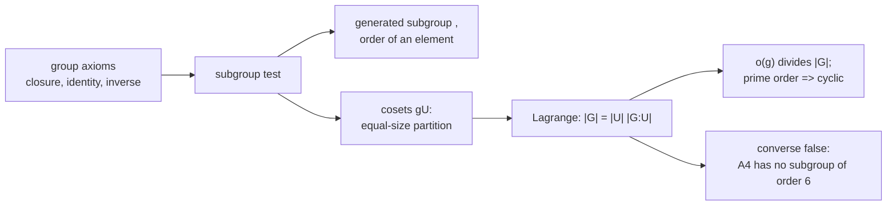

# GT01 · Groups, Subgroups and Cosets

◀ [[Group Theory - Course Map|Course Map]] · next: [[GT02 Homomorphisms Normal Subgroups and Quotients]]

extra · book extra · beyond

> [!syllabus] Syllabus map: what is in the syllabus and what is extra in this chapter
> **No lecture source** for finite groups (the only lectures in the repository are the MT3184 differential-geometry course, which uses groups as a tool; see [[Group Theory - Course Map]]). The chapter follows the one finite-group book in the repository.
> 🟡 **Extra · book:** Kurzweil and Stellmacher, *The Theory of Finite Groups: An Introduction*, §1.1 (printed pp. 1–10, [[Kurzweil-Stellmacher_Theory of finite groups.pdf#page=14|PDF p.14 ff.]]; the PDF page is the printed page + 13): definition, subgroups (1.1.3–1.1.5), the product formula (1.1.6), Lagrange's theorem (1.1.7–1.1.8), transversals (1.1.9).
> 🔵 **Extra · beyond** (my additions, every count brute-forced in `scripts/gt_numbers.py`): the Cayley table and subgroup lattices of $S_3$ and $D_4$ with the number of subgroups, the failure of the converse of Lagrange's theorem in $A_4$, and the "symmetry" way of seeing a group.

> [!key] After this chapter you can
> - state the group axioms and derive from them that the identity and inverses are unique and that cancellation holds,
> - decide whether a subset is a subgroup (**the finite one-step test**) and describe $\langle X\rangle$,
> - prove the **product formula** $|AB|=|A||B|/|A\cap B|$ and **Lagrange's theorem** $|G|=|U|\cdot|G:U|$ and its consequences ($o(g)\mid|G|$, groups of prime order are cyclic),
> - read a **Cayley table** and a **subgroup lattice**, and know why the converse of Lagrange fails.

> [!intuition] The one-sentence story
> A group is the complete list of things you can do to an object without being able to tell you did anything (its symmetries), together with the rule "do one, then the other"; cosets cut that list into equal pieces, which is why subgroup sizes must divide the group size.

![[GT01 Groups Map.svg]]
*Diagram GT1.0. The chapter in one page. Editable source: [[GT01 Groups Map.excalidraw]].*

*Concept map.*

## 1. Groups
extra · book *K–S §1.1*

> [!key] Definition
> A **group** is a nonempty set $G$ with a rule assigning to each pair $(x,y)\in G\times G$ an element $xy\in G$ such that
> 1. **associativity:** $(xy)z=x(yz)$ for all $x,y,z$,
> 2. **identity:** there is $1\in G$ with $1x=x$ for all $x$,
> 3. **inverses:** for every $x$ there is $x^{-1}$ with $x^{-1}x=1$.
> $G$ is **Abelian** if $xy=yx$ always. The **order** $|G|$ is the number of elements; the **order of an element**, $o(g)$, is the least $n\ge1$ with $g^n=1$ (or $\infty$).

> [!derivation] What follows at once (K–S state the axioms in this one-sided form; here is why they are enough)
> **(a) A left inverse is a right inverse.** Let $x^{-1}x=1$ and let $y$ satisfy $y\,x^{-1}=1$ (a left inverse of $x^{-1}$). Then $xx^{-1}=1\cdot xx^{-1}=(yx^{-1})xx^{-1}=y(x^{-1}x)x^{-1}=y\,x^{-1}=1$.
> **(b) The left identity is a right identity.** $x1=x(x^{-1}x)=(xx^{-1})x=1x=x$.
> **(c) Uniqueness.** If $e$ also satisfies $ex=x$ for all $x$, then $e=e1=1$. If $ax=1$ and $a'x=1$, then $a=a(xx^{-1})=(ax)x^{-1}=x^{-1}$, so $a'=x^{-1}$ too.
> **(d) Cancellation.** $xa=xb\Rightarrow a=b$ (multiply on the left by $x^{-1}$), and $ax=bx\Rightarrow a=b$. In particular, for fixed $a$, the maps $x\mapsto ax$ and $x\mapsto xa$ are **bijections** of $G$ (K–S 1.1.1): every row and column of a Cayley table contains each element exactly once.
> **(e)** $(xy)^{-1}=y^{-1}x^{-1}$ because $(xy)(y^{-1}x^{-1})=x(yy^{-1})x^{-1}=1$.

**Examples worth carrying.**

| group | elements | order | Abelian? |
|---|---|---|---|
| $\mathbb Z_n=\mathbb Z/n\mathbb Z$ ($C_n$) | integers mod $n$ under $+$ | $n$ | yes |
| $(\mathbb Z/n)^\times$ | residues prime to $n$ under $\times$ | $\varphi(n)$ | yes |
| $S_n$ | all bijections of $\{1,\dots,n\}$ | $n!$ | only $n\le2$ |
| $D_n$ | symmetries of a regular $n$-gon | $2n$ | only $n\le2$ |
| $GL_n(F)$ | invertible $n\times n$ matrices | infinite (finite over $\mathbb F_q$) | $n=1$ only |
| $V_4=\mathbb Z_2\times\mathbb Z_2$ | $\{1,a,b,ab\}$, $a^2=b^2=1$ | 4 | yes |

> [!pitfall] Composition order for permutations
> I compose permutations **right to left**: $(pq)(i)=p(q(i))$ (do $q$ first), as in calculus and in the code in `scripts/gt_numbers.py`. `[verify]` K–S write maps on the **right** ($\alpha^{\sigma\tau}$ means "first $\sigma$, then $\tau$"; see their List of Symbols, $X^\varphi$), so a product such as $(123)(12)$ is a *different* permutation in the two conventions. Always check which convention a source uses before comparing a worked product.

## 2. Symmetry: where groups come from
extra · beyond

> [!intuition] The group of a square and the group of a triangle
> Rotate an equilateral triangle by $120^\circ$ ($r$) or flip it about the axis through a vertex ($s$): it looks unchanged. All such moves form $D_3\cong S_3$ with $r^3=s^2=1$ and $srs=r^{-1}$. The six elements are $e,r,r^2,s,sr,sr^2$. The **Cayley table** below records every product; the group is non-Abelian because $rs\neq sr$ ($rs=sr^2$).

![[fig_gt01_cayley.png]]
*Figure GT1.1. Left: Cayley table of $S_3\cong D_3$ (each element has its own colour: each row and column is a permutation of the colours, which is cancellation). Right: the three **left cosets** of $H=\{e,s\}$; they are disjoint, equal in size and cover $G$.*

> [!derivation] Why $D_n$ has order $2n$ (and is the full symmetry group of the $n$-gon)
> A symmetry is determined by where it sends one vertex (any of $n$ places) and then whether it preserves or reverses the orientation of the rest (2 choices): $n\cdot2=2n$. Rotations form the cyclic subgroup $\langle r\rangle$ of order $n$; the other $n$ elements are reflections $sr^k$. The relation $srs^{-1}=r^{-1}$ says reflecting reverses the sense of rotation.

## 3. Subgroups
extra · book *K–S 1.1.3–1.1.6*

> [!key] Subgroup, generated subgroup
> $U\subseteq G$ is a **subgroup** ($U\le G$) if it is a group under the same product. **Test (1.1.3).** *A nonempty finite subset $U$ is a subgroup iff $xy\in U$ for all $x,y\in U$.* For an arbitrary subset $X$, $\langle X\rangle$ is the **smallest subgroup containing $X$** (the intersection of all subgroups containing $X$, 1.1.4). $\langle g\rangle=\{g^k\}$ is **cyclic** and has $|\langle g\rangle|=o(g)$.

> [!derivation] Proof of the finite test
> Take $x\in U$. The powers $x,x^2,x^3,\dots$ all lie in $U$ (closure), which is finite, so $x^i=x^j$ for some $i<j$; cancel to get $x^{j-i}=1$. Hence $1\in U$ ($=x^{j-i}$), and $x^{-1}=x^{j-i-1}\in U$ (take $j-i=1$ to get $x=1$, whose inverse is itself). Associativity is inherited. ∎ For infinite $G$ the test fails: $\mathbb N\subset\mathbb Z$ is closed under $+$ but is not a subgroup.

> [!derivation] When is $AB$ a subgroup, and how big is it? (K–S 1.1.5–1.1.6)
> For subgroups $A,B$ of $G$, $AB=\{ab\}$ is a subgroup **iff $AB=BA$**. (If $AB$ is a subgroup then $ba=(a^{-1}b^{-1})^{-1}\in(AB)^{-1}=AB$ shows $BA\subseteq AB$ and vice versa; conversely if $AB=BA$ then $(ab)(a'b')=a(ba')b'=a(a''b'')b'\in AB$ and $(ab)^{-1}=b^{-1}a^{-1}\in BA=AB$.)
> **Product formula:** $|AB|=\dfrac{|A||B|}{|A\cap B|}$. *Proof.* The map $A\times B\to AB$, $(a,b)\mapsto ab$ is onto. If $ab=a'b'$ then $c=a^{-1}a'=b\,b'^{-1}\in A\cap B$ and $(a',b')=(ac,\,c^{-1}b)$; conversely every $c\in A\cap B$ gives such a pair. So each element of $AB$ has exactly $|A\cap B|$ preimages. ∎ (This is a statement about sets; it holds even if $AB$ is not a subgroup.)

![[fig_gt01_lattice.png]]
*Figure GT1.2. Subgroup lattices (a line goes up from a subgroup to one that contains it). $S_3$ has **6** subgroups: $1$, three of order 2 (the reflections), $A_3=\langle r\rangle$ of order 3, and $S_3$. $D_4$ has **10**: $1$, five of order 2, three of order 4 ($C_4$, and two Klein four-groups $V_4,V_4'$) and $D_4$. Both counts are brute-forced in `scripts/gt_numbers.py`.*

> [!example] Reading the lattice
> In $D_4$ the centre $Z=\langle r^2\rangle$ (rotation by $180^\circ$) is the only order-2 subgroup lying inside all three order-4 subgroups; each reflection lies in exactly one Klein group. In $S_3$ every order-2 subgroup has no larger proper subgroup above it: the lattice is a "diamond" and $A_3$ is the only non-reflection subgroup. The sizes $1,2,3,4,6,8$ all divide the group orders $6$, $8$, as Lagrange (next section) demands.

## 4. Cosets and Lagrange's theorem
extra · book *K–S 1.1.7–1.1.9*

> [!key] Cosets, index, transversal
> For $U\le G$ and $g\in G$ the **left coset** is $gU=\{gu:u\in U\}$ (and $Ug$ the right coset). The number of left cosets is the **index** $|G:U|$. A **transversal** of $U$ in $G$ is a set $S$ containing exactly one element from each coset (1.1.9).

> [!derivation] Theorem (Lagrange, 1.1.7). If $U\le G$ with $G$ finite, then $|G|=|U|\cdot|G:U|$; in particular $|U|$ divides $|G|$.
> *Proof.* (i) **The cosets partition $G$.** Define $x\sim y$ iff $x^{-1}y\in U$. It is reflexive ($x^{-1}x=1$), symmetric ($(x^{-1}y)^{-1}=y^{-1}x\in U$) and transitive ($x^{-1}y,\ y^{-1}z\in U\Rightarrow x^{-1}z\in U$), and the class of $x$ is exactly $xU$. So the left cosets are disjoint and cover $G$. (ii) **Every coset has $|U|$ elements:** $u\mapsto gu$ is a bijection $U\to gU$ by cancellation. Hence $|G|=\sum_{\text{cosets}}|U|=|G:U|\,|U|$. ∎

> [!derivation] Corollaries
> 1. **$o(g)\mid|G|$** (1.1.8), because $o(g)=|\langle g\rangle|$; hence $g^{|G|}=1$ for every $g$. In $(\mathbb Z/p)^\times$ (order $p-1$) this is **Fermat's little theorem** $a^{p-1}\equiv1$; in $(\mathbb Z/n)^\times$ it is **Euler's theorem** $a^{\varphi(n)}\equiv1$.
> 2. **A group of prime order $p$ is cyclic** (and generated by any non-identity element): $o(g)>1$ divides $p$, so $o(g)=p=|G|$, and $\langle g\rangle=G$. So every group of order 2, 3, 5, 7 is $\mathbb Z_p$.
> 3. If $K\le U\le G$ then $|G:K|=|G:U||U:K|$ (multiply the Lagrange equalities).
> 4. **Tower for products:** with $A,B\le G$, $|G|\ge|AB|=|A||B|/|A\cap B|$, so $|A\cap B|\ge|A||B|/|G|$: two subgroups of more than half the group always meet non-trivially.

> [!pitfall] The converse of Lagrange is false
> A divisor of $|G|$ need not be the order of a subgroup. $A_4$ (the 12 even permutations of four points) has **no subgroup of order 6**; this is checked by brute force over all subgroups generated by at most three elements in `scripts/gt_numbers.py` (`False`). A one-line reason: a subgroup of order 6 would have index 2 and therefore contain the square of every element; $A_4$ has 8 elements of order 3 and every one of them is the square of another ($g=(g^{2})^{2}$), so all 8 would be in the subgroup, which has only 6 elements. The converse *does* hold for prime powers dividing $|G|$ (Sylow, [[GT03 Actions Conjugation and Sylow Theorems]]) and for cyclic groups.

> [!example] Counting with Lagrange
> In $S_4$ ($|G|=24$) the possible subgroup orders are among $1,2,3,4,6,8,12,24$; all occur ($S_3$ gives 6, $D_4$ gives 8, $A_4$ gives 12). In a group of order 10 an element of order 4 is impossible, and in a group of order 6 elements have order 1, 2, 3 or 6, so a group of order 6 with no element of order 6 has an element of order 2 and one of order 3 (Cauchy, [[GT03 Actions Conjugation and Sylow Theorems]]).

## 5. Summary and practice
> [!summary] Cheat-sheet
> | Statement | Formula or fact | Section |
> |---|---|---|
> | axioms $\Rightarrow$ two-sided identity and inverse, cancellation | $(xy)^{-1}=y^{-1}x^{-1}$ | §1 |
> | finite subgroup test | nonempty and closed under product | §3 |
> | $AB\le G$ | iff $AB=BA$ | §3 |
> | product formula | $\lvert AB\rvert=\lvert A\rvert\lvert B\rvert/\lvert A\cap B\rvert$ | §3 |
> | Lagrange | $\lvert G\rvert=\lvert U\rvert\lvert G:U\rvert$ | §4 |
> | element orders | $o(g)\mid\lvert G\rvert$, $g^{\lvert G\rvert}=1$ | §4 |
> | prime order | cyclic | §4 |
> | counts | $S_3$: 6 subgroups; $D_4$: 10; $A_4$: none of order 6 | §3–4 |

> [!example]- Practice (with answers)
> 1. **Prove** that a group in which every element satisfies $x^2=1$ is Abelian. *Answer:* $xy=(xy)^{-1}=y^{-1}x^{-1}=yx$.
> 2. **List the orders of elements of $D_4$.** *Answer:* $1$ (one element), $2$ (five: $r^2$ and the four reflections), $4$ ($r,r^3$); sum $1+5+2=8$; consistent with divisors of 8.
> 3. **How many subgroups of order 2 does $S_4$ have?** *Answer:* one for each element of order 2: 6 transpositions + 3 double transpositions = 9.
> 4. **Show** $\mathbb Z_6\not\cong S_3$ although both have order 6. *Answer:* $\mathbb Z_6$ is Abelian, $S_3$ is not (also $S_3$ has no element of order 6).
> 5. **Use the product formula:** in a group of order 60 suppose $A,B$ are subgroups of orders 12 and 15. Show $|A\cap B|=3$. *Answer:* $|AB|=180/|A\cap B|\le60$ gives $|A\cap B|\ge3$; and $|A\cap B|$ divides both 12 and 15, so it divides 3.
> 6. **Euler:** compute $7^{222}\bmod10$. *Answer:* $\varphi(10)=4$, $222=4\cdot55+2$, so $7^{222}\equiv7^2=49\equiv9$.

## Map of this chapter
> [!connection] How GT01 connects
> **Next:** [[GT02 Homomorphisms Normal Subgroups and Quotients]] (maps between groups, the quotient of $G$ by a *normal* subgroup, which needs left and right cosets to agree). **Used by:** [[GT03 Actions Conjugation and Sylow Theorems]] (Lagrange is the counting engine of orbit–stabiliser) and [[GT04 Symmetry Representations and Characters]] ($C_{3v}\cong S_3$ is the point group of ammonia).
> **Other subjects:** [[Proofs, Analysis and Topology - Course Map]] (proof technique, equivalence relations), [[Inorganic Chemistry - Course Map]] (point groups), [[Quantum Mechanics - Course Map]] (parity group $\mathbb Z_2$), [[Probability - Course Map]] (counting arguments).
> **Concept notes:** [[Group]] · [[Subgroup]] · [[Coset]] · [[Lagrange's Theorem]] · [[Cyclic Group]] · [[Dihedral Group]] · [[Symmetric Group]]

## Provenance
> [!provenance]- Source map for this chapter
> | Topic | Source | Scope |
> |---|---|---|
> | axioms, subgroup test, $\langle X\rangle$, product formula, Lagrange, transversals | [[Kurzweil-Stellmacher_Theory of finite groups.pdf#page=14|K–S §1.1, PDF pp.14–22]] (1.1.1–1.1.9) | extra · book |
> | derivation of two-sided identity and inverse, corollaries 1–4, $D_n$ order | my own derivations (standard) | extra · beyond |
> | Cayley table, lattices, subgroup counts, $A_4$ has no subgroup of order 6, Euler example | `scripts/gt_numbers.py`, `scripts/fig_gt.py` | extra · beyond |
>
> **Flags.** (1) K–S's convention for composing permutations (maps on the right) is stated from memory of their notation list; check before comparing products. (2) The reason given for "$A_4$ has no subgroup of order 6" uses that an index-2 subgroup is normal and contains all squares; this is proved in [[GT02 Homomorphisms Normal Subgroups and Quotients]] (an index-2 subgroup is the kernel of a map to $\mathbb Z_2$).
