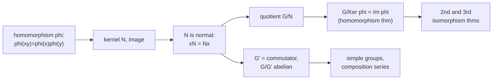

# GT02 · Homomorphisms, Normal Subgroups and Quotients

◀ [[GT01 Groups Subgroups and Cosets]] · [[Group Theory - Course Map|Course Map]] · next: [[GT03 Actions Conjugation and Sylow Theorems]]

extra · book extra · beyond

> [!syllabus] Syllabus map: what is in the syllabus and what is extra in this chapter
> **No lecture source** (see [[GT01 Groups Subgroups and Cosets]]).
> 🟡 **Extra · book:** K–S §1.2 homomorphisms and normal subgroups (1.2.1–1.2.8, [[Kurzweil-Stellmacher_Theory of finite groups.pdf#page=23|PDF p.23 ff.]]), §1.3 automorphisms (1.3.1–1.3.2, PDF p.28), §1.4 cyclic groups (1.4.1–1.4.6, PDF p.34), §1.5 commutators (PDF p.37), §1.6 products (PDF p.40), §1.8 composition series (PDF p.52), §2.1 structure of Abelian groups (2.1.3, PDF p.56).
> 🔵 **Extra · beyond** (`scripts/gt_numbers.py`, `scripts/fig_gt.py`): the explicit quotient $S_4\to S_4/V_4\cong S_3$ with all 24 elements, the commutator subgroup $S_4'=A_4$ verified by brute force, and the proof that an index-2 subgroup is normal.

> [!key] After this chapter you can
> - define a **homomorphism**, its **kernel** and **image**, and prove that kernels are exactly the **normal subgroups**,
> - build the **quotient group** $G/N$ and state and prove the **homomorphism theorem** and the second and third isomorphism theorems,
> - compute the **centre**, **inner automorphisms** and the **commutator subgroup** $G'$ and say why $G/G'$ is the largest Abelian quotient,
> - classify **cyclic groups** and their subgroups, state the structure theorem of finite Abelian groups, and name the building blocks of any finite group (**simple groups**, composition series).

> [!intuition] The one-sentence story
> A homomorphism is a "shadow" of a group that remembers the multiplication but forgets some detail; the forgotten part is the kernel, and the shadow is the group with the kernel collapsed to a point, which is the quotient.

![[GT02 Quotients Map.svg]]
*Diagram GT2.0. The chapter in one page. Editable source: [[GT02 Quotients Map.excalidraw]].*

*Concept map.*

## 1. Homomorphisms
extra · book *K–S §1.2*

> [!key] Definitions
> A map $\varphi:G\to H$ is a **homomorphism** if $\varphi(xy)=\varphi(x)\varphi(y)$. An **isomorphism** is a bijective homomorphism ($G\cong H$; its inverse is again a homomorphism, K–S 1.2.1). The **kernel** is $\operatorname{Ker}\varphi=\{x:\varphi(x)=1\}$, the **image** $\operatorname{Im}\varphi=\varphi(G)\le H$.

> [!derivation] First consequences
> $\varphi(1)=1$ (from $\varphi(1)=\varphi(1)\varphi(1)$ and cancellation), $\varphi(x^{-1})=\varphi(x)^{-1}$, $\operatorname{Im}\varphi$ and $\operatorname{Ker}\varphi$ are subgroups, and $\varphi$ is injective iff $\operatorname{Ker}\varphi=1$ (if $\varphi(x)=\varphi(y)$ then $\varphi(x^{-1}y)=1$). Moreover $\varphi(x)=\varphi(y)\iff x\operatorname{Ker}\varphi=y\operatorname{Ker}\varphi$: **the fibres of $\varphi$ are the cosets of the kernel** (K–S 1.2.2).

**Examples.** $\det:GL_n(F)\to F^\times$ (kernel $SL_n$); the **sign** $S_n\to\{\pm1\}$ (kernel $A_n$, the even permutations); $\exp:(\mathbb R,+)\to(\mathbb R_{>0},\times)$ (an isomorphism); reduction $\mathbb Z\to\mathbb Z/n$ (kernel $n\mathbb Z$); $x\mapsto x^k$ on an Abelian group; $\mathbb Z_6\to\mathbb Z_3$, $x\mapsto x\bmod3$ (kernel $\{0,3\}$).

## 2. Normal subgroups and the quotient
extra · book *K–S 1.2.3–1.2.5*

> [!key] Normal subgroup (1.2.3)
> $N\le G$ is **normal** ($N\trianglelefteq G$) if $xNx^{-1}=N$ for all $x\in G$, equivalently $xN=Nx$ (left and right cosets coincide), equivalently $yxy^{-1}\in N$ for all $x\in N,y\in G$. **Every kernel is normal:** if $\varphi(x)=1$ then $\varphi(yxy^{-1})=\varphi(y)\varphi(y)^{-1}=1$. $1$ and $G$ are normal; subgroups of an Abelian group and the **centre** $Z(G)=\{z:zg=gz\ \forall g\}$ are normal.

> [!derivation] Theorem (quotient group, 1.2.4). If $N\trianglelefteq G$, then $G/N=\{xN\}$ is a group under $(xN)(yN)=xyN$, and $\pi:G\to G/N$, $x\mapsto xN$ is a homomorphism with kernel $N$. So **normal subgroups = kernels.**
> *Proof.* The product is **well defined** exactly because $N$ is normal: if $xN=x'N$ and $yN=y'N$, write $x'=xn$, $y'=yn'$; then $x'y'=xn\,yn'=xy\,(y^{-1}ny)\,n'\in xyN$ since $y^{-1}ny\in N$. Associativity, the identity $N$ and inverses $(xN)^{-1}=x^{-1}N$ are inherited from $G$. $\pi$ is a homomorphism by definition, with kernel $\{x:xN=N\}=N$. ∎

> [!derivation] Theorem (homomorphism theorem, 1.2.5). For $\varphi:G\to H$ with $N=\operatorname{Ker}\varphi$, the map $\bar\varphi:G/N\to\operatorname{Im}\varphi$, $xN\mapsto\varphi(x)$ is an isomorphism: $G/\operatorname{Ker}\varphi\cong\operatorname{Im}\varphi$.
> *Proof.* Well defined and injective: $\varphi(x)=\varphi(y)\iff xN=yN$ (fibres are cosets). Surjective onto the image by definition; a homomorphism because $\varphi$ is. ∎ **Counting form:** $|G|=|\operatorname{Ker}\varphi|\cdot|\operatorname{Im}\varphi|$.

> [!example] The picture: $S_4\to S_3$ with kernel $V_4$
> $V_4=\{e,(12)(34),(13)(24),(14)(23)\}$ is normal in $S_4$ (it is a union of conjugacy classes: the identity and the class of double transpositions, verified in `scripts/gt_numbers.py`). The 24 elements fall into **6 cosets of 4**, and the cosets multiply like the elements of $S_3$: $S_4/V_4\cong S_3$ (the action of $S_4$ on the three ways to split $\{1,2,3,4\}$ into two pairs). The figure shows every coset.

![[fig_gt02_quotient.png]]
*Figure GT2.1. The homomorphism $\pi:S_4\to S_4/V_4\cong S_3$. Each box is one fibre (a coset of $V_4$; the first is the kernel itself); the circle is its image. Cosets were generated by code, so the lists are exact.*

> [!derivation] Index 2 implies normal
> If $|G:N|=2$ then the left cosets are $N$ and $G\setminus N$, and so are the right cosets; the two partitions agree, hence $xN=Nx$ for all $x$ and $N\trianglelefteq G$. Consequently $G/N\cong\mathbb Z_2$ and $x^2\in N$ for **every** $x\in G$ (since $(xN)^2=N$). This is the fact used in [[GT01 Groups Subgroups and Cosets]] to show $A_4$ has no subgroup of order 6. Example: $A_n\trianglelefteq S_n$.

> [!derivation] The isomorphism theorems
> **Second (1.2.6).** If $U\le G$ and $N\trianglelefteq G$ then $UN\le G$, $U\cap N\trianglelefteq U$, and $UN/N\cong U/(U\cap N)$. *Proof.* Apply the homomorphism theorem to $U\to G/N$, $u\mapsto uN$: image $UN/N$, kernel $U\cap N$. ∎ (Compare the product formula: $|UN|=|U||N|/|U\cap N|$.)
> **Third (1.2.7).** If $N\le M$ are both normal in $G$ then $M/N\trianglelefteq G/N$ and $(G/N)/(M/N)\cong G/M$. *Proof.* Apply the theorem to $G/N\to G/M$, $xN\mapsto xM$ (well defined as $N\le M$), kernel $M/N$. ∎
> **Correspondence.** Subgroups of $G/N$ correspond one-to-one to subgroups of $G$ containing $N$, normal ones to normal ones: this is how one reads off the lattice of a quotient.

## 3. Automorphisms, the centre and inner automorphisms
extra · book *K–S §1.3*

> [!key] $\operatorname{Aut}G$, $\operatorname{Inn}G$
> An **automorphism** is an isomorphism $G\to G$; they form the group $\operatorname{Aut}G$. For $g\in G$ the **conjugation** $c_g:x\mapsto gxg^{-1}$ is an automorphism (**inner**); $\operatorname{Inn}G\trianglelefteq\operatorname{Aut}G$. The map $g\mapsto c_g$ is a homomorphism $G\to\operatorname{Aut}G$ with kernel $Z(G)$, so by the homomorphism theorem

$$\operatorname{Inn}G\;\cong\;G/Z(G).$$

> [!derivation] Theorem (1.3.1). If $G/Z(G)$ is cyclic, then $G$ is Abelian.
> *Proof.* Let $G/Z$ be generated by $gZ$. Every element is $g^kz$ ($z\in Z$). Then $(g^kz)(g^lz')=g^{k+l}zz'=(g^lz')(g^kz)$ because $z,z'$ are central. ∎ **Consequence:** a non-Abelian group cannot have $G/Z(G)$ of prime order, so $|G/Z|\ge4$; e.g. $|Z(D_4)|=2$ and $D_4/Z\cong V_4$ is the smallest case.

A subgroup $A$ is **characteristic** ($A\ \mathrm{char}\ G$) if every automorphism maps it to itself. Characteristic $\Rightarrow$ normal. A characteristic subgroup of a normal subgroup is normal in $G$ (1.3.2). Example: the cyclic subgroup of order $d$ in a cyclic group is unique, hence characteristic (1.4.4).

## 4. Cyclic groups and Abelian groups
extra · book *K–S §1.4 and §2.1*

> [!key] Cyclic groups (1.4.1–1.4.6)
> Every subgroup of $\mathbb Z$ is $n\mathbb Z$. A cyclic group of order $n$ is isomorphic to $C_n=\mathbb Z/n\mathbb Z$ (1.4.2). **A cyclic group of order $n$ has exactly one subgroup of order $d$ for each $d\mid n$** (generated by $g^{n/d}$), and no others. The generators of $C_n$ are the $k$ with $\gcd(k,n)=1$: there are $\varphi(n)$ of them, and $\sum_{d\mid n}\varphi(d)=n$ (count elements by order). **The cyclic groups of prime order are the only Abelian simple groups** (1.4.6): every subgroup of an Abelian group is normal, so a simple Abelian group has no proper non-trivial subgroups, hence is generated by any non-identity element, and has prime order by the divisor count.

> [!derivation] Theorem (structure of finite Abelian groups, 2.1.3). Every finite Abelian group is a direct product of cyclic groups of prime-power order, uniquely up to order.
> *Statement and use.* $\mathbb Z_{12}\cong\mathbb Z_4\times\mathbb Z_3$ and $\mathbb Z_6\cong\mathbb Z_2\times\mathbb Z_3$ (Chinese remainder theorem: $C_m\times C_n\cong C_{mn}$ iff $\gcd(m,n)=1$), but $\mathbb Z_2\times\mathbb Z_2\not\cong\mathbb Z_4$. Abelian groups of order 36: $\mathbb Z_4\times\mathbb Z_9$, $\mathbb Z_2^2\times\mathbb Z_9$, $\mathbb Z_4\times\mathbb Z_3^2$, $\mathbb Z_2^2\times\mathbb Z_3^2$: **4** (partitions of the exponents $2=2$ or $1+1$ for each prime). The proof in K–S 2.1.1–2.1.3 splits off a cyclic subgroup of maximal order as a direct factor.

## 5. Commutators and direct products
extra · book *K–S §1.5–1.6*

> [!key] Commutator subgroup
> $[x,y]=x^{-1}y^{-1}xy$ and $G'=\langle[x,y]\rangle$. Then $G'\ \mathrm{char}\ G$, and **$G/G'$ is Abelian, and it is the largest Abelian quotient**: for $N\trianglelefteq G$, $G/N$ is Abelian iff $G'\le N$ (since $[x,y]N=N$ for all $x,y$ iff all $[x,y]\in N$).

> [!example] Commutator subgroups, brute-forced
> $S_3'=A_3\cong\mathbb Z_3$ with $S_3/S_3'\cong\mathbb Z_2$; $S_4'=A_4$ (the subgroup generated by all 24² commutators of $S_4$ has 12 elements and equals $A_4$, verified), so $S_4/S_4'\cong\mathbb Z_2$ and the **Abelianisation** of $S_n$ is the sign homomorphism. A group is **perfect** if $G=G'$: $A_n$ for $n\ge5$ ([[GT03 Actions Conjugation and Sylow Theorems]]).

> [!key] Direct products (§1.6)
> $G\times H$ with componentwise product has $|G\times H|=|G||H|$, projections are homomorphisms, and $G\cong A\times B$ internally iff $A,B\trianglelefteq G$, $A\cap B=1$, $AB=G$ (then $ab=ba$). Example: $D_6\cong D_3\times\mathbb Z_2$ (rotation by $180^\circ$ is central), but $D_4$ is **not** a direct product of smaller groups.

> [!key] Simple groups and composition series (§1.7–1.8)
> $G\ne1$ is **simple** if its only normal subgroups are $1$ and $G$. A **composition series** $1=G_0\trianglelefteq G_1\trianglelefteq\dots\trianglelefteq G_n=G$ has simple factors $G_i/G_{i-1}$; the **Jordan–Hölder theorem** says the factors are unique up to order. Example: $1\trianglelefteq\mathbb Z_2\trianglelefteq V_4\trianglelefteq A_4\trianglelefteq S_4$ is a composition series of $S_4$ (each term is normal in the next, though $\mathbb Z_2$ is *not* normal in $A_4$ or $S_4$), with simple factors $\mathbb Z_2,\mathbb Z_2,\mathbb Z_3,\mathbb Z_2$ whose orders multiply to 24. **Every finite group is built from simple groups; the classification of finite simple groups lists them** (the context of K–S's preface).

> [!pitfall] Four traps
> 1. **Normal is not transitive:** $\langle(12)(34)\rangle\trianglelefteq V_4\trianglelefteq S_4$ but $\langle(12)(34)\rangle\ntrianglelefteq S_4$. (Characteristic is transitive, 1.3.2.)
> 2. **$G/N$ is not a subgroup of $G$** in general: $S_4/V_4\cong S_3$ happens to embed, but $\mathbb Z_4/\{0,2\}\cong\mathbb Z_2$ does not embed in $\mathbb Z_4$ as a complement.
> 3. **Same order, same quotient does not mean isomorphic:** $\mathbb Z_4$ and $V_4$ both have quotient $\mathbb Z_2$ by a subgroup of order 2.
> 4. **Well-definedness is the whole point:** if $N$ is not normal the "product" $xN\cdot yN=xyN$ depends on representatives.

## 6. Summary and practice
> [!summary] Cheat-sheet
> | Statement | Result |
> |---|---|
> | kernels | exactly the normal subgroups |
> | homomorphism theorem | $G/\operatorname{Ker}\varphi\cong\operatorname{Im}\varphi$, $\lvert G\rvert=\lvert\operatorname{Ker}\rvert\lvert\operatorname{Im}\rvert$ |
> | 2nd / 3rd | $UN/N\cong U/(U\cap N)$; $(G/N)/(M/N)\cong G/M$ |
> | index 2 | normal, quotient $\mathbb Z_2$, contains all squares |
> | inner automorphisms | $\operatorname{Inn}G\cong G/Z(G)$; $G/Z$ cyclic $\Rightarrow G$ Abelian |
> | cyclic $C_n$ | one subgroup per divisor, $\varphi(n)$ generators |
> | commutator | $G/G'$ largest Abelian quotient; $S_n'=A_n$ |
> | Abelian simple | only $\mathbb Z_p$ |

> [!example]- Practice (with answers)
> 1. **Prove** $|G|=|\operatorname{Ker}\varphi||\operatorname{Im}\varphi|$. *Answer:* the fibres of $\varphi$ are the $|\operatorname{Im}\varphi|$ cosets of the kernel, each of size $|\operatorname{Ker}\varphi|$.
> 2. **How many homomorphisms $\mathbb Z_{12}\to\mathbb Z_{18}$?** *Answer:* determined by the image $a$ of 1, which needs $12a=0$ in $\mathbb Z_{18}$: $a\in\{0,3,6,\dots,15\}$, i.e. $\gcd(12,18)=6$.
> 3. **Find the quotient** $D_4/Z(D_4)$. *Answer:* order 4, every element squares to the identity ($r^2\in Z$, reflections square to 1), so $\cong V_4$.
> 4. **Show $A_n\trianglelefteq S_n$ and $S_n/A_n\cong\mathbb Z_2$.** *Answer:* it is the kernel of sign; or index 2.
> 5. **Show that a group of order $p^2$ is Abelian.** *Answer:* its centre is non-trivial ([[GT03 Actions Conjugation and Sylow Theorems]], p-groups); if $|Z|=p$ then $G/Z$ has order $p$, so is cyclic, and $G$ is Abelian by 1.3.1, contradicting $Z\ne G$; so $Z=G$.
> 6. **Number of Abelian groups of order 72 up to isomorphism.** *Answer:* $72=2^3\cdot3^2$: partitions of 3 (3) times partitions of 2 (2) $=6$.

## Map of this chapter
> [!connection] How GT02 connects
> **Builds on:** [[GT01 Groups Subgroups and Cosets]] (cosets, Lagrange). **Next:** [[GT03 Actions Conjugation and Sylow Theorems]] (conjugation as an action; the class equation) and [[GT04 Symmetry Representations and Characters]] (a representation is a homomorphism $G\to GL(V)$; characters are functions constant on conjugacy classes).
> **Other subjects:** [[Proofs, Analysis and Topology - Course Map]] (well-definedness, equivalence classes), [[Quantum Mechanics - Course Map]] (parity: the quotient and sign homomorphisms).
> **Concept notes:** [[Homomorphism]] · [[Kernel and Image]] · [[Normal Subgroup]] · [[Quotient Group]] · [[Isomorphism Theorems]] · [[Commutator Subgroup]] · [[Simple Group]] · [[Direct Product of Groups]]

## Provenance
> [!provenance]- Source map for this chapter
> | Topic | Source | Scope |
> |---|---|---|
> | homomorphisms, normal subgroups, quotient, homomorphism and isomorphism theorems | [[Kurzweil-Stellmacher_Theory of finite groups.pdf#page=23|K–S §1.2, PDF pp.23–28]] (1.2.1–1.2.8) | extra · book |
> | automorphisms, $G/Z$ cyclic | [[Kurzweil-Stellmacher_Theory of finite groups.pdf#page=28|K–S §1.3, PDF pp.28–33]] (1.3.1–1.3.2) | extra · book |
> | cyclic and Abelian groups | [[Kurzweil-Stellmacher_Theory of finite groups.pdf#page=34|K–S §1.4, PDF p.34]]; [[Kurzweil-Stellmacher_Theory of finite groups.pdf#page=56|§2.1, PDF p.56]] | extra · book |
> | commutators, products, composition series | K–S §1.5–1.8 (PDF pp.37–55) | extra · book |
> | index-2 argument, $S_4\to S_3$ figure, $S_4'=A_4$, practice | `scripts/gt_numbers.py`, `scripts/fig_gt.py`, my derivations | extra · beyond |
>
> **Flags.** (1) The composition-series example uses a subnormal chain (a composition series only requires each term to be normal in the *next*), which is what Jordan–Hölder is about; the normal series $1\trianglelefteq V_4\trianglelefteq A_4\trianglelefteq S_4$ has non-simple factor $V_4$. (2) The theorem numbers 1.2.x, 1.3.x, 1.4.x, 2.1.x were read from the book's section list and my memory of their content; I did not re-check their exact wording against the PDF.
