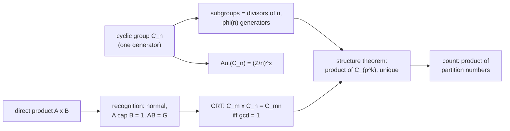

# GT03 · Cyclic and Abelian Groups and Direct Products

◀ [[GT02 Homomorphisms Normal Subgroups and Quotients]] · [[Group Theory - Course Map|Course Map]] · next: [[GT04 Commutators Simple Groups and Composition Series]]

> [!info] Source and approach
> Follows K–S §1.4 (cyclic groups, [[Kurzweil-Stellmacher_Theory of finite groups.pdf#page=34|PDF p.34]]), §1.6 (products, PDF p.40), §2.1 (structure of Abelian groups, PDF p.56) and §2.2 (automorphisms of cyclic groups, PDF p.62); PDF page = printed page + 13. The proofs of the structure theorem and of the cyclicity of $(\mathbb Z/p)^\times$ are written out in full here, and every count is checked by computer (`scripts/gt_numbers2.py`). Exact theorem numbers of K–S were not re-checked.

> [!tip] Start here (first read)
> - **The picture.** The simplest groups are those where *order does not matter* ("Abelian": $xy=yx$) and those generated by a single move ("cyclic": do one thing again and again, like turning a clock hand). This chapter shows that **every finite Abelian group is just a bundle of independent clocks**. That is a *complete classification*, rare in mathematics.
> - **What you need.** Groups, subgroups, cosets, Lagrange ([[GT01 Groups Subgroups and Cosets]]) and quotients ([[GT02 Homomorphisms Normal Subgroups and Quotients]]). No more.
> - **How to read the proofs.** Each proof is preceded by a box "What the proof is doing" in plain words; read that first. The structure-theorem proof is the longest in the chapter: skim it first, then come back.

> [!key] After this chapter you can
> - describe all subgroups, quotients and generators of a **cyclic group** and count them with $\varphi$,
> - recognise when $G$ is an **internal direct product** $A\times B$ and use the **Chinese remainder theorem**,
> - state and prove the **structure theorem**: a finite Abelian group is uniquely a product of cyclic groups of prime-power order, and **count** Abelian groups of a given order,
> - compute $\operatorname{Aut}(C_n)\cong(\mathbb Z/n)^\times$ and show that $(\mathbb Z/p)^\times$ is cyclic.

> [!intuition] The one-sentence story
> A cyclic group is one clock; an Abelian group is several clocks ticking independently (each with a prime-power number of hours); nothing else can happen as long as the order of operations does not matter.

![[GT03 Cyclic Abelian Map.svg]]
*Diagram GT3.0. The chapter in one page. Editable source: [[GT03 Cyclic Abelian Map.excalidraw]].*

*Concept map.*

## 1. Cyclic groups
> [!key] Definition
> $G$ is **cyclic** if $G=\langle g\rangle=\{g^k:k\in\mathbb Z\}$ for one element $g$ (a **generator**). Two models: $\mathbb Z$ (infinite) and $C_n=\mathbb Z/n\mathbb Z$ (order $n$). *Every cyclic group is one of these*: send $g^k\mapsto k$ (mod $n$ if $g$ has finite order $n$); the map is an isomorphism because $g^k=g^l\iff n\mid k-l$.

> [!derivation] Theorem 1.1 (subgroups of cyclic groups). Every subgroup of $\mathbb Z$ is $m\mathbb Z$ for a unique $m\ge0$. Every subgroup of a cyclic group is cyclic. A cyclic group of order $n$ has **exactly one subgroup of order $d$ for each divisor $d\mid n$**, and no others.
> *What the proof is doing:* a subgroup of $\mathbb Z$ is closed under subtraction, and the **Euclidean algorithm** (division with remainder) shows its smallest positive element generates everything else.
> *Proof.* Let $U\le\mathbb Z$, $U\ne0$, and let $m$ be its smallest positive element. For $u\in U$ write $u=qm+r$, $0\le r<m$; then $r=u-qm\in U$, so $r=0$ by minimality: $U=m\mathbb Z$. For $G=\langle g\rangle$ of order $n$, a subgroup $U$ is the image of $m\mathbb Z$ under $k\mapsto g^k$, so is cyclic, generated by $g^{m}$ with $m\mid n$ (take $m=\gcd$ of the exponents with $n$); its order is $n/m$. Conversely for each $d\mid n$ the element $g^{n/d}$ has order $d$, and uniqueness follows because any subgroup of order $d$ is $\langle g^m\rangle$ with $n/m=d$. ∎

> [!derivation] Theorem 1.2 (orders of elements and generators). If $o(g)=n$ then $o(g^k)=n/\gcd(n,k)$. Hence $C_n$ has exactly $\varphi(n)$ generators ($\varphi$ = Euler's function: the number of $1\le k\le n$ with $\gcd(k,n)=1$), and $\sum_{d\mid n}\varphi(d)=n$.
> *Proof.* $(g^k)^j=1\iff n\mid kj\iff\frac n{\gcd(n,k)}\mid j$ (divide by $\gcd$), so $o(g^k)=n/\gcd(n,k)$; it equals $n$ iff $\gcd(n,k)=1$. For the identity, sort the $n$ elements of $C_n$ by their order: each divisor $d$ is the order of exactly the $\varphi(d)$ generators of the unique subgroup of order $d$ (Theorem 1.1), so the counts add to $n$. ∎ *Check ($n=12$):* orders $1,2,3,4,6,12$ occur $1,1,2,2,2,4$ times (sum 12), and $\sum_{d\mid36}\varphi(d)=36$ (computed).

> [!example] A clock, a keyboard and a polygon
> $C_{12}$ is the hours on a clock face (add hours); its generators are the hours $1,5,7,11$ ($\varphi(12)=4$): *the hands that, stepped repeatedly, visit every hour.* In music, transposition by semitones is $C_{12}$: the circle of fifths (step 7) is a generator, which is why it visits every pitch class. The rotations of a regular $n$-gon form $C_n$ (the subgroup $\langle r\rangle$ of $D_n$, [[GT01 Groups Subgroups and Cosets]]).

## 2. Direct products
> [!key] External and internal direct products
> The **(external) direct product** $A\times B$ is the set of pairs $(a,b)$ with $(a,b)(a',b')=(aa',bb')$; $|A\times B|=|A||B|$; the maps $a\mapsto(a,1)$, $b\mapsto(1,b)$ embed $A,B$ as **normal subgroups that commute elementwise**. **Recognition (internal direct product).** If $G$ has subgroups $A,B$ with (i) $A,B\trianglelefteq G$, (ii) $A\cap B=1$, (iii) $AB=G$, then $G\cong A\times B$.

> [!derivation] Proof of the recognition theorem
> *What the proof is doing:* two normal subgroups that meet only in the identity must commute, and then the product map is a bijective homomorphism.
> *Proof.* Let $a\in A,b\in B$. The commutator $[a,b]=a^{-1}b^{-1}ab$ equals $a^{-1}(b^{-1}ab)\in A$ (as $A$ is normal) and $(a^{-1}b^{-1}a)b\in B$ (as $B$ is normal), so $[a,b]\in A\cap B=1$: **$ab=ba$**. Define $\mu:A\times B\to G$, $(a,b)\mapsto ab$. It is a homomorphism: $\mu((a,b)(a',b'))=aa'bb'=(ab)(a'b')$ using $ba'=a'b$. It is onto since $AB=G$, and injective since $ab=1\Rightarrow a=b^{-1}\in A\cap B=1$. ∎

> [!derivation] Theorem 2.1 (Chinese remainder theorem for groups). $C_m\times C_n\cong C_{mn}$ **if and only if $\gcd(m,n)=1$.**
> *Proof.* The element $(1,1)\in C_m\times C_n$ has order $\operatorname{lcm}(m,n)$ (its $k$-th multiple is $(k,k)$, zero iff $m\mid k$ and $n\mid k$). The product has order $mn$, so it is cyclic iff some element has order $mn$ iff $\operatorname{lcm}(m,n)=mn$ (every element's order divides the lcm of the factors' orders) iff $\gcd(m,n)=1$. ∎ *Examples:* $C_6\cong C_2\times C_3$, $C_{12}\cong C_4\times C_3$, but $C_2\times C_2\not\cong C_4$ (every element of $C_2\times C_2$ has order $\le2$).

> [!pitfall] Not every normal subgroup splits off
> $D_4$ (symmetries of a square) has the normal subgroup $\langle r^2\rangle\cong C_2$ with quotient $V_4$, but is not a direct product $C_2\times V_4$ (the latter is Abelian, $D_4$ is not). $C_4$ has the normal subgroup $\{0,2\}$ but *no* complement ($C_4\ne C_2\times C_2$). Direct product is a *strong* condition; the weaker construction is the **semidirect product** ([[GT08 Solvable Groups and Complements]]).

## 3. The structure theorem for finite Abelian groups
> [!key] Theorem 3.1 (K–S §2.1)
> **Every finite Abelian group is a direct product of cyclic groups of prime-power order, $G\cong C_{p_1^{e_1}}\times\cdots\times C_{p_r^{e_r}}$, and the multiset of prime powers $p_i^{e_i}$ is uniquely determined by $G$.**

> [!derivation] Step 1: split into primes
> *What this step is doing:* an Abelian group is a product of its "$p$-parts", one for each prime dividing the order.
> For $G$ Abelian let $G_p=\{g:g^{p^k}=1\text{ for some }k\}$, a subgroup (Abelian: $(gh)^{p^k}=g^{p^k}h^{p^k}$); every subgroup of $G$ is normal. *Every $g$ is a product of elements of the $G_p$:* if $o(g)=\prod p_i^{b_i}$ put $m_i=o(g)/p_i^{b_i}$; the $m_i$ have $\gcd 1$, so $\sum c_im_i=1$ for some integers $c_i$ (Bezout), and $g=\prod g^{c_im_i}$ with $g^{c_im_i}\in G_{p_i}$ (its order divides $p_i^{b_i}$). The $G_{p_i}$ intersect pairwise trivially (an element of $G_p\cap G_q$ has order a power of $p$ and a power of $q$), so by the recognition theorem $G=G_{p_1}\times\cdots\times G_{p_r}$ and $|G|=\prod|G_{p_i}|$ with each $|G_{p_i}|$ a power of $p_i$, hence $|G_{p_i}|=p_i^{a_i}$ where $|G|=\prod p_i^{a_i}$ (unique factorisation). It remains to handle **Abelian $p$-groups**.

> [!derivation] Step 2 (key lemma). Let $G$ be a finite Abelian $p$-group and $a\in G$ an element of **maximal order** $p^m$. Then $\langle a\rangle$ has a complement: $G=\langle a\rangle\times H$ for some subgroup $H$.
> *What the proof is doing:* take $H$ as large as possible with $H\cap\langle a\rangle=1$ and show it must already fill out $G$; if not, one could enlarge it, using that $a$ has the *largest* order so no element can "eat" a piece of $\langle a\rangle$.
> *Proof.* Choose $H$ **maximal** among subgroups with $H\cap\langle a\rangle=1$ (possible: $H=1$ qualifies). Suppose $\langle a\rangle H\ne G$ and take $g\notin\langle a\rangle H$ of **minimal order**. Then $g^p\in\langle a\rangle H$ (the element $g^p$ has smaller order than $g$, and if it were outside $\langle a\rangle H$ it would contradict minimality; if $g^p=1$ then trivially inside). Write $g^p=a^ih$ with $h\in H$. Since $a$ has maximal order, $g^{p^m}=1$, so $1=(a^ih)^{p^{m-1}}=a^{ip^{m-1}}h^{p^{m-1}}$, hence $a^{ip^{m-1}}=h^{-p^{m-1}}\in\langle a\rangle\cap H=1$, so $a^{ip^{m-1}}=1$, i.e. $p^m\mid ip^{m-1}$, i.e. **$p\mid i$**: $i=pj$. Put $g'=ga^{-j}$. Then $g'\notin\langle a\rangle H$ (else $g\in\langle a\rangle H$), and $g'^p=g^pa^{-pj}=a^{pj}ha^{-pj}=h\in H$. Let $H'=\langle H,g'\rangle=H\cup g'H\cup\cdots\cup g'^{p-1}H$ (since $g'^p\in H$, $H'$ has index... $|H'|=p|H|$). We claim $H'\cap\langle a\rangle=1$: if $a^k=g'^th'$ with $h'\in H$, $0<t<p$, then $g'^t\in\langle a\rangle H$, and since $\gcd(t,p)=1$ we may write $1=ut+vp$ and $g'=(g'^t)^u(g'^p)^v\in\langle a\rangle H$ (as $g'^p\in H$), a contradiction; for $t=0$ we get $a^k\in H\cap\langle a\rangle=1$. So $H'\supsetneq H$ meets $\langle a\rangle$ trivially, contradicting the maximality of $H$. Hence $G=\langle a\rangle H$; with $H\cap\langle a\rangle=1$ and everything normal, $G=\langle a\rangle\times H$. ∎

> [!derivation] Step 3: existence and uniqueness
> **Existence.** Induction on $|G|$ for a $p$-group $G$: write $G=\langle a\rangle\times H$ (Step 2) with $|H|<|G|$ and apply the induction hypothesis to $H$.
> **Uniqueness.** *What this step is doing:* count solutions of $x^{p^k}=1$; these counts "see" the exponents.
> Let $G\cong\prod_iC_{p^{e_i}}$. The number of elements with $x^{p^k}=1$ is $N_k=\prod_ip^{\min(k,e_i)}$ (in each factor $C_{p^e}$ the solutions of $x^{p^k}=1$ form the subgroup of order $p^{\min(k,e)}$, by Theorem 1.1). So $\log_pN_k-\log_pN_{k-1}=\#\{i:e_i\ge k\}$, and these numbers (for $k=1,2,\dots$) determine the multiset $\{e_i\}$ completely. Since $N_k$ is an invariant of $G$, so is $\{e_i\}$. ∎ *Check:* the three groups of order 8 that are Abelian have $N_1=(2,4,8)$ for $C_8,C_4\times C_2,C_2^3$ resp.: distinct (computed). 

> [!example] Counting Abelian groups
> The number of Abelian groups of order $n=\prod p_i^{a_i}$ is $\prod_ip(a_i)$, where $p(a)$ is the number of **partitions** of $a$ (the exponents $e_i$ with $\sum e_i=a$). Order $72=2^3\cdot3^2$: $p(3)p(2)=3\cdot2=\mathbf6$ groups ($C_8,C_4C_2,C_2^3$ times $C_9,C_3^2$); order $36$: $p(2)p(2)=4$; order $16$: $p(4)=5$; order $1000$: $p(3)^2=9$ (all computed).

## 4. Automorphisms of cyclic groups
> [!derivation] Theorem 4.1. $\operatorname{Aut}(C_n)\cong(\mathbb Z/n)^\times$, the group of units mod $n$ under multiplication; in particular $|\operatorname{Aut}(C_n)|=\varphi(n)$.
> *Proof.* An automorphism is determined by the image $g^k$ of the generator $g$, which must again generate: $\gcd(k,n)=1$. Define $\alpha_k(g^j)=g^{kj}$. Then $\alpha_k\alpha_l=\alpha_{kl}$ (apply to $g$: $g\mapsto g^l\mapsto g^{lk}$), so $k\mapsto\alpha_k$ is an isomorphism $(\mathbb Z/n)^\times\to\operatorname{Aut}(C_n)$. ∎ *Examples:* $\operatorname{Aut}(C_6)\cong C_2$, $\operatorname{Aut}(C_8)\cong C_2\times C_2$ (not cyclic!), $\operatorname{Aut}(C_{10})\cong C_4$ (all computed); $\operatorname{Aut}(C_2\times C_2)\cong S_3$ (any permutation of the three non-identity elements works: $|{\rm Aut}|=6$).

> [!derivation] Theorem 4.2. $(\mathbb Z/p)^\times$ is cyclic of order $p-1$ for every prime $p$ (so there are **primitive roots** mod $p$).
> *What the proof is doing:* count elements by order; a polynomial equation over a field cannot have too many roots, which forces the existence of an element of the largest possible order.
> *Proof.* In the field $\mathbb F_p$ the polynomial $x^d-1$ has at most $d$ roots. Hence for each $d\mid p-1$ there are **at most $d$ elements with $x^d=1$**, so at most $\varphi(d)$ elements of order exactly $d$ (they all lie in the subgroup of order $d$ if one exists: if there is one element of order $d$ its powers already give $d$ roots, so the elements of order $d$ are exactly its $\varphi(d)$ generators). Therefore the number of elements of order $d$ is $0$ or $\varphi(d)$. But the total is $p-1=\sum_{d\mid p-1}\varphi(d)$ (Theorem 1.2), so every $d$ attains $\varphi(d)$; in particular $d=p-1$ does: there is an element of order $p-1$. ∎ *Check ($p=13$):* orders $1,2,3,4,6,12$ occur $1,1,2,2,2,4$ times: four generators. (Warning: $(\mathbb Z/8)^\times$ and $(\mathbb Z/12)^\times$ are *not* cyclic, so the statement needs $n$ prime.)

<!-- interactive:start (generated by scripts/embed_interactive.py; edit the tool in scripts/interactive/tools/, not this block) -->
> [!interactive]+ Interactive: Cyclic groups, Z_n and quotients: clock arithmetic and cosets
> Z_n is the clock with n hours; the subgroup ⟨d⟩ generated by a divisor d of n has n/d elements and the quotient Z_n/⟨d⟩ ≅ Z_d.
>
> ![[gt_zn_quotient.png|720]]
>
> **Try:** n = 12, g = 4: the subgroup {0, 4, 8} has order 3 and index 4 (four cosets). The quotient has 4 elements: Z₁₂/⟨4⟩ ≅ Z₄. Product: Z₃ × Z₄ (gcd 1) has an element of order 12 so it is cyclic ≅ Z₁₂; Z₂ × Z₄ (gcd 2) has no element of order 8: not cyclic.
>
> [▶ Open the tool in your browser](../Assets/interactive/gt_zn_quotient.html) · [absolute link](file:///home/swastik/Documents/notes/Assets/interactive/gt_zn_quotient.html) · all tools and coverage: [[Interactive Tools]]

<!-- interactive:end -->

## 5. Practice and check yourself
> [!example]- Practice (with answers)
> 1. **List the subgroups** of $C_{18}$ and the number of generators of each. *Answer:* orders $1,2,3,6,9,18$ (the divisors), with $\varphi=1,1,2,2,6,6$ generators; total generators of all subgroups $=18$ counting each element of order $d$ once.
> 2. **Is $C_{15}\cong C_3\times C_5$? Is $C_{12}\cong C_6\times C_2$?** *Answer:* yes ($\gcd=1$); no ($\gcd(6,2)=2$; $C_6\times C_2$ has $3$ elements of order 2, $C_{12}$ has one).
> 3. **How many Abelian groups of order 360?** *Answer:* $360=2^3\cdot3^2\cdot5$: $p(3)p(2)p(1)=3\cdot2\cdot1=6$.
> 4. **Show a finite group whose elements all have order $\le2$ is isomorphic to $C_2^n$.** *Answer:* it is Abelian ($xy=(xy)^{-1}=yx$), a $2$-group, so a product of $C_{2^e}$'s with every $e=1$ (Theorem 3.1).
> 5. **Compute $|\operatorname{Aut}(C_{100})|$.** *Answer:* $\varphi(100)=100(1-\tfrac12)(1-\tfrac15)=40$.
> 6. **Find a primitive root mod 11.** *Answer:* $2$: powers $2,4,8,5,10,9,7,3,6,1$ — order 10.

## 6. Where Abelian groups show up in other subjects
> [!connection] Abelian groups elsewhere in the vault
> - **Commuting operators and good quantum numbers:** the symmetries of a quantum system that commute with each other form an Abelian group, and all its irreducible representations are one-dimensional, so a basis exists where all of them are simultaneously diagonal ([[Dirac Algebra]] §8, compatible observables; [[GT10 Symmetry Representations and Characters]] §2). Translations on a lattice are $\mathbb Z^d$: **Bloch's theorem** ([[Bloch Theorem]], [[QM08 Quantum Tunnelling]] §8). Parity is $C_2$ ([[Parity Operator]], [[Parity Theorem]]); the point group $C_{2v}$ of water is $C_2\times C_2$ ([[CH03 Molecular Orbital Theory Polyatomics]]).
> - **Fourier analysis is the structure theory of Abelian groups:** the DFT is the character table of $C_N$ ([[Fourier and Laplace Transforms]] §5.5); a finite Abelian group $\prod C_{n_i}$ has a multi-dimensional DFT.
> - **Clock arithmetic and equivalence classes:** $\mathbb Z/n$ is the set of residue classes of the equivalence relation "congruence mod $n$", exactly the quotient construction of [[PA03 Relations Equivalence and Order]] ([[Congruence Modulo n]], [[Equivalence Class and Partition]]).
> - **Counting and probability:** the number of Abelian groups, necklaces and orbits ([[Probability - Course Map]], [[GT05 Actions Conjugation and Sylow Theorems]] Burnside).
> - **Crystals and landscapes:** the translation group of a crystal is Abelian; the grid of a DEM and a periodic landscape are acted on by $\mathbb Z^2$ ([[LS03 Digital Elevation Models and Terrain Analysis]]).
> **Concept notes:** [[Cyclic Group]] · [[Direct Product of Groups]] · [[Structure Theorem of Finite Abelian Groups]] · [[Euler Totient Function]] · [[Primitive Root]] · [[Automorphism Group]]

## Provenance
> [!provenance]- Source map for this chapter
> | Topic | Source | Origin |
> |---|---|---|
> | cyclic groups, products, structure of Abelian groups, automorphisms of cyclic groups | K–S §1.4, §1.6, §2.1, §2.2 (PDF pp.34, 40, 56, 62; the TOC titles and the section list were read, not each page) | book |
> | the proofs written out (Euclidean-algorithm proof, key lemma with maximal $H$, uniqueness by counting, $(\mathbb Z/p)^\times$ cyclic by counting roots), examples, practice | my write-up of the standard arguments; computations in `scripts/gt_numbers2.py` | mine |
>
> **Flags.** (1) The key-lemma proof is the textbook maximal-complement argument; it is believed correct and the key steps were re-derived, but not copied from K–S. (2) The statement "the number of Abelian groups of order $n$ is $\prod p(a_i)$" follows from the theorem and was checked only on the listed orders.
