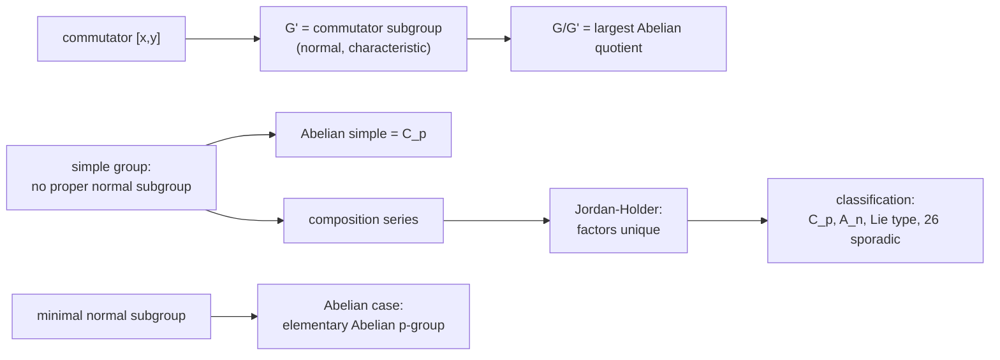

# GT04 · Commutators, Simple Groups and Composition Series

◀ [[GT03 Cyclic and Abelian Groups and Direct Products]] · [[Group Theory - Course Map|Course Map]] · next: [[GT05 Actions Conjugation and Sylow Theorems]]

> [!info] Source and approach
> Follows K–S §1.5 (commutators, [[Kurzweil-Stellmacher_Theory of finite groups.pdf#page=37|PDF p.37]]), §1.7 (minimal normal subgroups, PDF p.49) and §1.8 (composition series, PDF p.52); PDF page = printed page + 13. The Jordan–Hölder proof below is the standard induction written out in full; all examples are computed (`scripts/gt_numbers2.py`). Exact theorem numbers of K–S were not re-checked.

> [!tip] Start here (first read)
> - **The picture.** Chemists build every molecule from atoms; group theorists try to build every finite group from **simple groups**, the groups that cannot be broken by a quotient ("atoms"). The **commutator subgroup** measures how non-commutative a group is; **composition series** is the recipe that lists the atoms of a group.
> - **What you need.** Normal subgroups, quotients and the isomorphism theorems ([[GT02 Homomorphisms Normal Subgroups and Quotients]]); cyclic and Abelian groups ([[GT03 Cyclic and Abelian Groups and Direct Products]]).
> - **How to read.** The only long proof is Jordan–Hölder (§4); its idea is two sentences in the box before it. Everything else is short.

> [!key] After this chapter you can
> - compute the **commutator subgroup** $G'$ and the **abelianisation** $G/G'$ and use the fact that $G/G'$ is the *largest Abelian quotient*,
> - explain why a group is **simple** and list the simple groups you know,
> - find a **minimal normal subgroup** and show it is elementary Abelian in the Abelian case,
> - build a **composition series**, read off its **composition factors**, and prove they depend only on $G$ (**Jordan–Hölder**),
> - say what the **classification of finite simple groups** states and why $A_5$ is the smallest non-Abelian simple group.

> [!intuition] The one-sentence story
> Quotienting by a normal subgroup is like "zooming out"; a simple group is one you cannot zoom out of without losing everything, so repeatedly zooming out of a finite group ends at the atoms, and (Jordan–Hölder) the *list* of atoms is an invariant of the group, even though the order in which you peel them is not.

![[GT04 Commutators Simple Map.svg]]
*Diagram GT4.0. The chapter in one page. Editable source: [[GT04 Commutators Simple Map.excalidraw]].*

*Concept map.*

## 1. Commutators
> [!key] Definitions
> The **commutator** of $x,y\in G$ is $[x,y]=x^{-1}y^{-1}xy$; it equals $1$ iff $x,y$ commute ($xy=yx\iff x^{-1}y^{-1}xy=1$). The **commutator subgroup** (or **derived subgroup**) is $G'=\langle[x,y]:x,y\in G\rangle$. Notation: $x^g=g^{-1}xg$.

> [!derivation] Theorem 1.1. (a) $G'$ is a **characteristic** (hence normal) subgroup. (b) $G/G'$ is Abelian. (c) For $N\trianglelefteq G$: $G/N$ is Abelian $\iff G'\le N$. Hence **$G/G'$ is the largest Abelian quotient**, and every homomorphism from $G$ to an Abelian group factors uniquely through $G/G'$.
> *What the proof is doing:* a commutator is *by definition* the thing that measures failure of commutativity, so killing all commutators is exactly what makes the quotient Abelian.
> *Proof.* (a) An automorphism $\alpha$ satisfies $\alpha([x,y])=[\alpha x,\alpha y]$, so it maps the set of commutators to itself and hence $G'$ to itself. (b,c) In $G/N$: $[xN,yN]=[x,y]N$, so $G/N$ is Abelian iff every $[x,y]\in N$ iff $G'\le N$ ($N$ is a subgroup, so containing all generators means containing $G'$). The factorisation: a homomorphism $\varphi:G\to A$ with $A$ Abelian has $G/\ker\varphi\cong\operatorname{Im}\varphi$ Abelian, so $G'\le\ker\varphi$ by (c), and $\varphi$ descends to $G/G'$. ∎

> [!example] Commutator subgroups computed
> $$S_3'=A_3\ (\text{so }S_3/S_3'\cong C_2),\quad S_4'=A_4,\quad A_4'=V_4,\quad V_4'=1,\quad D_4'=\langle r^2\rangle\cong C_2\ (D_4/D_4'\cong V_4),\quad A_5'=A_5.$$
> (All brute-forced: e.g. $|S_4'|=12$, $|A_5'|=60$.) A group with $G=G'$ is **perfect** ($A_5$, $A_n$ for $n\ge5$, $SL_n$ over a field with a few small exceptions). **Derived series:** $G\ge G'\ge G''\ge\cdots$ with $G^{(k+1)}=(G^{(k)})'$; for $S_4$ it is $S_4>A_4>V_4>1$ (orders $24,12,4,1$): it reaches $1$, which is the definition of *solvable* ([[GT08 Solvable Groups and Complements]]); for $A_5$ it is stuck at $A_5$.

> [!intuition] Why $S_n/A_n=C_2$ is the whole story of parity
> The sign homomorphism $S_n\to\{\pm1\}$ is the abelianisation of $S_n$ ($n\ge2$): *the only thing about a permutation that survives "forgetting the order of operations" is whether it is even or odd.* The same idea in other subjects: the only thing about a closed path that survives forgetting order is its winding number (the abelianisation of a fundamental group is the first homology group; outside this vault).

## 2. Simple groups
> [!key] Definition
> A group $G\ne1$ is **simple** if its only normal subgroups are $1$ and $G$: no proper non-trivial quotient exists.

> [!derivation] Theorem 2.1. An Abelian group is simple iff it is cyclic of prime order.
> *Proof.* In an Abelian group every subgroup is normal. If $G$ is simple Abelian and $g\ne1$, then $\langle g\rangle$ is a non-trivial normal subgroup, so $\langle g\rangle=G$: $G$ is cyclic, and by Theorem 1.1 of [[GT03 Cyclic and Abelian Groups and Direct Products]] a cyclic group of order $n$ has a subgroup of each order $d\mid n$, so $n$ has no divisors besides $1,n$: $n$ is prime. Conversely $C_p$ has no subgroups other than $1,C_p$ (Lagrange). ∎

> [!example] The non-Abelian simple groups you will meet
> $A_5$ (order 60, simple: proved in [[GT05 Actions Conjugation and Sylow Theorems]] by the class-size argument) and, for all $n\ge5$, $A_n$ ([[GT06 Permutation Groups]]). **Hölder (1892): $A_5$ is the smallest non-Abelian simple group**; every non-Abelian group of order $<60$ has a proper non-trivial normal subgroup (Sylow arguments as in the order-12 and order-56 examples of GT05). Next: $|PSL_2(7)|=168$, $|A_6|=360$, $|PSL_2(8)|=504$ (recalled).

> [!key] The classification of finite simple groups (statement only)
> *Every finite simple group is isomorphic to one of: (1) a cyclic group $C_p$; (2) an alternating group $A_n$, $n\ge5$; (3) a finite group of **Lie type** (matrix groups over finite fields, e.g. $PSL_n(q)$ and their cousins); (4) one of **26 sporadic groups**, the largest being the **Monster** of order $\approx8\times10^{53}$ (recalled).* The proof, completed in the early 21st century, is tens of thousands of journal pages by many authors; the K–S preface places the book in this context ("an impressive and convincing demonstration of the strength of its methods") and its later chapters develop techniques used in the classification. It is not proved or used here.

## 3. Minimal normal subgroups
> [!key] Definition
> A **minimal normal subgroup** of $G$ is a normal subgroup $N\ne1$ such that no normal subgroup of $G$ lies strictly between $1$ and $N$. Every finite $G\ne1$ has one (take a non-trivial normal subgroup of smallest order). Examples (computed): $S_4$: $V_4$; $A_4$: $V_4$; $S_3$: $A_3$; $D_4$: $Z(D_4)=\langle r^2\rangle$.

> [!derivation] Theorem 3.1 (Abelian minimal normal subgroups). If $N$ is an **Abelian** minimal normal subgroup of $G$, then $N$ is an **elementary Abelian $p$-group** ($N\cong C_p^k$) for some prime $p$.
> *What the proof is doing:* the elements of order dividing $p$ form a subgroup that every automorphism preserves, so it is normal in $G$, and minimality leaves only one possibility.
> *Proof.* Let $p$ divide $|N|$ and $\Omega=\{x\in N:x^p=1\}$. As $N$ is Abelian, $\Omega$ is a subgroup; $\Omega\ne1$ by Cauchy. It is **characteristic** in $N$ (automorphisms preserve $x^p=1$), and $N\trianglelefteq G$, so $\Omega\trianglelefteq G$ (conjugation by $g$ induces an automorphism of $N$). By minimality $\Omega=N$: every element has order $1$ or $p$, so $N\cong C_p^k$ by [[GT03 Cyclic and Abelian Groups and Direct Products]] (all elements of order $\le p$ forces all cyclic factors to be $C_p$). ∎
> *Non-Abelian case (K–S 1.7, stated):* a minimal normal subgroup is a direct product of isomorphic simple groups $S\times\cdots\times S$. Together: a minimal normal subgroup is a direct power of one simple group.

## 4. Composition series and the Jordan–Hölder theorem
> [!key] Definition
> A **composition series** of $G$ is a chain $1=G_0<G_1<\cdots<G_r=G$ with **each $G_{i-1}\trianglelefteq G_i$** and each quotient $G_i/G_{i-1}$ **simple**. The quotients are the **composition factors**; $r$ is the **length**. (Each term need only be normal in the *next*, not in $G$: **subnormal**.)

> [!derivation] Existence. Every finite group has a composition series.
> *Proof.* Induction on $|G|$. For $G=1$ the empty chain works. For $G\ne1$ choose a normal subgroup $M<G$ of **largest possible order**. If $G/M$ had a proper non-trivial normal subgroup, its preimage would be a normal subgroup of $G$ strictly between $M$ and $G$ (correspondence theorem), contradicting the choice of $M$; so $G/M$ is simple. Append $G$ to a composition series of $M$ (induction). ∎

> [!derivation] Theorem 4.1 (Jordan–Hölder). Any two composition series of $G$ have the same length, and their composition factors agree up to isomorphism and order.
> *What the proof is doing:* compare the two largest proper terms $A,B$. If they are equal, induct. If not, they must multiply to the whole group and the two "diamond" quotients $G/A\cong B/(A\cap B)$, $G/B\cong A/(A\cap B)$ match up the factors.
> *Proof.* Induction on $|G|$; $|G|=1$ is trivial. Let $1=G_0<\dots<G_r=G$ and $1=H_0<\dots<H_s=G$ be composition series, $A=G_{r-1}$, $B=H_{s-1}$, both normal in $G$ with $G/A$, $G/B$ simple.
> *Case $A=B$.* The chains $(G_i)_{i<r}$ and $(H_j)_{j<s}$ are composition series of $A$ ($|A|<|G|$); by induction $r-1=s-1$ and the factors agree; the remaining factor $G/A=G/B$ is common.
> *Case $A\ne B$.* If $B\le A$, then $A/B$ is a normal subgroup of the simple group $G/B$, so $A=B$ or $A=G$, impossible; hence $B\not\le A$ and $AB\supsetneq A$. Now $AB$ is normal in $G$ (a product of normal subgroups), and $AB/A$ is a non-trivial normal subgroup of the simple group $G/A$, so $AB=G$. Put $K=A\cap B\trianglelefteq G$. By the second isomorphism theorem [[GT02 Homomorphisms Normal Subgroups and Quotients]]: $$G/A=AB/A\cong B/K,\qquad G/B=AB/B\cong A/K.$$ Both quotients are simple. Choose a composition series $1=K_0<\cdots<K_t=K$ of $K$. Then $K_0<\cdots<K_t<A$ is a composition series of $A$ (as $A/K\cong G/B$ is simple), and so is $(G_i)_{i<r}$; by induction ($|A|<|G|$) $r-1=t+1$ and the factors of $(G_i)_{i\le r-1}$ are those of $K$ together with $A/K\cong G/B$. In the same way $s-1=t+1$ and the factors of $(H_j)_{j\le s-1}$ are those of $K$ together with $B/K\cong G/A$. Therefore $r=s=t+2$, and the factors of the first series are $\{K\text{-factors},\,G/B,\,G/A\}$, those of the second $\{K\text{-factors},\,G/A,\,G/B\}$: the same multiset. ∎

> [!example] Composition factors of familiar groups (all verified)
> | Group | A composition series | Factors (orders) |
> |---|---|---|
> | $C_n$, $n=\prod p_i^{a_i}$ | any chain adding one prime at a time | $C_{p_i}$ with multiplicity $a_i$ |
> | $S_3$ | $1<A_3<S_3$ | $C_3,C_2$ |
> | $D_4$ | $1<\langle r^2\rangle<V_4<D_4$ | $C_2,C_2,C_2$ |
> | $A_4$ | $1<\langle(12)(34)\rangle<V_4<A_4$ | $C_2,C_2,C_3$ |
> | $S_4$ | $1<\langle(12)(34)\rangle<V_4<A_4<S_4$ | $C_2,C_2,C_3,C_2$ (orders $2,2,3,2$) |
> | $A_5$ | $1<A_5$ | $A_5$ |
> | $S_5$ | $1<A_5<S_5$ | $A_5,C_2$ |
> The factor orders multiply to $|G|$ ($2\cdot2\cdot3\cdot2=24$ for $S_4$).

> [!pitfall] Same atoms, different molecule: the extension problem
> $C_6$ and $S_3$ both have composition factors $\{C_2,C_3\}$ but are not isomorphic ($C_6$ is Abelian, $S_3$ is not); likewise $D_4$ and $Q_8$ and $C_8$ all have factors $C_2,C_2,C_2$. **The composition factors do not determine the group**: how the factors are glued together is the *extension problem* (semidirect products, [[GT08 Solvable Groups and Complements]]). Nor is the series unique: $C_6$ has two series ($1<C_2<C_6$ and $1<C_3<C_6$) with the same factors in a different order.

<!-- interactive:start (generated by scripts/embed_interactive.py; edit the tool in scripts/interactive/tools/, not this block) -->
> [!interactive]+ Interactive: Permutations: cycles, order and sign
> A permutation of {1..n} drawn as arrows i → σ(i) on a circle.
>
> ![[gt_permutation.png|720]]
>
> **Try:** Build a 3-cycle (1 2 3): order 3, sign +. Multiply by a transposition: sign flips. The preset (1 2)(3 4 5) has order lcm(2,3) = 6 and sign −1 (odd). Swap two values and watch the cycle structure merge or split and the sign flip. Press 'random' repeatedly to see typical cycle types.
>
> [▶ Open the tool in your browser](../Assets/interactive/gt_permutation.html) · [absolute link](file:///home/swastik/Documents/notes/Assets/interactive/gt_permutation.html) · all tools and coverage: [[Interactive Tools]]

<!-- interactive:end -->

## 5. Practice and check yourself
> [!example]- Practice (with answers)
> 1. **Compute $G'$ and $G/G'$ for $D_5$ (order 10).** *Answer:* $G'=\langle r\rangle\cong C_5$ (commutators $[s,r]=r^{\pm2}$ generate $\langle r\rangle$); $G/G'\cong C_2$.
> 2. **Show $G'\le N$ whenever $G/N$ is Abelian, and conclude $S_n'\le A_n$.** *Answer:* Theorem 1.1(c) with $N=A_n$ ($S_n/A_n\cong C_2$ is Abelian).
> 3. **Why is $C_6$ not simple but $C_7$ is?** *Answer:* $6=2\cdot3$ has proper divisors; $7$ is prime (Theorem 2.1).
> 4. **List the composition factors of $C_{12}$.** *Answer:* $C_2,C_2,C_3$ (prime factorisation $2^2\cdot3$).
> 5. **An Abelian minimal normal subgroup of order 9: which group is it?** *Answer:* elementary Abelian: $C_3\times C_3$, not $C_9$ (Theorem 3.1).
> 6. **If $G$ has a composition series of length 3 with factors of orders $2,3,5$ in some order, what is $|G|$?** *Answer:* $30$ (the orders multiply).

## 6. Where these ideas show up elsewhere
> [!connection] Commutators, simplicity and composition series in other subjects
> - **Commutators measure non-commuting operators:** $[x,y]=1$ means $x,y$ can be measured simultaneously; the quantum commutator $[\hat x,\hat p]=i\hbar$ is the Lie-algebra version of $x^{-1}y^{-1}xy$ ([[Canonical Commutation Relation]], [[Dirac Algebra]] §7–8; the group-level version is the Weyl/Heisenberg group, see [[GT10 Symmetry Representations and Characters]] §6). The derived series is the group analogue of a *nilpotent* or *solvable* Lie algebra ([[GT07 p-Groups and Nilpotent Groups]], [[GT08 Solvable Groups and Complements]]).
> - **Simple objects and irreducibility:** a simple group has no proper quotients; an **irreducible representation** has no proper invariant subspaces ([[GT10 Symmetry Representations and Characters]] §2). Jordan–Hölder holds for representations too (the multiset of irreducible constituents is unique), which is why the reduction formula in [[CH03 Molecular Orbital Theory Polyatomics]] gives a *well-defined* list of irreps.
> - **Why the quintic has no formula:** the symmetric group $S_5$ is not solvable because $A_5$ is simple and non-Abelian (a derived series of $S_5$ is stuck at $A_5$); Galois theory turns this into the insolubility of the general quintic by radicals (pointer only; Galois theory is not in the vault).
> - **Parity as the abelianisation of $S_n$:** the sign of a permutation (exchange of identical particles: fermion versus boson, [[Quantum Mechanics - Course Map]]) is the unique non-trivial homomorphism $S_n\to\{\pm1\}$.
> **Concept notes:** [[Commutator Subgroup]] · [[Simple Group]] · [[Minimal Normal Subgroup]] · [[Composition Series]] · [[Jordan-Holder Theorem]] · [[Perfect Group]]

## Provenance
> [!provenance]- Source map for this chapter
> | Topic | Source | Origin |
> |---|---|---|
> | commutators, minimal normal subgroups, composition series | K–S §1.5, §1.7, §1.8 (PDF pp.37, 49, 52; the TOC titles and the list of symbols were read, not each page) | book |
> | proofs written out (Theorems 1.1, 2.1, 3.1, existence of a composition series, Jordan–Hölder), examples, practice | my write-up of the standard arguments; computations in `scripts/gt_numbers2.py` (derived series, minimal normal subgroups, $D_4'$) | mine |
> | classification statement, orders of $PSL_2(q)$ and the Monster | recalled; not in the repository | not checked (`[verify]`) |
>
> **Flags.** (1) The non-Abelian case of the minimal-normal-subgroup theorem is quoted, not proved. (2) Hölder's theorem on the smallest non-Abelian simple group is quoted. (3) The classification is stated for context only.
