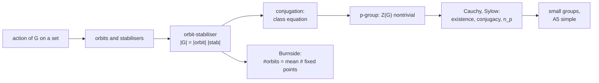

# GT05 · Actions, Conjugation and Sylow Theorems

◀ [[GT04 Commutators Simple Groups and Composition Series]] · [[Group Theory - Course Map|Course Map]] · next: [[GT06 Permutation Groups]]

> [!info] Source and approach
> Follows K–S §3.1–3.2 and §4.3 ([[Kurzweil-Stellmacher_Theory of finite groups.pdf#page=68|PDF p.68 ff.]]). Burnside's lemma, the McKay proof of Cauchy, the proof of Sylow's theorems, the class lists and the simplicity of $A_5$ are my own write-ups and computations (`scripts/gt_numbers.py`).

> [!tip] Start here (first read)
> - **The picture.** A group becomes powerful when it *acts*: let the moves shuffle the corners of a square, the cosets of a subgroup, or the group's own elements. Look at where one object can be sent (its **orbit**) and which moves leave it alone (its **stabiliser**): *(size of orbit) × (size of stabiliser) = |G|*. Counting orbits and fixed points gives the class equation, Burnside's lemma and Sylow's theorems.
> - **What you need.** Groups, cosets, quotients ([[GT01 Groups Subgroups and Cosets]], [[GT02 Homomorphisms Normal Subgroups and Quotients]]) and the idea of an equivalence relation: orbits are its classes.
> - **How to read.** Every counting identity here is orbit–stabiliser in disguise; start with §1. The Sylow proofs (§4) are long but each step is a two-line counting argument: follow the three boxed parts (existence, conjugacy, counting) one at a time.

> [!key] After this chapter you can
> - define an **action**, its **orbits** and **stabilisers**, and prove **orbit–stabiliser** $|G|=|\alpha^G||G_\alpha|$,
> - derive the **class equation** and use it to show that a $p$-group has a non-trivial centre,
> - count orbits with **Burnside's lemma** (necklaces, colourings),
> - state and prove **Cauchy** and the three **Sylow theorems** and use them to classify small groups (order 15, 12, ...),
> - describe conjugacy in $S_n$ (cycle type) and show that **$A_5$ is simple**.

> [!intuition] The one-sentence story
> A group is most useful when it *acts*: stand the group on a set (vertices of a square, subgroups of itself, its own elements) and count; every counting identity (orbit–stabiliser, class equation, Burnside, Sylow) is the same sentence, "the orbit has as many points as the group has elements divided by those that fix the point".

![[GT05 Actions Map.svg]]
*Diagram GT5.0. The chapter in one page. Editable source: [[GT05 Actions Map.excalidraw]].*

*Concept map.*

## 1. Actions, orbits, stabilisers
*K–S 3.1.1–3.1.6*

> [!key] Definitions
> $G$ **acts** on a set $\Omega$ if each $g$ gives a permutation $\omega\mapsto\omega^g$ with $\omega^{1}=\omega$ and $(\omega^g)^h=\omega^{gh}$. Equivalently an action is a **homomorphism $G\to S_\Omega$** (the permutation representation). The **orbit** is $\omega^G=\{\omega^g\}$ and the **stabiliser** is $G_\omega=\{g:\omega^g=\omega\}\le G$. The orbits partition $\Omega$ (the relation "$\beta=\alpha^g$ for some $g$" is an equivalence). The kernel of the action is $\bigcap_\omega G_\omega$.

> [!derivation] Theorem (orbit–stabiliser, 3.1.5). $|\omega^G|=|G:G_\omega|$, hence $|G|=|\omega^G|\cdot|G_\omega|$.
> *Proof.* Map the right coset $G_\omega g$ to $\omega^g$. It is **well defined and injective**: $\omega^g=\omega^h\iff\omega^{gh^{-1}}=\omega\iff gh^{-1}\in G_\omega\iff G_\omega g=G_\omega h$. It is onto the orbit by definition. ∎ Also $G_{\omega^g}=g^{-1}G_\omega g$ (3.1.3): stabilisers along one orbit are conjugate.

> [!example] The square
> $D_4$ acts on the four vertices; orbit of vertex 1 has 4 points, so $|G_1|=8/4=2$: the identity and the reflection in the diagonal through 1, exactly as drawn.

![[fig_gt03_classes.png]]
*Figure GT5.1. Left: the class sizes of $S_4$ (24 = 1+3+6+6+8). Middle: the class sizes of $A_5$ (60 = 1+12+12+15+20). Right: $D_4$ acting on the vertices of a square: orbit 4, stabiliser 2, $4\cdot2=8$.*

> [!derivation] Three standard actions
> 1. **Left multiplication** on $G$ (regular action), faithful: **Cayley's theorem** $G\hookrightarrow S_{|G|}$.
> 2. **Action on cosets** $\Omega=\{Ug\}$ of a subgroup $U$ of index $n$ by right multiplication (3.1.2): transitive, with kernel the **core** $U_G=\bigcap_gg^{-1}Ug$, so $G/U_G\hookrightarrow S_n$. *Consequence:* **a simple group $G$ with a proper subgroup of index $n$ embeds in $S_n$**, so $|G|\le n!$ (the kernel $U_G$ is a normal subgroup contained in $U\ne G$, hence trivial). Example: $A_5$ has no subgroup of index $2,3$ or $4$ (else $60\le4!=24$).
3. **Conjugation** $x^g=g^{-1}xg$ on $G$ (or on its subgroups): orbits are **conjugacy classes**, the stabiliser of $x$ is the **centraliser** $C_G(x)$; on subgroups the stabiliser is the **normaliser** $N_G(U)$ (3.1.9, the largest subgroup in which $U$ is normal).

## 2. The class equation and $p$-groups
*K–S 3.1.7–3.1.11*

> [!derivation] Theorem (class equation, 3.1.8). If $K_1,\dots,K_h$ are the conjugacy classes of size $>1$ with representatives $x_i$, then $|G|=|Z(G)|+\sum_{i=1}^h|G:C_G(x_i)|$.
> *Proof.* $x$ is central iff its class is $\{x\}$. The remaining classes partition the rest; by orbit–stabiliser a class of $x_i$ has size $|G:C_G(x_i)|$. ∎

> [!derivation] Corollary (3.1.7 and following). A non-trivial $p$-group $P$ has $Z(P)\neq1$. Hence a group of order $p^2$ is Abelian.
> *Proof.* Each $|P:C_P(x_i)|>1$ is a power of $p$, hence divisible by $p$; $|P|$ is divisible by $p$; so $p\mid|Z(P)|$ and $|Z(P)|\ge p$. For $|P|=p^2$: if $Z\ne P$ then $|Z|=p$ and $P/Z$ is cyclic of order $p$, so $P$ is Abelian by [[GT02 Homomorphisms Normal Subgroups and Quotients]] (1.3.1), contradiction. ∎ (Also: every normal subgroup $N\ne1$ of a $p$-group meets $Z(P)$ non-trivially, 3.1.11.)

> [!example] The class equation of $D_4$ and $S_4$ (brute-forced)
> $D_4$: class sizes $1,1,2,2,2$, so $8=2+2+2+2$ with $|Z|=2$. $S_4$: $24=1+3+6+6+8$ (identity, double transpositions, transpositions, 4-cycles, 3-cycles); by cycle type the sizes are $n!/\prod_kk^{m_k}m_k!$ where $m_k$ = number of $k$-cycles: $24/(1^2\cdot2!\cdot2)=6$, $24/(2^2\cdot2!)=3$, $24/3=8$, $24/4=6$.

## 3. Burnside's lemma
> [!derivation] Theorem. The number of orbits of $G$ on $\Omega$ is $\dfrac1{|G|}\sum_{g\in G}|\mathrm{Fix}(g)|$.
> *Proof.* Count the pairs $(g,\omega)$ with $\omega^g=\omega$ in two ways: $\sum_g|\mathrm{Fix}(g)|=\sum_\omega|G_\omega|=\sum_\omega|G|/|\omega^G|$. Each orbit $O$ contributes $\sum_{\omega\in O}|G|/|O|=|G|$, so the total is $|G|\cdot\#\text{orbits}$. ∎

> [!example] Necklaces (checked in `gt_numbers.py`)
> Colour the 4 vertices of a square with $k$ colours, counting colourings equivalent under rotations $C_4=\{e,r,r^2,r^3\}$. A rotation with $c$ cycles on the vertices fixes $k^c$ colourings: $e$: $k^4$; $r,r^3$: $k$; $r^2$: $k^2$. Orbits $=\frac14(k^4+k^2+2k)$: $k=2$: $\frac14(16+4+4)=\mathbf6$; $k=3$: $\frac14(81+9+6)=\mathbf{24}$. Allowing reflections too (all of $D_4$): for $k=2$ also 6 (the extra reflections add $2k^3+2k^2$ terms: $\frac18(16+4+4+2\cdot8+2\cdot4)=6$).

## 4. Cauchy and Sylow
*K–S 3.2.1–3.2.9*

> [!derivation] Theorem (Cauchy, 3.2.1). If a prime $p$ divides $|G|$ then $G$ has an element of order $p$.
> *Proof (McKay).* Let $X=\{(g_1,\dots,g_p)\in G^p:g_1g_2\cdots g_p=1\}$; $|X|=|G|^{p-1}$ (choose $g_1,\dots,g_{p-1}$ freely, $g_p$ is forced). The cyclic group $\mathbb Z_p$ acts on $X$ by cyclic shift (a cyclic shift of a product equal to 1 is again 1: $g_2\cdots g_pg_1=g_1^{-1}(g_1\cdots g_p)g_1=1$). Orbits have size 1 or $p$; size 1 means $g_1=\dots=g_p=g$ with $g^p=1$. Hence $|G|^{p-1}\equiv\#\{g:g^p=1\}\pmod p$; the left side is $\equiv0$, so $p$ divides $\#\{g:g^p=1\}$. This number is $\ge1$ (identity), so it is $\ge p$, and some $g\ne1$ has $g^p=1$, i.e. $o(g)=p$. ∎

> [!key] Sylow's theorems (3.2.3). Let $|G|=p^em$ with $p\nmid m$. A subgroup of order $p^e$ is a **Sylow $p$-subgroup**; $\mathrm{Syl}_p(G)$ is the set of them, $n_p=|\mathrm{Syl}_p(G)|$.
> **(a) Existence:** $\mathrm{Syl}_p(G)\neq\emptyset$ (and every $p$-subgroup lies in a Sylow one). **(b) Conjugacy:** all Sylow $p$-subgroups are conjugate. **(c) Counting:** $n_p=|G:N_G(P)|$ divides $m$ and $n_p\equiv1\pmod p$.

> [!derivation] Proof of Sylow
> **(a)** Induct on $|G|$. *Case 1: $p\mid|Z(G)|$.* By Cauchy take $z\in Z$ of order $p$; $G/\langle z\rangle$ has order $p^{e-1}m$, so by induction it has a subgroup of order $p^{e-1}$; its preimage has order $p^e$. *Case 2: $p\nmid|Z(G)|$.* In the class equation $|G|=|Z|+\sum|G:C_G(x_i)|$ we have $p\mid|G|$ but $p\nmid|Z|$, so $p$ cannot divide every term of the sum, i.e. some term $|G:C_G(x_i)|$ is prime to $p$; since $|G|=|G:C_G(x_i)|\cdot|C_G(x_i)|$, $p^e$ divides $|C_G(x_i)|$ with $C_G(x_i)<G$ (as $x_i\notin Z$), and induction applies to it. ∎(a)
> **(b)** Let $P$ be Sylow and $Q$ any $p$-subgroup. $Q$ acts on the set $\Omega=\{Pg\}$ of right cosets; $|\Omega|=m$ is prime to $p$ and $Q$-orbits have $p$-power size, so some orbit has size 1: $Pg\,q=Pg$ for all $q\in Q$, i.e. $gQg^{-1}\le P$. If $Q$ is Sylow too, orders force $gQg^{-1}=P$. ∎(b)
> **(c)** By (b), $n_p=|G:N_G(P)|$ (orbit–stabiliser for conjugation on $\mathrm{Syl}_p$), which divides $|G:P|=m$ because $P\le N_G(P)$. Let $P$ act by conjugation on $\mathrm{Syl}_p$; a Sylow $Q$ is fixed iff $P\le N_G(Q)$. Then $P$ and $Q$ are both Sylow in $N_G(Q)$, hence conjugate there by (b), and $Q\trianglelefteq N_G(Q)$ forces $P=Q$. So $P$ is the only fixed point and all other orbits have size divisible by $p$: $n_p\equiv1\pmod p$. ∎

> [!key] Frattini argument (3.2.7). If $N\trianglelefteq G$ and $P\in\mathrm{Syl}_p(N)$ then $G=N\,N_G(P)$. *Proof.* For $g\in G$, $gPg^{-1}$ is Sylow in $N$, so $=nPn^{-1}$; then $n^{-1}g\in N_G(P)$. ∎

![[fig_gt03_sylow.png]]
*Figure GT5.2. Sylow numbers found by brute force. Each satisfies $n_p\equiv1\pmod p$ and $n_p\mid m$: $S_4$: $n_2=3$ ($m=3$), $n_3=4$ ($m=8$); $A_5$: $n_2=5$ ($m=15$), $n_3=10$ ($m=20$), $n_5=6$ ($m=12$).*

## 5. Using Sylow: small groups
*K–S 3.2.10–3.2.12*

> [!example] Order 15 is cyclic
> $n_3\mid5$, $n_3\equiv1\pmod3$ so $n_3=1$; $n_5\mid3$, $n_5\equiv1\pmod5$ so $n_5=1$. Both Sylow subgroups $A$ (order 3), $B$ (order 5) are normal, $A\cap B=1$, $AB=G$: $G\cong\mathbb Z_3\times\mathbb Z_5\cong\mathbb Z_{15}$. The same argument shows: **if $p<q$ are primes with $q\not\equiv1\pmod p$ then every group of order $pq$ is cyclic**; if $q\equiv1\pmod p$ there is also a non-Abelian one ($S_3$ for $(2,3)$, order 21 for $(3,7)$).

> [!example] Order 12 always has a normal Sylow subgroup (3.2.10)
> $n_3\in\{1,4\}$. If $n_3=4$, the four subgroups of order 3 intersect pairwise trivially (prime order), giving $4\cdot2=8$ elements of order 3, leaving 4 other elements; these must form the unique Sylow 2-subgroup, which is therefore normal. So $G$ has a normal Sylow 3- or Sylow 2-subgroup ($A_4$ has $n_3=4$ and normal $V_4$; $D_6$ has $n_3=1$).

> [!example] No simple group of order 56 (a pattern)
> $n_7\in\{1,8\}$; if 8 there are $8\cdot6=48$ elements of order 7, leaving 8 for the Sylow 2-subgroup (order 8), so it is unique and normal. Either way $G$ is not simple.

## 6. The symmetric and alternating groups
*K–S 4.3.1–4.3.5*

> [!derivation] Conjugacy in $S_n$ (4.3.1). Two permutations are conjugate in $S_n$ iff they have the same cycle type.
> *Proof.* $g^{-1}(i_1\,i_2\dots i_k)g=(i_1^g\,i_2^g\dots i_k^g)$: conjugation **renames the points inside the cycles**, so the cycle lengths are unchanged, and any two permutations with the same type can be renamed into each other. ∎ The number of classes is the number of partitions of $n$ ($S_4$: 5, $S_5$: 7).

> [!derivation] The class of a permutation can split in $A_n$
> A class of $S_n$ contained in $A_n$ splits into two $A_n$-classes iff its cycle type has **distinct odd parts**. For $A_5$ (classes computed by code): $60=1+15+20+12+12$, from cycle types $1^5$ ($1$), $2^21$ ($15$), $3\,1^2$ ($20$), and $5$, which has $24$ elements and **splits** into $12+12$ (distinct odd part).

> [!derivation] Theorem (4.3.5). $A_n$ is simple for $n\ge5$. Proof for $A_5$ by class sizes.
> A normal subgroup is a union of conjugacy classes containing $\{e\}$, and its order divides 60. Possible orders are $1$ plus a sub-multiset sum of $\{12,12,15,20\}$: $1,13,16,21,25,28,33,36,40,45,48,60$; none other than $1$ and $60$ divides 60 (checked by enumeration in `gt_numbers.py`: `A5 simple: True`). ∎ General $n\ge5$: $A_n$ is generated by 3-cycles, all conjugate in $A_n$ for $n\ge5$, and any normal $N\ne1$ contains one (the 4.3 proof). **Consequence:** $S_n'=A_n$ and $A_n$ is perfect.

> [!pitfall] Four traps
> 1. **Right versus left actions.** $x^g=g^{-1}xg$ is a *right* action ($(x^g)^h=x^{gh}$); $gxg^{-1}$ is a left action. Orbit–stabiliser and the class equation are unaffected, but the order of products in $G_{\omega^g}=g^{-1}G_\omega g$ is.
> 2. **Orbit–stabiliser needs the *stabiliser of one point*,** not the kernel of the action.
> 3. **$n_p\equiv1\pmod p$ is necessary, not sufficient.** $n_3=4$ is allowed for order 12 and occurs in $A_4$, but does not occur in $D_6$.
> 4. **Sylow gives subgroups of order $p^e$ only.** $A_4$ has Sylow subgroups of order 4 and 3 but no subgroup of order 6, as in [[GT01 Groups Subgroups and Cosets]].

## 7. Summary and practice
> [!summary] Cheat-sheet
> | Statement | Formula |
> |---|---|
> | orbit–stabiliser | $\lvert G\rvert=\lvert\omega^G\rvert\lvert G_\omega\rvert$ |
> | class equation | $\lvert G\rvert=\lvert Z\rvert+\sum\lvert G:C_G(x_i)\rvert$ |
> | $p$-group | $Z(P)\ne1$; order $p^2$ Abelian |
> | Burnside | $\#\text{orbits}=\frac1{\lvert G\rvert}\sum_g\lvert\mathrm{Fix}(g)\rvert$ |
> | Cauchy | $p\mid\lvert G\rvert\Rightarrow$ element of order $p$ |
> | Sylow | $n_p\equiv1\ (p)$, $n_p\mid m$, all conjugate, $n_p=\lvert G:N_G(P)\rvert$ |
> | $S_n$ | conjugate $\iff$ same cycle type; $A_n$ simple, $n\ge5$ |

> [!example]- Practice (with answers)
> 1. **Number of necklaces** of 6 beads in 2 colours up to rotation. *Answer:* $\frac16(2^6+2^1+2^2+2^3+2^2+2^1)=\frac16(64+2+4+8+4+2)=14$ (rotation by $k$ has $\gcd(k,6)$ cycles).
> 2. **Show** a group of order 20 has a normal Sylow 5-subgroup. *Answer:* $n_5\mid4$ and $n_5\equiv1\pmod5$, so $n_5=1$.
> 3. **Class equation of a group of order 21** with $|Z|=1$: possible class sizes. *Answer:* sizes divide 21: $1,3,7$; $21=1+3a+7b$ has $(a,b)=(2,2)$ ($1+6+14$), i.e. the non-Abelian group of order 21 has 5 classes: $1,3,3,7,7$.
> 4. **Why is there no simple group of order 12?** *Answer:* §5: it has a normal Sylow 2- or 3-subgroup.
> 5. **Find the number of 3-cycles in $S_5$.** *Answer:* $5!/(3\cdot1\cdot2!)=20$ (cycle type $3\,1^2$: $3^1\cdot1!\cdot1^2\cdot2!=6$, $120/6=20$).
> 6. **How many Sylow 3-subgroups does $S_5$ have?** *Answer:* each has order 3 and contains 2 three-cycles, so $20/2=10$ (and $10\equiv1\bmod3$, $10\mid40$).

<!-- interactive:start (generated by scripts/embed_interactive.py; edit the tool in scripts/interactive/tools/, not this block) -->
> [!interactive]+ Interactive: Counting with symmetry: Burnside's lemma on necklaces and bracelets
> How many different n-bead necklaces with k colours are there if rotations (and reflections, for bracelets) of the same pattern count as one?
>
> ![[gt_burnside.png|720]]
>
> **Try:** n = 6, k = 2: 14 necklaces (rotations only), 13 bracelets (D₆). n = 5, k = 3: 51 necklaces, 39 bracelets. n = 8, k = 2: 36 and 30. Check against the sum over group elements of k^{cycles}/|G|; press 'show an orbit' to see the colourings Burnside identifies.
>
> [▶ Open the tool in your browser](../Assets/interactive/gt_burnside.html) · [absolute link](file:///home/swastik/Documents/notes/Assets/interactive/gt_burnside.html) · all tools and coverage: [[Interactive Tools]]

<!-- interactive:end -->

## Map of this chapter
> [!connection] How GT05 connects
> **Builds on:** [[GT01 Groups Subgroups and Cosets]], [[GT02 Homomorphisms Normal Subgroups and Quotients]] (kernel of an action, $G/Z$). **Next:** [[GT10 Symmetry Representations and Characters]] (conjugacy classes label the columns of a character table: the class equation counts the irreducible representations).
> **Other subjects:** [[Probability - Course Map]] (counting arguments: necklaces, orbit sizes), [[Quantum Mechanics - Course Map]] (identical particles: $S_n$ acts on $n$-particle wavefunctions), [[Inorganic Chemistry - Course Map]] (the orbit of an atom under the point group = symmetry-equivalent atoms).
> **Concept notes:** [[Group Action]] · [[Orbit-Stabiliser Theorem]] · [[Conjugacy Class]] · [[Class Equation]] · [[Burnside's Lemma]] · [[Cauchy's Theorem]] · [[Sylow Theorems]] · [[Alternating Group]]

## Provenance
> [!provenance]- Source map for this chapter
> | Topic | Source | Origin |
> |---|---|---|
> | actions, orbit–stabiliser, class equation, $p$-groups, Frattini | [[Kurzweil-Stellmacher_Theory of finite groups.pdf#page=68|K–S §3.1, PDF pp.68–74]] (3.1.1–3.1.11) | book |
> | Cauchy, Sylow, small groups | [[Kurzweil-Stellmacher_Theory of finite groups.pdf#page=75|K–S §3.2, PDF pp.75–84]] (3.2.1–3.2.12) | book |
> | conjugacy in $S_n$, $A_n$ simple | [[Kurzweil-Stellmacher_Theory of finite groups.pdf#page=100|K–S §4.3, PDF pp.100–104]] (4.3.1–4.3.5) | book |
> | McKay proof of Cauchy, proof of Sylow (a)–(c), Burnside, orders 15, 12, 56, class lists, $A_5$ simple, practice | my write-ups (standard arguments) and `scripts/gt_numbers.py` | mine |
>
> **Flags.** (1) I did not read K–S's own proofs of Sylow's theorem; the proofs here are the standard textbook arguments (induction on $|G|$, action on cosets), not a transcription. (2) The general-$n$ part of "$A_n$ is simple" is cited, not proved here; only $A_5$ is proved. (3) Theorem numbers are read from the book's section list; their exact wording was not re-checked.
