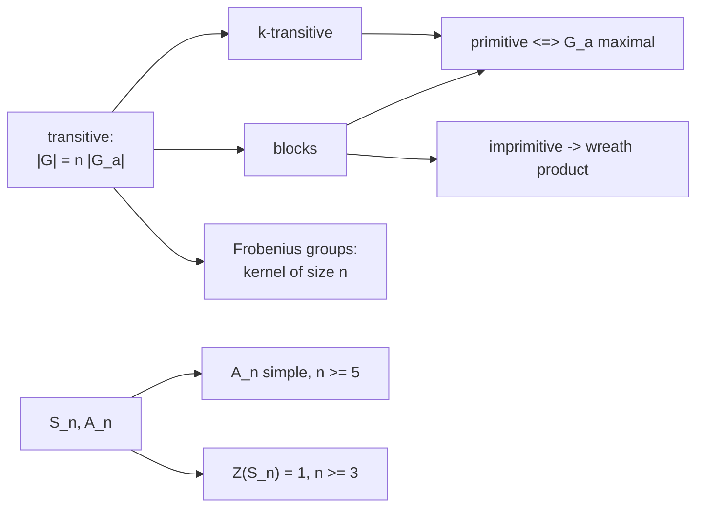

# GT06 · Permutation Groups

◀ [[GT05 Actions Conjugation and Sylow Theorems]] · [[Group Theory - Course Map|Course Map]] · next: [[GT07 p-Groups and Nilpotent Groups]]

> [!info] Source and approach
> Follows K–S chapter 4: §4.1 transitive groups and Frobenius groups ([[Kurzweil-Stellmacher_Theory of finite groups.pdf#page=90|PDF p.90]]), §4.2 primitive action (PDF p.97), §4.3 the symmetric group (PDF p.100), §4.4 imprimitive groups and wreath products (PDF p.104); PDF page = printed page + 13. Proofs are written out in full for the block/primitivity correspondence, 2-transitive $\Rightarrow$ primitive, the counting lemma for Frobenius groups and the simplicity of $A_n$; Frobenius's theorem and the embedding theorem for imprimitive groups are stated, not proved. All examples are computed (`scripts/gt_numbers2.py`). Exact theorem numbers of K–S were not re-checked.

> [!tip] Start here (first read)
> - **The picture.** A permutation group is a group of *shuffles of a set of objects*. We ask two questions: *how much can the shuffles mix things?* (**transitive**: any object can be sent to any other; **$k$-transitive**: any $k$ objects to any $k$ objects) and *do they keep some grouping intact?* (**primitive** = no hidden grouping; **imprimitive** = objects come in blocks that are shuffled as units, like the two diagonals of a square).
> - **What you need.** Actions, orbit–stabiliser, conjugacy classes in $S_n$ ([[GT05 Actions Conjugation and Sylow Theorems]]).
> - **How to read.** §1–§2 are short and conceptual; §3 (Frobenius groups) has one counting lemma; §4 contains the longest proof, that $A_n$ is simple, as four short cases (each case is a one-line commutator computation that was verified by computer).

> [!key] After this chapter you can
> - define **transitive**, **$k$-transitive**, **regular** and **primitive** actions and test them on examples,
> - prove that a transitive $G$ is primitive iff a point stabiliser is a **maximal subgroup**, and that 2-transitive $\Rightarrow$ primitive,
> - recognise a **Frobenius group**, count its kernel, and name its standard examples ($S_3$, $A_4$, $AGL(1,q)$),
> - prove that **$A_n$ is simple for $n\ge5$** and know that $S_n$ has trivial centre for $n\ge3$,
> - build a **wreath product** and recognise it as the group of an imprimitive action ($D_4=C_2\wr C_2$; Sylow subgroups of $S_{p^2}$).

> [!intuition] The one-sentence story
> The symmetric group is the "mother of all finite groups" (Cayley: every group is a subgroup of some $S_n$); this chapter studies *how a subgroup of $S_n$ can sit inside it*, from fully mixing (2-transitive) to blocked (imprimitive), and proves that the big alternating groups are indivisible (simple).

![[GT06 Permutation Groups Map.svg]]
*Diagram GT6.0. The chapter in one page. Editable source: [[GT06 Permutation Groups Map.excalidraw]].*

*Concept map.*

## 1. Transitive and $k$-transitive actions
> [!key] Definitions
> Let $G$ act on $\Omega$, $|\Omega|=n$, with $\alpha^g$ the image of $\alpha$ under $g$ ([[GT05 Actions Conjugation and Sylow Theorems]]). The action is **transitive** if there is a single orbit, **regular** if moreover $G_\alpha=1$ ($|G|=n$), and **$k$-transitive** ($k\le n$) if for any two $k$-tuples of *distinct* points there is $g$ sending one to the other. By orbit–stabiliser, **transitive $\Rightarrow|G|=n\,|G_\alpha|$**; **2-transitive $\iff G$ transitive and $G_\alpha$ transitive on $\Omega\setminus\{\alpha\}$**, hence $n(n-1)\mid|G|$; generally a $k$-transitive group has $|G|$ divisible by $n(n-1)\cdots(n-k+1)$.

> [!example] Transitivity of the symmetric and alternating groups (computed)
> $S_n$ is $n$-transitive (obviously: any ordering of the points can be reached). **$A_n$ is $(n-2)$-transitive** (K–S 4.3): given two $(n-2)$-tuples, an element of $S_n$ sends one to the other; if it is odd, compose with the transposition of the two remaining points, which fixes the tuple. Checks: $A_4$ reaches all $12$ ordered pairs but only $12$ of $24$ ordered triples (2-transitive, not 3-transitive); $A_5$ reaches all $60$ ordered triples (3-transitive) — consistent with $|A_5|=60=5\cdot4\cdot3$, so $A_5$ is *sharply* 3-transitive on 5 points.

## 2. Blocks and primitivity
> [!key] Definition
> Let $G$ be transitive on $\Omega$. A subset $B\subseteq\Omega$ is a **block** if for every $g\in G$ either $B^g=B$ or $B^g\cap B=\emptyset$. $\Omega$ and the singletons are the **trivial blocks**; $G$ is **primitive** if it has only trivial blocks, **imprimitive** otherwise. The images of a block form a partition of $\Omega$ into blocks of equal size (a **block system**) that $G$ permutes.

> [!example] A square has hidden structure
> $D_4$ acts transitively on the 4 vertices of a square. The diagonals $\{1,3\}$ and $\{2,4\}$ form a block system (a symmetry sends a diagonal to a diagonal or to itself): $D_4$ is **imprimitive** on the vertices. $S_4$ acting on the same 4 points is primitive. The two answers differ because $S_4$ can break the diagonals apart (swap 1 and 2).

> [!derivation] Theorem 2.1 (primitivity and maximal subgroups). Let $G$ be transitive on $\Omega$ and $\alpha\in\Omega$. Blocks $B\ni\alpha$ correspond one-to-one to subgroups $H$ with $G_\alpha\le H\le G$, via $B\mapsto H_B=\{g:B^g=B\}$ and $H\mapsto\alpha^H$. Consequently **$G$ is primitive iff $G_\alpha$ is a maximal subgroup of $G$.**
> *What the proof is doing:* a block is the set of points "reachable by a subgroup that contains the stabiliser", and the stabiliser sits inside every such subgroup because moving $\alpha$ nowhere also moves the block nowhere.
> *Proof.* Let $B\ni\alpha$ be a block and $H_B=\{g:B^g=B\}\ge G_\alpha$ (a $g$ fixing $\alpha$ sends $B$ to a block meeting $B$ in $\alpha$, hence to $B$). Then $B=\alpha^{H_B}$: $\supseteq$ is clear; for $\beta\in B$ take $g$ with $\alpha^g=\beta$ (transitivity); then $B^g\cap B\ni\beta$, so $B^g=B$, $g\in H_B$. Conversely let $H\ge G_\alpha$ and $B=\alpha^H$. If $B^g\cap B\ne\emptyset$ then $\alpha^{hg}=\alpha^{h'}$ for some $h,h'\in H$, so $hgh'^{-1}\in G_\alpha\le H$, hence $g\in H$ and $B^g=\alpha^{Hg}=\alpha^H=B$: $B$ is a block. The two maps are inverse to each other. Finally $|\alpha^H|=|H:G_\alpha|$; it equals $1$ iff $H=G_\alpha$ and equals $n=|G:G_\alpha|$ iff $H=G$. So non-trivial blocks exist iff some $H$ lies strictly between $G_\alpha$ and $G$. ∎ *Check:* in $S_4$ the stabiliser $S_3$ of a point is maximal (primitive); in $D_4$ the stabiliser of a vertex has order 2 and sits inside the order-4 group fixing the diagonal $\{1,3\}$: not maximal (imprimitive); both verified by brute force.

> [!derivation] Theorem 2.2. A 2-transitive group is primitive.
> *Proof.* Suppose $B$ is a block with $\alpha\ne\beta$ in $B$ and a point $\gamma\notin B$ (so $B$ is non-trivial). By 2-transitivity pick $g$ with $(\alpha,\beta)^g=(\alpha,\gamma)$. Then $\alpha\in B\cap B^g$, so $B^g=B$; but $\gamma=\beta^g\in B^g=B$, contradiction. ∎ So $S_n$, $A_n$ ($n\ge4$), $AGL(1,p)$ and many classical groups are primitive; the converse is false (primitive groups need not be 2-transitive, e.g. $D_5$ on 5 points).

## 3. Frobenius groups
> [!key] Definition
> A transitive permutation group $G$ on $\Omega$ ($|\Omega|=n>1$) is a **Frobenius group** if no non-identity element fixes more than one point, and some non-identity element fixes a point (so $G_\alpha\ne1$). $H=G_\alpha$ is a **Frobenius complement**; $K=\{1\}\cup\{g:g\text{ fixes no point}\}$ is the **Frobenius kernel**.

> [!derivation] Lemma 3.1 (counting). In a Frobenius group, **$|K|=n$**.
> *Proof.* The stabilisers $G_\alpha$ ($\alpha\in\Omega$) are $n$ conjugate subgroups of order $h=|G|/n$ and any two intersect trivially (an element in both fixes two points). So they contain exactly $n(h-1)$ non-identity elements, none fixed-point-free, and the remaining $nh-n(h-1)=n$ elements (including $1$) form $K$. ∎

> [!key] Frobenius's theorem (stated; proved with characters, [[GT10 Symmetry Representations and Characters]] is the tool)
> The kernel $K$ of a Frobenius group is a **normal subgroup** of $G$; it acts regularly, $G=K\rtimes H$ ($K\cap H=1$, $KH=G$), and $H$ acts on $K$ by conjugation without non-trivial fixed points. (Thompson later proved $K$ is nilpotent.)

> [!example] Frobenius groups, verified
> | $G$ | acts on | $n$ | kernel $K$ | complement $H$ |
> |---|---|---|---|---|
> | $S_3$ | 3 points | 3 | $A_3\cong C_3$ | $C_2$ |
> | $A_4$ | 4 points | 4 | $V_4$ | $C_3$ |
> | $F_{20}=C_5\rtimes C_4=AGL(1,5)$ (maps $x\mapsto ax+b$) | 5 points | 5 | $C_5$ | $C_4$ |
> | $AGL(1,q)$, $q$ a prime power | $\mathbb F_q$ | $q$ | $(\mathbb F_q,+)$ | $\mathbb F_q^\times$ ($C_{q-1}$) |
> For each of the first three, a computer count finds that no non-identity element fixes two points, that the fixed-point-free elements together with $1$ number exactly $n$, and that they form a subgroup. **Non-example:** $S_4$ on 4 points is *not* Frobenius: a transposition fixes two points; the fixed-point-free elements plus $1$ number $10\ne4$ and do not form a subgroup. (Frobenius groups include all the "affine" groups of a field; e.g. $A_4=V_4\rtimes C_3$ is the group of rotations of a tetrahedron.)

## 4. The symmetric and alternating groups
> [!derivation] Theorem 4.1 (generation, centre). (a) $S_n$ is generated by transpositions, $A_n$ by 3-cycles. (b) $Z(S_n)=1$ for $n\ge3$. 
> *Proof.* (a) Any cycle $(a_1\cdots a_k)=(a_1a_2)(a_2a_3)\cdots(a_{k-1}a_k)$ is a product of transpositions. A product of two transpositions is a product of 3-cycles: $(ab)(ac)=(acb)$ and $(ab)(cd)=(ab)(bc)\cdot(bc)(cd)$ is a product of two 3-cycles; an even permutation is a product of an even number of transpositions, grouped in pairs. (b) Let $g\ne1$, say $a^g=b\ne a$, and pick $c\notin\{a,b\}$ (possible as $n\ge3$). Conjugating the transposition $t=(a\,c)$ by $g$ relabels its points by $g$, so $g$ commutes with $t$ only if $g$ maps $\{a,c\}$ to itself; but $a^g=b\notin\{a,c\}$. Hence $g$ does not commute with $t$ and $g\notin Z(S_n)$. ∎

> [!derivation] Theorem 4.2. $A_n$ is **simple for $n\ge5$.**
> *What the proof is doing:* show that any non-trivial normal subgroup $N$ contains a 3-cycle (by a case analysis on the cycle structure of one of its elements, using that commutators $[\sigma,\rho]=\sigma\rho\sigma^{-1}\rho^{-1}$ of an element $\sigma\in N$ with any $\rho\in A_n$ stay in $N$), then use that all 3-cycles are conjugate in $A_n$ and generate it.
> *Proof.* Let $1\ne N\trianglelefteq A_n$, $n\ge5$, and $1\ne\sigma\in N$. For $\rho\in A_n$ the element $\sigma\rho\sigma^{-1}\rho^{-1}=\sigma\cdot(\rho\sigma^{-1}\rho^{-1})\in N$. Write $a_1,a_2,\ldots$ for distinct points moved as indicated. **Case 1: $\sigma$ has a cycle of length $\ge4$**, $\sigma=(a_1a_2a_3a_4\cdots)\cdots$. With $\rho=(a_1a_2a_3)$: $\sigma\rho\sigma^{-1}=(a_2a_3a_4)$ and the commutator is $(a_2a_3a_4)(a_1a_3a_2)=(a_1a_4a_2)$, a **3-cycle** in $N$. **Case 2: at least two 3-cycles**, $\sigma=(a_1a_2a_3)(a_4a_5a_6)\cdots$. With $\rho=(a_1a_2a_4)$ the commutator is the 5-cycle $(a_1a_4a_3a_5a_2)\in N$, so Case 1 applies. **Case 3: exactly one 3-cycle**, $\sigma=(a_1a_2a_3)\tau$ with $\tau$ a product of disjoint transpositions: $\sigma^2=(a_1a_3a_2)\in N$ (since $\tau^2=1$). **Case 4: only transpositions** (an even number $\ge2$), $\sigma=(a_1a_2)(a_3a_4)\cdots$. With $\rho=(a_1a_2a_3)$ the commutator is $c=(a_1a_3)(a_2a_4)\in N$. As $n\ge5$ choose $a_5$ and $\psi=(a_1a_3a_5)$: $c\cdot\psi c\psi^{-1}=(a_1a_3)(a_2a_4)(a_3a_5)(a_2a_4)=(a_1a_3a_5)$, a 3-cycle in $N$. These cases exhaust all $\sigma\ne1$ (a permutation either has a cycle of length $\ge4$, or all cycles have length $\le3$ and then contains $\ge2$, exactly $1$ or $0$ three-cycles). *In every case $N$ contains a 3-cycle.* All 3-cycles are conjugate in $A_n$ for $n\ge5$: two 3-cycles are conjugate in $S_n$, say by $\pi$; if $\pi$ is odd replace it by $\pi(d\,e)$ with $d,e$ outside the support of the 3-cycle (possible since $n\ge5$): $(d\,e)$ commutes with it and makes the parity even. So $N$ contains all 3-cycles, which generate $A_n$ (Theorem 4.1): $N=A_n$. ∎ *Checks (computed):* each of the four commutator formulas was verified; and in $A_5$ and $A_6$ the normal closure of *every* non-identity element is the whole group. For $n=4$ the argument fails (Case 4 needs a fifth point), consistent with the normal subgroup $V_4\trianglelefteq A_4$.

> [!example] Counting with $S_n$ (link to probability)
> A random permutation of $n$ objects has on average **exactly 1 fixed point** (Burnside: the average number of fixed points equals the number of orbits, and $S_n$ is transitive; checked for $S_5$: average $1.000$), and the probability of having *no* fixed point (a **derangement**) tends to $1/e=0.3679$ (for $n=6$: $265/720=0.3681$). The classical "matching" problem of [[PR01 Counting and the Axioms of Probability]] is this statement.

## 5. Imprimitive groups and wreath products
> [!key] Wreath product
> Let $H$ be a group and $K\le S_m$ a permutation group on $\{1,\ldots,m\}$. The **wreath product** $H\wr K=H^m\rtimes K$ is the set of pairs $((h_1,\ldots,h_m),k)$ with product $((h_i),k)((h_i'),k')=((h_ih'_{i^{k^{-1}}}),kk')$ (the base group $H^m$ with $K$ permuting the coordinates). It has order $|H|^m|K|$. If $H\le S_r$, it acts on $m$ blocks of $r$ points each: the base group acts independently inside each block, $K$ permutes the blocks.

> [!example] Wreath products you already know (orders computed)
> $D_4\cong C_2\wr C_2$ (order $2^2\cdot2=8$): the symmetries of a square are "flip each diagonal independently, and swap the two diagonals". The stabiliser in $S_6$ of the partition $\{1,2,3\}|\{4,5,6\}$ is $S_3\wr S_2$ (order $6^2\cdot2=72$); in $S_4$ the stabiliser of $\{1,2\}|\{3,4\}$ is $S_2\wr S_2=D_4$ of order 8, a Sylow 2-subgroup. In general the stabiliser in $S_{rm}$ of a partition into $m$ blocks of size $r$ is $S_r\wr S_m$ of order $(r!)^mm!$. **Sylow subgroups of symmetric groups:** the exponent of $p$ in $n!$ is $\sum_{k\ge1}\lfloor n/p^k\rfloor$ (Legendre); for $n=p^2$ it is $p+1$, and $C_p\wr C_p$ has order $p^p\cdot p=p^{p+1}$: **a Sylow $p$-subgroup of $S_{p^2}$ is $C_p\wr C_p$** (for $p=3$: $3^3\cdot3=81=3^4$ and $v_3(9!)=4$ ✓).

> [!key] Embedding theorem (stated; K–S §4.4)
> If $G$ is transitive and imprimitive with block system $\mathcal B$ ($m$ blocks of size $r$), $H$ is the permutation group induced on a block by its setwise stabiliser and $K$ the group induced on the set of blocks, then $G$ embeds in $H\wr K$. (So the wreath product is the "largest" group compatible with a block structure.)
> **Culture:** Rubik's cube moves are a subgroup of $(C_3\wr S_8)\times(C_2\wr S_{12})$ (corners twist in 3 ways, edges flip in 2); its order is $\approx4.3\times10^{19}$ (recalled) — permutations *with orientations* are precisely wreath-product elements.

<!-- interactive:start (generated by scripts/embed_interactive.py; edit the tool in scripts/interactive/tools/, not this block) -->
> [!interactive]+ Interactive: The dihedral group D_n: symmetries, the Cayley table and cosets
> Act on a labelled regular n-gon with the rotation r (by 2π/n) and the reflection s.
>
> ![[gt_dihedral.png|720]]
>
> **Try:** n = 3 gives D₃ ≅ S₃: press r, then s, and compare with s then r (a different state). Choose g = s: the cosets are {1,s}, {r, rs}, {r², r²s} (3 cosets of size 2). Choose g = r in D₄: ⟨r⟩ has order 4, index 2: a normal subgroup.
>
> [▶ Open the tool in your browser](../Assets/interactive/gt_dihedral.html) · [absolute link](file:///home/swastik/Documents/notes/Assets/interactive/gt_dihedral.html) · all tools and coverage: [[Interactive Tools]]

> [!interactive]+ Interactive: Permutations: cycles, order and sign
> A permutation of {1..n} drawn as arrows i → σ(i) on a circle.
>
> ![[gt_permutation.png|720]]
>
> **Try:** Build a 3-cycle (1 2 3): order 3, sign +. Multiply by a transposition: sign flips. The preset (1 2)(3 4 5) has order lcm(2,3) = 6 and sign −1 (odd). Swap two values and watch the cycle structure merge or split and the sign flip. Press 'random' repeatedly to see typical cycle types.
>
> [▶ Open the tool in your browser](../Assets/interactive/gt_permutation.html) · [absolute link](file:///home/swastik/Documents/notes/Assets/interactive/gt_permutation.html) · all tools and coverage: [[Interactive Tools]]

<!-- interactive:end -->

## 6. Practice and check yourself
> [!example]- Practice (with answers)
> 1. **Is $A_5$ acting on 5 points 2-transitive? 3-transitive?** *Answer:* yes and yes ($|A_5|=60=5\cdot4\cdot3$, and the orbit of a triple has size $60$ — computed). It is not 4-transitive ($5\cdot4\cdot3\cdot2=120>60$).
> 2. **Show $D_5$ on the 5 vertices of a pentagon is primitive but not 2-transitive.** *Answer:* the stabiliser of a vertex has order 2; a subgroup containing it has order dividing 10 and divisible by 2, so order 2 or 10: the stabiliser is maximal, hence $D_5$ is primitive (Theorem 2.1). But $|D_5|=10<5\cdot4=20$, so it cannot be 2-transitive.
> 3. **Is $S_3\times S_3$ acting on two copies of 3 points transitive on 6 points?** *Answer:* no: the two triples are separate orbits.
> 4. **The Frobenius kernel of $A_4$:** *Answer:* $V_4$: the identity and the three double transpositions, which are exactly the fixed-point-free elements (the eight 3-cycles each fix one point).
> 5. **Why is $A_4$ not simple while $A_5$ is?** *Answer:* $V_4\trianglelefteq A_4$; the Case-4 argument needs a fifth point.
> 6. **Order of the stabiliser of the partition $\{1,2,3\}|\{4,5,6\}$ in $S_6$.** *Answer:* $S_3\wr S_2$: $6^2\cdot2=72$ (swap blocks: $\times2$; permute inside each: $6\times6$).

## 7. Where permutation groups appear in other subjects
> [!connection] Permutation groups in the vault
> - **Molecules:** the point group of methane, $T_d\cong S_4$, acts on the four H atoms by *all* 24 permutations; that of ammonia, $C_{3v}\cong S_3$, permutes the three H atoms ([[GT10 Symmetry Representations and Characters]], [[CH03 Molecular Orbital Theory Polyatomics]], [[Ligand Group Orbitals]]): the "characters = number of unmoved orbitals" recipe is the permutation character $\operatorname{fix}(g)$.
> - **Identical particles:** $n$ identical particles have wavefunctions on which $S_n$ acts; the sign homomorphism $S_n\to\{\pm1\}$ separates bosons (symmetric) from fermions (antisymmetric) ([[Quantum Mechanics - Course Map]]; the exchange symmetry of the oscillator states is in [[QM06 The Oscillator Toolbox]]).
> - **Probability:** random permutations, derangements, cycle structure ([[PR01 Counting and the Axioms of Probability]], [[Probability - Course Map]]).
> - **Symmetry in landscape and chemistry networks:** automorphism groups of graphs are permutation groups; the drainage network of [[LS03 Digital Elevation Models and Terrain Analysis]] has trivial symmetry in general, which is why one rarely sees groups in river networks.
> **Concept notes:** [[Transitive Action]] · [[Primitive Action and Blocks]] · [[Frobenius Group]] · [[Wreath Product]] · [[Alternating Group]] · [[Symmetric Group]] · [[k-Transitive Action]]

## Provenance
> [!provenance]- Source map for this chapter
> | Topic | Source | Origin |
> |---|---|---|
> | transitivity, primitivity, Frobenius groups, symmetric group, wreath products | K–S ch. 4 (PDF pp.90–108; the TOC and the theorem labels 4.3.1–4.3.5 read earlier, the text of §4.1, §4.2, §4.4 **not read**; statements are the standard ones) | book (by title) |
> | proofs written out (blocks and maximal stabiliser, 2-transitive $\Rightarrow$ primitive, Frobenius counting lemma, $A_n$ simple by four cases), examples, practice | my write-up of standard arguments; all computations in `scripts/gt_numbers2.py` (transitivity, Frobenius tests, wreath orders, commutator formulas, normal closures) | mine |
> | Frobenius's theorem, Thompson's theorem, embedding theorem, Rubik's cube order | recalled; not proved here | not checked (`[verify]`) |
>
> **Flags.** (1) K–S's own treatment of §4.1–4.2 and §4.4 was not read, so the presentation (and the exact statement of the embedding theorem) may differ.
