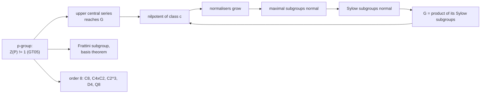

# GT07 · $p$-Groups and Nilpotent Groups

◀ [[GT06 Permutation Groups]] · [[Group Theory - Course Map|Course Map]] · next: [[GT08 Solvable Groups and Complements]]

> [!info] Source and approach
> Follows K–S chapter 5: §5.1 nilpotent groups ([[Kurzweil-Stellmacher_Theory of finite groups.pdf#page=112|PDF p.112]]), §5.2 nilpotent normal subgroups (PDF p.117), §5.3 $p$-groups with cyclic maximal subgroups (PDF p.121); PDF page = printed page + 13. The characterisation of finite nilpotent groups, the Frattini/basis theorem and the classification of groups of order 8 are written out in full; the classification in §5.3 for larger orders is stated. All examples are computed (`scripts/gt_numbers2.py`). Exact theorem numbers of K–S were not re-checked.

> [!tip] Start here (first read)
> - **The picture.** A group is **nilpotent** if repeatedly "peeling off the centre" eventually uses up the whole group: the centre is non-trivial, the quotient by it has a non-trivial centre, and so on. Every $p$-group does this (GT05), and *a finite nilpotent group is just a bundle of $p$-groups, one for each prime*. The groups that are not nilpotent ($S_3$, $A_4$, $D_6$) have a Sylow subgroup that is not normal.
> - **What you need.** Centre, quotients, Sylow theorems and the class equation ([[GT05 Actions Conjugation and Sylow Theorems]]), direct products ([[GT03 Cyclic and Abelian Groups and Direct Products]]).
> - **How to read.** The main result is the 5-way equivalence in §1 (a chain of five short implications); the second half (§2–§3) is about generators and small $p$-groups.

> [!key] After this chapter you can
> - compute the **upper and lower central series** and the **nilpotency class**,
> - prove the equivalence: finite $G$ is nilpotent $\iff$ normalisers grow $\iff$ maximal subgroups are normal $\iff$ Sylow subgroups are normal $\iff$ $G$ is the direct product of its Sylow subgroups,
> - use the **Frattini subgroup** and the **Burnside basis theorem** to count generators of a $p$-group,
> - classify the groups of **order 8** (five of them) and know the classification of $p$-groups with a cyclic maximal subgroup,
> - recognise the **Heisenberg group** (canonical commutation relations) as a nilpotent group.

> [!intuition] The one-sentence story
> "Nilpotent" means "almost Abelian in a layered way": the commutators of commutators of ... eventually vanish, so the failure of commutativity is controlled by a finite staircase; for finite groups this happens exactly when the group is a bundle of independent $p$-groups.

![[GT07 Nilpotent Map.svg]]
*Diagram GT7.0. The chapter in one page. Editable source: [[GT07 Nilpotent Map.excalidraw]].*

*Concept map.*

## 1. Nilpotent groups
> [!key] Definitions
> The **upper central series** is $1=Z_0\le Z_1\le Z_2\le\cdots$ with $Z_1=Z(G)$ and $Z_{i+1}/Z_i=Z(G/Z_i)$ (equivalently $Z_{i+1}=\{g:[g,h]\in Z_i\ \forall h\}$). $G$ is **nilpotent** if $Z_c=G$ for some $c$; the least such $c$ is the **class**. The **lower central series** is $\gamma_1=G$, $\gamma_{i+1}=[\gamma_i,G]$ (generated by $[x,g]$, $x\in\gamma_i$); $G$ is nilpotent of class $c$ iff $\gamma_{c+1}=1$ and $\gamma_c\ne1$ (stated; the two series have the same length).

> [!example] Central series computed
> | $G$ | upper central series (orders) | lower central series | verdict |
> |---|---|---|---|
> | $C_n$, any Abelian | $1,|G|$ | $|G|,1$ | class 1 |
> | $D_4$ (order 8) | $1,2,8$ | $8,2,1$ | class 2 |
> | $Q_8$ | $1,2,8$ | | class 2 |
> | $D_8$ (order 16) | $1,2,4,16$ | $16,4,2,1$ | class 3 |
> | $S_3$ | $1,1,\ldots$ (stuck at $1$) | $6,3,3,\ldots$ (stuck at $A_3$) | **not nilpotent** |
> | $A_4$, $S_4$ | stuck at $1$ | | **not nilpotent** |
> | $D_6$ (order 12) | $1,2,2,\ldots$ (stuck at $Z=C_2$) | $12,3,3,\ldots$ | **not nilpotent** (despite $Z\ne1$) |
> *Warning:* a non-trivial centre is not enough ($D_6$); the series must climb to the *whole* group. A dihedral group of order $2^{k+1}$ has class $k$.

> [!derivation] Theorem 1.1. Every finite $p$-group is nilpotent.
> *Proof.* If $Z_i<P$ then $P/Z_i$ is a non-trivial $p$-group, so its centre is non-trivial ([[GT05 Actions Conjugation and Sylow Theorems]]); hence $Z_{i+1}>Z_i$. The orders strictly increase and are bounded by $|P|$, so the series reaches $P$. ∎ (Class bound: a non-Abelian $p$-group of order $p^n$ and class $c\ge2$ has class $\le n-1$. Each of $Z_1,\ldots,Z_{c-1}$ adds a factor $\ge p$, and the quotient $Q=P/Z_{c-2}$ has class 2, so $Q/Z(Q)=P/Z_{c-1}$ is non-cyclic (else $Q$ would be Abelian, [[GT02 Homomorphisms Normal Subgroups and Quotients]]) and has order $\ge p^2$; so $|P|\ge p^{c-1}\cdot p^2$, i.e. $c\le n-1$.)

> [!derivation] Theorem 1.2 (characterisation of finite nilpotent groups). For a finite group $G$ the following are equivalent: **(a)** $G$ is nilpotent; **(b)** *normalisers grow*: $H<G\Rightarrow H<N_G(H)$; **(c)** every maximal subgroup is normal; **(d)** every Sylow subgroup is normal; **(e)** $G$ is the direct product of its Sylow subgroups.
> *What the proof is doing:* a chain of five implications. The key idea is (b): in a nilpotent group a proper subgroup can always be "pushed up" by an element from the next layer of the central series.
> *Proof.* **(a)$\Rightarrow$(b).** Let $H<G$ and take the largest $i$ with $Z_i\le H$; then $i<c$ (as $Z_c=G\not\le H$) and there is $z\in Z_{i+1}\setminus H$. For $h\in H$, $[z,h]\in Z_i\le H$, so $z^{-1}h^{-1}zh\in H$ hence $z^{-1}h^{-1}z\in H$ for all $h\in H$: $z$ normalises $H$, and $z\notin H$. **(b)$\Rightarrow$(c).** A maximal $M$ has $M<N_G(M)\le G$, so $N_G(M)=G$. **(c)$\Rightarrow$(d).** Let $P$ be a Sylow subgroup, $N=N_G(P)$ and suppose $N<G$; take a maximal subgroup $M\ge N$, normal in $G$ by (c). $P$ is Sylow in $M$ and $M\trianglelefteq G$, so the **Frattini argument** ([[GT05 Actions Conjugation and Sylow Theorems]]) gives $G=M\,N_G(P)=M$, contradiction; so $N=G$, $P\trianglelefteq G$. **(d)$\Rightarrow$(e).** Sylow subgroups $P_1,\ldots,P_r$ of different primes are normal with coprime orders, so they intersect trivially and commute elementwise ($[x,y]\in P_i\cap P_j=1$); the product has order $\prod|P_i|=|G|$, so $G=P_1\times\cdots\times P_r$. **(e)$\Rightarrow$(a).** Each $P_i$ is nilpotent (Theorem 1.1) and the upper central series of a direct product is the product of the series ($Z_k(A\times B)=Z_k(A)\times Z_k(B)$), which reaches $G$. ∎ *Checks:* $S_3$ (Sylow 2-subgroups are three conjugates, not normal), $A_4$ (four Sylow 3-subgroups), $D_6$ (three Sylow 2-subgroups $V_4$) all fail (d), hence are not nilpotent, matching the series table.

> [!example] A useful consequence
> A finite nilpotent group has a subgroup of **every order dividing $|G|$** and every subgroup is *subnormal* (normalisers grow). *The converse of Lagrange holds for nilpotent groups* (contrast $A_4$ in [[GT01 Groups Subgroups and Cosets]]).

## 2. Generators and the Frattini subgroup
> [!key] Definitions
> The **Frattini subgroup** $\Phi(G)$ is the intersection of all maximal subgroups of $G$. The **Fitting subgroup** $F(G)$ is the product of all nilpotent normal subgroups of $G$ (it is the largest nilpotent normal subgroup).

> [!derivation] Theorem 2.1 ($\Phi$ = non-generators). If $G=\langle X,\Phi(G)\rangle$ then $G=\langle X\rangle$.
> *Proof.* If $\langle X\rangle<G$, then $\langle X\rangle$ lies in a maximal subgroup $M$; also $\Phi(G)\le M$, so $\langle X,\Phi(G)\rangle\le M<G$. ∎ So *to generate $G$ one need only generate $G/\Phi(G)$.*

> [!derivation] Theorem 2.2 (Burnside basis theorem). For a $p$-group $P$, $P/\Phi(P)$ is elementary Abelian $C_p^d$, and every minimal generating set of $P$ has exactly $d=\log_p|P/\Phi(P)|$ elements.
> *Proof.* Every maximal subgroup $M$ of $P$ is normal (Theorem 1.2(c)) and $P/M$ has no proper non-trivial subgroup, so it is a simple $p$-group, hence $C_p$ ([[GT04 Commutators Simple Groups and Composition Series]]): $M$ has index $p$ and contains $P'$ and all $p$-th powers. Thus $\Phi(P)=\bigcap M\supseteq P'P^p$, and the natural map $P/\Phi(P)\to\prod_M P/M$ is injective, so $P/\Phi(P)$ embeds in a product of copies of $C_p$: it is elementary Abelian, a vector space over $\mathbb F_p$ of some dimension $d$. By Theorem 2.1 a set generates $P$ iff its image generates $P/\Phi(P)$, i.e. spans this vector space; a minimal such set is a basis, of size $d$. ∎ *Check:* the three maximal subgroups of $D_4$ (all of order 4) meet in $\langle r^2\rangle$ of order 2, so $D_4/\Phi\cong V_4$ and $D_4$ needs exactly $d=2$ generators ($r$ and a reflection). For non-nilpotent groups $\Phi$ can be trivial ($S_4$, $A_4$: computed), so the basis theorem is genuinely about $p$-groups.

> [!example] The Fitting subgroup
> Computed: $F(S_3)=A_3$, $F(S_4)=V_4$, $F(A_5)=1$ (the only nilpotent normal subgroup of the simple group $A_5$ is trivial). For a *solvable* group $G$ one has $C_G(F(G))\le F(G)$ (K–S §5.2, stated); check: $C_{S_4}(V_4)=V_4$ (order 4). This says that in a solvable group everything is controlled by the nilpotent normal core, which is why $F(G)$ is the key to the structure of solvable groups ([[GT08 Solvable Groups and Complements]]).

## 3. Small $p$-groups
> [!derivation] Proposition 3.1. A group of order $p^n$ has a normal subgroup of every order $p^k$, $0\le k\le n$; the maximal subgroups have index $p$.
> *Proof.* Induction on $n$. $Z(P)\ne1$ so by Cauchy contains a subgroup $A$ of order $p$, which is normal (central). Apply induction to $P/A$ (order $p^{n-1}$): its normal subgroups of order $p^{k-1}$ pull back to normal subgroups of $P$ of order $p^k$. The index statement is in Theorem 2.2. ∎

> [!derivation] Theorem 3.2 (groups of order 8). There are exactly five groups of order 8: $C_8$, $C_4\times C_2$, $C_2^3$ (Abelian) and the non-Abelian $D_4$ and $Q_8$.
> *What the proof is doing:* the Abelian ones come from the structure theorem; a non-Abelian group of order 8 must have an element of order 4 generating a normal subgroup of index 2, and the way the rest acts leaves only two possibilities.
> *Proof.* Abelian groups: $p(3)=3$ by [[GT03 Cyclic and Abelian Groups and Direct Products]]. Let $G$ be non-Abelian of order 8. Not all elements have order $\le2$ (else $G$ is Abelian) and none has order 8 (else cyclic), so there is $a$ of order 4; $H=\langle a\rangle$ has index 2, hence is normal. Take $b\notin H$, so $G=H\cup bH$. Conjugation by $b$ is an automorphism of $C_4$: $a\mapsto a$ or $a^{-1}$; if $a\mapsto a$ then $a,b$ commute and $G=\langle a,b\rangle$ would be Abelian, so $bab^{-1}=a^{-1}$. Now $b^2\in H$ and $b$ commutes with $b^2$, so $b^2\in C_H(b)=\{a^k:a^{-k}=a^k\}=\{1,a^2\}$. If $b^2=1$: $G=\langle a,b\mid a^4=b^2=1,\ bab^{-1}=a^{-1}\rangle=D_4$. If $b^2=a^2$: $G=\langle a,b\mid a^4=1,\ b^2=a^2,\ bab^{-1}=a^{-1}\rangle=Q_8$ (the quaternion group $\{\pm1,\pm i,\pm j,\pm k\}$). (Replacing $b$ by $ba^j$ does not change which case occurs: $(ba)^2=b^2$.) The two groups are different: $D_4$ has **five** elements of order 2 and two of order 4, $Q_8$ has **one** element of order 2 and six of order 4 (computed). ∎

> [!key] Classification with a cyclic maximal subgroup (K–S §5.3; stated)
> Let $G$ be a non-cyclic group of order $p^n$ with a cyclic subgroup of index $p$. Then $G$ is one of: $C_{p^{n-1}}\times C_p$; the **modular group** $M_{p^n}=\langle a,b\mid a^{p^{n-1}}=b^p=1,\ b^{-1}ab=a^{1+p^{n-2}}\rangle$ ($n\ge3$ for odd $p$, $n\ge4$ for $p=2$); and, **only for $p=2$**, the dihedral $D_{2^{n-1}}$ (order $2^n$), the generalised quaternion $Q_{2^n}$ and the semidihedral $SD_{2^n}$ ($n\ge4$). *Order 8 ($p=2$, $n=3$): $C_4\times C_2$, $D_4$, $Q_8$ (plus the cyclic $C_8$): four groups; the fifth, $C_2^3$, has no cyclic maximal subgroup.* The number of groups of order $p,p^2,p^3,p^4$ is $1,2,5,14$ for $p=2$ (and $1,2,5,15$ for odd $p$ at $p^4$; recalled, `[verify]`).

## 4. Practice and check yourself
> [!example]- Practice (with answers)
> 1. **Compute the class of $D_n$ for $n=2^k$.** *Answer:* order $2^{k+1}$, class $k$ ($D_4$: 2, $D_8$: 3).
> 2. **Is $D_6$ nilpotent?** *Answer:* no: $D_6\cong S_3\times C_2$ and $S_3$ is not nilpotent; equivalently the three Sylow 2-subgroups $V_4$ are not normal.
> 3. **A group of order 45: is it nilpotent?** *Answer:* $45=9\cdot5$; Sylow: $n_3\mid5$, $n_3\equiv1\pmod3$ gives $n_3=1$; $n_5\mid9$, $n_5\equiv1\pmod5$ gives $n_5=1$; both Sylow subgroups are normal, so $G$ is a direct product $P_3\times P_5$ and every group of order 45 is nilpotent (indeed Abelian, as groups of order $p^2$ are).
> 4. **How many generators does $C_2^3$ need? $Q_8$?** *Answer:* $C_2^3$: $\Phi=1$, $d=3$. $Q_8$: $\Phi=\{\pm1\}$, $Q_8/\Phi\cong V_4$, $d=2$ ($i,j$ generate).
> 5. **Show $Z(Q_8)=\{\pm1\}$ and $Q_8/Z\cong V_4$.** *Answer:* only $\pm1$ commute with $i,j,k$; the quotient has four elements each of order 2.
> 6. **Why can a non-trivial normal subgroup of a $p$-group meet the centre non-trivially?** *Answer:* $P$ acts on $N$ by conjugation; non-trivial orbit sizes are powers of $p$, so the fixed points $N\cap Z(P)$ number $\equiv|N|\equiv0\pmod p$ and contain $1$, hence at least $p$.

## 5. Where nilpotent groups show up elsewhere
> [!connection] Nilpotent groups in the vault
> - **The Heisenberg group.** The position and momentum operators satisfy $[\hat x,\hat p]=i\hbar$, which is *central* (it commutes with everything): the group generated by $e^{ia\hat x}$, $e^{ib\hat p}$ and phases is a **nilpotent group of class 2**, the exact group analogue of $D_4$ and $Q_8$ (class 2, centre of order 2). The Baker–Campbell–Hausdorff series for such operators terminates after the commutator ([[Canonical Commutation Relation]], [[Dirac Algebra]] §7, [[Displacement Operator]]). Over the field $\mathbb F_p$ the Heisenberg group has order $p^3$ and is one of the five groups of order $p^3$.
> - **Solvability and symmetry breaking:** nilpotent $\subset$ solvable ([[GT08 Solvable Groups and Complements]]); the point groups of molecules are overwhelmingly solvable ($T_d\cong S_4$, $O_h\cong S_4\times C_2$), but the icosahedral group $I\cong A_5$ (fullerenes, [[Inorganic Chemistry - Course Map]] cages) is not.
> - **Counting:** the structure of $p$-groups underlies the Sylow counts of [[GT05 Actions Conjugation and Sylow Theorems]].
> **Concept notes:** [[Nilpotent Group]] · [[Upper Central Series]] · [[Frattini Subgroup]] · [[Fitting Subgroup]] · [[Burnside Basis Theorem]] · [[Quaternion Group]] · [[Heisenberg Group]]

## Provenance
> [!provenance]- Source map for this chapter
> | Topic | Source | Origin |
> |---|---|---|
> | nilpotent groups, Fitting and Frattini subgroups, $p$-groups with cyclic maximal subgroups | K–S ch. 5 (PDF pp.112–126; the TOC titles only; the text of ch. 5 was **not** read) | book (by title) |
> | the five-way characterisation, basis theorem, groups of order 8, order-45 example, practice | my write-up of the standard arguments; central series, Frattini subgroups, Fitting subgroups and element-order counts computed in `scripts/gt_numbers2.py` | mine |
> | classification of $p$-groups with a cyclic maximal subgroup, numbers of groups of order $p^k$, $C_G(F(G))\le F(G)$ | recalled standard statements, not proved here | not checked (`[verify]`) |
>
> **Flags.** (1) The equivalence of the upper and lower central series' lengths is stated. (2) K–S's chapter 5 was not read; the organisation (and which results they prove) may differ.
