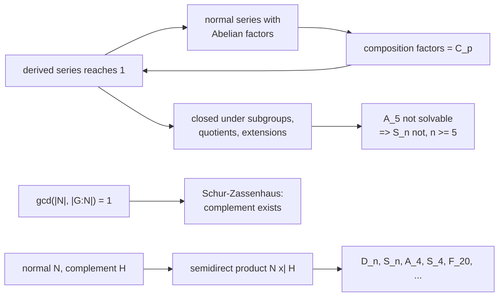

# GT08 · Solvable Groups and Complements

◀ [[GT07 p-Groups and Nilpotent Groups]] · [[Group Theory - Course Map|Course Map]] · next: [[GT09 Transfer and Normal p-Complements]]

> [!info] Source and approach
> Follows K–S §6.1 (solvable groups, [[Kurzweil-Stellmacher_Theory of finite groups.pdf#page=134|PDF p.134]]), §6.2 (Schur–Zassenhaus, PDF p.138), §6.7 (subnormal subgroups, PDF p.169) and §3.3 (complements of normal subgroups, PDF p.84); PDF page = printed page + 13. The equivalence of the definitions of "solvable", the closure properties, the semidirect-product construction, the proof of Schur–Zassenhaus **for Abelian $N$** and the intersection property of subnormal subgroups are written out in full. The general Schur–Zassenhaus theorem, conjugacy of complements, Burnside's $p^aq^b$ theorem and the Feit–Thompson theorem are stated. All examples are computed (`scripts/gt_numbers2.py`). Exact theorem numbers of K–S were not re-checked.

> [!tip] Start here (first read)
> - **The picture.** A **solvable** group is one that can be built from cyclic pieces of prime order by repeatedly "gluing". The word comes from Galois: an equation is solvable by radicals exactly when its Galois group is solvable. A **semidirect product** $N\rtimes H$ is the gluing recipe: two groups together with an action of one on the other. A **complement** is "the other half" of such a gluing.
> - **What you need.** Normal subgroups, quotients, composition series ([[GT04 Commutators Simple Groups and Composition Series]]), Sylow and coprime orders ([[GT05 Actions Conjugation and Sylow Theorems]]), nilpotent groups ([[GT07 p-Groups and Nilpotent Groups]]).
> - **How to read.** §1 (solvable groups) is short. §2 (semidirect products) is the construction that explains most small groups. §3 has the longest proof (Schur–Zassenhaus, Abelian case): read the "what the proof is doing" box first.

> [!key] After this chapter you can
> - state three equivalent definitions of **solvable** and prove that subgroups, quotients and extensions of solvable groups are solvable,
> - say which small groups are solvable and why $A_5$ (hence $S_n$, $n\ge5$) is not,
> - build **semidirect products** $N\rtimes_\varphi H$, recognise $D_n$, $S_n$, $A_4$, $S_4$ and the Frobenius groups as semidirect products, and tell the five groups of order 12 apart,
> - prove the **Schur–Zassenhaus theorem** for Abelian $N$ and know the general statement,
> - define **subnormal** subgroups and prove that intersections of subnormal subgroups are subnormal.

> [!intuition] The one-sentence story
> Solvable groups are exactly the groups assembled from prime-order clocks by stacking, and a semidirect product is the *general* way of stacking: the top clock acts on the bottom group by symmetries of it (like the reflection acting on the rotations of a polygon by inversion).

![[GT08 Solvable Complements Map.svg]]
*Diagram GT8.0. The chapter in one page. Editable source: [[GT08 Solvable Complements Map.excalidraw]].*

*Concept map.*

## 1. Solvable groups
> [!key] Definition and equivalent forms
> The **derived series** is $G^{(0)}=G$, $G^{(i+1)}=(G^{(i)})'$ ([[GT04 Commutators Simple Groups and Composition Series]]). $G$ is **solvable** (soluble) if $G^{(k)}=1$ for some $k$; the least such $k$ is the **derived length**.

> [!derivation] Theorem 1.1. For a finite group $G$ the following are equivalent: **(a)** $G$ is solvable; **(b)** $G$ has a series $1=A_0\trianglelefteq A_1\trianglelefteq\cdots\trianglelefteq A_r=G$ with every $A_i/A_{i-1}$ **Abelian**; **(c)** every composition factor of $G$ is **cyclic of prime order**.
> *What the proof is doing:* the derived series *is* a series with Abelian factors; refining an Abelian factor gives prime cyclic pieces; conversely a cyclic quotient kills commutators, so commutators of commutators of ... die.
> *Proof.* (a)$\Rightarrow$(b): the derived series has Abelian factors $G^{(i)}/G^{(i+1)}$. (b)$\Rightarrow$(c): in an Abelian group every subgroup is normal, so each Abelian factor $A_i/A_{i-1}$ has a composition series with factors of prime order (Theorem 2.1 of GT04: Abelian simple $=C_p$); the refined series is a composition series of $G$, and by Jordan–Hölder its factors are *the* composition factors. (c)$\Rightarrow$(a): induct on $|G|$. Let $M\trianglelefteq G$ be the first term below $G$ in a composition series, so $G/M\cong C_p$ is Abelian and $G'\le M$ (GT04 Theorem 1.1); $M$ has cyclic composition factors, hence $M^{(k)}=1$ for some $k$ by induction. Then $G^{(i+1)}=(G')^{(i)}\le M^{(i)}$, so $G^{(k+1)}=1$. ∎

> [!derivation] Theorem 1.2 (closure). Subgroups and quotients of solvable groups are solvable; if $N\trianglelefteq G$ with $N$ and $G/N$ solvable then $G$ is solvable.
> *Proof.* $H\le G\Rightarrow H^{(i)}\le G^{(i)}$. For $N\trianglelefteq G$: $(G/N)^{(i)}=G^{(i)}N/N$. For the extension: if $(G/N)^{(a)}=1$ then $G^{(a)}\le N$, and then $G^{(a+b)}\le N^{(b)}=1$ for $b$ the derived length of $N$. ∎

> [!example] Which groups are solvable?
> | Group | derived series (orders) | solvable? |
> |---|---|---|
> | Abelian, nilpotent, every $p$-group | $\ldots\to1$ | yes |
> | $S_3$, $D_n$ | $S_3>A_3>1$ (6, 3, 1) | yes |
> | $A_4$ | $12>4>1$ | yes (derived length 2) |
> | $S_4$ | $24>12>4>1$ | **yes** (derived length 3) |
> | $A_5$, $S_5$, $S_n$ ($n\ge5$) | $A_5$ is perfect: $A_5'=A_5$ | **no** |
> $A_5$ is non-Abelian simple and its derived series is stuck at $A_5$ (computed: $A_5'=A_5$, $S_5'=A_5$). **Every group of order $<60$ is solvable**: a non-solvable group has a non-Abelian simple composition factor (Theorem 1.1(c)), of order at most $|G|$, but the smallest such is $A_5$ with 60 elements (Hölder, GT04). *Deeper theorems (stated):* **Burnside's $p^aq^b$ theorem**: every group of order $p^aq^b$ ($p,q$ primes) is solvable; **Feit–Thompson**: every group of **odd order** is solvable (a proof of about 250 pages).

> [!intuition] Galois and the quintic
> An equation is solvable by radicals iff its Galois group is solvable. The Galois group of a general polynomial of degree $n$ is $S_n$; $S_n$ is solvable for $n\le4$ (the quadratic, cubic and quartic formulas) and **not** for $n\ge5$ (because $A_n$ is simple non-Abelian; [[GT06 Permutation Groups]]): hence no general formula for the quintic. (Galois theory itself is not in the vault; this is the origin of the word "solvable".)

## 2. Semidirect products
> [!key] Definition and recognition
> Let $N,H$ be groups and $\varphi:H\to\operatorname{Aut}(N)$ a homomorphism. The **semidirect product** $N\rtimes_\varphi H$ is the set $N\times H$ with
> $$(n_1,h_1)(n_2,h_2)=\big(n_1\,\varphi(h_1)(n_2),\ h_1h_2\big).$$
> It is a group: the identity is $(1,1)$, the inverse of $(n,h)$ is $(\varphi(h^{-1})(n^{-1}),h^{-1})$, and associativity holds because $\varphi$ is a homomorphism: both bracketings of three elements give $\big(n_1\varphi(h_1)(n_2)\varphi(h_1h_2)(n_3),\,h_1h_2h_3\big)$. $N=\{(n,1)\}$ is a normal subgroup, $H=\{(1,h)\}$ a subgroup with $N\cap H=1$ and $NH=G$, and $(1,h)(n,1)(1,h)^{-1}=(\varphi(h)(n),1)$: **$H$ acts on $N$ by conjugation through $\varphi$.** For $\varphi$ trivial this is the direct product ([[GT03 Cyclic and Abelian Groups and Direct Products]]).

> [!derivation] Theorem 2.1 (recognition). If $N\trianglelefteq G$ and $H\le G$ with $NH=G$ and $N\cap H=1$ (a **complement** of $N$), then $G\cong N\rtimes_\varphi H$ with $\varphi(h)(n)=hnh^{-1}$.
> *Proof.* Every $g\in G$ is $nh$ in a unique way ($nh=n'h'\Rightarrow n'^{-1}n=h'h^{-1}\in N\cap H=1$). The map $(n,h)\mapsto nh$ is a bijection $N\rtimes_\varphi H\to G$ and $(n_1h_1)(n_2h_2)=n_1(h_1n_2h_1^{-1})h_1h_2=n_1\varphi(h_1)(n_2)\,h_1h_2$, which is the product rule. ∎

> [!example] Groups that are semidirect products (all structurally checked)
> | $G$ | $N$ | $H$ | the action $\varphi$ |
> |---|---|---|---|
> | $D_n$ (order $2n$) | $C_n=\langle r\rangle$ | $C_2=\langle s\rangle$ | inversion $r\mapsto r^{-1}$ |
> | $S_n$ ($n\ge2$) | $A_n$ | $C_2$ (a transposition) | conjugation by the transposition |
> | $A_4$ | $V_4$ | $C_3$ | cyclic rotation of the three non-identity elements |
> | $S_4$ | $V_4$ | $S_3$ | permuting the three double transpositions |
> | $F_{20}=AGL(1,5)$ | $C_5$ | $C_4$ | $x\mapsto ax$ ($a\in(\mathbb Z/5)^\times$) |
> | $\mathrm{Dic}_3=C_3\rtimes C_4$ | $C_3$ | $C_4$ | generator $\mapsto$ inversion (kernel $C_2$) |
> The Frobenius groups of [[GT06 Permutation Groups]] are exactly the semidirect products $K\rtimes H$ with $H$ acting on $K$ without fixed points.

> [!example] The five groups of order 12 are told apart by element orders (computed)
> | group | description | element orders $\{\text{order}:\text{count}\}$ |
> |---|---|---|
> | $C_{12}$ | cyclic | $\{1{:}1,2{:}1,3{:}2,4{:}2,6{:}2,12{:}4\}$ |
> | $C_6\times C_2$ | Abelian | $\{1{:}1,2{:}3,3{:}2,6{:}6\}$ |
> | $A_4$ | $V_4\rtimes C_3$ | $\{1{:}1,2{:}3,3{:}8\}$ |
> | $D_6$ | $C_6\rtimes C_2$ | $\{1{:}1,2{:}7,3{:}2,6{:}2\}$ |
> | $\mathrm{Dic}_3$ | $C_3\rtimes C_4$ | $\{1{:}1,2{:}1,3{:}2,4{:}6,6{:}2\}$ |
> All five tuples differ, so these groups are pairwise non-isomorphic; that there are *no others* is a standard fact (recalled, `[verify]`; [[GT05 Actions Conjugation and Sylow Theorems]] shows each has a normal Sylow 2- or 3-subgroup, the start of the classification).

> [!pitfall] Not every extension splits
> $N\trianglelefteq G$ does not imply a complement exists. $C_4$ has the normal subgroup $\{0,2\}$ but no element of order 2 outside it, so no complement; $Q_8$ has the normal subgroup $\langle i\rangle\cong C_4$ but only one element of order 2 (inside $\langle i\rangle$), so no complement. These are **non-split extensions**: $C_6$ and $S_3$ are the two ways of gluing $C_3$ and $C_2$ (trivial and inversion action); $C_4$ and $C_2\times C_2$ the two (one split, one not) ways of gluing $C_2$ and $C_2$. The general problem of listing all ways to glue given factors is the **extension problem** (group cohomology).

## 3. The Schur–Zassenhaus theorem
> [!key] Theorem 3.1 (Schur–Zassenhaus)
> Let $N\trianglelefteq G$ with $\gcd(|N|,|G:N|)=1$. Then $N$ has a complement in $G$. Moreover all complements are conjugate in $G$ (true when $N$ or $G/N$ is solvable, which by Feit–Thompson is always the case). *We prove the existence part when $N$ is Abelian; the general case is reduced to it via a Sylow subgroup and the Frattini argument (K–S §6.2), and is stated here.*

> [!derivation] Proof for Abelian $N$ (Gaschütz-type counting)
> *What the proof is doing:* consider all transversals $T$ of $N$ in $G$ (one element from each coset). Compare two transversals by multiplying the "differences" of corresponding elements; because $\gcd(|N|,m)=1$ ($m=|G:N|$) the $m$-th power map on $N$ is a bijection, which makes $N$ act regularly on the set of equivalence classes of transversals; then $G$ acts transitively on that set, and the stabiliser of a class has the size and the intersection property of a complement.
> *Proof.* Let $m=|G:N|$ and $\mathcal T$ the set of transversals $T=\{t_1,\ldots,t_m\}$ (one element of each coset $tN$; since $N\trianglelefteq G$ left and right cosets agree). For $T,T'\in\mathcal T$ pair $t\in T$ with the unique $t'\in T'$ in the same coset and put $d(T,T')=\prod_{t\in T}t\,t'^{-1}$; each factor lies in $N$ ($t\,t'^{-1}\in N$ as $tN=t'N$), and since $N$ is **Abelian** the product does not depend on the order. Then $d(T,T')d(T',T'')=d(T,T'')$ and $d(T,T)=1$ (check: telescoping). Define $T\sim T'$ iff $d(T,T')=1$: an equivalence relation. *Actions.* (i) $G$ acts on $\mathcal T$ by $T\mapsto gT=\{gt\}$ (transversal again), and $d(gT,gT')=g\,d(T,T')\,g^{-1}$, so $G$ permutes the classes. (ii) $N$ acts on $\mathcal T$ by $T\mapsto nT$ (an $n\in N$ multiplies each $t$ on the left; $nt\in tN$) and $d(nT,T)=n^m$. Since $\gcd(|N|,m)=1$, $n\mapsto n^m$ is a bijection $N\to N$. *Therefore $N$ acts regularly on the set $\mathcal C=\mathcal T/{\sim}$ of classes:* given classes $[T],[T']$ there is a unique $n$ with $n^m=d(T',T)$, and then $d(nT,T')=n^md(T,T')=1$, i.e. $[nT]=[T']$ (uniqueness of $n$ from bijectivity of $n\mapsto n^m$), so $|\mathcal C|=|N|$. Hence $G$ acts transitively on $\mathcal C$ ($N\le G$ already does). By orbit–stabiliser the stabiliser $H$ of a class has order $|G|/|N|=m$, and $H\cap N=1$ because $N$ acts regularly (a non-trivial $n$ fixes no class). So $|HN|=|H||N|=|G|$: **$H$ is a complement of $N$**. ∎ *Check (computed, $G=A_4$, $N=V_4$, $m=3$):* the cocycle identity $d(T_1,T_2)d(T_2,T_3)=d(T_1,T_3)$ and $d(T,T)=1$ hold for random transversals; $n\mapsto n^3$ is a bijection of $V_4$; and $A_4$ has $4$ complements to $V_4$ (its four Sylow 3-subgroups), all conjugate.

> [!example] Using Schur–Zassenhaus
> $A_4\supseteq V_4$ (indices coprime: $4$ and $3$): complement $C_3$. $S_3\supseteq A_3$ (3 and 2): complement $C_2$. A group of order $pq$ with a normal Sylow $q$-subgroup, $p\ne q$, is $C_q\rtimes C_p$. When $\gcd\ne1$ it can fail: $C_4\supseteq C_2$ ($2$ and $2$), $Q_8\supseteq C_4$.

## 4. Subnormal subgroups
> [!key] Definition
> $A$ is **subnormal** in $G$ ($A\trianglelefteq\!\trianglelefteq G$) if there is a chain $A=A_0\trianglelefteq A_1\trianglelefteq\cdots\trianglelefteq A_r=G$. Terms of a composition series are subnormal; a normal subgroup is subnormal (take $r=1$). In a nilpotent group **every** subgroup is subnormal (Theorem 1.2(b) of [[GT07 p-Groups and Nilpotent Groups]]: the chain $H<N_G(H)<N_G(N_G(H))<\cdots$ ends at $G$).

> [!derivation] Theorem 4.1 (K–S 1.2.8). If $A,B$ are subnormal in $G$, so is $A\cap B$.
> *Proof.* Let $A=A_0\trianglelefteq\cdots\trianglelefteq A_r=G$. Intersecting with $B$ gives $A_i\cap B\trianglelefteq A_{i+1}\cap B$ (a normal subgroup intersected with a subgroup is normal in the intersection), so $A\cap B=A_0\cap B\trianglelefteq A_1\cap B\trianglelefteq\cdots\trianglelefteq A_r\cap B=B$: $A\cap B$ is subnormal in $B$. Since $B$ is subnormal in $G$, concatenating the two chains shows $A\cap B$ is subnormal in $G$. ∎ **Wielandt's theorem** (stated, K–S §6.7): the subgroup generated by two subnormal subgroups is again subnormal.

> [!example] Subnormal but not normal, and not subnormal at all
> $\langle(12)(34)\rangle\trianglelefteq V_4\trianglelefteq A_4\trianglelefteq S_4$: subnormal in $S_4$, but not normal (computed: it has conjugates $\langle(13)(24)\rangle$, ...). In $S_3$ the subgroup $\langle(12)\rangle$ is **not subnormal**: the only subgroups containing it are itself and $S_3$, and it is not normal in $S_3$.

## 5. Practice and check yourself
> [!example]- Practice (with answers)
> 1. **Derived length of $S_4$, $A_4$, $D_4$.** *Answer:* $3,2,2$.
> 2. **Is a group of order 56 solvable?** *Answer:* $56=2^3\cdot7$: solvable by Burnside's $p^aq^b$ theorem (and directly: GT05 shows $n_7=1$ or the 2-Sylow is normal).
> 3. **Write $D_5$ as a semidirect product and give the product rule.** *Answer:* $C_5\rtimes_\varphi C_2$ with $\varphi(1)(n)=-n$: $(n_1,h_1)(n_2,h_2)=(n_1+(-1)^{h_1}n_2,\ h_1+h_2)$.
> 4. **Does $Q_8$ split over $\langle i\rangle$? Over $\{\pm1\}$?** *Answer:* neither. A complement of $\langle i\rangle$ would be a subgroup of order 2 meeting $\langle i\rangle$ trivially, but the only subgroup of order 2 is $\{\pm1\}\subset\langle i\rangle$. A complement of $\{\pm1\}$ would be a subgroup of order 4 not containing $-1$, but every subgroup of order 4 in $Q_8$ contains the unique element of order 2, namely $-1$.
> 5. **Show that $G$ solvable $\Rightarrow$ every minimal normal subgroup is elementary Abelian.** *Answer:* a minimal normal subgroup $N$ is solvable (subgroup), so $N'\ne N$; $N'$ is characteristic in $N$ hence normal in $G$; minimality gives $N'=1$: $N$ is Abelian, then elementary Abelian by GT04 Theorem 3.1.
> 6. **How many complements does $V_4$ have in $S_4$?** *Answer:* a complement is a subgroup of order 6 meeting $V_4$ trivially; $S_4$ has 4 subgroups $S_3$ (point stabilisers), all conjugate: 4 complements.

## 6. Where these ideas appear elsewhere
> [!connection] Solvable groups and semidirect products in the vault
> - **Point groups of molecules** are semidirect products of rotations by reflections: $C_{nv}\cong D_n$, $T_d\cong S_4=V_4\rtimes S_3$, $O_h\cong S_4\times C_2$ ([[GT10 Symmetry Representations and Characters]], [[CH03 Molecular Orbital Theory Polyatomics]]); all the crystallographic point groups are solvable. The icosahedral rotation group $I\cong A_5$ (fullerenes) is the first non-solvable point group; its irreducible representations have dimensions $1,3,3,4,5$ ($1+9+9+16+25=60$), so orbitals can be 4- or 5-fold degenerate, whereas in the solvable point groups $T_d$, $O_h$ the maximum degeneracy is 3 (dimensions $1,1,2,3,3$).
> - **Space groups of crystals** are semidirect products $\mathbb Z^3\rtimes P$ of the translation lattice with a point group $P$ ([[Bloch Theorem]] uses the translation subgroup).
> - **Galois and the quintic:** see §1 (the original reason for the word).
> - **Probability:** random walks on a semidirect product ($\mathbb R^n\rtimes SO(n)$, the Euclidean group of motions); **Landscapes:** the group of rigid motions of the plane acting on a DEM ([[LS04 Map Projections and Reference Surfaces]]).
> - **Jordan–Hölder for representations:** the solvability of the point group guarantees a chain of induced representations used in vibrational analyses ([[GT10 Symmetry Representations and Characters]] §4).
> **Concept notes:** [[Solvable Group]] · [[Derived Series]] · [[Semidirect Product]] · [[Complement of a Normal Subgroup]] · [[Schur-Zassenhaus Theorem]] · [[Subnormal Subgroup]] · [[Extension Problem]]

## Provenance
> [!provenance]- Source map for this chapter
> | Topic | Source | Origin |
> |---|---|---|
> | solvable groups, complements, Schur–Zassenhaus, subnormal subgroups | K–S §6.1, §6.2, §6.7, §3.3 (PDF pp.134, 138, 169, 84; theorem label 1.2.8 for the intersection of subnormal subgroups read earlier; the text of ch. 6 was **not** read) | book (by title) |
> | proofs written out (Theorems 1.1, 1.2, 2.1, Schur–Zassenhaus for Abelian $N$, 4.1), examples, practice | my write-up of the standard arguments; computations in `scripts/gt_numbers2.py` (derived series, the five groups of order 12 by element orders, cocycle check, complements) | mine |
> | general Schur–Zassenhaus, conjugacy of complements, Burnside $p^aq^b$, Feit–Thompson, Wielandt, "exactly five groups of order 12" | recalled; not proved here | not checked (`[verify]`) |
>
> **Flags.** (1) The Schur–Zassenhaus proof is the standard transversal-counting argument for Abelian $N$; each step was re-derived and the key identities were spot-checked by computer on one example. (2) K–S's chapter 6 was not read.
