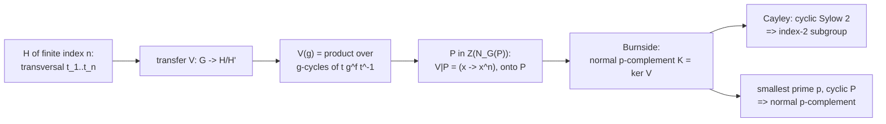

# GT09 · Transfer and Normal $p$-Complements

◀ [[GT08 Solvable Groups and Complements]] · [[Group Theory - Course Map|Course Map]] · next: [[GT10 Symmetry Representations and Characters]]

> [!info] Source and approach
> Follows K–S chapter 7: §7.1 the transfer homomorphism ([[Kurzweil-Stellmacher_Theory of finite groups.pdf#page=176|PDF p.176]]) and §7.2 normal $p$-complements (PDF p.182); PDF page = printed page + 13. The definition and well-definedness of the transfer, its evaluation formula, Burnside's normal $p$-complement theorem, and its two classical corollaries (Cayley's even-order criterion and the smallest-prime criterion) are written out in full; every example is computed (`scripts/gt_numbers2.py`). Chapter 7 of K–S was **not read**; the statements are the standard ones.

> [!tip] Start here (first read)
> - **The picture.** A **normal $p$-complement** is a normal subgroup $K$ with $G=K\rtimes P$, $P$ a Sylow $p$-subgroup: the group "splits off" its $p$-part. Is there a quick test? **Burnside's theorem**: yes, if the Sylow subgroup $P$ is *central in its own normaliser*. The tool is a clever homomorphism, the **transfer**, which converts information about the *subgroup* $P$ into a homomorphism defined on all of $G$.
> - **What you need.** Sylow theorems and conjugacy ([[GT05 Actions Conjugation and Sylow Theorems]]); semidirect products and complements ([[GT08 Solvable Groups and Complements]]); the abelianisation $H/H'$ ([[GT04 Commutators Simple Groups and Composition Series]]).
> - **How to read.** This is the most technical chapter of the sequence. Read §1 for the definition (with the check that it is a homomorphism), §2 for the single-line evaluation rule, and then jump to §3 and the examples; the proofs there only *use* the previous facts.

> [!key] After this chapter you can
> - define the **transfer** $V:G\to H/H'$ and verify it is a well-defined homomorphism,
> - evaluate it with the **cycle decomposition** formula,
> - prove **Burnside's normal $p$-complement theorem**: if $P\le Z(N_G(P))$ then $G$ has a normal $p$-complement,
> - deduce: groups of order $2m$ with $m$ odd and a cyclic Sylow 2-subgroup have an index-2 subgroup (Cayley), and a **cyclic Sylow $p$-subgroup for the smallest prime $p$** gives a normal $p$-complement,
> - use these to show that many orders (e.g. $pq$, $p^aq$) force a normal subgroup.

> [!intuition] The one-sentence story
> The transfer is the "determinant of the permutation action of $G$ on the cosets of $H$", with the answer taken in $H/H'$: it measures how $G$ shuffles the cosets while recording the $H$-twist each coset picks up; if $H$ is a Sylow subgroup that is well-behaved, this shuffle-and-twist already splits the group.

![[GT09 Transfer Map.svg]]
*Diagram GT9.0. The chapter in one page. Editable source: [[GT09 Transfer Map.excalidraw]].*

*Concept map.*

## 1. The transfer homomorphism
> [!key] Definition
> Let $H\le G$ with $|G:H|=n$, let $t_1,\ldots,t_n$ be a (right) transversal, so $G=\bigsqcup_iHt_i$, and write $\bar H=H/H'$ (Abelian). For $g\in G$ each $t_ig$ lies in a unique coset $Ht_{i\sigma}$ (where $\sigma=\sigma_g$ is a permutation of $\{1,\ldots,n\}$: the action of $g$ on the cosets) so $h_i(g):=t_i\,g\,t_{i\sigma}^{-1}\in H$. The **transfer** is $$V:G\to\bar H,\qquad V(g)=\prod_{i=1}^nh_i(g)\,H'.$$

> [!derivation] Theorem 1.1. $V$ is a **homomorphism** and does **not depend on the choice of transversal**.
> *What the proof is doing:* the defining product is a "determinant": multiplying $g$ and $g'$ composes the permutations of the cosets and the twists $h_i$ multiply along the way; since $\bar H$ is Abelian the order of the factors does not matter, so the product telescopes into the product of the individual answers.
> *Proof.* *Homomorphism.* For $g,g'\in G$ with coset permutations $\sigma,\sigma'$ we have $h_i(gg')=t_igg't_{i\sigma\sigma'}^{-1}=(t_igt_{i\sigma}^{-1})(t_{i\sigma}g't_{(i\sigma)\sigma'}^{-1})=h_i(g)\,h_{i\sigma}(g')$ (computing with the right action $i\mapsto i\sigma$). Taking the product over $i$ and using that $\bar H$ is Abelian and $i\mapsto i\sigma$ is a bijection, $\prod_ih_i(gg')=\prod_ih_i(g)\cdot\prod_ih_{i\sigma}(g')=V(g)V(g')$ in $\bar H$. *Independence of the transversal.* Another transversal is $t'_i=k_it_i$ with $k_i\in H$. Then $h'_i(g)=k_it_igt_{i\sigma}^{-1}k_{i\sigma}^{-1}=k_ih_i(g)k_{i\sigma}^{-1}$, and $\prod_ik_i\cdot\prod_ih_i(g)\cdot\prod_ik_{i\sigma}^{-1}=\prod_ih_i(g)$ in the Abelian group $\bar H$ (the $k$ factors cancel since $i\mapsto i\sigma$ is a bijection). ∎

> [!example] A computed example: $S_3$ with $H=C_2$
> Take $H=\langle(12)\rangle$ of index 3 in $S_3$. A computer evaluation of $V(g)=\prod_ih_i(g)$ confirms $V$ is a homomorphism $S_3\to H\cong C_2$ with **kernel of order 3**, namely $A_3$: *the transfer to the Sylow 2-subgroup is the sign map.* For $A_4$ with $H=V_4$ the transfer is a homomorphism but its **image is trivial**: so it tells us nothing, consistent with the theorem below ($V_4$ is not central in $N_{A_4}(V_4)=A_4$).

## 2. Evaluating the transfer
> [!derivation] Lemma 2.1 (cycle formula). Let $g\in G$ and let $\langle g\rangle$ act on the cosets $Ht_1,\ldots,Ht_n$; let the orbits have lengths $f_1,\ldots,f_s$ ($\sum f_j=n$) with representatives $t_{j}$ (one coset $Ht_j$ from each orbit). Then $$V(g)=\prod_{j=1}^s\ t_j\,g^{f_j}\,t_j^{-1}\ H'.$$
> *Proof.* Choose the transversal adapted to $g$: for each orbit $Ht_j,Ht_jg,Ht_jg^2,\ldots,Ht_jg^{f_j-1}$ use the representatives $t_j,t_jg,\ldots,t_jg^{f_j-1}$ (allowed by independence of the transversal). Then for $i=t_jg^k$ with $k<f_j-1$: $t_ig=t_jg^{k+1}$ is itself the next representative, so $h_i(g)=1$; for the last one $k=f_j-1$: $t_ig=t_jg^{f_j}\in Ht_j$, so $h_i(g)=t_jg^{f_j}t_j^{-1}$. Multiply over all $i$. ∎ *Meaning:* each $g$-cycle on the cosets contributes the $f$-th power $g^f$ (which lies in a conjugate of $H$), conjugated back into $H$. In particular if $H\le Z(G)$ then every conjugation is trivial and $V(g)=g^n$ (for $g\in H$ the cycles all have length 1).

## 3. Burnside's normal $p$-complement theorem
> [!key] Definition
> A **normal $p$-complement** of $G$ is a normal subgroup $K$ with $|G:K|$ a power of $p$ and $p\nmid|K|$; equivalently $G=K\rtimes P$ with $P\in\mathrm{Syl}_p(G)$ (a complement given by Schur–Zassenhaus, [[GT08 Solvable Groups and Complements]]).

> [!derivation] Lemma 3.1 (Burnside's fusion lemma). Let $P$ be an Abelian Sylow $p$-subgroup of $G$ and $x,y\in P$ with $y=g^{-1}xg$ for some $g\in G$. Then $y=c^{-1}xc$ for some $c\in N_G(P)$.
> *Proof.* $P\le C_G(y)$ because $P$ is Abelian and contains $y$; and $P^g=g^{-1}Pg$ is Abelian and contains $g^{-1}xg=y$, so $P^g\le C_G(y)$ as well. So $P$ and $P^g$ are Sylow $p$-subgroups of $C_G(y)$, hence conjugate there: $P^{gc'}=P$ for some $c'\in C_G(y)$. Put $c=gc'$. Then $c\in N_G(P)$ and $c^{-1}xc=c'^{-1}(g^{-1}xg)c'=c'^{-1}yc'=y$. ∎

> [!derivation] Theorem 3.2 (Burnside). If a Sylow $p$-subgroup $P$ of $G$ satisfies $P\le Z(N_G(P))$ (equivalently $P$ is Abelian and $N_G(P)=C_G(P)$), then $G$ has a **normal $p$-complement**.
> *What the proof is doing:* transfer into the Abelian group $P$. The centrality hypothesis forces conjugate elements of $P$ to be *equal*, so the cycle formula collapses to $V(x)=x^n$ with $n=|G:P|$ prime to $p$: the restriction of the transfer to $P$ is a bijection of $P$. So $V$ maps $G$ *onto* $P$ and its kernel is a normal complement.
> *Proof.* $P\le Z(N_G(P))$ implies $P$ is Abelian, so $P'=1$ and $\bar P=P$; take the transfer $V:G\to P$. *Step 1: conjugate elements of $P$ are equal.* If $y=g^{-1}xg$ with $x,y\in P$, the fusion lemma gives $y=c^{-1}xc$ with $c\in N_G(P)$; but $P$ is central in $N_G(P)$, so $y=x$. *Step 2: $V(x)=x^n$ for $x\in P$.* In the cycle formula, each term $t_jx^{f_j}t_j^{-1}$ is a $G$-conjugate of $x^{f_j}\in P$ *and lies in $P$* (it is an element of $H=P$); by Step 1 it equals $x^{f_j}$. So $V(x)=\prod_jx^{f_j}=x^{\sum f_j}=x^n$. *Step 3.* $n=|G:P|$ is prime to $p$, so $x\mapsto x^n$ is an automorphism of the $p$-group $P$. Thus $V(P)=P$, $V$ is onto, and $K=\ker V$ is a normal subgroup with $K\cap P=1$ (as $V|_P$ is injective) and $|G:K|=|P|$. Hence $|K|=|G|/|P|$ is prime to $p$: **$K$ is a normal $p$-complement**. ∎ *Checks (computed):* $S_3$, $p=2$: $N_G(P)=P$ is Abelian, $P\le Z$ ✓, normal 2-complement $A_3$. $A_4$, $p=3$: $N_G(P)=P=C_3$, central ✓, normal 3-complement $V_4$. $A_4$, $p=2$: $N_G(V_4)=A_4$ with trivial centre ✗ (no normal 2-complement: $A_4$ has no normal subgroup of order 3). $S_4$, $p=2$ and $p=3$: $N_G(P)$ of orders $8$ and $6$, not centralising ✗.

## 4. Consequences
> [!derivation] Corollary 4.1 (Cayley). Let $|G|=2^km$ with $m$ odd and a **cyclic** Sylow 2-subgroup $P=\langle g\rangle$, $k\ge1$. Then $G$ has a **normal 2-complement**: a normal subgroup $K$ of odd order $m$ with $G=K\rtimes P$ (so $|G:K|=2^k$; for $k=1$ this is a subgroup of index 2).
> *What the proof is doing:* in the regular representation the generator $g$ of the Sylow subgroup is a product of $|G|/2^k$ cycles of even length $2^k$, which is an **odd** permutation; so the sign map restricted to $G$ is non-trivial and kills an index-2 subgroup, whose Sylow 2-subgroup is again cyclic and smaller.
> *Proof.* $G$ acts regularly on itself by left multiplication ([[GT05 Actions Conjugation and Sylow Theorems]], Cayley). The element $g$ of order $2^k$ moves every point and its cycles all have length $2^k$; there are $|G|/2^k=m$ of them. A cycle of even length is an odd permutation, and $m$ is odd, so $g$ is an **odd** permutation. Hence the composite $G\to S_{|G|}\xrightarrow{\ \mathrm{sgn}\ }\{\pm1\}$ is onto, with kernel $G_1\trianglelefteq G$ of index 2. The Sylow 2-subgroup of $G_1$ is $\langle g^2\rangle$, cyclic of order $2^{k-1}$. Induct on $k$ (for $k=1$ put $K=G_1$, of odd order): $G_1$ has a normal 2-complement $K$ of order $m$. $K$ is the set of all elements of odd order in $G_1$ (an element of odd order maps to an element of odd order in the 2-group $G_1/K$, hence to $1$), so $K$ is characteristic in $G_1$ and therefore normal in $G$ (conjugation by $g\in G$ restricts to an automorphism of $G_1\trianglelefteq G$). It is a normal 2-complement of $G$. ∎ *Check:* the regular representation of $S_3$ sends each of the three elements of order 2 to a product of three transpositions: sign $-1$ ✓ (computed).

> [!derivation] Corollary 4.2 (smallest prime). Let $p$ be the **smallest prime** dividing $|G|$ and suppose a Sylow $p$-subgroup $P$ is **cyclic**. Then $G$ has a normal $p$-complement.
> *Proof.* Let $N=N_G(P)$, $C=C_G(P)$. $N$ acts on $P$ by conjugation, so $N/C$ embeds in $\operatorname{Aut}(P)$, which has order $p^{k-1}(p-1)$ if $|P|=p^k$ (GT03: $|\operatorname{Aut}(C_{p^k})|=\varphi(p^k)$). Since $P\le C$ ($P$ is Abelian), $|N/C|$ is prime to $p$, so it divides $p-1$. It also divides $|G|$, all of whose prime divisors are $\ge p$. A divisor of $p-1$ with no prime factor $<p$ must be $1$. So $N=C$, i.e. $P\le Z(N_G(P))$ ($P$ is Abelian and centralised by $N$), and Burnside's theorem applies. ∎

> [!example] What these theorems give
> - **Order $2m$, $m$ odd** (e.g. 6, 10, 14, 30, 42): the Sylow 2-subgroup has order 2 and is cyclic: a normal subgroup of order $m$ and index 2. (Check: $S_3,D_5,D_7$.)
> - **Order $pq$, $p<q$:** the Sylow $p$-subgroup has prime order, hence cyclic, for the smallest prime: normal $p$-complement of order $q$, so the Sylow $q$-subgroup is normal: the $C_q\rtimes C_p$ classification of GT08.
> - **A cyclic Sylow $p$-subgroup for the smallest prime $p$** (Corollary 4.2) forces a normal $p$-complement: e.g. a group of order 12 with cyclic Sylow 2-subgroup $C_4$ ($C_{12}$, $\mathrm{Dic}_3$) has a normal subgroup of order 3 ✓, while $A_4$ (Sylow 2-subgroup $V_4$, not cyclic) escapes ✓.
> - **Non-example:** $A_4$ for $p=2$: no normal 2-complement because $V_4$ is not cyclic and not central in its normaliser; $A_5$: Sylow 2-subgroup $V_4$ not cyclic, and indeed $A_5$ is simple.

## 5. Practice and check yourself
> [!example]- Practice (with answers)
> 1. **Show every group of order 30 has a normal subgroup of order 15.** *Answer:* $30=2\cdot15$ with $15$ odd; Sylow 2-subgroup of order 2 is cyclic: Cayley's corollary gives a normal subgroup of index 2, of order 15.
> 2. **Show every group of order $385=5\cdot7\cdot11$ has a normal Sylow 11-subgroup.** *Answer:* the smallest prime is 5 and a Sylow 5-subgroup (order 5) is cyclic, so by Corollary 4.2 there is a normal 5-complement $K$ of order $77$. In $K$, $n_{11}\mid7$ and $n_{11}\equiv1\pmod{11}$ force $n_{11}=1$: the Sylow 11-subgroup of $K$ is characteristic in $K$, hence normal in $G$, and it is a Sylow 11-subgroup of $G$.
> 3. **Compute the transfer $V:G\to Z(G)$ for central $H=Z(G)$ with $|G:H|=n$.** *Answer:* $V(g)=g^n$ for $g\in H$ (Lemma 2.1; each cycle has length 1 and conjugation is trivial); for general $g$, $V(g)=\prod_jg^{f_j}$.
> 4. **Why does $A_5$ not violate Burnside's theorem?** *Answer:* $A_5$ is simple, so a normal 2-complement (order 15) cannot exist; its Sylow 2-subgroup $V_4$ has $N_{A_5}(V_4)=A_4$ whose centre is trivial: the hypothesis fails.
> 5. **Is $V$ always onto $H/H'$?** *Answer:* no: for $A_4$ and $H=V_4$ the image is trivial (computed); it is onto for $P$ in Burnside's situation.
> 6. **Does Corollary 4.2 apply to $S_4$ (smallest prime 2, Sylow 2-subgroup $D_4$)?** *Answer:* no: $D_4$ is not cyclic; indeed $S_4$ has no normal subgroup of order 3.

## 6. Where transfer and normal complements appear in other subjects
> [!connection] Transfer and complements in the vault
> - **Sign and parity:** the proof of Cayley's corollary is the statement that the sign homomorphism detects the $2$-part of a group; the same sign appears as fermion/boson statistics for exchange of identical particles ([[Quantum Mechanics - Course Map]], [[GT06 Permutation Groups]]).
> - **Splitting symmetry groups:** $\mathrm{Dic}_n$, $C_{nv}$, $D_n$ with $n$ odd all split off their odd part; the point group $C_{3v}\cong S_3$ has the normal subgroup $C_3$ (the rotations) and the quotient $C_2$ (the reflections); this is the statement behind classifying the orbitals of $\mathrm{NH}_3$ by the rotation subgroup first ([[GT10 Symmetry Representations and Characters]], [[CH03 Molecular Orbital Theory Polyatomics]]).
> - **Transfer in cohomology and number theory:** the transfer is the first example of a "corestriction" map in group cohomology and appears in class field theory (outside this vault).
> - **Counting/probability:** Burnside-type arguments that "conjugate elements are equal" are special cases of counting orbits ([[GT05 Actions Conjugation and Sylow Theorems]]).
> **Concept notes:** [[Transfer Homomorphism]] · [[Normal p-Complement]] · [[Burnside Normal p-Complement Theorem]] · [[Burnside Fusion Lemma]]

## Provenance
> [!provenance]- Source map for this chapter
> | Topic | Source | Origin |
> |---|---|---|
> | transfer, normal $p$-complements | K–S ch. 7 (PDF pp.176–186; the TOC titles only; the text of ch. 7 was **not** read) | book (by title) |
> | definition and well-definedness, cycle formula, fusion lemma, Burnside's theorem, Cayley's corollary, smallest-prime corollary, examples, practice | my write-up of the standard arguments; checks computed in `scripts/gt_numbers2.py` (transfer homomorphism for $S_3\to C_2$ and $A_4\to V_4$, Burnside's condition for $S_3,A_4,S_4$, signs in the regular representation of $S_3$) | mine |
>
> **Flags.** (1) In Corollary 4.1 the induction is short: $K$ is the set of elements of odd order of the index-2 subgroup $G_1$, hence characteristic in $G_1$. (2) K–S's chapter 7 was not read; their proofs may be organised differently (e.g. via Wielandt's fixed-point formulation).
