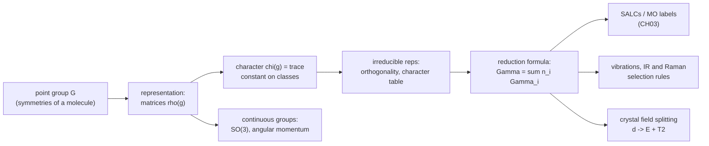

# GT10 · Symmetry, Representations and Characters

◀ [[GT09 Transfer and Normal p-Complements]] · [[Group Theory - Course Map|Course Map]]

> [!info] Source and approach
> No source in the repository (K–S excludes representation theory); a bridge to the places where groups are used in this vault. All tables and reductions are computed in `scripts/gt_numbers.py`.

> [!tip] Start here (first read)
> - **The picture.** A **representation** turns each symmetry into a matrix acting on something physical (the three H orbitals of NH$_3$, the vibrations of H$_2$O, the five $d$ orbitals). The **character** (the trace of each matrix, one number per type of symmetry) is enough to split that something into independent, irreducible pieces that never mix; those pieces are what chemists label $a_1,e,t_{2g}$ and physicists call degenerate multiplets.
> - **What you need.** Linear algebra (matrix, trace, eigenvalues) and the groups of [[GT01 Groups Subgroups and Cosets]]–[[GT05 Actions Conjugation and Sylow Theorems]] ($S_3$, $D_4$, conjugacy classes).
> - **How to read.** §1 (point groups) and §3 (a worked NH$_3$ example) are the best entry points; the orthogonality relations of §2 are *stated* and checked by computer rather than proved, since the repository has no source for representation theory proper.

> [!key] After this chapter you can
> - describe a **representation** (a homomorphism $G\to GL(V)$) and its **character** $\chi(g)=\operatorname{tr}\rho(g)$, a function constant on conjugacy classes,
> - state the **orthogonality relations** and use the **reduction formula** $n_\Gamma=\frac1{|G|}\sum_C|C|\,\chi(C)\chi_\Gamma(C)$,
> - read the character tables of $C_{3v}$, $C_{2v}$ and $O$ and know what $A_1,A_2,E,T_1,T_2$ mean,
> - do a **vibrational analysis** (NH$_3$: $2A_1+2E$; H$_2$O: $2A_1+B_2$), build **SALCs** (NH$_3$ H 1s: $A_1+E$), and split **d orbitals** in an octahedral field ($E+T_2$),
> - connect continuous symmetry: the rotation characters $\chi_\ell(\theta)=\sin((\ell+\tfrac12)\theta)/\sin(\theta/2)$ and why $\ell$ multiplets are irreps of $SO(3)$.

> [!intuition] The one-sentence story
> A symmetry acts on every object living on a molecule (orbitals, vibrations, wavefunctions) as a matrix; the traces of those matrices, one number per class of symmetry operation, are enough to decompose any such object into a few irreducible, independent "pieces" that never mix, which is why they label orbital energies and decide what is IR active.

![[GT10 Representations Map.svg]]
*Diagram GT10.0. The chapter in one page. Editable source: [[GT10 Representations Map.excalidraw]].*

*Concept map.*

## 1. Point groups: the symmetry groups of molecules
A **point group** is the group of rigid motions (rotations $C_n$, reflections $\sigma$, inversion $i$, improper rotations $S_n$) that fix at least one point of the molecule and map it onto itself. It is a finite group, so everything in [[GT01 Groups Subgroups and Cosets]]–[[GT05 Actions Conjugation and Sylow Theorems]] applies.

| molecule | point group | order | as an abstract group |
|---|---|---|---|
| H$_2$O | $C_{2v}$ | 4 | $V_4\cong\mathbb Z_2\times\mathbb Z_2$ |
| NH$_3$ | $C_{3v}$ | 6 | $S_3$ (permutations of the 3 H atoms) |
| BF$_3$, CO$_3^{2-}$ | $D_{3h}$ | 12 | $S_3\times\mathbb Z_2$ |
| CH$_4$ | $T_d$ | 24 | $S_4$ (permutations of the 4 H atoms) |
| SF$_6$, octahedral complexes | $O_h$ | 48 | $S_4\times\mathbb Z_2$ |

> [!example] Ammonia is $S_3$
> The three H atoms can be permuted in $3!=6$ ways by rotations about the $C_3$ axis (the 3-cycles, forming the class $2C_3$) and by the three mirror planes $\sigma_v$ (the transpositions, class $3\sigma_v$), plus the identity: the classes of $C_{3v}$ **are** the classes of $S_3$ (sizes $1,2,3$; cf. [[GT05 Actions Conjugation and Sylow Theorems]]).

![[fig_gt04_c3v.png]]
*Figure GT10.1. Left: NH$_3$ seen down the $C_3$ axis (N above the H$_3$ triangle; three mirror planes, dashed). Right: the character table of $C_{3v}$ as a heat map; the class sizes are $1,2,3$ and the rows are orthogonal with the class-size weighting.*

## 2. Representations and characters
> [!key] Definitions
> A **representation** of $G$ on a vector space $V$ is a homomorphism $\rho:G\to GL(V)$; $\dim V$ is its **dimension**. $V$ is **reducible** if it has a proper subspace invariant under all $\rho(g)$, **irreducible** otherwise. The **character** is $\chi_V(g)=\operatorname{tr}\rho(g)$. Facts used throughout (for finite groups over $\mathbb C$):
> 1. **$\chi$ is a class function:** $\chi(hgh^{-1})=\chi(g)$ because $\operatorname{tr}(AB)=\operatorname{tr}(BA)$. So a character table has one column per **conjugacy class**.
> 2. $\chi(1)=\dim V$.
> 3. **Maschke:** every representation is a direct sum of irreps.
> 4. **Number of irreps = number of classes**, and $\sum_i(\dim\Gamma_i)^2=|G|$.

> [!derivation] Orthogonality (stated; verified here for $C_{3v}$ and $O$)
> For irreps $\Gamma_i,\Gamma_j$ and classes $C$ of size $|C|$:
> $$\frac1{|G|}\sum_C|C|\,\chi_i(C)^*\chi_j(C)=\delta_{ij}\quad\text{(rows)},\qquad \sum_i\chi_i(C)^*\chi_i(C')=\frac{|G|}{|C|}\,\delta_{CC'}\quad\text{(columns)}.$$
> **Check ($C_{3v}$, `gt_numbers.py`):** with rows $A_1=(1,1,1)$, $A_2=(1,1,-1)$, $E=(2,-1,0)$ over the classes $E,2C_3,3\sigma_v$ of sizes $1,2,3$, the weighted row products give $6\,\delta_{ij}$ and the column products give $\mathrm{diag}(6,3,2)=|G|/|C|$. **Dimension check:** $1^2+1^2+2^2=6=|G|$ and 3 irreps for 3 classes.

> [!derivation] Reduction formula
> A representation $\Gamma$ with character $\chi$ contains the irrep $\Gamma_i$ exactly
> $$n_i=\frac1{|G|}\sum_C|C|\,\chi_i(C)^*\chi(C)$$
> times. *Proof.* $\chi=\sum_jn_j\chi_j$ (Maschke); take the inner product with $\chi_i$ and use row orthogonality. ∎ This is the single most-used tool: write down the character of the (reducible) object from "how many things stay put", then reduce.

## 3. Worked example 1: the H 1s orbitals of NH$_3$ (SALCs)
*compare [[CH03 Molecular Orbital Theory Polyatomics]], [[Ligand Group Orbitals]]*

Take the three H 1s orbitals as a basis. $\chi(R)$ = **number of orbitals left unmoved** by $R$ (an orbital swapped with another contributes 0 to the trace): $\chi(E)=3$, $\chi(C_3)=0$, $\chi(\sigma_v)=1$ (the H on the mirror plane stays).

$$n_{A_1}=\tfrac16(1\cdot3\cdot1+2\cdot0\cdot1+3\cdot1\cdot1)=1,\quad n_{A_2}=\tfrac16(3+0-3)=0,\quad n_E=\tfrac16(1\cdot3\cdot2+0+0)=1.$$

So $\Gamma(\mathrm H\,1s)=A_1+E$ (computed: `[1, 0, 1]`). The $A_1$ combination is $\tfrac1{\sqrt3}(\phi_1+\phi_2+\phi_3)$; $E$ is the two-fold degenerate pair $\tfrac1{\sqrt6}(2\phi_1-\phi_2-\phi_3)$, $\tfrac1{\sqrt2}(\phi_2-\phi_3)$. The N orbitals transform as $2s$: $A_1$; $2p_z$: $A_1$; $(2p_x,2p_y)$: $E$. Symmetry therefore allows N 2s/$2p_z$ to mix with the H $A_1$ SALC and $(2p_x,2p_y)$ with the H $E$ SALC, and nothing else: the MO diagram of CH03 follows. A lone pair on N is the leftover $A_1$.

## 4. Worked example 2: vibrations, IR and Raman
> [!derivation] Recipe
> 1. $\Gamma_{3N}$: $\chi(R)=(\text{number of atoms unmoved by }R)\times(\text{character of }R\text{ on a vector})$, where a rotation by $\theta$ contributes $1+2\cos\theta$ (proper) or $-1+2\cos\theta$ (improper), the identity $3$, a mirror $1$, inversion $-3$.
> 2. $\Gamma_{vib}=\Gamma_{3N}-\Gamma_{trans}-\Gamma_{rot}$; $\Gamma_{trans}$ transforms like $(x,y,z)$, $\Gamma_{rot}$ like $(R_x,R_y,R_z)$ (read from the table).
> 3. **IR-active** modes transform like $x,y$ or $z$ (a changing dipole); **Raman-active** ones like a quadratic ($x^2,xy,\dots$).

> [!example] NH$_3$ ($C_{3v}$, $N=4$)
> $\chi_{3N}(E,C_3,\sigma_v)=(12,0,2)$ [$4\cdot3$; one atom (N) with $1+2\cos120^\circ=0$; N and one H, each with 1]. Reduction gives $\Gamma_{3N}=3A_1+A_2+4E$ (dimension $3+1+8=12$ ✓). $\Gamma_{trans}=A_1+E$, $\Gamma_{rot}=A_2+E$, so $$\Gamma_{vib}=2A_1+2E,$$ six modes ($3N-6$) and **four distinct frequencies**; every $A_1$ and $E$ mode transforms like $z$ or $(x,y)$, so **all four are IR active** (and Raman active), as observed for ammonia (the "umbrella" mode is an $A_1$).

> [!example] H$_2$O ($C_{2v}$, molecule in the $yz$ plane)
> $\chi_{3N}(E,C_2,\sigma_{xz},\sigma_{yz})=(9,-1,1,3)$, reduction gives $\Gamma_{vib}=2A_1+B_2$: the symmetric stretch and the bend are $A_1$, the antisymmetric stretch is $B_2$ (label depends on the plane convention); all three are IR active.

![[fig_gt04_reduce.png]]
*Figure GT10.2. Reduction of $\Gamma(\mathrm H\,1s)$, $\Gamma_{3N}$, $\Gamma_{trans}$, $\Gamma_{rot}$ and $\Gamma_{vib}$ of NH$_3$ into $A_1,A_2,E$. Computed from the character table; the bar heights are the multiplicities $n_\Gamma$.*

> [!pitfall] Traps in vibrational counting
> 1. **Linear molecules** have $3N-5$ vibrations, not $3N-6$ (only two rotations).
> 2. **"IR active" and "Raman active" are different tables:** a mode can be silent in one and active in the other; in a molecule with an inversion centre (rule of mutual exclusion) a mode cannot be both ([[CL07 Optical Properties of the Atmosphere]]: why CO$_2$'s bend absorbs while the symmetric stretch does not).
> 3. **Count unmoved atoms,** not unmoved orbitals, for $\Gamma_{3N}$: the character of a vector on an atom is the trace of the $3\times3$ rotation matrix.

## 5. Worked example 3: octahedral crystal field
The rotation group $O$ of the octahedron has classes $E,8C_3,6C_4,3C_2(=C_4^2),6C_2'$ (sizes $1,8,6,3,6$; $|O|=24\cong S_4$) and five irreps $A_1,A_2,E,T_1,T_2$ with dimensions $1,1,2,3,3$ ($1+1+4+9+9=24$ ✓). A set of functions with angular momentum $\ell$ has rotation character

$$\chi_\ell(\theta)=\sum_{m=-\ell}^{\ell}e^{im\theta}=\frac{\sin\big((\ell+\tfrac12)\theta\big)}{\sin(\theta/2)},\qquad\chi_\ell(0)=2\ell+1.$$

Evaluating at $\theta=0,\tfrac{2\pi}3,\tfrac\pi2,\pi,\pi$ and reducing (computed, orthogonality of $O$ checked first):

| orbital set | $\ell$ | reduction in $O$ |
|---|---|---|
| s | 0 | $A_1$ |
| p | 1 | $T_1$ |
| **d** | 2 | $\mathbf{E+T_2}$ |
| f | 3 | $A_2+T_1+T_2$ |

So the five d orbitals split into a two-fold ($e_g$: $d_{z^2},d_{x^2-y^2}$) and a three-fold ($t_{2g}$: $d_{xy},d_{xz},d_{yz}$) level in an octahedral complex: **ligand-field splitting follows from symmetry alone**; the *size* of the splitting (10 Dq) does not. The $g$ subscript (even under inversion) comes from $O_h=O\times\{1,i\}$.

## 6. Continuous symmetry: the bridge to Lie groups and quantum mechanics
*compare [[maps/courses/mt3184-differential-geometry-and-lie-groups|MT3184]], [[one-parameter-subgroup]]*

> [!key] Same ideas, infinitely many symmetries
> The rotation group $SO(3)$ is a **Lie group**: a group that is also a manifold, whose product and inverse are smooth. Its irreps are the $(2\ell+1)$-dimensional spaces spanned by the spherical harmonics $Y_\ell^m$; the character $\chi_\ell(\theta)$ above is the trace of rotation by $\theta$ on that space, and the **reduction of $\chi_\ell$ in a finite subgroup** (the table in §5) is exactly the "breaking of rotational symmetry to a lattice symmetry" that splits a free-atom level in a crystal. The **one-parameter subgroups** $t\mapsto\exp(tL_z)$ of the MT3184 lectures are the rotations about an axis; their generators are the angular-momentum operators of [[Quantum Mechanics - Course Map]], and "$[L_x,L_y]=i\hbar L_z$" is the Lie algebra of $SO(3)$.

> [!example] What the finite and continuous pictures share
> Selection rules: an integral $\int\psi_a\,\hat O\,\psi_b$ is non-zero only if $\Gamma_a\otimes\Gamma_O\otimes\Gamma_b$ contains the totally symmetric irrep (for $SO(3)$ this is $\Delta\ell=\pm1$ for a dipole). The product of irreps is a reducible rep, to be reduced with the same formula.

## 7. Summary and practice
> [!summary] Cheat-sheet
> | Idea | Formula |
> |---|---|
> | character | $\chi(g)=\operatorname{tr}\rho(g)$, constant on classes, $\chi(1)=\dim$ |
> | irreps | #irreps = #classes, $\sum(\dim)^2=\lvert G\rvert$ |
> | orthogonality | $\frac1{\lvert G\rvert}\sum_C\lvert C\rvert\chi_i\chi_j=\delta_{ij}$ |
> | reduction | $n_i=\frac1{\lvert G\rvert}\sum_C\lvert C\rvert\chi_i\chi$ |
> | NH$_3$ | H 1s: $A_1+E$; $\Gamma_{vib}=2A_1+2E$ |
> | H$_2$O | $\Gamma_{vib}=2A_1+B_2$ |
> | d in $O_h$ | $E_g+T_{2g}$ |
> | $SO(3)$ | $\chi_\ell(\theta)=\sin((\ell+\frac12)\theta)/\sin(\theta/2)$ |

> [!example]- Practice (with answers)
> 1. **Show $C_{3v}$ has 3 irreps** and find the missing dimension of $E$. *Answer:* 3 classes $\Rightarrow$ 3 irreps; $1+1+d^2=6\Rightarrow d=2$.
> 2. **Reduce** the three $p_z$ orbitals on the H atoms of NH$_3$ (all parallel to the $C_3$ axis). *Answer:* each is unmoved or swapped like the s orbital and is even under $\sigma_v$, so the characters are $(3,0,1)$ again: $A_1+E$.
> 3. **Reduce** the six $\sigma$-donor orbitals of an octahedral ML$_6$ in $O$. *Answer:* characters $(6,0,2,2,0)$ over $(E,8C_3,6C_4,3C_2,6C_2')$; $n_{A_1}=\frac1{24}(6+0+12+6+0)=1$, $n_E=\frac1{24}(12+0+0+12+0)=1$, $n_{T_1}=\frac1{24}(18+0+12-6+0)=1$: $\Gamma_\sigma=A_1+E+T_1$ (hence $a_{1g}+e_g+t_{1u}$ in $O_h$).
> 4. **Why can't an $A_2$ mode of NH$_3$ be IR active?** *Answer:* it transforms like $R_z$, not like $x,y,z$.
> 5. **Show** the sum $\sum_i(\dim\Gamma_i)^2=|G|$ holds for $O$. *Answer:* $1+1+4+9+9=24$.
> 6. **Compute** $\chi_2(\pi/2)$. *Answer:* $\sin(5\pi/4)/\sin(\pi/4)=-1$ ($d$ under $C_4$).

> [!connection] Fourier transform as characters
> The DFT matrix is the character table of $\mathbb Z_N$: [[Fourier and Laplace Transforms]] §5.5.

## Map of this chapter
> [!connection] How GT10 connects
> **Builds on:** [[GT05 Actions Conjugation and Sylow Theorems]] (conjugacy classes label character-table columns), [[GT02 Homomorphisms Normal Subgroups and Quotients]] (a representation is a homomorphism). **Used by:** [[CH03 Molecular Orbital Theory Polyatomics]] and [[Ligand Group Orbitals]] (SALCs), [[Symmetry Labels a b e t]], [[Quantum Mechanics - Course Map]] (angular momentum, selection rules).
> **Other subjects:** [[CL07 Optical Properties of the Atmosphere]] (infrared activity of CO$_2$, H$_2$O).
> **Concept notes:** [[Point Group]] · [[Representation of a Group]] · [[Character of a Representation]] · [[Irreducible Representation]] · [[Character Table]] · [[Reduction Formula]]

## Provenance
> [!provenance]- Source map for this chapter
> | Topic | Source | Origin |
> |---|---|---|
> | all content | my own write-up of standard representation theory; tables and reductions computed in `scripts/gt_numbers.py`, figures `scripts/fig_gt.py` | mine |
> | link to MO theory | [[CH03 Molecular Orbital Theory Polyatomics]], [[Ligand Group Orbitals]] (these vault notes) | cross-reference |
> | Lie groups | MT3184 notes written by another tool (`mt3184-differential-geometry-and-lie-groups/`), only referenced | cross-reference |
>
> **Flags.** (1) Character tables for $C_{3v}$, $C_{2v}$ and $O$ are standard but were not copied from a source in the repository; they pass the orthogonality and dimension checks. (2) Practice 3's $O$-characters of the six $\sigma$ orbitals ($6,0,2,2,0$) are from the geometry (6 unmoved on $E$; 2 on $C_4$; 2 on $C_2=C_4^2$; 0 on $C_3$ and $C_2'$): re-derive before an exam. (3) The sentence about the AI-written MOT notes records that they were not read.
