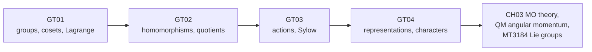

# Group Theory - Course Map

> [!summary] Where this subject stands
> **No lecture course exists for finite groups in this repository**, so nothing here is "taught"; the chapters follow the one book in the repository (Kurzweil and Stellmacher, ch. 1–4) and add a bridge to the places the vault *uses* groups. **GT01–GT04 are drafted** with proofs, brute-force checks (`scripts/gt_numbers.py`), seven figures (`scripts/fig_gt.py`), concept maps and 29 concept notes. Symmetry underlies molecular orbitals, vibrational selection rules (why CO₂ absorbs infrared) and quantum angular momentum.

![[GT01 Groups Map.svg]]

## Chapters
| # | Chapter | Content | Scope | Source |
|---|---|---|---|---|
| 01 | [[GT01 Groups Subgroups and Cosets]] | axioms, subgroup test, product formula, Lagrange | extra · book + beyond | K–S §1.1 |
| 02 | [[GT02 Homomorphisms Normal Subgroups and Quotients]] | homomorphism and isomorphism theorems, $G/Z$, commutators, cyclic and Abelian groups, simple groups | extra · book + beyond | K–S §1.2–1.8, 2.1 |
| 03 | [[GT03 Actions Conjugation and Sylow Theorems]] | orbit–stabiliser, class equation, Burnside, Cauchy, Sylow, $S_n$, $A_5$ simple | extra · book + beyond | K–S §3.1–3.2, 4.3 |
| 04 | [[GT04 Symmetry Representations and Characters]] | point groups, characters, reduction, NH₃/H₂O vibrations, octahedral d splitting, $SO(3)$ | extra · beyond | my write-up |

## Reading order

## Concept notes (29)
GT01: [[Group]] · [[Subgroup]] · [[Coset]] · [[Lagrange's Theorem]] · [[Cyclic Group]] · [[Dihedral Group]] · [[Symmetric Group]]
GT02: [[Homomorphism]] · [[Kernel and Image]] · [[Normal Subgroup]] · [[Quotient Group]] · [[Isomorphism Theorems]] · [[Commutator Subgroup]] · [[Simple Group]] · [[Direct Product of Groups]]
GT03: [[Group Action]] · [[Orbit-Stabiliser Theorem]] · [[Conjugacy Class]] · [[Class Equation]] · [[Burnside's Lemma]] · [[Cauchy's Theorem]] · [[Sylow Theorems]] · [[Alternating Group]]
GT04: [[Point Group]] · [[Representation of a Group]] · [[Character of a Representation]] · [[Irreducible Representation]] · [[Character Table]] · [[Reduction Formula]]

## Sources
| Source | Location | Used in |
|---|---|---|
| H. Kurzweil, B. Stellmacher, *The Theory of Finite Groups: An Introduction* (Springer, 2004; 400 pp., PDF page = printed page + 13) | `math/group-theory/books/` | GT01–GT03 |
| MOT group-theory notes (AI-written, **not read**) | `chemistry/inorganic-chemistry/ai-gen-notes/inorganicchemmaster/mot-group-theory-full.pdf` | to compare with GT04 |
| MT3184 Differential Geometry and Lie Groups lecture notes (other tool; **only referenced**) | `mt3184-differential-geometry-and-lie-groups/`, [[maps/courses/mt3184-differential-geometry-and-lie-groups\|course map]] | GT04 §6 |
| stray note `inbox/one-parameter-subgroup.md` | `inbox/` | linked from GT04 §6 |

## Gaps and to-do
- [ ] **No lectures:** if a group-theory or representation-theory course is added, restructure around it and mark the matching parts 🟢 taught.
- [ ] K–S ch. 4.1–4.2 (transitive, Frobenius, primitive groups), ch. 5 ($p$-groups, nilpotent), ch. 6 (solvable, Schur–Zassenhaus), ch. 7 (transfer) not written; ch. 8–12 (action on groups, signalizer functors, $N$-groups) are research-level and out of scope.
- [ ] Representation theory proper (Schur's lemma, proofs of orthogonality, the regular representation) is only stated in GT04; no source for it in the repository.
- [ ] Lie groups and Lie algebras: write after reading the MT3184 notes in full; connect $SO(3)$, $SU(2)$ and angular momentum.
- [ ] Compare GT04 with the MOT notes (read them) and with the character tables used in the CH02–CH03 chapters.
- [ ] Exercises from K–S are not worked; the practice problems here are my own.

## Connections
[[Inorganic Chemistry - Course Map]] · [[Quantum Mechanics - Course Map]] · [[CL07 Optical Properties of the Atmosphere]] · [[Proofs, Analysis and Topology - Course Map]] · [[Probability - Course Map]]

See [[Subject Map]] for how this subject relates to the others and [[Roadmap]] for its place in the plan.
