# Group Theory - Course Map

> [!summary] Where this subject stands
> There is **no lecture course** for finite groups in this repository, so the subject follows the one book (Kurzweil and Stellmacher, *The Theory of Finite Groups*, chapters 1–7) in a connected order, written for a 2nd–3rd year reader and keeping the proofs: every chapter has a "start here" box for beginners, a plain-words box before each proof, a concept map, practice problems with answers, a list of where the ideas are **used in other subjects**, and numbers checked by computer (`scripts/gt_numbers.py`, `scripts/gt_numbers2.py`). **GT01–GT10 and three advanced guides are drafted.** Where groups are used elsewhere in the vault: [[Where Groups Appear in the Vault]].

![[GT01 Groups Map.svg]]

## Chapters in reading order
| # | Chapter | Content | K–S |
|---|---|---|---|
| **I. Foundations** | | | |
| 01 | [[GT01 Groups Subgroups and Cosets]] | axioms, subgroup test, product formula, cosets, Lagrange | §1.1 |
| 02 | [[GT02 Homomorphisms Normal Subgroups and Quotients]] | homomorphism and isomorphism theorems, $G/Z$, previews of cyclic/commutator/product ideas | §1.2–1.3 |
| **II. Structure** | | | |
| 03 | [[GT03 Cyclic and Abelian Groups and Direct Products]] | cyclic groups, direct products, structure theorem of Abelian groups (full proof), $\operatorname{Aut}(C_n)$ | §1.4, 1.6, 2.1, 2.2 |
| 04 | [[GT04 Commutators Simple Groups and Composition Series]] | commutators, simple groups, minimal normal subgroups, Jordan–Hölder (full proof) | §1.5, 1.7, 1.8 |
| **III. Actions** | | | |
| 05 | [[GT05 Actions Conjugation and Sylow Theorems]] | orbit–stabiliser, class equation, Burnside, Cauchy, Sylow (full proofs), $A_5$ simple | §3.1, 3.2, 4.3 |
| 06 | [[GT06 Permutation Groups]] | transitivity, primitivity, Frobenius groups, $A_n$ simple (full proof), wreath products | §4.1–4.4 |
| **IV. Decomposition** | | | |
| 07 | [[GT07 p-Groups and Nilpotent Groups]] | nilpotent groups (five-way characterisation), Frattini, groups of order 8 | §5.1–5.3 |
| 08 | [[GT08 Solvable Groups and Complements]] | solvable groups, semidirect products, Schur–Zassenhaus (Abelian case), subnormal subgroups | §6.1, 6.2, 6.7, 3.3 |
| 09 | [[GT09 Transfer and Normal p-Complements]] | transfer, Burnside's normal $p$-complement theorem (full proof), Cayley's criterion | §7.1, 7.2 |
| **V. Bridge** | | | |
| 10 | [[GT10 Symmetry Representations and Characters]] | point groups, characters, reduction formula, vibrations, crystal-field splitting, $SO(3)$ | none (K–S excludes it) |
| **Advanced** (folder `Advanced/`, [[Advanced Group Theory]]) | | | |
| A1 | [[GT-A1 Radical Residue and Hall Subgroups]] | $O_p(G)$, Hall's theorem for solvable groups | §6.3–6.4 |
| A2 | [[GT-A2 Components and the Generalised Fitting Subgroup]] | $F^*(G)$, $C_G(F)\le F$ (solvable case) | §6.5 |
| A3 | [[GT-A3 Primitive Maximal Subgroups]] | cores, primitive and affine groups | §6.6 |

## Reading order

```mermaid
flowchart LR
  A["GT01 groups, cosets"] --> B["GT02 homomorphisms,<br/>quotients"]
  B --> C["GT03 cyclic, Abelian,<br/>products"]
  C --> D["GT04 commutators,<br/>simple, Jordan-Holder"]
  D --> E["GT05 actions, Sylow"]
  E --> F["GT06 permutation groups"]
  F --> G["GT07 nilpotent,<br/>p-groups"]
  G --> H["GT08 solvable,<br/>semidirect products"]
  H --> I["GT09 transfer,<br/>normal p-complements"]
  E --> J["GT10 representations,<br/>characters"]
  I --> J
  J --> K["CH03 MO theory, QM,<br/>Lie groups (MT3184)"]
```

## Concept notes (66)
**Basics:** [[Group]] · [[Subgroup]] · [[Coset]] · [[Lagrange's Theorem]] · [[Cyclic Group]] · [[Dihedral Group]] · [[Symmetric Group]] · [[Alternating Group]] · [[Quaternion Group]]
**Maps and quotients:** [[Homomorphism]] · [[Kernel and Image]] · [[Normal Subgroup]] · [[Quotient Group]] · [[Isomorphism Theorems]] · [[Automorphism Group]] · [[Direct Product of Groups]]
**Abelian groups:** [[Structure Theorem of Finite Abelian Groups]] · [[Euler Totient Function]] · [[Primitive Root]]
**Simple groups and series:** [[Commutator Subgroup]] · [[Perfect Group]] · [[Simple Group]] · [[Minimal Normal Subgroup]] · [[Composition Series]] · [[Jordan-Holder Theorem]]
**Actions and counting:** [[Group Action]] · [[Orbit-Stabiliser Theorem]] · [[Conjugacy Class]] · [[Class Equation]] · [[Burnside's Lemma]] · [[Cauchy's Theorem]] · [[Sylow Theorems]]
**Permutation groups:** [[Transitive Action]] · [[k-Transitive Action]] · [[Primitive Action and Blocks]] · [[Frobenius Group]] · [[Wreath Product]]
**Nilpotent and solvable:** [[Nilpotent Group]] · [[Upper Central Series]] · [[Frattini Subgroup]] · [[Burnside Basis Theorem]] · [[Fitting Subgroup]] · [[Heisenberg Group]] · [[Solvable Group]] · [[Derived Series]] · [[Semidirect Product]] · [[Complement of a Normal Subgroup]] · [[Schur-Zassenhaus Theorem]] · [[Subnormal Subgroup]] · [[Extension Problem]]
**Transfer:** [[Transfer Homomorphism]] · [[Normal p-Complement]] · [[Burnside Normal p-Complement Theorem]] · [[Burnside Fusion Lemma]]
**Advanced:** [[Radical of a Group]] · [[Hall Subgroup]] · [[Quasisimple Group]] · [[Generalised Fitting Subgroup]] · [[Core of a Subgroup]] · [[Affine Group]]
**Representations:** [[Point Group]] · [[Representation of a Group]] · [[Character of a Representation]] · [[Irreducible Representation]] · [[Character Table]] · [[Reduction Formula]]

## Sources
| Source | Location | Used in |
|---|---|---|
| H. Kurzweil, B. Stellmacher, *The Theory of Finite Groups: An Introduction* (Springer, 2004; 400 pp.; PDF page = printed page + 13) | `math/group-theory/books/` | GT01–GT09, Advanced (the TOC, the notation list and the theorem labels of ch. 1–4 were read; chapters 4–7 and the advanced sections only by title, so their statements are the standard ones, not a transcription) |
| MOT group-theory notes (AI-written, **not read**) | `chemistry/inorganic-chemistry/ai-gen-notes/inorganicchemmaster/mot-group-theory-full.pdf` | to compare with GT10 |
| MT3184 Differential Geometry and Lie Groups lecture notes (other tool; **only referenced**) | `mt3184-differential-geometry-and-lie-groups/`, [[maps/courses/mt3184-differential-geometry-and-lie-groups\|course map]]; written up in [[Differential Geometry - Course Map]] | GT10 §6 |
| stray note `inbox/one-parameter-subgroup.md` | `inbox/` | linked from GT10 §6 |

## Gaps and to-do
- [ ] **No lectures:** if a group-theory course is added, restructure around it.
- [ ] K–S chapters 4–7 and §6.3–6.6 were not read in the book itself; compare each chapter with the book and upgrade the "(by title)" provenance rows.
- [ ] Not written: K–S ch. 8–12 (action on groups, signalizer functors, $N$-groups: research-level).
- [ ] Representation theory proper (Schur's lemma, proofs of orthogonality, regular representation, induced representations) is only stated in GT10; no source in the repository.
- [ ] Lie groups and Lie algebras: write after reading the MT3184 notes in full ($SO(3)$, $SU(2)$, angular momentum). *(Done as a separate vault, 2026-11-02: see [[Differential Geometry - Course Map]].)*
- [ ] Compare GT10 with the MOT notes and the character tables of CH02–CH03.
- [ ] Exercises from K–S are not worked; the practice problems are my own.
- [ ] Optional: the old figures `GT03 Actions Map.svg` and `GT04 Representations Map.svg` in `Assets/figures/` are orphaned by the renumbering (the new maps are `GT05 Actions Map.svg`, `GT10 Representations Map.svg`).

## Connections
[[Where Groups Appear in the Vault]] · [[Inorganic Chemistry - Course Map]] · [[Quantum Mechanics - Course Map]] · [[CL07 Optical Properties of the Atmosphere]] · [[Proofs, Analysis and Topology - Course Map]] · [[Probability - Course Map]] · [[Fourier and Laplace Transforms]]

See [[Subject Map]] for how this subject relates to the others and [[Roadmap]] for its place in the plan.

<!-- graph-spine:start (generated by scripts/graph_spine.py; do not edit between the markers) -->
## Atlas: every note in this subject
The graph view draws only real links, so this block links **every** note of the subject (the map is the hub of its cluster; [[Home]] is the hub of all maps).

> [!abstract]- Atlas (generated): 13 chapters · 66 concept notes · 2 other notes in the vault
> **Chapters (13):** [[GT-A1 Radical Residue and Hall Subgroups]] · [[GT-A2 Components and the Generalised Fitting Subgroup]] · [[GT-A3 Primitive Maximal Subgroups]] · [[GT01 Groups Subgroups and Cosets]] · [[GT02 Homomorphisms Normal Subgroups and Quotients]] · [[GT03 Cyclic and Abelian Groups and Direct Products]] · [[GT04 Commutators Simple Groups and Composition Series]] · [[GT05 Actions Conjugation and Sylow Theorems]] · [[GT06 Permutation Groups]] · [[GT07 p-Groups and Nilpotent Groups]] · [[GT08 Solvable Groups and Complements]] · [[GT09 Transfer and Normal p-Complements]] · [[GT10 Symmetry Representations and Characters]]
>
> **Concept notes (66):** [[Affine Group]] · [[Alternating Group]] · [[Automorphism Group]] · [[Burnside Basis Theorem]] · [[Burnside Fusion Lemma]] · [[Burnside Normal p-Complement Theorem]] · [[Burnside's Lemma]] · [[Cauchy's Theorem]] · [[Character of a Representation]] · [[Character Table]] · [[Class Equation]] · [[Commutator Subgroup]] · [[Complement of a Normal Subgroup]] · [[Composition Series]] · [[Conjugacy Class]] · [[Core of a Subgroup]] · [[Coset]] · [[Cyclic Group]] · [[Derived Series]] · [[Dihedral Group]] · [[Direct Product of Groups]] · [[Euler Totient Function]] · [[Extension Problem]] · [[Fitting Subgroup]] · [[Frattini Subgroup]] · [[Frobenius Group]] · [[Generalised Fitting Subgroup]] · [[Group Action]] · [[Group]] · [[Hall Subgroup]] · [[Heisenberg Group]] · [[Homomorphism]] · [[Irreducible Representation]] · [[Isomorphism Theorems]] · [[Jordan-Holder Theorem]] · [[k-Transitive Action]] · [[Kernel and Image]] · [[Lagrange's Theorem]] · [[Minimal Normal Subgroup]] · [[Nilpotent Group]] · [[Normal p-Complement]] · [[Normal Subgroup]] · [[Orbit-Stabiliser Theorem]] · [[Perfect Group]] · [[Point Group]] · [[Primitive Action and Blocks]] · [[Primitive Root]] · [[Quasisimple Group]] · [[Quaternion Group]] · [[Quotient Group]] · [[Radical of a Group]] · [[Reduction Formula]] · [[Representation of a Group]] · [[Schur-Zassenhaus Theorem]] · [[Semidirect Product]] · [[Simple Group]] · [[Solvable Group]] · [[Structure Theorem of Finite Abelian Groups]] · [[Subgroup]] · [[Subnormal Subgroup]] · [[Sylow Theorems]] · [[Symmetric Group]] · [[Transfer Homomorphism]] · [[Transitive Action]] · [[Upper Central Series]] · [[Wreath Product]]
>
> **Other notes in the vault (2):** [[Advanced Group Theory]] · [[Where Groups Appear in the Vault]]
<!-- graph-spine:end -->
