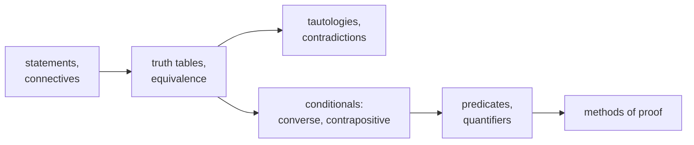

# PA01 · Logic and Methods of Proof

◀ [[Proofs, Analysis and Topology - Course Map|Course Map]] · [[PA02 Sets Families and the ZFC Foundations]] ▶

taught · in syllabus extra · book extra · beyond

> [!syllabus] Syllabus map: what is in the syllabus and what is extra in this chapter
> 🟢 **In syllabus (taught)**: [[Assignment-prems_merged.pdf#page=7|Assignment 1]] (statements, truth tables, equivalences, tautologies; PDF p.7–8), [[Assignment-prems_merged.pdf#page=5|Assignment 2]] (conditionals, quantifiers, negation; PDF p.5–6) and the instructor's one-page note [[Tautology.pdf|True Statements versus Tautologies]].
> - §1–§3 statements, connectives, truth tables, logical equivalence, tautology, contradiction, contingency
> - §4 true statement versus tautology
> - §5 conditionals in words (if, only if, sufficient, necessary), converse, contrapositive, negation
> - §6 predicates, quantifiers, negation of quantified statements, order of quantifiers
> - §7 the prime-number questions (Euclid, Goldbach, twin primes)
>
> 🟡 **Extra · book** (AI notes `proofs-prems-topo.pdf` Part I, Sundstrom Ch. 1–3)
> - §8 methods of proof: direct, contrapositive, contradiction, cases, existence, counterexample
>
> 🔵 **Extra · beyond** (my additions, labelled)
> - §2 the 16 truth functions of two variables and adequacy of $\{\neg,\wedge\}$; §7 numerical checks (`scripts/pa_numbers.py`)

> [!key] After this chapter you can
> - build a **truth table** for any compound statement and decide whether two forms are **logically equivalent**,
> - classify a form as a **tautology**, **contradiction** or **contingency**, and say why a true statement need not be a tautology,
> - rewrite $P\Rightarrow Q$ in all the usual words, form its **converse** and **contrapositive**, and **negate** it,
> - **translate** a sentence into quantifiers, negate it mechanically, and explain why $\forall\exists$ differs from $\exists\forall$,
> - choose a **proof strategy** from the logical form of the goal.

> [!intuition] The one-sentence story
> Mathematics is written in a small precise dialect of English; logic is the grammar of that dialect, and the first job of a proof is to read the statement correctly (what is assumed, what is claimed, and what its negation would say).

<!-- intuition-v1 -->

*Concept map: how the ideas of this chapter depend on each other (read left to right; every box is a section).*

## 1. Statements and connectives
taught *Assignment 1*

A **statement** is a sentence that is true or false, not both. "$2$ is an integer" and "$3<2$" are statements; "$x>0$" is not (it is a predicate, §6). Given statements $P,Q$ the connectives are

| $P$ | $Q$ | $\neg P$ | $P\wedge Q$ | $P\vee Q$ | $P\Rightarrow Q$ | $P\Leftrightarrow Q$ |
|---|---|---|---|---|---|---|
| T | T | F | T | T | T | T |
| T | F | F | F | T | F | F |
| F | T | T | F | T | T | F |
| F | F | T | F | F | T | T |

> [!key] Three conventions that cause most mistakes
> - $\vee$ is **inclusive**: $P\vee Q$ is true when both are true.
> - $P\Rightarrow Q$ is false in exactly **one** row (P true, Q false); with $P$ false it is true whatever $Q$ is (**vacuously true**).
> - $P\Leftrightarrow Q$ is true exactly when $P,Q$ have the same truth value.

Notation (Assignment 1): $=$ is for equality of mathematical **objects**; $\sim$ or $\equiv$ is for logical equivalence of **statements**.

> [!intuition] $P\Rightarrow Q$ as a promise
> "If it rains, I will bring an umbrella." The promise is broken only if it rains and I come without one. Mathematics needs this convention so that "$\forall n\,(n>5\Rightarrow n^2>25)$" is true for every $n$, including $n=3$ where the hypothesis fails.

## 2. Truth tables and logical equivalence
taught *Assignment 1, questions 1 and 3*

> [!intuition] A truth table is a logic calculator
> Two statements are the same *logically* exactly when their columns agree on every row. Checking a table replaces arguing.

Forms $\Phi,\Psi$ are **logically equivalent** ($\Phi\sim\Psi$) if they have the same truth value under every assignment. With $n$ variables there are $2^n$ rows.

> [!key] The standard laws (each checked by truth table; Assignment 1 asks for several)
> | law | statement |
> |---|---|
> | De Morgan | $\neg(P\wedge Q)\sim\neg P\vee\neg Q$; $\ \neg(P\vee Q)\sim\neg P\wedge\neg Q$ |
> | conditional | $(P\Rightarrow Q)\sim\neg P\vee Q\sim\neg(P\wedge\neg Q)$ |
> | contrapositive | $(P\Rightarrow Q)\sim(\neg Q\Rightarrow\neg P)$ |
> | biconditional | $(P\Leftrightarrow Q)\sim(P\Rightarrow Q)\wedge(Q\Rightarrow P)$ |
> | negated conditional | $\neg(P\Rightarrow Q)\sim P\wedge\neg Q$ |
> | distributive | $P\wedge(Q\vee R)\sim(P\wedge Q)\vee(P\wedge R)$; $\ P\vee(Q\wedge R)\sim(P\vee Q)\wedge(P\vee R)$ |
> | identity | $P\wedge(\text{tautology})\sim P$; $\ P\vee(\text{contradiction})\sim P$ |
> | exportation | $((P\wedge Q)\Rightarrow R)\sim(P\Rightarrow(Q\Rightarrow R))$ |

> [!example] Assignment 1 Q1(d): $(P\vee Q)\wedge(P\vee R)$
> | $P$ | $Q$ | $R$ | $P\vee Q$ | $P\vee R$ | $(P\vee Q)\wedge(P\vee R)$ |
> |---|---|---|---|---|---|
> | T | T | T | T | T | T |
> | T | T | F | T | T | T |
> | T | F | T | T | T | T |
> | T | F | F | T | T | T |
> | F | T | T | T | T | T |
> | F | T | F | T | F | F |
> | F | F | T | F | T | F |
> | F | F | F | F | F | F |
>
> The column equals $P\vee(Q\wedge R)$ (true in rows 1–5 only), the distributive law.

> [!derivation] Why $(P\Rightarrow Q)\sim\neg P\vee Q$ (Assignment 1 Q3(d))
> Both are false only when $P$ is true and $Q$ is false: $\neg P\vee Q$ is false iff $\neg P$ and $Q$ are both false, i.e. $P$ true and $Q$ false. The rows of the two columns agree, row by row.

> [!example] 🔵 How many forms are there?
> A form in $n$ variables has a truth table with $2^n$ rows and each row can carry T or F, so there are $2^{2^n}$ distinct truth functions: $4,16,256,65536$ for $n=1,\dots,4$. In two variables, starting from $P,Q$ and closing under $\neg,\wedge$ one reaches **all 16** truth functions (checked by closure), so $\{\neg,\wedge\}$ is **adequate**; closing under $\wedge,\vee$ alone gives only 4 (no negation, so only monotone functions).

## 3. Tautologies, contradictions, contingencies
taught *Assignment 1, question 4; the Tautology note*

A form is a **tautology** if true under every assignment, a **contradiction** if false under every assignment, a **contingency** otherwise.

> [!example] Assignment 1 Q4 (truth tables)
> | form | classification |
> |---|---|
> | $P\vee\neg P$ | tautology (excluded middle) |
> | $P\wedge\neg P$ | contradiction |
> | $(P\wedge Q)\Rightarrow P$ | tautology (simplification) |
> | $P\Rightarrow(P\wedge Q)$ | contingency (false when $P$ true, $Q$ false) |
> 
> Also tautologies (checked): modus ponens $(P\wedge(P\Rightarrow Q))\Rightarrow Q$ and hypothetical syllogism $((P\Rightarrow Q)\wedge(Q\Rightarrow R))\Rightarrow(P\Rightarrow R)$.

## 4. A true statement is not the same as a tautology
taught *the instructor's note [[Tautology.pdf|True Statements versus Tautologies]]*

> [!key] Form versus content
> Being a **tautology** is a property of **logical form** (true for every way of filling in the variables). Being a **true statement** depends on the mathematics.
> $0\ne1$ and $5<7$ are true, but their truth comes from the axioms of the number system, not from their form; they are **not** tautologies. $(P\wedge Q)\Rightarrow P$ is a tautology: every statement of that shape is true.
> Hence **true statement $\not\Rightarrow$ tautology**, while tautology $\Rightarrow$ true.

If $P$ is any true statement then $P$ and $0\ne1$ have the same truth value ($P\sim0\ne1$ as statements); this is "material equivalence", weaker than logical equivalence of forms.

| notion | applies to | decided by |
|---|---|---|
| true statement | a specific statement | mathematics |
| tautology | a propositional form | the truth table alone |
| logical equivalence $\sim$ | two forms | same truth table |

## 5. Conditionals in words, converse, contrapositive, negation
taught *Assignment 2, questions 1–2*

> [!intuition] 'If P then Q' is only broken by P true and Q false
> A promise is violated only if the condition holds and the result fails. So the contrapositive ($\neg Q\Rightarrow\neg P$) is equivalent, but the converse ($Q\Rightarrow P$) is a different claim.

For $P\Rightarrow Q$ the following all say the same thing: "if $P$ then $Q$"; "$Q$ if $P$"; "$P$ **only if** $Q$"; "$P$ is **sufficient** for $Q$"; "$Q$ is **necessary** for $P$". The **converse** is $Q\Rightarrow P$ (not equivalent); the **contrapositive** is $\neg Q\Rightarrow\neg P$ (equivalent).

> [!example] Assignment 2 Q1
> $P$: "$n$ is divisible by 6"; $Q$: "$n$ is divisible by 3". (a) If $n$ is divisible by 6 then $n$ is divisible by 3. (b) $n$ is divisible by 6 only if it is divisible by 3. (c) Divisibility by 6 is sufficient for divisibility by 3. (d) Divisibility by 3 is necessary for divisibility by 6. Converse: if $n$ is divisible by 3 then by 6 (**false**: $n=3$). Contrapositive: if $n$ is not divisible by 3 then it is not divisible by 6 (true, and equivalent to the original).

> [!key] Negating a conditional says exactly how it can fail
> $\neg(P\Rightarrow Q)\sim P\wedge\neg Q$. Do not write "it is not true that…".

> [!example] Assignment 2 Q2
> (a) "If $x>2$ then $x^2>4$": negation "$x>2$ and $x^2\le4$" (impossible, so the original is true). (b) "If $n$ is prime then $n$ is odd": negation "$n$ is prime and even"; $n=2$ realises it, so the original is **false**. (c) "If $ab=0$ then $a=0$ or $b=0$": negation "$ab=0$, $a\ne0$ and $b\ne0$" (impossible in $\mathbb R$; true statement).

## 6. Predicates and quantifiers
taught *Assignment 2, questions 3–8*

> [!intuition] $\forall$ is an infinite AND, $\exists$ an infinite OR
> Negating swaps them: 'not every swan is white' means 'some swan is not white'. Order of mixed quantifiers matters: $\forall x\exists y$ is weaker than $\exists y\forall x$.

A **predicate** $P(x)$ becomes a statement once $x$ is given a value in its **domain**. Quantifiers: $\forall x\,P(x)$ (for all) and $\exists x\,P(x)$ (there exists), with $\forall x\in A\,P\equiv\forall x\,(x\in A\Rightarrow P)$ and $\exists x\in A\,P\equiv\exists x\,(x\in A\wedge P)$.

> [!key] Negation rules (push the negation through)
> $$\neg\forall x\,P(x)\ \sim\ \exists x\,\neg P(x),\qquad\neg\exists x\,P(x)\ \sim\ \forall x\,\neg P(x),\qquad\neg(P\Rightarrow Q)\sim P\wedge\neg Q .$$
> To **disprove** a "for all" statement one counterexample suffices; to disprove an "exists" statement one must treat every $x$.

> [!pitfall] Order of quantifiers matters
> $A:\ \forall x\in\mathbb R\ \exists y\in\mathbb R\ (y>x)$ is **true** (take $y=x+1$). $B:\ \exists y\in\mathbb R\ \forall x\in\mathbb R\ (y>x)$ is **false** (take $x=y$). In $A$ the witness $y$ may depend on $x$; in $B$ it must work for all $x$ at once. Negations: $\neg A\sim\exists x\,\forall y\,(y\le x)$ (false); $\neg B\sim\forall y\,\exists x\,(x\ge y)$ (true).

> [!example] Assignment 2 Q3: translations
> (a) $\forall x\in\mathbb Z\ \exists y\in\mathbb Z\ (x+y=0)$. (b) $\exists q\in\mathbb Q\ (q^2=2)$ (false). (c) $\forall x\in\mathbb R\ (x^2\ne-1)$, i.e. $\neg\exists x\,(x^2=-1)$. (d) $\neg\forall x\in\mathbb R\,(x>x^2)\sim\exists x\in\mathbb R\,(x\le x^2)$; true, $x=0$.

> [!example] Assignment 2 Q5: truth values over $\mathbb R$
> | statement | true? | negation | true? |
> |---|---|---|---|
> | (a) $\forall x\,\exists y\ (x+y=0)$ | T ($y=-x$) | $\exists x\,\forall y\ (x+y\ne0)$ | F |
> | (b) $\exists y\,\forall x\ (x+y=0)$ | F | $\forall y\,\exists x\ (x+y\ne0)$ | T |
> | (c) $\forall x\,\forall y\ (x<y\vee y\le x)$ | T (trichotomy) | $\exists x\,\exists y\ (y\le x\wedge x<y)$ | F |
> | (d) $\exists x\,\exists y\ (x^2+y^2<0)$ | F | $\forall x\,\forall y\ (x^2+y^2\ge0)$ | T |

> [!example] Assignment 2 Q7: likes
> $L(x,y)$: student $x$ likes book $y$. (a) $\forall x\,\exists y\,L$ "every student likes some book"; (b) $\exists y\,\forall x\,L$ "some book is liked by every student"; (c) $\exists x\,\forall y\,\neg L$ "some student likes no book"; (d) $\forall x\,\exists y\,\neg L$ "no student likes every book". **(a) and (c) are negations of each other.** (b) and (d) are not: $\neg$(b) is "every book is disliked by some student", whereas (d) is the negation of "some student likes every book".

> [!example] Assignment 2 Q8: three negations
> (a) $\neg\forall x\in\mathbb Z\,\exists y\in\mathbb Z\,(x<y\wedge y\le x+5)\sim\exists x\in\mathbb Z\,\forall y\in\mathbb Z\,(y\le x\vee y>x+5)$: "some integer $x$ has no integer in $(x,x+5]$". **False** ($y=x+1$ works for every $x$), so the original is true.
> (b) $\neg\exists a\in\mathbb R\,\forall b\in\mathbb Z\,(b<a\Rightarrow b^2<a^2)\sim\forall a\in\mathbb R\,\exists b\in\mathbb Z\,(b<a\wedge b^2\ge a^2)$. **True**: take $b=-\lceil|a|\rceil-1$, then $b<a$ and $b^2>a^2$.
> (c) $\neg\forall m,n\in\mathbb Z\,(m\mid n\Rightarrow m\le|n|)\sim\exists m,n\,(m\mid n\wedge m>|n|)$. **True**: $m=1$, $n=0$ ($1\mid0$ and $1>0$). The original is false only because of the zero (checked: $(1,0),(2,0),(3,0)$ are counterexamples).

## 7. The prime-number questions
taught *Assignment 1, questions 6–7*

An integer $p\ge2$ is **prime** if its only divisors are 1 and $p$. (a) "Whenever $p$ is prime, $2^p-1$ is prime" is **false**: $p=11$ gives $2^{11}-1=2047=23\cdot89$. (b) "There are infinitely many primes" is **true** (Euclid: if $p_1,\dots,p_k$ were all of them, $p_1\cdots p_k+1$ has a prime factor different from each $p_i$, contradiction). (c) "Every prime ends in 1, 3, 7 or 9" is **false** ($2$ and $5$); the correct statement is that every prime other than 2 and 5 ends in 1, 3, 7 or 9, since a number ending in an even digit or 5 is divisible by 2 or by 5.

> [!note] Goldbach and twin primes
> **Goldbach:** every even integer $>2$ is a sum of two primes. **Twin prime:** there are infinitely many primes $p$ with $p+2$ prime. Both are **open**. Numerically: every even $n$ from 4 to 20,000 is a sum of two primes, and there are 8169 twin-prime pairs below $10^6$ (checked); this is evidence, not proof. Known: Goldbach has been verified by computer far beyond $10^{18}$; Zhang (2013) proved bounded gaps between primes, now reduced to 246.

## 8. Methods of proof
extra · book *AI notes Part I ch. 3; Sundstrom Ch. 3*

> [!intuition] Choose the proof by what the negation gives you
> Direct if the hypothesis hands you something to work with; contrapositive if the negated conclusion does; contradiction if assuming the opposite quickly gets absurd; induction if the claim is a list indexed by $\mathbb N$.

![[PA01 Proof Strategies by Logical Form.svg]]
*Figure PA1.1. Choosing a proof strategy from the logical form of the goal (SVG; an editable Excalidraw copy is in `Assets/excalidraw/`).*

> [!key] The principal techniques
> - **Direct proof** of $P\Rightarrow Q$: assume $P$, derive $Q$.
> - **Contrapositive**: prove $\neg Q\Rightarrow\neg P$ instead.
> - **Contradiction**: assume $\neg(\text{claim})$ and derive a statement of the form $R\wedge\neg R$.
> - **Cases** (and "without loss of generality" for symmetric cases).
> - **Existence**: exhibit a witness (constructive) or argue it cannot fail to exist (non-constructive; see Zorn's lemma in [[PA03 Relations Equivalence and Order]]).
> - **Counterexample** to refute a universal statement.
> - **Induction** for statements over $\mathbb N$ ([[PA05 Induction and the Number Systems]]).

> [!example] One proof of each kind
> *Direct:* if $m,n$ are odd, $m=2a+1$, $n=2b+1$, then $m+n=2(a+b+1)$ is even.
> *Contrapositive:* "if $n^2$ is even then $n$ is even": if $n$ is odd, $n=2a+1$, $n^2=4a^2+4a+1$ is odd.
> *Contradiction:* $\sqrt2$ is irrational. If $\sqrt2=p/q$ in lowest terms then $p^2=2q^2$, so $p$ is even (by the contrapositive above), $p=2r$, so $q^2=2r^2$ and $q$ is even, contradicting lowest terms.

> [!pitfall] Common errors
> Affirming the consequent ($P\Rightarrow Q$ and $Q$ do **not** give $P$); proving the converse instead of the statement; treating one example as a proof of a "for all"; swapping quantifiers; assuming what is to be proved.

## Map of this chapter
> [!connection] How PA01 connects
> **Builds on:** school mathematics and ordinary English.
> **Leads to:** [[PA02 Sets Families and the ZFC Foundations]] (the logic–set dictionary: $\wedge\leftrightarrow\cap$, $\vee\leftrightarrow\cup$, $\neg\leftrightarrow{}^c$, $\Rightarrow\leftrightarrow\subseteq$); [[PA05 Induction and the Number Systems]]; the $\varepsilon$–$N$ definitions of [[PA06 The Real Numbers and Sequences]] are nested quantifiers whose negations are mechanical.
> **Concepts:** [[Statement and Truth Table]] · [[Logical Equivalence]] · [[11-Proofs-Analysis-Topology/Concepts/Tautology|Tautology]] · [[Conditional Statement]] · [[Quantifiers and Their Negation]] · [[Proof Techniques]] · [[Counterexample]]
> **Other subjects:** [[Proofs, Analysis and Topology - Course Map]], [[Probability - Course Map]] ([[PR01 Counting and the Axioms of Probability]]: events behave as sets, De Morgan for events), [[Jensen Inequality]] and [[Fixed Points and Linear Stability]] (proofs by cases and contradiction recur).

## Summary
> [!summary] Cheat-sheet
> - $P\Rightarrow Q$ false only for (T,F); $\vee$ inclusive; $\Leftrightarrow$ = same truth value; $=$ for objects, $\sim$ for statements.
> - Laws: De Morgan; $P\Rightarrow Q\sim\neg P\vee Q\sim\neg Q\Rightarrow\neg P$; $\neg(P\Rightarrow Q)\sim P\wedge\neg Q$; distributivity; exportation.
> - Tautology = true by form; **true $\not\Rightarrow$ tautology** ($0\ne1$, $5<7$).
> - Words: only if / sufficient (for $P\Rightarrow Q$); necessary (the other way). Converse $\not\sim$ original; contrapositive $\sim$ original.
> - $\neg\forall\sim\exists\neg$, $\neg\exists\sim\forall\neg$; $\forall\exists\ne\exists\forall$. One counterexample kills a $\forall$.
> - Primes: $2^{11}-1=23\cdot89$; infinitely many; 2 and 5 are the primes not ending in 1, 3, 7, 9; Goldbach and twin primes are open.

## Practice
1. **Truth table.** Build the table of $(P\Rightarrow Q)\wedge(Q\Rightarrow R)$ and of $P\Rightarrow R$. Is the first form equivalent to the second? Is the implication from the first to the second a tautology?
2. **Equivalence.** Show with truth tables that $P\Leftrightarrow Q\sim(P\wedge Q)\vee(\neg P\wedge\neg Q)$.
3. **Classify.** Classify as tautology, contradiction or contingency: (a) $(P\Rightarrow Q)\vee(Q\Rightarrow P)$; (b) $(P\wedge\neg Q)\wedge(P\Rightarrow Q)$; (c) $P\Rightarrow(Q\Rightarrow P)$; (d) $(P\vee Q)\Rightarrow P$.
4. **Words.** For "if a quadrilateral is a square then it is a rectangle" write the converse, contrapositive and negation, and say which of the four statements are true.
5. **Negate.** Negate "for every $\varepsilon>0$ there is $\delta>0$ such that for all $x$, $|x-a|<\delta$ implies $|f(x)-f(a)|<\varepsilon$" (continuity of $f$ at $a$) and state what a counterexample looks like.
6. **Quantifier order.** Over $\mathbb R$, decide the truth of (a) $\forall x\,\exists y\ (xy=1)$, (b) $\forall x\ne0\,\exists y\ (xy=1)$, (c) $\exists y\,\forall x\ (xy=0)$, and negate each.
7. **True versus tautology.** Is "$2+2=4\Rightarrow\sqrt2\notin\mathbb Q$" a tautology? A true statement? Justify.
8. **Primes.** Show that $n^2+n+41$ is prime for $n=0,\dots,39$ but not for $n=40$ (so a pattern holding for 40 cases proves nothing).
9. **Contrapositive.** Prove: if $ab$ is odd then $a$ and $b$ are both odd.
10. **Contradiction.** Prove that there is no largest even integer, and that $\sqrt3$ is irrational.

> [!example]- Solutions
> 1. Rows (P,Q,R): the form $(P\Rightarrow Q)\wedge(Q\Rightarrow R)$ is T in rows TTT, FTT, FFT, FFF and F elsewhere; $P\Rightarrow R$ is T in all rows except TTF and TFF. They are **not** equivalent (row FTF: first form F ($Q\Rightarrow R$ false), second form T), but the implication first $\Rightarrow$ second **is** a tautology (hypothetical syllogism): whenever the first is T, so is the second.
> 2. Both columns are T exactly in rows (T,T) and (F,F).
> 3. (a) tautology: if $P\Rightarrow Q$ is false then $P$ is T, $Q$ is F so $Q\Rightarrow P$ is T. (b) contradiction: $P\wedge\neg Q$ makes $P\Rightarrow Q$ false. (c) tautology: if $P$ true, $Q\Rightarrow P$ is true; if $P$ false the outer implication is vacuous. (d) contingency: false for $P$ F, $Q$ T.
> 4. Converse: if a quadrilateral is a rectangle then it is a square (false). Contrapositive: if it is not a rectangle then it is not a square (true). Negation: it is a square and not a rectangle (false). Original true.
> 5. $\exists\varepsilon>0\ \forall\delta>0\ \exists x\ (|x-a|<\delta\wedge|f(x)-f(a)|\ge\varepsilon)$. A counterexample is one fixed $\varepsilon$ and, for each $\delta$, a point $x$ within $\delta$ of $a$ whose value stays at least $\varepsilon$ away from $f(a)$ (e.g. the step function at the jump).
> 6. (a) false ($x=0$); negation $\exists x\,\forall y\,(xy\ne1)$. (b) true ($y=1/x$); negation $\exists x\ne0\,\forall y\,(xy\ne1)$. (c) true ($y=0$); negation $\forall y\,\exists x\,(xy\ne0)$.
> 7. It is a true statement (T $\Rightarrow$ T) but not a tautology: as a form $P\Rightarrow Q$ is false for $P$ T, $Q$ F; its truth comes from arithmetic, not from its form.
> 8. $n=0$: 41; $n=1$: 43; …; $n=39$: 1601, all prime (checked). $n=40$: $40^2+40+41=1681=41^2$.
> 9. Contrapositive: if $a$ or $b$ is even then $ab$ is even: if $a=2k$ then $ab=2(kb)$.
> 10. Suppose $2n$ is the largest even integer; then $2n+2$ is even and larger: contradiction. For $\sqrt3$: if $\sqrt3=p/q$ in lowest terms, $p^2=3q^2$, so $3\mid p^2$, hence $3\mid p$ (a prime dividing a square divides the number), $p=3r$, $3q^2=9r^2$, $q^2=3r^2$, so $3\mid q$, contradicting lowest terms.

<!-- zettel:start (generated by scripts/sort_zettel.py; do not edit between the markers) -->
## Zettel notes

> [!abstract]- Zettel notes filed under this chapter (12): the other tool's concept notes from the lectures, unreviewed
> [[zettel/biconditional-statement|Biconditional Statement]] · [[zettel/conditional-statement|Conditional Statement]] · [[zettel/conjunction|Conjunction]] · [[zettel/contradiction|Contradiction]] · [[zettel/disjunction|Disjunction]] · [[zettel/logical-equivalence|Logical Equivalence]] · [[zettel/negation|Negation]] · [[zettel/negation-of-a-conditional|Negation of a Conditional]] · [[zettel/prime-number|Prime Number]] · [[zettel/quantifier-negation-laws|Quantifier Negation Laws]] · [[zettel/tautology|Tautology]] · [[zettel/truth-table|Truth Table]]
<!-- zettel:end -->

## Provenance
> [!provenance]- Source map for this chapter
> | Topic | Source | Scope |
> |---|---|---|
> | truth tables, equivalences, tautologies, primes, Goldbach and twin primes | [[Assignment-prems_merged.pdf#page=7\|Assignment 1]] | taught |
> | conditionals, quantifiers, negation, order of quantifiers | [[Assignment-prems_merged.pdf#page=5\|Assignment 2]] | taught |
> | true statement versus tautology | [[Tautology.pdf]] (instructor's note) | taught |
> | methods of proof; adequacy; forms and laws table | AI notes `proofs-prems-topo.pdf` Part I; Sundstrom Ch. 1–3 | extra/book |
> | counting truth functions, numerical checks | `scripts/pa_numbers.py` | extra/beyond |
>
> **Notes.** Solutions are mine, checked against the AI notes' solutions to Assignments 1–2 where they exist. The assignments write $\varphi$ for the empty set and $\subset$ for $\subseteq$ (see [[PA02 Sets Families and the ZFC Foundations]]). The lecture notes for Lectures 1–16 (logic, sets, relations, functions) are **not** in the folder; the AI notes say they were built from the "class notes and Assignments 1–4".

> [!verify] Assignment 2 Q5(c) and Q8(b)
> The assignment does not state the domain of $x,y$ in Q5(c) (taken as $\mathbb R$ as in the preamble of Q5); and in Q8(b), "$b<a\Rightarrow b^2<a^2$" with $b\in\mathbb Z$ fails for every real $a$, so the original statement is false and its negation true. Check against your own solution.

**References.** Sundstrom, T. *Mathematical Reasoning: Writing and Proof*, Ch. 1–3 · Kumaresan, S. et al. *A Foundation Course in Mathematics*, Ch. 1–2 · Velleman, D. *How to Prove It*.
