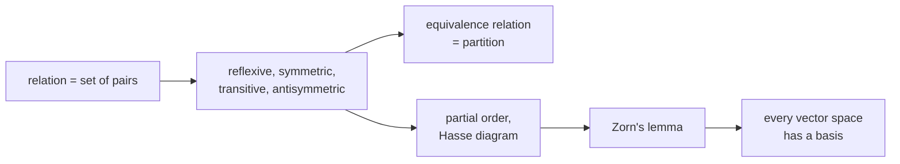

# PA03 · Relations, Equivalence and Order

◀ [[PA02 Sets Families and the ZFC Foundations]] · [[PA04 Functions and Cardinality]] ▶

taught · in syllabus extra · book extra · beyond

> [!syllabus] Syllabus map: what is in the syllabus and what is extra in this chapter
> 🟢 **In syllabus (taught)**: [[Assignment-prems_merged.pdf#page=1|Assignment 4]] (posets, extremal elements, equivalence relations; PDF p.1–2), [[Assignment-5.pdf|Assignment 5]] (congruences) and the instructor's note [[Zorn's_lemma.pdf|Zorn's Lemma and Existence of a Basis]] (5 pp.).
> - §1 binary relations and their properties; the traps (symmetric and transitive does not give reflexive)
> - §2 equivalence relations, classes and partitions; congruence modulo $n$ and the arithmetic of $\mathbb Z/{\equiv_n}$
> - §3 partial orders: minimal and maximal versus minimum and maximum; lower and upper bounds; glb and lub
> - §4 **Zorn's lemma** and the existence of a basis of every vector space
>
> 🟡 **Extra · book** (AI notes Part III; the AI note on Assignments 5–7)
> - §3 lattices (glb and lub for every pair)
>
> 🔵 **Extra · beyond** (my additions, labelled)
> - §1 the number of relations, equivalence relations, partial orders and preorders on 2, 3, 4 points, **by exhaustive enumeration**; §3 glb = gcd and lub = lcm for divisibility (`scripts/pa_numbers.py`)

> [!key] After this chapter you can
> - test a relation for **reflexive, symmetric, antisymmetric, transitive**, and build examples that have exactly the properties you want,
> - turn an **equivalence relation** into a **partition** and back, and compute with **congruence classes**,
> - for a subset $S$ of a poset find the **minimal/maximal** elements, **minimum/maximum**, **bounds**, and **glb/lub**,
> - state **Zorn's lemma** and run the standard argument (poset of the right objects, union of a chain, maximal element has the property).

> [!intuition] The one-sentence story
> An equivalence relation says "treat these as the same" and cuts a set into blocks; a partial order says "this comes before that" and turns a set into a picture with a bottom, a top and incomparable branches; Zorn's lemma says that if every chain has an upper bound, some element is at the very top.

<!-- intuition-v1 -->

*Concept map: how the ideas of this chapter depend on each other (read left to right; every box is a section).*

## 1. Binary relations and their properties
taught *Assignment 4, questions 5–7*

> [!intuition] Draw a relation as arrows
> Reflexive: a loop at every point. Symmetric: every arrow has a return arrow. Transitive: two-step paths have a shortcut. A property is a pattern you can check by eye.

A **relation** on $A$ is a subset $R\subseteq A\times A$; write $xRy$ for $(x,y)\in R$. It is

- **reflexive** if $xRx$ for all $x$; **symmetric** if $xRy\Rightarrow yRx$; **antisymmetric** if $xRy\wedge yRx\Rightarrow x=y$; **transitive** if $xRy\wedge yRz\Rightarrow xRz$.

> [!example] Assignment 4 Q6–Q7
> *Reflexive and transitive but not symmetric:* $\le$ on $\mathbb R$ ($1\le2$, not $2\le1$). *Not reflexive, not symmetric, but transitive:* $<$ on $\mathbb R$ ($x<x$ fails; $1<2$ but not $2<1$; $x<y<z\Rightarrow x<z$).

> [!pitfall] Symmetric and transitive does **not** give reflexive
> The "proof" $xRy\Rightarrow yRx\Rightarrow xRx$ only works if $x$ is related to **something**. On $A=\{1,2\}$ the relation $R=\{(1,1)\}$ is symmetric and transitive but $2R2$ fails.

> [!example] 🔵 Counting every relation on a small set (by exhaustive enumeration)
> | $n=\lvert A\rvert$ | all relations $2^{n^2}$ | reflexive | symmetric | equivalence | partial orders | preorders | symmetric + transitive, not reflexive |
> |---|---|---|---|---|---|---|---|
> | 2 | 16 | 4 | 8 | 2 | 3 | 4 | 3 |
> | 3 | 512 | 64 | 64 | 5 | 19 | 29 | 10 |
> | 4 | 65 536 | 4096 | 1024 | 15 | 219 | 355 | 37 |
>
> Reflexive: $2^{n^2-n}$; symmetric: $2^{n(n+1)/2}$. The counts of equivalence relations are the **Bell numbers** $1,2,5,15,52,203$ (§2). The counts 29 and 355 of preorders reappear as the numbers of topologies on 3 and 4 points in [[PA07 Metric and Topological Spaces]].

## 2. Equivalence relations, classes, partitions, congruences
taught *Assignment 4 questions 5, 8(c), 9; Assignment 5*

> [!intuition] An equivalence relation sorts things into bins
> Equivalence classes never overlap and cover everything: that is a *partition*, and every partition comes from a unique equivalence relation. Congruence mod $n$ sorts integers into $n$ bins.

An **equivalence relation** $\sim$ is reflexive, symmetric and transitive. The **class** of $a$ is $[a]=\{x:x\sim a\}$.

> [!key] Equivalence relations = partitions
> (1) Two classes are either equal or disjoint (Q8c): if $z\in[a]\cap[b]$ then $a\sim z\sim b$, so $a\sim b$ and every $x\sim a$ satisfies $x\sim b$ (and conversely), so $[a]=[b]$. (2) Every $a$ lies in its own class ($a\sim a$), so the classes **cover** $A$. Hence the classes form a **partition** $P_\sim$. Conversely a partition $P$ of $A$ gives $x\sim_Py\iff x,y$ lie in the same block, an equivalence relation (Q9). The two constructions are inverse to each other.
> The set of classes is the **quotient** $A/{\sim}$.

> [!example] Assignment 4 Q5
> (a) "$P\sim Q$ if $P,Q$ lie on the same line in $\mathbb R^2$": as literally stated **any two points lie on a common line**, so the relation is everything, an equivalence with a **single class**. The intended meaning is probably "on the same line through the origin": on $\mathbb R^2\setminus\{0\}$ the classes are the lines through $0$ minus the origin (it fails at $0$, which is on every line, as transitivity breaks).
> (b) $x\mid y$ on $\mathbb Z$ is reflexive and transitive but **not symmetric** ($2\mid4$, $4\nmid2$): not an equivalence relation (it is a preorder).
> (c) $x\sim y\iff n\mid x-y$ (congruence mod $n$): an equivalence relation with exactly $n$ classes $[0],\dots,[n-1]$.

> [!verify] Assignment 4 Q5(a)
> The relation as written is trivial (all of $\mathbb R^2$ is one class). If your lecture notes say "through the origin" or "parallel lines", the answer changes (classes = lines through the origin, resp. parallel classes). Check against the original wording.

> [!key] Congruence modulo $n$ (Assignment 5)
> $a\equiv b\pmod n$ iff $n\mid a-b$. It is an equivalence relation; $\mathbb Z=\bigcup_{j=0}^{n-1}[j]$ (division with remainder, Q7), the classes being disjoint. It respects sums and products (Q4): if $a\equiv b$ and $c\equiv d$ then $a+c\equiv b+d$ and $ac\equiv bd$ [since $ac-bd=a(c-d)+d(a-b)$], hence $a^m\equiv b^m$ for $m\in\mathbb N$.

> [!example] Assignment 5, computed
> Classes mod 11: $[30]=[8]$, $[-1]=[10]$, $[5]=[5]$. Integers congruent to $121\pmod{13}$: $121=9\cdot13+4$, so $4$ and $17$; to $23\pmod9$: $23=2\cdot9+5$, so $5$ and $14$. $[-50]=[1]=[-2]$ mod 3 since $-50=-51+1$ and $-2=-3+1$. $3^{16}\bmod4$: $3\equiv-1$, so $3^{16}\equiv(-1)^{16}=1$. In $\mathbb Z/{\equiv_5}$: $[5]+[-1]=[4]$ and $[2]\cdot[5]=[10]=[0]$.

> [!pitfall] Well-definedness
> $[a]+[b]:=[a+b]$ is a definition on **classes**; one must check it does not depend on the representatives chosen. That is exactly what (a) and (b) of Q4 prove.

> [!note] Bell numbers
> Partitions of an $n$-set: $1,1,2,5,15,52,203,\dots$ ($n=0,\dots,6$). For $\{1,2,3\}$: $\{123\}$, $\{1\}\{23\}$, $\{2\}\{13\}$, $\{3\}\{12\}$, $\{1\}\{2\}\{3\}$ — five, matching the enumeration of equivalence relations above.

## 3. Partial orders
taught *Assignment 4 questions 1–4, 8*

> [!intuition] Partial: some pairs can't be compared
> Divisibility is a partial order: neither 2 nor 3 divides the other. Hasse diagrams draw only the cover relations; a *chain* is a totally ordered path through it.

A **partial order** is reflexive, antisymmetric and transitive; $(P,\le)$ is a **poset**. For $S\subseteq P$:

> [!key] The vocabulary (keep these apart)
> | notion | definition |
> |---|---|
> | $m$ **minimal** in $S$ | $m\in S$ and no $s\in S$ has $s<m$ |
> | $m$ **minimum** of $S$ | $m\in S$ and $m\le s$ for **all** $s\in S$ (unique if it exists, Q8a) |
> | **lower bound** of $S$ | any $p\in P$ (not necessarily in $S$) with $p\le s$ for all $s\in S$ |
> | **greatest lower bound** glb $S$ | the largest lower bound, if it exists (also $\inf S$) |
> | maximal, maximum, upper bound, lub $S$ | dually (lub $=\sup S$) |
> A minimum is minimal; a minimal element need not be a minimum. In a **total** order (any two elements comparable) the two notions coincide.

![[fig_pa03_posets.png]]
*Figure PA3.1. The three posets of Assignment 4 with $S$ in blue and the glb and lub in orange. A: divisors of 24; B: subsets of $\{1,2,3,4\}$; C: $\mathbb Z\times\mathbb Z$ with the product order.*

> [!example] Assignment 4 Q1–Q4 (all recomputed)
> | Q | poset, $S$ | minimal | maximal | min / max | lower bounds | upper bounds | glb | lub |
> |---|---|---|---|---|---|---|---|---|
> | 1 | divisors of 24 under $\mid$, $\{2,3,4,6\}$ | 2, 3 | 4, 6 | none | 1 | 12, 24 | 1 | 12 |
> | 2 | $\mathcal P(\{1,2,3,4\})$, $\{\{1\},\{2\},\{1,2\},\{1,3\},\{2,3\}\}$ | $\{1\},\{2\}$ | $\{1,2\},\{1,3\},\{2,3\}$ | none | $\varnothing$ | $\{1,2,3\},\{1,2,3,4\}$ | $\varnothing$ | $\{1,2,3\}$ |
> | 3 | $\mathbb Z^2$, product order, $\{(0,1),(1,0),(1,2),(2,1)\}$ | $(0,1),(1,0)$ | $(1,2),(2,1)$ | none | all $(a,b)$, $a,b\le0$ | all $(a,b)$, $a,b\ge2$ | $(0,0)$ | $(2,2)$ |
> | 4 | subspaces of $\mathbb R^3$, $\{U,V\}$ with $U=\mathrm{span}(e_1,e_2)$, $V=\mathrm{span}(e_2,e_3)$ | $U,V$ | $U,V$ | none | subspaces of $U\cap V=\mathrm{span}(e_2)$ | subspaces containing $U+V=\mathbb R^3$, i.e. only $\mathbb R^3$ | $U\cap V=\mathrm{span}(e_2)$ | $U+V=\mathbb R^3$ |

> [!example] 🔵 Divisibility is a lattice: glb = gcd, lub = lcm
> In Q1, $\gcd(2,3,4,6)=1$ and $\operatorname{lcm}(2,3,4,6)=12$, which are exactly the glb and lub. A poset in which every pair has a glb and a lub is a **lattice** 🟡: $(\mathbb N,\mid)$ with $\gcd,\operatorname{lcm}$, $(\mathcal P(X),\subseteq)$ with $\cap,\cup$, and $\mathbb Z^2$ with componentwise $\min,\max$ are the three examples of this section.

> [!derivation] Assignment 4 Q8(a),(b)
> (a) **Uniqueness of the minimum.** If $m,m'$ are both minima, $m\le m'$ and $m'\le m$, so $m=m'$ by antisymmetry.
> (b) **A finite non-empty poset has a maximal element.** Pick $x_1$. If it is not maximal, some $x_2>x_1$; if $x_2$ is not maximal, some $x_3>x_2$; … The sequence is strictly increasing so all $x_i$ are distinct (transitivity + antisymmetry: $x_i=x_j$ for $i<j$ would give $x_i<x_j=x_i$), impossible in a finite set, so the process stops at a maximal element. Dually for minimal elements. (Checked on all 219 partial orders on 4 points.) This is the finite case of Zorn's lemma.

## 4. Zorn's lemma and the existence of a basis
taught *the instructor's note [[Zorn's_lemma.pdf|Zorn's Lemma and Existence of a Basis]]*

> [!intuition] Zorn: if every chain has a ceiling, something is maximal
> It is the tool that lets you pick a largest object without constructing it: maximal linearly independent sets are bases, maximal ideals exist. It is equivalent to the axiom of choice.

A **chain** is a subset $C\subseteq P$ in which any two elements are comparable.

> [!key] Zorn's lemma
> Let $(P,\le)$ be a **non-empty** poset in which every chain has an upper bound in $P$. Then $P$ has a **maximal** element.
> (It is equivalent to the Axiom of Choice; see [[Axiom of Choice]]. The empty chain has an upper bound iff $P$ is non-empty, which is why "non-empty" is part of the hypothesis.)

> [!key] Theorem. Every vector space $V$ over a field $F$ has a basis.
> A **basis** is a linearly independent set $B$ with $\mathrm{span}(B)=V$, where $\mathrm{span}(S)=\bigcap\{W\le V:S\subseteq W\}$.

> [!derivation] Proof (the instructor's)
> **Case $V=\{0\}$.** $\varnothing$ is linearly independent (no vectors, no relation, vacuously) and $\mathrm{span}(\varnothing)=\bigcap\{W\le V\}=\{0\}=V$ because $\{0\}$ is itself a subspace and all subspaces contain $0$.
> **Case $V\ne\{0\}$.** Let $\mathcal P=\{S\subseteq V:S\text{ is linearly independent}\}$ ordered by $\subseteq$.
> *Non-empty:* $\varnothing\in\mathcal P$.
> *Chains have upper bounds:* let $\mathcal C\subseteq\mathcal P$ be a chain and $U=\bigcup_{S\in\mathcal C}S$. If $a_1v_1+\dots+a_nv_n=0$ with $v_i\in U$, pick $S_i\in\mathcal C$ with $v_i\in S_i$. The $S_i$ are finitely many members of a chain, so one of them, $S_j$, contains the others; all $v_i\in S_j$, which is independent, so all $a_i=0$. Thus $U\in\mathcal P$ and $U\supseteq S$ for every $S\in\mathcal C$.
> *Zorn* gives a maximal independent set $B$. **Claim:** $\mathrm{span}(B)=V$. If not, take $v\notin\mathrm{span}(B)$ and suppose $a_1b_1+\dots+a_nb_n+\lambda v=0$. If $\lambda\ne0$ then $v=-\lambda^{-1}\sum a_ib_i\in\mathrm{span}(B)$, a contradiction; so $\lambda=0$ and then all $a_i=0$ by independence of $B$. Hence $B\cup\{v\}\in\mathcal P$ strictly contains $B$, contradicting maximality. $\square$

> [!key] The pattern of a Zorn argument
> 1. Choose the poset $\mathcal P$ of partial objects of the kind you want (here: independent sets), ordered by inclusion.
> 2. Show $\mathcal P\ne\varnothing$.
> 3. Show every chain has an upper bound (usually its **union**).
> 4. A maximal element exists; show maximality forces the desired property (else you could extend it).

> [!note] Non-constructive
> The proof does not produce $B$. For $\mathbb R$ as a vector space over $\mathbb Q$ such a **Hamel basis** exists but is uncountable and cannot be written down; for $\prod_{n\ge1}\mathbb R$ over $\mathbb R$ the vectors $e_1,e_2,\dots$ do **not** form a basis ([[PA02 Sets Families and the ZFC Foundations]] §3), yet a basis exists.

## Map of this chapter
> [!connection] How PA03 connects
> **Builds on:** [[PA02 Sets Families and the ZFC Foundations]] (a relation is a subset of $A\times A$; the ordered pair underlies everything).
> **Leads to:** [[PA04 Functions and Cardinality]] (a function is a relation; $\sim$ of "same cardinality" is an equivalence relation; kernels of functions), [[PA05 Induction and the Number Systems]] ($\mathbb Z$ and $\mathbb Q$ are quotients by equivalence relations; well-orders), [[PA06 The Real Numbers and Sequences]] (sup and inf are lub and glb in the poset $(\mathbb R,\le)$).
> **Concepts:** [[Binary Relation]] · [[Equivalence Relation]] · [[Equivalence Class and Partition]] · [[Congruence Modulo n]] · [[Partially Ordered Set]] · [[Extremal Elements and Bounds]] · [[Zorn's Lemma]] · [[Basis of a Vector Space]]
> **Other subjects:** [[Proofs, Analysis and Topology - Course Map]], [[Probability - Course Map]] (a partition of $\Omega$ is the setting of the law of total probability, [[Law of Total Probability]]), [[Thermodynamics and Statistical Mechanics - Course Map]] (thermal equilibrium is an equivalence relation: the content of the zeroth law, [[TH01 Temperature and the Zeroth Law]]; temperature labels the classes).

## Summary
> [!summary] Cheat-sheet
> - Relation properties: reflexive, symmetric, antisymmetric, transitive. Symmetric + transitive $\not\Rightarrow$ reflexive ($\{(1,1)\}$ on $\{1,2\}$). Examples: $\le$ (reflexive, transitive, not symmetric); $<$ (transitive only).
> - **Equivalence ⇔ partition**; classes are equal or disjoint; $A/{\sim}$ the set of classes. Mod $n$: $n$ classes, $+$ and $\cdot$ well defined; $3^{16}\equiv1\pmod4$.
> - Minimal ≠ minimum; bounds need not lie in $S$; glb = inf, lub = sup. Minimum unique; finite non-empty posets have maximal elements.
> - Q1–Q4 results (table above); divisibility: glb = gcd, lub = lcm.
> - **Zorn:** non-empty poset, every chain has an upper bound ⇒ maximal element. Basis existence: independent sets, union of a chain, maximal ⇒ spanning.

## Practice
1. **Properties.** On $\mathbb Z$ decide reflexive/symmetric/transitive for: (a) $x\sim y\iff x-y$ even; (b) $x\sim y\iff|x-y|\le1$; (c) $x\sim y\iff xy>0$; (d) $x\sim y\iff x\le y$.
2. **Classes.** On $\mathbb R$ let $x\sim y\iff x-y\in\mathbb Z$. Show it is an equivalence relation, describe $[0.3]$, and find one representative of every class.
3. **All partitions.** List the 5 equivalence relations on $\{1,2,3\}$ as sets of pairs and say which is the identity relation.
4. **Poset.** Divisors of 36 under divisibility, $S=\{4,6,9\}$: find minimal, maximal, minimum, maximum, lower and upper bounds, glb and lub.
5. **Subsets.** In $\mathcal P(\{a,b,c\})$ with $\subseteq$ take $S=\{\{a\},\{b\},\{a,b\}\}$. Find the same eight items.
6. **Lexicographic order.** On $\mathbb R^2$ put $(a,b)\le(c,d)$ iff $a<c$ or ($a=c$ and $b\le d$). Show it is a total order. Does $S=\{(1,y):0\le y<1\}$ have a maximum? A lub?
7. **Uniqueness.** Prove that if the lub of $S$ exists it is unique.
8. **Maximum versus maximal.** Prove a maximum is maximal; give a poset with a maximal element that is not a maximum; prove that in a total order the notions agree.
9. **Congruences.** Compute $7^{100}\bmod13$ and the last digit of $3^{2026}$. Prove that every square is $\equiv0$ or $1\pmod4$ and deduce $4k+3$ is never the sum of two squares.
10. **Zorn's hypotheses.** Show $(\mathbb N,\le)$ fails the chain condition and has no maximal element. Show that for finite $P\ne\varnothing$ the chain condition holds and a maximal element exists.

> [!example]- Solutions
> 1. (a) equivalence (two classes: even, odd). (b) reflexive and symmetric, **not** transitive ($0\sim1\sim2$, $0\not\sim2$). (c) $0\not\sim0$ (not reflexive); symmetric and transitive on $\mathbb Z\setminus\{0\}$ (classes: positives, negatives). (d) reflexive, transitive, antisymmetric, not symmetric: a partial (indeed total) order.
> 2. Reflexive ($0\in\mathbb Z$), symmetric ($-n\in\mathbb Z$), transitive ($n+m\in\mathbb Z$). $[0.3]=\{0.3+k:k\in\mathbb Z\}$. Each class has exactly one representative in $[0,1)$ (its fractional part), so $\mathbb R/{\sim}\leftrightarrow[0,1)$.
> 3. Identity: $\{(1,1),(2,2),(3,3)\}$; the others add pairs: $\{12\}\{3\}$: add $(1,2),(2,1)$; $\{13\}\{2\}$: $(1,3),(3,1)$; $\{23\}\{1\}$: $(2,3),(3,2)$; all-in-one: all 9 pairs.
> 4. Divisors $1,2,3,4,6,9,12,18,36$. No element of $S$ divides another, so **all three are minimal and maximal**; no minimum or maximum. Lower bounds: common divisors $=\{1\}$, glb $1$. Upper bounds: common multiples among the divisors $=\{36\}$, lub $36$ ($\gcd=1$, $\operatorname{lcm}=36$).
> 5. Minimal $\{a\},\{b\}$; maximal $\{a,b\}$ (also the **maximum**); no minimum; lower bounds $\{\varnothing\}$, glb $\varnothing$; upper bounds $\{a,b\},\{a,b,c\}$, lub $\{a,b\}$.
> 6. Reflexive, antisymmetric, transitive by cases; any two points compare (compare first coordinates, then second). $S$ has **no maximum** (for $y<1$ the point $(1,\frac{1+y}2)$ is bigger). Upper bounds: $(1,d)$ with $d\ge1$ and all $(c,d)$ with $c>1$; the least is $(1,1)\notin S$: lub $=(1,1)$.
> 7. If $u,u'$ are both least upper bounds, each is an upper bound and $u\le u'$, $u'\le u$ by leastness; antisymmetry gives $u=u'$.
> 8. Maximum $m$: if $m\le x$ then $x\le m$ ($m$ is above all), so $x=m$. Example: $\{2,3,4,6\}$ under divisibility has maximal elements 4 and 6 but no maximum. Total order: if $m$ is maximal and $x\in S$ then $x\le m$ or $m<x$; the latter is excluded, so $m$ is the maximum.
> 9. $7^2=49\equiv10$, $7^4\equiv100\equiv9$, and by Fermat $7^{12}\equiv1$ so $7^{100}=7^{96}7^4\equiv9\pmod{13}$ (checked). $3^4=81\equiv1\pmod{10}$, $2026=4\cdot506+2$, so $3^{2026}\equiv3^2=9$: last digit **9** (checked). Squares: $(2k)^2=4k^2\equiv0$, $(2k+1)^2=4(k^2+k)+1\equiv1$; a sum of two squares is $\equiv0,1,2\pmod4$, never $3$.
> 10. $\mathbb N$ itself is a chain with no upper bound, and no element is maximal. For finite $P\ne\varnothing$ every chain is finite with a largest element (its upper bound), and a maximal element exists (§3, Q8(b)).

> [!connection] Group theory used here
> The cosets $gU$ are the equivalence classes of $x\sim y\iff x^{-1}y\in U$ and $G/N$ is a quotient set: [[GT01 Groups Subgroups and Cosets]], [[GT02 Homomorphisms Normal Subgroups and Quotients]]; see [[Where Groups Appear in the Vault]].

<!-- zettel:start (generated by scripts/sort_zettel.py; do not edit between the markers) -->
## Zettel notes

> [!abstract]- Zettel notes filed under this chapter (18): the other tool's concept notes from the lectures, unreviewed
> [[zettel/chain-in-a-poset|Chain in a Poset]] · [[zettel/disjointness-or-equality-of-equivalence-classes|Disjointness or Equality of Equivalence Classes]] · [[zettel/equivalence-relation|Equivalence Relation]] · [[zettel/equivalence-relation-and-partition-correspondence|Equivalence Relation and Partition Correspondence]] · [[zettel/existence-of-a-basis-for-vector-spaces|Existence of a Basis for Vector Spaces]] · [[zettel/existence-of-extremal-elements-in-finite-posets|Existence of Extremal Elements in Finite Posets]] · [[zettel/greatest-lower-bound|Greatest Lower Bound]] · [[zettel/least-upper-bound|Least Upper Bound]] · [[zettel/linear-independence|Linear Independence]] · [[zettel/linear-span|Linear Span]] · [[zettel/lower-bound-in-a-poset|Lower Bound in a Poset]] · [[zettel/maximal-element-in-a-poset|Maximal Element in a Poset]] · [[zettel/minimum-element-in-a-poset|Minimum Element in a Poset]] · [[zettel/partial-order|Partial Order]] · [[zettel/product-order-on-z-x-z|Product Order on Z x Z]] · [[zettel/uniqueness-of-minimum-in-a-poset|Uniqueness of Minimum in a Poset]] · [[zettel/upper-bound-in-a-poset|Upper Bound in a Poset]] · [[zettel/zorn-s-lemma|Zorn's Lemma]]
<!-- zettel:end -->

## Provenance
> [!provenance]- Source map for this chapter
> | Topic | Source | Scope |
> |---|---|---|
> | posets, extremal elements, equivalence relations and partitions, Q1–Q9 | [[Assignment-prems_merged.pdf#page=1\|Assignment 4]] | taught |
> | congruence classes, arithmetic mod $n$ | [[Assignment-5.pdf\|Assignment 5]] | taught |
> | Zorn's lemma, basis existence | [[Zorn's_lemma.pdf]] (instructor's note) | taught |
> | lattices, closures, dependency of properties | AI notes `proofs-prems-topo.pdf` Part III (ch. 7–10) | extra/book |
> | exhaustive counts, glb = gcd | `scripts/pa_numbers.py`, `fig_pa03_posets.py` | extra/beyond |
>
> **Notes.** The AI note `Assignments_5-7_Notes_and_Solutions.pdf` (a compiled solution set) was compared with the answers for Assignment 5. Solutions are mine. In the Assignment 4 text the poset in Q4 is the set of vector subspaces of $\mathbb R^3$ ordered by inclusion; the meet is the intersection and the join the sum of subspaces.

**References.** Sundstrom, T. *Mathematical Reasoning*, Ch. 7–8 · Kumaresan et al., *A Foundation Course in Mathematics* · Munkres, J. *Topology*, §§3, 10 · Hatcher, A. *Notes on Introductory Point-Set Topology*, §1.
