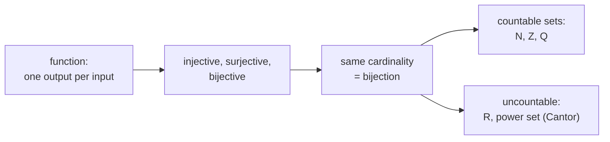

# PA04 · Functions and Cardinality

◀ [[PA03 Relations Equivalence and Order]] · [[PA05 Induction and the Number Systems]] ▶

taught · in syllabus extra · book extra · beyond

> [!syllabus] Syllabus map: what is in the syllabus and what is extra in this chapter
> 🟢 **In syllabus (taught)**: [[Assignment-6.pdf|Assignment 6]] (functions), [[Assignment-7.pdf|Assignment 7]] and [[Assignment-8.pdf|Assignment 8]] (countability, Cantor's theorem), and the instructor's typed **Lectures 17–20** [[Countable-Uncountable-sets.pdf|Countable and Uncountable Sets]] (6 pp.).
> - §1–§2 function, image, preimage, injective, surjective, bijective; composition and inverse
> - §3 same cardinality, finite sets, $\sim$ as an equivalence relation
> - §4 countable sets: $\mathbb N$, $\mathbb Z$, $\mathbb Q$, $\mathbb N\times\mathbb N$, subsets, finite products, countable unions
> - §5 uncountable sets: $(0,1)$ by the diagonal argument, intervals, $\mathbb R$, $\{0,1\}^{\mathbb N}$, Cantor's theorem; $|\mathbb R|=\mathfrak c$ and the continuum hypothesis
>
> 🟡 **Extra · book** (AI notes ch. 9, 13; textbooks)
> - kernels and factorisation of a function; the Schröder–Bernstein theorem
>
> 🔵 **Extra · beyond** (my additions, labelled)
> - §4 algebraic numbers are countable, so transcendental numbers exist; counts of functions between finite sets; every explicit bijection and the diagonal construction **checked by computer** (`scripts/pa_numbers.py`)

> [!key] After this chapter you can
> - decide whether a rule defines a **function**, and whether it is **injective**, **surjective**, **bijective**, giving the image and preimages,
> - show two sets have the **same cardinality** by exhibiting a bijection, and show a set is **countable** by listing it,
> - run Cantor's **diagonal argument** (for $(0,1)$ via decimal expansions, for $\{0,1\}^{\mathbb N}$, for $\mathcal P(A)$),
> - state the **continuum hypothesis** and its status.

> [!intuition] The one-sentence story
> Size, for infinite sets, means "can be matched one-to-one": $\mathbb N$, $\mathbb Z$ and $\mathbb Q$ all match, so they have the same size, but a list of real numbers always misses one, so $\mathbb R$ is strictly bigger.

<!-- intuition-v1 -->

*Concept map: how the ideas of this chapter depend on each other (read left to right; every box is a section).*

## 1. Functions, images and preimages
taught *Assignment 6, definitions 1–2 and problems 1–3*

> [!key] Definitions
> A **function** $f:A\to B$ assigns to **each** $a\in A$ **exactly one** $f(a)\in B$ ($A$ domain, $B$ codomain). The **image** is $\mathrm{Im}(f)=f(A)=\{f(a):a\in A\}\subseteq B$ and, for $S\subseteq A$, $f(S)=\{f(a):a\in S\}$. The **preimage** of $T\subseteq B$ is $f^{-1}(T)=\{a\in A:f(a)\in T\}$ (a set; it exists even when $f$ has no inverse).
> As a set, $f\subseteq A\times B$ is a relation in which every $a$ appears in exactly one pair.

> [!example] Assignment 6 Q1: is it a function? ($A=\{1,2,3\}$, $B=\{a,b\}$)
> (a) $f(1)=a$, $f(2)=b$, $f(3)=a$ is a function with image $\{a,b\}$. (b) $f(1)=a$ **and** $f(1)=b$: not a function (two values at 1, and nothing at 3). (c) $f(1)=a$, $f(3)=b$: not a function (2 has no image).

> [!example] Q2–Q3: images and preimages
> $f:\{1,\dots,5\}\to\{a,b,c,d\}$, $f(1)=b$, $f(2)=d$, $f(3)=b$, $f(4)=a$, $f(5)=d$: $\mathrm{Im}f=\{a,b,d\}$, $f(\{1,3\})=\{b\}$, preimages $f^{-1}(a)=\{4\}$, $f^{-1}(b)=\{1,3\}$, $f^{-1}(c)=\varnothing$, $f^{-1}(\{a,d\})=\{2,4,5\}$.
> $f(x)=|x|$ on $\mathbb R$: $f^{-1}(2)=\{-2,2\}$, $f^{-1}(0)=\{0\}$, $f^{-1}(-3)=\varnothing$; $\mathrm{Im}f=[0,\infty)$; not injective ($f(-1)=f(1)$), not surjective onto $\mathbb R$ ($-1$ is missed).

## 2. Injective, surjective, bijective
taught *Assignment 6, definitions 3–5 and problems 4–9*

> [!intuition] No collisions, nothing missed, both
> Injective: different inputs, different outputs. Surjective: every target is hit. Bijective: a perfect pairing, so you can undo it (an inverse exists).

> [!key] Three properties
> $f$ is **injective** if $f(a_1)=f(a_2)\Rightarrow a_1=a_2$ (every $b$ has **at most** one preimage); **surjective** if $\mathrm{Im}f=B$ (**at least** one preimage); **bijective** if both (**exactly** one). A bijection has an **inverse** $f^{-1}:B\to A$, and a composite of bijections is a bijection (so "same cardinality" is transitive).

> [!example] Q4: $\mathbb N$ has the same size as its proper subsets and as $\mathbb Z$
> (a) $f(n)=2n+1$ as a map $\mathbb N\to\mathbb N$ is injective ($2n_1+1=2n_2+1\Rightarrow n_1=n_2$) but **not surjective** (it misses $1,2,4,\dots$). Changing the codomain to $\{3,5,7,\dots\}$ makes it a **bijection** (an odd $k\ge3$ is $f(\tfrac{k-1}2)$).
> (b) A bijection $\mathbb N\to\mathbb Z$ (with $\mathbb N=\{1,2,3,\dots\}$): $f(n)=\tfrac n2$ for $n$ even, $f(n)=\tfrac{1-n}2$ for $n$ odd, giving $0,1,-1,2,-2,3,-3,\dots$. *Proof.* Even $n$ go to the positive integers, odd $n$ to the integers $\le0$; each half is injective (the formulas are strictly monotone) and onto its half ($y>0\mapsto n=2y$, $y\le0\mapsto n=1-2y$). Checked on $n\le10{,}000$: bijection onto $[-4999,5000]$.

> [!example] Q5–Q9, summarised
> - $g:\mathbb R_{\ge0}\to\mathbb R_{\ge0}$, $g(x)=x^2$ is bijective ($x_1^2=x_2^2\Rightarrow(x_1-x_2)(x_1+x_2)=0\Rightarrow x_1=x_2$; surjectivity is the existence of square roots, [[PA06 The Real Numbers and Sequences]]). $x\mapsto\sqrt x$ is **not** a function $\mathbb R\to\mathbb R$ (not defined for $x<0$). For $x\mapsto x^n$: bijective on $\mathbb R$ for $n$ odd, neither injective nor surjective for $n$ even.
> - Reflection $r(x,y)=(x,-y)$: bijective ($r\circ r=\mathrm{id}$). $d(x,y)=x^2+y^2$ as a map $\mathbb R^2\to\mathbb R$: $d^{-1}(1)$ is the unit circle, $d^{-1}(0)=\{(0,0)\}$, $d^{-1}(-1)=\varnothing$; $\mathrm{Im}\,d=[0,\infty)$, image of the unit disc $=[0,1]$; not injective; surjective only onto $\mathbb R_{\ge0}$.
> - Projections $\pi_1,\pi_2:\mathbb R^2\to\mathbb R$: surjective, not injective; $\pi_1^{-1}(3)=\{3\}\times\mathbb R$, $\pi_2^{-1}(-1)=\mathbb R\times\{-1\}$, $\pi_1([-1,1]\times B)=[-1,1]$.
> - $f:\mathbb R^3\to\mathbb R^2$, $(x,y,z)\mapsto(x,y)$: surjective, not injective, $f^{-1}(0)$ = the $z$-axis. $g:\mathbb R^2\to\mathbb R^3$, $(x,y)\mapsto(x,y,0)$: injective, not surjective, $g^{-1}(0)=\{(0,0)\}$.
> - $\mathrm{tr}:M_2(\mathbb R)\to\mathbb R$: surjective (the trace of $\mathrm{diag}(t,0)$ is $t$), not injective. Transpose $M\mapsto M^T$: bijective (its own inverse).

> [!pitfall] Check domain and codomain before judging
> $x\mapsto x^2$ is not surjective on $\mathbb R$ but is on $\mathbb R_{\ge0}$; injectivity and surjectivity belong to the triple $(f,A,B)$, not to the formula.

> [!note] 🔵 Counting functions between finite sets
> $|A|=5$, $|B|=4$: $4^5=1024$ functions, none injective, $\sum_{i}(-1)^i\binom4i(4-i)^5=240$ surjective. $|A|=4$, $|B|=5$: $5\cdot4\cdot3\cdot2=120$ injective, none surjective. A function between two sets of the same finite size is injective iff surjective iff bijective ($4!=24$ bijections for $n=4$); this **fails** for infinite sets (the maps of Q4).

## 3. Same cardinality
taught *Lectures 17–18; Assignment 7, definitions 1–2*

> [!intuition] 'Same size' means 'can be paired off'
> That definition, not counting, is the one that works for infinite sets, and it has surprises: the even numbers pair off perfectly with all of $\mathbb N$ (Hilbert's hotel).

> [!key] Definitions (lectures 17–18)
> $A\sim B$ ("**same cardinality**", $|A|=|B|$) if there is a **bijection** $A\to B$. A set is **finite** if it is empty or $\sim\mathbb N_k=\{1,\dots,k\}$ for some $k$ ($|A|=k$); **countable** if finite or $\sim\mathbb N$ (**countably infinite**); **uncountable** if infinite and not countable. $|\mathbb N|=\aleph_0$.
> $\sim$ is an **equivalence relation** on sets: $A\sim A$ (identity), $A\sim B\Rightarrow B\sim A$ ($f^{-1}$), $A\sim B\sim C\Rightarrow A\sim C$ ($g\circ f$).

Black boxes assumed (proved later by induction, [[PA05 Induction and the Number Systems]]): (1) there is no injection $\mathbb N_{n+1}\to\mathbb N_n$; (2) a subset of $\mathbb N_k$ is finite; (3) every subset of $\mathbb N$ is countable (well-ordering).

> [!key] Consequences (lecture 18)
> 1. A subset of a finite set is finite. 2. If $B\sim\mathbb N_k$ ($k\ge1$) and $x\in B$ then $B\setminus\{x\}\sim\mathbb N_{k-1}$ (compose with the transposition swapping $f(x)$ and $k$). 3. A finite set is **never** equivalent to a proper subset. 4. $\mathbb N$ is infinite: $n\mapsto2n-1$ is a bijection onto the proper subset of odd numbers. 5. A subset of a countable set is countable; a set containing an uncountable subset is uncountable.

> [!note] History (from the lecture)
> Galileo (1638) matched $\mathbb N$ with the squares; Bolzano (1851) used the word "set" and matched intervals of different length; Dedekind (1888) **defined** infinite as "in bijection with a proper subset of itself"; Cantor (1874) proved $\mathbb N\not\sim\mathbb R$ and introduced "countable", "uncountable" and the continuum hypothesis.

## 4. Countable sets
taught *Lecture 17; Assignment 7; Assignment 8 problems 1–2*

> [!intuition] Countable = can be listed
> $\mathbb Z$ and $\mathbb Q$ can be put in an infinite list, even though $\mathbb Q$ is dense: walk the grid of fractions diagonally and skip repeats.

> [!example] Assignment 7 Q1–Q2
> $\mathbb N\cup\{0\}$ is countably infinite via $n\mapsto n-1$. $\mathbb N\times\{0,1\}$ is countably infinite via $(n,0)\mapsto2n-1$, $(n,1)\mapsto2n$ (odd numbers for the first copy, even for the second).

> [!derivation] $\mathbb N\times\mathbb N$ is countable (Q3, Figure PA4.1 A)
> List the pairs along the **anti-diagonals** $m+n=s$: $(1,1);(1,2),(2,1);(1,3),(2,2),(3,1);\dots$ The $s$-th diagonal ($m+n=s+1$) has $s$ pairs, so the pair $(m,n)$ with $m+n=s$ sits at position $\tfrac{(s-2)(s-1)}2+m$ in the list: $(1,1)\mapsto1$, $(1,2)\mapsto2$, $(2,1)\mapsto3$, $(1,3)\mapsto4$. Every pair appears exactly once (its diagonal is determined by $m+n$, its place on the diagonal by $m$): a bijection $\mathbb N\to\mathbb N\times\mathbb N$ (checked on all 820 pairs with $m+n\le41$). *Alternative:* $h(m,n)=2^m3^n$ is injective (unique factorisation), so $\mathbb N\times\mathbb N\sim h(\mathbb N\times\mathbb N)\subseteq\mathbb N$, a subset, hence countable.

![[fig_pa04_cardinality.png]]
*Figure PA4.1. A: the anti-diagonal enumeration of $\mathbb N\times\mathbb N$. B: Cantor's diagonal argument. C: the bijection $(0,1)\to\mathbb R$ of Lecture 20.*

> [!derivation] A subset of a countable set is countable (Q4)
> If $A$ is finite so is $S\subseteq A$. If $f:\mathbb N\to A$ is a bijection and $S$ is infinite: let $n_1$ be the least $n$ with $f(n)\in S$, $n_2$ the least $n>n_1$ with $f(n)\in S$, and so on. Each $n_k$ exists because every non-empty subset of $\mathbb N$ has a least element (well-ordering), and $n_1<n_2<\cdots$. Put $g(k)=f(n_k)$: injective ($f$ is, and $n_k$ are distinct) and surjective (if $f(n)\in S$ then $n$ is some $n_k$, since the $n_k$ list the set $\{n:f(n)\in S\}$ in increasing order). So $S$ is countably infinite.

> [!derivation] $\mathbb Q$ is countable (Lecture 17)
> Step 1: list $\mathbb Q_{>0}=\{m/n\}$ along the diagonals $m+n=2,3,4,\dots$ in a zigzag, **skipping repeats**: $1,\tfrac12,2,3,\tfrac13,\tfrac14,\tfrac23,\tfrac32,4,5,\tfrac15,\tfrac16,\dots$ (the order is immaterial). Every $m/n$ is reached on the $(m+n-1)$-th diagonal; the listing without repeats is a bijection $\mathbb N\to\mathbb Q_{>0}$. Step 2: $x\mapsto-x$ is a bijection $\mathbb Q_{>0}\to\mathbb Q_{<0}$. Step 3: $\mathbb Q=\{0,a_1,-a_1,a_2,-a_2,\dots\}$ via $f(1)=0$, $f(n)=a_{n/2}$ ($n$ even), $f(n)=-a_{(n-1)/2}$ ($n>1$ odd). (Checked: the listing is repeat-free and every $m/n$ with $m+n\le11$ appears.)

> [!key] Closure properties (Assignments 7–8)
> A **finite product** of countable sets is countable (Q5: $F(m,n)=(f(m),g(n))$ is a bijection $\mathbb N\times\mathbb N\to A\times B$); a **countable union of countable sets** is countable (A8 Q2: for disjoint $A_i$ with bijections $f_i:\mathbb N\to A_i$, $F(i,n)=f_i(n)$ is a bijection $\mathbb N\times\mathbb N\to\bigcup A_i$); $A\cup B$ is countably infinite if $A$ is and $B$ is countable (A8 Q1a: list $A$, then the elements of $B\setminus A$, interleaved).
> **An infinite product is different:** $\prod_{n\ge1}\{0,1\}=\{0,1\}^{\mathbb N}$ is **uncountable** (§5).

> [!example] 🔵 The algebraic numbers are countable, so transcendental numbers exist
> A real is **algebraic** if it solves $a_nx^n+\dots+a_0=0$ with integer coefficients, not all 0. For each $n$ there are countably many coefficient vectors $(a_0,\dots,a_n)\in\mathbb Z^{n+1}$ (a finite product of the countable $\mathbb Z$), each polynomial has at most $n$ roots, and $\bigcup_n$ of these is a countable union of countable sets. So the algebraic numbers are countable; since $\mathbb R$ is not, **uncountably many reals are transcendental** (Cantor 1874), although only a few ($\pi$, $e$) are known by name.

## 5. Uncountable sets
taught *Lectures 19–20; Assignment 8 problems 1(b), 3–5*

> [!intuition] Cantor's diagonal
> Given any list of real numbers, build a new one that differs from the $n$th number in its $n$th digit: it is not on the list. So $\mathbb R$ is strictly bigger than $\mathbb N$, and $P(S)$ is always bigger than $S$.

> [!key] Decimal expansions (Lecture 19)
> Every $x\in(0,1)$ is $0.a_1a_2a_3\dots=\sum a_k10^{-k}$, $a_k\in\{0,\dots,9\}$ (the series converges since $\sum\tfrac9{10^k}$ does: its partial sums are $0.99\dots9=1-10^{-n}\to1$). The representation is **not unique**: $0.4999\dots=\tfrac4{10}+9\sum_{k\ge2}10^{-k}=\tfrac4{10}+\tfrac9{90}=\tfrac12=0.5000\dots$ A representation is **normalised** if it does not end in an infinite string of 9s. **Every real in $(0,1)$ has exactly one normalised expansion, and two normalised expansions are equal iff all their digits agree.**

> [!derivation] Theorem. $(0,1)$ is uncountable (Lecture 19; Figure PA4.1 B)
> *$(0,1)$ is infinite:* $n\mapsto\tfrac1{n+1}$ injects $\mathbb N$ into it. *No $f:\mathbb N\to(0,1)$ is surjective:* write each $f(n)=0.a_{n1}a_{n2}a_{n3}\dots$ in normalised form and define $b=0.b_1b_2b_3\dots$ by $b_k=3$ if $a_{kk}\ne3$, $b_k=7$ if $a_{kk}=3$. Every digit of $b$ is 3 or 7, so $0<0.333\dots\le b\le0.777\dots<1$ and $b$ is normalised (no 9s). For every $n$ the digits $b_n\ne a_{nn}$, so $b\ne f(n)$ (distinct normalised expansions). So $b\notin\mathrm{Im}f$. $\square$
> **Why 3 and 7 and not "add 1":** changing a digit to 0 or 9 could produce a number with two expansions (an expansion ending in 9s), which is why the lecture avoids those digits.

> [!example] Intervals and $\mathbb R$
> (i) $(a,b)\sim(0,1)$ for $a<b$ via $f(x)=a+(b-a)x$ (injective since $b-a\ne0$; for $y\in(a,b)$, $x=\tfrac{y-a}{b-a}\in(0,1)$). (ii) $(0,1)\sim\mathbb R$ (Lecture 20):
> $$f(x)=\begin{cases}1-\dfrac1{2x},&0<x\le\tfrac12\\[1ex]\dfrac1{2(1-x)}-1,&\tfrac12\le x<1\end{cases}\qquad g(y)=\begin{cases}\dfrac1{2(1-y)},&y\le0\\[1ex]1-\dfrac1{2(1+y)},&y\ge0\end{cases}$$
> $f$ maps $(0,\tfrac12]$ onto $(-\infty,0]$ and $[\tfrac12,1)$ onto $[0,\infty)$, $f(\tfrac12)=0$; $g\circ f=\mathrm{id}_{(0,1)}$ and $f\circ g=\mathrm{id}_{\mathbb R}$ (verified symbolically in the lecture and by exact rational arithmetic on 96 and 81 test points; e.g. $f(\tfrac14)=-1$, $f(\tfrac34)=1$, $f(\tfrac1{10})=-4$). Hence $\mathbb R$ is uncountable (a bijection $\mathbb N\to\mathbb R$ composed with $g$ would give $\mathbb N\to(0,1)$).
> (iii) $[0,1)\sim(0,1)$ (A8 Q5a): $g(0)=\tfrac12$, $g(\tfrac1n)=\tfrac1{n+1}$ ($n\ge2$), $g(x)=x$ otherwise. The chain $0\mapsto\tfrac12\mapsto\tfrac13\mapsto\tfrac14\dots$ shifts the sequence $0,\tfrac12,\tfrac13,\dots$ one step along to make room; the map is injective and hits $\tfrac1k$ ($k\ge2$) and every other point exactly once. (iv) $[0,1]\sim(0,1)$ (Q5b): make room for **two** points: $0\mapsto\tfrac12$, $1\mapsto\tfrac13$, $\tfrac1n\mapsto\tfrac1{n+2}$ ($n\ge2$), identity elsewhere. Hence $[0,1]\sim(0,1)\sim\mathbb R$; since $\mathbb R\supseteq(0,1)$, any set containing an uncountable subset is uncountable, and so is $\mathbb R\setminus\mathbb Q$ (A8 Q1b: otherwise $\mathbb R=\mathbb Q\cup(\mathbb R\setminus\mathbb Q)$ would be countable).

> [!derivation] $\{0,1\}^{\mathbb N}$ is uncountable (A8 Q3)
> The set of all infinite 0–1 sequences is infinite ($e_k$ = 1 only at place $k$). For any $f:\mathbb N\to\{0,1\}^{\mathbb N}$ with $f(n)=(a_{n1},a_{n2},\dots)$ put $b_n=1-a_{nn}$. Then $b$ differs from $f(n)$ at place $n$, so $b\notin\mathrm{Im}f$: no surjection from $\mathbb N$. (Same diagonal as above, with only two digits and no normalisation problem.)

> [!key] Cantor's theorem (A8 Q4)
> For **every** set $A$ and every $f:A\to\mathcal P(A)$, the set $B=\{a\in A:a\notin f(a)\}$ is **not** in the image of $f$. Hence no map $A\to\mathcal P(A)$ is onto, and $|A|<|\mathcal P(A)|$ (the map $a\mapsto\{a\}$ is an injection).
> *Proof.* If $B=f(a_0)$: either $a_0\in B$, then by definition $a_0\notin f(a_0)=B$; or $a_0\notin B=f(a_0)$, then $a_0\in B$. Both contradict. $\square$ (The same self-reference as Russell's paradox, [[PA02 Sets Families and the ZFC Foundations]].) Verified on 2000 random $f:\{1,\dots,6\}\to\mathcal P(\{1,\dots,6\})$: $B$ was never in the image. Consequences: $|\mathbb N|<|\mathcal P(\mathbb N)|<|\mathcal P(\mathcal P(\mathbb N))|<\cdots$, an infinite tower of infinities, and $|\mathcal P(\mathbb N)|=|\mathbb R|=\mathfrak c=2^{\aleph_0}$.

> [!key] The continuum hypothesis (Lecture 20)
> $|\mathbb N|=\aleph_0<|\mathbb R|=\mathfrak c$. **CH:** there is no set $X$ with $\aleph_0<|X|<\mathfrak c$. Gödel (1940): CH cannot be **disproved** from ZFC; Cohen (1963, Fields medal): it cannot be **proved** either. CH is **independent** of ZFC.

## Map of this chapter
> [!connection] How PA04 connects
> **Builds on:** [[PA03 Relations Equivalence and Order]] ($\sim$ is an equivalence relation; a function is a relation) and [[PA02 Sets Families and the ZFC Foundations]] ($\mathcal P(A)$, products).
> **Leads to:** [[PA05 Induction and the Number Systems]] (the black boxes are proved by induction; $\mathbb Z$, $\mathbb Q$ as quotients), [[PA06 The Real Numbers and Sequences]] (nested intervals give a second proof that $\mathbb R$ is uncountable), [[PA07 Metric and Topological Spaces]] (continuous functions are those whose preimages of open sets are open).
> **Concepts:** [[Function]] · [[Injective Surjective and Bijective Functions]] · [[Image and Preimage]] · [[Composition and Inverse of Functions]] · [[Cardinality]] · [[Countable Set]] · [[Uncountable Set]] · [[Cantor's Diagonal Argument]] · [[Cantor's Theorem]] · [[Continuum Hypothesis]]
> **Other subjects:** [[Proofs, Analysis and Topology - Course Map]], [[Probability - Course Map]] (a random variable is a function; $P[X=x]=0$ for continuous $X$ because $\mathbb R$ is uncountable, [[PR05 Continuous Random Variables]]; countable additivity needs countable index sets, [[Axioms of Probability]]), [[Cumulative Distribution Function]] (a cdf has at most countably many jumps).

## Summary
> [!summary] Cheat-sheet
> - Function: **every** $a$ has **exactly one** value. Injective ⇔ ≤ 1 preimage; surjective ⇔ image = codomain; bijective ⇔ exactly 1; properties belong to $(f,A,B)$.
> - $\mathbb N\to\mathbb Z$: $0,1,-1,2,-2,\dots$; $2n+1$ is a bijection onto the odd numbers $\ge3$; $\mathbb N\sim$ proper subsets (impossible for finite sets).
> - $A\sim B$ iff a bijection exists; $\sim$ is an equivalence. Countable = finite or $\sim\mathbb N$.
> - Countable: $\mathbb N,\mathbb Z,\mathbb Q,\mathbb N\times\mathbb N$ (anti-diagonals or $2^m3^n$), subsets, finite products, countable unions, finite subsets of $\mathbb N$, algebraic numbers.
> - Uncountable: $(0,1)$ (diagonal with digits 3/7, normalised expansions), $(a,b)$, $[0,1]$, $\mathbb R$ ($f,g$ of Lecture 20), $\mathbb R\setminus\mathbb Q$, $\{0,1\}^{\mathbb N}$, $\mathcal P(\mathbb N)$.
> - **Cantor:** $|A|<|\mathcal P(A)|$ via $B=\{a:a\notin f(a)\}$. $\mathfrak c=2^{\aleph_0}$. **CH** is independent of ZFC (Gödel 1940, Cohen 1963).

## Practice
1. **Classify.** For $f:\mathbb Z\to\mathbb Z$, $n\mapsto n^2$; $g:\mathbb R\to\mathbb R$, $x\mapsto x^3$; $h:\mathbb R\to\mathbb R$, $x\mapsto x^3-x$; $k:\mathbb N\to\mathbb N$, $n\mapsto n+1$: decide injective, surjective, bijective.
2. **Images.** For $f(x)=x^2$ on $\mathbb R$ find $f([-2,1])$, $f^{-1}([1,4])$, $f^{-1}((-\infty,0))$, and compare $f(f^{-1}(T))$ with $T$ for $T=[-1,4]$.
3. **Composites.** Prove: $g\circ f$ injective $\Rightarrow f$ injective; $g\circ f$ surjective $\Rightarrow g$ surjective. Give an example where $g\circ f$ is injective but $g$ is not.
4. **A bijection of intervals.** Show $x\mapsto\frac x{1+x}$ is a bijection $(0,\infty)\to(0,1)$ and find its inverse.
5. **Countable.** Show $\mathbb Z\times\mathbb Z$ is countable and that the set of **finite** subsets of $\mathbb N$ is countable (map $S\mapsto\sum_{s\in S}2^s$).
6. **Strings.** Show the set of finite 0–1 strings is countable but the set of infinite 0–1 sequences is not.
7. **Power set.** Show $\mathcal P(\mathbb N)$ is uncountable and deduce that "most" subsets of $\mathbb N$ are infinite and cannot be described by a finite rule.
8. **Same size.** Show $\mathbb N\sim\mathbb N\setminus\{1,2,3\}$ and $(0,1)\sim(0,1]$.
9. **Irrationals.** Prove that between any two reals there is an irrational and that $\mathbb R\setminus\mathbb Q$ is uncountable; give a countable dense subset of $\mathbb R$.
10. **Dedekind.** Prove that no finite set is in bijection with a proper subset of itself, using Lecture 18's proposition, and show $\mathbb N$ is.

> [!example]- Solutions
> 1. $f$: neither ($f(-1)=f(1)$; $2$ is not a square). $g$: bijective (inverse $\sqrt[3]{\cdot}$). $h$: surjective (a cubic takes every real value), not injective ($h(-1)=h(0)=h(1)=0$). $k$: injective, not surjective ($1$ is missed).
> 2. $f([-2,1])=[0,4]$; $f^{-1}([1,4])=[-2,-1]\cup[1,2]$; $f^{-1}((-\infty,0))=\varnothing$; $f^{-1}(T)=[-2,2]$ so $f(f^{-1}(T))=[0,4]\subsetneq T=[-1,4]$ (equality holds for surjective maps).
> 3. If $f(a_1)=f(a_2)$ then $g(f(a_1))=g(f(a_2))$, so $a_1=a_2$. If $g\circ f$ is onto $C$, every $c$ equals $g(f(a))$, so $g$ hits it. Example: $f:\{1\}\to\{1,2\}$, $f(1)=1$; $g:\{1,2\}\to\{1\}$ constant; $g\circ f$ is injective, $g$ is not.
> 4. Inverse $y\mapsto\frac y{1-y}$: $\frac{x/(1+x)}{1-x/(1+x)}=\frac{x/(1+x)}{1/(1+x)}=x$ and $\frac{y/(1-y)}{1+y/(1-y)}=y$.
> 5. $\mathbb Z\sim\mathbb N$ so $\mathbb Z\times\mathbb Z\sim\mathbb N\times\mathbb N$ (Q5), countable. Each finite $S\subseteq\mathbb N$ gets the number $\sum2^s$ whose binary expansion lists $S$; by uniqueness of binary expansions the map is injective into $\mathbb N$, a subset of a countable set.
> 6. Finite strings of length $n$: $2^n$ of them, so countably many in all (countable union). Infinite sequences: uncountable by the diagonal argument.
> 7. $\mathcal P(\mathbb N)\sim\{0,1\}^{\mathbb N}$ (indicator sequence) or apply Cantor's theorem with $A=\mathbb N$. The finite subsets are countable (Q5), so the infinite subsets are uncountable (otherwise the union would be countable).
> 8. $n\mapsto n+3$. $(0,1]\to(0,1)$: $1\mapsto\tfrac12$, $\tfrac12\mapsto\tfrac13$, $\tfrac1n\mapsto\tfrac1{n+1}$, identity elsewhere.
> 9. If $x<y$, choose a rational $q$ with $x<q<y$ (density) and set $q+\tfrac{\sqrt2}{n}$ for large $n$ (irrational and in $(x,y)$). $\mathbb R\setminus\mathbb Q$ is uncountable (A8 Q1b). $\mathbb Q$ is a countable dense subset.
> 10. A finite $B\sim\mathbb N_k$ and a proper subset $A\subsetneq B$ satisfies $A\sim\mathbb N_j$ with $j<k$ (Lecture 18); $A\sim B$ would give $\mathbb N_j\sim\mathbb N_k$ with $j<k$, contradicting black box (1). For $\mathbb N$: $n\mapsto2n-1$ is a bijection to the odd numbers.

<!-- zettel:start (generated by scripts/sort_zettel.py; do not edit between the markers) -->
## Zettel notes

> [!abstract]- Zettel notes filed under this chapter (13): the other tool's concept notes from the lectures, unreviewed
> [[zettel/cantor-diagonal-argument|Cantor Diagonal Argument]] · [[zettel/cantor-s-theorem|Cantor's theorem]] · [[zettel/cardinality-equivalence|Cardinality Equivalence]] · [[zettel/cartesian-product-of-countably-infinite-sets|Cartesian Product of Countably Infinite Sets]] · [[zettel/countability-of-subsets|Countability of Subsets]] · [[zettel/countability-of-the-rationals|Countability of the Rationals]] · [[zettel/diagonal-traversal-enumeration|Diagonal Traversal Enumeration]] · [[zettel/finite-set-proper-subset-non-equivalence|Finite Set Proper Subset Non-Equivalence]] · [[zettel/infinitude-of-the-natural-numbers|Infinitude of the Natural Numbers]] · [[zettel/normalized-decimal-expansion|Normalized Decimal Expansion]] · [[zettel/uncountability-of-the-real-numbers|Uncountability of the Real Numbers]] · [[zettel/uncountability-of-the-unit-interval|Uncountability of the Unit Interval]] · [[zettel/uncountable-set|Uncountable set]]
<!-- zettel:end -->

## Provenance
> [!provenance]- Source map for this chapter
> | Topic | Source | Scope |
> |---|---|---|
> | functions, images, preimages, injective/surjective/bijective, Q1–Q9 | [[Assignment-6.pdf]] | taught |
> | cardinality, countable sets, $\mathbb Q$ countable, finite-set propositions, $(0,1)$ and $\mathbb R$ uncountable, CH | [[Countable-Uncountable-sets.pdf]] Lectures 17–20 | taught |
> | $\mathbb N\times\mathbb N$, subsets, finite products | [[Assignment-7.pdf]] (+ solutions `Solutions_Assignment_7.pdf`, AI-typeset) | taught |
> | unions, irrationals, $\{0,1\}^{\mathbb N}$, Cantor's theorem, interval bijections | [[Assignment-8.pdf]] | taught |
> | compiled notes and solutions to Assignments 5–7 | `Assignments_5-7_Notes_and_Solutions.pdf` (AI-typeset) | secondary |
> | algebraic numbers; counting finite functions; computer checks | `scripts/pa_numbers.py`, `fig_pa04_cardinality.py` | extra/beyond |
>
> **Notes.** The lecture notes (Lectures 17–20) are typed; Assignments 6–8 are the instructor's. Lecture 20 states $|\mathbb R|=\mathfrak c=\aleph_1$ in one line ("$\aleph_1$"); strictly, $\mathfrak c=\aleph_1$ **is** CH, so $\mathfrak c$ is the safe notation.

> [!verify] $\mathfrak c=\aleph_1$ in Lecture 20
> The lecture writes "Define $|\mathbb R|=c$ (continuum) $=\aleph_1$". $\aleph_1$ is the *next* infinite cardinal after $\aleph_0$; saying $\mathfrak c=\aleph_1$ is the continuum hypothesis itself, which the same page then calls independent of ZFC. Probably a notational shortcut; check.

**References.** Sundstrom, T. *Mathematical Reasoning*, Ch. 9 · Kumaresan et al., *A Foundation Course in Mathematics* · Munkres, J. *Topology*, §§6–7 · Cantor, G. (1874) *Über eine Eigenschaft des Inbegriffes aller reellen algebraischen Zahlen* · Cohen, P. (1963) *The independence of the continuum hypothesis*.
