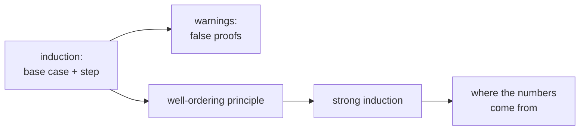

# PA05 · Induction and the Number Systems

◀ [[PA04 Functions and Cardinality]] · [[PA06 The Real Numbers and Sequences]] ▶

> [!info] Deeper treatments (added 2026-10-29)
> [[PA08 Mathematical Induction]] (variants, families of problems, strengthening, failures) · [[PA09 Strong Induction and Recursion]] (strong induction, strong recursion, structural induction) · [[PA10 Well-Ordering and Well-Ordered Pairs]] (WOP and the equivalence cycle, minimal counterexamples, lexicographic well-orders, induction on pairs).

taught · in syllabus extra · book extra · beyond

> [!syllabus] Syllabus map: what is in the syllabus and what is extra in this chapter
> 🟢 **In syllabus (taught)**: [[Assignment-8.pdf#page=1|Assignment 8]] (the Principle of Mathematical Induction: inductive sets, statement and extended forms, the four-part proof, problems 6–7) and the **well-ordering principle** used in Lecture 18 and in Assignment 7 Q4.
> - §1 inductive sets, PMI in set form, statement form, extended form; the four parts of a proof
> - §2 the four induction exercises (sums, factorials, divisibility, $2^n>n^2$) and the two "what induction does not prove" questions
> - §3 the well-ordering principle and why it gives induction
>
> 🟡 **Extra · book** (AI notes Part IV, ch. 12–15)
> - §4 strong induction; the black boxes of Lecture 18 proved (no injection $\mathbb N_{n+1}\to\mathbb N_n$)
> - §5 $\mathbb N$ as von Neumann sets, definition by recursion, $\mathbb Z$ and $\mathbb Q$ as quotients of $\mathbb N\times\mathbb N$ (the real numbers are the subject of [[PA06 The Real Numbers and Sequences]])
>
> 🔵 **Extra · beyond** (my additions, labelled)
> - §2 the horses fallacy; §3 irrationality of $\sqrt2$ by well-ordering; §5 sizes of $\mathbb Z$- and $\mathbb Q$-classes checked by computer (`scripts/pa_numbers.py`)

> [!key] After this chapter you can
> - write a complete **induction proof** (state $P(n)$, base case, step, conclusion) and choose the right base case,
> - say exactly which hypothesis of PMI fails in a bogus proof,
> - use the **well-ordering principle** and **strong induction**,
> - explain how $\mathbb N$, $\mathbb Z$, $\mathbb Q$ are built and why these constructions use equivalence relations.

> [!intuition] The one-sentence story
> The natural numbers are what you reach from $1$ by adding $1$ again and again, and nothing else; induction is the precise form of "nothing else", so a property passed from each number to its successor holds for all of them.

<!-- intuition-v1 -->

*Concept map: how the ideas of this chapter depend on each other (read left to right; every box is a section).*

## 1. The Principle of Mathematical Induction
taught *Assignment 8, Definition 2, Examples and Remark*

> [!intuition] Dominoes
> The base case tips the first domino; the inductive step says each domino tips the next. Both are needed: a step without a base is a row of dominoes nobody pushes; a base without a step is one fallen domino.

Throughout $\mathbb N=\{1,2,3,\dots\}$.

> [!key] PMI
> A subset $S\subseteq\mathbb N$ is **inductive** if $k\in S\Rightarrow k+1\in S$ for every $k\in\mathbb N$. **PMI (set form):** if $S\subseteq\mathbb N$ is inductive and $1\in S$, then $S=\mathbb N$.
> **Statement form.** If $P(1)$ is true and $P(k)\Rightarrow P(k+1)$ for every $k\in\mathbb N$, then $P(n)$ is true for every $n\in\mathbb N$ (apply the set form to $S=\{n:P(n)\}$).
> **Extended form.** If $P(m)$ is true and $P(k)\Rightarrow P(k+1)$ for every integer $k\ge m$, then $P(n)$ holds for all integers $n\ge m$.

> [!key] A proof by induction has four parts (write all four every time)
> 1. State precisely what $P(n)$ is. 2. **Base case**: prove $P(1)$ (or $P(m)$). 3. **Inductive step**: assume $P(k)$ for an arbitrary $k$ and prove $P(k+1)$. 4. Conclude by PMI.

> [!intuition] Dominoes
> The step is "if domino $k$ falls then domino $k+1$ falls"; the base case pushes the first domino. Without the push nothing falls; without the step only the first does.

## 2. The four exercises and the two warnings
taught *Assignment 8, questions 6–7*

> [!example] Q6(a) $1+3+5+\dots+(2n-1)=n^2$
> *Base* $n=1$: $1=1^2$. *Step:* if $1+\dots+(2k-1)=k^2$ then adding $2k+1$: $k^2+2k+1=(k+1)^2$. (Checked for $n<400$.)

> [!example] Q6(b) $1\cdot1!+2\cdot2!+\dots+n\cdot n!=(n+1)!-1$
> *Base* $n=1$: $1=2!-1$. *Step:* $(k+1)!-1+(k+1)(k+1)!=(k+1)!\,(1+k+1)-1=(k+2)!-1$. (Checked for $n<40$.)

> [!example] Q6(c) $6\mid n^3+5n$
> *Base* $n=1$: $6$. *Step:* $(k+1)^3+5(k+1)=(k^3+5k)+3k(k+1)+6$. By hypothesis $6\mid k^3+5k$; $k(k+1)$ is even so $6\mid3k(k+1)$; and $6\mid6$. The values $n^3+5n=6,18,42,84,150,246,\dots$ are $6\times1,3,7,14,25,41,\dots$.

> [!example] Q6(d) $2^n>n^2$ for every integer $n\ge5$
> *The base case is $n=5$*: $32>25$. For $n=2,3,4$ the claim **fails** ($4=4$, $8<9$, $16=16$; Figure PA5.1 A). *Step:* if $2^k>k^2$ with $k\ge5$ then $2^{k+1}>2k^2\ge(k+1)^2$, the last because $k^2\ge2k+1$ holds for $k\ge3$ ($9-6-1=2$).

![[fig_pa05_induction.png]]
*Figure PA5.1. A: $2^n$ against $n^2$; the red circles mark $n=2,3,4$ where the inequality fails, which is why the base case must be $n=5$. B: the integers as differences of naturals: each diagonal $a-b=\text{const}$ of $\mathbb N\times\mathbb N$ is one integer (§5).*

> [!example] Q7(a) The "theorem" $n=n+1$
> Assume $P(k)$: $k=k+1$. Add 1 to both sides: $k+1=k+2$, which is $P(k+1)$. **The inductive step is valid**, but the **base case** $P(1)$: $1=2$ is false. PMI requires both hypotheses; with the base case missing nothing is proved. (If you check $P(n)\Rightarrow P(n+1)$ for all $n$, you still have not proved $P(n)$ for any $n$.)

> [!example] Q7(b) Induction does not work on $\mathbb Q$
> Let $P(x)$ be "$x\ge1$" for $x\in\mathbb Q$. Then $P(1)$ is true and $P(x)\Rightarrow P(x+1)$ for every $x\in\mathbb Q$, yet $P(\tfrac12)$ is false. PMI is a statement about $\mathbb N$: its proof uses the **well-ordering of $\mathbb N$** (§3), and $\mathbb Q$ lacks it: the "orbit" $\{1,2,3,\dots\}$ of $1$ under $x\mapsto x+1$ does not exhaust $\mathbb Q$, and the set $\{x\in\mathbb Q:x>0\}$ has no least element.

> [!example] 🔵 The horses fallacy
> "All horses have the same colour": $P(n)$ = "any $n$ horses have one colour". $P(1)$ is true. The step takes $k+1$ horses, removes one, removes another, and uses the overlap of the two groups of $k$. For $k=1$ the two groups $\{h_1\}$, $\{h_2\}$ **do not overlap**, so the step fails from $P(1)$ to $P(2)$. An inductive step must hold for **every** $k\ge$ base, including the first.

## 3. The well-ordering principle
taught *used in Lecture 18 (black box 3) and Assignment 7 Q4 (the least $n_1$ with $f(n_1)\in S$)*

> [!intuition] 'Every nonempty set of naturals has a least element'
> This is induction in different clothing, and it is the engine of proofs by 'minimal counterexample': if a counterexample exists, the smallest one leads to a contradiction.

> [!key] Well-ordering principle (WOP)
> Every **non-empty** subset of $\mathbb N$ has a **least element**.

It is equivalent to PMI.

> [!derivation] WOP $\Rightarrow$ PMI
> Let $S$ be inductive with $1\in S$ and suppose $S\ne\mathbb N$. Then $\mathbb N\setminus S\ne\varnothing$ has a least element $m$. $m\ne1$ (as $1\in S$), so $m-1\in\mathbb N$ and $m-1\in S$ (by leastness of $m$); inductiveness gives $m=(m-1)+1\in S$, a contradiction.

> [!example] 🔵 $\sqrt2$ is irrational by well-ordering
> If $\sqrt2=p/q$ with positive integers, let $q$ be the **least** positive integer for which $q\sqrt2$ is an integer (it exists by WOP). Then $p=q\sqrt2$ and $\sqrt2=\dfrac{2q-p}{p-q}$ (indeed $q\sqrt2(\sqrt2+1)=p(1+\sqrt2)$). Since $1<\sqrt2<2$ we have $0<p-q<q$, and $(p-q)\sqrt2=2q-p$ is an integer: a smaller denominator, contradiction.

## 4. Strong induction and the finite-set black boxes
extra · book *AI notes ch. 12–13; Sundstrom Ch. 4*

> [!intuition] Strong induction lets you use *all* smaller cases
> Prime factorisation: $n$ is prime or $ab$ with $a,b<n$, so assume the claim for every smaller number. Weak induction (only $n-1$) would not be enough.

> [!key] Strong induction
> If $P(1)$ holds and $[P(1)\wedge\dots\wedge P(k)]\Rightarrow P(k+1)$ for all $k$, then $P(n)$ for all $n$. (Equivalent to PMI and to WOP.)

> [!example] Every $n\ge2$ is a product of primes
> If $n$ is prime, done. Otherwise $n=ab$ with $1<a,b<n$; by the induction hypothesis each of $a,b$ is a product of primes, hence so is $n$. (Checked by factorising every $n\le10^4$.)

> [!derivation] Lecture 18's first black box: there is no injection $\mathbb N_{n+1}\to\mathbb N_n$
> Induction on $n$. $n=1$: any map $\mathbb N_2\to\mathbb N_1$ is constant, so not injective. Step: suppose an injection $f:\mathbb N_{n+2}\to\mathbb N_{n+1}$. If $f(n+2)\ne n+1$, compose with the transposition swapping $n+1$ and $f(n+2)$ to get an injection sending $n+2\mapsto n+1$. Then the restriction to $\mathbb N_{n+1}$ never takes the value $n+1$ and is an injection $\mathbb N_{n+1}\to\mathbb N_n$, contradicting the induction hypothesis. This is the **pigeonhole principle**. It is what makes "the number of elements of a finite set" well defined and shows $\mathbb N_j\sim\mathbb N_k\Rightarrow j=k$.

## 5. Where the numbers come from
extra · book *AI notes ch. 12–15*

![[PA05 The Number System Tower.svg]]
*Figure PA5.2. The tower $\mathbb N\to\mathbb Z\to\mathbb Q\to\mathbb R$ (SVG; an editable Excalidraw copy is in `Assets/excalidraw/`).*

> [!key] The natural numbers as sets (von Neumann)
> $0=\varnothing$, and $n+1=n\cup\{n\}$: $1=\{\varnothing\}$, $2=\{\varnothing,\{\varnothing\}\}$, $3=\{0,1,2\}$, … The **Axiom of Infinity** (PA02) gives a set containing $\varnothing$ and closed under $x\mapsto x\cup\{x\}$; $\mathbb N$ is the intersection of all such sets, so induction **holds by construction**: a subset containing $0$ and closed under successor is all of $\mathbb N$. The $n$-th natural number has exactly $n$ elements, $m<n\iff m\in n\iff m\subsetneq n$ (checked for $m,n\le6$).

> [!key] Definition by recursion
> The **recursion theorem** says that for a set $X$, $x_0\in X$ and $g:X\to X$ there is a unique sequence $(x_n)$ with $x_0$ given and $x_{n+1}=g(x_n)$ (and its two-step version for the Fibonacci numbers $F_{n+2}=F_{n+1}+F_n$). Factorial, powers, sums $\sum_{k\le n}$ and the sequences of [[PA06 The Real Numbers and Sequences]] are defined this way.

> [!key] $\mathbb Z$ and $\mathbb Q$ by equivalence classes ([[PA03 Relations Equivalence and Order]])
> - $\mathbb Z=(\mathbb N\times\mathbb N)/{\sim}$ with $(a,b)\sim(c,d)\iff a+d=c+b$; the class of $(a,b)$ plays the role of $a-b$. Among $a,b\in\{0,\dots,5\}$ there are exactly $11=2\cdot5+1$ classes (the values $-5,\dots,5$; Figure PA5.1 B).
> - $\mathbb Q=\{(a,b):a\in\mathbb Z,b\in\mathbb Z\setminus\{0\}\}/{\sim}$ with $(a,b)\sim(c,d)\iff ad=bc$; the class of $(a,b)$ is the fraction $a/b$. With numerators and denominators in $1,\dots,6$ the 36 pairs fall into $23$ classes (distinct fractions).
> - Operations are defined on representatives ($[(a,b)]+[(c,d)]=[(a+c,b+d)]$ for $\mathbb Z$, $\frac ab+\frac cd=\frac{ad+bc}{bd}$) and one **checks well-definedness**, exactly as for congruences.
> - $\mathbb R$ is built from $\mathbb Q$ by Dedekind cuts (PA06).

## Map of this chapter
> [!connection] How PA05 connects
> **Builds on:** [[PA04 Functions and Cardinality]] (the black boxes of Lecture 18), [[PA03 Relations Equivalence and Order]] (quotients) and [[PA02 Sets Families and the ZFC Foundations]] (the Axiom of Infinity).
> **Leads to (deeper):** [[PA08 Mathematical Induction]] · [[PA09 Strong Induction and Recursion]] · [[PA10 Well-Ordering and Well-Ordered Pairs]].
> **Leads to:** [[PA06 The Real Numbers and Sequences]] (sequences are functions $\mathbb N\to\mathbb R$; the Archimedean property rests on induction), [[PA07 Metric and Topological Spaces]].
> **Concepts:** [[Principle of Mathematical Induction]] · [[Well-Ordering Principle]] · [[Strong Induction]] · [[Recursion Theorem]] · [[Natural Numbers]] · [[Construction of Integers and Rationals]]
> **Other subjects:** [[Proofs, Analysis and Topology - Course Map]], [[Probability - Course Map]] ([[PR01 Counting and the Axioms of Probability]]: the derivations $|\mathcal P(A)|=2^n$ and the inclusion-exclusion proof use induction; the binomial theorem is proved by induction), [[EE02 Structured Population Models]] (recursions $N_{t+1}=g(N_t)$ are definitions by recursion).

## Summary
> [!summary] Cheat-sheet
> - PMI: $1\in S$ and $k\in S\Rightarrow k+1\in S$ ⇒ $S=\mathbb N$. Four parts: define $P(n)$; base; step; conclude. Extended form from base $m$.
> - Identities proved: $\sum(2k-1)=n^2$; $\sum k\cdot k!=(n+1)!-1$; $6\mid n^3+5n$; $2^n>n^2$ for $n\ge5$ (fails at $2,3,4$).
> - "$n=n+1$": step valid, base false. $\mathbb Q$ is not covered by $1,2,3,\dots$: induction needs well-ordering.
> - WOP ⇔ PMI ⇔ strong induction. Pigeonhole: no injection $\mathbb N_{n+1}\to\mathbb N_n$.
> - $0=\varnothing$, $n+1=n\cup\{n\}$; $\mathbb Z=(\mathbb N^2)/{\sim}$, $(a,b)\sim(c,d)\iff a+d=c+b$; $\mathbb Q$: $ad=bc$; operations defined on representatives and checked.

## Practice
1. **Squares.** Prove $1^2+2^2+\dots+n^2=\frac{n(n+1)(2n+1)}6$.
2. **Telescoping.** Prove $\sum_{k=1}^n\frac1{k(k+1)}=\frac n{n+1}$.
3. **Divisibility.** Prove $6\mid7^n-1$ for every $n\ge1$.
4. **Base case.** Find the least $m$ such that $n!>2^n$ for all $n\ge m$ and prove it.
5. **Fibonacci.** With $F_1=F_2=1$, $F_{n+2}=F_{n+1}+F_n$ prove $F_1+\dots+F_n=F_{n+2}-1$ and $F_n<2^n$.
6. **Bernoulli.** Prove $(1+x)^n\ge1+nx$ for $x\ge-1$, $n\in\mathbb N$.
7. **Find the flaw.** What breaks in the "proof" that all horses have the same colour?
8. **Strong induction.** Prove every integer $n\ge2$ is a product of primes.
9. **Well-ordering.** Prove there is no integer $m$ with $0<m<1$.
10. **Counting subsets.** Prove by induction that an $n$-element set has $2^n$ subsets.

> [!example]- Solutions
> 1. Base $n=1$: $1=\frac{1\cdot2\cdot3}6$. Step: $\frac{k(k+1)(2k+1)}6+(k+1)^2=\frac{(k+1)}6\big(k(2k+1)+6(k+1)\big)=\frac{(k+1)(2k^2+7k+6)}6=\frac{(k+1)(k+2)(2k+3)}6$.
> 2. Base $\frac12=\frac12$. Step: $\frac k{k+1}+\frac1{(k+1)(k+2)}=\frac{k(k+2)+1}{(k+1)(k+2)}=\frac{(k+1)^2}{(k+1)(k+2)}=\frac{k+1}{k+2}$.
> 3. Base: $6\mid6$. Step: $7^{k+1}-1=7(7^k-1)+6$.
> 4. $3!=6<8=2^3$, $4!=24>16$, so $m=4$. Step: $(k+1)!=(k+1)k!>(k+1)2^k\ge2\cdot2^k$ since $k+1\ge2$.
> 5. Base $F_1=1=F_3-1=2-1$. Step: $F_{k+2}-1+F_{k+1}=F_{k+3}-1$. For $F_n<2^n$ use strong induction: $F_1=1<2$, $F_2=1<4$, $F_{n+2}=F_{n+1}+F_n<2^{n+1}+2^n<2^{n+2}$.
> 6. Base $1+x\ge1+x$. Step: $(1+x)^{k+1}=(1+x)(1+x)^k\ge(1+x)(1+kx)=1+(k+1)x+kx^2\ge1+(k+1)x$, using $1+x\ge0$ to multiply the inequality.
> 7. The step $P(1)\Rightarrow P(2)$ fails: the two groups of $k=1$ horses do not overlap, so no horse is common to both. For $k\ge2$ the argument is fine, but there is no true base $P(2)$.
> 8. Suppose each $m$ with $2\le m<n$ is a product of primes. If $n$ is prime done; else $n=ab$ with $2\le a,b<n$ and both factor, hence $n$ does.
> 9. If such an integer existed, $\{m\in\mathbb Z:0<m<1\}\subseteq\mathbb N$ is non-empty and has a least element $m_0$. Then $0<m_0^2<m_0<1$ (since $0<m_0<1$), so $m_0^2$ is a smaller element of the set, a contradiction.
> 10. $n=0$: $\{\varnothing\}$, $1=2^0$. If an $n$-set $A$ has $2^n$ subsets and $x\notin A$, the subsets of $A\cup\{x\}$ are those not containing $x$ ($2^n$ of them) and those containing $x$ ($S\cup\{x\}$ for $S\subseteq A$, another $2^n$): $2^{n+1}$ in all.

<!-- zettel:start (generated by scripts/sort_zettel.py; do not edit between the markers) -->
## Zettel notes

> [!abstract]- Zettel notes filed under this chapter (4): the other tool's concept notes from the lectures, unreviewed
> [[zettel/inductive-set|Inductive set]] · [[zettel/method-of-minimal-counterexample|Method of Minimal Counterexample]] · [[zettel/principle-of-strong-induction|Principle of Strong Induction]] · [[zettel/well-ordering-principle|Well-Ordering Principle]]
<!-- zettel:end -->

## Provenance
> [!provenance]- Source map for this chapter
> | Topic | Source | Scope |
> |---|---|---|
> | inductive sets, PMI, statement and extended forms, four-part proof, Q6–Q7 | [[Assignment-8.pdf#page=1\|Assignment 8]] | taught |
> | well-ordering principle used for subsets of $\mathbb N$; black boxes | [[Countable-Uncountable-sets.pdf]] Lecture 18; [[Assignment-7.pdf]] Q4 | taught |
> | strong induction, von Neumann $\mathbb N$, recursion, $\mathbb Z$ and $\mathbb Q$ by classes | AI notes `proofs-prems-topo.pdf` ch. 12–14; Sundstrom Ch. 4 | extra/book |
> | horses fallacy, $\sqrt2$ by WOP, class counts | `scripts/pa_numbers.py`, `fig_pa05_induction.py` | extra/beyond |
>
> **Notes.** Assignment 8 uses $\mathbb N=\{1,2,\dots\}$; the AI notes use $\mathbb N=\{0,1,2,\dots\}$ and write $\mathbb N_{\ge1}$ for the positive integers (their notation key says so). Here $\mathbb N$ starts at 1 (the assignments' convention), and von Neumann numbering starts at 0.

**References.** Sundstrom, T. *Mathematical Reasoning*, Ch. 4 · Kumaresan et al., *A Foundation Course in Mathematics* · Peano, G. (1889) *Arithmetices principia* · von Neumann, J. (1923) *Zur Einführung der transfiniten Zahlen*.
