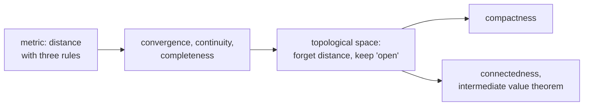

# PA07 · Metric and Topological Spaces

◀ [[PA06 The Real Numbers and Sequences]] · [[Proofs, Analysis and Topology - Course Map]]

extra · book extra · beyond

> [!warning] Scope of this chapter
> **No lecture note or assignment in the folder covers metric or topological spaces.** The course's title ("Proofs, Analysis and Topology") and the books supplied (Munkres, Hatcher, Kumaresan et al., Sundstrom) point here, and the AI-written monograph `proofs-prems-topo.pdf` ends with this material, but there is no instructor source. Everything below is 🟡/🔵: proofs follow the AI notes (read and rechecked) and Munkres/Hatcher; the numbers are my own computations. **Ask the instructor** how far the course goes (perhaps only to the definition of a metric and open sets).

> [!syllabus] Syllabus map: what is in the syllabus and what is extra in this chapter
> 🟡 **Extra · book** (AI notes ch. 17–18; Munkres Ch. 2–3; Hatcher §§1–3)
> - §1 metric spaces, balls, open and closed sets; §2 convergence, continuity, completeness
> - §3 topological spaces, subspaces, closure/interior/boundary; §4 compactness and Heine–Borel; §5 connectedness and the intermediate value theorem
>
> 🔵 **Extra · beyond** (my additions, labelled)
> - which "distances" fail the triangle inequality (random tests); the **number of topologies on 1, 2, 3, 4 points** (1, 4, 29, 355) by brute force and their equality with the numbers of preorders; unit balls of $\ell^1,\ell^2,\ell^\infty$; bisection for the intermediate value theorem (`scripts/pa_numbers.py`)

> [!key] After this chapter you can
> - check the **metric axioms** (and find which fails), draw balls, and decide whether a set is **open, closed, both or neither**,
> - state **continuity** three ways ($\varepsilon$–$\delta$, preimages of open sets, sequences),
> - write down a **topology**, find closure, interior and boundary, and say why some topologies are not metrisable,
> - prove that $[a,b]$ is **compact**, that continuous images of compact (connected) sets are compact (connected), and deduce the **extreme value** and **intermediate value** theorems.

> [!intuition] The one-sentence story
> A metric says how far apart points are; a topology keeps only "which sets are open", i.e. which points are near which sets, and that is exactly enough to define continuity, compactness and connectedness.

<!-- intuition-v1 -->

*Concept map: how the ideas of this chapter depend on each other (read left to right; every box is a section).*

## 1. Metric spaces
extra · book *AI notes ch. 17.1*

> [!intuition] Three rules make a notion of nearness
> Positive (distinct points are apart), symmetric, and the triangle inequality (a detour is never shorter). Anything that satisfies them, from city blocks to functions to words, supports limits and continuity.

> [!key] Definition
> A **metric** on $X$ is $d:X\times X\to\mathbb R$ with (M1) $d(x,y)\ge0$, $=0$ iff $x=y$; (M2) $d(x,y)=d(y,x)$; (M3) $d(x,z)\le d(x,y)+d(y,z)$ (**triangle inequality**). Examples: $|x-y|$ on $\mathbb R$; the Euclidean metric on $\mathbb R^n$; the **taxicab** $\ell^1$ and **max** $\ell^\infty$ metrics; the **discrete metric** ($1$ if $x\ne y$); the **sup metric** $\sup_a|f(a)-g(a)|$ on bounded functions; any subset with the restricted metric.

> [!example] 🔵 Which "distances" are metrics?
> $\ell^1,\ell^2,\ell^\infty$ and the discrete metric pass 5000 random triples without a violation (they are metrics). The **squared** Euclidean "distance" $d(x,y)=\|x-y\|^2$ fails (M3): on $\mathbb R$, $d(0,2)=4>d(0,1)+d(1,2)=2$; in 5000 random triples in the plane, 1256 violated it.

![[fig_pa07_topology.png]]
*Figure PA7.1. A: unit balls $\{y:d(0,y)<1\}$ of the $\ell^1$ (diamond, area 2), $\ell^2$ (disc, area $\pi$) and $\ell^\infty$ (square, area 4) metrics. B: numbers of topologies on an $n$-point set: labelled $1,4,29,355$ and up to homeomorphism $1,3,9,33$ ($n=1,\dots,4$). C: $\{(1/n,1)\}$ is an open cover of $(0,1)$ with no finite subcover.*

> [!key] Open and closed sets
> The **open ball** $B(x,r)=\{y:d(x,y)<r\}$. $U$ is **open** if $\forall x\in U\ \exists r>0\ B(x,r)\subseteq U$; $F$ is **closed** if $X\setminus F$ is open.
> *Balls are open:* if $y\in B(x,r)$ and $\rho=r-d(x,y)>0$ then $B(y,\rho)\subseteq B(x,r)$ by the triangle inequality.

> [!key] The topology of a metric space
> (a) $\varnothing$ and $X$ are open. (b) **Any** union of open sets is open. (c) **Finite** intersections of open sets are open (take the minimum of finitely many radii). Dually, arbitrary intersections of closed sets and finite unions of closed sets are closed (De Morgan, [[PA02 Sets Families and the ZFC Foundations]]).

> [!pitfall] Infinite intersections and unions
> $\bigcap_n(-\frac1n,\frac1n)=\{0\}$ is **not** open; $\bigcup_n[\frac1n,1-\frac1n]=(0,1)$ ($n\ge2$) is **not** closed. In $\mathbb R$: $(a,b)$ open, $[a,b]$ closed, $[a,b)$ neither; $\mathbb Z$ closed; $\mathbb Q$ neither; $\mathbb R$ and $\varnothing$ both open and closed.

## 2. Convergence, continuity, completeness
extra · book *AI notes ch. 17.2–17.3*

> [!key] Convergence and continuity
> $x_n\to L$ in $(X,d)$ iff $d(x_n,L)\to0$ (PA06). $f:X\to Y$ is **continuous at $a$** if $\forall\varepsilon>0\,\exists\delta>0\,\forall x\ (d_X(x,a)<\delta\Rightarrow d_Y(f(x),f(a))<\varepsilon)$.

> [!key] Theorem (three equivalent descriptions of continuity)
> For $f:X\to Y$ metric spaces: (a) $f$ is continuous; (b) $f^{-1}(V)$ is **open** for every open $V\subseteq Y$; (c) $x_n\to x$ implies $f(x_n)\to f(x)$.
> *(a)⇒(b):* $a\in f^{-1}(V)$, $B(f(a),\varepsilon)\subseteq V$, take $\delta$ from (a): $B(a,\delta)\subseteq f^{-1}(V)$. *(b)⇒(a):* preimage of the open ball $B(f(a),\varepsilon)$ is open and contains $a$. *(a)⇒(c):* eventually $d(x_n,x)<\delta$. *(c)⇒(a):* if (a) fails at $a$, choose $\delta=1/n$ to get $x_n\to a$ with $d(f(x_n),f(a))\ge\varepsilon$ (using the negation of PA01).
> Also: $F$ is **closed** iff every sequence in $F$ converging in $X$ has its limit in $F$.

> [!key] Completeness
> A metric space is **complete** if every Cauchy sequence converges in it. $\mathbb R$ is complete (PA06). $\mathbb Q$ is not ($1,1.4,1.41,\dots$); $(0,1)$ is not ($\frac1n$ is Cauchy with limit $0\notin(0,1)$); any discrete space is. A closed subspace of a complete space is complete, and a complete subspace of any metric space is closed.

## 3. Topological spaces
extra · book *AI notes ch. 18.1–18.3; Munkres §12–§17*

> [!intuition] Topology keeps only 'who is near whom'
> You can bend, stretch and squash a space; as long as neighbourhoods are preserved, topology does not notice. A coffee cup and a doughnut are the same.

> [!key] Definition
> A **topology** on $X$ is a family $\tau\subseteq\mathcal P(X)$ with (T1) $\varnothing,X\in\tau$; (T2) closed under **arbitrary unions**; (T3) closed under **finite intersections**. Members of $\tau$ are **open**; complements are **closed**. A map is **continuous** if preimages of open sets are open; every metric gives a topology $\tau_d$ (§1), a topology of that form is **metrisable**.

> [!example] Examples
> **Discrete** $\tau=\mathcal P(X)$ (metrisable); **indiscrete** $\{\varnothing,X\}$ (not metrisable if $|X|\ge2$: a metric separates points by open balls); **cofinite** (complements finite, plus $\varnothing$) on an infinite $X$; the **subspace topology** on $S\subseteq X$: $\{U\cap S:U\in\tau\}$; a **basis** $\mathcal B$ generates the topology of all unions of its members (open balls form a basis in a metric space).
> A concrete one on $X=\{1,2,3\}$: $\tau=\{\varnothing,\{1\},\{3\},\{1,2\},\{1,3\},X\}$ (checked: closed under all pairwise unions and intersections). Its closed sets are $X,\{2,3\},\{1,2\},\{3\},\{2\},\varnothing$; $\mathrm{cl}\{1\}=\{1,2\}$ (the smallest closed set containing 1), $\mathrm{int}\{2\}=\varnothing$ although $\{2\}$ is closed.

> [!key] Closure, interior, boundary
> $\mathrm{int}(A)=\bigcup\{U\text{ open}:U\subseteq A\}$ (the largest open subset), $\mathrm{cl}(A)=\bigcap\{F\text{ closed}:A\subseteq F\}$ (the smallest closed superset), $\mathrm{bd}(A)=\mathrm{cl}(A)\setminus\mathrm{int}(A)$. $A$ is open iff $A=\mathrm{int}A$, closed iff $A=\mathrm{cl}A$. In $\mathbb R$: $\mathrm{int}[0,1]=(0,1)$, $\mathrm{cl}(0,1)=[0,1]$, $\mathrm{bd}[0,1]=\{0,1\}$, $\mathrm{int}\,\mathbb Q=\varnothing$, $\mathrm{cl}\,\mathbb Q=\mathbb R$ (density, PA06), so $\mathrm{bd}\,\mathbb Q=\mathbb R$.

> [!example] 🔵 How many topologies are there on a small set?
> By brute force (a family of subsets is a topology iff it contains $\varnothing,X$ and is closed under pairwise unions and intersections):
> | points $n$ | 1 | 2 | 3 | 4 |
> |---|---|---|---|---|
> | topologies on $\{1,\dots,n\}$ | 1 | 4 | 29 | 355 |
> | up to homeomorphism | 1 | 3 | 9 | 33 |
> The labelled counts $1,4,29,355$ are exactly the numbers of **preorders** on $n$ points ([[PA03 Relations Equivalence and Order]]): a finite topology is the same thing as a reflexive transitive relation ($x\le y$ iff every open set containing $x$ contains $y$; open sets = up-sets). Topologies on 2 points: discrete, indiscrete, and two copies of the Sierpiński space $\{\varnothing,\{a\},X\}$, $\{\varnothing,\{b\},X\}$ (homeomorphic to each other): 3 up to homeomorphism.

## 4. Compactness
extra · book *AI notes ch. 18.4*

> [!intuition] Compact: no escape to infinity or to a missing boundary point
> In $\mathbb R^n$ that is exactly closed and bounded (Heine–Borel). Its great consequence: a continuous function on a compact set attains its maximum.

> [!key] Definition
> An **open cover** of $A\subseteq X$ is a family of open sets whose union contains $A$. $A$ is **compact** if every open cover has a **finite subcover**. Every finite set is compact.

> [!example] $(0,1)$ is not compact (Figure PA7.1 C)
> $\{(\frac1n,1):n\ge2\}$ covers $(0,1)$ but any finite subfamily is contained in $(\frac1N,1)$ for the largest $N$ used, and misses $\frac1{2N}$.

> [!key] Theorem (Heine–Borel). $A\subseteq\mathbb R$ is compact iff it is closed and bounded.
> *Compact ⇒ bounded:* $\{(-n,n)\}$ covers $\mathbb R$; a finite subcover has a largest $n$. *Compact ⇒ closed:* for $y\notin A$ cover $A$ by balls $B(x,\frac{|x-y|}2)$, $x\in A$; a finite subcover with minimum radius $r$ gives $B(y,r)\cap A=\varnothing$.
> *$[a,b]$ is compact:* let $S=\{x\in[a,b]:[a,x]\text{ has a finite subcover}\}$; $a\in S$, $S$ is bounded; let $s=\sup S$ and pick $U_0\ni s$ in the cover with $B(s,\delta)\subseteq U_0$. Some $x_0\in S$ exceeds $s-\delta$; a finite subcover of $[a,x_0]$ together with $U_0$ covers $[a,\min(s+\delta/2,b)]$ (the part beyond $x_0$ lies in $B(s,\delta)\subseteq U_0$). If $s<b$ this puts the point $\min(s+\delta/2,b)>s$ in $S$, contradicting $s=\sup S$; so $s=b$, and the same finitely many sets then cover $[a,b]$, i.e. $b\in S$. *Closed and bounded ⇒ compact:* $A\subseteq[a,b]$; add the open set $\mathbb R\setminus A$ to a cover of $A$ to cover $[a,b]$, extract a finite subcover, and drop $\mathbb R\setminus A$.
> (The sup argument is exactly the completeness of PA06 at work.)

> [!key] Continuous images of compact sets are compact
> If $f$ is continuous and $K$ compact, $f(K)$ is compact: given an open cover $\mathcal V$ of $f(K)$, the sets $f^{-1}(V)$ are open and cover $K$; a finite subcover gives finitely many $V_i$ covering $f(K)$.
> **Extreme value theorem.** A continuous $f:[a,b]\to\mathbb R$ is bounded and attains its max and min: $f([a,b])$ is compact, hence closed and bounded, so it contains its sup and inf. Example: $x(1-x)$ on $[0,1]$ has max $\frac14$ at $\frac12$; $x$ on $(0,1)$ has no max (not compact).

## 5. Connectedness and the intermediate value theorem
extra · book *AI notes ch. 18.5*

> [!intuition] Connected: in one piece
> A set that cannot be split into two disjoint open parts. The intermediate value theorem is the statement that a continuous image of an interval is connected: it cannot jump over a value.

> [!key] Definition
> $X$ is **disconnected** if $X=U\cup V$ with $U,V$ disjoint, non-empty and open (equivalently some non-empty proper subset is both open and closed); otherwise **connected**. $A\subseteq X$ is connected if it is connected in the subspace topology.

> [!key] Theorem. $A\subseteq\mathbb R$ is connected iff it is an interval
> (i.e. $x,y\in A$, $x<z<y\Rightarrow z\in A$.) *Not an interval ⇒ disconnected:* if $z\notin A$ lies between $x,y\in A$ then $A\cap(-\infty,z)$ and $A\cap(z,\infty)$ separate it. *Interval ⇒ connected:* if $A=U\cup V$ separated, $x\in U$, $y\in V$, $x<y$, put $s=\sup(U\cap[x,y])$. Then $x\le s\le y$, so $s\in A$ (interval), so $s$ is in $U$ or in $V$. *If $s\in U$:* $s\ne y$ (as $y\in V$), so $s<y$; $U$ is open in $A$, so $(s-\varepsilon,s+\varepsilon)\cap A\subseteq U$ for some $\varepsilon>0$, and since $[x,y]\subseteq A$ the points of $(s,\min(s+\varepsilon,y))$ are in $U\cap[x,y]$, contradicting that $s$ is an upper bound. *If $s\in V$:* $s>x$; $V$ is open in $A$, so $(s-\varepsilon,s]\cap[x,y]\subseteq V$ contains no point of $U$; every element of $U\cap[x,y]$ is then $\le s-\varepsilon$, so $s-\varepsilon$ is a smaller upper bound, contradicting leastness. Both cases are impossible, so no separation exists.
> $\mathbb Z$ and $\mathbb Q$ are disconnected ($\mathbb Q=(\mathbb Q\cap(-\infty,\sqrt2))\cup(\mathbb Q\cap(\sqrt2,\infty))$); $[0,1]\cup[2,3]$ is disconnected; $\mathbb R$ and $[a,b]$ are connected.

> [!key] Continuous images of connected sets are connected; the intermediate value theorem
> If $f:X\to Y$ is continuous and $X$ connected, $f(X)$ is connected (a separation of $f(X)$ pulls back to one of $X$). **IVT:** if $f:[a,b]\to\mathbb R$ is continuous and $f(a)<c<f(b)$, then $f(x)=c$ for some $x$: $f([a,b])$ is a connected set (an interval) containing $f(a)$ and $f(b)$, hence $c$.

> [!example] 🔵 IVT in practice: bisection
> $\cos x=x$: $g(x)=\cos x-x$ has $g(0)=1>0>g(1)=-0.46$, so a root lies in $(0,1)$; bisection gives $0.73908513$ (40 halvings reach $10^{-12}$). $x^3+x-1$ has $f(0)=-1<0<f(1)=1$; successive midpoints $0.5,0.75,0.625,0.6875,0.65625,0.6719,0.6797,0.6836$ have $f<0,>0,<0,>0,<0,<0,<0,>0$ and bracket the root $0.68233$ (the bracket after 8 steps is $[0.6797,0.6836]$, of width $2^{-8}$).

<!-- interactive:start (generated by scripts/embed_interactive.py; edit the tool in scripts/interactive/tools/, not this block) -->
> [!interactive]+ Interactive: Compactness: when every open cover has a finite subcover
> A set is compact if from every cover by open sets one can pick finitely many that still cover it.
>
> ![[pa_compactness.png|720]]
>
> **Try:** Set (0, 1] with cover Uₙ = (1/n, 2): for any N, the uncovered gap (0, 1/N] never disappears. Switch to [0, 1] with the cover by balls of radius r = 0.1 around every point: a finite subcover of about 5–6 balls suffices (the chosen finite subcover is highlighted). The point 0 is where the open-cover trick for (0, 1] fails.
>
> [▶ Open the tool in your browser](../Assets/interactive/pa_compactness.html) · [absolute link](file:///home/swastik/Documents/notes/Assets/interactive/pa_compactness.html) · all tools and coverage: [[Interactive Tools]]

> [!interactive]+ Interactive: Metric balls: the same plane, different geometries
> The ball B(p, r) = {x : d(x,p) < r} for the ℓᵖ metric d_p(x,y) = (|x₁−y₁|ᵖ + |x₂−y₂|ᵖ)^{1/p}: a diamond for p = 1 (taxicab), a disc for p = 2, a square for p = ∞.
>
> ![[pa_metric_balls.png|720]]
>
> **Try:** p = 1, 2, ∞ with r = 1: area 2, π, 4. Slide p between 1 and ∞ and the diamond bulges into a square. In the discrete metric the ball B(p, 1) is {p} and B(p, 1.01) is everything. Click a point and watch the triangle inequality hold.
>
> [▶ Open the tool in your browser](../Assets/interactive/pa_metric_balls.html) · [absolute link](file:///home/swastik/Documents/notes/Assets/interactive/pa_metric_balls.html) · all tools and coverage: [[Interactive Tools]]

<!-- interactive:end -->

## Map of this chapter
> [!connection] How PA07 connects
> **Builds on:** [[PA06 The Real Numbers and Sequences]] (completeness, sequences) and [[PA02 Sets Families and the ZFC Foundations]] (unions, intersections, De Morgan, $\mathcal P(X)$).
> **Concepts:** [[Metric Space]] · [[Open and Closed Sets]] · [[Topological Space]] · [[Continuous Function (Topological)]] · [[Compact Space]] · [[Heine-Borel Theorem]] · [[Connected Space]] · [[Intermediate Value Theorem]] · [[Closure Interior and Boundary]]
> **Other subjects:** [[Proofs, Analysis and Topology - Course Map]], [[Quantum Mechanics - Course Map]] (state spaces are complete inner-product (Hilbert) spaces: completeness lets a Cauchy sequence of wavefunctions converge, [[QM01 From Waves to Probabilities]]), [[Fixed Points and Linear Stability]] (a contraction on a complete metric space has a unique fixed point; the IVT guarantees fixed points of continuous maps of $[0,1]$), [[Jensen Inequality]] (continuity of convex functions on open intervals), [[Probability - Course Map]] (the open sets generate the Borel $\sigma$-algebra on which probabilities live; compactness gives existence of maxima of likelihoods, [[Akaike Information Criterion]]), [[Bistability and Tipping Points]] (connectedness and the IVT locate the equilibria: if $f(a)<0<f(b)$ then a zero lies between).

## Summary
> [!summary] Cheat-sheet
> - Metric: $d\ge0$ (0 iff equal), symmetric, triangle inequality. $\ell^1,\ell^2,\ell^\infty$, discrete are metrics; $\|x-y\|^2$ is not.
> - Open: every point has a ball inside; **arbitrary unions, finite intersections**. Closed: complement open; contains limits of its sequences.
> - Continuity ⇔ $\varepsilon$–$\delta$ ⇔ preimages of open sets open ⇔ preserves limits of sequences.
> - Topology: $\varnothing,X$; any unions; finite intersections. Discrete, indiscrete (not metrisable), cofinite. $\mathrm{int}$, $\mathrm{cl}$, $\mathrm{bd}$. **Topologies on $n$ points: 1, 4, 29, 355 = number of preorders.**
> - **Compact** = every open cover has a finite subcover; in $\mathbb R$: closed and bounded; continuous image compact; **EVT**. $(0,1)$ not compact.
> - **Connected** = no separation; in $\mathbb R$ exactly the intervals; continuous image connected; **IVT**.

## Practice
1. **Bounded metric.** Show $\rho(x,y)=\min(1,|x-y|)$ is a metric on $\mathbb R$ and that it has the same open sets as $|x-y|$.
2. **Balls.** In $(\mathbb R^2,\ell^1)$ describe $B((1,2),2)$ and compute its area; in $(\mathbb R^2,\ell^\infty)$ describe it and compute its area.
3. **Open or closed.** Classify as open, closed, both, neither (in $\mathbb R$): $(0,1)$, $[0,1]$, $[0,1)$, $\mathbb Z$, $\mathbb Q$, $\{0\}\cup\{\frac1n:n\in\mathbb N\}$, $\mathbb R$, $\varnothing$.
4. **Closed balls.** In a metric space show $\{y:d(x,y)\le r\}$ is closed.
5. **Topologies on two points.** List all four topologies on $\{a,b\}$ and say which is metrisable.
6. **Is it a topology?** $X=\{1,2,3\}$, $\mathcal T=\{\varnothing,\{1\},\{2\},X\}$. Check (T2) and find the smallest topology containing $\mathcal T$.
7. **Cofinite.** On an infinite set with the cofinite topology show that every non-empty open set is dense (its closure is $X$) and that the space is compact.
8. **EVT.** Prove that a continuous $f:[a,b]\to\mathbb R$ is bounded using compactness, and give an example showing failure on $(0,1)$.
9. **Disconnected.** Show $\mathbb Z\subset\mathbb R$ and $[0,1]\cup[2,3]$ are disconnected and that $\mathbb R\setminus\{0\}$ is.
10. **IVT.** Show $x^3+x-1=0$ has a root in $(0,1)$; locate it to two decimals by bisection. Show also that every continuous $f:[0,1]\to[0,1]$ has a fixed point.

> [!example]- Solutions
> 1. (M1) and (M2) clear; (M3): if either $\min$ is 1 the right side $\ge1\ge\rho(x,z)$; else $|x-z|\le|x-y|+|y-z|$. Same open sets: $B_\rho(x,r)=B(x,r)$ for $r\le1$, and every ball contains a ball of radius $\le1$ about each of its points.
> 2. $\ell^1$: the open diamond $|x-1|+|y-2|<2$, area $2r^2=8$. $\ell^\infty$: the open square $(−1,3)\times(0,4)$, area $16$.
> 3. Open: $(0,1)$, $\mathbb R$, $\varnothing$. Closed: $[0,1]$, $\mathbb Z$, $\{0\}\cup\{\frac1n\}$ (it contains its only limit point 0), $\mathbb R$, $\varnothing$. Both: $\mathbb R,\varnothing$. Neither: $[0,1)$, $\mathbb Q$.
> 4. If $d(x,z)>r$, put $\rho=d(x,z)-r$; for $w\in B(z,\rho)$, $d(x,w)\ge d(x,z)-d(z,w)>r$, so $B(z,\rho)$ lies outside the closed ball: the complement is open.
> 5. $\{\varnothing,X\}$ (indiscrete), $\{\varnothing,\{a\},X\}$, $\{\varnothing,\{b\},X\}$ (Sierpiński), $\mathcal P(X)$ (discrete). Only the discrete topology is metrisable (any metric makes $\{a\}=B(a,\frac12d(a,b))$ open).
> 6. $\{1\}\cup\{2\}=\{1,2\}\notin\mathcal T$: not a topology. Adding $\{1,2\}$ gives $\{\varnothing,\{1\},\{2\},\{1,2\},X\}$ (closed under unions and intersections).
> 7. Closed sets are $X$ and finite sets; a non-empty open $U$ is infinite (complement finite), and the only closed set containing an infinite set is $X$, so $\mathrm{cl}\,U=X$. Compact: given a cover, pick one non-empty member $U_0$; $X\setminus U_0$ is finite, covered by finitely many other members.
> 8. $f([a,b])$ is compact, hence bounded. On $(0,1)$: $f(x)=\frac1x$ is continuous and unbounded.
> 9. $\mathbb Z=(-\infty,\frac12)\cap\mathbb Z\ \cup\ (\frac12,\infty)\cap\mathbb Z$. $[0,1]\cup[2,3]$: $U=[0,1]$, $V=[2,3]$ are open in the subspace and disjoint. $\mathbb R\setminus\{0\}=(-\infty,0)\cup(0,\infty)$.
> 10. $f(0)=-1<0<1=f(1)$; IVT gives a root. Bisection: midpoints $0.5,0.75,0.625,0.6875,0.65625,0.671875,0.6796875,0.68359375$ with $f$ signs $-,+,-,+,-,-,-,+$, bracket $[0.6797,0.6836]$, root $\approx0.68$ (more precisely $0.682328$). Fixed point: $g(x)=f(x)-x$ has $g(0)=f(0)\ge0$ and $g(1)=f(1)-1\le0$, so IVT gives $x$ with $g(x)=0$.

## Provenance
> [!provenance]- Source map for this chapter
> | Topic | Source | Scope |
> |---|---|---|
> | metric spaces, open/closed, continuity, completeness | AI notes `proofs-prems-topo.pdf` ch. 17 (proofs read and rechecked); Munkres §§12–21 | extra/book |
> | topologies, closure/interior, compactness, connectedness, IVT, EVT | AI notes ch. 18; Munkres Ch. 2–3; Hatcher §§1–3 | extra/book |
> | random triangle-inequality tests, topology counts, bisection | `scripts/pa_numbers.py`, `fig_pa07_topology.py` | extra/beyond |
>
> **Notes.** The AI notes' proof of "interval ⇒ connected" (Theorem 18.16) is correct but the case $s\in V$ is argued twice (once vaguely, once directly); the version above keeps the direct one. The count 355 of topologies on four points is the OEIS value (A000798); 29 on three points likewise.

**References.** Munkres, J. *Topology* (2nd ed.), Ch. 2–3 · Hatcher, A. *Notes on Introductory Point-Set Topology* · Kumaresan et al., *A Foundation Course in Mathematics* · Rudin, W. *Principles of Mathematical Analysis*, Ch. 2 · Fréchet, M. (1906) *Sur quelques points du calcul fonctionnel*.
