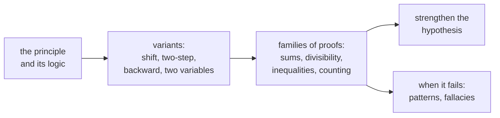

# PA08 · Mathematical Induction

◀ [[PA05 Induction and the Number Systems]] · [[PA09 Strong Induction and Recursion]] ▶ · [[Proofs, Analysis and Topology - Course Map]]

taught · in syllabus extra · book extra · beyond

> [!warning] How this chapter relates to PA05
> **Added 2026-10-29** at the user's request (chapters on mathematical induction, strong induction and well-ordering). [[PA05 Induction and the Number Systems]] §1–§2 states the principle, gives the four-part write-up and solves the four exercises and the two warnings of Assignment 8. This chapter is the **working manual**: why the principle holds, how to write a proof, the variants (shifted base, two-step, backward, two variables), the main families of problems with their standard tricks (above all **strengthening the hypothesis**), and the ways an induction proof fails. Strong induction is [[PA09 Strong Induction and Recursion]]; the well-ordering principle and well-ordered pairs are [[PA10 Well-Ordering and Well-Ordered Pairs]]. **No lecture beyond Assignment 8 is in the folder** for induction (Lectures 1–16 are missing), so §1 and §2 are 🟢 and the rest is textbook and my own.

> [!syllabus] Syllabus map: what is in the syllabus and what is extra in this chapter
> 🟢 **Taught** ([[Assignment-8.pdf#page=1|Assignment 8]]: Definition 2 inductive set and PMI, Example 1 statement and extended form, the Remark on the four parts, Problems 6–7)
> - §1 the principle and its logical form; the four-part write-up; the extended form with a base $m$
>
> 🟡 **Extra · book** (Bloch *Proofs and Fundamentals* §6.3, Theorems 6.3.1, 6.3.6, 6.3.8, 6.3.9; Sundstrom *Mathematical Reasoning* §4.1 pp.169–187; Tao *Analysis I* Prop. 2.2.14 and Exercise 2.2.6; AI notes `proofs-prems-topo.pdf` §3.4)
> - §2 the variants (two-step, backward, two variables); §3 sums, divisibility, inequalities, counting and recursive sequences
>
> 🔵 **Extra · beyond** (my additions; every number in `scripts/pa_numbers2.py`, figure `fig_pa08_induction2.py`)
> - §3 strengthening the hypothesis ($\sum1/k^2\le2-1/n$), the deficient chessboard, Tower of Hanoi with a lower bound; §4 why patterns are not proofs (Moser's circle, $n^2+n+41$, Fermat numbers), the fallacies

> [!key] After this chapter you can
> - state PMI precisely, say **which part of a proof proves which hypothesis**, and write a complete induction proof in the four-part form,
> - choose the right variant: shifted base, two bases for a two-step step, backward induction, induction on a different variable,
> - **strengthen the hypothesis** when a direct induction gets stuck,
> - diagnose a false induction proof: missing base, invalid step (for the smallest $k$), a non-arbitrary $k$, or a statement that is not about $\mathbb N$.

> [!intuition] The one-sentence story
> Induction is a **proof of infinitely many implications by a single implication**: instead of $P(1)\Rightarrow P(2)$, $P(2)\Rightarrow P(3)$, … one proves $P(k)\Rightarrow P(k+1)$ once, for an arbitrary $k$, and starts the chain with a base case.

<!-- intuition-v1 -->

*Concept map: how the ideas of this chapter depend on each other (read left to right; every box is a section).*

## 1. The principle and how to write a proof #quiz/pa-induction
taught *Assignment 8, Definition 2, Example 1, Remark*

> [!key] PMI and its logical form ([[Principle of Mathematical Induction]])
> $S\subseteq\mathbb N$ is **inductive** if $k\in S\Rightarrow k+1\in S$ for every $k\in\mathbb N$. **PMI:** if $S$ is inductive and $1\in S$ then $S=\mathbb N$. For a statement $P(n)$ (put $S=\{n:P(n)\}$):
> $$\big[\,P(1)\ \wedge\ \forall k\in\mathbb N\ (P(k)\Rightarrow P(k+1))\,\big]\ \Longrightarrow\ \forall n\in\mathbb N\ P(n).$$
> Two different hypotheses are proved in two different places: the **base case** proves $P(1)$, the **inductive step** proves the *conditional* $P(k)\Rightarrow P(k+1)$.

> [!intuition] What "assume $P(k)$" means
> The step is a **conditional proof** (PA01): to prove $A\Rightarrow B$ you *assume* $A$ and derive $B$. You are not assuming the thing you want; you are showing that **if** the $k$-th domino falls **then** the $(k+1)$-st does. Bloch puts it sharply: to prove Part (b) "we do not show directly that $n\in G$, nor that $n+1\in G$, but only that $n\in G$ implies $n+1\in G$" (Bloch §6.3).

> [!key] The write-up (four parts, every time)
> 1. **State** $P(n)$ exactly (with its quantifiers): "Let $P(n)$ be the statement that …".
> 2. **Base case:** prove $P(1)$ (or $P(m)$).
> 3. **Inductive step:** let $k\in\mathbb N$ be **arbitrary** (or $k\ge m$) and assume $P(k)$, the *induction hypothesis*. Prove $P(k+1)$, and **point to the place where $P(k)$ is used**.
> 4. **Conclude:** "By PMI, $P(n)$ holds for every $n$."

> [!example] A model proof: $1+2+\dots+n=\dfrac{n(n+1)}2$
> *$P(n)$:* $1+2+\dots+n=\frac{n(n+1)}2$. *Base* $n=1$: $1=\frac{1\cdot2}2$. *Step:* let $k\ge1$ and assume $1+\dots+k=\frac{k(k+1)}2$. Then $1+\dots+k+(k+1)=\frac{k(k+1)}2+(k+1)$ **(hypothesis used here)** $=\frac{(k+1)(k+2)}2$, which is $P(k+1)$. *Conclusion:* by PMI the formula holds for all $n$. (Gauss's pairing proof gives the same result without induction; induction **verifies** a formula you already have, it does not discover it.)

> [!derivation] The extended form from the basic form
> Suppose $P(m)$ holds and $P(k)\Rightarrow P(k+1)$ for every integer $k\ge m$ ($m\in\mathbb Z$). Let $S=\{n\in\mathbb N:P(m-1+n)\}$. Then $1\in S$ because $P(m)$ holds, and if $n\in S$, i.e. $P(m-1+n)$, then $k=m-1+n\ge m$ and the step gives $P(k+1)=P(m-1+(n+1))$, so $n+1\in S$. By PMI $S=\mathbb N$, i.e. $P(j)$ for all $j\ge m$. (Bloch's PMI-V1, Theorem 6.3.6, with $k_0=m$.)

## 2. Variants, all reducible to PMI #quiz/pa-induction
extra · book *Bloch Theorems 6.3.6–6.3.9; Tao Exercise 2.2.6; Sundstrom §4.2*

> [!key] A map of the variants
> | Variant | What you prove | Use it when |
> |---|---|---|
> | **shifted base** | $P(m)$, and $P(k)\Rightarrow P(k+1)$ for $k\ge m$ | the claim is false for small $n$ ($2^n>n^2$ needs $n\ge5$) |
> | **two-step** | $P(1),P(2)$, and $P(k)\wedge P(k+1)\Rightarrow P(k+2)$ | the step needs the **two** previous cases (Fibonacci-type recursions) |
> | **backward** | $P(n_0)$ for infinitely many $n_0$, and $P(k+1)\Rightarrow P(k)$ | going *down* is easier (AM–GM) |
> | **two variables** | induct on one variable with the other fixed, or on $m+n$ | the statement has two indices |
> | **strong** | $P(j)$ for all $j\le k$ $\Rightarrow$ $P(k+1)$ | the step needs an unknown smaller case ([[PA09 Strong Induction and Recursion]]) |

> [!derivation] Two-step induction is PMI applied to the pair $Q(n)=P(n)\wedge P(n+1)$
> Given $P(1)$, $P(2)$ and $P(k)\wedge P(k+1)\Rightarrow P(k+2)$: $Q(1)=P(1)\wedge P(2)$ holds, and $Q(k)\Rightarrow Q(k+1)$ because $Q(k)$ gives $P(k)$ and $P(k+1)$, hence $P(k+2)$, which together with $P(k+1)$ is $Q(k+1)$. By PMI $Q(n)$ for all $n$, so $P(n)$ for all $n$. **Both** base cases are needed: with only $P(1)$ the step from $Q(1)$ is not available.

> [!example] Two-step: if $x+\frac1x$ is an integer then so is $x^n+\frac1{x^n}$ for every $n\ge1$ ($x\ne0$)
> $P(1)$ is the hypothesis, $P(2)$: $x^2+x^{-2}=(x+x^{-1})^2-2\in\mathbb Z$. For $n\ge2$ the identity
> $$x^{n+1}+x^{-(n+1)}=\big(x+x^{-1}\big)\big(x^n+x^{-n}\big)-\big(x^{n-1}+x^{-(n-1)}\big)$$
> expresses the $(n+1)$-st term through the $n$-th and the $(n-1)$-st, both integers by $P(n)$ and $P(n-1)$. (Check: $x=\frac{3+\sqrt5}2$ has $x+\frac1x=3$ and $x^n+x^{-n}=3,7,18,47,123,322,843,2207$ for $n=1,\dots,8$, so $a_{n+1}=3a_n-a_{n-1}$.)

> [!derivation] Backward induction and the AM–GM inequality (Cauchy's proof, 🔵)
> **Backward induction** (Tao Exercise 2.2.6): if $P(n_0)$ holds and $P(k+1)\Rightarrow P(k)$ for all $k$, then $P(m)$ holds for all $m\le n_0$. For $\frac{a_1+\dots+a_n}n\ge\sqrt[n]{a_1\cdots a_n}$ ($a_i\ge0$): (i) $n=2$ is $(\sqrt a-\sqrt b)^2\ge0$. (ii) **Forward** by doubling, $P(n)\Rightarrow P(2n)$: apply $P(n)$ to each half and $P(2)$ to the two means, so $P(2^j)$ for all $j$. (iii) **Backward** $P(n)\Rightarrow P(n-1)$: apply $P(n)$ to $a_1,\dots,a_{n-1},g$ where $g=\sqrt[n-1]{a_1\cdots a_{n-1}}$; the right side is $(g^{n-1}g)^{1/n}=g$, so $\frac{a_1+\dots+a_{n-1}+g}n\ge g$, i.e. $a_1+\dots+a_{n-1}\ge(n-1)g$. Since $2^j$ is arbitrarily large, every $n$ lies below some $2^j$, so $P(n)$ holds for all $n\ge2$. (Random test: 18,000 draws for $n=2,\dots,9$, no violation.)

> [!example] Two variables: lattice paths. The number of shortest paths from $(0,0)$ to $(m,n)$ is $\binom{m+n}m$
> Induct on $s=m+n$. For $s=0$ there is one (empty) path, $\binom00=1$. Assume the claim for all pairs with $m+n=s$ and take $m+n=s+1$ with $m,n\ge1$: the last step arrives from $(m-1,n)$ or $(m,n-1)$, so the count is $\binom{m+n-1}{m-1}+\binom{m+n-1}m=\binom{m+n}m$ (Pascal). If $m=0$ or $n=0$ there is one path and $\binom{m+n}{m}=1$. (Dynamic-programming check for all $m,n\le12$.)

> [!connection] Induction on something other than a number
> The "$n$" of PMI need not be the obvious one. Induct on the **degree** of a polynomial ("a nonzero polynomial of degree $n$ has at most $n$ roots": factor out a root, apply the case $n-1$), on the **number of elements** of a set ($|\mathcal P(A)|=2^n$, PR01), on the **number of vertices** of a graph, on **dimension**, on the **length** of a formula (PA01). Choosing what to induct on is half the proof.

## 3. The main families of problems #quiz/pa-induction
extra · book *Sundstrom §4.1; AI notes §3.4* · extra · beyond *the examples marked 🔵*

> [!example] Sums and identities: $\sum_{k=1}^nk^3=\Big(\dfrac{n(n+1)}2\Big)^2$
> Base $n=1$: $1=1$. Step: $\Big(\frac{k(k+1)}2\Big)^2+(k+1)^3=(k+1)^2\Big(\frac{k^2}4+k+1\Big)=(k+1)^2\frac{(k+2)^2}4=\Big(\frac{(k+1)(k+2)}2\Big)^2$. The same pattern (add the next term to the closed form and factor) proves $\sum k\cdot k!=(n+1)!-1$, $\sum k(k+1)=\frac{n(n+1)(n+2)}3$ and the geometric sum $1+r+\dots+r^n=\frac{r^{n+1}-1}{r-1}$. *Where do the closed forms come from?* Not from induction: from differences, a guess fitted to small cases, or a clever pairing. **Induction is the check, not the discovery.**

> [!example] Divisibility: $9\mid4^n+6n-1$ for every $n\ge1$ (🔵)
> Base $n=1$: $4+6-1=9$. Step: write $4^{k+1}+6(k+1)-1=4\big(4^k+6k-1\big)+\big(6k+5-24k+4\big)=4\big(4^k+6k-1\big)+9(1-2k)$. Both terms are multiples of $9$ (the first by the hypothesis). The values $9,27,81,279,1053$ are all multiples of $9$. **Trick:** isolate $4\times$ the hypothesis, and show the *remainder* is divisible too.

> [!example] Inequalities (🔵)
> - $\sum_{k=1}^n\dfrac1{\sqrt k}\ge\sqrt n$. Base: $1\ge1$. Step: it suffices that $\sqrt n+\frac1{\sqrt{n+1}}\ge\sqrt{n+1}$, i.e. $\frac1{\sqrt{n+1}}\ge\sqrt{n+1}-\sqrt n=\frac1{\sqrt{n+1}+\sqrt n}$, true because the denominator on the right is larger. ($n=100$: the sum is $18.59\ge10$.)
> - $2^n>n^3$ for $n\ge10$. It **fails** for $n=2,\dots,9$ ($2^9=512<729$), so the base case is $n=10$ ($1024>1000$). Step for $k\ge10$: $2^{k+1}>2k^3\ge(k+1)^3$, the last because $\big(1+\tfrac1k\big)^3\le2$ once $k\ge4$ ($1.25^3=1.95$, but $\big(\tfrac43\big)^3=2.37$ for $k=3$).

> [!key] 🔵 Strengthen the hypothesis
> **Claim:** $s_n=\sum_{k=1}^n\dfrac1{k^2}<2$. A direct induction fails: $s_k<2$ gives only $s_{k+1}<2+\frac1{(k+1)^2}$, which is not $<2$; the hypothesis has **no room left** for the new term. **Fix:** prove the stronger $P(n):\ s_n\le2-\dfrac1n$. Base: $1\le1$. Step: $s_{k+1}\le2-\frac1k+\frac1{(k+1)^2}\le2-\frac1{k+1}$ because $\frac1{(k+1)^2}\le\frac1{k(k+1)}=\frac1k-\frac1{k+1}$. The stronger statement is easier to *use* in the step because its hypothesis is stronger. Lesson: **to prove more, assume more**. (Checked for $n\le3000$; the true limit is $\pi^2/6=1.645$, Figure PA8.1 B.)

> [!example] 🔵 Counting and geometry
> - **Lines in the plane.** $n$ lines, no two parallel and no three through one point, cut the plane into $L_n=\frac{n(n+1)}2+1$ regions. Step: the $(n+1)$-st line meets the $n$ old lines in $n$ distinct points, which cut it into $n+1$ pieces; each piece splits one old region in two, so $L_{n+1}=L_n+(n+1)$. ($1,2,4,7,11,16,22,29$.)
> - **Tower of Hanoi.** $T_{n+1}\le2T_n+1$: move $n$ discs aside, move the largest, move $n$ back; with $T_1=1$ this gives $T_n\le2^n-1$. **Lower bound** by induction: the largest disc must move at least once. When it first moves, from its start peg to some other peg, the other $n$ discs cannot be on either of those two pegs (they would block it), so they are all stacked on the spare peg; moving $n$ discs into one stack takes at least $T_n$ moves by the hypothesis. After its last move, the $n$ discs must again be moved as a whole stack onto it, at least $T_n$ more. With the big move itself, $T_{n+1}\ge2T_n+1$. Hence $T_n=2^n-1$ exactly (breadth-first search over all legal positions confirms $1,3,7,15,31,63,127$ for $n\le7$).
> - **The deficient chessboard.** *Remove any one square of a $2^n\times2^n$ board: the rest can be tiled by L-shaped trominoes.* A direct induction on the number of squares fails, but the statement **for every position of the hole** is exactly what makes the step work: cut the board into four $2^{n-1}$-squares; one contains the hole; put one tromino at the **centre** covering one corner square of each of the other three quarters, so every quarter now has exactly one missing square and the hypothesis applies four times. The proof *is* a tiling algorithm; it was run for all holes on boards up to $16\times16$ with $(4^n-1)/3$ trominoes ($1,5,21,85$). (Divisibility $3\mid4^n-1$ is necessary, but only induction gives the tiling.)

![[fig_pa08_induction2.png]]
*Figure PA8.1. A: the number of regions cut out by chords of a circle starts $1,2,4,8,16$ and then **breaks** the pattern $2^{n-1}$ ($31$, $57$, $99$). B: the partial sums $s_n$ against the provable bound $2-1/n$ and the bound $2$, which a direct induction cannot reach. C: $n^2+n+41$ is prime for $n=0,\dots,39$ and composite at $n=40$.*

## 4. When induction fails: patterns, fallacies and a checklist #quiz/pa-induction
taught *Assignment 8 Q7* · extra · beyond *the numerical examples*

> [!pitfall] A pattern is not a proof, however many cases agree
> - **Moser's circle problem.** $n$ points on a circle, all chords drawn, no three chords through an interior point: the regions number $1,2,4,8,16$ and then **31**, not $32$; in general $\binom n4+\binom n2+1$ ($57,99,163,256,\dots$). Five cases fit $2^{n-1}$; the sixth does not.
> - **Euler's polynomial.** $n^2+n+41$ is prime for **forty** consecutive values $n=0,\dots,39$; at $n=40$ it equals $1681=41^2$ (and at $n=41$ it is $41\cdot43$).
> - **Fermat numbers.** $2^{2^n}+1$ is prime for $n=0,\dots,4$ ($3,5,17,257,65537$), but $2^{32}+1=641\cdot6700417$.
> No finite check, even a long one, proves a statement about **all** $n$. A proof by induction is a **base case plus a step valid for every $k$**; check both.

> [!pitfall] The four ways an induction proof breaks
> 1. **No base case.** "$n=n+1$": the step is valid, the base $1=2$ is false (Assignment 8 Q7a). Also: a base case that is *too early* for a step that needs $k\ge3$.
> 2. **A step that fails for the smallest $k$.** The horses ([[PA05 Induction and the Number Systems]] §2): the step $P(1)\Rightarrow P(2)$ fails because the two groups of one horse do not overlap. 🔵 *All positive integers are equal:* "$P(n)$: if $\max(a,b)=n$ then $a=b$; if $\max(a,b)=k+1$ then $\max(a-1,b-1)=k$, so $a-1=b-1$." For $k=1$, $a=2$, $b=1$ the pair is $(1,0)$ and $0\notin\mathbb N$, so the hypothesis does not apply.
> 3. **A step that is valid but the bases are wrong.** 🔵 *Every Fibonacci number is even:* "if $F_n,F_{n-1}$ are even then so is $F_{n+1}=F_n+F_{n-1}$." The step is **correct**, but $F_1=F_2=1$ are odd. The truth is that every **third** Fibonacci number is even ($n=3,6,9,\dots$).
> 4. **Not a statement about $\mathbb N$.** Induction on $\mathbb Q$ fails (Assignment 8 Q7b). It also **never reaches "$n=\infty$"**: $A_n=(0,\tfrac1n)$ has every finite intersection $A_1\cap\dots\cap A_n=A_n\ne\varnothing$, but $\bigcap_{n}A_n=\varnothing$. "True for every $n$" does not mean "true in the limit".

> [!key] Checklist before you write "by induction"
> - Is the claim really "for all $n\ge m$"? Which $m$ (check small $n$ by hand; $2^n>n^3$ needs $m=10$)?
> - Did I **prove the base case** and **name every base case** the step needs (one, or two for a two-step recursion)?
> - Is $k$ **arbitrary**, and does the step use $P(k)$ **somewhere visible**? Is it valid for the smallest $k$ allowed?
> - Am I proving $P(k)\Rightarrow P(k+1)$ and **not assuming $P(k+1)$**?
> - If the step is stuck: **strengthen** $P$, or induct on another quantity, or use strong induction ([[PA09 Strong Induction and Recursion]]).

> [!connection] Every "$\dots$" is an induction
> $\sum_{k=1}^na_k$ and $n!$ are *defined* by recursion, $s_{n+1}=s_n+a_{n+1}$ ([[Recursion Theorem]], PA05 §5), and statements about them are proved by induction. The dots in "$1+2+\dots+n$" are an abbreviation for a recursive definition.

## Map of this chapter
> [!connection] How PA08 connects
> **Builds on:** [[PA05 Induction and the Number Systems]] (the principle, the four exercises, $\mathbb N$ as von Neumann sets) and [[PA01 Logic and Methods of Proof]] (conditional proof, quantifiers).
> **Leads to:** [[PA09 Strong Induction and Recursion]] (when the step needs several earlier cases), [[PA10 Well-Ordering and Well-Ordered Pairs]] (why PMI is true, and induction on pairs), [[PA06 The Real Numbers and Sequences]] (the Archimedean property, sequences defined by recursion).
> **Concepts:** [[Principle of Mathematical Induction]] · [[Strengthening the Induction Hypothesis]] · [[Forward-Backward Induction]] · [[Common Induction Errors]] · [[Strong Induction]] · [[Recursion Theorem]] · [[Natural Numbers]] · [[Proof Techniques]] · [[Counterexample]] · [[Fibonacci Numbers]]
> **Other subjects:** [[Proofs, Analysis and Topology - Course Map]], [[PR01 Counting and the Axioms of Probability]] (binomial theorem, $|\mathcal P(A)|=2^n$ and inclusion–exclusion are induction proofs), [[PR07 Sums of Independent Variables Covariance and Correlation]] (the mean and variance of a sum of $n$ independent variables by induction on $n$), [[EE02 Structured Population Models]] (a recursion $N_{t+1}=g(N_t)$ and its closed form are proved by induction).

## Summary
> [!summary] Cheat-sheet
> - $[P(1)\wedge\forall k(P(k)\Rightarrow P(k+1))]\Rightarrow\forall nP(n)$. **Base case** proves $P(1)$; **step** proves the conditional for an arbitrary $k$; the conclusion cites PMI.
> - **Variants:** shifted base $m$ (set $S=\{n:P(m-1+n)\}$); two-step needs **two** bases (apply PMI to $P(n)\wedge P(n+1)$); backward induction (AM–GM: forward by doubling, backward by adding the geometric mean); two variables (induct on $m+n$).
> - **Standard tricks:** add the next term and factor (sums); isolate the hypothesis and show the remainder is divisible (divisibility); make the hypothesis stronger when it has no room ($\sum1/k^2\le2-1/n$); state the claim for **all** positions of the hole (chessboard).
> - **Failures:** no base ($n=n+1$); step false at the smallest $k$ (horses, all integers equal); right step with wrong bases (all Fibonacci numbers even); not about $\mathbb N$ ($\mathbb Q$, "$n=\infty$").
> - **Patterns are not proofs:** Moser $1,2,4,8,16,31$; $n^2+n+41$ composite at $40$; $2^{32}+1=641\cdot6700417$.

## Practice
1. **Cubes.** Prove $\sum_{k=1}^nk^3=\big(\frac{n(n+1)}2\big)^2$.
2. **Divisibility.** Prove $9\mid4^n+6n-1$ for every $n\ge1$.
3. **An inequality.** Prove $\sum_{k=1}^n\frac1{\sqrt k}\ge\sqrt n$.
4. **A product sum.** Prove $1\cdot2+2\cdot3+\dots+n(n+1)=\frac{n(n+1)(n+2)}3$.
5. **Cassini.** With $F_1=F_2=1$, $F_{n+2}=F_{n+1}+F_n$, prove $F_{n+1}F_{n-1}-F_n^2=(-1)^n$ for $n\ge2$.
6. **Roots.** Prove that a nonzero polynomial of degree $n$ (real coefficients) has at most $n$ real roots, by induction on $n$ (you may use: if $p(a)=0$ then $p(x)=(x-a)q(x)$).
7. **Lattice paths.** Prove that the number of shortest lattice paths from $(0,0)$ to $(m,n)$ is $\binom{m+n}m$ by induction on $m+n$.
8. **Lines.** $n$ lines, no two parallel and no three concurrent, divide the plane into $\frac{n(n+1)}2+1$ regions. Prove it.
9. **Find the flaw.** "Proof" that all positive integers are equal: let $P(n)$ be "if $\max(a,b)=n$ then $a=b$" … Where does it break?
10. **Forward–backward.** Prove the AM–GM inequality for $n=4$ from $n=2$, then deduce it for $n=3$.
11. **Base case.** Find the least $m$ such that $2^n>n^3$ for all $n\ge m$, and prove it.
12. **Compare.** Prove $3\mid n^3-n$ by induction, then give a one-line proof without induction.

> [!example]- Solutions
> 1. Base $1=1$. Step: $\big(\frac{k(k+1)}2\big)^2+(k+1)^3=(k+1)^2\big(\frac{k^2}4+k+1\big)=(k+1)^2\frac{(k+2)^2}4=\big(\frac{(k+1)(k+2)}2\big)^2$.
> 2. Base $9$. Step: $4^{k+1}+6(k+1)-1=4(4^k+6k-1)+9(1-2k)$; both terms are multiples of $9$ (hypothesis for the first).
> 3. Base $1\ge1$. Step: $\sum_{k\le n+1}\frac1{\sqrt k}\ge\sqrt n+\frac1{\sqrt{n+1}}$ and $\sqrt{n+1}-\sqrt n=\frac1{\sqrt{n+1}+\sqrt n}\le\frac1{\sqrt{n+1}}$, so $\sqrt n+\frac1{\sqrt{n+1}}\ge\sqrt{n+1}$.
> 4. Base $2=\frac{1\cdot2\cdot3}3$. Step: $\frac{k(k+1)(k+2)}3+(k+1)(k+2)=\frac{(k+1)(k+2)(k+3)}3$.
> 5. Base $n=2$: $F_3F_1-F_2^2=2-1=1=(-1)^2$. Step: $F_{n+2}F_n-F_{n+1}^2=(F_{n+1}+F_n)F_n-F_{n+1}^2=F_n^2-F_{n+1}(F_{n+1}-F_n)=F_n^2-F_{n+1}F_{n-1}=-(-1)^n=(-1)^{n+1}$ (using $F_{n+1}-F_n=F_{n-1}$).
> 6. $n=0$: a nonzero constant has no roots. If $\deg p=n+1$ and $p$ has no root, done; if $p(a)=0$ then $p=(x-a)q$ with $\deg q=n$ and $q\ne0$. Every root of $p$ other than $a$ is a root of $q$ ($x-a\ne0$), and $q$ has at most $n$ by the hypothesis, so $p$ has at most $n+1$.
> 7. As in §2: the last step comes from $(m-1,n)$ or $(m,n-1)$, and $\binom{m+n-1}{m-1}+\binom{m+n-1}m=\binom{m+n}m$; the boundary $m=0$ or $n=0$ has one path.
> 8. $n=0$: one region. The $(n+1)$-st line crosses the $n$ others in $n$ distinct points (no parallels, no three concurrent), so it is cut into $n+1$ pieces, each splitting one region: $L_{n+1}=L_n+n+1$.
> 9. The step uses $P(k)$ for the pair $(a-1,b-1)$, which requires $a-1,b-1\in\mathbb N$. For $k=1$ this fails: $a=2,b=1$ has $\max=2$ and $(a-1,b-1)=(1,0)$. So $P(1)\Rightarrow P(2)$ is not proved.
> 10. $P(2)$: $\frac{a+b}2\ge\sqrt{ab}$. $P(4)$: $\frac{a+b+c+d}4=\frac12\big(\frac{a+b}2+\frac{c+d}2\big)\ge\frac12(\sqrt{ab}+\sqrt{cd})\ge\sqrt{\sqrt{ab}\sqrt{cd}}=(abcd)^{1/4}$. For $n=3$ apply $P(4)$ to $a,b,c,g$ with $g=(abc)^{1/3}$: $\frac{a+b+c+g}4\ge(abc\,g)^{1/4}=(g^3g)^{1/4}=g$, so $a+b+c\ge3g$.
> 11. $m=10$: $2^n\le n^3$ for $n=2,\dots,9$ ($2^9=512<729$) and $2^{10}=1024>1000$. For $k\ge10$: $2^{k+1}>2k^3\ge(k+1)^3$ since $(1+\frac1k)^3\le1.1^3=1.331<2$.
> 12. Base $n=1$: $0$. Step: $(k+1)^3-(k+1)=(k^3-k)+3k(k+1)$, a multiple of $3$ by the hypothesis. Direct: $n^3-n=(n-1)n(n+1)$ is a product of three consecutive integers, one of which is divisible by $3$.

## Provenance
> [!provenance]- Source map for this chapter
> | Topic | Source | Scope |
> |---|---|---|
> | inductive set, PMI, statement and extended form, four-part proof | [[Assignment-8.pdf#page=1\|Assignment 8]] Definition 2, Example 1, Remark | taught |
> | the failures $n=n+1$, induction on $\mathbb Q$ | [[Assignment-8.pdf#page=2\|Assignment 8]] Q7 | taught |
> | variants (shift, two-step, strong), conditional-proof remark | Bloch §6.3 (Theorems 6.3.1, 6.3.6, 6.3.8, 6.3.9); Sundstrom §4.1 pp.169–187, §4.2 | extra/book |
> | backward induction | Tao *Analysis I* Exercise 2.2.6 | extra/book |
> | equivalence of the three forms | AI notes `proofs-prems-topo.pdf` Theorem 3.7 and §12.4 | extra/book |
> | strengthening, deficient board, Hanoi (lower bound), lines, Moser, $n^2+n+41$, Fermat, AM–GM, fallacies, Practice | `scripts/pa_numbers2.py`, `fig_pa08_induction2.py` | extra/beyond |
>
> **Notes.** Assignment 8 uses $\mathbb N=\{1,2,\dots\}$, as here; the AI notes use $\{0,1,\dots\}$ and write $P(0)$ for the base case. Bloch's textbook text layer and Tao's were read for the cited statements; Sundstrom's section numbers were taken from its text layer.

**References.** Bloch, E. D. *Proofs and Fundamentals*, §6.3 · Sundstrom, T. *Mathematical Reasoning: Writing and Proof*, Ch. 4 · Tao, T. *Analysis I*, §2.2 · Cauchy, A.-L. (1821) *Cours d'analyse* (the forward–backward proof of AM–GM).

## Continued in the vault (added 2026-11-12): Assignment 8, Problems 6 and 7, solved in full
*Source: [[Assignment-8.pdf#page=2|Assignment 8]] Problems 6 and 7 (statements from the other tool's note [[intro-to-proofs/2026-10-22-assignment-8]]; Problems 1–5 of that sheet are cardinality, see [[PA04 Functions and Cardinality]]). Each proof follows the sheet's **four mandatory parts**: say what $P(n)$ is, prove the base case, assume $P(k)$ for an arbitrary $k\ge m$ and prove $P(k+1)$, state the conclusion by PMI. All identities were checked by machine (`scripts/quiz_numbers.py`).* #quiz/pa-induction

> [!example] Problem 6(a): $\sum_{i=1}^n(2i-1)=n^2$
> $P(n)$: that equality. **Base** $n=1$: $1=1^2$. **Step:** assume $P(k)$. Then $\sum_{i=1}^{k+1}(2i-1)=k^2+(2k+1)=(k+1)^2$. **Conclusion:** $P(n)$ for all $n\in\mathbb N$ by PMI.

> [!example] Problem 6(b): $\sum_{i=1}^ni\cdot i!=(n+1)!-1$
> **Base** $n=1$: $1\cdot1!=1=2!-1$. **Step:** $\sum_{i=1}^{k+1}i\cdot i!=\big((k+1)!-1\big)+(k+1)(k+1)!=(k+1)!\,(1+k+1)-1=(k+2)!-1$.

> [!example] Problem 6(c): $6\mid n^3+5n$
> **Base** $n=1$: $6$. **Step:** $(k+1)^3+5(k+1)=\big(k^3+5k\big)+3k(k+1)+6$. The first bracket is divisible by $6$ (hypothesis), $k(k+1)$ is even so $3k(k+1)$ is divisible by $6$, and $6$ is. *(The other tool's note writes this identity without the final $+6$; with $k=1$ the left side is $18$ and "$k^3+5k+3k(k+1)$" is $12$, so the $+6$ is needed. It does not affect the conclusion because $6\mid6$.)*

> [!example] Problem 6(d): $2^n>n^2$ for every integer $n\ge5$ (extended PMI, base $m=5$)
> **Base** $n=5$: $32>25$. (The base cannot be earlier: $2^2=4=2^2$, $2^3=8<9$, $2^4=16=4^2$, so $P(2),P(3),P(4)$ are false.) **Step** ($k\ge5$): $2^{k+1}=2\cdot2^k>2k^2$, and $2k^2\ge(k+1)^2\iff k^2-2k-1\ge0$, which holds for $k\ge3$ (at $k=5$: $14>0$). So $2^{k+1}>(k+1)^2$.

> [!example] Problem 7: what induction does *not* prove
> **(a)** "Theorem": $n=n+1$ for all $n$. The **step is valid**: if $k=k+1$ then adding $1$ gives $k+1=(k+1)+1$. But $P(1)$: $1=2$ is false, so no base case, and the induction proves nothing. *Lesson: the step alone is worthless.* **(b)** For $x\in\mathbb Q$ let $P(x)$ be "$x\ge1$": $P(1)$ is true and $P(x)\Rightarrow P(x+1)$ for every $x\in\mathbb Q$. This does **not** show every rational is $\ge1$: PMI is a statement about subsets of $\mathbb N$ ("if $1\in S$ and $k\in S\Rightarrow k+1\in S$ then $S=\mathbb N$"); starting from $1$ and adding $1$ reaches only $\{1,2,3,\dots\}$, never $\tfrac12$ or $0$. The set $\{x\in\mathbb Q:x\ge1\}$ is closed under $+1$ and contains $1$, and it is not $\mathbb Q$: **$\mathbb Q$ has no "successor from a start" structure** (it is dense and has no first element; see [[PA16 Peano's Axioms and the Natural Numbers]], axiom P3).
