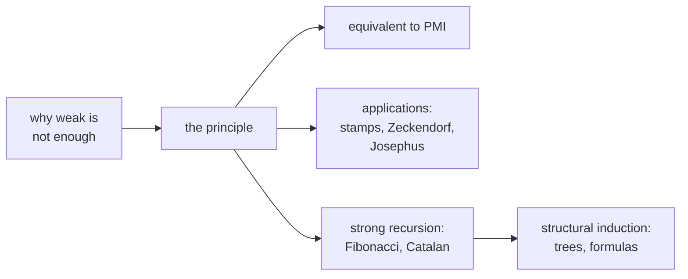

# PA09 · Strong Induction and Recursion

◀ [[PA08 Mathematical Induction]] · [[PA10 Well-Ordering and Well-Ordered Pairs]] ▶ · [[Proofs, Analysis and Topology - Course Map]]

taught · in syllabus extra · book extra · beyond

> [!warning] Scope of this chapter
> **Added 2026-10-29.** [[PA05 Induction and the Number Systems]] §4 states strong induction in one paragraph and uses it for prime factorisation and for the finite-set black box of Lecture 18; this chapter develops it. **There is no lecture note on strong induction in the folder**: the course uses it implicitly (Lecture 18, Assignment 7 Q4 via the least element), and the statement is in the AI notes (Theorem 3.7, §12.4) and in all four textbooks. So §1–§2 are 🟡 (with the taught uses marked 🟢), and the worked applications (postage, Zeckendorf, Josephus, Catalan) are 🔵 of my own. Every number was recomputed in `scripts/pa_numbers2.py`. *Ask the instructor* whether strong induction and recursion are examinable beyond the uses in Lecture 18.

> [!syllabus] Syllabus map: what is in the syllabus and what is extra in this chapter
> 🟢 **Taught (as a tool)**: the **least element** of a set of naturals is used in Lecture 18 and [[Assignment-7.pdf#page=1|Assignment 7 Q4]], and strong induction is the induction form of that argument ([[Countable-Uncountable-sets.pdf#page=2|Lecture 18]]).
>
> 🟡 **Extra · book** (Tao *Analysis I* Proposition 2.2.14 and Proposition 8.5.10; Bloch §6.3, Variants 2 and 3, Theorems 6.3.8–6.3.10; Sundstrom §4.2 "Second Principle of Mathematical Induction" pp.188–199 and §4.3 on recursion; AI notes Theorem 3.7 and Theorem 12.13)
> - §1 the principle and its two forms; §2 the equivalence with PMI; §4 definition by strong recursion; §5 structural induction
>
> 🔵 **Extra · beyond** (my additions)
> - §3 the postage problem, binary representation, Zeckendorf's theorem, Fibonacci bounds, the Josephus problem, Catalan numbers; §6 the "interesting number" paradox

> [!key] After this chapter you can
> - state strong induction in both forms and say **when weak induction is not enough**,
> - write a strong induction proof with the right **base cases** and a step whose smaller cases are **in range**,
> - prove that strong induction and PMI are equivalent,
> - define a sequence by **strong recursion** and prove properties of it, and use **structural induction** on trees and formulas.

> [!intuition] The one-sentence story
> Weak induction lets you lean on the **previous** domino; strong induction lets you lean on **all earlier** ones, which is what you need when the case $n$ is built from **some** smaller case you do not know in advance (a factor, a half, the amount minus $4$).

<!-- intuition-v1 -->

*Concept map: how the ideas of this chapter depend on each other (read left to right; every box is a section).*

## 1. Why weak induction is not enough, and the principle #quiz/pa-strong
extra · book *Sundstrom §4.2; Tao Proposition 2.2.14; Bloch Theorem 6.3.8*

> [!intuition] The factorisation example
> Take $P(n)$: "$n$ is prime or a product of primes". To prove $P(40)$ you factor $40=2\cdot20$, and $P(39)$ does not help. You need $P(2)$ and $P(20)$, two **specific smaller** cases that depend on $40$. So the hypothesis must be "$P(j)$ for **all** $j<n$".

> [!key] Strong induction ([[Strong Induction]])
> **Form 1 (with base cases).** Let $m\in\mathbb Z$. If $P(m)$ holds and, for every $k\ge m$,
> $$\big[P(m)\wedge P(m+1)\wedge\dots\wedge P(k)\big]\ \Longrightarrow\ P(k+1),$$
> then $P(n)$ holds for every $n\ge m$ (Bloch's Variant 3, Theorem 6.3.9; Sundstrom's Second Principle).
> **Form 2 (no separate base case).** If for **every** $n\in\mathbb N$ $\ \big[\forall j<n\ P(j)\big]\Rightarrow P(n)$, then $P(n)$ holds for all $n$ (Tao Proposition 2.2.14 with $m_0=1$).

> [!intuition] Where did the base case go?
> In Form 2 the hypothesis $\forall j<n\,P(j)$ is **vacuous** for the smallest $n$ ($n=1$: there is no $j<1$), so the step *by itself* must prove $P(1)$. Tao, Remark 8.5.11: "such a base case is automatically included in the strong induction hypothesis." In practice you treat the small cases that your argument cannot handle (those with no smaller case to lean on) **separately**: they are your base cases.

> [!key] The write-up (five parts)
> 1. State $P(n)$. 2. **Base cases**: every $n$ for which the argument below cannot reach a smaller case. 3. **Step:** let $n$ be larger than the base cases, assume $P(j)$ for **all** $j$ with $m\le j<n$. 4. Prove $P(n)$ and **name the smaller cases you use**, checking that each is in range (at least the first base case, less than $n$). 5. Conclude by strong induction.

## 2. Strong induction is equivalent to PMI #quiz/pa-strong
extra · book *AI notes Theorem 3.7 and Theorem 12.13; Bloch Theorem 6.3.8 uses the well-ordering principle*

> [!derivation] PMI $\Rightarrow$ strong induction
> Assume the hypotheses of strong induction (Form 1 with $m=1$): $P(1)$, and $[P(1)\wedge\dots\wedge P(k)]\Rightarrow P(k+1)$. Define $Q(n)$ = "$P(j)$ holds for every $j\le n$". Then $Q(1)=P(1)$ is true. If $Q(k)$ holds, the strong hypothesis gives $P(k+1)$, and together with $Q(k)$ this is $Q(k+1)$. By **PMI** $Q(n)$ for all $n$, so $P(n)$ for all $n$. $\square$

> [!derivation] Strong induction $\Rightarrow$ PMI
> If $P(1)$ and $P(k)\Rightarrow P(k+1)$ for all $k$, then also $[P(1)\wedge\dots\wedge P(k)]\Rightarrow P(k+1)$ (the weaker premise $P(k)$ is part of the stronger one), so strong induction applies and gives $P(n)$ for all $n$. $\square$

So the two principles prove exactly the same statements; strong induction is a **convenience**, "weak induction on the statement $Q$". The third equivalent form, the well-ordering principle, is in [[PA10 Well-Ordering and Well-Ordered Pairs]], which closes the cycle PMI $\Rightarrow$ WOP $\Rightarrow$ strong induction $\Rightarrow$ PMI.

> [!example] Strong induction as weak induction on blocks (🔵)
> The postage claim of §3 is "weak induction on $Q(n)=P(n)\wedge P(n+1)\wedge P(n+2)\wedge P(n+3)$": the four-in-a-row base case $Q(12)$ and the step $Q(k)\Rightarrow Q(k+1)$ (which needs only $P(k)$, to get $P(k+4)$) do the same work with a visible bookkeeping.

## 3. Applications #quiz/pa-strong
extra · beyond *all checked by computer; Figure PA9.1*

> [!example] Prime factorisation, existence (recall PA05 §4)
> Every $n\ge2$ is a product of primes. If $n$ is prime, done; otherwise $n=ab$ with $2\le a,b<n$, and **both** $a,b$ are products of primes by the hypothesis. The two smaller cases are $a$ and $b$, not $n-1$. (Uniqueness needs Euclid's lemma and a least-element argument; see [[PA10 Well-Ordering and Well-Ordered Pairs]] §3.)

> [!example] The postage problem: every amount $n\ge12$ is $4x+5y$ with $x,y\ge0$
> **Base cases** $12=4\cdot3$, $13=4\cdot2+5$, $14=4+2\cdot5$, $15=3\cdot5$. **Step:** let $n\ge16$ and assume the claim for all amounts from $12$ to $n-1$. Then $n-4\ge12$ is representable, $n-4=4x+5y$, and $n=4(x+1)+5y$. The case used is $n-4$, **not** $n-1$, so the one-step form of PMI does not apply to $P$ directly (it does apply to the block statement $Q$ below). The amounts that **cannot** be made are exactly $1,2,3,6,7,11$ (the largest, $11=4\cdot5-4-5$, is the Frobenius number for coprime stamps $4,5$). Computer check: all $n$ from $12$ to $5000$ are representable.

> [!example] Binary representation: every $n\ge1$ is a sum of distinct powers of $2$
> **Existence** by strong induction. $n=1=2^0$. Let $n\ge2$. If $n$ is even, $\frac n2<n$ has a representation $\frac n2=\sum2^{e_i}$ and $n=\sum2^{e_i+1}$. If $n$ is odd, $\frac{n-1}2<n$ has one, and $n=1+\sum2^{e_i+1}$ (the exponents $e_i+1\ge1$ do not repeat the $2^0$). The smaller case is $\lfloor n/2\rfloor$, again not $n-1$. **Uniqueness** by counting: the $2^m$ subsets of $\{2^0,\dots,2^{m-1}\}$ have sums in $\{0,\dots,2^m-1\}$; by existence every value occurs (a power $2^e\le n<2^m$ has $e<m$, so only these powers are used), and a surjection between two finite sets of $2^m$ elements is a bijection (pigeonhole, PA04), so no two subsets share a sum. (Verified exhaustively for $m\le12$.)

> [!key] Zeckendorf's theorem (existence; 🔵)
> Let $F_1=F_2=1$, $F_{k+2}=F_{k+1}+F_k$. **Every $n\ge1$ is a sum of Fibonacci numbers $F_k$ with $k\ge2$, no two of consecutive index** (and the representation is unique). *Proof of existence by strong induction.* Let $F_k\le n<F_{k+1}$ be the largest Fibonacci number not exceeding $n$ ($k\ge2$). If $n=F_k$ we are done. Otherwise $0<n-F_k<F_{k+1}-F_k=F_{k-1}$, so by the hypothesis $n-F_k$ is a sum of non-consecutive Fibonacci numbers, all $\le n-F_k<F_{k-1}$, hence of index $\le k-2$. Adding $F_k$ gives a representation of $n$ whose indices are still non-consecutive. $\square$ **Examples:** $100=89+8+3$; $2026=1597+377+34+13+5$. The greedy rule was checked for **all** $n\le20000$ and uniqueness exhaustively for $n<100$.

> [!example] Fibonacci bounds by strong (two-step) induction
> **Claim:** $\varphi^{\,n-2}\le F_n<2^n$ for all $n\ge1$, where $\varphi=\frac{1+\sqrt5}2$ satisfies $\varphi^2=\varphi+1$. *Bases* $n=1,2$: $\varphi^{-1}=0.618\le1<2$ and $\varphi^0=1\le1<4$. *Step* $n\ge3$: $F_n=F_{n-1}+F_{n-2}<2^{n-1}+2^{n-2}<2^n$, and $F_n\ge\varphi^{n-3}+\varphi^{n-4}=\varphi^{n-4}(\varphi+1)=\varphi^{n-4}\varphi^2=\varphi^{n-2}$. **Two** earlier cases are used, so **two** base cases are needed (compare the "all Fibonacci numbers are even" fallacy, [[PA08 Mathematical Induction]] §4). So $F_n$ grows exponentially at a rate between $\varphi=1.618$ and $2$ (exact ratio $\to\varphi$).

> [!key] 🔵 The Josephus problem
> $n$ people stand in a circle, numbered $1,\dots,n$; starting with person $1$ **spared**, every **second** person is eliminated, going round and round. Let $J(n)$ be the survivor. Small values $J(1),\dots,J(16)=1,1,3,1,3,5,7,1,3,5,7,9,11,13,15,1$ (by simulation).
> **Recursion.** $J(1)=1$, and for $n\ge1$: $J(2n)=2J(n)-1$, $J(2n+1)=2J(n)+1$.
> *Why.* With $2n$ people, the first pass eliminates $2,4,\dots,2n$ and leaves $1,3,\dots,2n-1$ in a circle with $1$ spared next; that is the $n$-person game with person $j$ renamed $2j-1$, so the survivor is $2J(n)-1$. With $2n+1$ people the first pass eliminates $2,4,\dots,2n$ and then $1$ (next after the spared $2n+1$), leaving $3,5,\dots,2n+1$ with $3$ spared next: the $n$-person game with $j$ renamed $2j+1$, so the survivor is $2J(n)+1$.
> **Closed form.** If $n=2^m+\ell$ with $0\le\ell<2^m$ then $\boxed{J(n)=2\ell+1}$ ($J(41)=J(2^5+9)=19$, $J(100)=J(2^6+36)=73$; both match simulation, as does every $n\le2000$).
> *Proof by strong induction on $n$.* $n=1$: $m=0,\ell=0$, $J=1$. For $n\ge2$ the recursion refers to $\lfloor n/2\rfloor<n$. **$n$ even:** $\frac n2=2^{m-1}+\frac\ell2$, so $J(\frac n2)=\ell+1$ and $J(n)=2(\ell+1)-1=2\ell+1$. **$n$ odd,** $n=2k+1$: $k=2^{m-1}+\frac{\ell-1}2$, so $J(k)=\ell$ and $J(n)=2\ell+1$. $\square$ (So $J(n)=1$ exactly when $n$ is a power of $2$.)

> [!example] Catalan numbers by a strong recursion (🔵)
> $C_0=1$ and $C_{n+1}=\sum_{k=0}^nC_kC_{n-k}$, every earlier value being used: $1,1,2,5,14,42,132,429,1430,4862,16796$. They count the ways to fully parenthesise a product of $n+1$ factors ($C_3=5$: $((ab)c)d$, $(a(bc))d$, $(ab)(cd)$, $a((bc)d)$, $a(b(cd))$) and the full binary trees with $n$ internal nodes (§5). The closed form $C_n=\frac1{n+1}\binom{2n}n$ was checked for $n\le25$.

![[fig_pa09_strong.png]]
*Figure PA9.1. A: the amounts $1,\dots,40$ made from stamps of 4 and 5; grey amounts cannot be made, orange are the four base cases, and every later amount is a base case plus a number of 4-stamps. B: $F_n$ (solid) between $\varphi^{n-2}$ and $2^n$ (dashed). C: the Josephus survivor $J(n)$ is a sawtooth that returns to $1$ at every power of $2$.*

## 4. Definition by strong recursion #quiz/pa-strong
extra · book *Sundstrom §4.3; Bloch §6.4; PA05 §5 for the recursion theorem*

> [!key] Course-of-values recursion ([[Recursion Theorem]])
> A sequence can be **defined** by $a_1,\dots,a_m$ given and $a_n=G(a_1,\dots,a_{n-1})$ for $n>m$, with $G$ a given rule that may use **all** earlier values. Fibonacci ($a_n=a_{n-1}+a_{n-2}$), Catalan, the Josephus numbers (via $\lfloor n/2\rfloor$) and the greedy Zeckendorf representation are of this kind. **Uniqueness is a strong induction:** if $(a_n)$ and $(b_n)$ both satisfy the definition then $a_n=b_n$ for all $n$, because $a_j=b_j$ for $j<n$ gives $a_n=G(a_1,\dots,a_{n-1})=G(b_1,\dots,b_{n-1})=b_n$. **Existence** is the recursion theorem applied to the sequence of **histories** $(a_1,\dots,a_n)$, the usual way to reduce strong recursion to the one-step recursion of PA05 §5.

> [!example] Example: $a_1=1$, $a_n=a_1+\dots+a_{n-1}$ ($n\ge2$)
> The terms are $1,1,2,4,8,16,\dots$. *Claim:* $a_n=2^{n-2}$ for $n\ge2$. $a_2=a_1=1=2^0$. For $n\ge3$: $a_n=a_1+\sum_{j=2}^{n-1}2^{j-2}=1+(2^{n-2}-1)=2^{n-2}$, using the **hypothesis for all** $j$ from $2$ to $n-1$. (Weak induction works too here: $a_n=a_{n-1}+a_{n-1}$, but only after noticing it.)

## 5. Structural induction
extra · book *Sundstrom §4.3* · extra · beyond *the tree counts*

> [!key] Induction on how an object is built
> A set is defined **recursively** by (i) basic objects and (ii) construction rules. **Structural induction:** to show that every object has a property, show that the basic objects have it and that each rule preserves it. It is strong induction on the **size** (number of symbols or construction steps), because the parts of an object are strictly smaller.

> [!example] Full binary trees
> A **full binary tree** is either a single leaf, or a root with two full binary subtrees. **Claim:** a full binary tree with $i$ internal nodes has $i+1$ leaves. *Leaf:* $i=0$, one leaf. *Join of $T_1,T_2$* with $i_1,i_2$ internal nodes and $\ell_1=i_1+1$, $\ell_2=i_2+1$ leaves (hypothesis for the two **smaller** trees): the new tree has $i=i_1+i_2+1$ internal nodes and $\ell_1+\ell_2=i_1+i_2+2=i+1$ leaves. $\square$ Also: a full binary tree of **height** $h$ has at most $2^h$ leaves (Practice 7). Enumerating all trees with $m\le7$ internal nodes gives $C_m$ trees each time, each with $m+1$ leaves.
> The same pattern proves facts about **well-formed formulas** ([[PA01 Logic and Methods of Proof]]): a formula built from letters by $\neg$ and $(\cdot\wedge\cdot)$ has as many left as right brackets, because letters have none and each rule adds one of each.

## 6. Pitfalls
extra · beyond

> [!pitfall] Strong induction: what goes wrong
> - **Too few base cases.** If the step uses $P(n-2)$, then for $n=2$ it uses $P(0)$, which may be out of range: two base cases are needed (Fibonacci). If it uses $P(n-4)$ you need four ($12,13,14,15$ in §3).
> - **A smaller case that is not smaller or not in range.** The step must produce a case $j$ with (first base case) $\le j<n$. "Use $P(n/2)$" is only legal for **even** $n$; the odd case needs its own argument ($\frac{n-1}2$ in the binary example).
> - **Writing "assume $P(k)$" and then using $P(k-2)$** is a gap: the hypothesis must really be "for **all** smaller $j$".
> - **An ill-defined recursion.** $J(n)$ is defined through $\lfloor n/2\rfloor<n$ only for $n\ge2$; a rule that refers to a value that is not smaller (or to $a_{n+1}$) defines nothing.
> - **A wrong "proof" that every positive integer is a power of $2$.** "$n=a+b$ with $a,b<n$ both powers of $2$, hence $n$ is." The first step is the flaw: a sum of two powers of $2$ ($1+2=3$) need not be one.
> - 🔵 **The 'interesting number' paradox.** "Every positive integer is interesting, else the least uninteresting one would be interesting." The argument is not a theorem because $P(n)$ = "$n$ is interesting" is **not a precise statement**; the least-element argument is valid only for a well-defined property.

## Map of this chapter
> [!connection] How PA09 connects
> **Builds on:** [[PA08 Mathematical Induction]] (weak induction and the two-step variant), [[PA05 Induction and the Number Systems]] (strong induction first stated; the recursion theorem).
> **Leads to:** [[PA10 Well-Ordering and Well-Ordered Pairs]] (the least-element form, minimal counterexamples, induction on pairs), [[PA06 The Real Numbers and Sequences]] (recursive sequences and their limits).
> **Concepts:** [[Strong Induction]] · [[Structural Induction]] · [[Recursion Theorem]] · [[Principle of Mathematical Induction]] · [[Well-Ordering Principle]] · [[Fibonacci Numbers]] · [[Josephus Problem]] · [[Catalan Numbers]] · [[Natural Numbers]]
> **Other subjects:** [[Proofs, Analysis and Topology - Course Map]], [[PR03 Discrete Random Variables and Distributions]] (the geometric tail $P[X>n]=q^n$ is the recursion $a_{n+1}=qa_n$), [[PR01 Counting and the Axioms of Probability]] (counting problems with a recursive structure, such as the derangements of the matching problem), [[EE02 Structured Population Models]] (Fibonacci's rabbits are the first age-structured population model: $N_{t+2}=N_{t+1}+N_t$), [[Fourier and Laplace Transforms]] (the binary / hierarchical structure of the fast Fourier transform is a recursion on $n/2$).

## Summary
> [!summary] Cheat-sheet
> - **Strong induction:** $[P(m)\wedge\dots\wedge P(k)]\Rightarrow P(k+1)$ (+ base) $\Rightarrow$ $P(n)\ \forall n\ge m$. No separate base case in Form 2 because the hypothesis is vacuous for the first $n$.
> - **Equivalent to PMI:** apply PMI to $Q(n)=\forall j\le n\,P(j)$; conversely weak induction is a special case.
> - **Use it when** the step needs an unknown smaller case: factor ($n=ab$), half ($\lfloor n/2\rfloor$), "$n-4$", or two predecessors.
> - **Results proved:** postage ($4,5$: all $n\ge12$; unattainable $1,2,3,6,7,11$); binary and Zeckendorf representations; $\varphi^{n-2}\le F_n<2^n$; $J(2^m+\ell)=2\ell+1$; $C_n=\sum C_kC_{n-1-k}=\frac1{n+1}\binom{2n}n$; leaves $=$ internal $+1$.
> - **Recursion:** strong recursion $a_n=G(a_1,\dots,a_{n-1})$; uniqueness by strong induction.
> - **Pitfalls:** too few bases, smaller case out of range, ill-defined recursion, and "interesting" numbers (not a precise property).

## Practice
1. **Binary.** Prove every positive integer is a sum of distinct powers of $2$, and that the representation is unique.
2. **Stamps.** Using $3$- and $7$-cent stamps, prove every amount $n\ge12$ is attainable and find all amounts that are not.
3. **Parity of Fibonacci.** Prove $F_n$ is even if and only if $3\mid n$.
4. **A recursion.** $a_1=1$ and $a_n=a_1+a_2+\dots+a_{n-1}$ for $n\ge2$. Find a formula and prove it.
5. **Josephus.** Compute $J(41)$ and $J(100)$ from the recursion and from the closed form.
6. **Zeckendorf.** Write $50$ and $100$ as sums of non-consecutive Fibonacci numbers ($1,2,3,5,8,13,21,34,55,89,\dots$).
7. **Heights.** A full binary tree of height $h$ (a leaf has height $0$) has at most $2^h$ leaves. Prove it by strong induction on the height.
8. **Catalan.** Compute $C_5$ from the recursion and list the $C_3=5$ ways to parenthesise $abcd$.
9. **Find the flaw.** "Every positive integer is a power of $2$": $1=2^0$; if $n>1$ write $n=a+b$ with $a,b<n$ positive; by hypothesis $a,b$ are powers of $2$, hence so is $n$.
10. **Weak or strong?** Restate the postage proof for stamps $4,5$ as a weak induction on a suitable statement $Q(n)$.

> [!example]- Solutions
> 1. *Existence:* §3 (even: double the representation of $\frac n2$; odd: add $2^0$ to the doubled representation of $\frac{n-1}2$). *Uniqueness:* the $2^m$ subsets of $\{1,2,\dots,2^{m-1}\}$ give sums in $\{0,\dots,2^m-1\}$ and by existence every sum occurs; a surjection between sets of the same finite size $2^m$ is injective.
> 2. Bases $12=3\cdot4$, $13=3\cdot2+7$, $14=2\cdot7$. For $n\ge15$ the amount $n-3\ge12$ is attainable by the hypothesis; add a $3$-cent stamp. Not attainable: $1,2,4,5,8,11$ ($3\cdot7-3-7=11$ is the largest). Check: all $n\in[12,5000]$ attainable.
> 3. The parities of $F_1,F_2,F_3,\dots$ are $1,1,0,1,1,0,\dots$. Prove by strong (three-base) induction that $F_n$ is even iff $3\mid n$. Bases $F_1=F_2=1$ odd, $F_3=2$ even. Step $n\ge4$: $F_n=F_{n-1}+F_{n-2}$. If $3\mid n$ then $3\nmid n-1,n-2$, both odd, sum even. If $n\equiv1$: $n-1\equiv0$ (even), $n-2\equiv2$ (odd), sum odd. If $n\equiv2$: $n-1\equiv1$ (odd), $n-2\equiv0$ (even), sum odd. (Checked for $n\le70$.)
> 4. $a_n=2^{n-2}$ for $n\ge2$ (§4): $a_2=1$; for $n\ge3$, $a_n=a_1+\sum_{j=2}^{n-1}2^{j-2}=1+2^{n-2}-1$. The terms are $1,1,2,4,8,16$.
> 5. $J(41)=2J(20)+1$, $J(20)=2J(10)-1$, $J(10)=2J(5)-1$, $J(5)=2J(2)+1$, $J(2)=1$, so $J(5)=3$, $J(10)=5$, $J(20)=9$, $J(41)=19$. Closed form $41=32+9$: $2\cdot9+1=19$. $100=64+36$: $2\cdot36+1=73$; by recursion $J(100)=2J(50)-1$, $J(50)=2J(25)-1$, $J(25)=2J(12)+1$, $J(12)=2J(6)-1$, $J(6)=2J(3)-1$, $J(3)=2J(1)+1=3$ gives $J(6)=5$, $J(12)=9$, $J(25)=19$, $J(50)=37$, $J(100)=73$.
> 6. $50=34+13+3$, and $100=89+8+3$ (the greedy choice: largest $F_k\le n$, then recurse; $100-89=11\to8$, $3$).
> 7. Height $0$: a single leaf, $1=2^0$ leaves. A tree of height $h\ge1$ is a root with subtrees $T_1,T_2$ of heights $h_1,h_2\le h-1$ (strictly smaller, so the strong hypothesis applies): leaves $\le2^{h_1}+2^{h_2}\le2\cdot2^{h-1}=2^h$.
> 8. $C_5=C_0C_4+C_1C_3+C_2C_2+C_3C_1+C_4C_0=14+5+4+5+14=42$. The five parenthesisations: $((ab)c)d$, $(a(bc))d$, $(ab)(cd)$, $a((bc)d)$, $a(b(cd))$.
> 9. The step "$a,b$ powers of $2$ hence $a+b$ a power of $2$" is false ($1+2=3$). (The induction scheme itself is fine; the implication is not.)
> 10. $Q(n)=P(n)\wedge P(n+1)\wedge P(n+2)\wedge P(n+3)$ with "$P(n)$: $n=4x+5y$". $Q(12)$ is the four base cases; if $Q(k)$ holds then $P(k+4)$ follows from $P(k)$ by adding a $4$-stamp, and with $P(k+1),P(k+2),P(k+3)$ this is $Q(k+1)$.

## Provenance
> [!provenance]- Source map for this chapter
> | Topic | Source | Scope |
> |---|---|---|
> | the least element of a subset of $\mathbb N$ used in an argument; the finite-set black boxes | [[Countable-Uncountable-sets.pdf#page=2\|Lecture 18]]; [[Assignment-7.pdf#page=1\|Assignment 7 Q4]] | taught |
> | strong induction statement; equivalence with PMI and well-ordering | AI notes `proofs-prems-topo.pdf` Theorem 3.7 and Theorem 12.13; Tao Proposition 2.2.14, Proposition 8.5.10, Remark 8.5.11 | extra/book |
> | Variants 2 and 3, prime factorisation (Theorem 6.3.10) | Bloch §6.3 (Theorems 6.3.8, 6.3.9, 6.3.10) | extra/book |
> | Second Principle, recursion and structural induction | Sundstrom §4.2 (pp.188–199) and §4.3 | extra/book |
> | postage, binary representation, Zeckendorf, Fibonacci bounds, Josephus, Catalan, trees, fallacies, Practice | `scripts/pa_numbers2.py`, `fig_pa09_strong.py` | extra/beyond |
>
> **Notes.** The Josephus convention (person $1$ spared, person $2$ eliminated first) is the one used in the simulation and in the recursion; the other common convention (person $1$ eliminated first) gives a different survivor. The AI notes number from $0$; here $\mathbb N$ starts at $1$ (Assignment 8's convention).

**References.** Tao, T. *Analysis I*, §2.2, §8.5 · Bloch, E. D. *Proofs and Fundamentals*, §6.3 · Sundstrom, T. *Mathematical Reasoning*, §4.2–4.3 · Graham, Knuth, Patashnik, *Concrete Mathematics* (the Josephus recursion) · Zeckendorf, E. (1972), *Bull. Soc. Roy. Sci. Liège* 41.

## Continued in the vault (added 2026-11-12): Assignment 9, Problem 1 and Problem 2(a), solved in full
*Source: [[Assignment-9.pdf#page=1|Assignment 9]] (read from the PDF and, for the garbled recurrence of Problem 1(a), from the page image: $a_1=1$, $a_2=3$, $a_n=a_{n-1}+a_{n-2}$, claim $a_n<(7/4)^n$; the other tool's note could not read it). Problems 3 and 4 (WOP) are solved in [[PA10 Well-Ordering and Well-Ordered Pairs]]. Checked by machine in `scripts/quiz_numbers.py`.* #quiz/pa-induction #quiz/pa-strong

**Strong induction, as the sheet states it:** if (i) $P(1)$ and (ii) for every $k$, $P(1),\dots,P(k)\Rightarrow P(k+1)$, then $P(n)$ for all $n$. Say what $P(n)$ is, prove the base case(s), state *exactly* what is assumed, prove $P(k+1)$, conclude.

> [!example] Problem 1(a): $a_1=1$, $a_2=3$, $a_n=a_{n-1}+a_{n-2}$ ($n\ge3$); prove $a_n<(7/4)^n$; why two base cases?
> $P(n)$: $a_n<(7/4)^n$. **Bases:** $a_1=1<\tfrac74$; $a_2=3<\tfrac{49}{16}=3.0625$. **Step** ($n\ge3$): assume $P(n-1)$ and $P(n-2)$. Then
> $$a_n=a_{n-1}+a_{n-2}<\Big(\tfrac74\Big)^{n-1}+\Big(\tfrac74\Big)^{n-2}=\Big(\tfrac74\Big)^{n-2}\Big(\tfrac74+1\Big)=\Big(\tfrac74\Big)^{n-2}\cdot\tfrac{44}{16}<\Big(\tfrac74\Big)^{n-2}\cdot\tfrac{49}{16}=\Big(\tfrac74\Big)^n.$$
> **Why two base cases:** the step for $n$ uses **two** earlier terms, $a_{n-1}$ and $a_{n-2}$; the first $n$ for which both exist is $n=3$, so $P(1)$ and $P(2)$ must be proved separately (one base case cannot start the induction: $P(1)$ alone says nothing about $a_2$, which is *given*, not computed). The bound is not sharp: $a_3,\dots,a_8=4,7,11,18,29,47$ (the Lucas numbers; checked $a_n<(7/4)^n$ for $n\le59$).

> [!example] Problem 1(b): $b_1=2$, $b_2=4$, $b_n=4b_{n-1}-4b_{n-2}$: compute $b_3,b_4,b_5$, guess, prove
> $b_3=4\cdot4-4\cdot2=\mathbf8$, $b_4=4\cdot8-4\cdot4=\mathbf{16}$, $b_5=4\cdot16-4\cdot8=\mathbf{32}$: guess $\boxed{b_n=2^n}$. **Proof** ($P(n)$: $b_n=2^n$): bases $b_1=2$, $b_2=4$; step ($n\ge3$): $b_n=4\cdot2^{n-1}-4\cdot2^{n-2}=2^{n+1}-2^n=2^n$ (uses $P(n-1)$ and $P(n-2)$, so two bases). *Why the guess is natural:* the characteristic equation $x^2-4x+4=(x-2)^2$ has the double root $2$, so the general solution is $(A+Bn)2^n$, and $b_1=2,b_2=4$ force $A=1$, $B=0$.

> [!example] Problem 1(c): every integer $n\ge8$ is $3x+5y$ ($x,y\ge0$); how many base cases; false for $n=7$
> $P(n)$: $n=3x+5y$ for some integers $x,y\ge0$. **Three base cases:** $8=3+5$, $9=3\cdot3$, $10=5\cdot2$. **Step** ($n\ge11$): $n-3\ge8$, so by the strong hypothesis $n-3=3x+5y$, hence $n=3(x+1)+5y$. **Why three:** the step reaches back by $3$, so the three smallest cases $8,9,10$ (one in each residue class mod $3$) must be checked directly; with only $8$ the step could not reach $9$ or $10$. **$n=7$ fails:** $7-5y\in\{7,2\}$ for $y=0,1$ and neither is divisible by $3$. (So the largest non-representable amount is $7=3\cdot5-3-5$, the Frobenius number; the non-representable amounts are $1,2,4,7$; checked for all $8\le n\le300$.)

> [!example] Problem 2(a): WOP $\Rightarrow$ strong induction
> Assume WOP and let $P(n)$ satisfy (i) $P(1)$ and (ii) $P(1),\dots,P(k)\Rightarrow P(k+1)$ for all $k$. Let $S=\{n\in\mathbb N:P(n)\text{ is false}\}$ and suppose $S\ne\varnothing$; by WOP it has a least element $m$. $m\ne1$ by (i). So $m\ge2$, and every $j<m$ is **not** in $S$ (minimality), i.e. $P(1),\dots,P(m-1)$ are all true. Applying (ii) with $k=m-1\ge1$ gives $P(m)$, contradicting $m\in S$. Hence $S=\varnothing$. $\square$ (The whole chain PMI $\Rightarrow$ WOP $\Rightarrow$ strong induction $\Rightarrow$ PMI is in [[PA10 Well-Ordering and Well-Ordered Pairs]] §2.)
