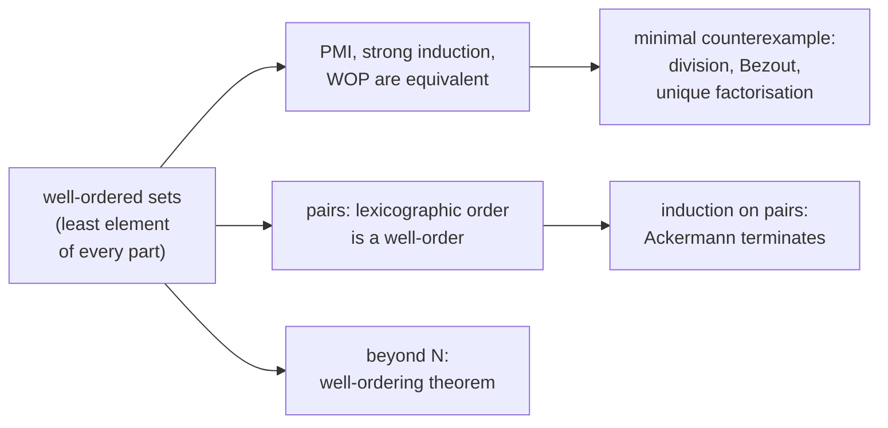

# PA10 · Well-Ordering and Well-Ordered Pairs

◀ [[PA09 Strong Induction and Recursion]] · [[PA06 The Real Numbers and Sequences]] ▶ · [[Proofs, Analysis and Topology - Course Map]]

taught · in syllabus extra · book extra · beyond

> [!warning] Scope of this chapter
> **Added 2026-10-29.** The request was for chapters on mathematical induction, strong induction and "well-ordered pair". I read the last phrase as the **well-ordering principle** together with **well-ordered sets of pairs**: the lexicographic order on $X\times Y$, which is a well-order exactly when $X$ and $Y$ are (Tao *Analysis I*, Exercise 8.5.12). If a different topic was meant (for example the Kuratowski ordered pair of [[PA02 Sets Families and the ZFC Foundations]], handled in the *Ordered Pairs* note), say so and this chapter will be adjusted. **Sources:** the **well-ordering principle** is 🟢 (Lecture 18, Assignment 7 Q4, stated in [[PA05 Induction and the Number Systems]] §3); well-ordered sets, the lexicographic order and induction on pairs are 🟡 (Tao §8.5, Bloch Theorem 6.2.5, AI notes Theorem 12.13); the examples (Euclid's algorithm, Ackermann, descent) are 🔵.

> [!syllabus] Syllabus map: what is in the syllabus and what is extra in this chapter
> 🟢 **Taught**: every non-empty subset of $\mathbb N$ has a least element, used for "the least $n_1$ with $f(n_1)\in S$" ([[Assignment-7.pdf#page=1|Assignment 7 Q4]], [[Countable-Uncountable-sets.pdf#page=2|Lecture 18]]). The **pairs** themselves are taught: Kuratowski ordered pairs ([[ordered pairs.pdf#page=1|Ordered Pairs note]]) and the order on $\mathbb R^2$ in [[PA03 Relations Equivalence and Order]] Practice 6.
>
> 🟡 **Extra · book** (Tao *Analysis I* Definition 8.5.8, Proposition 8.5.10, Exercise 8.5.12; Bloch Theorem 6.2.5 and Theorem 6.3.8; AI notes `proofs-prems-topo.pdf` Theorem 12.13)
> - §1 well-ordered sets; §2 the equivalence cycle PMI $\Rightarrow$ WOP $\Rightarrow$ strong induction $\Rightarrow$ PMI; §4 the lexicographic order on pairs; §5 induction on pairs; §6 the well-ordering theorem
>
> 🔵 **Extra · beyond** (my additions; numbers in `scripts/pa_numbers2.py`, figure `fig_pa10_wellorder.py`)
> - §3 the division algorithm, Bézout and unique factorisation from a least element, Euler's cubic by infinite descent; §4 which orders on $\mathbb N\times\mathbb N$ are well-orders; §5 the Ackermann function

> [!key] After this chapter you can
> - say what a **well-ordered set** is, test candidates, and prove the **three-way equivalence** of induction, strong induction and well-ordering,
> - run a **minimal-counterexample** (infinite descent) proof and derive the division algorithm, Bézout's identity and unique factorisation from a least element,
> - prove that the **lexicographic order on $X\times Y$ is a well-order** when $X,Y$ are, and say which other orders on $\mathbb N\times\mathbb N$ are,
> - prove a statement about **pairs** by induction on the lexicographic order, and show that a recursion such as Ackermann's terminates.

> [!intuition] The one-sentence story
> A set is well-ordered when you can **always pick the first element of any non-empty part of it**; that single property makes "choose the least counterexample", "assume the statement for everything smaller" and "this recursion must stop" all valid, and it survives taking **pairs** as long as you compare the first coordinate before the second.

<!-- intuition-v1 -->

*Concept map: how the ideas of this chapter depend on each other (read left to right; every box is a section).*

## 1. Well-ordered sets #quiz/pa-wop
extra · book *Tao Definition 8.5.8 and Examples 8.5.9; the order vocabulary is [[PA03 Relations Equivalence and Order]]*

> [!key] Definition ([[Well-Ordered Set]])
> A **total order** $(X,\le)$ is a **well-order** if every **non-empty** subset $S\subseteq X$ has a **least element**: some $s_0\in S$ with $s_0\le s$ for all $s\in S$. (In a total order a minimal element is least, so Tao's "minimal element" says the same.) The **well-ordering principle (WOP)** is the statement that $(\mathbb N,\le)$ is a well-order.

> [!example] Examples and non-examples (all easy to check)
> | Ordered set | Well-ordered? | Why |
> |---|---|---|
> | $\mathbb N$, $\{1,\dots,n\}$, any finite total order | **yes** | WOP; finite sets have a least element |
> | any **subset** of a well-ordered set | **yes** | a least element of the big set that lies in the subset |
> | $\mathbb Z$, $\mathbb R$ | no | $\mathbb Z$ itself has no least element |
> | $\{x\in\mathbb Q:x>0\}$, $\ (0,1]$, $\ \{\frac1n:n\in\mathbb N\}$ with the usual $\le$ | no | the subset has no least element: $\frac1n$ keeps decreasing |
> | $\mathbb N$ with the **reversed** order $\ge$ | no | $\mathbb N$ has no greatest element |
> | $\{\frac1n\}$ with $\ge$ ($1,\frac12,\frac13,\dots$) | **yes** | order-isomorphic to $\mathbb N$ |
> | $\mathbb N$ with all evens first: $2<4<6<\dots<1<3<5<\dots$ | **yes** | a subset with an even has a least even, else a least odd; but $1$ has **infinitely many** predecessors, so it is not $\mathbb N$ with its usual order |

> [!derivation] No infinite descending chain
> If $(X,\le)$ is a well-order there is **no** infinite strictly decreasing sequence $x_1>x_2>x_3>\cdots$: the set $\{x_1,x_2,\dots\}$ would have no least element. (The converse, that a total order with no infinite descending chain is a well-order, needs a weak form of the axiom of choice.) This is why **infinite descent** works in $\mathbb N$ and fails in $\mathbb Q_{>0}$ ($1>\frac12>\frac13>\cdots$).

## 2. The three forms of induction are equivalent #quiz/pa-induction #quiz/pa-strong #quiz/pa-wop
extra · book *AI notes Theorem 12.13; Bloch Theorems 6.2.5 and 6.3.8*

> [!key] The cycle
> $$\text{PMI}\ \Longrightarrow\ \text{WOP}\ \Longrightarrow\ \text{strong induction}\ \Longrightarrow\ \text{PMI}.$$
> The last arrow is [[PA09 Strong Induction and Recursion]] §2; WOP $\Rightarrow$ PMI directly is [[PA05 Induction and the Number Systems]] §3. Here are the other two.

> [!derivation] PMI $\Rightarrow$ WOP (the "hard part", Bloch Theorem 6.2.5)
> Suppose $S\subseteq\mathbb N$ is non-empty with **no** least element; we show $S=\varnothing$, a contradiction. Let $T=\{n\in\mathbb N:\ s>n\text{ for every }s\in S\}$. **$1\in T$:** if some $s\in S$ had $s\le1$ then $s=1$, and $1$ is the least element of $\mathbb N$ hence of $S$; contradiction. **$n\in T\Rightarrow n+1\in T$:** if some $s\in S$ had $s\le n+1$, then since $s>n$ and no natural lies strictly between $n$ and $n+1$, $s=n+1$; every $s'\in S$ satisfies $s'>n$, i.e. $s'\ge n+1=s$, so $s$ is least in $S$; contradiction. By PMI $T=\mathbb N$. But a member $s\in S\subseteq\mathbb N=T$ would satisfy $s>s$. So $S$ has no members. $\square$

> [!derivation] WOP $\Rightarrow$ strong induction
> Assume $\forall n\,[(\forall j<n\ P(j))\Rightarrow P(n)]$ and suppose $B=\{n:P(n)\text{ is false}\}\ne\varnothing$. By WOP $B$ has a least element $b$. Every $j<b$ is outside $B$, so $P(j)$ holds for all $j<b$, and the hypothesis gives $P(b)$: contradiction. $\square$

> [!connection] What each hypothesis buys
> PMI is the form you **verify** (base case and step); strong induction is the form you **use** when the step needs smaller cases; WOP is the form you **argue with** ("take the smallest counterexample"). Because they are equivalent, you may always choose the most convenient one.

## 3. Minimal counterexample, infinite descent and the arithmetic of $\mathbb Z$ #quiz/pa-wop
taught *the least element in Lecture 18, Assignment 7 Q4, PA05 §3 ($\sqrt2$)* · extra · beyond *the rest*

> [!key] The method
> To prove $\forall n\,P(n)$: suppose it fails; by WOP there is a **least** $n_0$ for which $P(n_0)$ is false; derive either a contradiction or a **smaller** counterexample. Infinite descent is the same argument with the contradiction "there would be an infinite decreasing chain".

> [!example] 🔵 Infinite descent: $a^3+2b^3+4c^3=0$ has only the solution $a=b=c=0$ in integers
> Suppose a non-trivial integer solution exists; choose one with $|a|+|b|+|c|$ least positive (WOP). Then $a^3=-2(b^3+2c^3)$ is even, so $a=2a_1$; substituting and dividing by $2$ gives $4a_1^3+b^3+2c^3=0$, so $b$ is even, $b=2b_1$; then $2a_1^3+4b_1^3+c^3=0$, so $c=2c_1$; finally $a_1^3+2b_1^3+4c_1^3=0$. So $(a_1,b_1,c_1)=\frac12(a,b,c)$ is a smaller non-trivial solution: contradiction. (Brute force over $|a|,|b|,|c|\le60$ finds no non-zero solution. The same descent shows $x^2+y^2=3z^2$ has none: squares are $0,1\pmod3$, so $3\mid x,y$, then $3\mid z$, and $\frac13(x,y,z)$ is smaller. Practice 5.)

> [!key] The division algorithm from a least element
> **Theorem.** For $a\in\mathbb Z$ and $b\in\mathbb N$ there are **unique** $q,r\in\mathbb Z$ with $a=bq+r$ and $0\le r<b$. *Existence.* $S=\{a-bq:\ q\in\mathbb Z,\ a-bq\ge0\}$ is non-empty ($q=-|a|$ gives $a+b|a|\ge0$) and consists of non-negative integers, so it has a least element $r=a-bq$. If $r\ge b$ then $r-b=a-b(q+1)\in S$ is smaller: contradiction. So $0\le r<b$. *Uniqueness.* If $bq+r=bq'+r'$ then $b(q-q')=r'-r$ with $|r'-r|<b$, so $q=q'$ and $r=r'$. Example: $a=-23$, $b=5$: the set is $\{2,7,12,\dots\}$, least element $r=2$, $q=-5$ ($-23=5\cdot(-5)+2$).

> [!key] Bézout's identity (the gcd is a least element)
> **Theorem.** For $a,b\in\mathbb N$ the set $L=\{ax+by:\ x,y\in\mathbb Z,\ ax+by>0\}$ has a least element $d$, and $d=\gcd(a,b)$. *Proof.* Write $d=ax_0+by_0$. Divide: $a=dq+r$ with $0\le r<d$; then $r=a-q(ax_0+by_0)$ is again of the form $ax+by$, and $r<d$, so by leastness $r=0$: $d\mid a$, likewise $d\mid b$. A common divisor $c$ of $a,b$ divides $ax_0+by_0=d$. So $d$ is the **greatest** common divisor. $\square$ **Example:** $a=1071$, $b=462$: the least positive value of $1071x+462y$ is $21=\gcd$, attained at $21=7\cdot462-3\cdot1071$.

> [!example] Euclid's lemma and uniqueness of prime factorisation
> **Euclid's lemma.** If $p$ is prime and $p\mid ab$ then $p\mid a$ or $p\mid b$. *Proof.* If $p\nmid a$ then $\gcd(p,a)=1$ (its divisors are $1$ and $p$), so by Bézout $1=px+ay$, hence $b=pbx+(ab)y$ is divisible by $p$. $\square$ **Uniqueness (strong induction).** Claim: every $n\ge1$ has only one factorisation into primes up to order. $n=1$: the empty product. For $n\ge2$ suppose $n=p_1\cdots p_r=q_1\cdots q_s$ and that all smaller numbers are uniquely factorised. $p_1\mid q_1\cdots q_s$ so by Euclid's lemma (repeatedly) $p_1\mid q_j$ for some $j$, hence $p_1=q_j$ ($q_j$ prime). Cancel: $\frac n{p_1}=p_2\cdots p_r=\prod_{i\ne j}q_i$ has two factorisations and is smaller than $n$, so they agree, and so do the two for $n$. $\square$ (Existence was [[PA09 Strong Induction and Recursion]] §3.)

> [!example] Euclid's algorithm stops
> Repeated division $a=bq+r$ replaces $(a,b)$ by $(b,r)$ with $\gcd$ unchanged ($d\mid a,b\iff d\mid b,r$), and the remainders $b>r_1>r_2>\dots\ge0$ are a **strictly decreasing sequence of naturals**, which must stop at $0$. For $(1071,462)$: $1071=2\cdot462+147$, $462=3\cdot147+21$, $147=7\cdot21+0$, gcd $21$ (pairs $(1071,462),(462,147),(147,21),(21,0)$; Figure PA10.1 C). Over all pairs $\le300$ at most $13$ steps are needed.

## 4. Well-ordered pairs: the lexicographic order
extra · book *Tao Exercise 8.5.12; [[PA03 Relations Equivalence and Order]] Practice 6 for the order on $\mathbb R^2$*

> [!intuition] Dictionary order
> Compare two words by their first letter; only if the first letters agree compare the second. The pair $(2,1)$ comes **after** every pair $(1,b)$, however large $b$ is.

> [!key] Lexicographic order ([[Lexicographic Order]])
> Let $(X,\le_X)$ and $(Y,\le_Y)$ be ordered sets. On $X\times Y$ put
> $$(x,y)<(x',y')\iff x<_Xx'\ \ \text{or}\ \ (x=x'\ \text{and}\ y<_Yy'),\qquad(x,y)\le(x',y')\iff(x,y)<(x',y')\text{ or }(x,y)=(x',y').$$
> The elements are **ordered pairs**: by the defining property $(x,y)=(x',y')\iff x=x'\wedge y=y'$ (Kuratowski, [[Ordered Pair]]), "the first coordinate of a pair" is well defined, which is what makes this definition legitimate.

> [!derivation] It is a total order if $X$ and $Y$ are
> *Reflexive* by definition. *Antisymmetric:* suppose the two pairs are different and $(x,y)<(x',y')$ and $(x',y')<(x,y)$. The first gives $x\le x'$, the second $x'\le x$, so $x=x'$; then the first needs $y<y'$ and the second $y'<y$, which is impossible. *Transitive:* if $(x,y)<(x',y')<(x'',y'')$ then $x\le x'\le x''$; if either inequality is strict, $x<x''$; if both are equalities then $y<y'<y''$ gives $y<y''$. *Total:* compare $x,x'$; if equal compare $y,y'$.

> [!key] Theorem (well-ordered pairs)
> **If $X$ and $Y$ are well-ordered, then $X\times Y$ with the lexicographic order is well-ordered.**
> *Proof.* Let $S\subseteq X\times Y$ be non-empty. The set $X_S=\{x:\exists y\ (x,y)\in S\}\subseteq X$ is non-empty, so it has a least element $x_0$. The set $Y_S=\{y:(x_0,y)\in S\}\subseteq Y$ is non-empty, so it has a least element $y_0$. Then $(x_0,y_0)\in S$ is the least element of $S$: for $(x,y)\in S$ we have $x\in X_S$, so $x_0\le x$; if $x_0<x$ then $(x_0,y_0)<(x,y)$, and if $x=x_0$ then $y\in Y_S$ so $y_0\le y$. $\square$
> By induction on $k$, the lexicographic order on $X^k$ ("words of fixed length $k$") is a well-order.

> [!example] Which orders on $\mathbb N\times\mathbb N$ and relatives are well-orders? (🔵)
> | Order | Well-ordered? | Reason |
> |---|---|---|
> | **lexicographic** on $\mathbb N\times\mathbb N$ | **yes** | the theorem; the least element of $S$ is "least first coordinate, then least second" (random finite subsets: confirmed) |
> | **second coordinate first**: $(a,b)\prec(c,d)$ iff $b<d$ or ($b=d$, $a<c$) | **yes** | lexicographic order on $Y\times X$, relabelled |
> | **graded**: compare $a+b$, then $a$: $(1,1),(1,2),(2,1),(1,3),(2,2),(3,1),\dots$ | **yes** | each pair has finitely many predecessors; the position of $(a,b)$ is $\frac{(a+b-1)(a+b-2)}2+a$ (Cantor's pairing, checked for $a+b\le38$) |
> | **componentwise** $(a,b)\le(c,d)\iff a\le c\wedge b\le d$ | **not total** | $(1,2)$ and $(2,1)$ are incomparable (it is a partial order) |
> | lexicographic on $\mathbb N\times\mathbb Z$ or $\mathbb Z\times\mathbb N$ | **no** | $(1,-1)>(1,-2)>(1,-3)>\cdots$ has no least element, or $(-1,1)>(-2,1)>\cdots$ |
> | alphabetical order on **all finite words** over $\{a,b\}$ ($a<b$) | **no** | $b>ab>aab>aaab>\cdots$; ordering words **by length first** (shortlex) is a well-order |

> [!connection] The lexicographic order on $\mathbb N\times\mathbb N$ is "longer" than $\mathbb N$
> Every pair $(1,b)$ precedes $(2,1)$, so $(2,1)$ has **infinitely many predecessors** (Figure PA10.1 A), whereas every natural number has finitely many. So $(\mathbb N\times\mathbb N,\text{lex})$ is a well-order that is **not order-isomorphic** to $\mathbb N$: its order type is $\omega\cdot\omega=\omega^2$, in the notation of ordinal arithmetic (§6). The graded order, by contrast, **is** isomorphic to $\mathbb N$ and shows $\mathbb N\times\mathbb N\sim\mathbb N$ (countability, [[PA04 Functions and Cardinality]]). The same set carries order types $\omega^2$ and $\omega$: cardinality ignores order, order type does not.

![[fig_pa10_wellorder.png]]
*Figure PA10.1. A: the lexicographic order on $\{1,\dots,5\}^2$ (blue rows run left to right, orange arrows jump from the end of each row to the start of the next; the circled $(2,1)$ has infinitely many predecessors in $\mathbb N\times\mathbb N$). B: number of recursive calls of the Ackermann function $A(m,n)$, which stops because each call lowers $(m,n)$ lexicographically. C: the first entry of the Euclid pair $(a,b)\to(b,a\bmod b)$ is a strictly decreasing sequence of naturals, so it reaches $0$.*

## 5. Induction on pairs, and why the Ackermann recursion stops
extra · book *Tao Proposition 8.5.10* · extra · beyond *the Ackermann function*

> [!key] Lexicographic induction (strong induction on a well-ordered set)
> Let $X$ be well-ordered and $P(x)$ a statement for $x\in X$. **If for every $x\in X$ the implication $\big[\forall y<x\ P(y)\big]\Rightarrow P(x)$ holds, then $P(x)$ holds for all $x\in X$** (Tao Proposition 8.5.10; the proof is the WOP argument of §2: take the least $x$ with $P(x)$ false). Take $X=\mathbb N\times\mathbb N$ with the lexicographic order: to prove $P(a,b)$ for all pairs you may assume $P(a',b')$ for **every pair lexicographically below** $(a,b)$: all of $(a',\ast)$ with $a'<a$, however large the second entry, and $(a,b')$ with $b'<b$.

> [!example] The Ackermann function is well defined
> $A(0,n)=n+1$, $\quad A(m+1,0)=A(m,1)$, $\quad A(m+1,n+1)=A(m,\,A(m+1,n))$.
> The calls made by $A(m+1,n+1)$ are $A(m+1,n)$ (same first entry, smaller second: **lex smaller**) and $A(m,\ A(m+1,n))$ (smaller first entry, **whatever** the second entry, which can be huge: **lex smaller**); $A(m+1,0)$ calls $A(m,1)$ (**lex smaller**). So every call is on a lexicographically smaller pair, and a chain of calls cannot be infinite because $(\mathbb N\times\mathbb N,\text{lex})$ has no infinite descending chain. **No induction on a single number** gives this: the second argument increases enormously. (A trace of $A(2,3)$ confirms that every one of its $43$ recursive calls lowers the pair lexicographically.)
> **Values** by induction on $n$ for fixed $m$ ($m=0$ trivial): $A(1,n)=n+2$ (since $A(1,0)=A(0,1)=2$ and $A(1,n+1)=A(0,A(1,n))=A(1,n)+1$); $A(2,n)=2n+3$ ($A(2,0)=A(1,1)=3$, $A(2,n+1)=A(1,A(2,n))=A(2,n)+2$); $A(3,n)=2^{n+3}-3$ ($A(3,0)=A(2,1)=5$, $A(3,n+1)=A(2,A(3,n))=2A(3,n)+3$). Hence $A(3,3)=61$, which takes $2432$ recursive calls; $A(3,5)=253$ takes $42438$. The count of calls grows far faster than the value.

> [!connection] The same shape elsewhere
> Euclid's algorithm is a recursion on pairs, $(a,b)\mapsto(b,a\bmod b)$, that lowers the pair lexicographically (first entry strictly decreases); Gaussian elimination, the Euclidean algorithm for polynomials and most "terminates because something decreases" arguments are lexicographic or multiset induction in disguise.

## 6. Beyond the natural numbers
extra · book *Tao §8.5 and Lemma 8.5.15; Bloch Ch. 3 (remarks after the axiom of choice); [[PA03 Relations Equivalence and Order]] (Zorn)*

> [!key] Transfinite induction and the well-ordering theorem
> **Transfinite induction** is the statement of §5 for an arbitrary well-ordered set $X$; the proof (a least counterexample) never used that $X=\mathbb N$. The **well-ordering theorem** says that **every set can be well-ordered**; it is equivalent to the axiom of choice and to Zorn's lemma ([[Axiom of Choice]], [[Zorn's Lemma]]). It does **not** say $\mathbb R$ is well-ordered by $\le$ (it is not); it says some other, **not explicitly describable**, order on $\mathbb R$ is. Tao's proof of Zorn's lemma (Lemma 8.5.14–8.5.15) builds a well-ordered chain step by step and uses transfinite induction.

> [!example] Ordinals, briefly (🔵)
> The **von Neumann ordinals** of [[PA05 Induction and the Number Systems]] §5 are sets that are well-ordered by $\in$ and contain all their predecessors; $\omega=\mathbb N_0$ is the first infinite one, followed by $\omega+1=\omega\cup\{\omega\}$, $\omega+2,\dots,\omega\cdot2,\dots,\omega\cdot3,\dots,\omega^2$. The lexicographic order on $\mathbb N\times\mathbb N$ has type $\omega^2$ (the pair $(a,b)$ sits at "$\omega\cdot(a-1)+b$"), and "evens before odds" has type $\omega\cdot2$. Not needed for the course; included to show where well-orders lead.

## 7. Pitfalls
> [!pitfall] WOP and well-orders: what goes wrong
> - **Least versus infimum.** $\{\frac1n\}$ has infimum $0$ but **no least element**; WOP requires the minimum to be **in the set**.
> - **Non-empty** is essential: the empty set has no least element.
> - **Descent needs a well-ordered quantity.** It works for positive integers and fails for positive rationals or reals ($1>\frac12>\frac13>\cdots$ never stops). A set of integers that is **bounded below** is fine (shift to $\mathbb N$); one unbounded below is not.
> - **Lexicographic means first coordinate first,** and **both** factors must be well-ordered: $\mathbb N\times\mathbb Z$ fails because of its second factor, $\mathbb Z\times\mathbb N$ because of its first.
> - **Alphabetical order of words of all lengths is not a well-order**, while "by length, then alphabetical" is.
> - **Product order is not total.** The componentwise order on $\mathbb N^2$ is only a partial order; induction on pairs uses the lexicographic order.

## Map of this chapter
> [!connection] How PA10 connects
> **Builds on:** [[PA03 Relations Equivalence and Order]] (total orders, least and minimal elements, Zorn), [[PA05 Induction and the Number Systems]] (WOP stated, $\sqrt2$, von Neumann $\mathbb N$), [[PA08 Mathematical Induction]], [[PA09 Strong Induction and Recursion]] and [[PA02 Sets Families and the ZFC Foundations]] (ordered pairs).
> **Leads to:** [[PA06 The Real Numbers and Sequences]] (the Archimedean property is proved by a least element; $\mathbb R$ is **not** well-ordered, the least-upper-bound property replaces it), [[PA07 Metric and Topological Spaces]] (Zorn-type arguments).
> **Concepts:** [[Well-Ordering Principle]] · [[Well-Ordered Set]] · [[Lexicographic Order]] · [[Minimal Counterexample]] · [[Division Algorithm and Bezout's Identity]] · [[Ackermann Function]] · [[Strong Induction]] · [[Principle of Mathematical Induction]] · [[Ordered Pair]] · [[Partially Ordered Set]] · [[Extremal Elements and Bounds]] · [[Zorn's Lemma]] · [[Axiom of Choice]]
> **Other subjects:** [[Proofs, Analysis and Topology - Course Map]], [[LS25 Water in the Landscape]] (the Strahler order of a stream network is defined recursively on the tree, the kind of definition handled by structural induction, [[PA09 Strong Induction and Recursion]] §5), [[Convolution]] (a sum over pairs $(i,j)$ with $i+j=n$ is a sum along an anti-diagonal of the graded order of §4).

## Summary
> [!summary] Cheat-sheet
> - **Well-order:** total order in which every **non-empty** subset has a **least** element. $\mathbb N$ yes; $\mathbb Z,\mathbb Q_{>0},\mathbb R$ no. Subsets of well-orders are well-ordered. No infinite descending chain.
> - **PMI $\Rightarrow$ WOP** (via $T=\{n:\text{every }s\in S\text{ exceeds }n\}$) **$\Rightarrow$ strong induction $\Rightarrow$ PMI.**
> - **Least-element proofs:** division algorithm (least $a-bq\ge0$), Bézout (least positive $ax+by$ is $\gcd$), Euclid's lemma, unique factorisation, Euclid's algorithm stops, Euler's cubic by descent.
> - **Pairs:** lex order $(x,y)<(x',y')$ iff $x<x'$ or ($x=x'$, $y<y'$); **$X,Y$ well-ordered $\Rightarrow X\times Y$ well-ordered** (least first coordinate, then least second). $\mathbb N\times\mathbb N$ lex has type $\omega^2$; the graded order has type $\omega$.
> - **Induction on pairs:** assume the statement for **all lex-smaller pairs**. Ackermann: $A(1,n)=n+2$, $A(2,n)=2n+3$, $A(3,n)=2^{n+3}-3$, $A(3,3)=61$.
> - **Beyond:** transfinite induction on any well-order; well-ordering theorem $\Leftrightarrow$ AC $\Leftrightarrow$ Zorn.

## Practice
1. **Minimal counterexample.** Prove that every integer $n\ge2$ has a prime divisor, by considering the least divisor greater than $1$.
2. **Division.** Find $q,r$ with $-23=5q+r$, $0\le r<5$, and write the set whose least element is $r$.
3. **Bézout.** Find integers $x,y$ with $1071x+462y=21$ and explain why $21$ is the least positive value.
4. **Coprime divisibility.** If $\gcd(a,b)=1$ and $a\mid bc$, prove $a\mid c$.
5. **Descent.** Prove $x^2+y^2=3z^2$ has no solution in integers other than $(0,0,0)$.
6. **Test the order.** Which are well-orders? (a) $\mathbb N\times\mathbb N$ with $(a,b)\prec(c,d)$ iff $b<d$ or ($b=d$ and $a<c$); (b) $\mathbb Z\times\mathbb N$ lexicographic; (c) $\{\frac1n:n\in\mathbb N\}$ with the usual $\le$; (d) the same set with $\ge$; (e) $\mathbb N$ with all evens before all odds; (f) alphabetical order on finite words over $\{a,b\}$.
7. **Ackermann.** Prove $A(1,n)=n+2$ and $A(2,n)=2n+3$ by induction on $n$, and compute $A(2,2)$ from the definition.
8. **Order axioms.** Prove that the lexicographic order on $X\times Y$ is transitive when $\le_X$ and $\le_Y$ are total orders.
9. **Cantor's pairing.** For the graded order ($a+b$, then $a$) on $\mathbb N\times\mathbb N$, show the position of $(a,b)$ is $\frac{(a+b-1)(a+b-2)}2+a$.
10. **Bounded below.** Use WOP to prove that every non-empty set of integers bounded below has a least element.

> [!example]- Solutions
> 1. Suppose $n\ge2$ and let $d$ be the least divisor of $n$ with $d>1$ (the set $\{d\in\mathbb N:d>1,\ d\mid n\}$ contains $n$, so it is non-empty). If $d$ were not prime, $d=ef$ with $1<e<d$, then $e\mid n$ and $e>1$ is a smaller divisor: contradiction. So $d$ is a prime divisor.
> 2. $S=\{-23-5q\ge0\}=\{2,7,12,\dots\}$ (take $q=-5,-6,\dots$); least element $r=2$, $q=-5$: $-23=5\cdot(-5)+2$.
> 3. Euclid: $1071=2\cdot462+147$, $462=3\cdot147+21$, so $21=462-3\cdot147=462-3(1071-2\cdot462)=7\cdot462-3\cdot1071$, i.e. $x=-3$, $y=7$. Every value $1071x+462y$ is a multiple of $\gcd=21$ (both numbers are), so $21$ is the least positive one.
> 4. $1=ax+by$ (Bézout), so $c=acx+bcy$. $a\mid acx$ and $a\mid bc$, hence $a\mid c$.
> 5. Squares are $\equiv0,1\pmod3$, so $x^2+y^2\equiv0\pmod3$ forces $x^2\equiv y^2\equiv0$, i.e. $3\mid x,y$. Then $9\mid x^2+y^2=3z^2$ gives $3\mid z^2$ and $3\mid z$. So $(x/3,y/3,z/3)$ is a smaller non-trivial solution. Taking a solution with $|x|+|y|+|z|$ least (WOP) gives a contradiction. (Brute force to $200$: none.)
> 6. (a) **yes** (lexicographic on $Y\times X$). (b) **no**: $(-1,1)>(-2,1)>(-3,1)>\cdots$. (c) **no**: the set has no least element. (d) **yes**: it is $1,\frac12,\frac13,\dots$, isomorphic to $\mathbb N$. (e) **yes**: type $\omega\cdot2$ (a subset containing an even number has a least even, otherwise a least odd). (f) **no**: $b>ab>aab>aaab>\cdots$.
> 7. $A(1,0)=A(0,1)=2$; $A(1,n+1)=A(0,A(1,n))=A(1,n)+1$. $A(2,0)=A(1,1)=3$; $A(2,n+1)=A(1,A(2,n))=A(2,n)+2$, so $A(2,n)=2n+3$. $A(2,2)=7$.
> 8. Let $(x,y)<(x',y')<(x'',y'')$. Then $x\le x'\le x''$. If $x<x'$ or $x'<x''$ then $x<x''$ and $(x,y)<(x'',y'')$. Otherwise $x=x'=x''$, so $y<y'<y''$ and $y<y''$ by transitivity of $<_Y$.
> 9. Pairs with $a+b=s$ come in the order $a=1,\dots,s-1$; there are $1+2+\dots+(s-2)=\frac{(s-1)(s-2)}2$ pairs with a smaller sum, and within the sum $s$ the pair $(a,b)$ is number $a$. (Checked for $a+b\le38$.)
> 10. Let $S\ne\varnothing$ with $s\ge L$ for all $s\in S$. Then $S'=\{s-L+1:s\in S\}\subseteq\mathbb N$ is non-empty, so it has a least element $s_0-L+1$; then $s_0$ is least in $S$.

<!-- zettel:start (generated by scripts/sort_zettel.py; do not edit between the markers) -->
## Zettel notes

> [!abstract]- Zettel notes filed under this chapter (1): the other tool's concept notes from the lectures, unreviewed
> [[zettel/natural-number-order|Natural Number Order]]
<!-- zettel:end -->

## Provenance
> [!provenance]- Source map for this chapter
> | Topic | Source | Scope |
> |---|---|---|
> | least element of a subset of $\mathbb N$ in an argument | [[Assignment-7.pdf#page=1\|Assignment 7 Q4]]; [[Countable-Uncountable-sets.pdf#page=2\|Lecture 18]] | taught |
> | Kuratowski ordered pair, $(A,B)=(C,D)\iff A=C\wedge B=D$ | [[ordered pairs.pdf#page=1\|Ordered Pairs note]] | taught |
> | order on $\mathbb R^2$ (lexicographic), Zorn's lemma | [[PA03 Relations Equivalence and Order]] Practice 6; [[Zorn's_lemma.pdf]] | taught |
> | well-ordered sets, strong induction on a well-order, lexicographic order of products | Tao *Analysis I* Definition 8.5.8, Examples 8.5.9, Proposition 8.5.10, Remark 8.5.11, Exercise 8.5.12 | extra/book |
> | PMI $\Rightarrow$ WOP, WOP $\Rightarrow$ strong induction | Bloch Theorem 6.2.5 and Theorem 6.3.8; AI notes `proofs-prems-topo.pdf` Theorem 12.13 | extra/book |
> | well-ordering theorem, Zorn's lemma proof | Tao Lemma 8.5.14–8.5.15; Bloch Ch. 3 remarks (p.126) | extra/book |
> | division algorithm, Bézout, Euclid's lemma, unique factorisation, Euler's cubic, orders on $\mathbb N\times\mathbb N$, Ackermann, Practice | `scripts/pa_numbers2.py`, `fig_pa10_wellorder.py` | extra/beyond |
>
> **Notes.** The phrase "well ordered pair" was interpreted as well-ordered sets of pairs (lexicographic order); see the scope box. Tao's "well-ordered" is defined for a totally ordered subset of a partially ordered set; in a total order "minimal" and "least" coincide, which is the form used here. $\mathbb N=\{1,2,\dots\}$ as in Assignment 8; Tao uses $\{0,1,\dots\}$.

**References.** Tao, T. *Analysis I*, §2.2, §8.5 · Bloch, E. D. *Proofs and Fundamentals*, §6.2–6.3 · Ackermann, W. (1928), *Zum Hilbertschen Aufbau der reellen Zahlen*, Math. Ann. 99 · von Neumann, J. (1923) *Zur Einführung der transfiniten Zahlen*.

## Continued in the vault (added 2026-11-12): Assignment 9, Problems 3 and 4 (WOP), solved in full
*Source: [[Assignment-9.pdf#page=1|Assignment 9]] (read in full). **Writing rule of the sheet for WOP:** say *which set* you take the least element of, and *why it is non-empty*. Checked by machine in `scripts/quiz_numbers.py`; Problems 1–2 are in [[PA09 Strong Induction and Recursion]].* #quiz/pa-wop

> [!example] Problem 3(a): every integer $n\ge2$ has a prime divisor
> Let $S=\{n\ge2:n\text{ has no prime divisor}\}$ and suppose $S\ne\varnothing$ (so WOP applies: a non-empty set of integers $\ge2$, which are in $\mathbb N$), with least element $m$. $m$ is not prime (a prime is its own prime divisor), so $m=ab$ with $1<a<m$. Then $a\ge2$ and $a<m$, so $a\notin S$ by minimality, i.e. $a$ has a prime divisor $p$; but then $p\mid a\mid m$, so $m$ has a prime divisor: contradiction. Hence $S=\varnothing$. (The other proof in Practice 1 takes the least divisor $>1$.)

> [!example] Problem 3(b): every non-empty subset of $\mathbb Z$ bounded below has a least element
> Let $\varnothing\ne S\subseteq\mathbb Z$ with $s\ge b$ for all $s\in S$. Put $T=\{s-b+1:s\in S\}$: each element is $\ge1$, so $T\subseteq\mathbb N$, and $T\ne\varnothing$. By WOP $T$ has a least element $t_0=s_0-b+1$ with $s_0\in S$. For any $s\in S$, $s-b+1\ge t_0$, i.e. $s\ge s_0$: **$s_0$ is the least element of $S$**. (This is the "shift into $\mathbb N$" the sheet's remark mentions: WOP also holds for $\mathbb N\cup\{0\}$ and $\{n\in\mathbb Z:n\ge m\}$.)

> [!example] Problem 3(c): no rational number has square $3$
> Suppose $q\in\mathbb N$ and $p\in\mathbb N$ with $(p/q)^2=3$, i.e. $p^2=3q^2$. The set $S=\{q\in\mathbb N:\exists\,p\in\mathbb N,\ p^2=3q^2\}$ is **non-empty** (assumption); let $q$ be its least element with its $p$. $3\mid p^2$ and $3$ is prime, so $3\mid p$, $p=3r$; then $9r^2=3q^2$, i.e. $q^2=3r^2$. So $r\in\mathbb N$ and $(q,r)$ satisfies $q^2=3r^2$: **$r\in S$** (with partner $q$). And $r<q$ because $q^2=3r^2>r^2$. This contradicts the minimality of $q$. Hence no such $p,q$ exist: $\sqrt3$ is irrational. *Minimal-counterexample method:* the least denominator would give a smaller one. (Checked: no solutions of $p^2=3q^2$ with $q\le3000$.)

> [!example] Problem 4: $P(n)$: "$n^2+n$ is even"
> **(a) By WOP.** Let $S=\{n\in\mathbb N:P(n)\text{ is false}\}$ and suppose $S\ne\varnothing$ with least element $m$. $P(1)$ holds ($1+1=2$), so $m\ne1$ ("treat $m=1$ separately"), hence $m\ge2$ and $m-1\in\mathbb N$. **Claim: $P(m-1)$ is false.** If $m^2+m$ is odd, then $(m-1)^2+(m-1)=m^2+m-2m$ is odd minus even, which is odd. So $m-1\in S$ and $m-1<m$, contradicting minimality. Hence $S=\varnothing$. **(b) By induction.** Base $1^2+1=2$. Step: $(k+1)^2+(k+1)=\big(k^2+k\big)+2(k+1)$, even $+$ even. **Comparison:** the inductive step $P(k)\Rightarrow P(k+1)$ of (b) is exactly the contrapositive "$P(m)$ false $\Rightarrow P(m-1)$ false" inside (a) (with $k=m-1$): (a) packages the *same* implication, and uses WOP to pick the smallest failure instead of chaining implications up from $P(1)$. (PMI, strong induction and WOP are one principle in three forms.)

## Team quiz on Assignments 6–9, Questions 4–6 (added 2026-11-21)
taught *the instructor's [[Team_Quiz_Assignments_6-9_with_Solutions.pdf|team quiz]] (Classroom, 18 Nov 2026)* #quiz/pa-wop

> [!question] Q6 · Choosing a least denominator. Use the fact that every nonempty subset of $\mathbb N$ has a least element to prove that no rational number has square 2 (you may use: if $n^2$ is even, $n$ is even).

> [!example]- Solution (as on the sheet)
> Suppose some rational has square 2. Then $D=\{q\in\mathbb N:\exists p\in\mathbb Z,\ p^2=2q^2\}$ is nonempty; let $q$ be its **least element** and $p$ a matching integer. $p^2=2q^2$ is even, so $p=2u$; then $q^2=2u^2$, so $q$ is even, $q=2v$ with $v\in\mathbb N$; then $u^2=2v^2$, so $v\in D$ with $v=q/2<q$: **contradicts minimality**. **The sheet's marking note:** "the contradiction must use a smaller positive denominator. A proof that only assumes a fraction is in lowest terms does not explicitly use the principle requested here." (Compare the other WOP proof in [[PA05 Induction and the Number Systems]], via $\sqrt2=(2q-p)/(p-q)$.)

**Q4** (ordinary induction, $1\cdot2+\dots+n(n+1)=\frac{n(n+1)(n+2)}3$) is [[PA08 Mathematical Induction]] Practice 4; the sheet's step: $\frac{k(k+1)(k+2)}3+(k+1)(k+2)=\frac{(k+1)(k+2)(k+3)}3$. **Q5** (every $n\ge12$ is $4x+5y$, and 11 is not) is the postage example of [[PA09 Strong Induction and Recursion]] §2; the sheet adds *why four base cases*: "this step increases a known value by 4: they start the four possible remainders upon division by 4", and for 11: $y\in\{0,1,2\}$ leaves $4x=11,6,1$, none divisible by 4. Q1–Q3: [[PA04 Functions and Cardinality]].

