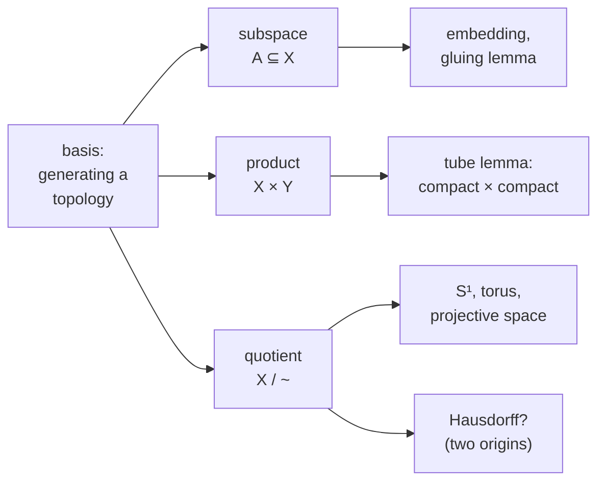

# PA11 · Subspaces, Products and Quotients

◀ [[PA07 Metric and Topological Spaces]] · [[Proofs, Analysis and Topology - Course Map]] · [[PA12 Separation, Countability and Local Compactness]] ▶

extra · book extra · beyond

> [!warning] Why this chapter exists, and what it rests on
> Written 2026-10-30 as a **prerequisite for [[DM01 Smooth Manifolds]]** (the new `14-Differential-Geometry` vault): a manifold is a space built by gluing open subsets of $\mathbb R^n$, so the vocabulary of subspaces, products and quotients is used on every page of it. **No lecture of this course covers it**; everything is 🟡/🔵. The proofs follow Lee's *Introduction to Smooth Manifolds* Appendix A ([[John M. Lee - Introduction to Smooth Manifolds.pdf#page=614|Lee App. A, pp. 596–607]], printed page = PDF page − 18) and Munkres *Topology* §§13, 15–19, 22; the numbers are recomputed in `scripts/pa11_numbers.py`.

> [!syllabus] Syllabus map: what is in the syllabus and what is extra in this chapter
> 🟡 **Extra · book** (Lee App. A; Munkres §§13, 15–19, 22, 26, 31)
> - §1 bases; §2 subspaces and the gluing lemma; §3 products, the tube lemma; §4 disjoint unions and locality
> - §5 quotients, the characteristic property, projective space; §6 the closed map lemma
>
> 🔵 **Extra · beyond** (my additions, labelled)
> - the open sets of the product of two Sierpiński spaces (6, not 9); the Euler characteristics of the four standard gluings computed by union–find; a numerical look at why $t\mapsto e^{2\pi it}$ on $[0,1)$ and the figure-eight curve are *not* embeddings; a proof that "open quotient map + closed relation ⇒ Hausdorff" (used for $\mathbb{RP}^n$)

> [!key] After this chapter you can
> - build a topology from a **basis**, and check the basis conditions,
> - use the **universal property** of the subspace, product and quotient topologies to prove that a map is continuous in one line,
> - decide when a continuous bijection or injection is a **homeomorphism / embedding** (and spot the classic failures),
> - prove that a quotient is **Hausdorff** and **second-countable**, and recognise $S^1$, the torus, the Klein bottle and $\mathbb{RP}^n$ as quotients,
> - explain why the **line with two origins** is not a manifold.

> [!intuition] The one-sentence story
> Three ways to make a new space from old ones: *cut out* a piece (subspace: keep every open set you can see from outside), *stack* spaces (product: open sets are generated by boxes), *glue* points together (quotient: a set is open when its preimage is). Each topology is defined to be the **coarsest/finest one that makes the obvious map continuous**, so each has a one-line test for continuity of maps into or out of it.

*Concept map: every box is a section; the arrows are the order in which the constructions are used.*

![[fig_pa11_quotients.png]]
*A: one square glued in four ways (Euler characteristic χ computed by union–find). B: the line with two origins, the standard non-Hausdorff quotient. C: an injective continuous curve whose image is not homeomorphic to its domain. Sections 5, 5 and 2 respectively.*

## 1. Bases
extra · book *Lee App. A; Munkres §13*

> [!intuition] A basis is a menu of "round" open sets
> Open balls are enough to describe every open set of a metric space: an open set is a union of balls. A basis abstracts this: a family of sets, rich enough that any two of them can be refined at any common point.

> [!key] Definition
> A **basis** for a set $X$ is a family $\mathcal B$ of subsets with (B1) every $x\in X$ lies in some $B\in\mathcal B$; (B2) if $x\in B_1\cap B_2$ with $B_i\in\mathcal B$, there is $B_3\in\mathcal B$ with $x\in B_3\subseteq B_1\cap B_2$. The **topology generated by $\mathcal B$** is
> $$\mathcal T_{\mathcal B}=\{U\subseteq X:\ \forall x\in U\ \exists B\in\mathcal B,\ x\in B\subseteq U\}.$$

> [!derivation]- $\mathcal T_{\mathcal B}$ is a topology, and its open sets are exactly the unions of basis sets
> $\varnothing$ qualifies vacuously and $X\in\mathcal T_{\mathcal B}$ by (B1). A union of members qualifies (each point of the union lies in one member, hence in a basis set inside it). For $U_1,U_2\in\mathcal T_{\mathcal B}$ and $x\in U_1\cap U_2$ choose $B_i$ with $x\in B_i\subseteq U_i$; (B2) gives $B_3$ with $x\in B_3\subseteq B_1\cap B_2\subseteq U_1\cap U_2$. If $U$ is open, $U=\bigcup_{x\in U}B_x$; conversely each $B\in\mathcal B$ is open by definition, so every union of basis sets is open.

Two facts are used constantly. **(a) Comparison:** $\mathcal T_{\mathcal B}\subseteq\mathcal T'$ iff every $B\in\mathcal B$ is $\mathcal T'$-open. **(b) Continuity on a basis:** $f:X\to Y$ is continuous iff $f^{-1}(B)$ is open for every $B$ in a basis of $Y$ (a union of basis sets pulls back to a union of open sets).

Examples. Open balls in a metric space; open intervals in $\mathbb R$; open intervals with **rational** endpoints (a *countable* basis, so $\mathbb R$ is second-countable, see [[PA12 Separation, Countability and Local Compactness]]); in $\mathbb R^n$, balls with rational centre and radius.

> [!pitfall] Basis sets need not be closed under intersection
> (B2) only asks that $B_1\cap B_2$ contain a basis set around each of its points. A **subbasis** is any family covering $X$; its finite intersections form a basis. Product topologies below are defined this way.

## 2. The subspace topology
extra · book *Lee Prop. A.17, Lemma A.20; Munkres §16*

> [!key] Definition
> For $A\subseteq X$ the **subspace topology** is $\mathcal T_A=\{U\cap A: U\text{ open in }X\}$. It is the **coarsest** topology on $A$ making the inclusion $\iota:A\hookrightarrow X$ continuous.

> [!intuition] You inherit what you can see from outside
> A set is open in $A$ when it is the trace of an open set of the ambient space. $[0,\tfrac12)$ is open in $[0,1]$ although it is not open in $\mathbb R$: it equals $(-1,\tfrac12)\cap[0,1]$.

> [!key] Universal property
> A map $f:Z\to A$ is continuous **iff** $\iota\circ f:Z\to X$ is continuous.
>
> *Proof.* ($\Rightarrow$) a composition of continuous maps. ($\Leftarrow$) an open set of $A$ is $U\cap A$ and $f^{-1}(U\cap A)=f^{-1}(\iota^{-1}U)=(\iota\circ f)^{-1}(U)$, open. $\square$

Consequences: restrictions of continuous maps are continuous; a subspace of a metric space gets the induced metric's topology; a basis for $X$ restricted to $A$ is a basis for $A$. If $A$ is open in $X$, a subset of $A$ is open in $A$ iff open in $X$; likewise, if $A$ is closed in $X$, a subset of $A$ is closed in $A$ iff closed in $X$. **Hereditary properties:** Hausdorff, first- and second-countable pass to subspaces. **Compactness** passes to *closed* subsets, and compact subsets of a Hausdorff space are closed ([[Compact Space]]).

> [!key] Gluing lemma (Lee A.20)
> Let $X=A\cup B$ with $A,B$ both closed (or both open) in $X$, and $f:X\to Y$ a map with $f|_A$ and $f|_B$ continuous. Then $f$ is continuous.
>
> *Proof for closed $A,B$.* For $C\subseteq Y$ closed, $f^{-1}(C)=(f|_A)^{-1}(C)\cup(f|_B)^{-1}(C)$. Each piece is closed in $A$ (resp. $B$), hence closed in $X$ because $A$ (resp. $B$) is closed. A union of two closed sets is closed. $\square$
>
> *Use:* paste a piecewise definition such as $f(x)=|x|$, i.e. $-x$ on $(-\infty,0]$ and $x$ on $[0,\infty)$. It **fails** for non-closed pieces: $f=0$ on $(-\infty,0]$ and $1$ on $(0,\infty)$.

> [!key] Homeomorphism and embedding
> A **homeomorphism** is a continuous bijection with continuous inverse. A **(topological) embedding** is a continuous injection $f:X\to Y$ that is a homeomorphism onto its image $f(X)$ *with the subspace topology*.

> [!pitfall] A continuous injection is not an embedding in general
> (i) $f:[0,1)\to S^1,\ f(t)=e^{2\pi it}$ is a continuous bijection onto $S^1$ but not a homeomorphism: $t_n=1-\tfrac1n$ has $f(t_n)\to f(0)=1$ while $t_n\not\to0$ (numbers: at $t=1-10^{-3}$, $|f(t)-f(0)|=6.3\times10^{-3}$ yet $|t-0|=0.999$). (ii) **The figure-eight.** $\beta(t)=(\sin2t,\sin t)$ on $(-\pi,\pi)$ is injective (checked on a grid of $4\times10^5$ points: no two distinct parameters share an image), continuous, an immersion in the sense of [[DM05 Immersions, Embeddings, Submersions and Coverings]], and its image is the lemniscate. But $\beta(\pi-\delta)\to\beta(0)=(0,0)$ as $\delta\to0$ (at $\delta=10^{-3}$: $|\beta-\beta(0)|=2.2\times10^{-3}$) while $\pi-\delta$ stays far from $0$. So $\beta^{-1}$ is not continuous: the image, with the subspace topology, is *not* homeomorphic to an interval. This is exactly the difference between *immersed* and *embedded* submanifolds ([[DM06 Submanifolds]]; Lee Example 4.19, [[John M. Lee - Introduction to Smooth Manifolds.pdf#page=104|Lee p. 86]]).

The standard rescue is compactness (§6): a continuous injection from a **compact** space into a **Hausdorff** space is an embedding.

## 3. The product topology
extra · book *Lee Prop. A.23; Munkres §§15, 19, 26*

> [!key] Definition
> On $X\times Y$ the **product topology** has basis the "boxes" $U\times V$, $U\subseteq X$ and $V\subseteq Y$ open. (B2) holds because $(U_1\times V_1)\cap(U_2\times V_2)=(U_1\cap U_2)\times(V_1\cap V_2)$. For finitely many factors, repeat. For **infinitely** many factors the product topology allows $U_\alpha\neq X_\alpha$ for only finitely many $\alpha$ (the *box* topology, which allows all, is finer and rarely useful).

> [!intuition] Open = "pin down finitely many coordinates, approximately"
> A neighbourhood of $(x,y)$ restricts $x$ to a neighbourhood of $x$ and $y$ to a neighbourhood of $y$, and nothing else. In $\mathbb R\times\mathbb R$ the boxes are open rectangles: the product topology of $\mathbb R\times\mathbb R$ is the usual topology of $\mathbb R^2$ (rectangles and discs refine each other at every point).

> [!key] Universal property
> The projections $\pi_X,\pi_Y$ are continuous (and **open**), and a map $f=(f_1,f_2):Z\to X\times Y$ is continuous **iff** both components $f_1=\pi_X\circ f$ and $f_2=\pi_Y\circ f$ are.
>
> *Proof.* ($\Leftarrow$) $f^{-1}(U\times V)=f_1^{-1}(U)\cap f_2^{-1}(V)$ is open, and boxes form a basis (§1(b)). $\square$

Applications. Addition, multiplication $\mathbb R^2\to\mathbb R$ and the determinant $\mathbb R^{n^2}\to\mathbb R$ are continuous (polynomials in the coordinates), so $GL(n,\mathbb R)=\det^{-1}(\mathbb R\setminus0)$ is an open subset of $\mathbb R^{n^2}$ and matrix multiplication $GL\times GL\to GL$ is continuous: a **topological group**, the seed of [[DM08 Lie Groups]]. The torus is $T^n=(S^1)^n$ and the cylinder is $S^1\times\mathbb R$.

> [!key] A space is Hausdorff iff its diagonal is closed
> $X$ is Hausdorff iff $\Delta=\{(x,x)\}$ is closed in $X\times X$. *Proof.* $\Delta$ closed means: for $x\ne y$ some box $U\times V\ni(x,y)$ misses $\Delta$, i.e. $U\cap V=\varnothing$. $\square$

> [!key] Tube lemma and compact × compact
> If $Y$ is compact, $x_0\in X$ and $N\subseteq X\times Y$ is open with $\{x_0\}\times Y\subseteq N$, then there is an open $W\ni x_0$ with $W\times Y\subseteq N$.
>
> *Proof.* For each $y\in Y$ pick a box $U_y\times V_y\subseteq N$ around $(x_0,y)$. Finitely many $V_{y_1},\dots,V_{y_k}$ cover $Y$; put $W=U_{y_1}\cap\cdots\cap U_{y_k}$. $\square$
>
> **Corollary.** $X,Y$ compact $\Rightarrow$ $X\times Y$ compact. Given an open cover, each slice $\{x\}\times Y$ (homeomorphic to $Y$, so compact) is covered by finitely many members; their union $N_x$ is open, so $W_x\times Y\subseteq N_x$ for an open $W_x\ni x$. Finitely many $W_x$ cover $X$, so finitely many members cover $X\times Y$. $\square$ (Tychonoff's theorem extends this to arbitrary products and is equivalent to the axiom of choice; [[Axiom of Choice]].)

> [!example] The product of two Sierpiński spaces has 6 open sets, not 9
> Sierpiński space $S=\{0,1\}$ has open sets $\varnothing,\{1\},S$. The nine boxes $U\times V$ collapse: every box with $U=\varnothing$ or $V=\varnothing$ is $\varnothing$, leaving the **5** distinct boxes $\{(1,1)\}$, $\{1\}\times S$, $S\times\{1\}$, $S\times S$, $\varnothing$. Their unions add $\{1\}\times S\cup S\times\{1\}=\{(1,0),(0,1),(1,1)\}$, giving **6** open sets (`pa11_numbers.py`), the up-sets of the product order on $\{0,1\}^2$. The subspace topology of $\{(0,1),(1,1)\}\subset S\times S$ has 3 open sets: it is again a Sierpiński space.

## 4. Disjoint unions and locality
extra · book *Lee Lemma A.19, Prop. A.25*

The **disjoint union** $\bigsqcup X_\alpha$ has as open sets those sets whose intersection with every $X_\alpha$ is open; a map out of it is continuous iff its restriction to each piece is. More generally **continuity is local**: $f:X\to Y$ is continuous iff every point has a neighbourhood on which $f$ is continuous. This is why a smooth structure can be checked chart by chart ([[DM02 Smooth Maps and Partitions of Unity]]).

## 5. The quotient topology
extra · book *Lee Thms. A.27, A.30, A.31; Munkres §22*

> [!intuition] Glue first, ask later
> Take a space and declare some points to be the same point. The new space has a point for each class. A set of classes is *open* when the union of its classes is open upstairs: the topology is the **finest** one that keeps the gluing map continuous. Closing up an interval end to end gives a circle; gluing the sides of a square gives a torus.

> [!key] Definition
> For a surjection $\pi:X\to Y$ the **quotient topology** on $Y$ is $\{V\subseteq Y:\pi^{-1}(V)\text{ open in }X\}$; $\pi$ is then a **quotient map**. For an equivalence relation $\sim$ on $X$ write $X/{\sim}$ for the set of classes with this topology. Every surjective continuous map that is **open** or **closed** is a quotient map (if $\pi^{-1}(V)$ is open then $V=\pi(\pi^{-1}V)$ is open when $\pi$ is open). A quotient map need not be open.

> [!key] Characteristic property (passing to the quotient)
> Let $\pi:X\to Y$ be a quotient map and $g:X\to Z$ constant on each fibre $\pi^{-1}(y)$. Then $g=\hat g\circ\pi$ for a unique $\hat g:Y\to Z$, and $\hat g$ is continuous **iff** $g$ is.
>
> *Proof.* *Existence and uniqueness of $\hat g$:* for $y\in Y$ pick any $x$ with $\pi(x)=y$ ($\pi$ is surjective) and set $\hat g(y)=g(x)$; this does not depend on the choice because $g$ is constant on the fibre $\pi^{-1}(y)$, and it is the only possibility since $\hat g(\pi(x))$ must equal $g(x)$. ($\Rightarrow$) $g=\hat g\circ\pi$ is a composite of continuous maps. ($\Leftarrow$) For $W\subseteq Z$ open, $\pi^{-1}(\hat g^{-1}W)=g^{-1}(W)$ is open, so $\hat g^{-1}W$ is open by the definition of the quotient topology. $\square$

Two quotient maps with the same fibres give homeomorphic quotients (uniqueness, Lee Thm A.31). Hence one may describe a quotient by *any* convenient quotient map.

> [!example] $S^1$, the torus, $S^n$ as quotients
> * $[0,1]/(0\sim1)\cong S^1$: $g(t)=e^{2\pi it}$ is constant on fibres and continuous; $[0,1]$ is compact and $S^1$ Hausdorff, so $g$ is closed (§6), hence a quotient map, and the induced bijection is a homeomorphism. Likewise $\mathbb R/\mathbb Z\cong S^1$.
> * Gluing the square $[0,1]^2$ along the edge words of figure A gives, reading anticlockwise, $a\,b\,a^{-1}b^{-1}$ the **torus**, $a\,b\,a^{-1}b$ the **Klein bottle**, $a\,b\,a\,b$ the **projective plane**, $a\,a^{-1}b\,b^{-1}$ the **sphere**. Counting vertex classes $V$, edge classes $E$ and the single face $F=1$ (union–find, `pa11_numbers.py`): torus $V=1,E=2$, $\chi=0$; Klein $V=1,E=2$, $\chi=0$; projective plane $V=2,E=2$, $\chi=1$; sphere $V=3,E=2$, $\chi=2$. The torus is also $\mathbb R^2/\mathbb Z^2\cong S^1\times S^1$.
> * $D^n/\partial D^n\cong S^n$.

> [!example] Real projective space $\mathbb{RP}^n=S^n/(x\sim-x)$ is compact, Hausdorff, second-countable
> Let $\pi:S^n\to\mathbb{RP}^n$. **Open:** for $U\subseteq S^n$ open, $\pi^{-1}(\pi(U))=U\cup(-U)$ is open. **Second-countable:** if $\mathcal B$ is a countable basis of $S^n$ then $\{\pi(B)\}$ is a basis of the quotient (given $V\ni\pi(x)$ open pick $B\ni x$, $B\subseteq\pi^{-1}V$). **Compact:** continuous image of $S^n$. **Hausdorff:** the relation $R=\{(x,y):y=x\text{ or }y=-x\}$ is closed in $S^n\times S^n$ (the union of the zero sets of $x-y$ and $x+y$), and the criterion below applies. The same space is $(\mathbb R^{n+1}\setminus0)/\mathbb R^\times$, the set of lines through the origin ([[Real Projective Space]]).

> [!key] Hausdorff quotient criterion
> If $\pi:X\to X/{\sim}$ is **open** and $R=\{(x,x'):x\sim x'\}$ is **closed** in $X\times X$, then $X/{\sim}$ is Hausdorff.
>
> *Proof.* Let $[x]\neq[y]$. Then $(x,y)\notin R$, so a box $U\times V\ni(x,y)$ misses $R$: no point of $U$ is equivalent to a point of $V$. Hence $\pi(U)$ and $\pi(V)$ are disjoint, and open because $\pi$ is open. $\square$

> [!example] The line with two origins: locally Euclidean, second-countable, **not Hausdorff**
> Let $M=(\mathbb R\times\{1,-1\})/\big((x,1)\sim(x,-1)\ \text{for }x\neq0\big)$ (Lee's Problem 1-1, [[John M. Lee - Introduction to Smooth Manifolds.pdf#page=47|Lee p. 29]]), with two "origins" $0_1=[(0,1)]$ and $0_2=[(0,-1)]$. Each of the two copies of $\mathbb R$ maps homeomorphically onto an open subset of $M$, so $M$ is locally Euclidean, and it is second-countable. But take open sets $U\ni0_1$, $V\ni0_2$: their preimages contain $(-\varepsilon,\varepsilon)\times\{1\}$ and $(-\delta,\delta)\times\{-1\}$; with $c=\min(\varepsilon,\delta)$ the point $[(c/2,1)]=[(c/2,-1)]$ lies in $U\cap V$. The gluing relation on $\mathbb R\times\{\pm1\}$ is **not closed** (points $((x,1),(x,-1))$ with $x\to0$ converge to $((0,1),(0,-1))$, which is not in it), as the criterion predicts. **This is why the definition of a manifold insists on the Hausdorff axiom** ([[DM01 Smooth Manifolds]]).

> [!pitfall] Quotients of nice spaces can be bad
> A quotient of a Hausdorff space need not be Hausdorff (above) or even $T_1$ (collapse a non-closed set); a quotient map need not be open; and a continuous bijection out of a quotient is a homeomorphism only under compactness/Hausdorff hypotheses.

## 6. The closed map lemma
extra · book *Lee Lemma A.52; Munkres Thm 26.6*

> [!key] Closed Map Lemma
> If $f:X\to Y$ is continuous, $X$ compact and $Y$ Hausdorff, then $f$ is **closed**. Consequently a continuous bijection $X\to Y$ is a homeomorphism, and a continuous injection is an embedding.
>
> *Proof.* A closed $C\subseteq X$ is compact; $f(C)$ is compact in the Hausdorff space $Y$, hence closed. A closed continuous bijection has continuous inverse because $(f^{-1})^{-1}(C)=f(C)$. $\square$

This is the engine behind "$[0,1]/(0\sim1)\cong S^1$", behind "compact submanifolds are embedded" ([[DM05 Immersions, Embeddings, Submersions and Coverings]]), and it explains why both counterexamples in §2 have a **non-compact** domain.

<!-- interactive:start (generated by scripts/embed_interactive.py; edit the tool in scripts/interactive/tools/, not this block) -->
> [!interactive]+ Interactive: Metric balls: the same plane, different geometries
> The ball B(p, r) = {x : d(x,p) < r} for the ℓᵖ metric d_p(x,y) = (|x₁−y₁|ᵖ + |x₂−y₂|ᵖ)^{1/p}: a diamond for p = 1 (taxicab), a disc for p = 2, a square for p = ∞.
>
> ![[pa_metric_balls.png|720]]
>
> **Try:** p = 1, 2, ∞ with r = 1: area 2, π, 4. Slide p between 1 and ∞ and the diamond bulges into a square. In the discrete metric the ball B(p, 1) is {p} and B(p, 1.01) is everything. Click a point and watch the triangle inequality hold.
>
> [▶ Open the tool in your browser](../Assets/interactive/pa_metric_balls.html) · [absolute link](file:///home/swastik/Documents/notes/Assets/interactive/pa_metric_balls.html) · all tools and coverage: [[Interactive Tools]]

<!-- interactive:end -->

## Map of this chapter
> [!connection] How PA11 connects
> **Builds on:** [[PA07 Metric and Topological Spaces]] (open sets, continuity, compactness, connectedness) and [[PA02 Sets Families and the ZFC Foundations]] (equivalence relations come from [[PA03 Relations Equivalence and Order]]).
> **Leads to:** [[PA12 Separation, Countability and Local Compactness]] (Hausdorff, second-countable and the properties of the spaces built here), [[PA15 Covering Spaces and the Fundamental Group]] (quotients by group actions), and [[DM01 Smooth Manifolds]] (the Chart Lemma builds a topology on a set from charts; $TM$, $\mathbb{RP}^n$ and Lie groups are all constructed with these tools).
> **Concepts:** [[Basis for a Topology]] · [[Subspace Topology]] · [[Product Topology]] · [[Quotient Topology]] · [[Homeomorphism and Embedding]] · [[Gluing Lemma]] · [[Tube Lemma]] · [[Closed Map Lemma]] · [[Line with Two Origins]] · [[Real Projective Space]]
> **Other subjects:** [[Group Theory - Course Map]] (a group acting on a space gives a quotient, e.g. $T^n=\mathbb R^n/\mathbb Z^n$)

## Summary
> [!summary] Cheat-sheet
> - **Basis:** covers $X$ and refines intersections; open = union of basis sets; continuity can be tested on a basis.
> - **Subspace** $=\{U\cap A\}$, coarsest making $\iota$ continuous; $f:Z\to A$ continuous $\iff\iota\circ f$ continuous. **Gluing lemma:** two *closed* (or *open*) pieces.
> - **Product** has boxes as basis; $f$ into $X\times Y$ continuous $\iff$ components continuous; projections open; $X$ Hausdorff $\iff\Delta$ closed; **tube lemma** $\Rightarrow$ compact × compact.
> - **Quotient** $V$ open $\iff\pi^{-1}V$ open; $\hat g:Y\to Z$ continuous $\iff g=\hat g\pi$ continuous. Open/closed surjections are quotient maps. **Hausdorff quotient:** $\pi$ open and $R$ closed.
> - **Closed map lemma:** compact → Hausdorff is closed; continuous bijection is a homeomorphism.
> - **Failures:** $[0,1)\to S^1$ and the figure-eight are continuous injections, not embeddings; the line with two origins is locally Euclidean and second-countable but not Hausdorff.
> - **Numbers:** $S\times S$ (Sierpiński) has 6 open sets; $\chi$(torus, Klein, $\mathbb{RP}^2$, sphere) $=0,0,1,2$.

## Practice
1. **Basis check.** On $\mathbb R$ let $\mathcal B=\{[a,b):a<b\}$. Verify (B1) and (B2). Is $[0,1)$ open in the generated topology? Is $(0,1)$? Compare with the usual topology.
2. **Open in the subspace.** In $A=[0,1]\cup\{2\}\subset\mathbb R$ decide which of $\{2\}$, $[0,\tfrac12)$, $(\tfrac12,1]$, $\{0\}$ are open in $A$ and which are open in $\mathbb R$.
3. **Gluing.** Does $f(x)=x$ for $x\le0$, $f(x)=x+1$ for $x>0$ define a continuous map on $\mathbb R$? Which hypothesis of the gluing lemma fails? Change the second piece to $f(x)=x$ for $x\ge0$ with the first piece unchanged: why does the lemma now apply?
4. **Product universal property.** Show that $x\mapsto(x,x^2)$ is a homeomorphism from $\mathbb R$ onto its image (the parabola) with the subspace topology.
5. **Tube lemma.** Show the conclusion can fail if $Y$ is not compact: find an open $N\subseteq\mathbb R\times\mathbb R$ containing $\{0\}\times\mathbb R$ with no open $W\ni0$ such that $W\times\mathbb R\subseteq N$.
6. **A quotient.** Let $X=\mathbb R$ and $x\sim y$ iff $x-y\in\mathbb Z$. Show $\mathbb R/\!\sim\ \cong S^1$ by exhibiting a quotient map (not just a bijection).
7. **Hausdorff or not.** $X=\mathbb R$ with $x\sim y$ iff $x=y$ or $x,y\in\mathbb Q$ (all rationals become one point). Is $X/{\sim}$ Hausdorff? Is $\pi$ open?
8. **Möbius band.** Glue only the left and right edges of $[0,1]^2$ by $(0,y)\sim(1,1-y)$ (top and bottom stay free). Count $V,E,F$ and $\chi=V-E+F$, and count the boundary circles; compare with the cylinder $(0,y)\sim(1,y)$.
9. **$\mathbb{RP}^1$.** Prove $\mathbb{RP}^1\cong S^1$ by exhibiting a quotient map $S^1\to S^1$ that identifies exactly antipodal points.
10. **Embedding.** Let $f:[0,1)\to\mathbb R^2$, $f(t)=(\cos2\pi t,\sin2\pi t)$ and $g:[0,1]\to\mathbb R^2$ the same formula. Which is an embedding? Which hypothesis of the closed map lemma decides it?

> [!example]- Solutions
> 1. (B1) $x\in[x,x+1)$. (B2) $[a,b)\cap[c,d)=[\max(a,c),\min(b,d))$ is empty or a basis set. $[0,1)$ is open (it *is* a basis set); $(0,1)=\bigcup_{n}[\tfrac1n,1)$ is open too. Every usual open interval is open (it is a union of sets $[a,b)$), but $[0,1)$ is not usually open, so this *lower-limit* topology is strictly finer than the usual one.
> 2. $\{2\}=(1.5,2.5)\cap A$ is open in $A$ but not in $\mathbb R$. $[0,\tfrac12)=(-1,\tfrac12)\cap A$ open in $A$ only. $(\tfrac12,1]=(\tfrac12,1.5)\cap A$ is open in $A$ only. $\{0\}$ is open in neither (any $(-\varepsilon,\varepsilon)\cap A\ni$ points of $[0,\varepsilon)$).
> 3. No: $\lim_{x\to0^-}f=0\ne1=\lim_{x\to0^+}f$. The pieces $(-\infty,0]$ (closed) and $(0,\infty)$ (open) are neither both closed nor both open, so the lemma does not apply, and here its conclusion is false. With the pieces $(-\infty,0]$ and $[0,\infty)$, both closed, and $f(x)=x$ on each, the restrictions are continuous and agree on the overlap $\{0\}$, so $f$ is continuous (it is the identity).
> 4. $g(x)=(x,x^2)$ is continuous (components continuous), injective, with continuous left inverse $\pi_1|_{\text{parabola}}$. So $g$ is a homeomorphism onto its image.
> 5. $N=\{(x,y):|x|<\frac1{1+y^2}\}$ is open and contains $\{0\}\times\mathbb R$. Any $W=(-\varepsilon,\varepsilon)$ has $W\times\mathbb R\not\subseteq N$: take $y$ with $\frac1{1+y^2}<\varepsilon$.
> 6. $p:\mathbb R\to S^1$, $p(t)=e^{2\pi it}$ is continuous, surjective and **open** (a small interval maps to an arc), hence a quotient map; its fibres are exactly the classes $t+\mathbb Z$, so the induced bijection $\mathbb R/\mathbb Z\to S^1$ is a homeomorphism by uniqueness.
> 7. $X/{\sim}$ is **not** Hausdorff: let $q=\pi(\mathbb Q)$ and $r=\pi(\sqrt2)$. An open $W\ni r$ has $\pi^{-1}(W)$ open and containing $\sqrt2$, hence an interval, hence a rational; since $\pi^{-1}(W)$ is a union of classes it contains all of $\mathbb Q$, i.e. $q\in W$. So every neighbourhood of $r$ contains $q$ and no two neighbourhoods are disjoint. $\pi$ is not open: $\pi((0,1))$ has preimage $(0,1)\cup\mathbb Q$, which is not open.
> 8. Corner classes: $(0,0)\sim(1,1)$ and $(0,1)\sim(1,0)$, so $V=2$. Edges: the glued side is one class and the top and bottom edges stay separate: $E=3$, $F=1$, $\chi=2-3+1=0$. The top edge runs from $[(0,1)]$ to $[(1,1)]=[(0,0)]$ and the bottom edge from $[(0,0)]$ to $[(1,0)]=[(0,1)]$, so together they form **one** boundary circle; the cylinder has two (its corners $V=2$ pair as $(0,0)\sim(1,0)$, $(0,1)\sim(1,1)$ and each free edge closes up by itself). Same $\chi$, different boundary: the half-twist.
> 9. Write $S^1=\{e^{i\theta}\}$ and $q(e^{i\theta})=e^{2i\theta}$. It is continuous, surjective, a closed map by §6, and $q(z)=q(w)$ iff $z=\pm w$. By uniqueness of quotients $S^1/(z\sim-z)=\mathbb{RP}^1\cong S^1$.
> 10. $g$ (compact domain, Hausdorff target) is closed, but $g$ is not injective ($g(0)=g(1)$). $f$ is injective, continuous, with image $S^1$, yet is **not** an embedding (§2(i)): its domain is not compact, so the lemma does not apply, and $f^{-1}$ is discontinuous at $(1,0)$.

## Provenance
> [!provenance]- Source map for this chapter
> | Topic | Source | Scope |
> |---|---|---|
> | bases, subspaces, gluing lemma, product topology, tube lemma | Lee *ISM* App. A (Props. A.17, A.23, Lemma A.20); Munkres §§13, 15, 16, 19, 26 | extra/book |
> | quotient topology, characteristic property, uniqueness | Lee Thms. A.27, A.30, A.31; Munkres §22 | extra/book |
> | closed map lemma | Lee Lemma A.52; Munkres Thm 26.6 | extra/book |
> | line with two origins | Lee Problem 1-1 (p. 29) | extra/book |
> | Sierpiński product, $\chi$ of four gluings, figure-eight and $[0,1)\to S^1$ numbers, Hausdorff-quotient criterion | `scripts/pa11_numbers.py`, `scripts/fig_pa11_quotients.py` | extra/beyond |
>
> **Notes.** Lee's printed page = PDF page − 18 (Chapter 1 starts on PDF page 19).
