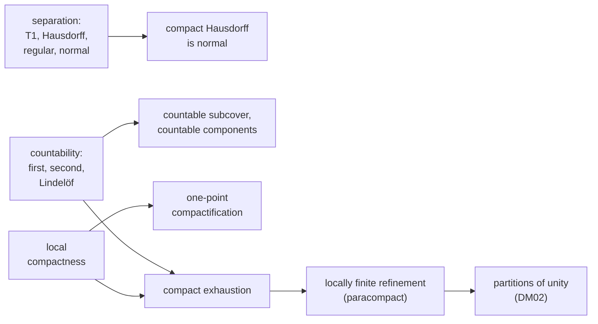

# PA12 · Separation, Countability and Local Compactness

◀ [[PA11 Subspaces, Products and Quotients]] · [[Proofs, Analysis and Topology - Course Map]] · [[PA13 The Derivative and the Inverse Function Theorem]] ▶

extra · book extra · beyond

> [!warning] Why this chapter exists, and what it rests on
> Written 2026-10-30 as a **prerequisite for [[DM01 Smooth Manifolds]] and [[DM02 Smooth Maps and Partitions of Unity]]**: a topological manifold is *locally Euclidean, Hausdorff and second-countable*, and every global construction on manifolds (countable atlases, partitions of unity, exhaustion functions, Riemannian metrics) rests on the consequences proved here. **No lecture of this course covers it**: everything is 🟡/🔵. Proofs follow Lee's *Introduction to Smooth Manifolds* App. A ([[John M. Lee - Introduction to Smooth Manifolds.pdf#page=618|Lee Props. A.12, A.16 (pp. 600–601), A.60 (p. 612)]]) and Munkres §§17, 26, 29–32, 39 (paracompactness); numbers recomputed in `scripts/pa12_numbers.py`.

> [!syllabus] Syllabus map: what is in the syllabus and what is extra in this chapter
> 🟡 **Extra · book** (Lee App. A; Munkres Ch. 4, §§26, 29, 30, 39)
> - §1 separation axioms; §2 countability axioms; §3 local compactness and the one-point compactification
> - §4 compact exhaustions, locally finite families, paracompactness; §5 what a manifold needs and why
>
> 🔵 **Extra · beyond** (my additions, labelled)
> - the numerical check $|\sigma^{-1}(w)-N|=2/\sqrt{1+|w|^2}$ for stereographic projection; a family that is locally finite in $(0,1)$ but not in $[0,1)$, with counts; the lower-limit line as a first-countable, non-second-countable example; the proof that second-countable locally connected spaces have countably many components

> [!key] After this chapter you can
> - place a space on the ladder **$T_1\Rightarrow$ Hausdorff $\Rightarrow$ regular $\Rightarrow$ normal** and prove compact Hausdorff $\Rightarrow$ normal,
> - use **second-countability** to extract countable subcovers (Lindelöf) and to show a space has countably many components,
> - define **local compactness**, build the **one-point compactification**, and recognise $(\mathbb R^n)^*=S^n$,
> - construct a **compact exhaustion** and a **locally finite refinement** of any open cover,
> - explain why the manifold axioms are exactly Hausdorff + second-countable, and give a counterexample to each.

> [!intuition] The one-sentence story
> Topology only knows "open"; the **separation axioms** say how well open sets tell points apart, the **countability axioms** say how many open sets you need to describe the whole space, and **local compactness** says small closed balls are compact. Spaces that have all three, like $\mathbb R^n$ and every manifold, behave almost like metric spaces: sequences suffice, covers can be made countable and locally finite, and partitions of unity exist.

*Concept map: separation, countability and local compactness combine into exhaustions and locally finite covers, the input of partitions of unity.*

![[fig_pa12_compact.png]]
*A: stereographic projection identifies $\mathbb R^2\cup\{\infty\}$ with $S^2$ (§3). B: a family that is locally finite in $(0,1)$ but not in $[0,1)$ (§4). C: a compact exhaustion of the plane (§4).*

## 1. Separation axioms
extra · book *Munkres §§17, 31–33; Lee App. A*

> [!intuition] How finely can open sets tell things apart?
> A topology can be so coarse that two points cannot be told apart (indiscrete space), or tell them apart only in one direction (Sierpiński space), or tell points apart but not keep them *separated* by disjoint neighbourhoods. The axioms grade this.

> [!key] Definitions
> A space $X$ is **$T_1$** if every point is closed. It is **Hausdorff ($T_2$)** if distinct points have disjoint open neighbourhoods. A $T_1$ space is **regular** if a point and a closed set not containing it have disjoint open neighbourhoods, and **normal** if two disjoint closed sets do. Then
> $$\text{normal}\ \Rightarrow\ \text{regular}\ \Rightarrow\ \text{Hausdorff}\ \Rightarrow\ T_1.$$

Examples. The Sierpiński space $\{0,1\}$ with open sets $\varnothing,\{1\},X$ is not even $T_1$ ($\{1\}$ is not closed). The cofinite topology on an infinite set is $T_1$ but not Hausdorff (two nonempty open sets always meet). The **line with two origins** ([[Line with Two Origins]]) is $T_1$, locally Euclidean, second-countable, and not Hausdorff. **Every metric space is normal**: for disjoint closed $A,B$ the sets $U=\{x:d(x,A)<d(x,B)\}$ and $V=\{x:d(x,B)<d(x,A)\}$ are open (distance to a set is continuous), disjoint, and contain $A$ and $B$ respectively.

> [!key] Consequences of Hausdorff
> (a) Limits of sequences are unique. (b) Compact subsets are closed ([[Compact Space]]). (c) The diagonal is closed in $X\times X$ ([[PA11 Subspaces, Products and Quotients]]). (d) A continuous map into a Hausdorff space has closed graph.

> [!derivation]- Compact sets in a Hausdorff space can be separated, and compact Hausdorff $\Rightarrow$ normal
> *Point versus compact.* Let $K$ be compact, $x\notin K$. For each $k\in K$ choose disjoint open $U_k\ni x$, $V_k\ni k$. Finitely many $V_{k_1},\dots,V_{k_m}$ cover $K$; then $U=\bigcap U_{k_i}\ni x$ and $V=\bigcup V_{k_i}\supseteq K$ are disjoint and open.
> *Compact versus compact.* Let $K,L$ be disjoint compact sets. For each $x\in K$ the previous step gives disjoint open $U_x\ni x$, $V_x\supseteq L$. Finitely many $U_{x_i}$ cover $K$; $U=\bigcup U_{x_i}$ and $V=\bigcap V_{x_i}$ separate $K$ from $L$.
> *Normal.* In a compact Hausdorff space closed sets are compact, so disjoint closed sets are separated by the previous step. $\square$

> [!key] Urysohn's lemma (statement)
> If $X$ is normal and $A,B$ are disjoint closed sets, there is a continuous $f:X\to[0,1]$ with $f|_A=0$ and $f|_B=1$. In a metric space one writes it down: $f(x)=\dfrac{d(x,A)}{d(x,A)+d(x,B)}$. (On manifolds *smooth* bump functions are built directly, [[DM02 Smooth Maps and Partitions of Unity]].)

> [!pitfall] Hausdorff is not automatic
> A quotient or a gluing of Hausdorff spaces can fail to be Hausdorff (line with two origins, quotient by a dense subgroup such as $\mathbb R/\mathbb Q$ which is indiscrete). Each time a manifold is built by gluing, one must check the Hausdorff property separately.

## 2. Countability axioms
extra · book *Lee Props. A.12, A.16; Munkres §30*

> [!intuition] How many questions does it take to describe the space?
> Metric spaces are described near each point by the countably many balls $B(x,1/n)$ (first-countable). $\mathbb R^n$ is described *globally* by countably many balls (rational centre and radius): second-countable. A space with uncountably many "isolated directions" cannot be.

> [!key] Definitions
> $X$ is **first-countable** if each point has a countable neighbourhood basis; **second-countable** if the topology has a countable basis; **separable** if it has a countable dense subset; **Lindelöf** if every open cover has a countable subcover. Second-countable implies first-countable, separable and Lindelöf; for **metric** spaces the last three are equivalent.

> [!key] Sequence lemma (Lee A.12)
> If $X$ is first-countable, $x\in\overline A$ iff some sequence in $A$ converges to $x$; and $f$ is continuous at $x$ iff $f(x_n)\to f(x)$ for every $x_n\to x$. (Without first countability, "sequentially continuous" is weaker than "continuous".)

> [!key] Lindelöf property of second-countable spaces (Lee A.16)
> Let $X$ be second-countable, $A\subseteq X$ open, and $\mathcal U$ an open cover of $A$. Then countably many members of $\mathcal U$ cover $A$.
>
> *Proof.* Let $\mathcal B$ be a countable basis. Call $B\in\mathcal B$ *good* if $B\subseteq U$ for some $U\in\mathcal U$ and, for each good $B$, pick one such $U_B$. Countably many $U_B$. Any $x\in A$ lies in some $U\in\mathcal U$, hence in a good $B\subseteq U$, hence in $U_B$. $\square$

Examples. $\mathbb R^n$ is second-countable (balls with rational centre and radius; for any point $x$ in a ball $B(c,r)$ some rational ball contains $x$ and lies in $B(c,r)$). **An uncountable discrete space** is first-countable (each point is open) but not second-countable (every singleton is open, so a basis contains all uncountably many) and not separable. **The lower-limit line $\mathbb R_\ell$** (basis $[a,b)$, PA11 Practice 1) is first-countable, separable ($\mathbb Q$ is dense), Lindelöf, but **not second-countable**: in any basis, for each real $x$ the open set $[x,x+1)$ contains a basis element $B_x\ni x$, and $B_x\subseteq[x,x+1)$ forces $\inf B_x=x$, so $x\mapsto B_x$ is injective, giving uncountably many basis elements.

> [!example] Countably many components
> Let $X$ be second-countable and **locally connected** (e.g. a manifold: every point has a connected neighbourhood, a ball). Its connected components are open (a point has a connected neighbourhood contained in its component) and pairwise disjoint. Each component contains a nonempty basis element and the basis is countable, so there are **countably many components**. An uncountable disjoint union of copies of $\mathbb R$ is locally Euclidean and Hausdorff but not second-countable, which is exactly what the axiom excludes.

> [!pitfall] The long line
> The **long line** (uncountably many copies of $[0,1)$ glued end to end in order, indexed by the first uncountable ordinal) is Hausdorff and locally Euclidean, connected, but **not second-countable** (not even paracompact, not metrisable). It is the standard example that second-countability is a genuine extra axiom and not a consequence of the others.

## 3. Local compactness and the one-point compactification
extra · book *Lee App. A; Munkres §29*

> [!key] Definition
> $X$ is **locally compact** if every point has a neighbourhood contained in a compact set. For a Hausdorff space this is equivalent to: every point has a neighbourhood basis of open sets with **compact closure** (*precompact* open sets). Open and closed subsets of a locally compact Hausdorff space are locally compact.

$\mathbb R^n$ is locally compact (closed balls are compact: Heine–Borel); every manifold is locally compact Hausdorff; $\mathbb Q$ is not (a compact subset of $\mathbb Q$ has empty interior); an infinite-dimensional normed space is not.

> [!intuition] Adding one point "at infinity"
> If a space is locally compact Hausdorff, one extra point can be added so that the result is compact: the neighbourhoods of the new point are the complements of compact sets, so a sequence that escapes every compact set converges to it. The plane with such a point is a sphere; the open interval with such a point is a circle.

> [!key] Theorem (one-point compactification)
> Let $X$ be locally compact Hausdorff, $X^*=X\cup\{\infty\}$, with open sets: the open sets of $X$, and the sets $X^*\setminus K$ with $K\subseteq X$ compact (hence closed). Then $X^*$ is a compact Hausdorff space containing $X$ as an open subspace.
>
> *Proof.* *Topology*: finite intersections and unions of these sets are again of the form (check the four cases; $K_1\cup K_2$ is compact). *Compact*: a cover contains a member $X^*\setminus K$ around $\infty$; finitely many other members cover the compact $K$. *Hausdorff*: two points of $X$ have disjoint open neighbourhoods in $X$; for $x\in X$ and $\infty$ choose a precompact open $U\ni x$, then $U$ and $X^*\setminus\overline U$ are disjoint open sets around $x$ and $\infty$. $\square$

> [!example] $(\mathbb R^n)^*\cong S^n$, with numbers
> Stereographic projection from $N=(0,\dots,0,1)$ identifies $\mathbb R^n$ with $S^n\setminus\{N\}$, $\sigma^{-1}(w)=\dfrac{(2w,|w|^2-1)}{|w|^2+1}$ (check: $|\sigma^{-1}(w)|=1$ for all $w$, verified to 12 digits). The distance to the pole is $|\sigma^{-1}(w)-N|=2/\sqrt{1+|w|^2}$: for $|w|=1,10,100,1000$ it is $1.414,\ 0.199,\ 2.0\times10^{-2},\ 2.0\times10^{-3}$ (`pa12_numbers.py`). So the complement of the closed disc of radius $R$ (a neighbourhood of $\infty$) corresponds to a small spherical cap around $N$ of radius $2/\sqrt{1+R^2}$, and conversely every cap around $N$ arises this way. Hence the identification is a homeomorphism and $(\mathbb R^n)^*=S^n$. Likewise $(0,1)^*\cong S^1$ (the two ends are glued to the single point $\infty$).

## 4. Exhaustions, locally finite families, paracompactness
extra · book *Lee Prop. A.60; Munkres §39*

> [!key] Compact exhaustion (Lee A.60)
> A **compact exhaustion** of $X$ is a sequence of compact sets $K_1\subseteq K_2\subseteq\cdots$ with $K_j\subseteq\operatorname{int}K_{j+1}$ and $\bigcup K_j=X$. Every second-countable, locally compact Hausdorff space has one.
>
> *Proof.* By local compactness the precompact open sets form a basis; by second-countability a countable family $\{B_i\}$ of them is already a basis ([[Basis for a Topology]]). Put $K_1=\overline{B_1}$. Given the compact $K_j$, finitely many $B_i$ cover it; take $m>j$ so large that $K_j\subseteq B_1\cup\cdots\cup B_m$ and set $K_{j+1}=\overline{B_1}\cup\cdots\cup\overline{B_m}$, compact, with $K_j\subseteq B_1\cup\dots\cup B_m\subseteq\operatorname{int}K_{j+1}$. Since $B_j\subseteq K_j$ the union is $X$. $\square$ For $\mathbb R^n$ take $K_j=\overline{B}(0,j)$.

> [!key] Locally finite families and paracompactness
> A family $\mathcal A$ of subsets is **locally finite** if every point has a neighbourhood meeting only finitely many members. A **refinement** of a cover $\mathcal U$ is a cover each of whose members lies in some member of $\mathcal U$. $X$ is **paracompact** if it is Hausdorff and every open cover has a locally finite open refinement.

> [!example] Local finiteness depends on the ambient space
> Let $\mathcal F=\{(\tfrac1{n+2},\tfrac1n):n\ge1\}$. In $X=(0,1)$ it is locally finite: the ball $B(0.5,0.01)$ meets 2 members, $B(0.05,0.01)$ meets 10, $B(0.001,0.0005)$ meets 1335 (finite for every $x>0$). In $[0,1)$ it is **not**: every ball $B(0,r)$ meets *every* member with $n\ge1/r$, infinitely many (counted up to $n<10^6$: 999,901 members for $r=0.01$ — only my cutoff is finite; `pa12_numbers.py`).

> [!key] Theorem (locally finite refinements)
> A second-countable, locally compact Hausdorff space is paracompact: every open cover $\mathcal U$ has a locally finite open refinement.
>
> *Proof.* Take a compact exhaustion and set $K_0=K_{-1}=\varnothing$. For $j\ge1$ the compact set $A_j=K_j\setminus\operatorname{int}K_{j-1}$ lies in the open set $W_j=\operatorname{int}K_{j+1}\setminus K_{j-2}$. For each $x\in A_j$ choose $U_x\in\mathcal U$ with $x\in U_x$; the sets $U_x\cap W_j$ cover $A_j$ and finitely many suffice. Collect these finitely many sets for every $j$. They are open, each lies in a member of $\mathcal U$, and they cover $X$ (a point of $K_j\setminus K_{j-1}$ lies in $A_j$). **Locally finite:** $\operatorname{int}K_m$ meets $W_j$ only if $j\le m+1$ (for $j\ge m+2$, $K_{j-2}\supseteq K_m$ so $W_j\cap K_m=\varnothing$), and only finitely many sets were chosen for each $j$. $\square$

This is the topological input of **partitions of unity** ([[DM02 Smooth Maps and Partitions of Unity]]): locally finite covers by coordinate balls, one smooth bump function per ball, normalised by their (locally finite) sum.

> [!example] Metrisability
> **Urysohn's metrisation theorem:** a second-countable regular space is metrisable. A topological manifold is locally Euclidean, hence regular, and second-countable by definition, so every manifold is metrisable, and the Riemannian distance function ([[John M. Lee - Introduction to Smooth Manifolds.pdf#page=355|Lee Ch. 13]]) is one such metric.

## 5. Why the manifold axioms are exactly these
extra · book *Lee Ch. 1 (p. 3–5)*

| Space | Locally Euclidean | Hausdorff | Second-countable |
|---|---|---|---|
| $\mathbb R^n$, $S^n$, $\mathbb{RP}^n$ | yes | yes | yes |
| line with two origins | yes | **no** | yes |
| long line | yes | yes | **no** |
| uncountable disjoint union of $\mathbb R$ | yes | yes | **no** |
| $\mathbb Q$ | no | yes | yes |

> [!connection] What each axiom buys later
> **Hausdorff:** unique limits, compact sets closed, flow lines and orbits behave ([[DM12 Integral Curves, Flows and Flowouts]]); **second-countable:** a *countable* atlas, countably many components, compact exhaustions, locally finite refinements and hence partitions of unity ([[DM02 Smooth Maps and Partitions of Unity]]), Whitney embedding ([[DM07 Sard Whitney and Transversality]]).

## Map of this chapter
> [!connection] How PA12 connects
> **Builds on:** [[PA11 Subspaces, Products and Quotients]] (subspace and product topologies, closed map lemma) and [[PA07 Metric and Topological Spaces]] (compactness).
> **Leads to:** [[PA15 Covering Spaces and the Fundamental Group]] (path-connected and locally path-connected spaces), [[DM01 Smooth Manifolds]], [[DM02 Smooth Maps and Partitions of Unity]].
> **Concepts:** [[Hausdorff Space]] · [[Separation Axioms]] · [[First-Countable Space]] · [[Second-Countable Space]] · [[Locally Compact Space]] · [[One-Point Compactification]] · [[Compact Exhaustion]] · [[Locally Finite Family]] · [[Paracompact Space]]
> **Other subjects:** [[Quantum Mechanics - Course Map]] (separable Hilbert spaces: a countable basis of states)

## Summary
> [!summary] Cheat-sheet
> - Normal $\Rightarrow$ regular $\Rightarrow$ Hausdorff $\Rightarrow T_1$. Metric spaces and compact Hausdorff spaces are normal. Hausdorff: unique limits, compacta closed, diagonal closed. Urysohn: $f=d(x,A)/(d(x,A)+d(x,B))$ in metric spaces.
> - Second-countable $\Rightarrow$ first-countable, separable, **Lindelöf** (countable subcovers of open subsets); locally connected + second-countable $\Rightarrow$ countably many components. $\mathbb R_\ell$ and the long line are not second-countable.
> - Locally compact Hausdorff $\Rightarrow$ precompact open basis; **one-point compactification** $X^*$; $(\mathbb R^n)^*=S^n$ with $|\sigma^{-1}(w)-N|=2/\sqrt{1+|w|^2}$.
> - Second-countable + locally compact + Hausdorff $\Rightarrow$ **compact exhaustion** $K_j\subseteq\operatorname{int}K_{j+1}$ $\Rightarrow$ **locally finite refinement** of every open cover (paracompact). Local finiteness depends on the ambient space.
> - Manifold axioms: locally Euclidean + Hausdorff + second-countable; each is independent (two origins; long line).

## Practice
1. **Ladder.** Show an infinite set $X$ with the cofinite topology is $T_1$ but not Hausdorff, and also not regular.
2. **Metric implies normal.** For disjoint closed $A,B$ in a metric space show $f(x)=\dfrac{d(x,A)}{d(x,A)+d(x,B)}$ is well defined, continuous, $0$ on $A$ and $1$ on $B$.
3. **Compact vs closed.** Give a Hausdorff-failing example where a compact subset is not closed (use the line with two origins).
4. **Lindelöf.** Show $\mathbb R_\ell$ (lower-limit line) is Lindelöf, even though it is not second-countable. *(Hint: given a cover by sets $[a,b)$, look at the interiors.)*
5. **Components.** Show a second-countable, locally connected space has countably many components, and that the hypothesis "locally connected" cannot be dropped for the components to be open (find a space whose components are not open).
6. **Local compactness.** Show $\mathbb Q$ is not locally compact; show $(0,1)$ is locally compact; show the Hilbert space $\ell^2$ is not (hint: the orthonormal vectors $e_n$).
7. **Compactification.** Compute $\mathbb N^*$ (the one-point compactification of the discrete $\mathbb N$) and identify it with $\{0\}\cup\{1/n\}\subset\mathbb R$.
8. **Exhaustion.** Give a compact exhaustion of the open annulus $\{1<|x|<2\}\subset\mathbb R^2$ and of $(0,1)$.
9. **Locally finite.** Is $\{(n-1,n+1):n\in\mathbb Z\}$ locally finite in $\mathbb R$? Is $\{(0,\tfrac1n):n\ge1\}$ locally finite in $(0,1)$? In $[0,1)$?
10. **Refinement.** The cover $\{(-n,n):n\ge1\}$ of $\mathbb R$ is not locally finite. Find a locally finite open refinement consisting of intervals of length $3$, and say how the construction of §4 produces one.

> [!example]- Solutions
> 1. Points are finite, hence closed ($T_1$). Two nonempty open sets $X\setminus F_1$ and $X\setminus F_2$ always meet ($X\setminus(F_1\cup F_2)\ne\varnothing$), so no two points have disjoint neighbourhoods: not Hausdorff. Regularity would separate a point $p$ from the finite closed set $F=\{q\}$, $q\ne p$, by disjoint open sets, which is impossible for the same reason.
> 2. $d(x,A)=0$ iff $x\in\overline A=A$, so the denominator vanishes only if $x\in A\cap B=\varnothing$. Both distance functions are 1-Lipschitz, so $f$ is a continuous quotient; $f=0$ on $A$, $f=1$ on $B$.
> 3. In the line $M$ with two origins let $K=\{[(x,1)]:x\in[-1,1]\}$, the image of the compact set $[-1,1]\times\{1\}$ under the quotient map, hence compact (it contains $0_1$). It is not closed: every neighbourhood of $0_2$ contains some $[(x,-1)]=[(x,1)]$ with $x\ne0$ small, which lies in $K$, so $0_2\in\overline K$, but $0_2\notin K$.
> 4. It suffices to treat covers by basis sets $[a_i,b_i)$. Let $V=\bigcup_i(a_i,b_i)$, an open subset of the usual $\mathbb R$, hence Lindelöf (§2): countably many of the $(a_i,b_i)$ cover $V$. Let $E=\mathbb R\setminus V$; each $e\in E$ lies in some $[a_{i(e)},b_{i(e)})$ and then $e=a_{i(e)}$. Choose a rational $q(e)\in(e,b_{i(e)})$; note $(e,b_{i(e)})\subseteq V$. **$e\mapsto q(e)$ is injective:** if $e<e'$ and $q(e)=q(e')=q$ then $e'\in(e,q)\subseteq V$, contradicting $e'\in E$. So $E$ is countable; take one member $[a_{i(e)},b_{i(e)})$ for each $e\in E$ together with the countably many covering $V$.
> 5. Components are open (locally connected), disjoint, each contains a basis element, and the basis is countable. Without local connectedness: $\mathbb Q\subset\mathbb R$ has singletons as components, none open.
> 6. $\mathbb Q$: any neighbourhood contains an interval of rationals whose closure in $\mathbb Q$ is not compact (a sequence converging to an irrational has no convergent subsequence in $\mathbb Q$). $(0,1)$: $[a,b]\subset(0,1)$ gives compact neighbourhoods. In $\ell^2$ the vectors $e_n$ satisfy $\|e_n-e_m\|=\sqrt2$ for $n\ne m$, so the closed unit ball has no convergent subsequence and is not compact; since a ball of any radius around $0$ is a scaled copy, no neighbourhood of $0$ has compact closure.
> 7. $\mathbb N^*=\mathbb N\cup\{\infty\}$ with neighbourhoods of $\infty$ the cofinite sets; this is the convergent sequence $\{0\}\cup\{1/n\}$ with $\infty\mapsto0$.
> 8. Annulus: $K_j=\{1+\tfrac1{j+2}\le|x|\le2-\tfrac1{j+2}\}$. Interval: $K_j=[\tfrac1{j+2},1-\tfrac1{j+2}]$.
> 9. $\{(n-1,n+1)\}$: yes (the ball $B(x,1/2)$ meets at most 3 members). $\{(0,1/n)\}$ in $(0,1)$: the ball $B(x,x/2)$ meets only the members with $1/n>x/2$: finitely many, yes. In $[0,1)$: every ball around 0 meets all members: no.
> 10. $\{(k-1,k+2):k\in\mathbb Z\}$: each member lies in $(-n,n)$ for $n>|k|+2$, they cover $\mathbb R$ (the point $x$ lies in $(k-1,k+2)$ for $k=\lfloor x\rfloor$), and the ball $B(x,1)$ meets only the members with $|k-x|<3$: at most 6. The construction of §4 with $K_j=[-j,j]$ yields, for each $j$, finitely many sets $U\cap W_j$ with $W_j=(-(j+1),j+1)\setminus[-(j-2),j-2]$ (two intervals each), and $\operatorname{int}K_m$ meets $W_j$ only for $j\le m+1$.

## Provenance
> [!provenance]- Source map for this chapter
> | Topic | Source | Scope |
> |---|---|---|
> | separation axioms, compact Hausdorff $\Rightarrow$ normal, Urysohn (statement) | Munkres §§17, 31–33; Lee App. A | extra/book |
> | countability axioms, sequence lemma, Lindelöf of second-countable spaces | Lee Lemma A.12, Prop. A.16; Munkres §30 | extra/book |
> | local compactness, one-point compactification | Lee App. A (Prop. A.60 area); Munkres §29 | extra/book |
> | compact exhaustion, locally finite refinement | Lee Prop. A.60; Munkres §39 (proof rewritten) | extra/book |
> | stereographic numbers, locally finite family counts, $\mathbb R_\ell$, countably many components | `scripts/pa12_numbers.py`, `fig_pa12_compact.py`; my arguments | extra/beyond |
>
> **Notes.** The long line and Urysohn's metrisation theorem are stated, not proved. Practice 4 (the lower-limit line is Lindelöf) is my own argument.
