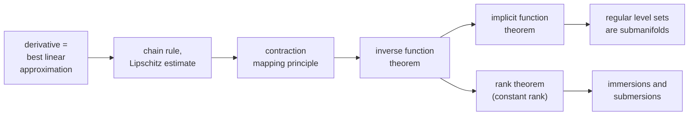

# PA13 · The Derivative and the Inverse Function Theorem

◀ [[PA12 Separation, Countability and Local Compactness]] · [[Proofs, Analysis and Topology - Course Map]] · [[PA14 ODE Existence Uniqueness and Smooth Dependence]] ▶

extra · book extra · beyond

> [!warning] Why this chapter exists, and what it rests on
> Written 2026-10-30 as a **prerequisite for [[DM02 Smooth Maps and Partitions of Unity]], [[DM03 Tangent Vectors and the Differential]] and [[DM04 The Tangent Bundle and the Rank Theorem]]**: smooth structures, differentials and the rank theorem on manifolds are *the Euclidean statements below transported by charts*. **No lecture of this course covers it.** Proofs follow Lee, *Introduction to Smooth Manifolds*, Appendix C ([[John M. Lee - Introduction to Smooth Manifolds.pdf#page=660|Lee App. C, pp. 642–662]]; printed page = PDF page − 18) and Spivak, *Calculus on Manifolds*, Ch. 2; the Euclidean rank theorem is Lee Thm 4.12 specialised to $\mathbb R^m$. The numbers are recomputed in `scripts/pa13_numbers.py`, and the matrix derivatives of §1 are the ones used in MT3184 homework 5 and 7.

> [!syllabus] Syllabus map: what is in the syllabus and what is extra in this chapter
> 🟡 **Extra · book** (Lee App. C: Props. C.3, C.4, C.10, C.29, Thm C.34, Lemma C.35, Thm C.40; Spivak Ch. 2; Munkres *Analysis on Manifolds*)
> - §1 total derivative, Jacobian, chain rule; §2 Lipschitz estimate; §3 contraction mapping principle
> - §4 inverse function theorem; §5 implicit function theorem; §6 the (Euclidean) rank theorem
>
> 🔵 **Extra · beyond** (my additions, labelled)
> - the derivatives of $\det$, matrix inversion and $A\mapsto AA^{T}$ checked by finite differences, and $\dim O(n)=n(n-1)/2$ from the **rank** of $B\mapsto B+B^T$ ($n=2,\dots,5$); the contraction iteration for $\cos x=x$ (67 steps against an a-priori bound of 166); the inverse of $z\mapsto z^2$ by 8 contraction steps; a worked rank-theorem normal form

> [!key] After this chapter you can
> - compute $DF(a)$ as a matrix and as a linear map, including for **matrix-valued** $F$ ($\det$, $A^{-1}$, $AA^T$),
> - prove the **contraction principle** and use it,
> - prove the **inverse and implicit function theorems** and apply them to show that level sets are graphs,
> - state and prove the **constant-rank theorem** in $\mathbb R^m$, and deduce the normal forms of immersions and submersions.

> [!intuition] The one-sentence story
> A differentiable map *looks like its derivative* near a point. The inverse function theorem says that if the derivative is invertible, the map itself is invertible near the point; the implicit function theorem says the same for solving equations; the rank theorem says that if the derivative has constant rank $r$, the map looks, in suitable coordinates, like the standard projection-then-inclusion $(x^1,\dots,x^m)\mapsto(x^1,\dots,x^r,0,\dots,0)$. Differential geometry is these three theorems applied chart by chart.

*Concept map: the contraction principle drives the inverse function theorem; the other two theorems are corollaries.*

![[fig_pa13_ift.png]]
*A: the contraction iteration for $\cos x=x$ (§3). B: the image of a coordinate grid under $z\mapsto z^2$ near $a=(1,0)$ and the solution of $F(p)=(1.1,0.2)$ (§4). C: the circle as a graph where $\partial F/\partial y\neq0$ (§5).*

## 1. The derivative as a linear map
extra · book *Lee App. C, Props. C.3, C.4, C.10; Spivak Ch. 2*

> [!key] Definition
> $F:U\to\mathbb R^m$ ($U\subseteq\mathbb R^n$ open) is **differentiable at $a$** if there is a linear map $DF(a):\mathbb R^n\to\mathbb R^m$ with
> $$\lim_{h\to0}\frac{|F(a+h)-F(a)-DF(a)h|}{|h|}=0 .$$
> $DF(a)$ is unique; in the standard bases its matrix is the **Jacobian** $\big(\partial F^i/\partial x^j(a)\big)$. If all partial derivatives exist and are continuous ($F\in C^1$) then $F$ is differentiable (Lee C.10). $F$ is **smooth** ($C^\infty$) if all partial derivatives of all orders exist and are continuous.

> [!intuition] Best linear approximation
> $DF(a)h$ is what $F$ does to a small displacement $h$, to first order: the graph of $F$ near $(a,F(a))$ is the tangent plane of $DF(a)$. Differentiability is exactly the statement that the error is *smaller than linear* in $|h|$.

> [!key] Chain rule (Lee C.3)
> If $F$ is differentiable at $a$ and $G$ at $F(a)$, then $D(G\circ F)(a)=DG(F(a))\circ DF(a)$. In particular a diffeomorphism has an invertible derivative: $G=F^{-1}$ gives $DF^{-1}(F(a))=DF(a)^{-1}$.

> [!example] Matrix-valued maps (the ones the Lie-group chapters use)
> Work on $M(n,\mathbb R)\cong\mathbb R^{n^2}$ and write $B$ for the direction.
> * **Determinant.** $\det(X+tB)=\det X\cdot\det(I+tX^{-1}B)=\det X\,(1+t\operatorname{tr}(X^{-1}B)+O(t^2))$, so $d(\det)_X(B)=\det X\operatorname{tr}(X^{-1}B)$ and $d(\det)_I(B)=\operatorname{tr}B$. *Check:* a random $4\times4$ matrix with $B$ random gives $114.714222$ by finite difference and $114.714182$ by the formula (relative error $3.5\times10^{-7}$).
> * **Inverse.** Differentiate $XX^{-1}=I$: $d(\mathrm{inv})_X(B)=-X^{-1}BX^{-1}$ (finite-difference error $6\times10^{-8}$).
> * **$AA^T$.** $d(AA^T)_X(B)=BX^T+XB^T$ (error $4\times10^{-6}$). At $X=I$ it is $B\mapsto B+B^T$, with image the symmetric matrices, of rank $n(n+1)/2$ (numerical ranks $3,6,10,15$ for $n=2,3,4,5$), and kernel the skew matrices of dimension $n^2-n(n+1)/2=n(n-1)/2$ ($1,3,6,10$). This is the computation behind "$\dim O(n)=n(n-1)/2$, $\mathfrak{so}(n)=\{A:A+A^T=0\}$" in [[DM08 Lie Groups]] and [[DM11 The Lie Algebra of a Lie Group]].

> [!pitfall] Partials existing is not enough
> $f(x,y)=\dfrac{xy}{x^2+y^2}$, $f(0,0)=0$ has both partial derivatives at the origin (both $0$) but is not even continuous there. Continuous partials ($C^1$) *are* enough.

## 2. Estimates
extra · book *Lee Prop. C.29; Prop. C.6*

> [!key] Lipschitz estimate (Lee C.29)
> If $U$ is convex, $F:U\to\mathbb R^m$ is $C^1$ and $\|DF(x)\|\le M$ on $U$ (operator norm), then $|F(x)-F(y)|\le M|x-y|$.
>
> *Proof.* Put $g(t)=F(y+t(x-y))$. Then $F(x)-F(y)=\int_0^1g'(t)\,dt=\int_0^1DF(y+t(x-y))(x-y)\,dt$, of norm at most $M|x-y|$. $\square$

**Equality of mixed partials** (Lee C.6): if the second partials of $F$ exist and are continuous, $\partial^2F/\partial x^i\partial x^j=\partial^2F/\partial x^j\partial x^i$. This is what makes $d\circ d=0$ for differential forms and the Lie bracket of coordinate fields vanish ($[\partial_i,\partial_j]=0$, [[DM10 Vector Fields and Lie Brackets]]).

## 3. The contraction mapping principle
extra · book *Lee Lemma C.35 ([[John M. Lee - Introduction to Smooth Manifolds.pdf#page=675|p. 657]])*

> [!key] Contraction Lemma
> Let $X$ be a nonempty **complete** metric space and $T:X\to X$ with $d(Tx,Ty)\le L\,d(x,y)$ for some $L<1$. Then $T$ has a **unique** fixed point $x^*$, and for every $x_0$ the iterates $x_{n+1}=Tx_n$ converge to $x^*$ with $d(x_n,x^*)\le\dfrac{L^n}{1-L}d(x_1,x_0)$.
>
> *Proof.* $d(x_{n+1},x_n)\le L^nd(x_1,x_0)$, so for $m>n$, $d(x_m,x_n)\le\dfrac{L^n}{1-L}d(x_1,x_0)$: the sequence is Cauchy and converges to some $x^*$. $T$ is continuous, so $Tx^*=\lim Tx_n=x^*$. If $y$ is another fixed point, $d(x^*,y)=d(Tx^*,Ty)\le L\,d(x^*,y)$ forces $d(x^*,y)=0$. The error bound follows by letting $m\to\infty$. $\square$

> [!example] $\cos x=x$
> $T=\cos$ maps $[0,1]$ into $[0,1]$ with $|T'|=|\sin x|\le\sin1=0.841471$, so it is a contraction on the complete space $[0,1]$. From $x_0=1$ the iterates reach error $<10^{-12}$ after **67** steps; the limit is $x^*=0.7390851332\ldots$. The a-priori bound $n\ge\ln\!\big(\varepsilon(1-L)/|x_1-x_0|\big)/\ln L$ is **166** (conservative); the actual error ratios $0.596,0.716,0.642,0.693,0.660$ oscillate towards $|\sin x^*|=0.6736$, the *local* contraction rate. (Figure A.)

> [!pitfall] Completeness matters
> $T(x)=x/2$ is a contraction of $(0,1]$ into itself without a fixed point: $(0,1]$ is not complete. $T(x)=x+1/x$ on $[1,\infty)$ satisfies $d(Tx,Ty)<d(x,y)$ for $x\ne y$ but not with a uniform $L<1$, and has no fixed point.

## 4. The inverse function theorem
extra · book *Lee Thm C.34, Cor. C.36; Spivak Thm 2-11*

> [!key] Inverse Function Theorem (IFT)
> Let $U\subseteq\mathbb R^n$ be open, $F:U\to\mathbb R^n$ smooth, $a\in U$, and $DF(a)$ invertible. Then there are open sets $U_0\ni a$ and $V_0\ni F(a)$ such that $F|_{U_0}:U_0\to V_0$ is a **diffeomorphism** (a smooth bijection with smooth inverse).

> [!intuition] Why invertible derivative is enough
> Near $a$, $F(x)\approx F(a)+DF(a)(x-a)$ and an invertible linear map can be solved for $x$. The theorem says the *error* does not spoil this: to solve $F(x)=y$ for $y$ near $F(a)$, keep correcting $x$ by the linear solution; the corrections shrink geometrically (a contraction), so the iteration converges.

> [!derivation]- Proof of the IFT
> **Step 0 (normalise).** Replace $F$ by $A^{-1}\circ\big(F(\,\cdot+a)-F(a)\big)$ with $A=DF(a)$; this is $F$ composed with diffeomorphisms (affine maps), and now $a=0$, $F(0)=0$, $DF(0)=I$.
> **Step 1.** Put $G(x)=x-F(x)$. Then $G(0)=0$, $DG(0)=0$, and by continuity of $DG$ there is $\delta>0$ with $\|DG(x)\|\le\tfrac12$ for $|x|\le\delta$. By the Lipschitz estimate (§2) $G$ is $\tfrac12$-Lipschitz on $\overline B_\delta$, and $|G(x)|\le\tfrac12|x|$.
> **Step 2 (injective, inverse Lipschitz).** For $x,x'\in\overline B_\delta$: $|F(x)-F(x')|\ge|x-x'|-|G(x)-G(x')|\ge\tfrac12|x-x'|$.
> **Step 3 (onto $B_{\delta/2}$).** For $|y|<\delta/2$ put $T_y(x)=y+G(x)$; $F(x)=y\iff T_y(x)=x$. For $|x|\le\delta$: $|T_yx|\le|y|+\tfrac12|x|<\delta$, so $T_y$ maps the complete space $\overline B_\delta$ to itself, and it is a $\tfrac12$-contraction. By §3 it has a unique fixed point $x(y)$, and $|x(y)|\le|y|+\tfrac12|x(y)|$ gives $|x(y)|\le2|y|<\delta$. Put $V_0=B_{\delta/2}$, $U_0=B_\delta\cap F^{-1}(V_0)$ (open): $F:U_0\to V_0$ is a bijection with inverse $H(y)=x(y)$, and by Step 2, $H$ is $2$-Lipschitz, hence continuous.
> **Step 4 (differentiable).** For $|x|\le\delta$, $\|I-DF(x)\|=\|DG(x)\|\le\tfrac12$, so $DF(x)$ is invertible (Neumann series) with $\|DF(x)^{-1}\|\le2$. Let $y,y'\in V_0$, $x=H(y)$, $x'=H(y')$. Then
> $$H(y')-H(y)-DF(x)^{-1}(y'-y)=-DF(x)^{-1}\big[F(x')-F(x)-DF(x)(x'-x)\big],$$
> of norm $\le2\,\varepsilon(|x'-x|)\,|x'-x|\le4\,\varepsilon(2|y'-y|)\,|y'-y|$, where $\varepsilon(\rho)\to0$ as $\rho\to0$ is the differentiability error of $F$ at $x$. So $H$ is differentiable at $y$ with $DH(y)=DF(H(y))^{-1}$.
> **Step 5 (smooth).** $DH=\mathrm{inv}\circ DF\circ H$, where $\mathrm{inv}$ is matrix inversion, smooth on the invertible matrices (Cramer's rule). Since $DF$ is smooth and $H$ continuous, $DH$ is continuous: $H\in C^1$. If $H\in C^k$ then $DH=\mathrm{inv}\circ DF\circ H\in C^k$, so $H\in C^{k+1}$; by induction $H$ is smooth. $\square$

> [!example] The inverse of $z\mapsto z^2$ by contraction
> $F(x,y)=(x^2-y^2,\,2xy)$ is $z\mapsto z^2$. At $a=(1,0)$, $DF(a)=2I$. To solve $F(p)=(1.1,0.2)$ iterate $p\mapsto p-DF(a)^{-1}(F(p)-y)$ from $p=a$: the errors against the exact root $\sqrt{1.1+0.2i}=1.0530987581+0.0949578558\,i$ are $5.9\times10^{-3},6.5\times10^{-4},7.1\times10^{-5},\ldots,1.1\times10^{-9}$ after 8 steps, a geometric rate $0.109=\|I-DF(a)^{-1}DF(p^*)\|$ (figure B). The theorem's local inverse is the **principal square root**.

> [!pitfall] A local diffeomorphism need not be injective
> $F(x,y)=(e^x\cos y,\,e^x\sin y)$ has $\det DF=e^{2x}>0$ at every point, so it is a local diffeomorphism everywhere, yet $F(x,y+2\pi)=F(x,y)$: it is **not** injective (it is the exponential $\mathbb C\to\mathbb C^\times$, a *covering map*, [[DM05 Immersions, Embeddings, Submersions and Coverings]]). And the condition $\det DF(a)\neq0$ is sufficient, not necessary for $F$ to be a homeomorphism: $F(x,y)=(x^3,y)$ is a smooth homeomorphism of $\mathbb R^2$ with $DF(0)$ singular, and its inverse is not differentiable at $0$.

## 5. The implicit function theorem
extra · book *Lee Thm C.40; Spivak Thm 2-12*

> [!key] Implicit Function Theorem
> Let $U\subseteq\mathbb R^n\times\mathbb R^k$ be open, $\Phi:U\to\mathbb R^k$ smooth, $(a,b)\in U$ with $\Phi(a,b)=c$, and the $k\times k$ matrix $\dfrac{\partial\Phi}{\partial y}(a,b)$ invertible. Then there are open $V_0\ni a$, $W_0\ni b$ and a **smooth** $g:V_0\to W_0$ with
> $$\{(x,y)\in V_0\times W_0:\Phi(x,y)=c\}=\{(x,g(x)):x\in V_0\},\qquad g'(x)=-\Big(\frac{\partial\Phi}{\partial y}\Big)^{-1}\frac{\partial\Phi}{\partial x}.$$

> [!derivation]- Proof from the IFT
> Put $F(x,y)=(x,\Phi(x,y))$ on $U$. Then $DF(a,b)=\begin{pmatrix}I&0\\\partial_x\Phi&\partial_y\Phi\end{pmatrix}$ is invertible, so $F$ restricts to a diffeomorphism from an open $U_0\ni(a,b)$ onto an open $V\ni(a,c)$; shrink $U_0$ to a product $V_0'\times W_0$ and let $V_0=\{x:(x,c)\in F(U_0)\}$. Write the inverse as $F^{-1}(x,z)=(x,h(x,z))$ with $h$ smooth and set $g(x)=h(x,c)$. For $(x,y)\in U_0$: $\Phi(x,y)=c\iff F(x,y)=(x,c)\iff(x,y)=F^{-1}(x,c)\iff y=g(x)$. Differentiating $\Phi(x,g(x))=c$ gives the formula for $g'$. $\square$

> [!example] The circle, with numbers
> $\Phi(x,y)=x^2+y^2-1$, $c=0$. At $(0,1)$, $\partial_y\Phi=2\ne0$: near $(0,1)$ the circle is the graph of $g(x)=\sqrt{1-x^2}$, and $g'(0.6)=-x/g=-0.75$ (central difference $-0.750000$). At $(1,0)$, $\partial_y\Phi=0$: the tangent is vertical and the circle is **not** a graph over the $x$-axis there; but $\partial_x\Phi=2\ne0$, so near $(1,0)$ it is a graph $x=g(y)$ over the $y$-axis. In general the theorem says: where *some* partial derivative of $\Phi$ is nonzero, the level set is locally a graph over the other coordinates. This is the regular level set theorem of [[DM06 Submanifolds]].

## 6. The rank theorem in $\mathbb R^m$
extra · book *Lee Thm 4.12 (manifold version); Spivak Problem 2-32; Munkres Analysis on Manifolds*

> [!key] Constant Rank Theorem (Euclidean form)
> Let $U\subseteq\mathbb R^m$ be open and $F:U\to\mathbb R^n$ smooth with $\operatorname{rank}DF(x)=r$ for **all** $x\in U$. For each $a\in U$ there are diffeomorphisms $\varphi$ (of a neighbourhood of $a$ onto an open set of $\mathbb R^m$) and $\psi$ (of a neighbourhood of $F(a)$ onto an open set of $\mathbb R^n$) such that
> $$\psi\circ F\circ\varphi^{-1}(x^1,\dots,x^m)=(x^1,\dots,x^r,0,\dots,0).$$

> [!intuition] Constant rank means "one picture everywhere"
> A linear map of rank $r$ is, in suitable bases, the identity on $r$ coordinates and zero on the rest. The rank theorem says a *nonlinear* map of constant rank is this, up to **nonlinear** changes of coordinates in domain and target. If the rank jumps (e.g. $x\mapsto x^2$, rank $1$ except at $0$) there is no normal form.

> [!derivation]- Proof
> After permuting coordinates in the domain and in the target we may assume the $r\times r$ block $\partial(F^1,\dots,F^r)/\partial(x^1,\dots,x^r)$ is invertible at $a$.
> **Step 1 (straighten the domain).** Put $\varphi(x)=(F^1(x),\dots,F^r(x),x^{r+1},\dots,x^m)$. Then $D\varphi(a)=\begin{pmatrix}A&*\\0&I\end{pmatrix}$ with $\det=\det A\ne0$, so by the IFT $\varphi$ is a diffeomorphism near $a$. Let $G=F\circ\varphi^{-1}$. Its first $r$ components are $G^i(u)=u^i$, so
> $$G(u)=(u^1,\dots,u^r,H^{r+1}(u),\dots,H^n(u)).$$
> **Step 2 ($H$ depends only on $u'=(u^1,\dots,u^r)$).** $\operatorname{rank}DG=\operatorname{rank}DF=r$ because $\varphi$ is a diffeomorphism, and
> $$DG(u)=\begin{pmatrix}I_r&0\\\partial H/\partial u'&\partial H/\partial u''\end{pmatrix}\quad\Rightarrow\quad\operatorname{rank}DG=r+\operatorname{rank}\frac{\partial H}{\partial u''}.$$
> So $\partial H/\partial u''\equiv0$. On a product of balls (convex in $u''$) the Lipschitz estimate gives $H(u)=H(u')$.
> **Step 3 (straighten the target).** Define $\psi(w)=(w^1,\dots,w^r,\;w^{r+1}-H^{r+1}(w'),\dots,w^n-H^n(w'))$. Its Jacobian is lower unitriangular, hence invertible, so $\psi$ is a diffeomorphism (inverse $w\mapsto(w',w''+H(w'))$). Then $\psi\circ G(u)=(u',0)$, i.e. $\psi\circ F\circ\varphi^{-1}(u)=(u^1,\dots,u^r,0,\dots,0)$. $\square$

> [!example] A rank-one map normalised, checked symbolically
> $F(u,v)=(u+v,(u+v)^2)$ has $DF=\begin{pmatrix}1&1\\2(u+v)&2(u+v)\end{pmatrix}$, rank $1$ everywhere. Take $\varphi(u,v)=(u+v,v)$ (so $\varphi^{-1}(s,t)=(s-t,t)$): then $F\circ\varphi^{-1}(s,t)=(s,s^2)$, so $H(s)=s^2$ does not depend on $t$, and $\psi(a,b)=(a,b-a^2)$ gives $\psi\circ F\circ\varphi^{-1}(s,t)=(s,0)$ (`pa13_numbers.py`, sympy). Geometrically $F$ collapses the lines $u+v=\text{const}$ to points and maps the quotient onto the parabola $b=a^2$.

> [!key] The two extreme cases (used constantly)
> * **Submersion** ($r=n\le m$, rank $n$): $\psi$ is not needed, $F\circ\varphi^{-1}(u)=(u^1,\dots,u^n)$ is the projection.
> * **Immersion** ($r=m\le n$, rank $m$): $\varphi$ is a diffeomorphism of $\mathbb R^m$ built from $m$ of the components, and $\psi\circ F\circ\varphi^{-1}(u)=(u,0)$ is the inclusion $\mathbb R^m\hookrightarrow\mathbb R^n$.
> So a **submersion is locally a projection** and an **immersion is locally an inclusion**; this is [[DM05 Immersions, Embeddings, Submersions and Coverings]] and, for level sets, [[DM06 Submanifolds]].

## Map of this chapter
> [!connection] How PA13 connects
> **Builds on:** [[PA06 The Real Numbers and Sequences]] (completeness, sequences), [[PA07 Metric and Topological Spaces]] (complete metric spaces, compactness) and linear algebra ([[Basis of a Vector Space]]).
> **Leads to:** [[PA14 ODE Existence Uniqueness and Smooth Dependence]] (the contraction principle again, Picard iteration), [[DM02 Smooth Maps and Partitions of Unity]], [[DM03 Tangent Vectors and the Differential]], [[DM04 The Tangent Bundle and the Rank Theorem]], [[DM05 Immersions, Embeddings, Submersions and Coverings]], [[DM06 Submanifolds]].
> **Concepts:** [[Total Derivative]] · [[Chain Rule]] · [[Contraction Mapping Principle]] · [[Inverse Function Theorem]] · [[Implicit Function Theorem]] · [[Constant Rank Theorem (Euclidean)]] · [[Local Diffeomorphism]]
> **Other subjects:** [[Quantum Mechanics - Course Map]] (linear approximation), [[Thermodynamics and Statistical Mechanics - Course Map]] (implicit functions: solving $F(P,V,T)=0$ for one variable)

## Summary
> [!summary] Cheat-sheet
> - $DF(a)$ = best linear approximation; Jacobian matrix; $C^1\Rightarrow$ differentiable; chain rule $D(G\circ F)=DG\,DF$.
> - $d(\det)_X(B)=\det X\operatorname{tr}(X^{-1}B)$, $d(\mathrm{inv})_X(B)=-X^{-1}BX^{-1}$, $d(AA^T)_X(B)=BX^T+XB^T$; $\dim O(n)=n(n-1)/2$.
> - Lipschitz: $\|DF\|\le M$ on a convex set $\Rightarrow$ $|F(x)-F(y)|\le M|x-y|$.
> - **Contraction principle:** complete + $L<1$ $\Rightarrow$ unique fixed point, $d(x_n,x^*)\le L^nd(x_1,x_0)/(1-L)$.
> - **IFT:** $DF(a)$ invertible $\Rightarrow$ local diffeomorphism, $D(F^{-1})=DF^{-1}\circ F^{-1}$. Local, not global ($e^x(\cos y,\sin y)$); sufficient, not necessary ($x^3$).
> - **Implicit function theorem:** $\partial_y\Phi$ invertible $\Rightarrow$ level set is a graph $y=g(x)$, $g'=-(\partial_y\Phi)^{-1}\partial_x\Phi$.
> - **Rank theorem:** constant rank $r$ $\Rightarrow$ $\psi\circ F\circ\varphi^{-1}=(x^1,\dots,x^r,0,\dots,0)$. Submersions are locally projections, immersions locally inclusions.

## Practice
1. **Matrix square.** Show $F(X)=X^2$ on $M(n,\mathbb R)$ has $DF(X)B=XB+BX$. Show $DF(I)$ is invertible and conclude every matrix near $I$ has a unique square root near $I$.
2. **A contraction.** Show $T(x)=\tfrac12\cos x$ is a contraction of $\mathbb R$ and find its fixed point to 5 decimals; how many iterations does the a-priori bound require from $x_0=0$?
3. **Completeness.** Show $T(x)=x/2$ on $(0,1]$ is a contraction without fixed point; which hypothesis fails?
4. **Sufficient, not necessary.** Show $F(x,y)=(x^3,y)$ is a smooth homeomorphism of $\mathbb R^2$, that $DF(0)$ is singular, and that $F^{-1}$ is not differentiable at $0$.
5. **Local, not global.** Show $F(x,y)=(e^x\cos y,e^x\sin y)$ has invertible derivative everywhere, is not injective, and find its image.
6. **Implicit function.** Show $xe^y+ye^x=1$ defines $y=g(x)$ near $(0,1)$ and compute $g'(0)$.
7. **Level set.** For $\Phi(x,y,z)=x^2+y^2-z^2-1$ show the level set $\{\Phi=0\}$ has no point where $D\Phi=0$, and say which coordinate can be solved for near $(1,0,0)$ and near $(0,1,0)$.
8. **Rank theorem.** $F(u,v)=(e^{u+v},\sinh(u+v))$ has rank 1 everywhere. Find $\varphi$ and $\psi$ with $\psi\circ F\circ\varphi^{-1}(x,y)=(x,0)$ near any point.
9. **Normal forms.** Derive from the rank theorem that a submersion $\mathbb R^m\to\mathbb R^n$ is locally the projection and an immersion $\mathbb R^m\to\mathbb R^n$ is locally the inclusion $(x\mapsto(x,0))$.
10. **Smooth bijection, non-smooth inverse.** Show $F(x)=x^3$ is a smooth bijection $\mathbb R\to\mathbb R$ whose inverse is not smooth; what does this say about the chart $x\mapsto x^3$ versus the identity chart (preview of [[DM01 Smooth Manifolds]])?

> [!example]- Solutions
> 1. $(X+tB)^2=X^2+t(XB+BX)+t^2B^2$, so $DF(X)B=XB+BX$. At $X=I$ it is $B\mapsto2B$, invertible. By the IFT $F$ is a diffeomorphism from a neighbourhood of $I$ onto a neighbourhood of $I$: the inverse is the principal square root near $I$.
> 2. $|T'(x)|=\tfrac12|\sin x|\le\tfrac12$, so $T$ is a $\tfrac12$-contraction of the complete space $\mathbb R$. Iterating from $0$: $0.5,\ 0.43879,\ 0.45263,\ 0.44965,\ 0.45030,\ 0.45016,\ 0.45019,\ 0.45018,\dots$, so $x^*=0.45018$ (more precisely $0.45018361$, `pa13_numbers.py`). The a-priori bound $n\ge\ln(\varepsilon(1-L)/|x_1-x_0|)/\ln L$ with $\varepsilon=10^{-5}$, $L=\tfrac12$, $|x_1-x_0|=0.5$ gives $n\ge\ln(10^{-5})/\ln0.5=16.6$, i.e. **17** steps, but only **7** are actually needed: the local rate is $\tfrac12|\sin x^*|=0.22$, much better than $L=\tfrac12$.
> 3. $T$ maps $(0,1]$ into itself with $L=\tfrac12$; a fixed point would be $x=0\notin(0,1]$. The space $(0,1]$ is not complete.
> 4. $F$ is smooth and bijective with continuous inverse $(x,y)\mapsto(x^{1/3},y)$ (cube root is continuous), so a homeomorphism. $DF(0)=\operatorname{diag}(0,1)$ is singular and $x^{1/3}$ has infinite slope at $0$, so $F^{-1}$ is not differentiable there.
> 5. $DF=e^x\begin{pmatrix}\cos y&-\sin y\\\sin y&\cos y\end{pmatrix}$, $\det=e^{2x}>0$. $F(x,y)=F(x,y+2\pi)$. The image is $\mathbb R^2\setminus\{0\}$ ($=\mathbb C^\times$ for $z\mapsto e^z$).
> 6. $\Phi=xe^y+ye^x-1$, $\Phi(0,1)=0$, $\partial_y\Phi=xe^y+e^x=1$ at $(0,1)$, nonzero. $g'(0)=-\partial_x\Phi/\partial_y\Phi=-(e^y+ye^x)/1=-(e+1)=-3.7183$.
> 7. $D\Phi=(2x,2y,-2z)=0$ only at the origin, which is not on $\Phi=0$. At $(1,0,0)$: $\partial_x\Phi=2\ne0$, $\partial_y\Phi=\partial_z\Phi=0$, so $x=\sqrt{1+z^2-y^2}$ as a graph over $(y,z)$. At $(0,1,0)$: $\partial_y\Phi=2\neq0$ so $y=g(x,z)$.
> 8. $s=u+v$: $DF=(e^s,\cosh s)^T(1\ 1)$, rank 1. $\varphi(u,v)=(e^{u+v},v)$ has $\det D\varphi=e^{s}\ne0$ and $\varphi^{-1}(w,t)=(\ln w-t,t)$. Then $F\circ\varphi^{-1}(w,t)=(w,\sinh\ln w)=(w,\tfrac12(w-1/w))$, so $H(w)=\tfrac12(w-1/w)$ ($w>0$), and $\psi(a,b)=(a,b-\tfrac12(a-1/a))$ gives $\psi\circ F\circ\varphi^{-1}(w,t)=(w,0)$.
> 9. *Submersion* ($r=n$): after permuting, the $n\times n$ block $\partial F/\partial x'$ is invertible; $\varphi(x)=(F(x),x'')$ is a local diffeomorphism and $F\circ\varphi^{-1}(u)=(u^1,\dots,u^n)$. *Immersion* ($r=m$): after permuting target coordinates the first $m$ components $\tilde F$ have $D\tilde F(a)$ invertible; $\varphi=\tilde F$ is a local diffeomorphism and $F\circ\varphi^{-1}(u)=(u,H(u))$; with $\psi(w)=(w',w''-H(w'))$ we get $\psi\circ F\circ\varphi^{-1}(u)=(u,0)$.
> 10. $F$ is smooth, bijective, and $F^{-1}(y)=y^{1/3}$ is not differentiable at $0$ ($F'(0)=0$). So the identity chart and the chart $x^3$ on $\mathbb R$ are *not* smoothly compatible and define different smooth structures on the same topological space, although the two resulting manifolds are diffeomorphic (via $F$). Compare MT3184 HW1 Q4 (infinitely many distinct smooth structures).

## Provenance
> [!provenance]- Source map for this chapter
> | Topic | Source | Scope |
> |---|---|---|
> | total derivative, chain rule, $C^1$ criterion, Lipschitz estimate, mixed partials | Lee App. C (Props. C.3, C.4, C.6, C.10, C.29) | extra/book |
> | contraction lemma, inverse and implicit function theorems | Lee Lemma C.35, Thm C.34, Thm C.40 (proofs rewritten); Spivak Ch. 2 | extra/book |
> | Euclidean rank theorem | Lee Thm 4.12 (manifold form), Spivak Problem 2-32 (proof above is my own write-up) | extra/book |
> | matrix derivatives, $\dim O(n)$ by rank, $\cos x=x$, $z^2$ inverse, rank-one normal form | `scripts/pa13_numbers.py`, `fig_pa13_ift.py`; MT3184 HW5 Q3, HW6 Q7, HW7 Q3 for context | extra/beyond |
>
> **Notes.** The a-priori bound for $\cos x=x$ (166 steps) is much larger than the 67 steps needed because it uses the *global* constant $L=\sin1$ while the local rate is $|\sin x^*|=0.674$. The iterates and step counts of Practice 2 are recomputed in the same script (my first hand-computed values were wrong and were replaced).
