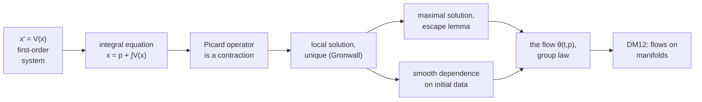

# PA14 · ODE: Existence, Uniqueness and Smooth Dependence

◀ [[PA13 The Derivative and the Inverse Function Theorem]] · [[Proofs, Analysis and Topology - Course Map]] · [[PA15 Covering Spaces and the Fundamental Group]] ▶

extra · book extra · beyond

> [!warning] Why this chapter exists, and what it rests on
> Written 2026-10-30 as the **analytic input of [[DM12 Integral Curves, Flows and Flowouts]]**: the MT3184 lectures quote "Prop 9.2: *there is an integral curve starting at $p$* (existence and uniqueness from ODE theory)" and build the **Fundamental Theorem on Flows** (Lee Thm 9.12) from it. This chapter proves that ODE input. **No lecture of this course covers it.** Proofs follow Lee, *Introduction to Smooth Manifolds*, Appendix D ([[John M. Lee - Introduction to Smooth Manifolds.pdf#page=681|Lee App. D, pp. 663–674]]; Thms. D.1–D.6) and the contraction principle of [[PA13 The Derivative and the Inverse Function Theorem]]; the smoothness part of the dependence theorem is **stated and sketched, not fully proved** (Lee Thm D.5). Numbers recomputed in `scripts/pa14_numbers.py`.

> [!syllabus] Syllabus map: what is in the syllabus and what is extra in this chapter
> 🟡 **Extra · book** (Lee App. D; Hirsch–Smale; Teschl *ODEs and Dynamical Systems* Ch. 2)
> - §1 first-order systems and state-space reduction; §2 Picard–Lindelöf by contraction, uniqueness by Gronwall
> - §3 maximal solutions and the escape lemma; §4 smooth dependence, the flow, the variational equation
>
> 🔵 **Extra · beyond** (my additions, labelled)
> - Picard iterates of $x'=x$ as Taylor polynomials with their errors; blow-up and non-uniqueness examples recomputed numerically; the flow of $y\partial_x+\partial_y$ (MT3184 HW7 Q5) and of the rotation field checked against a numerical integrator (error $7\times10^{-16}$); the variational equation checked ($\partial x/\partial x_0=4$ at $x_0=1,t=\tfrac12$); the pendulum periods $6.2871,\,7.4163,\,10.3232$ via elliptic integrals; "compactly supported fields are complete" proved from the escape lemma

> [!key] After this chapter you can
> - turn any higher-order or time-dependent ODE into an **autonomous first-order system** $x'=V(x)$,
> - prove **local existence and uniqueness** (Picard–Lindelöf) by the contraction principle and **uniqueness** by Gronwall,
> - construct the **maximal solution** and prove the **escape lemma** (solutions that stop must leave every compact set),
> - state **smooth dependence on initial data**, derive the **variational equation**, and see the **flow** $\theta(t,p)$ with its group law,
> - explain exactly how existence fails (blow-up) and uniqueness fails (non-Lipschitz).

> [!intuition] The one-sentence story
> A vector field is a rule "move this way from here"; an ODE asks for a path that always moves the way the rule says. Smooth rules give exactly one such path through each point (follow the arrows in tiny steps and the errors shrink: a contraction), the path may only be defined for a finite time (it can run off to infinity), and nearby starting points give nearby paths that depend smoothly on the start. Collecting all the paths gives the **flow**.

*Concept map: contraction ⇒ local solution ⇒ maximal solution and flow.*

![[fig_pa14_ode.png]]
*A: Picard iterates for $x'=x$ are the Taylor polynomials of $e^t$ (§2). B: blow-up of $x'=x^2$ and the non-unique solutions of $x'=\sqrt{|x|}$ (§2). C: the pendulum as a first-order system, with its separatrix (§1).*

## 1. First-order systems
extra · book *Lee App. D intro; Teschl §1.1*

> [!key] Definitions
> Let $U\subseteq\mathbb R^n$ be open and $V:U\to\mathbb R^n$ a (smooth, or just continuous) vector field. A **solution** (integral curve) of $x'=V(x)$ is a differentiable curve $x:J\to U$ on an interval $J$ with $x'(t)=V(x(t))$ for all $t\in J$; an **initial value problem** adds $x(t_0)=p$. Equivalently (for continuous $x$) $x(t)=p+\int_{t_0}^tV(x(s))\,ds$.

> [!intuition] Every ODE is a vector field on a bigger space
> * **Higher order $\to$ first order.** $\theta''=-\sin\theta$ becomes $(\theta,\omega)'=(\omega,-\sin\theta)$ on $\mathbb R^2$: the point of the state space records position *and* velocity.
> * **Time-dependent $\to$ autonomous.** $x'=V(t,x)$ becomes $(s,x)'=(1,V(s,x))$ on $\mathbb R\times U$.
> So it is enough to study autonomous first-order systems: **vector fields and their integral curves** ([[DM12 Integral Curves, Flows and Flowouts]]).

> [!example] The pendulum as a first-order system, with numbers
> With $g/l=1$ the state $(\theta,\omega)$ satisfies $(\theta,\omega)'=(\omega,-\sin\theta)$ (figure C). Energy $E=\tfrac12\omega^2-\cos\theta$ is conserved; the level $E=1$, i.e. $\omega=\pm2\cos(\theta/2)$, is the separatrix between oscillation and rotation. Period of oscillation of amplitude $\theta_0$: $T=4K(\sin^2(\theta_0/2))$ (complete elliptic integral). Integrating numerically to turning points: $\theta_0=0.1$ rad: $T=6.287115$; $\theta_0=90^\circ$: $T=7.416299$; $\theta_0=143^\circ$: $T=10.323163$, each equal to $4K$ (`pa14_numbers.py`); the small-angle value $2\pi=6.2832$ is only the first term. (The same reduction appears in the climate notes: [[zettel/simple-pendulum-differential-equation|the pendulum equation]], [[zettel/state-space-reduction-for-pendulum-simulation|its state-space reduction]] and [[zettel/lorenz-system|the Lorenz system]].)

## 2. Existence and uniqueness
extra · book *Lee Thms. D.1, D.3, D.4, D.2 (comparison); Prop. C.29*

> [!key] Lipschitz condition
> $V$ is **Lipschitz** on $K\subseteq U$ if $|V(x)-V(y)|\le L|x-y|$ for $x,y\in K$. A $C^1$ vector field is Lipschitz on every compact convex subset (Lipschitz estimate, [[PA13 The Derivative and the Inverse Function Theorem]] §2), hence **locally Lipschitz**.

> [!key] Theorem (Picard–Lindelöf, local existence and uniqueness)
> Let $V:U\to\mathbb R^n$ be $C^1$, $p\in U$, and $\overline B_r(p)\subseteq U$ with $|V|\le M$ and $V$ $L$-Lipschitz on $\overline B_r(p)$. If $0<\varepsilon<\min(r/M,\,1/L)$, then there is exactly one solution $x:[-\varepsilon,\varepsilon]\to\overline B_r(p)$ of $x'=V(x)$, $x(0)=p$.
>
> *Proof.* Let $X=C([-\varepsilon,\varepsilon],\overline B_r(p))$ with the sup norm: a **complete** metric space (uniform limits of continuous maps are continuous). Define the **Picard operator**
> $$(Px)(t)=p+\int_0^tV(x(s))\,ds .$$
> *$P$ maps $X$ to $X$:* $|(Px)(t)-p|\le M|t|\le M\varepsilon<r$. *$P$ is a contraction:* $|(Px)(t)-(Py)(t)|\le\int_0^{|t|}L|x(s)-y(s)|\,ds\le\varepsilon L\|x-y\|_\infty$, and $\varepsilon L<1$. By the contraction principle ([[PA13 The Derivative and the Inverse Function Theorem]] §3) $P$ has a unique fixed point; a continuous fixed point of $P$ satisfies the integral equation, hence is differentiable with $x'=V(x)$ by the fundamental theorem of calculus. $\square$

> [!example] Picard iterates of $x'=x$, $x(0)=1$ are the Taylor polynomials of $e^t$
> $x_0\equiv1$, $x_{k+1}(t)=1+\int_0^tx_k$ gives $x_1=1+t$, $x_2=1+t+\tfrac{t^2}2$, $x_3=1+t+\tfrac{t^2}2+\tfrac{t^3}6,\dots$; at $t=1$ the iterates are $1,\,2,\,2.5,\,2.6667,\,2.7083,\,2.7167,\,2.7181$ with errors against $e$ of $1.72,\,0.718,\,0.218,\,0.0516,\,0.00995,\,0.00162,\,0.000226$ (`pa14_numbers.py`; figure A). For $x'=1+x^2$, $x(0)=0$ the iterates are $t,\ t+\tfrac{t^3}3,\ t+\tfrac{t^3}3+\tfrac{2t^5}{15}+\tfrac{t^7}{63},\dots$, converging to $\tan t$ (whose series is $t+\tfrac{t^3}3+\tfrac{2t^5}{15}+\tfrac{17t^7}{315}+\cdots$): the third iterate is correct through $t^5$.

> [!key] Gronwall's inequality and uniqueness
> If $u\ge0$ is continuous on $[0,T]$ and $u(t)\le C+L\int_0^tu$, then $u(t)\le Ce^{Lt}$.
>
> *Proof.* Put $w(t)=C+L\int_0^tu$. Then $w'=Lu\le Lw$, so $(e^{-Lt}w)'\le0$ and $w(t)\le w(0)e^{Lt}=Ce^{Lt}$; and $u\le w$. $\square$
>
> **Corollary (uniqueness).** If $x,y:J\to U$ are two solutions of $x'=V(x)$ with $V$ locally Lipschitz and $x(t_0)=y(t_0)$, then $x=y$ on all of $J$. *Proof.* On a compact subinterval where both stay in a compact set $K$ on which $V$ is $L$-Lipschitz, $u=|x-y|$ satisfies $u(t)\le L\int_{t_0}^tu$, so $u\equiv0$ near $t_0$ (Gronwall with $C=0$). The set $\{t:x(t)=y(t)\}$ is therefore closed (continuity) and open (the argument at each of its points), nonempty, hence all of the interval $J$. $\square$
>
> The same estimate with $C=|p-q|$ gives **continuous dependence**: two solutions with initial points $p,q$ satisfy $|x(t)-y(t)|\le|p-q|e^{L|t|}$ as long as both stay in $K$.

> [!pitfall] Existence and uniqueness can each fail
> * **Not unique without a Lipschitz condition:** $x'=\sqrt{|x|}$, $x(0)=0$ has the solutions $x=0$ and $x=t^2/4$ ($t\ge0$), and indeed a whole family $x=(t-c)^2/4$ for $t\ge c$, $x=0$ for $t\le c$ (verified: residual $0$). $\sqrt{|x|}$ is not Lipschitz at $0$ (figure B).
> * **Not defined for all time:** $x'=x^2$, $x(0)=x_0>0$ has the unique solution $x=x_0/(1-x_0t)$ on $(-\infty,1/x_0)$: it **blows up** at $t=1/x_0$ (numerically $x(0.99/x_0)=100\,x_0$ exactly as the formula predicts; for $x_0=1,2$ the escape times are $1,\ 0.5$). $V=x^2$ is smooth, so smoothness of $V$ does *not* give global solutions.

## 3. Maximal solutions and the escape lemma
extra · book *Lee Thms. D.1, D.6; Lemma 9.19 (escape lemma)*

> [!key] Maximal solutions
> For $V$ locally Lipschitz and $p\in U$ there is a unique **maximal** solution $\gamma_p:(a_p,b_p)\to U$ with $\gamma_p(0)=p$: every other solution through $p$ is a restriction of it. *Proof.* Take the union of the domains of all solutions through $p$; any two agree on the intersection of their domains by the Gronwall corollary, so they glue to one solution on an open interval (open because each solution can be extended a little by the local theorem). $\square$

> [!key] Escape lemma
> If $b_p<\infty$, then for every compact $K\subseteq U$ there is $t_K<b_p$ with $\gamma_p(t)\notin K$ for $t\in(t_K,b_p)$. In words: a maximal solution that stops in finite time **leaves every compact set**.
>
> *Proof.* Suppose not: there are $t_n\to b_p$ with $\gamma_p(t_n)\in K$. Choose $r>0$ with the compact set $K'=\{x:d(x,K)\le r\}\subseteq U$, and let $M,L$ be bounds for $|V|$ and the Lipschitz constant on $K'$. By the local theorem with $\varepsilon<\min(r/M,1/L)$, the solution starting at *any* point of $K$ exists on $(-\varepsilon,\varepsilon)$ (a **uniform** existence time). For $n$ so large that $b_p-t_n<\varepsilon$, the solution starting at $\gamma_p(t_n)$ at time $t_n$ is defined beyond $b_p$ and, by uniqueness, extends $\gamma_p$: a contradiction with maximality. $\square$

> [!example] $x'=x^2$ again, and a corollary
> The maximal solution through $x_0>0$ has $b=1/x_0$ and $\gamma(t)\to\infty$: it leaves every compact set, as the lemma demands. **Corollary.** If $V$ has *compact support* then every maximal solution is defined on all of $\mathbb R$. Indeed if $\gamma$ ever meets the zero set of $V$ it is constant; otherwise it stays inside the compact set $\operatorname{supp}V$ (outside it $V=0$, so a solution that left would have been constant), and the escape lemma forbids $b<\infty$. This is exactly the statement "compactly supported vector fields are complete" (MT3184 HW8 Q2, Lee Thm 9.16).

## 4. Smooth dependence and the flow
extra · book *Lee Thm D.5, Thm D.1; Hirsch–Smale Ch. 8*

> [!key] Theorem (smooth dependence on initial data; Lee D.5, stated)
> Let $V$ be smooth on $U$ and $\gamma_p:(a_p,b_p)\to U$ the maximal solutions. Then
> $$\mathcal D=\{(t,p):p\in U,\ a_p<t<b_p\}\ \text{is open in }\mathbb R\times U,\quad\theta:\mathcal D\to U,\ \theta(t,p)=\gamma_p(t),\ \text{is smooth.}$$
> $\theta$ is the **flow** of $V$.

*Sketch of the proof and the mechanism.* **Continuity** is the Gronwall estimate above: $|\theta(t,p)-\theta(t,q)|\le|p-q|e^{Lt}$. **Differentiability.** Formally differentiate $\partial_t\theta(t,p)=V(\theta(t,p))$ in $p$: the derivative $Y(t)=D_p\theta(t,p)$ solves the linear **variational equation**
$$Y'(t)=DV(\theta(t,p))\,Y(t),\qquad Y(0)=I,$$
and a Gronwall-type argument shows that this $Y$ really is the derivative; applying the same reasoning to the system $(\theta,Y)$ (itself a smooth first-order system) gives $C^2$, then $C^k$, for every $k$. Openness of $\mathcal D$ follows from the uniform existence time near a point.

> [!example] The variational equation for $x'=x^2$, checked
> The flow is $\theta(t,x_0)=x_0/(1-x_0t)$, so $\partial_{x_0}\theta=1/(1-x_0t)^2$; at $x_0=1,\,t=\tfrac12$ it equals $4$. Numerically: a central difference of the integrated solution gives $4.000000$, and integrating the variational equation $y'=2xy$ alongside $x'=x^2$ gives $y(\tfrac12)=4.000000$. At the equilibrium $p=1$ of $x'=x-x^3$ one gets $Y'=DV(1)Y=-2Y$, $Y=e^{-2t}$: linear stability read off from the variational equation.

> [!key] Group law
> $\theta(s,\theta(t,p))=\theta(s+t,p)$ whenever the left side is defined. *Proof.* Both $s\mapsto\theta(s,\theta(t,p))$ and $s\mapsto\theta(s+t,p)$ solve $x'=V(x)$ with the same value $\theta(t,p)$ at $s=0$; uniqueness. $\square$ Hence each $\theta_t:M_t\to M_{-t}$ is a bijection with inverse $\theta_{-t}$, smooth with smooth inverse: **a diffeomorphism**. This is the Euclidean case of the **Fundamental Theorem on Flows** (Lee Thm 9.12), proved on manifolds in [[DM12 Integral Curves, Flows and Flowouts]].

> [!example] Two flows computed exactly and checked
> * $V=y\,\partial_x+\partial_y$ ($\dot x=y,\ \dot y=1$): $\theta_t(a,b)=(a+bt+\tfrac{t^2}2,\ b+t)$. Compared with a numerical integrator at nine test points the maximum error is $6.7\times10^{-16}$. (MT3184 HW7 Q5.)
> * Rotation field $W=-y\,\partial_x+x\,\partial_y$: $\theta_t$ is rotation by angle $t$; from $(1,0)$ the numerical solution at $t=2\pi$ is $(1.000000000,\,0.000000000)$. Every orbit except the origin is **periodic** of period $2\pi$, the origin is a fixed point (a *singular point*, $W=0$): the trichotomy *constant / injective / periodic* of MT3184 HW7 Q4 ([[DM12 Integral Curves, Flows and Flowouts]]).

> [!connection] From $\mathbb R^n$ to manifolds
> On a manifold the vector field is written in each chart as a vector field on an open subset of $\mathbb R^n$; the local solutions glue (uniqueness) and the Hausdorff property is needed so that two solutions that agree on a sequence of times agree in the limit ([[Hausdorff Space]]). The flow is again smooth, defined on an open $\mathcal D\subseteq\mathbb R\times M$, and satisfies the group law: [[DM12 Integral Curves, Flows and Flowouts]].

<!-- interactive:start (generated by scripts/embed_interactive.py; edit the tool in scripts/interactive/tools/, not this block) -->
> [!interactive]+ Interactive: Picard iteration: building the solution of an ODE step by step
> For y′ = f(t, y), y(0) = y₀, the Picard iterates yₖ₊₁(t) = y₀ + ∫₀ᵗ f(s, yₖ(s)) ds converge to the solution when f is Lipschitz in y (contraction mapping).
>
> ![[pa_picard.png|720]]
>
> **Try:** y′ = y: the k-th iterate is 1 + t + … + tᵏ/k!. y′ = y²: iterates 1, 1 + t, 1 + t + t² + …; they only converge for |t| < 1, even though f is smooth (a finite escape time). y′ = 3y^{2/3}, y(0) = 0: both y = 0 and y = t³ solve it.
>
> [▶ Open the tool in your browser](../Assets/interactive/pa_picard.html) · [absolute link](file:///home/swastik/Documents/notes/Assets/interactive/pa_picard.html) · all tools and coverage: [[Interactive Tools]]

<!-- interactive:end -->

## Map of this chapter
> [!connection] How PA14 connects
> **Builds on:** [[PA13 The Derivative and the Inverse Function Theorem]] (contraction principle, Lipschitz estimate, derivative), [[PA07 Metric and Topological Spaces]] (complete spaces of functions, compactness), [[PA12 Separation, Countability and Local Compactness]] (compact exhaustions in the escape lemma).
> **Leads to:** [[DM12 Integral Curves, Flows and Flowouts]], [[DM13 Lie Derivatives and Commuting Vector Fields]], [[DM14 One-Parameter Subgroups and the Exponential Map]] (one-parameter subgroups are integral curves of left-invariant fields).
> **Concepts:** [[Initial Value Problem]] · [[Lipschitz Condition]] · [[Picard Iteration]] · [[Gronwall Inequality]] · [[Maximal Solution of an ODE]] · [[Smooth Dependence on Initial Conditions]] · [[Variational Equation]]
> **Other subjects:** [[Climate - Course Map]] (the pendulum and Lorenz system are first-order systems, [[CL01 Earth as a System]]), [[Quantum Mechanics - Course Map]] (Schrödinger evolution as a flow on a Hilbert space)

## Summary
> [!summary] Cheat-sheet
> - Reduce to $x'=V(x)$: higher order by adding derivatives as variables; time-dependent by adding $s'=1$. $x'=V(x)$, $x(0)=p\iff x=p+\int_0^tV(x)$.
> - **Picard–Lindelöf:** $V$ $C^1$ (locally Lipschitz) $\Rightarrow$ unique solution on $[-\varepsilon,\varepsilon]$, $\varepsilon<\min(r/M,1/L)$; $P$ is a contraction on $C([-\varepsilon,\varepsilon],\overline B_r)$.
> - **Gronwall:** $u\le C+L\int u\Rightarrow u\le Ce^{Lt}$; gives uniqueness and $|x-y|\le|p-q|e^{Lt}$.
> - **Maximal solution**; **escape lemma**: $b<\infty\Rightarrow$ leaves every compact set; compact support $\Rightarrow$ complete.
> - **Smooth dependence:** $\theta(t,p)$ smooth on an open $\mathcal D$; $D_p\theta$ solves $Y'=DV(\theta)Y$, $Y(0)=I$; group law $\theta_s\circ\theta_t=\theta_{s+t}$.
> - Failures: $x'=\sqrt{|x|}$ (non-unique), $x'=x^2$ (blows up at $1/x_0$).

## Practice
1. **Reduction.** Write $x''+x'+\sin x=\cos t$ as an autonomous first-order system on $\mathbb R^3$.
2. **Picard.** Compute the first three Picard iterates for $x'=1+x^2$, $x(0)=0$, and compare with $\tan t$. What is the maximal interval of the solution?
3. **Non-uniqueness.** Show $x'=x^{1/3}$, $x(0)=0$ has two solutions, and explain which hypothesis of Picard–Lindelöf fails.
4. **Global existence.** Show every solution of $x'=\sin x$ is defined on all of $\mathbb R$, and find $\lim_{t\to\infty}x(t)$ for $x(0)=p\in(0,\pi)$.
5. **Global Lipschitz.** Show that if $V$ is Lipschitz on all of $\mathbb R^n$ (constant $L$), every maximal solution is defined on $\mathbb R$.
6. **Group law.** Verify $\theta_s\circ\theta_t=\theta_{s+t}$ for the flows of $V(x)=-x$ and of $V(x)=x^2$ on $\mathbb R$, being careful about where each side is defined.
7. **Variational equation.** For $x'=x-x^3$ and the equilibrium $p=1$ compute $D_p\theta(t,1)$; do the same at $p=0$. What do the signs of the exponents say?
8. **Compact support.** Prove that a smooth vector field on $\mathbb R^n$ with compact support is complete. Give a smooth, complete $V$ that is not compactly supported and a smooth incomplete one.
9. **Trichotomy.** Prove that a maximal solution of an autonomous system is constant, injective or periodic.
10. **Uniform time.** For the rotation field $W$ and $p=(1,0)$ take $r=1$; compute $M$, $L$ and the $\varepsilon$ guaranteed by the theorem. How does it compare with the true existence time?

> [!example]- Solutions
> 1. Put $v=x'$ and $s=t$: $(x,v,s)'=(v,\ \cos s-v-\sin x,\ 1)$ with $s(0)=0$.
> 2. $x_0=0$; $x_1=\int_0^t1=t$; $x_2=\int_0^t(1+s^2)ds=t+\tfrac{t^3}3$; $x_3=\int_0^t\big(1+(s+\tfrac{s^3}3)^2\big)ds=t+\tfrac{t^3}3+\tfrac{2t^5}{15}+\tfrac{t^7}{63}$. These are the Taylor polynomials of $\tan t$ up to $t^5$ ($\tan t=t+\tfrac{t^3}3+\tfrac{2t^5}{15}+\tfrac{17t^7}{315}+\cdots$). The solution is $\tan t$, maximal interval $(-\tfrac\pi2,\tfrac\pi2)$ (blow-up in finite time).
> 3. $x\equiv0$ and $x=(2t/3)^{3/2}$ ($t\ge0$): $x'=\tfrac32\cdot\tfrac23(2t/3)^{1/2}=(2t/3)^{1/2}=x^{1/3}$ ✓. $x^{1/3}$ is not Lipschitz at $0$ ($|x^{1/3}-0|/|x|=|x|^{-2/3}\to\infty$).
> 4. $|V|\le1$, so $|x(t)-p|\le|t|$: a solution cannot leave a compact set in finite time, so by the escape lemma $b=\infty$ (and likewise $a=-\infty$). For $p\in(0,\pi)$ the solution never reaches $\pi$ (the constant solution $x\equiv\pi$ passes through it, and uniqueness forbids two solutions through one point), so it stays in $(0,\pi)$, where $\sin x>0$: it is increasing and bounded, hence converges to some $\ell\in(p,\pi]$. The limit must be an equilibrium (if $\sin\ell>0$ then $x'\to\sin\ell>0$ and $x$ would grow without bound), so $\ell=\pi$.
> 5. $|V(x)|\le|V(0)|+L|x|$, so $|x(t)|\le|p|+\int_0^t(|V(0)|+L|x|)$; Gronwall (applied to $u=|x|+|V(0)|/L$) gives $|x(t)|\le(|p|+|V(0)|/L)e^{L|t|}$. A maximal solution with $b<\infty$ would stay in a compact ball on $[0,b)$, contradicting the escape lemma.
> 6. $V=-x$: $\theta_t(x)=e^{-t}x$, $\theta_s\theta_t=e^{-s-t}x=\theta_{s+t}$, all $t,s$. $V=x^2$: $\theta_t(x)=x/(1-xt)$ for $xt<1$. $\theta_s(\theta_t(x))=\dfrac{x/(1-xt)}{1-sx/(1-xt)}=\dfrac{x}{1-xt-sx}=\theta_{s+t}(x)$, valid when both $xt<1$ and $x(s+t)<1$ (the left side is defined iff $\theta_t(x)$ and $s$ satisfy $s\theta_t(x)<1$, which is equivalent to $x(s+t)<1$ given $xt<1$).
> 7. $DV(p)=1-3p^2$. $p=1$: $Y'=-2Y$, $Y=e^{-2t}\to0$: nearby solutions converge to the equilibrium (stable). $p=0$: $Y'=Y$, $Y=e^t$: nearby solutions move away (unstable).
> 8. Outside the compact $S=\operatorname{supp}V$, $V=0$. A maximal curve $\gamma$ is either constant (then complete) or stays in $S$ for all times in its domain (if it ever leaves $S$ at a point where $V=0$, it is stationary there by uniqueness). If $b<\infty$, $\gamma$ would stay in the compact $S$ near $b$: contradiction with the escape lemma. Complete, not compactly supported: $V=\sin x$ (or $V=-x$). Incomplete: $V=x^2$.
> 9. Suppose $\gamma(t_1)=\gamma(t_2)$ with $t_1<t_2$, $T=t_2-t_1$. $\tilde\gamma(t)=\gamma(t+T)$ is a solution with $\tilde\gamma(t_1)=\gamma(t_1)$, so $\tilde\gamma=\gamma$ where both are defined; by maximality the domain is invariant under $t\mapsto t+T$, hence is $\mathbb R$, and $\gamma(t+T)=\gamma(t)$. The set of periods is a closed subgroup of $\mathbb R$, either $\{0\}$ (injective), $\mathbb R$ (constant) or $c\mathbb Z$ (periodic).
> 10. On $\overline B_1(p)$ with $p=(1,0)$: $|W(x)|=|x|\le2$, so $M=2$; $W$ is linear with $\|W\|=1$, so $L=1$. The theorem guarantees $\varepsilon<\min(r/M,1/L)=\min(0.5,1)=0.5$. The true existence time is $\infty$ (rotation): the theorem's $\varepsilon$ is a local, conservative bound; the escape lemma/group law extend it.

## Provenance
> [!provenance]- Source map for this chapter
> | Topic | Source | Scope |
> |---|---|---|
> | first-order reduction, autonomous systems | Lee App. D intro; Teschl §1.1 | extra/book |
> | Picard–Lindelöf by contraction, uniqueness, Gronwall | Lee Thms. D.1, D.3, D.4 (proofs rewritten); Teschl Ch. 2 | extra/book |
> | maximal solutions, escape lemma | Lee Thm D.6, Lemma 9.19 | extra/book |
> | smooth dependence, variational equation | Lee Thm D.5 (stated, proof sketched); Hirsch–Smale Ch. 8 | extra/book |
> | Picard iterates, blow-up, non-uniqueness, two flows, variational check, pendulum periods | `scripts/pa14_numbers.py`, `fig_pa14_ode.py`; MT3184 HW7 Q4–Q5, HW8 Q2–Q3 for context | extra/beyond |
>
> **Notes.** The proof of **smoothness** in the dependence theorem is not reproduced (Lee D.5 handles it via the contraction principle with parameters and induction); only continuity (Gronwall) and the variational equation are derived. The escape-lemma proof uses a uniform existence time on a compact set, the same device as the Uniform Time Lemma 9.15 of [[DM12 Integral Curves, Flows and Flowouts]].
