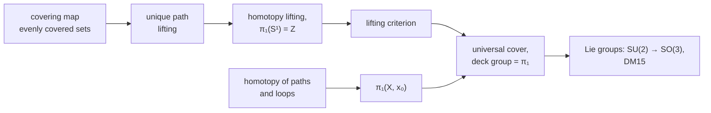

# PA15 · Covering Spaces and the Fundamental Group

◀ [[PA14 ODE Existence Uniqueness and Smooth Dependence]] · [[Proofs, Analysis and Topology - Course Map]] · [[DM01 Smooth Manifolds]] ▶

extra · book extra · beyond

> [!warning] Why this chapter exists, and what it rests on
> Written 2026-10-30 as a **prerequisite for [[DM05 Immersions, Embeddings, Submersions and Coverings]], [[DM09 Group Actions and Semidirect Products]] and [[DM15 Closed Subgroups and the Lie Correspondence]]**: smooth covering maps (Lee Ch. 4), the quotient manifold theorem, the *universal cover of a Lie group* and the Lie correspondence "simply connected groups $\leftrightarrow$ Lie algebras" all use the notions below. The MT3184 lectures quote them without proof ("Homomorphism Theorem if $G$ is simply connected", "the universal cover of $SL(2,\mathbb R)$ has no faithful representation"). **No lecture of this course proves them**; everything is 🟡/🔵. Proofs follow Lee, *Introduction to Smooth Manifolds*, Appendix A ([[John M. Lee - Introduction to Smooth Manifolds.pdf#page=630|Lee App. A, pp. 612–616]]; Props. A.62–A.80) and Hatcher *Algebraic Topology* Ch. 1; numbers recomputed in `scripts/pa15_numbers.py`.

> [!syllabus] Syllabus map: what is in the syllabus and what is extra in this chapter
> 🟡 **Extra · book** (Lee App. A; Hatcher Ch. 1; Munkres Ch. 9, 13)
> - §1 homotopy and $\pi_1$; §2 covering maps; §3 path and homotopy lifting, the lifting criterion
> - §4 $\pi_1(S^1)=\mathbb Z$; §5 universal covers and deck transformations; §6 quotients by group actions
>
> 🔵 **Extra · beyond** (my additions, labelled)
> - winding numbers computed numerically by lifting (3, −2, 3, 1, 0, 1, 0), the class $(1,2)$ in $\pi_1(T^2)$; $\times k$ on $\pi_1(S^1)$; a numerical verification that unit quaternions give a 2-sheeted homomorphism $SU(2)\to SO(3)$ and that the rotation loop by $2\pi$ lifts to a path from $+1$ to $-1$ (so $\pi_1(SO(3))=\mathbb Z/2$)

> [!key] After this chapter you can
> - define **homotopy**, the **fundamental group**, **simply connected**, and compute $\pi_1$ of $\mathbb R^n$, $S^1$, $S^n$ ($n\ge2$), $T^n$, $\mathbb{RP}^n$, $SO(3)$,
> - decide whether a map is a **covering map** (and spot the classic non-examples),
> - prove **unique path lifting** and use the **lifting criterion**,
> - construct **universal covers** and read off **deck groups**,
> - recognise **quotients by free, properly discontinuous actions** as coverings.

> [!intuition] The one-sentence story
> A loop in a space can sometimes be shrunk to a point and sometimes not (a loop around a hole). The **fundamental group** records the loops that cannot be shrunk. A **covering space** is a way of "unwrapping" the loops: the line $\mathbb R$ unwraps the circle, and a path in the circle lifts uniquely to a path in the line, ending at an integer: how many times it wound around. Every statement about $\pi_1$ becomes a statement about lifting.

*Concept map: path lifting is the engine; everything else follows from it.*

![[fig_pa15_cover.png]]
*A: the helix $t\mapsto(e^{2\pi it},t)$ covers the circle; the fibre over $1$ is $\mathbb Z$ (§2). B: winding numbers, i.e. classes in $\pi_1(S^1)$ (§4). C: the double cover $SU(2)\to SO(3)$ (§5).*

## 1. Homotopy and the fundamental group
extra · book *Lee App. A, Props. A.62–A.69, Thm A.71; Hatcher §1.1*

> [!key] Definitions
> Two maps $f_0,f_1:X\to Y$ are **homotopic** ($f_0\simeq f_1$) if there is a continuous $H:X\times[0,1]\to Y$ with $H(\cdot,0)=f_0$, $H(\cdot,1)=f_1$. Two **paths** $\gamma_0,\gamma_1:[0,1]\to X$ with the same endpoints are **path-homotopic** ($\simeq_p$) if the homotopy fixes the endpoints. The **fundamental group** $\pi_1(X,x_0)$ is the set of path-homotopy classes of **loops** based at $x_0$, with product $[\alpha][\beta]=[\alpha\cdot\beta]$ (first $\alpha$, then $\beta$), identity the constant loop and inverse the reversed loop. $X$ is **simply connected** if it is path-connected and $\pi_1(X,x_0)=1$.

> [!intuition] Loops you cannot pull tight
> A rubber band around a pole cannot be shrunk to a point without leaving the space; a rubber band on a table can. $\pi_1$ counts how a loop can wind around holes. In a group, "going around twice" is the product $[\gamma][\gamma]$, so winding numbers add.

A continuous map $f:(X,x_0)\to(Y,y_0)$ induces a homomorphism $f_*:\pi_1(X,x_0)\to\pi_1(Y,y_0)$, $f_*[\gamma]=[f\circ\gamma]$, with $(g\circ f)_*=g_*f_*$ (functoriality). **Homotopy invariance** (Lee A.71): a homotopy equivalence induces an isomorphism on $\pi_1$. Changing the base point in a path-connected space gives an isomorphic group, so one writes $\pi_1(X)$.

Computations: $\pi_1(\mathbb R^n)=1$ and every convex or star-shaped set is simply connected (straight-line homotopy $H(s,t)=(1-t)\gamma(s)+tx_0$); $\pi_1(X\times Y)\cong\pi_1(X)\times\pi_1(Y)$ (Lee A.69), so $\pi_1(T^n)=\mathbb Z^n$ once $\pi_1(S^1)=\mathbb Z$ is known (§4); $\pi_1(S^n)=1$ for $n\ge2$ (Lee A.68, e.g. by Seifert–van Kampen or because every loop can be perturbed to miss a point and then lies in $S^n\setminus\{pt\}\cong\mathbb R^n$).

> [!pitfall] Based classes versus free homotopy
> *Free* homotopy classes of loops correspond to **conjugacy classes** of $\pi_1$, not to elements: in a nonabelian $\pi_1$ the loops $a$ and $gag^{-1}$ are freely homotopic but different as elements. For abelian $\pi_1$ (circle, torus, $SO(3)$) conjugacy classes are single elements, so the two notions agree. A loop freely homotopic to a constant is path-homotopic to the constant.

## 2. Covering maps
extra · book *Lee App. A, "Covering Maps", p. 615; Hatcher §1.3*

> [!key] Definition
> A continuous surjective $\pi:E\to X$ is a **covering map** if every point of $X$ has an open neighbourhood $U$ that is **evenly covered**: $\pi^{-1}(U)=\bigsqcup_\alpha\widetilde U_\alpha$ is a disjoint union of open sets (**sheets**) each mapped *homeomorphically* onto $U$ by $\pi$. ($E$ and $X$ are usually required to be connected, locally path-connected.) The set $\pi^{-1}(x)$ is the **fibre**; it is discrete.

> [!intuition] A parking garage over the base
> Above each small region $U$ of the base the covering looks like several identical floors stacked over $U$; going around a hole in the base takes you up or down a ramp to another floor. The helix over the circle (figure A) is the simplest parking garage.

Examples. **(1)** $p:\mathbb R\to S^1$, $p(t)=e^{2\pi it}$: fibre over $1$ is $\mathbb Z$ (infinitely many sheets). **(2)** $z\mapsto z^k$ on $S^1$: $k$ sheets. **(3)** $\mathbb R^n\to T^n=\mathbb R^n/\mathbb Z^n$: fibre $\mathbb Z^n$. **(4)** $S^n\to\mathbb{RP}^n$: 2 sheets ([[PA11 Subspaces, Products and Quotients]]). **(5)** $\exp:\mathbb C\to\mathbb C^\times$: fibre $2\pi i\mathbb Z$ (the map with $\det D\exp=e^{2x}$, PA13 §4). **(6)** A homeomorphism is a one-sheeted covering.

> [!pitfall] Local homeomorphism and surjective is not enough
> $p|_{(0,2)}:(0,2)\to S^1$ is surjective and a local homeomorphism, but **not** a covering map: a small arc $U$ around $1=e^{0}$ has preimage $(0,\delta)\cup(1-\delta,1+\delta)\cup(2-\delta,2)$, and the pieces $(0,\delta)$ and $(2-\delta,2)$ map homeomorphically onto *half* of $U$ only, not onto $U$. Likewise $x\mapsto x^2$, $\mathbb R\to[0,\infty)$ fails at $0$ (one point above $0$, two above everything else), while $\mathbb R\setminus0\to(0,\infty)$ is a 2-sheeted covering.

A covering map is a local homeomorphism, hence an **open map**, and a quotient map. A **smooth covering map** is a smooth surjection whose evenly covered sets have sheets mapped *diffeomorphically* ([[DM05 Immersions, Embeddings, Submersions and Coverings]]).

## 3. Lifting
extra · book *Lee Props. A.77–A.79; Hatcher Props. 1.30, 1.33*

> [!key] Unique path lifting
> Let $\pi:E\to X$ be a covering, $\gamma:[0,1]\to X$ a path and $e_0\in\pi^{-1}(\gamma(0))$. Then there is a **unique** path $\tilde\gamma:[0,1]\to E$ with $\pi\circ\tilde\gamma=\gamma$ and $\tilde\gamma(0)=e_0$.
>
> *Proof.* *Existence.* Cover $X$ by evenly covered sets; by compactness of $[0,1]$ (Lebesgue number lemma, [[Compact Space]]) there is a partition $0=t_0<\dots<t_N=1$ with $\gamma([t_{i-1},t_i])\subseteq U_i$ evenly covered. Having defined $\tilde\gamma$ up to $t_{i-1}$, let $\widetilde U$ be the sheet over $U_i$ containing $\tilde\gamma(t_{i-1})$ and set $\tilde\gamma=(\pi|_{\widetilde U})^{-1}\circ\gamma$ on $[t_{i-1},t_i]$; the pieces are continuous and agree at the endpoints, so by the gluing lemma ([[Gluing Lemma]]) $\tilde\gamma$ is continuous. *Uniqueness.* If $l_1,l_2$ are two lifts, $S=\{t:l_1(t)=l_2(t)\}$ is nonempty. **Open:** if $l_1(t)=l_2(t)=e$, take the sheet $\widetilde U\ni e$ over an evenly covered $U\ni\gamma(t)$; for $s$ near $t$ both $l_i(s)\in\widetilde U$ and $\pi$ is injective there. **Closed:** if $l_1(t)\neq l_2(t)$, both lie over $\gamma(t)$ in *different* sheets (each sheet contains exactly one point over $\gamma(t)$), and near $t$ they stay in those disjoint sheets. So $S$ is clopen in the connected $[0,1]$. $\square$

> [!key] Homotopy lifting and consequences (Lee A.77, A.79)
> A homotopy $H:[0,1]\times[0,1]\to X$ with $H(0,0)=x$ lifts uniquely to $\tilde H$ with a prescribed $\tilde H(0,0)\in\pi^{-1}(x)$. Hence:
> (a) path-homotopic paths have lifts with the **same endpoint** (the endpoint depends only on the class);
> (b) $\pi_*:\pi_1(E,e_0)\to\pi_1(X,x_0)$ is **injective** (a loop whose image is null-homotopic lifts to a closed loop that is null-homotopic);
> (c) $\pi_1(X,x_0)$ **acts on the fibre** $\pi^{-1}(x_0)$ by $[\gamma]\cdot e=\tilde\gamma_e(1)$, transitively if $E$ is path-connected, and then $|\pi^{-1}(x_0)|=[\pi_1(X,x_0):\pi_*\pi_1(E,e_0)]$ (number of sheets $=$ index).

> [!key] Lifting criterion (Lee A.78)
> Let $\pi:(E,e_0)\to(X,x_0)$ be a covering and $f:(Y,y_0)\to(X,x_0)$ continuous with $Y$ path-connected and **locally path-connected**. Then $f$ lifts to $\tilde f:(Y,y_0)\to(E,e_0)$, $\pi\tilde f=f$, **iff** $f_*\pi_1(Y,y_0)\subseteq\pi_*\pi_1(E,e_0)$. In particular, **every map from a simply connected, locally path-connected space lifts**; and the lift is unique.
>
> *Sketch.* Define $\tilde f(y)=\tilde\sigma(1)$ where $\sigma$ is a path from $y_0$ to $y$ and $\tilde\sigma$ the lift of $f\circ\sigma$ starting at $e_0$. Two paths $\sigma,\sigma'$ give lifts with the same endpoint exactly when the loop $f\circ(\sigma\cdot\bar\sigma')$ lifts to a closed loop, i.e. when its class lies in $\pi_*\pi_1(E,e_0)$: that is the hypothesis. Continuity uses local path-connectedness: near $y$ choose a path-connected neighbourhood mapped into an evenly covered set and lift inside one sheet. $\square$

## 4. $\pi_1(S^1)\cong\mathbb Z$ by lifting
extra · book *Lee Prop. A.68; Hatcher Thm 1.7*

> [!key] Theorem
> The map $\Phi:\pi_1(S^1,1)\to\mathbb Z$, $\Phi[\gamma]=\tilde\gamma(1)$, where $\tilde\gamma$ is the lift through $p(t)=e^{2\pi it}$ with $\tilde\gamma(0)=0$, is an **isomorphism**. The integer $\Phi[\gamma]$ is the **winding number** of $\gamma$.
>
> *Proof.* **Well defined** by homotopy lifting (a). **A homomorphism:** if $\tilde\alpha(1)=m$ then the lift of $\alpha\cdot\beta$ is $\tilde\alpha$ followed by $m+\tilde\beta$ (translating $\tilde\beta$ by $m$ lifts $\beta$ starting at $m$), ending at $m+\tilde\beta(1)$. **Surjective:** the loop $\omega_n(t)=e^{2\pi int}$ lifts to $t\mapsto nt$, ending at $n$. **Injective:** if $\tilde\gamma(1)=0$, then $\tilde\gamma$ is a loop in $\mathbb R$ and $H(s,t)=(1-t)\tilde\gamma(s)$ is a null-homotopy; composing with $p$ gives a path-homotopy from $\gamma$ to the constant loop. $\square$

> [!example] Winding numbers computed by lifting (numbers)
> Lifting the loop and reading the end of the lift ($2\times10^5$ sample points, `pa15_numbers.py`): $e^{2\pi i\,3t}\mapsto+3$; $e^{-2\pi i\,2t}\mapsto-2$; the wobbly loop $e^{2\pi i(3t+0.2\sin2\pi t)}\mapsto+3$ (a homotopy-invariant: the wobble does not change it). **Around the origin:** the unit circle centred at $0.5$ has winding number $1$ (it encloses $0$); the circle of radius $0.3$ centred at $0.5$ has $0$ (it does not); the *radius-1* circles centred at $0.99$ and $1.01$ have winding numbers $1$ and $0$ respectively: the number jumps exactly when $0$ crosses the curve. The loop $(e^{2\pi it},e^{4\pi it})$ in $T^2=S^1\times S^1$ has class $(1,2)\in\mathbb Z^2$. The map $z\mapsto z^k$ sends the generator to the class $k$ ($k=2,3,5$ checked): **it induces multiplication by $k$ on $\pi_1(S^1)=\mathbb Z$**.

> [!connection] Why this matters later
> The **Lie correspondence** says a homomorphism of Lie algebras $\mathfrak g\to\mathfrak h$ integrates to a homomorphism of Lie groups only if $G$ is **simply connected** ([[DM15 Closed Subgroups and the Lie Correspondence]]): the Lie algebras of $S^1$ and $\mathbb R$ are both $\mathbb R$, and $p:\mathbb R\to S^1$ is a homomorphism, but there is no homomorphism $S^1\to\mathbb R$ inducing the identity on Lie algebras (compact image would be trivial). The loop that goes once around $S^1$ is the obstruction.

## 5. Universal covers and deck transformations
extra · book *Lee Props. A.79, A.80; Hatcher §1.3*

> [!key] Universal covering space
> A covering $\pi:\widetilde X\to X$ with $\widetilde X$ **simply connected** is a **universal covering**. If $X$ is connected, locally path-connected and *semilocally simply connected* (true for every manifold), a universal covering exists (Lee A.80) and is unique up to isomorphism; it covers every other connected covering of $X$. Every connected manifold has a universal cover, and it is again a manifold ([[DM05 Immersions, Embeddings, Submersions and Coverings]]).
>
> A **deck transformation** is a homeomorphism $\varphi:E\to E$ with $\pi\varphi=\pi$. The deck transformations form a group $\operatorname{Deck}(\pi)$, and for a universal cover $\operatorname{Deck}(\widetilde X\to X)\cong\pi_1(X)$ (by the lifting criterion: each $\varphi$ is determined by where it sends one point).

| Covering | Deck group | $\pi_1$ of the base |
|---|---|---|
| $\mathbb R\to S^1$ | $\mathbb Z$ (translations $t\mapsto t+n$) | $\mathbb Z$ |
| $\mathbb R^n\to T^n$ | $\mathbb Z^n$ | $\mathbb Z^n$ |
| $S^n\to\mathbb{RP}^n$ ($n\ge2$) | $\mathbb Z/2$ (antipodal map) | $\mathbb Z/2$ |
| $\mathbb C\to\mathbb C^\times$, $z\mapsto e^z$ | $2\pi i\mathbb Z$ | $\mathbb Z$ |

> [!example] $SU(2)\to SO(3)$: the double cover of the rotation group, checked
> Unit quaternions $q=(w,x,y,z)\in S^3\cong SU(2)$ act on $\mathbb R^3$ by rotations: $q\mapsto R(q)\in SO(3)$. Checked on $1000$ random pairs: $\max|R(ab)-R(a)R(b)|=1.1\times10^{-15}$ (a homomorphism), $R(q)R(q)^T=I$ and $\det R=1$ to $1.6\times10^{-15}$, and $R(-q)=R(q)$ **exactly**, with kernel $\{\pm1\}$. So $S^3\to SO(3)$ is a 2-sheeted covering, a *group* homomorphism, and $SO(3)\cong S^3/\pm1=\mathbb{RP}^3$. The loop $t\mapsto$ rotation by $2\pi t$ about the $z$-axis, $t\in[0,1]$, is closed in $SO(3)$ ($R(1)-I\sim2\times10^{-16}$), but its lift $q(t)=(\cos\pi t,0,0,\sin\pi t)$ ends at $q(1)=-1\ne+1$: it does **not** lift to a closed loop, so it is a **nontrivial** element of $\pi_1(SO(3))$. Going around twice, $t\in[0,2]$, the lift ends at $q(2)=+1$, a closed loop in the simply connected $S^3$ and hence null-homotopic. So $\pi_1(SO(3))\cong\mathbb Z/2$ and **$S^3=SU(2)$ is the universal cover of $SO(3)$** (figure C). The two groups have the **same Lie algebra** $\mathfrak{su}(2)\cong\mathfrak{so}(3)\cong(\mathbb R^3,\times)$ (MT3184 HW7 Q3b), which is why the Lie correspondence needs "simply connected": only $SU(2)$ is the canonical group of that Lie algebra. Physically, $\pi_1(SO(3))=\mathbb Z/2$ is the reason spin-$\tfrac12$ particles return to themselves only after a $4\pi$ rotation ([[QM09 The Stern-Gerlach Experiment and Spin]]).

> [!connection] The universal cover of $SL(2,\mathbb R)$
> $\pi_1(SL(2,\mathbb R))=\mathbb Z$ (it deformation retracts to $SO(2)=S^1$). The universal cover $\widetilde{SL}(2,\mathbb R)$ is a Lie group with the same Lie algebra and **has no faithful finite-dimensional representation** (MT3184 DG19), the standard counterexample to "every Lie group embeds in $GL(n)$" even though Ado's theorem gives a faithful representation of the Lie *algebra* ([[DM11 The Lie Algebra of a Lie Group]]).

## 6. Quotients by group actions
extra · book *Lee Ch. 21 (preview); Hatcher Prop. 1.40; Munkres §§81–82*

> [!key] Free, properly discontinuous actions give coverings
> Let a discrete group $\Gamma$ act on a Hausdorff space $X$ by homeomorphisms such that every $x$ has a neighbourhood $W$ with $\gamma W\cap W=\varnothing$ for all $\gamma\ne e$ (a **free, properly discontinuous** action). Then $X\to X/\Gamma$ is a covering map (an open quotient map whose evenly covered sets are the images of the sets $W$), $X/\Gamma$ is Hausdorff by the criterion of [[PA11 Subspaces, Products and Quotients]], and $\operatorname{Deck}=\Gamma$. If $X$ is simply connected then $\pi_1(X/\Gamma)\cong\Gamma$.

Examples. $\mathbb Z\curvearrowright\mathbb R$ by translation gives $S^1$; $\mathbb Z^n\curvearrowright\mathbb R^n$ gives $T^n$; $\{\pm1\}\curvearrowright S^n$ gives $\mathbb{RP}^n$; $\{\pm1\}\curvearrowright S^3$ gives $SO(3)$; a **lattice** $\Lambda\subset\mathbb R^n$ gives the torus $\mathbb R^n/\Lambda$. The smooth version, with proper actions of Lie groups, is the Quotient Manifold Theorem ([[DM09 Group Actions and Semidirect Products]]).

<!-- interactive:start (generated by scripts/embed_interactive.py; edit the tool in scripts/interactive/tools/, not this block) -->
> [!interactive]+ Interactive: Covering spaces: lifting loops from the circle to the line
> The real line covers the circle by t ↦ (cos t, sin t).
>
> ![[pa_covering.png|720]]
>
> **Try:** Set w = 2: the point goes twice round the circle and the lift climbs two floors of the helix, ending at 4π. Turn up the wobble: the loop is a different path, but the lift still ends at 2πw (homotopy invariance). w = 0 gives a null-homotopic loop whose lift returns to 0.
>
> [▶ Open the tool in your browser](../Assets/interactive/pa_covering.html) · [absolute link](file:///home/swastik/Documents/notes/Assets/interactive/pa_covering.html) · all tools and coverage: [[Interactive Tools]]

<!-- interactive:end -->

## Map of this chapter
> [!connection] How PA15 connects
> **Builds on:** [[PA11 Subspaces, Products and Quotients]] (quotients, gluing lemma, Hausdorff criterion), [[PA12 Separation, Countability and Local Compactness]] (locally path-connected, Lebesgue number via compactness), [[PA07 Metric and Topological Spaces]] (compactness, connectedness).
> **Leads to:** [[DM05 Immersions, Embeddings, Submersions and Coverings]] (smooth covering maps), [[DM09 Group Actions and Semidirect Products]], [[DM15 Closed Subgroups and the Lie Correspondence]] (simply connected groups, $SU(2)\to SO(3)$).
> **Concepts:** [[Homotopy]] · [[Fundamental Group]] · [[Covering Space]] · [[Path Lifting]] · [[Lifting Criterion]] · [[Universal Cover]] · [[Deck Transformation]] · [[Winding Number]]
> **Other subjects:** [[Group Theory - Course Map]] (the action of $\pi_1$ on the fibre; deck groups), [[Quantum Mechanics - Course Map]] ($\pi_1(SO(3))=\mathbb Z/2$ and spin-$\tfrac12$, [[QM09 The Stern-Gerlach Experiment and Spin]])

## Summary
> [!summary] Cheat-sheet
> - $\pi_1(X,x_0)$ = loops mod path homotopy; $f_*$ functorial; homotopy equivalences induce isomorphisms; $\pi_1(X\times Y)=\pi_1X\times\pi_1Y$; $\pi_1(\mathbb R^n)=1$, $\pi_1(S^n)=1$ ($n\ge2$).
> - **Covering:** evenly covered neighbourhoods; local homeomorphism, open, discrete fibres; $\mathbb R\to S^1$, $S^n\to\mathbb{RP}^n$, $\mathbb R^n\to T^n$, $z\mapsto z^k$. $(0,2)\to S^1$ is *not* a covering.
> - **Unique path lifting**; **homotopy lifting**; $\pi_*$ injective; sheets $=$ index; **lifting criterion:** $f_*\pi_1(Y)\subseteq\pi_*\pi_1(E)$, automatic if $Y$ is simply connected and locally path-connected.
> - $\pi_1(S^1)=\mathbb Z$ via the end of the lift = winding number; $z\mapsto z^k$ is $\times k$.
> - **Universal cover** exists for manifolds; $\operatorname{Deck}\cong\pi_1$. $SU(2)\to SO(3)$ is the universal double cover, $\pi_1(SO(3))=\mathbb Z/2$; $\widetilde{SL}(2,\mathbb R)$ has no faithful finite-dimensional representation.
> - Free properly discontinuous $\Gamma$-action $\Rightarrow$ $X\to X/\Gamma$ covering.

## Practice
1. **Covering check.** Show $p:\mathbb R\to S^1$ is a covering and give an evenly covered neighbourhood of $1$ and of $-1$. Show $p|_{(0,2)}$ is not.
2. **Winding numbers.** Compute the winding number about $0$ of $t\mapsto e^{2\pi i\,3t}$, of the circle of radius $0.3$ about $0.5$, and of $t\mapsto e^{2\pi i t}+0.5e^{-2\pi i\,2t}$ (careful: which term dominates?).
3. **Lifts agree.** Prove that two lifts of the same path through a covering that agree at one point agree everywhere (the uniqueness half of path lifting).
4. **Projective space.** Show $S^n\to\mathbb{RP}^n$ is a 2-sheeted covering and conclude $\pi_1(\mathbb{RP}^n)\cong\mathbb Z/2$ for $n\ge2$. What is $\pi_1(\mathbb{RP}^1)$?
5. **Degree $k$.** Show that $z\mapsto z^k$, $S^1\to S^1$, is a $k$-sheeted covering that induces multiplication by $k$ on $\pi_1=\mathbb Z$, and find its deck group.
6. **Fibre and $\pi_1$.** Using $\mathbb R\to S^1$, identify the fibre over $1$ with $\pi_1(S^1,1)$ as a set with the action of $\pi_1$; how do the sheets count relate to an index?
7. **Local homeomorphism.** Show that $x\mapsto x^2$ is a covering $\mathbb R\setminus\{0\}\to(0,\infty)$ but $x\mapsto x^2$, $\mathbb R\to[0,\infty)$, is not.
8. **Lifting criterion.** Prove that every continuous map $S^2\to S^1$ is null-homotopic.
9. **Deck group.** Show that the deck group of $\mathbb R\to S^1$ is $\mathbb Z$ and that of $S^n\to\mathbb{RP}^n$ is $\mathbb Z/2$.
10. **Rotation group.** Using $SU(2)\to SO(3)$ explain why $\pi_1(SO(3))=\mathbb Z/2$ and why $\mathfrak{so}(3)\cong\mathfrak{su}(2)$ does not distinguish the two groups.

> [!example]- Solutions
> 1. For $x\in S^1$ let $U=S^1\setminus\{-x\}$. Then $p^{-1}(U)=\bigsqcup_{n\in\mathbb Z}(a+n-\tfrac12,\,a+n+\tfrac12)$ with $p(a)=x$, each interval mapped homeomorphically onto $U$ (strictly monotone argument): evenly covered. At $1$: $U=S^1\setminus\{-1\}$, sheets $(n-\tfrac12,n+\tfrac12)$; at $-1$: $U=S^1\setminus\{1\}$, sheets $(n,n+1)$. For $p|_{(0,2)}$: see §2 (the arc around $1$ has preimage consisting of three pieces, two of which cover only half of it).
> 2. $+3$. $0$ (the circle does not enclose $0$). For $e^{2\pi it}+0.5e^{-4\pi it}$: $|e^{2\pi it}|=1>0.5$, so the curve stays within $0.5$ of the unit circle, never passes through $0$, and is homotopic (via $e^{2\pi it}+s\cdot0.5e^{-4\pi it}$, never $0$) to $e^{2\pi it}$: winding number $+1$.
> 3. See the uniqueness half of the proof in §3: the coincidence set is open (injectivity of $\pi$ on a sheet) and closed (distinct points over the same point lie in disjoint sheets) in the connected $[0,1]$.
> 4. Evenly covered: for $U\subset\mathbb{RP}^n$ the image of a small open cap $W\subset S^n$ with $W\cap(-W)=\varnothing$, preimage $W\sqcup(-W)$. $S^n$ is simply connected for $n\ge2$ so $\pi_1(\mathbb{RP}^n)$ is in bijection with the fibre (2 points) and is $\mathbb Z/2$. $\mathbb{RP}^1\cong S^1$, $\pi_1=\mathbb Z$ (PA11 Practice 9; the cover $S^1\to S^1$ is $z\mapsto z^2$).
> 5. $z\mapsto z^k$ has fibre the $k$th roots, evenly covered arcs give $k$ sheets. The loop $\omega_1$ maps to $\omega_k$, class $k$ (numerically $k=2,3,5$). Deck group: multiplication by $k$th roots of unity, $\mathbb Z/k$.
> 6. The fibre over $1$ is $\mathbb Z$; $\pi_1(S^1,1)=\mathbb Z$ acts by translation, simply transitively (the universal cover has fibre $\cong\pi_1$). A connected cover with $\pi_*\pi_1(E)=k\mathbb Z\subset\mathbb Z$ (the cover $z\mapsto z^k$) has $|\text{fibre}|=[\mathbb Z:k\mathbb Z]=k$ sheets.
> 7. $x^2:\mathbb R\setminus0\to(0,\infty)$: preimage of $(a,b)$, $0<a<b$, is $(-\sqrt b,-\sqrt a)\sqcup(\sqrt a,\sqrt b)$, each sheet homeomorphic to $(a,b)$. At $0\in[0,\infty)$: any neighbourhood $[0,\varepsilon)$ has preimage $(-\sqrt\varepsilon,\sqrt\varepsilon)$, connected and not a disjoint union of homeomorphic copies of $[0,\varepsilon)$.
> 8. $S^2$ is simply connected and locally path-connected, so $f$ lifts through $p$ to $\tilde f:S^2\to\mathbb R$. $H(x,t)=p((1-t)\tilde f(x))$ is a homotopy from $f$ to the constant map $p(0)=1$.
> 9. A deck transformation of $\mathbb R\to S^1$ is determined by the image of $0\in p^{-1}(1)=\mathbb Z$, say $n$: it is $t\mapsto t+n$; all integers occur. Similarly for $S^n\to\mathbb{RP}^n$ the only non-identity deck transformation is $x\mapsto-x$.
> 10. $S^3\to SO(3)$ is a 2-sheeted covering homomorphism with $S^3$ simply connected ($n=3\ge2$), so $\pi_1(SO(3))\cong\mathbb Z/2$, generated by the $2\pi$-rotation loop (lift from $+1$ to $-1$, §5 numbers). A covering homomorphism is a local diffeomorphism, so its differential at the identity is an isomorphism of Lie algebras: both groups have the same Lie algebra, whose "integration" is therefore ambiguous up to the covering, and the correspondence picks the simply connected one.

<!-- zettel:start (generated by scripts/sort_zettel.py; do not edit between the markers) -->
## Zettel notes

> [!abstract]- Zettel notes filed under this chapter (1): the other tool's concept notes from the lectures, unreviewed
> [[zettel/equivalence-relation-and-partition-correspondence|Equivalence Relation and Partition Correspondence]]
<!-- zettel:end -->

## Provenance
> [!provenance]- Source map for this chapter
> | Topic | Source | Scope |
> |---|---|---|
> | homotopy, $\pi_1$, functoriality, homotopy invariance, $\pi_1$ of spheres and products | Lee App. A Props. A.62–A.69, Thm A.71; Hatcher §1.1 | extra/book |
> | covering maps, path and homotopy lifting, lifting criterion, universal cover | Lee Props. A.77–A.80; Hatcher §1.3 (proof of path lifting rewritten) | extra/book |
> | $\pi_1(S^1)=\mathbb Z$ by lifting | Lee Prop. A.68; Hatcher Thm 1.7 | extra/book |
> | free properly discontinuous actions | Hatcher Prop. 1.40; Munkres §81 | extra/book |
> | winding-number table, $\times k$ on $\pi_1$, $SU(2)\to SO(3)$ numerical check | `scripts/pa15_numbers.py`, `fig_pa15_cover.py`; MT3184 DG18–DG20, HW7 Q3 for context | extra/beyond |
>
> **Notes.** $\pi_1(S^n)=1$ ($n\ge2$) and the existence of universal covers are quoted (Lee A.68, A.80), not proved; the lifting criterion is only sketched. $\pi_1(SL(2,\mathbb R))=\mathbb Z$ uses the polar decomposition retraction onto $SO(2)$, quoted from the MT3184 slides (DG19, partly illegible: [[mt3184-differential-geometry-and-lie-groups/2026-10-10-october-5-9|notes on DG19–DG21]]).
