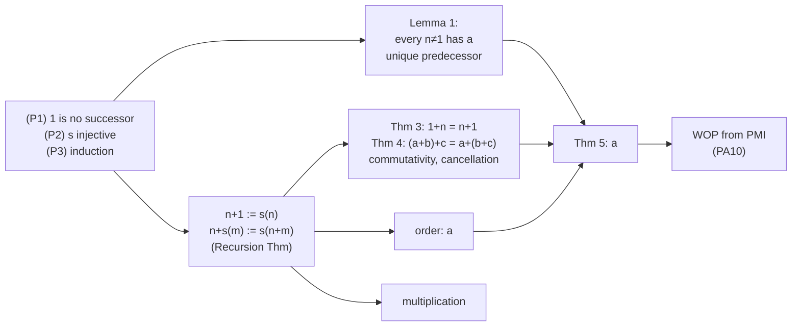

# PA16 · Peano's Axioms and the Natural Numbers

◀ [[PA10 Well-Ordering and Well-Ordered Pairs]] · [[Proofs, Analysis and Topology - Course Map]] · ▶ [[PA06 The Real Numbers and Sequences]]

taught · in syllabus (Lecture 25) extra · beyond

> [!warning] Scope of this chapter (added 2026-11-12)
> New source: the **Lecture 25 handout** ([[L-25.pdf]], 3 pages, Supriya Pisolkar; read in full this session; the other tool's note is [[intro-to-proofs/2026-11-10-peano-s-axioms|Peano's axioms]]). It answers the question left open in Lecture 24 ("$\mathbb N$ was taken as given and PMI accepted as a fact"): **where does induction come from?** The handout takes $(N,1,s)$ with three axioms and *derives* addition, order, multiplication and (what Lecture 24 used) the two facts behind PMI ⇔ WOP. PA05 §5 only mentioned Peano in one line and PA08–PA10 take $+$, $<$ and $\mathbb N$ as known; so this is a **new chapter** (new-material rule). The proofs of Theorems 3–5 and Lemma 1 are the handout's; commutativity, cancellation, $a+z\ne a$, and the five exercises are **proved here in full** (the handout lists them without proof, `🔵`). Every statement was also **checked by brute force** on $\{1,\dots,40\}$ with arithmetic built only from the successor (`scripts/pa16_numbers.py`). Lecture 24 itself is not in the folder.

> [!syllabus] Syllabus map: what is in the syllabus and what is extra in this chapter
> 🟢 **Taught (Lecture 25)**
> - §1 the three axioms (P1)–(P3), the example and the three non-examples; §2 **Lemma 1** (predecessor); §3 **addition** by the two recursion rules, $2+2=4$, **Theorem 3** ($1+n=n+1$), **Theorem 4** (associativity); §4 **order** and **Theorem 5**; the link PMI ⇔ WOP; §5 **multiplication**; the list of further results; §6 isomorphism of Peano systems, $\mathbb Z\to\mathbb Q\to\mathbb R$, the ZFC model $\mathbb N_0$, $\mathbb N$ versus $\mathbb N_0$; the five exercises
>
> 🔵 **Extra · beyond** (my additions)
> - §3 full proofs of commutativity and cancellation; §4 $a+z\ne a$ and the proof of exercise (e); §5 exercises (b) and (c); the brute-force verification; §6 why no finite set is a Peano system

> [!key] After this chapter you can
> - state **(P1)–(P3)**, show by examples that **each axiom is needed**, and say why (P3) is PMI,
> - prove the **predecessor lemma** and use it to run a proof by induction on a *definition by recursion*,
> - define $+$, $\cdot$ and $<$ from $s$ alone and prove $1+n=n+1$, associativity, commutativity, cancellation, $a+z\ne a$ and the step property of the order,
> - explain why **PMI, strong induction and WOP** now rest only on (P1)–(P3) ([[PA10 Well-Ordering and Well-Ordered Pairs]]), and what "the" natural numbers means (uniqueness up to isomorphism).

> [!intuition] The one-sentence story
> Induction is not a *theorem* about $\mathbb N$: it is **half of what $\mathbb N$ is**. Give a set a start (1) and a step ($s$) which never returns to the start (P1) and never merges two numbers (P2), insist that **nothing is in the set except what the start and the step produce** (P3), and everything else, $+$, $\times$, $<$, the WOP, is *defined* and *proved* by induction.

*Concept map: what is built from what; Lemma 1 and Theorem 5 are exactly the two facts used to prove WOP from PMI.*

## 1. The axioms
taught *Source: Lecture 25 ([[L-25.pdf#page=1|p. 1]])*

> [!key] Definition (Peano system)
> A set $N$ with a distinguished element $1\in N$ and a function $s:N\to N$ (the **successor**) such that
> **(P1)** $1\notin\mathrm{Im}(s)$: $s(n)\ne1$ for all $n$;
> **(P2)** $s$ is **injective**: $s(m)=s(n)\Rightarrow m=n$;
> **(P3) (Induction)** if $S\subseteq N$, $1\in S$ and $s(S)\subseteq S$, then $S=N$.

$N$, $1$ and $s$ are **not assumed to be anything in advance**; "1" is a name for the distinguished element, as "$e$" names the identity of a group. (P3) is PMI written with $s(k)$ in place of $k+1$, because $+$ is not yet defined. In words: 1 is not a successor, different numbers have different successors, and starting at 1 and taking successors reaches everything.

**Example.** $\{1,2,3,\dots\}$ with $s(n)=n+1$.

**Non-examples: each axiom is needed** (the handout's three):
- $X=\{1\}$, $s(1)=1$: (P2), (P3) hold, **(P1) fails** ($1=s(1)$).
- $X=\{1,2\}$, $s(1)=2$, $s(2)=2$: (P1), (P3) hold, **(P2) fails** ($s(1)=s(2)$).
- $X=\mathbb N\cup\mathbb N'$ ($\mathbb N'=\{1',2',\dots\}$ a disjoint copy), $s(n)=n+1$, $s(n')=(n+1)'$: (P1), (P2) hold; $S=\mathbb N$ satisfies $1\in S$, $s(S)\subseteq S$ but $S\ne X$: **(P3) fails**. The second copy is a "number line you can never reach from 1".

> [!example] Why no finite set is a Peano system 🔵
> If $N$ is finite and $s$ is injective then $s$ is a **bijection** of $N$ (an injection of a finite set into itself is onto), so $1\in\mathrm{Im}(s)$ and (P1) fails. Check: on $\{1,2,3\}$ with $1\to2\to3\to1$ the axioms read $(\text{P1},\text{P2},\text{P3})=(\text{False},\text{True},\text{True})$. So a Peano system is **infinite**: that is what (P1)+(P2) buy, and (P3) says it is the *smallest* such thing.

## 2. The predecessor lemma
taught *Lecture 25 p. 1*

> [!key] Lemma 1
> **Every $n\ne1$ is the successor of exactly one element.**
> *Proof.* Let $S=\{1\}\cup\mathrm{Im}(s)$. Then $1\in S$, and if $x\in S$ then $s(x)\in\mathrm{Im}(s)\subseteq S$. By (P3) $S=N$. So if $n\ne1$ then $n\in\mathrm{Im}(s)$. Uniqueness is (P2). $\square$

(Checked on $\{1,\dots,40\}$: every $n\ge2$ has exactly one predecessor, 1 has none.) This is the "every $m\ne1$ has a predecessor" used in Lecture 24 to prove WOP.

## 3. Addition
taught *Lecture 25 pp. 1–2* · extra · beyond *commutativity and cancellation proved*

**Definition.** We only have $s$, so $n+m$ must be *specified*, for fixed $n$ one $m$ at a time: first for $m=1$, then for $s(m)$ once known for $m$:
$$n+1:=s(n),\qquad n+s(m):=s(n+m).$$
"Adding 1 = successor once; adding $s(m)$ = add $m$, then successor once more." *Example:* with $2=s(1)$, $3=s(2)$, $4=s(3)$: $2+2=2+s(1)=s(2+1)=s(s(2))=s(3)=4$. Two rules suffice because of (P3): the set of $m$ for which $n+m$ is specified contains 1 and is closed under $s$. That the values **fit into a single well-defined function** $N\times N\to N$ is the **Recursion Theorem**, taken as given ([[PA09 Strong Induction and Recursion]]). Writing $m+1$ for $s(m)$, the second rule reads $\boxed{n+(m+1)=(n+m)+1}$: a **definition, not associativity**: it says what adding $m+1$ means, and is the base case of Theorem 4.

> [!key] Theorem 3 (handout): $1+n=n+1$
> Induction on $n$. $n=1$: both sides are $1+1$. If $1+k=k+1$, then $1+(k+1)=(1+k)+1=(k+1)+1$: the first equality is the second rule ($n=1$, $m=k$), the second substitutes the hypothesis. $\square$

> [!key] Theorem 4 (handout): associativity, $(a+b)+c=a+(b+c)$
> Fix $a,b$; induct on $c$. $c=1$: $(a+b)+1=a+(b+1)$ is the second rule ($n=a$, $m=b$). Step: $(a+b)+(c+1)=((a+b)+c)+1=(a+(b+c))+1=a+((b+c)+1)=a+(b+(c+1))$, by the second rule ($n=a+b$, $m=c$); the hypothesis, substituted; the second rule ($n=a$, $m=b+c$) read right to left; the second rule ($n=b$, $m=c$) inside the parentheses. $\square$

> [!key] Commutativity, $a+b=b+a$ 🔵 (listed in the handout, proved here)
> Induct on $b$. $b=1$: $a+1=1+a$ is Theorem 3. Step: $a+(b+1)=(a+b)+1=(b+a)+1=b+(a+1)=b+(1+a)=(b+1)+a$: second rule; hypothesis; second rule ($n=b$, $m=a$) right to left; Theorem 3 ($a+1=1+a$); Theorem 4 ($b+(1+a)=(b+1)+a$). $\square$

> [!key] Cancellation, $a+c=b+c\Rightarrow a=b$ 🔵 (uses (P2))
> Induct on $c$. $c=1$: $a+1=b+1$ means $s(a)=s(b)$, so $a=b$ by (P2). Step: $a+(c+1)=b+(c+1)$ gives $s(a+c)=s(b+c)$, so $a+c=b+c$ by (P2), so $a=b$ by the hypothesis. $\square$

*Numerical check of all four* (arithmetic built only from $s$, `pa16_numbers.py`): $1+n=n+1$ for $n\le40$; associativity for all triples $\le15$ ($3375$ triples); commutativity for all pairs $\le40$; cancellation for all triples $\le25$: **all true**.

## 4. Order
taught *Lecture 25 p. 2* · extra · beyond *$a+z\ne a$, exercises (d), (e)*

**Definition.** $a<b$ iff $b=a+x$ for some $x\in N$; $a\le b$ iff $a<b$ or $a=b$.

> [!key] Theorem 5 (handout): $a<b\Rightarrow a+1\le b$ (nothing between $a$ and $a+1$)
> $b=a+x$. If $x=1$, $b=a+1$. If $x\ne1$, $x=y+1$ (Lemma 1) and $b=a+(y+1)=a+(1+y)=(a+1)+y$ by Theorems 3 and 4, so $a+1<b$. $\square$

Theorem 5 and Lemma 1 are the two facts used in Lecture 24 to prove **WOP from PMI**; so **PMI ⇔ WOP now rests only on (P1)–(P3) and the definitions of $+$ and $<$** ([[PA10 Well-Ordering and Well-Ordered Pairs]] §2). Checked: Theorem 5 for all $a,b\le40$; trichotomy (exactly one of $a<b$, $a=b$, $b<a$) for all pairs $\le30$.

> [!key] Lemma 🔵: $a+z\ne a$ for all $a,z$ (this contains $s(n)\ne n$)
> Induct on $a$. $a=1$: $1+z=1$ is impossible: for $z=1$, $1+1=s(1)\ne1$ by (P1); for $z=y+1$, $1+(y+1)=s(1+y)\ne1$ by (P1). Step: suppose $(a+1)+z=a+1$. Then $(a+1)+z=a+(1+z)=a+(z+1)=(a+z)+1$ (Theorems 4, 3, second rule), so $s(a+z)=s(a)$ and by (P2) $a+z=a$, contradicting the hypothesis. $\square$

**Exercises (d), (e) of the handout, proved** 🔵.
- **(d) No $n$ satisfies $n<1$.** If $1=n+x$: $x=1$ gives $1=s(n)$, contradicting (P1); $x=y+1$ gives $1=(n+y)+1=s(n+y)$, again (P1). $\square$
- **(e) $a<b$ and $b<a$ cannot both hold.** $b=a+x$, $a=b+y$ give $a=(a+x)+y=a+(x+y)$, contradicting $a+z\ne a$ with $z=x+y$. $\square$

## 5. Multiplication
taught *Lecture 25 p. 2* · extra · beyond *exercises (a)–(c) proved*

$$n\cdot1:=n,\qquad n\cdot(m+1):=n\cdot m+n.$$
The handout lists (each "proved by induction in the same way"): $s(n)\ne n$; commutativity and cancellation of $+$; trichotomy; $<$ transitive and $a<b\Rightarrow a+c<b+c$; multiplication associative, commutative, distributive over $+$, with identity $1$.

- **Exercise (a)** $a+c=b+c\Rightarrow a=b$: the cancellation proof above.
- **Exercise (b)** $n\cdot1=1\cdot n$ 🔵. Induct on $n$. $n=1$: trivial. Step: $(n+1)\cdot1=n+1$ (first rule); $1\cdot(n+1)=1\cdot n+1=n\cdot 1+1=n+1$ (second rule, hypothesis, first rule). $\square$
- **Exercise (c)** $a(b+c)=ab+ac$ 🔵. Induct on $c$. $c=1$: $a(b+1)=ab+a=ab+a\cdot1$. Step: $a(b+(c+1))=a((b+c)+1)=a(b+c)+a=(ab+ac)+a=ab+(ac+a)=ab+a(c+1)$ (addition rule $b+(c+1)=(b+c)+1$; multiplication rule; hypothesis; associativity of $+$; multiplication rule read backwards). $\square$

*Check:* $a(b+c)=ab+ac$ for all $a,b,c\le8$; $\cdot$ commutative ($\le10$) and associative ($\le6$): true; $3\cdot4=12$.

## 6. Uniqueness, existence and the number systems
taught *Lecture 25 p. 3*

- **Any two Peano systems are isomorphic**: there is a bijection taking $1$ to $1$ and commuting with the successors (defined by recursion, shown bijective by (P2), (P3)); this is why we speak of *the* natural numbers.
- **Existence is not an axiom.** ZFC gives a model $\mathbb N_0$: $0=\varnothing$, $s(x)=x\cup\{x\}$, and the **Axiom of Infinity** guarantees that $\{0,s(0),s(s(0)),\dots\}$ exists; then (P1)–(P3) are **theorems**, so PMI is *provable* for this particular model. *Check* 🔵 on the first eight: $|s^k(0)|=0,1,\dots,7$, $s$ is injective on them, $0$ is no successor, $n\in s(n)$ and $n\subseteq s(n)$, and $n<m\iff n\in m$.
- Starting from $1=\varnothing$ instead gives $\mathbb N$; $(\mathbb N_0,s)$ and $(\mathbb N,s)$ are **two different Peano systems that are isomorphic** (via the first remark).
- **From $\mathbb N$ to $\mathbb R$:** $\mathbb Z$ from classes of pairs $(a,b)$ read as $a-b$; $\mathbb Q$ from classes of pairs $(a,b)$, $b\ne0$, as $a/b$; $\mathbb R$ by Dedekind cuts; each step is a quotient by an equivalence relation ([[PA03 Relations Equivalence and Order]], [[Construction of Integers and Rationals]], [[Dedekind Cut]]).

## Map of this chapter
> [!connection] How PA16 connects
> **Builds on:** [[PA05 Induction and the Number Systems]] (PMI, WOP, "where the numbers come from"), [[PA08 Mathematical Induction]], [[PA09 Strong Induction and Recursion]] (the Recursion Theorem used for the definitions), [[PA10 Well-Ordering and Well-Ordered Pairs]] (PMI ⇔ WOP, which this chapter grounds), [[PA02 Sets Families and the ZFC Foundations]] (Axiom of Infinity, von Neumann naturals).
> **Leads to:** [[GT01 Groups Subgroups and Cosets]] (associativity, identity and cancellation are the group axioms; $(\mathbb N,+)$ lacks an identity and inverses, $(\mathbb Z,+)$ is the first group; Assignment 10 is the next lecture's sheet), [[PA06 The Real Numbers and Sequences]] (the next rung of the ladder).
> **Concepts:** [[Peano System]] · [[Natural Numbers]] · [[Principle of Mathematical Induction]] · [[Recursion Theorem]] · [[Construction of Integers and Rationals]]
> **Other subjects:** [[Group Theory - Course Map]] (a monoid and a group: [[GT01 Groups Subgroups and Cosets]]), [[Quantum Mechanics - Course Map]] (the number operator and the ladder $a^\dagger$: the ladder $|0\rangle,a^\dagger|0\rangle,\dots$ is a Peano system "inside" the oscillator, [[QM06 The Oscillator Toolbox]]; analogy), [[Probability - Course Map]] (induction on the number of trials).

## Summary
> [!summary] Cheat-sheet
> - **Peano system $(N,1,s)$:** (P1) $s(n)\ne1$; (P2) $s$ injective; (P3) induction. Each axiom needed (examples: $\{1\}$, $\{1,2\}$, $\mathbb N\cup\mathbb N'$). No finite Peano system.
> - **Lemma 1:** $n\ne1\Rightarrow n=s(m)$ for a unique $m$ ((P3) on $\{1\}\cup\mathrm{Im}\,s$, then (P2)).
> - **Addition:** $n+1=s(n)$, $n+s(m)=s(n+m)$; Thm 3 $1+n=n+1$; Thm 4 associativity; commutativity (induct on $b$, base Thm 3); cancellation ((P2)).
> - **Order:** $a<b$ iff $b=a+x$; Thm 5 $a<b\Rightarrow a+1\le b$; no $n<1$; $a+z\ne a$; trichotomy.
> - **Multiplication:** $n\cdot1=n$, $n\cdot(m+1)=nm+n$; distributive, commutative, associative.
> - **Meta:** all Peano systems are isomorphic; ZFC model $0=\varnothing$, $s(x)=x\cup\{x\}$; $\mathbb N\to\mathbb Z\to\mathbb Q\to\mathbb R$ by equivalence classes and cuts.

## Practice
1. **Axioms.** Which of (P1)–(P3) fail for $\mathbb Z$ with $s(n)=n+1$, $1$ the distinguished element? For $\{1,2,3,\dots\}$ with $s(n)=n+2$? For $\mathbb N$ with $s(n)=n+1$ but distinguished element $2$?
2. **A new non-example.** $X=\mathbb N\cup\{\ast\}$ with $s(n)=n+1$, $s(\ast)=\ast$, distinguished element 1. Which axioms hold?
3. **Compute from the definition.** Compute $3+2$ and $2\cdot3$ using only $s$ and the recursive rules.
4. **Theorem 3.** Prove $1+n=n+1$ and say where each rule is used.
5. **Commutativity.** Prove $a+b=b+a$ (write out every justification).
6. **Cancellation.** Prove $a+c=b+c\Rightarrow a=b$; find the one place where (P2) is used.
7. **Order.** Show $<$ is transitive and that $a<b\Rightarrow a+c<b+c$.
8. **Exercises (d), (e).** Prove no $n<1$ and that $a<b$, $b<a$ cannot both hold.
9. **Multiplication.** Prove $n\cdot1=1\cdot n$ and $a(b+c)=ab+ac$.
10. **Models.** In the ZFC model compute $s^3(0)$ as a set and its size; why is $s$ injective there?

> [!example]- Solutions
> 1. $\mathbb Z$: (P1) fails (1 is the successor of 0) and (P3) fails ($S=\{1,2,\dots\}$ is closed, not all of $\mathbb Z$); (P2) holds. $s(n)=n+2$ on $\{1,2,\dots\}$: (P1), (P2) hold, (P3) fails ($S=\{1,3,5,\dots\}$). Distinguished element 2 with $s(n)=n+1$: (P1) fails ($2=s(1)$ is a successor), (P2) holds, (P3) fails ($S=\{2,3,\dots\}$ contains 2 and is closed under $s$ but is not all of $\mathbb N$).
> 2. (P1), (P2) hold; (P3) fails ($S=\mathbb N$ is closed, $\ast\notin S$).
> 3. $3+2=3+s(1)=s(3+1)=s(s(3))=s(4)=5$; $2\cdot3=2\cdot s(2)=2\cdot2+2=(2\cdot s(1))+2=(2\cdot1+2)+2=(2+2)+2=4+2=6$.
> 4. §3: induction on $n$; base trivial; step uses the second rule ($1+(k+1)=(1+k)+1$) then the hypothesis.
> 5. §3 (base Theorem 3; step: second rule, hypothesis, second rule, Theorem 3, Theorem 4).
> 6. §3: the base case and the step both end with "$s(x)=s(y)\Rightarrow x=y$", which is (P2).
> 7. $a<b$, $b<c$: $b=a+x$, $c=b+y=(a+x)+y=a+(x+y)$ (Theorem 4), so $a<c$. If $b=a+x$ then $b+c=(a+x)+c=a+(x+c)=a+(c+x)=(a+c)+x$ (Theorems 4, commutativity, Theorem 4).
> 8. §4.
> 9. §5.
> 10. $s^3(0)=\{0,1,2\}=\{\varnothing,\{\varnothing\},\{\varnothing,\{\varnothing\}\}\}$, size 3; $s(x)=s(y)\Rightarrow x\cup\{x\}=y\cup\{y\}$; then $x\in y\cup\{y\}$ gives $x\in y$ or $x=y$, likewise $y\in x$ or $y=x$; $x\in y$ and $y\in x$ is excluded by the Axiom of Regularity, so $x=y$.

<!-- zettel:start (generated by scripts/sort_zettel.py; do not edit between the markers) -->
## Zettel notes

> [!abstract]- Zettel notes filed under this chapter (8): the other tool's concept notes from the lectures, unreviewed
> [[zettel/abelian-group|Abelian Group]] · [[zettel/associativity-of-addition|Associativity of Addition]] · [[zettel/commutativity-with-one|Commutativity with One]] · [[zettel/discrete-order-step-property|Discrete Order Step Property]] · [[zettel/peano-system|Peano System]] · [[zettel/recursive-definition-of-addition|Recursive Definition of Addition]] · [[zettel/recursive-definition-of-multiplication|Recursive Definition of Multiplication]] · [[zettel/successor-function-predecessor-property|Successor Function Predecessor Property]]
<!-- zettel:end -->

## Provenance
> [!provenance]- Source map for this chapter
> | Topic | Source | Scope |
> |---|---|---|
> | (P1)–(P3), example, non-examples, Lemma 1, addition, $2+2=4$, Theorems 3–5, multiplication, further results, isomorphism, ZFC model, constructions of $\mathbb Z,\mathbb Q,\mathbb R$, exercises (a)–(e) | [[L-25.pdf]] (read in full this session); the other tool's note [[intro-to-proofs/2026-11-10-peano-s-axioms\|Peano's axioms]] (checked against the PDF) | taught |
> | proofs of commutativity, cancellation, $a+z\ne a$, exercises (b)–(e), no finite Peano system, Practice, brute-force verification | derived here; `scripts/pa16_numbers.py` | extra/beyond |
>
> **Notes.** The handout takes the **Recursion Theorem** as given; so do I (PA09 treats it). The handout lists several results "proved by induction in the same way" without proof; the ones proved here are written out and numerically checked, the others (transitivity, monotonicity of $+$, associativity of $\cdot$) are only checked. Practice 1's last case: starting at 2 makes (P3) fail because $1$ is never reached (and (P1) fails because $2=s(1)$).
