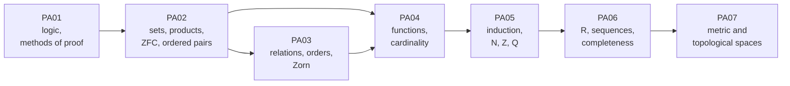

# Proofs, Analysis and Topology: Course Map

<span class="scope-taught">taught · in syllabus</span> <span class="scope-extra-book">extra · book</span>

Seven chapters that run from logic to topology: logic and methods of proof, sets and the ZFC foundations, relations and orders (with Zorn's lemma), functions and cardinality, induction and the number systems, the real numbers and sequences, metric and topological spaces. PA01–PA05 follow the instructor's **assignments 1–8** and the typed **lecture notes 17–20** plus the three instructor notes (tautology, ordered pairs, Zorn). PA06–PA07 (real analysis and topology) have **no lecture source in the folder** and are built from the AI-written monograph and the textbooks (🟡).

> [!warning] What is and is not in the sources
> - **Taught (🟢)**: statements, truth tables, tautologies, conditionals, quantifiers and negation (Assignments 1–2 and the Tautology note); sets, power sets, De Morgan, products, indexed families, Kuratowski pairs (Assignment 3 and the Ordered Pairs note); relations, equivalence relations, partitions, posets, extremal elements, Zorn's lemma and the existence of a basis (Assignment 4 and the Zorn note); congruences (Assignment 5); functions (Assignment 6); cardinality, countability, uncountability, Cantor's theorem, CH (Lectures 17–20, Assignments 7–8); induction (Assignment 8).
> - **Not in the folder**: **Lectures 1–16** (the logic, set, relation and function lectures; the AI notes say they are "based on the class notes and Assignments 1–4"), and any lecture on **sequences, completeness, metric spaces or topology**. The syllabus beyond Assignment 8 is unknown. **Ask the instructor** how far the course goes (is real analysis of sequences examinable? is topology only definitions?).
> - **AI sources**: `foundations-of-mathematical-reasoning.pdf` (98 pp., Parts I–III, "based on the class notes and Assignments 1–4") and `proofs-prems-topo.pdf` (107 pp., the same plus number systems, analysis, topology and solutions to Assignments 1–4). Used to cross-check and as the source for 🟡 material; their proofs of PA06–PA07 were read and rechecked.
> - `Assignments_5-7_Notes_and_Solutions.pdf` and `Solutions_Assignment_7.pdf` are AI-typeset solution notes (secondary).
> - **Misplaced file**: `ai-gen-notes/proofs tex/mt2113_week1/HANDOFF_mt2113_week1.md` is a handoff note for the **probability** week-1 notes (continuous random variables), not for this subject; its content is used in [[PR05 Continuous Random Variables]].
> - The textbooks (Munkres, Hatcher, Kumaresan et al., Sundstrom) were cited by section, not read in full.

## The storyline

Central thread: **statements and proofs (PA01) are about sets (PA02); sets carry relations and orders (PA03) and are compared by functions (PA04); the natural numbers satisfy induction (PA05) and are extended to the reals (PA06), whose completeness underlies limits, and abstracting "near" gives topology (PA07).**

## Chapters
| # | Chapter | Main sources | Status |
|---|---|---|---|
| 01 | [[PA01 Logic and Methods of Proof]] | Assignments 1–2; Tautology note; AI notes ch. 1–3 | draft |
| 02 | [[PA02 Sets Families and the ZFC Foundations]] | Assignment 3; Ordered Pairs note; AI notes ch. 4–6 | draft |
| 03 | [[PA03 Relations Equivalence and Order]] | Assignments 4–5; Zorn note; AI notes ch. 7–11 | draft |
| 04 | [[PA04 Functions and Cardinality]] | Assignments 6–8; Lectures 17–20 | draft |
| 05 | [[PA05 Induction and the Number Systems]] | Assignment 8; Lecture 18; AI notes ch. 12–14 | draft |
| 06 | [[PA06 The Real Numbers and Sequences]] | AI notes ch. 15–16 (🟡); Lecture 19 (decimals) | draft (🟡) |
| 07 | [[PA07 Metric and Topological Spaces]] | AI notes ch. 17–18 (🟡); Munkres, Hatcher | draft (🟡) |

```dataview
TABLE chapter AS "#", scope AS "Scope", status AS "Status"
FROM #subject/analysis AND #type/chapter
SORT chapter ASC
```

## Sources and what they are
| ID | File | What it is | Role |
|---|---|---|---|
| A1–A4 | [[Assignment-prems_merged.pdf]] | Assignments 4, 3, 2, 1 (PDF p.1–2, 3–4, 5–6, 7–8): posets and equivalence, sets, conditionals and quantifiers, truth tables | taught: PA01–PA03 |
| A5–A8 | [[Assignment-5.pdf]], [[Assignment-6.pdf]], [[Assignment-7.pdf]], [[Assignment-8.pdf]] | congruences; functions; countability; uncountability, Cantor, induction | taught: PA03–PA05 |
| L17–20 | [[Countable-Uncountable-sets.pdf]] | typed Lectures 17–20 (6 pp.): $\mathbb Q$ countable, finite sets, $(0,1)$ and $\mathbb R$ uncountable, CH | taught: PA04 |
| N | [[Tautology.pdf]], [[ordered pairs.pdf]], [[Zorn's_lemma.pdf]] | instructor notes (1, 8 and 5 pp.) | taught: PA01, PA02, PA03 |
| S | [[Solutions_Assignment_7.pdf]], [[Assignments_5-7_Notes_and_Solutions.pdf]] | AI-typeset solutions and notes for Assignments 5–7 | secondary |
| AI | `foundations-of-mathematical-reasoning.pdf`, `proofs-prems-topo.pdf` (+ `proofs tex/*.tex`) | AI monographs: logic to topology, with solutions to Assignments 1–4 | secondary; PA06–PA07 and extras |
| BK | Munkres *Topology*; Hatcher *Point-Set Topology*; Kumaresan et al.; Sundstrom *Mathematical Reasoning* | textbooks | extra/book (cited) |

## Gaps (to ask the instructor / supply later)
- **How far the course goes**: sequences and limits, completeness, metric spaces, topology.
- **Lectures 1–16**; the typed notes for logic, sets, relations, functions.
- Q5(a) of Assignment 4 ("lie on the same line"): the relation as written is trivial.
- Lecture 20 writes $|\mathbb R|=\mathfrak c=\aleph_1$ (CH itself).
- Assignment 8 and later: the second half of the course (after cardinality and induction) is not in the folder.

## Why this subject is tightly linked to the others
- **Probability:** events are sets (De Morgan, $|\mathcal P(S)|=2^{|S|}$), partitions give the law of total probability, countable additivity and uncountable sample spaces ($P[X=x]=0$), limits for continuity of probability and the LLN/CLT ([[Probability - Course Map]], [[PR01 Counting and the Axioms of Probability]], [[Continuity of Probability]]).
- **Quantum mechanics:** state spaces are complete inner-product spaces; Cauchy sequences of wavefunctions must converge ([[Quantum Mechanics - Course Map]]).
- **Thermodynamics:** thermal equilibrium is an equivalence relation, temperature labels the classes ([[TH01 Temperature and the Zeroth Law]]).
- **Ecology and climate:** recursions $N_{t+1}=g(N_t)$ are definitions by recursion; the IVT locates equilibria; fixed points ([[Fixed Points and Linear Stability]], [[Bistability and Tipping Points]], [[Jensen Inequality]]).
- **Foundations:** [[Gaussian Integral]], [[Dimensional Analysis]].

## Revision
- A printable formula sheet: [[pa-formula-sheet.pdf]] (2 pages).
- Practice with solutions lives at the end of each chapter (7 × 10 problems); the assignments themselves are worked in the chapters.

## Concept index
```dataview
LIST FROM #type/concept AND #subject/analysis SORT file.name ASC
```

See [[Subject Map]] for how this subject relates to the others and [[Roadmap]] for its place in the plan.
