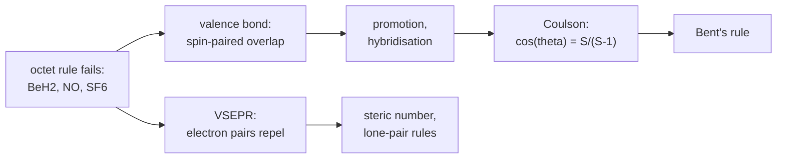

# CH01 · VSEPR and Valence Bond Theory

◀ [[Inorganic Chemistry - Course Map|Course Map]] · next: CH02 Molecular Orbital Theory (planned)

taught · in syllabus extra · book extra · beyond

> [!syllabus] Syllabus map: what is in the syllabus and what is extra in this chapter
> 🟢 **Taught (CH-2113 slides 1–26, instructor R. Boomi Shankar, [[chem pre-ms .pdf#page=1|pre-midsem pack]])**
> - §1 limits of the octet rule (slide 1)
> - §2 VSEPR: the assumption, steps, basic shapes, lone-pair and multiple-bond effects, the summary of rules (slides 2–7)
> - §3 valence bond theory: $\mathrm H_2$, $\mathrm N_2$, the failure for $\mathrm H_2\mathrm O$ and $\mathrm{NH_3}$ (slides 8–12); §4 promotion and hybridisation (slides 13–17)
> - §5 compositions of hybrids, **Coulson's relation** $\cos\theta=S/(S-1)$, non-equivalent hybrids (slides 18–22) with the two **take-home exercises** (ammonia; $\mathrm{CH_2F_2}$)
> - §6 hypervalence (slide 23); §7 **Bent's rule** and the energy of hybridisation (slides 24–26)
>
> 🟡 **Extra · book** (Shriver and Atkins, *Inorganic Chemistry* 5th ed., Ch. 2: Lewis structures PDF p.61, VSEPR [[Shriver and Atkins Inorganic Chemistry 5th Ed.pdf#page=63|pp.63–66]], valence bond theory [[Shriver and Atkins Inorganic Chemistry 5th Ed.pdf#page=66|pp.66–69]]; printed page = PDF page − 27)
> - the book's wording of the "ripples on a lake" picture of hybridisation and the potential-energy curve of $\mathrm H_2$
>
> 🔵 **Extra · beyond** (my additions, all numbers in `scripts/ch_numbers.py`)
> - §2 the steric-number table and the **90° repulsion count** that derives every lone-pair site rule; §3 the overlap integral and the normalised Heitler–London function; §5 the derivation of Coulson's relation, its use for $\mathrm{PH_3}$, $\mathrm{NF_3}$ and the take-home answers; §7 why heavy hydrides are almost pure $p$

> [!key] After this chapter you can
> - predict the shape of any main-group molecule or ion from its **steric number** $Z=\tfrac12(V+M+A-C)$ and the lone-pair rules, and say why a lone pair sits equatorially in a trigonal bipyramid,
> - write the valence-bond description of $\mathrm H_2$ and $\mathrm N_2$ and explain, with **promotion** and **hybridisation**, the 109.5° of $\mathrm{CH_4}$,
> - construct the four $sp^3$ hybrids, check they are orthonormal, and prove that two equivalent $s$–$p$ hybrids at angle $\theta$ have $s$ character $S=\cos\theta/(\cos\theta-1)$,
> - find the $s$ and $p$ character of the bonding and non-bonding hybrids of $\mathrm{H_2O}$ and $\mathrm{NH_3}$ (the instructor's take-home exercise),
> - state **Bent's rule** and use it for $\mathrm{PCl_2F_3}$ and $\mathrm{CH_2F_2}$, and explain why hypervalence does not require $d$ orbitals.

> [!intuition] The one-sentence story
> A bond is a pair of electrons that wants to be between two nuclei, and every pair of electrons wants to be as far from every other pair as possible; VSEPR uses only the second wish to get the **shape**, valence bond theory uses the first to get the **bond** and then bends the orbitals (hybridisation) until the shape comes out right.

<!-- intuition-v1 -->

*Concept map: how the ideas of this chapter depend on each other (read left to right; every box is a section).*

![[CH01 Models of Covalent Bonding.svg]]
*Diagram CH1.1. Three models, three questions. Editable source: [[CH01 Models of Covalent Bonding.excalidraw]].*

## 1. Why the octet rule is not enough
taught *[[chem pre-ms .pdf#page=1|slide 1]]*

The Lewis/octet picture fails in three ways: **(1) incomplete octets** ($\mathrm{LiCl}$, $\mathrm{BeH_2}$, $\mathrm{BCl_3}$), **(2) odd-electron molecules** (NO, $\mathrm{NO_2}$) and **(3) expanded octets** ($\mathrm{PCl_5}$, $\mathrm{SF_6}$, $\mathrm{H_2SO_4}$). It also cannot account for the **noble-gas compounds**, says nothing about **shape**, and says nothing about **relative stabilities or energies**. Three models repair this ([[Octet Rule and Its Limits]]): VSEPR for shape, valence bond (VB) theory for localised bonds and their energies, molecular orbital (MO) theory for delocalised orbitals, spectra and magnetism (Diagram CH1.1).

## 2. VSEPR: electron pairs repel
taught *slides 2–7, [[chem pre-ms .pdf#page=2|from slide 2]]* · extra · book *Shriver and Atkins §2.3, PDF pp.63–66*

> [!intuition] Tie balloons at a point
> Each region of electron density is a balloon: they push apart until the angles are as large as they can be. A lone pair is a fatter balloon (closer to the nucleus), so it squeezes the bonds and takes the roomy equatorial site.

> [!key] The assumption (slide 2)
> **Regions of enhanced electron density** (bonding pairs, lone pairs, and the electron concentration of a multiple bond) take up positions as far apart as possible, so that their mutual repulsion is minimal ([[VSEPR Model]]).

| Regions | Arrangement | Regions | Arrangement |
|---|---|---|---|
| 2 | linear | 5 | trigonal bipyramid |
| 3 | trigonal planar | 6 | octahedron |
| 4 | tetrahedron | 7 | pentagonal bipyramid |

**Steps** (slide 4): (1) count the valence electrons of the central and peripheral atoms that take part in bonding; (2) divide by two to get the electron pairs and read off the basic shape; (3) place the $\sigma$ bonds, lone pairs and multiple bonds; (4) a multiple bond is **one** region, along its $\sigma$ bond. The lecture's examples: $\mathrm{POCl_3}$ ($5+2+3=10$ electrons, minus one pair for the $\mathrm{P=O}$ double bond's second pair: **4 regions, tetrahedral**) and $\mathrm{SO_3^{2-}}$ ($6+6+2=14$ electrons, 7 pairs, minus 3 pairs for the three oxide ligands: 4 regions, basic tetrahedron, **trigonal pyramidal** shape).

> [!derivation] A counting formula for the steric number (consistent with slide 17)
> The number of regions $Z$ around the central atom is $Z=\tfrac12\,(V+M+A-C)$, where $V$ = valence electrons of the central atom, $M$ = number of monovalent atoms (H, F, Cl, ...), $A$ = anion charge, $C$ = cation charge; divalent atoms such as O count as 0. Slide 17 writes it in exactly this form: $\mathrm{SO_4^{2-}}$: $Z=\frac{6+0+2-0}2=4$; $\mathrm{CO_3^{2-}}$: $\frac{4+0+2-0}2=3$; $\mathrm{H_2O}$: bonding pairs 2 and lone pairs $\frac{6-1\times2}2=2$. The number of lone pairs is $Z$ minus the number of atoms attached. Applied to 29 species it reproduces 28 observed shapes (the exception is deliberate, see the end of this section):
>
> | Species | $Z$ | Lone pairs | Shape |
> |---|---|---|---|
> | $\mathrm{CH_4}$, $\mathrm{NH_4^+}$, $\mathrm{SO_4^{2-}}$, $\mathrm{POCl_3}$, $\mathrm{ClO_4^-}$ | 4 | 0 | tetrahedral |
> | $\mathrm{NH_3}$, $\mathrm{H_3O^+}$, $\mathrm{SO_3^{2-}}$, $\mathrm{ClO_3^-}$, $\mathrm{XeO_3}$ | 4 | 1 | trigonal pyramidal |
> | $\mathrm{H_2O}$ | 4 | 2 | bent |
> | $\mathrm{PCl_5}$ | 5 | 0 | trigonal bipyramidal |
> | $\mathrm{SF_4}$ | 5 | 1 | see-saw |
> | $\mathrm{ClF_3}$ | 5 | 2 | T-shaped |
> | $\mathrm{XeF_2}$, $\mathrm{I_3^-}$ | 5 | 3 | linear |
> | $\mathrm{SF_6}$ | 6 | 0 | octahedral |
> | $\mathrm{BrF_5}$, $\mathrm{XeOF_4}$ | 6 | 1 | square pyramidal |
> | $\mathrm{XeF_4}$, $\mathrm{ICl_4^-}$ | 6 | 2 | square planar |
> | $\mathrm{IF_7}$ | 7 | 0 | pentagonal bipyramidal |
> | $\mathrm{XeF_5^-}$ | 7 | 2 | pentagonal planar |

### 2.1 Modifications to the basic shape (slides 5–6)
The basic shape is then adjusted for the **unequal repulsions**: lone pair/lone pair $>$ lone pair/bond pair $>$ bond pair/bond pair. The lecture's reason: a lone pair is on average **closer to the nucleus** than a bond pair, so it repels the others more strongly; lone pairs therefore take the **larger sites** (the equatorial sites of a trigonal bipyramid), and when all sites are equal (octahedron) two lone pairs go **trans** to each other.

- **Tetrahedral family** (slide 6): $\mathrm{CH_4}$ no lone pair, 109.5°; $\mathrm{NH_3}$ one, 107°; $\mathrm{H_2O}$ two, 104.5° (Fig. CH1.1 C).
- **Trigonal family:** in $\mathrm{COF_2}$ the $\mathrm{C{=}O}$ double bond is shorter and "needs more angular volume", so the $\mathrm{O{=}C{-}F}$ angle opens.
- **Trigonal bipyramid:** $\mathrm{SF_4}$ puts its lone pair equatorially, with "two 90° interactions" instead of "three" (slide 5).

> [!derivation] Why equatorial? Counting the 90° contacts (🔵)
> In a trigonal bipyramid an axial site has **three** neighbours at 90° (the equatorial sites) and an equatorial site has **two** (the axial sites); 120° contacts are weaker. I counted the 90° lone pair/lone pair (ll) and lone pair/bond pair (lb) contacts for every placement, and the rule "fewest ll contacts at 90°, then fewest lb" gives every observed shape:
> - **1 lone pair:** axial $(0,3)$ against equatorial $(0,2)$ $\Rightarrow$ **equatorial** $\to$ see-saw ($\mathrm{SF_4}$);
> - **2 lone pairs:** both equatorial $(0,4)$, axial + equatorial $(1,3)$, both axial $(0,6)$ $\Rightarrow$ **both equatorial** $\to$ T-shaped ($\mathrm{ClF_3}$);
> - **3 lone pairs:** all equatorial $(0,6)$ against $(2,3)$, $(2,4)$ $\Rightarrow$ **all equatorial** $\to$ linear ($\mathrm{XeF_2}$, $\mathrm{I_3^-}$);
> - **octahedron, 2 lone pairs:** trans (180°) $(0,8)$ against cis $(1,6)$ $\Rightarrow$ **trans** $\to$ square planar ($\mathrm{XeF_4}$, $\mathrm{ICl_4^-}$).
> ($(\mathrm{ll},\mathrm{lb})$ = number of 90° contacts; checked by enumerating all placements, `scripts/ch_numbers.py`.) This is a crude energy proxy, not a calculation, but it ranks the arrangements correctly because a lone pair/lone pair contact at 90° costs the most.

> [!example] The slide's three trigonal-bipyramid-derived structures
> Slide 6 lists axial F–S–F angles of $179^\circ,\ 178.5^\circ,\ 170^\circ$ and equatorial angles $103^\circ,\ 110^\circ,\ 97^\circ$ for three drawn structures. The structures are **images** (no labels in the text layer), so I cannot say which species they are; the trend shown is that the axial bonds bend **away** from the equatorial lone pair, and the angles fall below the ideal 180° and 120°. `[verify]` against the original slide.

### 2.2 Summary of the lecture's rules (slide 7)
Pairs minimise repulsion; ll $>$ lb $>$ bb; lone pairs make angles smaller than predicted and choose the **larger sites**; **double bonds occupy more space**; **electronegative substituents occupy less space** than electropositive ones (Bent's rule, §7); and **lone pairs are stereochemically less influential in heavy elements**: octahedral $[\mathrm{SeF_6}]^{2-}$ and $[\mathrm{TeCl_6}]^{2-}$ have a lone pair that sits in a spherical, non-directional $s$ orbital, whereas $[\mathrm{XeF_5}]^-$ is **pentagonal planar** with two axial lone pairs (steric number 7, $Z=\frac{8+5+1}2$). The counting formula gives $Z=7$ and one lone pair for $[\mathrm{SeF_6}]^{2-}$, so a purely "VSEPR" prediction would be a distorted octahedron; the observed regular octahedron is the one exception in the table ([[Lone Pair Stereochemical Activity]]).

> [!pitfall] VSEPR gives geometry, not energies, and not for every metal
> VSEPR says nothing about bond strengths and fails for many transition-metal compounds (ligand-field effects). Its power is for main-group $\mathrm{AX_nE_m}$ species ([[VSEPR Model]], [[Steric Number]]).

## 3. Valence bond theory
taught *slides 8–12* · extra · book *Shriver and Atkins, PDF pp.66–68* · extra · beyond *overlap and normalisation*

> [!intuition] A bond is two electrons sitting between two nuclei
> Valence bond theory writes Lewis's electron pair as a wave function: the electrons are shared in the overlap region, with opposite spins. More overlap, stronger bond.

VB theory is "the first quantum-mechanical theory of bonding", a way of writing Lewis's electron pairs as **wave functions**; MO theory largely superseded it but its language (σ, π, hybrids) survives ([[Valence Bond Theory]]).

> [!key] The hydrogen molecule (slide 10)
> For two distant atoms $\psi=\chi_A(1)\chi_B(2)$. When they are close one cannot tell which electron is on which atom, and quantum mechanics says to **superpose the indistinguishable outcomes**:
> $$\psi=\chi_A(1)\chi_B(2)+\chi_A(2)\chi_B(1)\qquad(\text{un-normalised Heitler–London function}).$$
> By Pauli's principle only **paired spins** can be described by this (spatially symmetric) function; it is the $\sigma$ bond, which has cylindrical symmetry and zero orbital angular momentum about the axis ([[Heitler-London Wavefunction]]).

> [!derivation] Normalisation and the overlap integral (🔵)
> With $S=\langle\chi_A|\chi_B\rangle$ and normalised $1s$ orbitals, $\langle\psi|\psi\rangle=2(1+S^2)$, so $N=1/\sqrt{2(1+S^2)}$. For $1s$ orbitals $S(R)=e^{-R}\big(1+R+\tfrac{R^2}3\big)$ ($R$ in Bohr radii). I checked this closed form against a numerical 3-D integral: $S=0.858385,\ 0.752943,\ 0.586453,\ 0.189262$ at $R=1,\ 1.4,\ 2,\ 4\,a_0$ (identical to six digits). At the experimental bond length $r_e=0.74$ Å $=1.398\,a_0$: $S=0.7534$ and $N=0.5648$ ($N^2=0.3190$). The overlap is large, which is why the "extra" $S^2$ matters in the normalisation.

**The energy curve** (slide 10, [[Shriver and Atkins Inorganic Chemistry 5th Ed.pdf#page=67|S&A p.40]]): the energy falls when the atoms are close enough for each electron to wander onto the other atom, and rises steeply at short range because of nuclear repulsion; "the deeper the minimum, the stronger the bond". The lecture quotes a dissociation energy of **4.5 eV (434 kJ/mol)** for $\mathrm H_2$ ($4.5\times96.485=434.2$ ✓).

**$\mathrm N_2$ (slide 11).** Each N has $2s^22p_x^12p_y^12p_z^1$; take $z$ as the axis. Spin-pairing of the two opposed $2p_z$ electrons gives the $\sigma$ bond. The $2p_x$ and $2p_y$ orbitals are perpendicular to the axis, **cannot** give cylindrical $\sigma$ overlap, and overlap side-by-side to give **two $\pi$ bonds**: $\mathrm{N{\equiv}N}$ = one $\sigma$ + two $\pi$.

**The first problem (slide 12).** Each $\sigma$ bond forms by spin pairing of electrons in neighbouring atomic orbitals of the right symmetry. For $\mathrm{H_2O}$ ($2s^22p_x^22p_y^12p_z^1$) the two half-filled $2p$ orbitals are at 90°, so VB without refinement predicts $\mathrm{H{-}O{-}H}=90^\circ$; $\mathrm{NH_3}$ would also give 90°. The observed angles are 104.5° and 107°. The discrepancy is the reason for hybridisation.

## 4. Promotion and hybridisation
taught *slides 13–17* · extra · book *Shriver and Atkins Ch. 2, "Valence bond theory": promotion PDF p.68, hybridization p.69*

> [!intuition] Hybrids are orbitals pointed at the bonds
> Mixing $s$ and $p$ on one atom gives lobes that point towards the neighbours and overlap better than pure $s$ or $p$; the energy cost of promotion is repaid by the stronger bonds.

**Promotion (slide 13).** Carbon's ground configuration $2s^22p^2$ suggests two bonds; $\mathrm{CH_4}$ needs four. Promoting an electron, $2s^22p^2\to2s^12p_x^12p_y^12p_z^1$, "requires an investment of energy, [but] it is worthwhile if the energy can be more than recovered from the greater strength of the number of bonds". For carbon the cost is small and is repaid by forming four bonds and by relieving the $2s$ electron–electron repulsion ([[Promotion Energy]]).

> [!key] Hybridisation (slide 14, the "ripples" picture)
> For $\mathrm{AB_4}$ one would expect three equal bonds from $A\,2p$ and one different bond from $A\,2s$. All the evidence (bond length, strength, shape) says the four are **equivalent**. The electron density of the promoted atom is the same as that from each electron occupying a **hybrid** formed by interference of $A\,2s$ and $A\,2p$ (constructive and destructive interference of "ripples" gives four new shapes) ([[Hybridisation]]):
> $$h_1=s+p_x+p_y+p_z,\quad h_2=s-p_x-p_y+p_z,\quad h_3=s-p_x+p_y-p_z,\quad h_4=s+p_x-p_y-p_z$$
> each with a normalisation factor $\tfrac12$ (the slide omits it). Each is a large lobe along one corner of a tetrahedron plus a small lobe on the other side. The axes of the lobes make $\theta=\cos^{-1}(-\tfrac13)=109.47^\circ$.

> [!derivation] Orthonormality and angles, checked (🔵)
> The coefficient matrix $\tfrac12\begin{pmatrix}1&1&1&1\\1&-1&-1&1\\1&-1&1&-1\\1&1&-1&-1\end{pmatrix}$ satisfies $HH^{\mathsf T}=I$ (checked), so the four $sp^3$ hybrids are **orthonormal**, each is 25 % $s$ and 75 % $p$, and the $p$-direction vectors $(1,1,1),(-1,-1,1),(-1,1,-1),(1,-1,-1)$ all make $109.47^\circ$ with each other. The $sp^2$ set $\tfrac1{\sqrt3}s+\sqrt{\tfrac23}p_x$ etc. is also orthonormal with $120.00^\circ$ angles, and $sp$: $(s\pm p_z)/\sqrt2$ gives $180^\circ$.

Why hybridisation raises bond strength (slide 15): a hybrid has **pronounced directional character** and **larger amplitude in the internuclear region**, so overlap with the partner orbital is better than with a pure $s$ or $p$ orbital. Slide 15's table of hybrid sets by coordination number:

| C.N. | Shape | Hybrid sets |
|---|---|---|
| 2 | linear | $sp$, $pd$, $sd$ |
| 2 | angular | $sp$, $sd$ |
| 3 | trigonal planar | $sp^2$, $p^2d$ |
| 3 | trigonal pyramidal | $sp^2$, $pd^2$ |
| 4 | tetrahedral | $sp^3$, $sd^3$ |
| 4 | square planar | $p^2d^2$, $sp^2d$ |
| 5 | trigonal bipyramid | $sp^3d$, $spd^3$ |
| 6 | octahedron | $sp^3d^2$ |
| 6 | trigonal prism | $spd^4$, $pd^5$ |

(Copied as printed on slide 15. Two entries look odd: an "angular" molecule from the linear-looking sets $sp$, $sd$, and a "trigonal pyramidal" molecule from $sp^2$, whereas the steric-number rule of the next paragraph assigns $sp^3$ to $\mathrm{AB_3L}$. They are probably slips or a different convention for counting the lone pair; `[verify]` with the instructor.)

**Combining VSEPR with hybridisation (slides 16–17).** The steric number $Z$ fixes the hybrid: $Z=4\Rightarrow sp^3$ ($\mathrm{SO_4^{2-}}$, and also $\mathrm{H_2O}$: $\mathrm{AB_2L_2}$, bent, $sp^3$), $Z=3\Rightarrow sp^2$ ($\mathrm{CO_3^{2-}}$), $Z=2\Rightarrow sp$, $Z=5\Rightarrow sp^3d$, $Z=6\Rightarrow sp^3d^2$.

> [!pitfall] "$sp^3$" is a label for the electron-pair arrangement, not a measured fact
> $\mathrm{H_2O}$ is called $sp^3$ because $Z=4$, yet its bond angle is not 109.5° and, as §5 shows, the bonding hybrids are $sp^{4.0}$ and the lone-pair hybrids $sp^{2.3}$. The label gives the **number** of hybrids, not their exact composition.

## 5. Composition of hybrids: Coulson's relation
taught *slides 18–22 and the take-home exercise* · extra · beyond *the derivation and the extra molecules*

> [!intuition] More $s$ means a wider angle
> Orthogonality of two equivalent hybrids forces $\cos\theta=S/(S-1)$: $s$-richer hybrids spread out ($sp$ 180°, $sp^2$ 120°, $sp^3$ 109.5°); $p$-richer ones close up towards 90°.

Most hybridisations give **equivalent** orbitals (identical $s$/$p$ composition and orientation): tetrahedral and octahedral molecules. In $dsp^3$ **trigonal bipyramids** the hybrids are not equivalent: **three strong equatorial bonds** ($sp^2$, trigonal) and **two weaker axial bonds** ($dp$, linear); the square pyramid is a square-planar $dsp^2$ set plus a $p_z$ (slide 19).

> [!key] Coulson's relation (slide 19)
> For two or more **equivalent** $s$–$p$ hybrid orbitals with fractional $s$ character $S$ and $p$ character $P=1-S$, the angle $\theta$ between them satisfies
> $$\boxed{\ \cos\theta=\frac S{S-1}=-\frac SP\ }$$
> ([[Coulson's Theorem]]). For $\mathrm{CH_4}$ ($S=0.25$): $\cos\theta=\frac{0.25}{-0.75}=-0.333$, $\theta=109.5^\circ$.

> [!derivation] Where it comes from (🔵)
> Write two hybrids pointing along unit vectors $\hat a,\hat b$ at angle $\theta$: $h_a=\sqrt S\,s+\sqrt P\,p_{\hat a}$ and $h_b=\sqrt S\,s+\sqrt P\,p_{\hat b}$, where $p_{\hat a}$ is the $p$ orbital along $\hat a$. They must be **orthogonal** (different orbitals of the same atom): $\langle h_a|h_b\rangle=S+P\,(\hat a\cdot\hat b)=S+(1-S)\cos\theta=0$, i.e. $\cos\theta=-S/(1-S)$. Limits: $S=\tfrac12$ gives $180^\circ$ ($sp$), $S=\tfrac13$ gives $120^\circ$ ($sp^2$), $S=\tfrac14$ gives $109.47^\circ$ ($sp^3$), $S=0$ gives $90^\circ$ (pure $p$) (Fig. CH1.1 A). Hybridisation index: $sp^n$ with $n=(1-S)/S$, so $n=1,2,3,\infty$.

![[fig_ch01_hybrids.png]]
*Figure CH1.1. A: the angle between two equivalent hybrids against their $s$ character (Coulson); the water points are computed in the next callout. B: the polar shape $|h(\vartheta)|^2$ of $sp$, $sp^2$, $sp^3$ and $p$: less $s$ character, smaller back lobe. C: the angle falls as lone pairs are added to the tetrahedral family, with the $s$ character of the bonds.*

> [!example] Non-equivalent hybrids: water (slides 21–22, reproduced and checked)
> $\mathrm{H_2O}$ uses bonding orbitals "midway between pure $p$ and $sp^3$". The angle between the **bonding** subset is 104.5°, so $\cos104.5^\circ=-0.25=\frac S{S-1}$ gives **$S=0.20$: 20 % $s$, 80 % $p$** (exact: $S=0.2002$, i.e. $sp^{3.99}$). The totals over all four orbitals must be $s=1$ and $p=3$:
> $p$: $0.80+0.80+x+x=3\Rightarrow x=0.70$ (the non-bonding hybrids are **70 % $p$**); $s$: $0.20+0.20+y+y=1\Rightarrow y=0.30$ (**30 % $s$**). The angle between the lone-pair hybrids is
> $$\cos\theta=\frac{0.30}{0.30-1}=-0.4286\ \Rightarrow\ \theta=115.37^\circ$$
> (slide; exact values $S_{\rm lp}=0.2998$ and $115.35^\circ$). So the lone pairs are **$s$-richer** than the bonds. This is the result that makes Bent's rule (§7) quantitative.

> [!example] Take-home 1: ammonia (my answer)
> $\mathrm{NH_3}$ has three equivalent bonding hybrids and one lone pair. With $\angle\mathrm{HNH}=107^\circ$ (slide): $S_{\rm bond}=\frac{\cos107^\circ}{\cos107^\circ-1}=0.2262$, i.e. **22.6 % $s$, 77.4 % $p$** ($sp^{3.42}$). The lone pair takes what is left, $1-3(0.2262)=0.3214$: **32.1 % $s$, 67.9 % $p$** ($sp^{2.11}$). With the more precise $107.8^\circ$ (recalled, `[verify]`): bonds $23.4\%$ $s$, lone pair $29.8\%$ $s$. The lone pair is again the $s$-richer hybrid, which is why it is the **HOMO** and concentrated on N (the photoelectron assignment of CH03).

> [!example] Take-home 2: $\mathrm{CH_2F_2}$ with VSEPR and with Bent's rule (my answer)
> **VSEPR:** four regions, tetrahedral; there is no lone pair, so the only effect is the different repulsion of the C–F and C–H bond pairs. **Bent's rule (§7):** the electronegative F draws the C–F bonding pair towards F and uses a carbon hybrid **poor in $s$** (more $p$); the C–H bonds therefore use hybrids **richer in $s$**. Poorer-$s$ hybrids close the angle (Coulson), richer-$s$ hybrids open it: **$\angle\mathrm{FCF}<109.5^\circ<\angle\mathrm{HCH}$**. Numbers: if $\angle\mathrm{FCF}=108.3^\circ$ (recalled `[verify]`), $S_{\rm CF}=0.239$, so the C–H hybrids have $S=\frac{1-2(0.239)}2=0.261$ and $\angle\mathrm{HCH}=110.7^\circ$. The literature value is larger (about $113^\circ$, recalled `[verify]`); the simple model gets the **direction** and the order of magnitude right, not the full size.

> [!pitfall] Coulson's relation needs equivalent hybrids and pure $s$–$p$
> If $d$ orbitals take part, or no two orbitals are equivalent (the trigonal bipyramid), "the calculation of $s$ and $p$ character is more difficult" (slide 22). There is no unique symmetric set of equivalent orbitals for five-coordination.

## 6. Hypervalence
taught *slide 23*

Period-2 elements obey the octet; later ones do not: P in $\mathrm{PCl_5}$ has 10 electrons, S in $\mathrm{SF_6}$ 12 ([[12-Inorganic-Chemistry/Concepts/Hypervalence|Hypervalence]]). The **traditional** explanation uses low-lying $d$ orbitals (P can exceed eight electrons by using $3d$). The lecture adds two cautions: the **absence of a $2d$ shell is not the only reason** the effect is rare in period 2 (**geometric difficulty of packing more than four atoms** round a small atom matters too), and **MO theory describes hypervalent compounds without invoking $d$-orbital participation** (CH03, $\mathrm{SF_6}$ by ligand-group orbitals). The modern view is that $d$ orbitals are energetically too high to be important.

## 7. Bent's rule and the energy of hybridisation
taught *slides 24–26* · extra · beyond *the heavy-hydride numbers*

> [!intuition] Electronegative groups prefer the $p$-rich orbitals
> Putting the bonding electrons in orbitals with little $s$ character keeps the low-energy $s$ electrons on the central atom: so electronegative substituents take the $p$-rich (axial) sites, and angles close up.

> [!key] Bent's rule (slide 26)
> **More electronegative substituents prefer hybrid orbitals with less $s$ character, and more electropositive substituents prefer hybrids with more $s$ character.** ([[Bent's Rule]])

**The energy argument (slides 24–25).** The energy of a hybrid set is the **weighted average** of the energies of its atomic orbitals. For **carbon** a promotion energy is paid anyway, independent of the hybridisation, so $sp^3$ costs nothing extra. For **phosphorus** there is little or no promotion energy: hybridising raises the filled $3s$ and lowers the half-filled $3p$ for no gain. The "energy of hybridisation" is of the order of a bond energy (the lecture quotes **about 600 kJ/mol** to hybridise a central P atom, and higher for heavier congeners) and so decides structures; it is also why **some lone pairs prefer the spherical, non-directional $s$ orbital** to a hybrid.

- **High promotion energy and good overlap: $s$-rich hybrids. Poor overlap and low promotion energy: $p$-rich hybrids.**
- The $sp^3d$ set can be viewed as $p_zd_{z^2}$ **axial** hybrids (two linear, weaker bonds) plus $sp_xp_y$ **equatorial** ($sp^2$, three trigonal, stronger bonds).

> [!example] $\mathrm{PCl_xF_{5-x}}$: the electronegative substituent sits axial (slide 26)
> The more electronegative F occupies the **axial** ($dp$, 0 % $s$) positions, the less electronegative Cl the **equatorial** ($sp^2$, 33 % $s$) positions: $\mathrm{PCl_2F_3}$ has **two axial F**, one equatorial F and two equatorial Cl (the structure observed for this molecule). That is Bent's rule: F takes the orbitals with least $s$ character.

> [!example] Heavy hydrides: nearly pure $p$ (🔵, computed)
> With Coulson's relation and literature angles (recalled, `[verify]`): $\mathrm{NH_3}$ 107.8°: bonds $23.4\%$ $s$, lone pair $29.8\%$ $s$. $\mathrm{PH_3}$ 93.5°: bonds $5.8\%$ $s$ ($sp^{16}$), **lone pair $82.7\%$ $s$**. $\mathrm{AsH_3}$ 92.0°: bonds $3.4\%$ $s$, lone pair $89.9\%$ $s$. The bonds are almost pure $p$ (angles near 90°) and the lone pair is almost a pure, spherical $s$ orbital: the lecture's statements that P has no promotion energy to repay, and that lone pairs of heavy elements are "stereochemically less influential" ([[Lone Pair Stereochemical Activity]]). **Bent's rule in a single molecule:** $\mathrm{NF_3}$ (102.3°, recalled `[verify]`) has bonds of only $17.6\%$ $s$ against $23.4\%$ for $\mathrm{NH_3}$: F draws the bond towards itself, the N–F hybrids are $p$-richer, and the angle closes by about 5°.

## Map of this chapter
> [!connection] How CH01 connects
> **Builds on:** [[QM04 The Particle in a Box]] and [[QM06 The Oscillator Toolbox]] (quantum numbers, superposition of indistinguishable outcomes, orthonormal functions), [[QM03 States Operators and Measurement]] (orthogonality).
> **Leads to:** CH02 molecular orbital theory (delocalised alternatives, hypervalence without $d$ orbitals), then acids and bases and main-group clusters (the shapes of boranes, phosphorus cages).
> **Concepts:** [[Octet Rule and Its Limits]] · [[VSEPR Model]] · [[Steric Number]] · [[Lone Pair Stereochemical Activity]] · [[Valence Bond Theory]] · [[Heitler-London Wavefunction]] · [[Promotion Energy]] · [[Hybridisation]] · [[Coulson's Theorem]] · [[Bent's Rule]] · [[12-Inorganic-Chemistry/Concepts/Hypervalence|Hypervalence]]
> **Other subjects:** [[QM01 From Waves to Probabilities]] (Born rule, indistinguishable outcomes), [[PA01 Logic and Methods of Proof]] (counting arguments), [[Group Theory - Course Map]] (point groups, symmetry-adapted orbitals), [[PR01 Counting and the Axioms of Probability]] (the 90° counts are a small enumeration).

## Summary
> [!summary] Cheat-sheet
> - **Octet fails:** incomplete ($\mathrm{BeH_2}$, $\mathrm{BCl_3}$), odd electron (NO), expanded ($\mathrm{PCl_5}$, $\mathrm{SF_6}$).
> - **VSEPR:** regions $Z=\frac12(V+M+A-C)$ $\to$ 2 linear, 3 trigonal planar, 4 tetrahedral, 5 TBP, 6 octahedral, 7 PBP; ll > lb > bb; lone pairs take larger sites (TBP equatorial, octahedral trans); double bonds take more room; electronegative substituents take less room; heavy-element lone pairs are inert. $\mathrm{CH_4}$ 109.5°, $\mathrm{NH_3}$ 107°, $\mathrm{H_2O}$ 104.5°.
> - **VB:** $\psi_{\mathrm{H_2}}=\chi_A(1)\chi_B(2)+\chi_A(2)\chi_B(1)$, paired spins, $N=1/\sqrt{2(1+S^2)}$; $D=4.5$ eV (434 kJ/mol). $\mathrm N_2$: $1\sigma+2\pi$. Pure VB gives $90^\circ$ for $\mathrm{H_2O}$ and $\mathrm{NH_3}$: the reason for **promotion** and **hybridisation**.
> - **Hybrids:** $sp^3$ ($25\%$ $s$, 109.47°), $sp^2$ (33 %, 120°), $sp$ (50 %, 180°); $dsp^3$ TBP = 3 equatorial $sp^2$ + 2 axial $dp$. **Coulson:** $\cos\theta=\frac S{S-1}$.
> - **Water:** bonds $20\%$ $s$ / $80\%$ $p$ ($sp^{4.0}$), lone pairs $30\%$ $s$ / $70\%$ $p$, lone-pair angle $115.4^\circ$. **Ammonia:** bonds $22.6\%$ $s$, lone pair $32.1\%$ $s$.
> - **Bent's rule:** electronegative substituent $\to$ less $s$ (axial in $\mathrm{PCl_2F_3}$, $\angle\mathrm{FCF}<\angle\mathrm{HCH}$ in $\mathrm{CH_2F_2}$); heavy hydrides: $\mathrm{PH_3}$ bonds $\approx$ pure $p$, lone pair $83\%$ $s$.
> - **Hypervalence:** $d$-orbital explanation is traditional; packing and MO theory matter more.

## Practice
1. **Shapes.** Give the steric number, lone pairs and shape of $\mathrm{ClF_3}$, $\mathrm{BrF_5}$, $\mathrm{XeF_4}$, $\mathrm{ICl_4^-}$, $\mathrm{SO_3^{2-}}$, $\mathrm{I_3^-}$ and $\mathrm{XeO_3}$.
2. **Lone-pair site.** Explain with 90° contact counts why $\mathrm{SF_4}$'s lone pair is equatorial and why $\mathrm{XeF_4}$ is square planar.
3. **POCl$_3$ and SO$_3^{2-}$.** Reproduce the lecture's electron counts (10 and 14 valence electrons) and name the shapes.
4. **Coulson.** Derive $\cos\theta=S/(S-1)$ and use it to find the $s$ character that gives $109.47^\circ$, $120^\circ$ and $180^\circ$.
5. **Water.** From $\angle\mathrm{HOH}=104.5^\circ$ find the $s$ and $p$ character of the bonding and lone-pair hybrids and the lone-pair angle.
6. **Ammonia (take-home).** Do the same for $\mathrm{NH_3}$ with $\angle\mathrm{HNH}=107^\circ$.
7. **$\mathrm{PH_3}$.** With $\angle\mathrm{HPH}=93.5^\circ$ find the $s$ character of the bonds and of the lone pair. What does it say about hybridisation in the heavier hydrides?
8. **Bent's rule.** Which isomer of $\mathrm{PCl_2F_3}$ is observed, and why? Predict the order of $\angle\mathrm{HCH}$ and $\angle\mathrm{FCF}$ in $\mathrm{CH_2F_2}$.
9. **Orthonormality.** Show that $h_1=\tfrac12(s+p_x+p_y+p_z)$ and $h_2=\tfrac12(s-p_x-p_y+p_z)$ are orthogonal and find the angle between their lobes.
10. **Heitler–London.** Normalise $\chi_A(1)\chi_B(2)+\chi_A(2)\chi_B(1)$ and evaluate the constant for $r_e=0.74$ Å given $S=0.7534$.

> [!example]- Solutions
> 1. $\mathrm{ClF_3}$: $Z=\frac{7+3}2=5$, 2 lone pairs, **T-shaped**. $\mathrm{BrF_5}$: $Z=\frac{7+5}2=6$, 1 lone pair, **square pyramidal**. $\mathrm{XeF_4}$: $Z=\frac{8+4}2=6$, 2 lone pairs, **square planar**. $\mathrm{ICl_4^-}$: $Z=\frac{7+4+1}2=6$, 2 lone pairs, **square planar**. $\mathrm{SO_3^{2-}}$: $Z=\frac{6+0+2}2=4$, 1 lone pair, **trigonal pyramidal**. $\mathrm{I_3^-}$: $Z=\frac{7+2+1}2=5$, 3 lone pairs, **linear**. $\mathrm{XeO_3}$: $Z=\frac{8+0}2=4$, 1 lone pair, **trigonal pyramidal**.
> 2. TBP, one lone pair: axial gives three 90° lb contacts, equatorial two, so the lone pair is equatorial (see-saw). Octahedron with two lone pairs: cis puts them at 90° (one ll contact, the costliest), trans puts them at 180° with no ll contact, so trans, and the four bonds are coplanar.
> 3. $\mathrm{POCl_3}$: $5+2+3=10$ electrons, 5 pairs; one pair is used for the extra bond of $\mathrm{P=O}$, leaving 4 regions: tetrahedral. $\mathrm{SO_3^{2-}}$: $6+6+2=14$ electrons, 7 pairs; 3 pairs go to the three oxide ligands, leaving 4 regions with 1 lone pair: basic shape tetrahedral, actual shape trigonal pyramidal.
> 4. See §5: orthogonality $S+(1-S)\cos\theta=0$. $\theta=109.47^\circ\to S=\frac14$ ($\cos=-\frac13$); $120^\circ\to S=\frac13$ ($\cos=-\frac12$); $180^\circ\to S=\frac12$ ($\cos=-1$).
> 5. $S_{\rm bond}=\frac{\cos104.5^\circ}{\cos104.5^\circ-1}=\frac{-0.2504}{-1.2504}=0.2002$ (20 % $s$, 80 % $p$, $sp^{3.99}$); each lone-pair hybrid has $\frac{1-2(0.2002)}2=0.2998$ $s$ and $0.7002$ $p$; $\cos\theta=\frac{0.2998}{-0.7002}=-0.4281$, $\theta=115.35^\circ$ (slide with rounded 20/30: $115.37^\circ$).
> 6. $S_{\rm bond}=\frac{-0.2924}{-1.2924}=0.2262$; $p=0.7738$. Lone pair: $s=1-3(0.2262)=0.3214$, $p=3-3(0.7738)=0.6786$ ✓ ($0.3214+0.6786=1$).
> 7. $\cos93.5^\circ=-0.0610$: $S_{\rm bond}=\frac{0.0610}{1.0610}=0.0575$ (5.8 % $s$, $sp^{16}$); lone pair $s=1-3(0.0575)=0.827$. Almost pure $p$ bonds with an $s$-rich, non-directional lone pair: heavier hydrides do not hybridise (no promotion energy to recover, §7).
> 8. $\mathrm{PCl_2F_3}$: the two axial positions (weaker, 0 % $s$ $dp$) are occupied by the most electronegative substituent, F; the third F and the two Cl are equatorial. $\mathrm{CH_2F_2}$: $\angle\mathrm{FCF}<109.5^\circ<\angle\mathrm{HCH}$ (F is electronegative: $p$-rich C–F hybrids, $s$-rich C–H hybrids).
> 9. $\langle h_1|h_2\rangle=\tfrac14(1-1-1+1)=0$ (orthonormal $s,p_x,p_y,p_z$). The $p$ parts are along $(1,1,1)$ and $(-1,-1,1)$: $\cos\theta=\frac{-1-1+1}{3}=-\frac13$, $\theta=109.47^\circ$.
> 10. $\langle\psi|\psi\rangle=\langle\chi_A\chi_B|\chi_A\chi_B\rangle+\langle\chi_B\chi_A|\chi_B\chi_A\rangle+2\langle\chi_A(1)\chi_B(2)|\chi_A(2)\chi_B(1)\rangle=1+1+2S^2$ with $S=\langle\chi_A|\chi_B\rangle$, so $N=\frac1{\sqrt{2(1+S^2)}}$; for $S=0.7534$: $N=\frac1{\sqrt{2(1.5676)}}=0.5648$.

> [!connection] Group theory used here
> The shape of a molecule is a point group, equivalent ligands an orbit of that group: [[GT05 Actions Conjugation and Sylow Theorems]], [[GT10 Symmetry Representations and Characters]]; see [[Where Groups Appear in the Vault]].

## Provenance
> [!provenance]- Source map for this chapter
> | Topic | Source | Scope |
> |---|---|---|
> | octet limits; VSEPR assumption, steps, basic shapes | [[chem pre-ms .pdf#page=1\|slides 1–4]] | taught |
> | modifications, lone-pair rules, summary of rules, heavy-element exceptions | [[chem pre-ms .pdf#page=5\|slides 5–7]] | taught |
> | VB theory, $\mathrm H_2$, $\mathrm N_2$, polyatomic failure | [[chem pre-ms .pdf#page=9\|slides 9–12]] | taught |
> | promotion, hybridisation, hybrid sets, steric number formula | [[chem pre-ms .pdf#page=13\|slides 13–17]] | taught |
> | composition of hybrids, Coulson, water, take-home exercises | [[chem pre-ms .pdf#page=18\|slides 18–22]] | taught |
> | hypervalence; Bent's rule and hybridisation energy | [[chem pre-ms .pdf#page=23\|slides 23–26]] | taught |
> | VSEPR, VB theory and hybridisation in the textbook | Shriver and Atkins Ch. 2, [[Shriver and Atkins Inorganic Chemistry 5th Ed.pdf#page=63\|PDF pp.63–69]] (page anchors found by text search) | extra/book |
> | steric-number table, 90° counts, orthonormality, overlap integral, take-home answers, heavy hydrides | `scripts/ch_numbers.py` | extra/beyond |
>
> **Notes.** (1) The slides are text with embedded diagrams; the pictures (the three TBP-derived structures of slide 6, the $\mathrm H_2$ energy curve) have no text layer and were not read. (2) Slide 12 writes $\mathrm{NH_3}$ as 107°; the literature value is about 107.8° (recalled). (3) Literature angles for $\mathrm{PH_3}$, $\mathrm{AsH_3}$, $\mathrm{NF_3}$ and $\mathrm{CH_2F_2}$ are recalled, not checked against a source in the folder. (4) The other tool's note for this course lists MO theory before Part 2 as "no notes yet": CH02 will cover it. (5) The fuller exam picture of CH2113 (Quiz 1 up to and including MO theory; Quiz 2 on redox) is in [[Inorganic Chemistry - Course Map]].

**References.** Shriver, D. F. and Atkins, P. W. *Inorganic Chemistry* (5th ed.), Ch. 2 · Gillespie, R. J. and Nyholm, R. S. (1957) *Inorganic stereochemistry*, Q. Rev. Chem. Soc. 11, 339 · Coulson, C. A. (1961) *Valence* (2nd ed.) · Bent, H. A. (1961) *An appraisal of valence-bond structures and hybridization in compounds of the first-row elements*, Chem. Rev. 61, 275 · Heitler, W. and London, F. (1927) Z. Phys. 44, 455.
