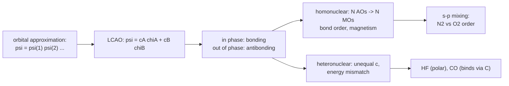

# CH02 · Molecular Orbital Theory: Diatomics

◀ [[CH01 VSEPR and Valence Bond Theory]] · [[Inorganic Chemistry - Course Map|Course Map]] · next: [[CH03 Molecular Orbital Theory Polyatomics]]

taught · in syllabus extra · book extra · beyond

> [!syllabus] Syllabus map: what is in the syllabus and what is extra in this chapter
> 🟢 **Taught (CH-2113 slides 27–39, instructor R. Boomi Shankar, [[chem pre-ms .pdf#page=27|pre-midsem pack]])**
> - §1 why MO theory (slide 28: VB is reasonable but cannot handle polyatomics elegantly; MOT is a more sophisticated model with electrons spread over the molecule), what is covered (slide 29)
> - §2 the two approximations: orbital approximation and LCAO (slide 30)
> - §3 the coefficients, interference, $\psi_\pm=\chi_A\pm\chi_B$, bonding versus antibonding, the $\mathrm H_2$ numbers 11.4 eV and 4.5 eV (slides 31–33)
> - §4 homonuclear diatomics: eight MOs from four AOs per atom; $\mathrm{N_2}$ in detail; the two orderings for Li$_2$–N$_2$ and O$_2$–F$_2$ (slides 34–35)
> - §5 heteronuclear diatomics: unequal coefficients, energy mismatch, CO (1070 kJ/mol) against $\mathrm{N_2}$ (946), **HF**, **CO**, **ICl as the take-home exercise** (slides 36–39)
>
> 🟡 **Extra · book** (Shriver and Atkins 5th ed., Ch. 2: homonuclear diatomics [[Shriver and Atkins Inorganic Chemistry 5th Ed.pdf#page=72|PDF p.72]], heteronuclear [[Shriver and Atkins Inorganic Chemistry 5th Ed.pdf#page=75|p.75]], bond properties [[Shriver and Atkins Inorganic Chemistry 5th Ed.pdf#page=77|p.77]]; printed page = PDF − 27)
> - the book's overlap-and-energy-gap criterion, the $s$–$p$ mixing explanation of the $\mathrm{N_2}$/$\mathrm{O_2}$ order change, bond-order trends
>
> 🔵 **Extra · beyond** (my additions; every number in `scripts/ch0209_numbers.py`)
> - §3 the overlap-corrected normalisation and the asymmetric split $(1+S)/(1-S)$ (7.1 at the $\mathrm H_2$ bond length); §4 the electron-fill table with bond orders and unpaired spins for 16 species; §5 a worked two-orbital secular problem for HF; the ICl answer; the AO energy table

> [!key] After this chapter you can
> - write a molecular orbital as an LCAO, $\psi=c_A\chi_A+c_B\chi_B$, say what $c^2$ and the cross term $2c_Ac_B\chi_A\chi_B$ mean, and explain why $\psi_+$ is bonding and $\psi_-$ antibonding,
> - build the MO ladder of any homonuclear diatomic from Li$_2$ to Ne$_2$ (and their ions), choose the right ordering ($s$–$p$ mixing) and read off **bond order**, **magnetism** and the number of unpaired electrons,
> - explain why $\mathrm{O_2}$ is paramagnetic although Lewis structures say otherwise, why $\mathrm{B_2}$ is too, and why $\mathrm{C_2}$ is not,
> - place the MOs of **HF** and **CO** relative to the AO energies, say which atom each is mostly on, and explain **why CO binds metals through carbon** ($\sigma$-donation and $\pi$-back-donation),
> - sketch the MO diagram of **ICl** (the lecture's take-home exercise) by analogy with HF.

> [!intuition] The one-sentence story
> Instead of asking which two atoms share an electron pair (valence bond), ask what *standing waves* the electrons can form over the whole molecule: combine the atomic orbitals as waves, add them in phase for a low-energy, bond-building wave, subtract them for a high-energy wave with a node between the nuclei, then pour in the electrons from the bottom.

![[CH02 Molecular Orbital Theory Diatomics.svg]]
*Diagram CH2.0. The chapter in one page: LCAO, bonding and antibonding, the two homonuclear orderings, heteronuclear polarity, CO and HF. Editable source: [[CH02 Molecular Orbital Theory Diatomics.excalidraw]].*

*Concept map: every box is a section of this chapter.*

> [!intuition] Why a second model after valence bond theory?
> Valence bond theory draws electrons as pairs *between* two atoms; it needs resonance to describe $\mathrm{O_2}$ and cannot say why $\mathrm{O_2}$ is magnetic, why $\mathrm{N_2^+}$ has a *weaker* bond than $\mathrm{N_2}$, or what colours and photoelectron spectra mean. MO theory describes the molecule as one object with its own set of orbitals and fills them exactly as the Aufbau principle fills an atom ([[Valence Bond Theory]], [[Molecular Orbital Theory]]).

## 1. The scope of MO theory
taught *slides 27–29 ([[chem pre-ms .pdf#page=28|slide 28]], handwritten comparison)*

The lecture's own summary (slide 28, red annotations): **VB theory** gives *a reasonable description of bonding but cannot handle polyatomic molecules elegantly*; **MO theory** is *the more sophisticated model, can handle small and complex molecules, generalises the atomic-orbital description in a natural way: electrons are spread all over the molecule*. Slide 29: the discussion begins with **homonuclear diatomic molecules and ions**, extends to **heteronuclear** diatomics, then to **polyatomic** molecules (and, as an idealisation, to very large arrays: solids, the band picture of [[QM08 Quantum Tunnelling]] §8), and can be applied to **fragments of molecules**.

> [!connection] The quantum-mechanics link
> MO theory is the variational idea of [[QM06 The Oscillator Toolbox]] and [[QM04 The Particle in a Box]] applied to a molecular potential: the exact eigenfunctions are unknown, so a trial function is built from a basis (the AOs) and its coefficients are optimised. The orthonormality and Hermiticity facts of [[Dirac Algebra]] §4 are what guarantee the MOs are orthogonal and have real energies.

## 2. The two approximations
taught *slide 30*

**Orbital approximation.** $\psi=\psi(1)\psi(2)\cdots\psi(N_e)$: electron 1 is described by $\psi(1)$, and so on; these one-electron functions are the **molecular orbitals**. $|\psi|^2$ is the probability distribution of that electron: large where the amplitude is large, zero at nodes. (Strictly the product must be antisymmetrised, [[Heitler-London Wavefunction]]; the orbital picture keeps the spirit.)

**LCAO.** Near one nucleus the electron's wave function looks like that atom's orbital, so a first approximation to the MO is a **linear combination of atomic orbitals**, a sum with weighted coefficients: combining the AOs of the contributing atoms gives MOs that **extend over the whole molecule**. With $N$ AOs one builds $N$ MOs.

## 3. Fundamentals: $\mathrm H_2$ in detail
taught *slides 31–33* · extra · beyond *normalisation with overlap, the asymmetric split*

Using only the valence shell, for $\mathrm H_2$ take
$$\psi=c_A\chi_A+c_B\chi_B,\qquad c_A^2=\text{probability that the electron is in }\chi_A,$$
and the density is
$$\psi^2=c_A^2\chi_A^2+2c_Ac_B\chi_A\chi_B+c_B^2\chi_B^2,$$
where the middle term is the **interference** contribution (slide 31). Both electrons are equally likely to be near each nucleus, so $c_A^2=c_B^2$: $c_A=\pm c_B$, and, ignoring normalisation,
$$\boxed{\psi_\pm=\chi_A\pm\chi_B}\quad(\text{slide 32}).$$
"The relative signs of the coefficients play a very important role in determining the energies of the orbitals."

> [!key] Bonding and antibonding (slide 33)
> A **bonding** orbital arises from *constructive* interference of neighbouring AOs (enhanced density in the internuclear region); an **antibonding** orbital arises from *destructive* interference, shown by a **node between the atoms**. Data on the slide: the spectroscopic **bonding → antibonding gap of $\mathrm H_2$ is 11.4 eV**, the **dissociation energy is 4.5 eV (434 kJ/mol)** ($4.5\times96.485=434.2$ ✓), locating the bonding orbital relative to the separated atoms.

![[fig_ch02_lcao.png]]
*Figure CH2.1. $\mathrm{H_2}$ as an LCAO. A: $\psi_+$ (blue) and $\psi_-$ (orange) along the bond axis for $R=1.4\,a_0$ with the two $1s$ orbitals dotted: the in-phase combination piles up density between the nuclei, the out-of-phase one has a node at the midpoint. B: the overlap $S(R)=e^{-R}(1+R+R^2/3)$ (blue) and the factor $(1+S)/(1-S)$ by which the antibonding level rises more than the bonding level falls (orange, scaled by 1/8); at the experimental bond length $S=0.753$. C: the level diagram with overlap included.*

> [!derivation] Why the antibonding orbital is *more* antibonding than the bonding is bonding (🔵)
> Variationally, with $S=\langle\chi_A|\chi_B\rangle$, $\alpha=H_{AA}$, $\beta=H_{AB}$,
> $$E_\pm=\frac{\alpha\pm\beta}{1\pm S},\qquad \psi_\pm=\frac{\chi_A\pm\chi_B}{\sqrt{2(1\pm S)}}$$
> (the normalisation is *not* $1/\sqrt2$ when $S\neq0$). With $\beta-\alpha S=-\gamma<0$,
> $$E_+-\alpha=-\frac{\gamma}{1+S},\qquad E_--\alpha=+\frac{\gamma}{1-S}\ \Rightarrow\ \frac{\text{rise}}{\text{drop}}=\frac{1+S}{1-S}.$$
> At the $\mathrm H_2$ bond length $S=0.7534$ the ratio is **7.1**: the antibonding level lies far above the atoms, the bonding level only a little below. This is why two helium atoms ($\sigma^2\sigma^{*2}$) repel, and why filling antibonding MOs costs more than filling bonding MOs gains. $N_+=0.534$, $N_-=1.424$ at this $S$.

> [!example] $\mathrm H_2$, $\mathrm{He_2}$, $\mathrm{He_2^+}$, $\mathrm{H_2^-}$
> $\mathrm{H_2}$: $\sigma_g^2$, bond order $\tfrac12(2-0)=1$. $\mathrm{He_2^+}$: $\sigma_g^2\sigma_u^{*1}$, bond order $\tfrac12$ (it exists, weakly bound). $\mathrm{He_2}$: $\sigma_g^2\sigma_u^{*2}$, bond order 0: no bond. $\mathrm{H_2^-}$: $\sigma_g^2\sigma_u^{*1}$, bond order $\tfrac12$.

> [!pitfall] Bonding does not mean 'all density between the nuclei'
> A bonding MO is one whose occupation *lowers* the energy relative to separated atoms; a *non*bonding MO (e.g. a lone pair on a heteroatom, HF's $1\pi$) has the same energy as an AO; an *anti*bonding MO raises it. Phases and nodes are the diagnostic, not the picture of density alone.

## 4. Homonuclear diatomics: $\mathrm{Li_2}$ to $\mathrm{F_2}$
taught *slides 34–35* · extra · book *S&A Ch.2, [[Shriver and Atkins Inorganic Chemistry 5th Ed.pdf#page=72|PDF p.72]]*

**Counting (slide 35).** *Eight MOs are constructed from the four atomic orbitals on each atom*: four $\sigma$-type and four $\pi$-type. The four $\sigma$ orbitals span a range of energies: **one strongly bonding, one strongly antibonding, and two in between**; the four $\pi$ orbitals form **two doubly degenerate pairs** (bonding and antibonding). Slide 34 draws $\mathrm{N_2}$ with the labels $1\sigma_g,\,1\sigma_u,\,1\pi_u,\,2\sigma_g,\,1\pi_g,\,2\sigma_u$ from the bottom up (the lecture counts only valence MOs; this chapter calls the same orbitals $2\sigma_g,\,2\sigma_u^*,\,1\pi_u,\,3\sigma_g,\,1\pi_g^*,\,3\sigma_u^*$ to match the book, which counts the core $1\sigma$ pair too).

> [!key] The two orderings (slide 35, left and right)
> * **Li$_2$ to N$_2$:** $2\sigma_g<2\sigma_u^*<1\pi_u<3\sigma_g<1\pi_g^*<3\sigma_u^*$ (the $1\pi_u$ pair *below* $3\sigma_g$).
> * **O$_2$ and F$_2$:** $2\sigma_g<2\sigma_u^*<3\sigma_g<1\pi_u<1\pi_g^*<3\sigma_u^*$ (the $3\sigma_g$ *below* the $1\pi_u$ pair).
>
> The switch is **$s$–$p$ mixing**. The $2s$ and $2p_z$ orbitals on each atom have the same symmetry ($\sigma$) and mix when they are close in energy; mixing pushes $3\sigma_g$ *up* and $2\sigma_g$ down. The $2s$–$2p$ gap grows across the period (C 8.8 eV, N 12.4, O 16.5, F 21.5 eV, from the AO table below), so mixing is strong up to N$_2$ and negligible at O$_2$ and F$_2$.

![[fig_ch02_diatomics.png]]
*Figure CH2.2. Homonuclear diatomics. A: the $\mathrm{N_2}$ ladder (10 valence electrons) with $s$–$p$ mixing: $1\pi_u$ below $3\sigma_g$; the net bond is $\sigma^2\pi^4$, bond order 3. B: the $\mathrm{O_2}$ ladder (12 electrons) without mixing: the last two electrons occupy the degenerate $1\pi_g^*$ pair singly with parallel spins (**triplet, paramagnetic**), bond order 2. C: bond order against measured dissociation energy (recalled literature values, `[verify]`): the trend is monotonic for a given period; $\mathrm{O_2^+}$ (bond order 2.5) is stronger than $\mathrm{O_2}$, $\mathrm{O_2^-}$ (1.5) weaker.*

> [!example] Bond order and magnetism from the electron fill (🔵, computed for 16 species)
> Bond order $=\tfrac12(n_{\rm bonding}-n_{\rm antibonding})$, magnetism from Hund's rule on the degenerate pairs:
>
> | Species | Valence e⁻ | Ordering | Bond order | Unpaired | Observed |
> |---|---|---|---|---|---|
> | Li$_2$ | 2 | N-type | 1 | 0 | diamagnetic, 105 kJ/mol |
> | Be$_2$ | 4 | N-type | 0 | 0 | no covalent bond |
> | **B$_2$** | 6 | N-type | 1 | **2** | **paramagnetic** ($\pi_u^2$, needs $1\pi_u<3\sigma_g$) |
> | **C$_2$** | 8 | N-type | **2** | 0 | diamagnetic, double *$\pi$* bond ($\pi_u^4$) |
> | **N$_2$** | 10 | N-type | **3** | 0 | 945 kJ/mol, shortest bond |
> | **O$_2$** | 12 | O-type | **2** | **2** | **paramagnetic**, 498 kJ/mol |
> | F$_2$ | 14 | O-type | 1 | 0 | 159 kJ/mol |
> | Ne$_2$ | 16 | O-type | 0 | 0 | none |
> | N$_2^+$ / O$_2^+$ | 9 / 11 | | 2.5 / 2.5 | 1 / 1 | |
> | O$_2^-$ / O$_2^{2-}$ | 13 / 14 | O-type | 1.5 / 1 | 1 / 0 | superoxide / peroxide |
>
> **Tests of the ordering.** With the O-type order $\mathrm{B_2}$ would be diamagnetic ($3\sigma_g^2$, 0 unpaired) and $\mathrm{C_2}$ would have 2 unpaired electrons; observation (B$_2$ paramagnetic, C$_2$ diamagnetic) *requires* $s$–$p$ mixing for the light elements. The isoelectronic series $\mathrm{N_2}$, $\mathrm{CO}$, $\mathrm{CN^-}$, $\mathrm{C_2^{2-}}$, NO$^+$ all have 10 valence electrons and bond order 3.

> [!pitfall] Removing an electron does not always weaken the bond
> $\mathrm{N_2\to N_2^+}$ removes a *bonding* electron ($3\sigma_g$): bond order 3 → 2.5, weaker. $\mathrm{O_2\to O_2^+}$ removes an *antibonding* electron ($\pi_g^*$): bond order 2 → 2.5, **stronger and shorter** (112 pm against 121 pm, recalled). The sign of the change is decided by the character of the orbital, which is only visible in MO theory.

## 5. Heteronuclear diatomics
taught *slides 36–39* · extra · book *S&A [[Shriver and Atkins Inorganic Chemistry 5th Ed.pdf#page=75|PDF p.75]]* · extra · beyond *the 2×2 secular problem and the ICl answer*

The MO has the same form, $\psi=c_A\chi_A+c_B\chi_B+\dots$, but now (slide 36):
* the **more electronegative atom contributes more to the bonding MOs**, the less electronegative atom more to the antibonding MOs;
* the AOs have **different energies**, and a large energy separation means *less pronounced overlap*;
* *A–B bonds are not always weaker than A–A*: orbital size and closeness of approach also decide: the **CO bond enthalpy (1070 kJ/mol) exceeds that of its isoelectronic partner $\mathrm{N_2}$ (946)** (ratio 1.13).

> [!derivation] The polarity of a bond from a two-orbital problem (🔵)
> Two AOs at energies $\alpha_A<\alpha_B$ with coupling $\beta$ (overlap neglected) give
> $$E_\pm=\frac{\alpha_A+\alpha_B}{2}\pm\sqrt{\Big(\frac{\alpha_A-\alpha_B}{2}\Big)^2+\beta^2},\qquad c_A^2(\text{bonding})=\frac12\Big[1+\frac{\Delta/2}{\sqrt{(\Delta/2)^2+\beta^2}}\Big],\ \ \Delta=|\alpha_A-\alpha_B|.$$
> **Equal atoms** ($\Delta=0$): 50:50. **Large gap**: $c_A^2\to1$, the bonding electrons sit on the lower atom: an *ionic* bond. For H 1s ($-13.6$ eV) against F 2p ($-18.65$ eV), with an illustrative $|\beta|=3$ eV: $\Delta=5.05$ eV and the bonding MO is **82 % F, 18 % H**, the antibonding MO 82 % H. The *shape* of this result (not the 82 %, which depends on $\beta$) is what the slide states in words. The *energy* gain of the bond, $E_--E_+$, grows with $\beta$ and *shrinks* relative to $\beta$ as $\Delta$ grows: a big mismatch makes a polar but not necessarily strong bond.

**AO energies** (valence orbital ionisation energies in eV, Miessler and Tarr, recalled `[verify]`):

| | H 1s | C 2s | 2p | N 2s | 2p | O 2s | 2p | F 2s | 2p |
|---|---|---|---|---|---|---|---|---|---|
| $E$ | $-13.6$ | $-19.4$ | $-10.7$ | $-25.6$ | $-13.2$ | $-32.4$ | $-15.9$ | $-40.2$ | $-18.7$ |

### 5.1 HF (slide 37)
Three $\sigma$ orbitals from H 1s, F 2s and F $2p_z$. The $\mathrm F\,2p_x,2p_y$ have **no match on H**, stay as **non-bonding orbitals of $\pi$ symmetry**. There is **no inversion centre** in a heteronuclear diatomic, so $g/u$ labels are not used. Of the 8 valence electrons, **two** occupy the bonding $2\sigma$ and **six** occupy the largely non-bonding $1\sigma$ and $1\pi$, *all on F*, so HF is **polar with a partial negative charge on F**.

### 5.2 CO (slide 38)
$1\sigma$: essentially O 2s, non-bonding. $2\sigma$: bonding ($\mathrm{C\,2s}+\mathrm{C\,2p_z}+\mathrm{O\,2p_z}$). $1\pi$: bonding, mainly O 2p. $3\sigma$: **largely non-bonding, the HOMO, mainly C 2s**. $2\pi$: the **LUMO**, **C 2p character**.

![[fig_ch02_hetero.png]]
*Figure CH2.3. Heteronuclear diatomics. A: HF with the AO energies of the table (H 1s $-13.6$; F 2p $-18.7$; F 2s $-40.2$): the bonding $2\sigma$ lies just below F 2p, the four $\pi$ electrons are non-bonding F lone pairs, the antibonding $3\sigma^*$ is mostly H. B: CO (10 electrons, bond order 3): $3\sigma$ (HOMO) and $2\pi$ (LUMO) are both carbon-centred. C: the coefficient$^2$ on the more electronegative atom as the AO mismatch grows ($\beta=3$ eV, illustrative): 50 % at zero mismatch, 82 % for HF.*

> [!key] Why CO binds metals through carbon (slide 38)
> The **HOMO and LUMO of CO are both on carbon**. The HOMO ($3\sigma$) is a lone pair that can **donate** into an empty metal orbital ($\sigma$-donation); the LUMO ($2\pi^*$) is empty and can **accept** electron density from filled metal $d$ orbitals ($\pi$-**back-donation**). The two effects reinforce each other (synergy). Oxygen, although more electronegative and therefore holding more of the *bonding* density, carries little of the frontier orbitals. This is the bridge to metal carbonyl chemistry ([[CH06 Hard and Soft Acids and Bases]]: CO as a soft base).

### 5.3 ICl: the take-home exercise (slide 39, answer)
The slide shows the AO energies I 5s/5p (higher, less electronegative) against Cl 3s/3p (lower). By direct analogy with HF but with $p$ orbitals on both atoms:
* **14 valence electrons** (I $5s^25p^5$ + Cl $3s^23p^5$): $1\sigma^2$ (mostly Cl 3s, non-bonding), $2\sigma^2$ (mostly I 5s, non-bonding), the bonding $3\sigma^2$ (the $p_z$ combination), the bonding $1\pi^4$ and the antibonding $2\pi^{*4}$, with the antibonding $4\sigma^*$ empty. The $\pi$ and $\pi^*$ sets cancel, so the net result is **one $\sigma$ bond, bond order 1**, exactly as for $\mathrm{F_2}$ or $\mathrm{Cl_2}$.
* **Polarity:** the bonding $3\sigma$ is mostly on Cl (more electronegative: $\chi_{\rm Cl}=8.3$ eV against $\chi_{\rm I}=6.8$ eV by the Mulliken scale of [[CH06 Hard and Soft Acids and Bases]]), the antibonding MOs mostly on I: **$\mathrm I^{\delta+}$–$\mathrm{Cl}^{\delta-}$**. The HOMO is the filled $2\pi^*$ (mainly I $5p$) and the LUMO the empty $4\sigma^*$ (on I), which explains why ICl is a **Lewis acid at iodine** ([[CH05 Acid Strength Lewis Acidity and Reactions]]: halogen acids, I$_2$ + donor solvent).
`[verify]` against the instructor's answer; the slide gives only the blank diagram.

> [!connection] What comes next
> CH03 extends the same method to three and more atoms: the AOs are combined into **symmetry-adapted** *ligand-group orbitals* first, then matched to the central-atom orbitals by symmetry label ([[CH03 Molecular Orbital Theory Polyatomics]]).

## Map of this chapter
> [!connection] How CH02 connects
> **Builds on:** [[CH01 VSEPR and Valence Bond Theory]] (σ/π language, hypervalence), [[QM04 The Particle in a Box]] and [[QM06 The Oscillator Toolbox]] (variational idea, orthonormality), [[Dirac Algebra]] (Hermitian operators, overlap).
> **Leads to:** [[CH03 Molecular Orbital Theory Polyatomics]] (LGOs, $\mathrm H_3$, $\mathrm{NH_3}$, $\mathrm{SF_6}$, $\mathrm{H_2O}$), [[CH06 Hard and Soft Acids and Bases]] (frontier orbitals, CO as a soft base).
> **Concepts:** [[Molecular Orbital Theory]] · [[LCAO Approximation]] · [[Bonding and Antibonding Orbitals]] · [[Bond Order]] · [[sp Mixing]] · [[Heteronuclear Diatomic MOs]] · [[CO Back-Donation]]
> **Other subjects:** [[QM08 Quantum Tunnelling]] §8 (bands: $N\to\infty$ MOs), [[Thermodynamics and Statistical Mechanics - Course Map]] (paramagnetism and heat capacity of O$_2$), [[Climate - Course Map]] (O$_2$ and N$_2$ do not absorb in the IR because they have no dipole; CO does: [[Greenhouse Gases and Absorption Bands]]).

## Summary
> [!summary] Cheat-sheet
> - **LCAO:** $\psi=\sum c_i\chi_i$, $N$ AOs → $N$ MOs; $c^2$ = share of AO; $\psi^2$ has the interference term $2c_Ac_B\chi_A\chi_B$.
> - **$\mathrm H_2$:** $\psi_\pm=\chi_A\pm\chi_B$; bonding = in phase, antibonding = node; 11.4 eV gap, 4.5 eV (434 kJ/mol) dissociation. With overlap: $E_\pm=(\alpha\pm\beta)/(1\pm S)$, rise/drop $=(1+S)/(1-S)=7.1$.
> - **Homonuclear:** 8 MOs from 4+4 AOs (4σ + 4π). Li₂–N₂: $1\pi_u<3\sigma_g$; O₂, F₂: $3\sigma_g<1\pi_u$ ($s$–$p$ mixing). Bond order $\tfrac12(n_b-n_a)$: N₂ 3, O₂ 2 (2 unpaired), F₂ 1, B₂ 1 (2 unpaired), C₂ 2, O₂⁺ 2.5, O₂⁻ 1.5.
> - **Heteronuclear:** electronegative atom dominates the bonding MO; big AO gap → polar/ionic; CO 1070 vs N₂ 946 kJ/mol.
> - **HF:** 2 e⁻ in the polar bond, 6 on F (1σ, 1π). **CO:** HOMO 3σ and LUMO 2π both on C → σ-donation/π-back-donation. **ICl:** bond order 1, I(δ+)–Cl(δ−), LUMO on I.

## Practice
1. **H$_2$ and its ions.** Give the bond order of $\mathrm{H_2^+}$, $\mathrm{H_2}$, $\mathrm{H_2^-}$, $\mathrm{He_2}$, $\mathrm{He_2^+}$ and say which exist.
2. **Fill the ladders.** Write the valence configuration, bond order and number of unpaired electrons of $\mathrm{B_2}$, $\mathrm{C_2}$, $\mathrm{N_2^+}$, $\mathrm{O_2^-}$, $\mathrm{F_2}$.
3. **The ordering test.** Show that the observed paramagnetism of $\mathrm{B_2}$ and diamagnetism of $\mathrm{C_2}$ *require* the N-type ordering.
4. **Change of bond strength.** Predict the sign of the change in bond length on going $\mathrm{NO\to NO^+}$ and $\mathrm{O_2\to O_2^+}$.
5. **Overlap.** For $S=0.30$ find the rise/drop ratio of the antibonding and bonding levels.
6. **Normalisation.** Normalise $\chi_A-\chi_B$ for $S=0.7534$.
7. **HF composition.** Find the share of F in the bonding MO if $|\beta|=2$ eV (and 4 eV) for the H 1s/F 2p pair.
8. **CO.** Explain with the MO picture why CO is a much stronger $\pi$-acceptor than N$_2$ yet binds metals via carbon.
9. **Isoelectronic.** List five diatomic species isoelectronic with N$_2$ (10 valence electrons) and give their bond order.
10. **ICl.** Draw the MO diagram of ICl and state the HOMO, the LUMO, and which atom each sits on.

> [!example]- Solutions
> 1. $\mathrm{H_2^+}$ ($\sigma_g^1$): $\tfrac12$; $\mathrm{H_2}$: 1; $\mathrm{H_2^-}$ ($\sigma_g^2\sigma_u^{*1}$): $\tfrac12$; $\mathrm{He_2}$: 0 (does not exist); $\mathrm{He_2^+}$: $\tfrac12$ (exists, weakly bound).
> 2. $\mathrm{B_2}$ (6 e⁻): $2\sigma_g^22\sigma_u^{*2}1\pi_u^2$: BO 1, 2 unpaired. $\mathrm{C_2}$ (8): $\dots1\pi_u^4$: BO 2, 0. $\mathrm{N_2^+}$ (9): $\dots1\pi_u^43\sigma_g^1$: BO 2.5, 1. $\mathrm{O_2^-}$ (13): $\dots3\sigma_g^21\pi_u^41\pi_g^{*3}$: BO 1.5, 1. $\mathrm{F_2}$ (14): $\dots1\pi_g^{*4}$: BO 1, 0.
> 3. $\mathrm{B_2}$ has 6 valence electrons: after $2\sigma_g^22\sigma_u^{*2}$ two remain. O-type order: they fill $3\sigma_g$ as a pair, **0 unpaired** (diamagnetic). N-type order: they enter the degenerate $1\pi_u$ pair one each (Hund), **2 unpaired** (paramagnetic, observed). $\mathrm{C_2}$ has 8: N-type fills $1\pi_u^4$, **0 unpaired** (observed); O-type fills $3\sigma_g^2$ and puts only two electrons in $1\pi_u$, **2 unpaired** (not observed).
> 4. $\mathrm{NO}$ (11 e⁻): the odd electron is in $2\pi^*$ (antibonding): removing it gives $\mathrm{NO^+}$ (10 e⁻, bond order 3 against 2.5): **stronger, shorter** (1.06 Å against 1.15 Å, recalled). $\mathrm{O_2\to O_2^+}$ removes a $\pi_g^*$ electron: stronger, shorter.
> 5. $(1+0.30)/(1-0.30)=1.857$.
> 6. $N=1/\sqrt{2(1-S)}=1/\sqrt{2(0.2466)}=1.424$.
> 7. $\Delta=5.05$ eV: $|\beta|=2$: $\frac12[1+2.525/\sqrt{2.525^2+4}]=\frac12[1+0.784]=0.892$ (89 % F); $|\beta|=4$: $\frac12[1+2.525/\sqrt{6.376+16}]=\frac12[1+0.534]=0.767$ (77 % F). Stronger coupling, more covalent.
> 8. CO's LUMO $2\pi^*$ is lower in energy and more *carbon* than N$_2$'s $\pi_g^*$ (equal on both N), so it overlaps better with metal $d$ orbitals; its HOMO $3\sigma$ is a *carbon* lone pair, so $\sigma$-donation happens at carbon. In $\mathrm{N_2}$ the frontier orbitals are spread equally, the HOMO is lower, and the LUMO is higher: poor donor and acceptor.
> 9. $\mathrm{CO},\ \mathrm{CN^-},\ \mathrm{NO^+},\ \mathrm{C_2^{2-}},\ \mathrm{N_2}$: all $\sigma^2\sigma^{*2}\pi^4\sigma^2$, bond order 3.
> 10. Valence: 14 e⁻. Order from the bottom: $1\sigma$ (Cl 3s), $2\sigma$ (I 5s), $3\sigma$ (bonding $p_z$), $1\pi$ (bonding), $2\pi^*$ (HOMO, on I? mostly I, since the Cl $p$ are lower and I $p$ are higher in the antibonding combination: antibonding MOs are mostly on the *less* electronegative atom), $4\sigma^*$ (LUMO, mostly I). So HOMO = $2\pi^*$ (mainly I $5p$), LUMO = $4\sigma^*$ (mainly I): consistent with ICl acting as a Lewis acid at I (accepts into $4\sigma^*$).

> [!connection] Group theory used here
> The $\sigma/\pi$ and $g/u$ labels are characters of $D_{\infty h}$ (rotation about the axis and inversion): [[GT10 Symmetry Representations and Characters]]; see [[Where Groups Appear in the Vault]].

## Provenance
> [!provenance]- Source map for this chapter
> | Topic | Source | Scope |
> |---|---|---|
> | scope, VB vs MO, introduction | [[chem pre-ms .pdf#page=27\|slides 27–29]] (28 has handwritten annotations) | taught |
> | orbital approximation, LCAO | [[chem pre-ms .pdf#page=30\|slide 30]] | taught |
> | $\mathrm H_2$: coefficients, interference, bonding/antibonding, 11.4 eV, 4.5 eV | [[chem pre-ms .pdf#page=31\|slides 31–33]] | taught |
> | homonuclear diatomics, $\mathrm{N_2}$, two orderings | [[chem pre-ms .pdf#page=34\|slides 34–35]] | taught |
> | heteronuclear, HF, CO, ICl (blank) | [[chem pre-ms .pdf#page=36\|slides 36–39]] | taught |
> | S&A MO theory, $s$–$p$ mixing, bond properties | [[Shriver and Atkins Inorganic Chemistry 5th Ed.pdf#page=72\|PDF pp.72–77]] (page anchors by text search) | extra/book |
> | overlap-corrected normalisation, $(1+S)/(1-S)$, electron fills, secular HF, ICl answer, AO table | `scripts/ch0209_numbers.py`, `scripts/fig_ch0209.py` | extra/beyond |
>
> **Notes.** (1) The lecture's MO diagrams (slides 34–39) are images; the energy *positions* drawn in Figure CH2.3 follow the text and the AO table, not the pictures' exact heights. (2) The bond energies and lengths of Figure CH2.2 C, the AO energies and the $\mathrm{NO/NO^+}$ lengths are recalled `[verify]`. (3) The ICl diagram has no lecture answer; the one given is by analogy and flagged. (4) The lecture labels the $\mathrm{N_2}$ orbitals starting from the valence $1\sigma_g$; the book numbers from the core.

**References.** Shriver, D. F. and Atkins, P. W. *Inorganic Chemistry* (5th ed.), Ch. 2 · Mulliken, R. S. (1932) *Phys. Rev.* 41, 49 · Miessler, G. L. and Tarr, D. A. *Inorganic Chemistry* (valence orbital energies) · Szabo, A. and Ostlund, N. S. *Modern Quantum Chemistry* Ch. 3 (LCAO and the overlap-corrected secular equation).
